# 高级计算机体系结构：P5：时序逻辑 2 🧠

在本节课中，我们将继续学习时序逻辑。我们将巩固上一讲的知识，并介绍一些时序逻辑的基本构件。最终，我们将能够使用这些时序逻辑元件来构建CPU核心或其他存储单元。

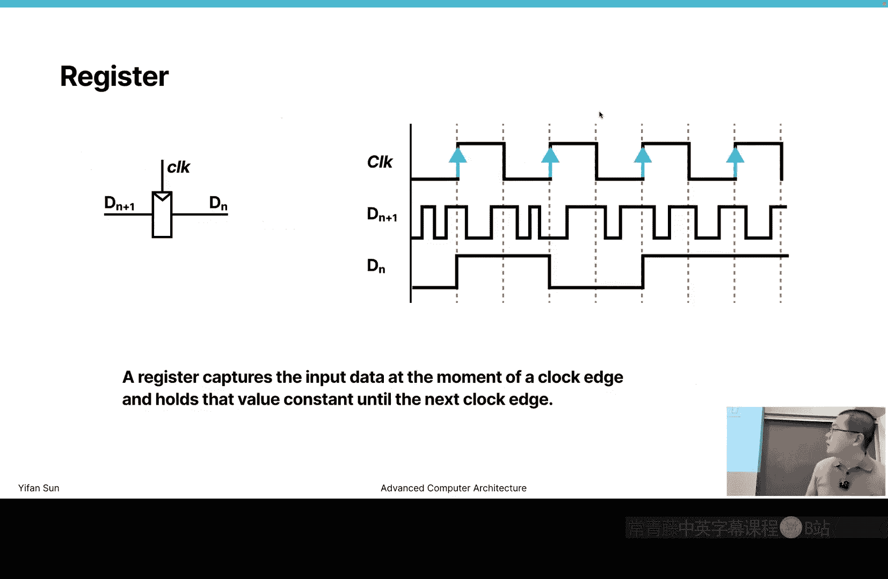

## 回顾：时序逻辑与组合逻辑

上一节我们介绍了时序逻辑的基本概念。本节中，我们来看看时序逻辑与组合逻辑的核心区别。

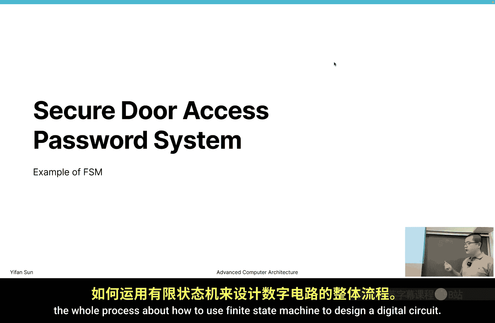

时序逻辑是一种数字电路，其输出取决于电路的**先前状态**。这个先前状态存储在存储器中，通常由**寄存器**实现。电路中有反馈信号，并且整个电路由**时钟**信号控制。

相比之下，组合逻辑电路没有记忆功能。对于任何输入，它都会产生一个预定的输出，并且这个计算过程被认为是瞬间完成的。

在时序逻辑中，寄存器是关键元件。它只在时钟信号的**上升沿**（或下降沿，取决于设计）响应，并在该时刻捕获输入数据。在时钟周期的其余时间里，寄存器会**保持**这个值不变，直到下一个时钟边沿到来。

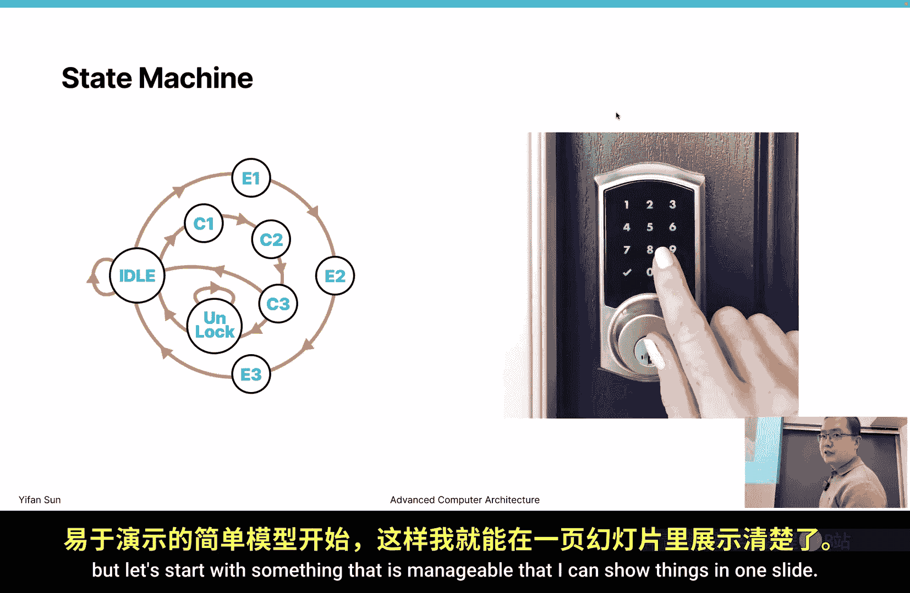

## 使用有限状态机设计电路 🔄

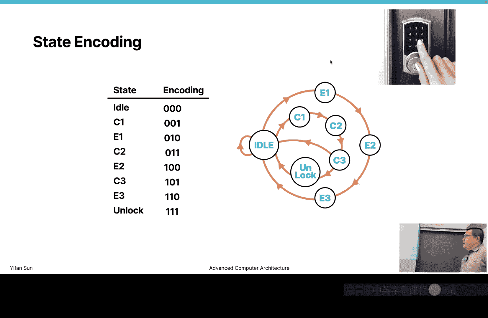

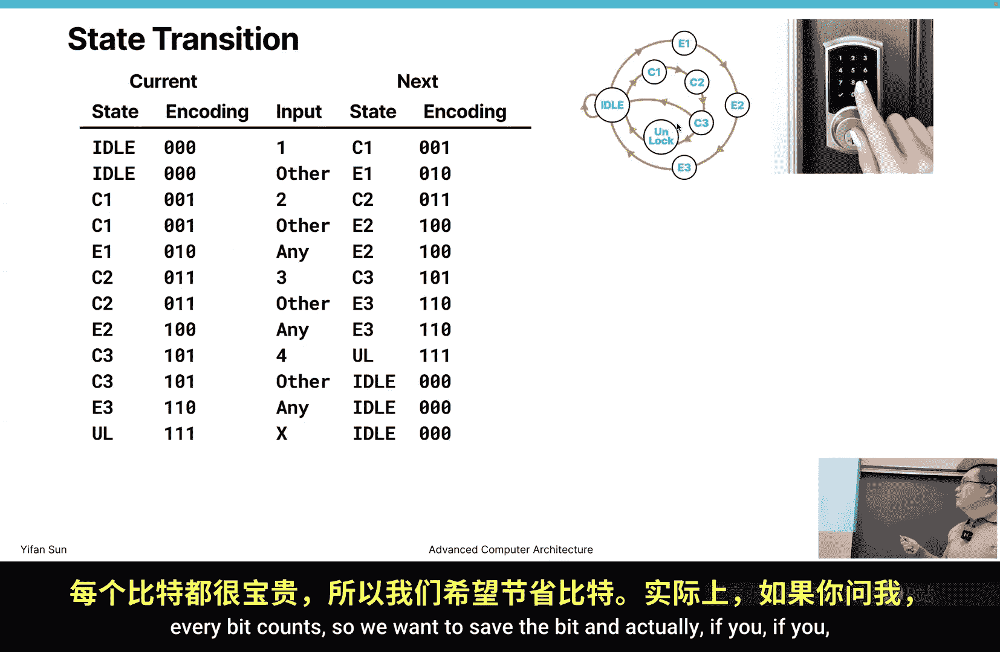

有限状态机是设计数字电路的一个核心概念。它不是一个具体的硬件，而是一种模型，用于描述电路在不同状态下的行为以及状态之间的转换规则。

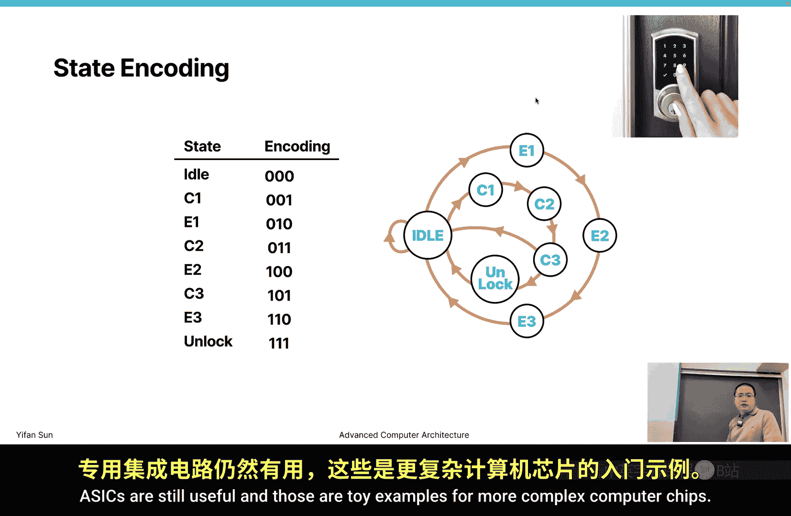

以下是使用FSM设计时序逻辑电路的一般步骤：
1.  **列出所有可能的状态**：确定系统可能处于的所有情况。
2.  **列出所有可能的输出**：明确每个状态下电路应产生的输出。
3.  **绘制状态转移图**：用图形表示状态之间的转换关系及触发条件。
4.  **对状态进行编码**：为每个状态分配一个唯一的二进制编码。
5.  **列出状态转移表**：以表格形式详细列出当前状态、输入、下一状态和输出之间的关系。
6.  **推导逻辑表达式并设计电路**：根据真值表，写出布尔表达式，简化后即可绘制出对应的组合逻辑电路。

接下来，我们通过一个更具体的例子来理解整个过程。

## 实例：电子门锁设计 🔐

假设我们要设计一个简单的电子门锁，密码为“1234”。用户需要按顺序输入四个数字，然后按确认键。如果密码正确，则开锁；如果错误，则提示错误。

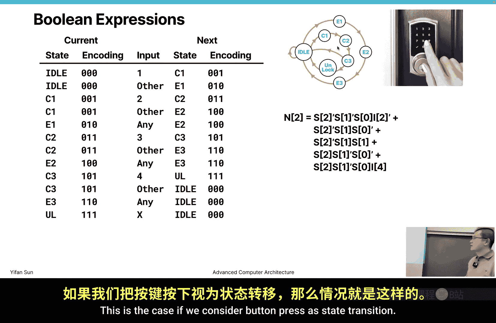

### 1. 定义状态与输出
首先，我们定义系统可能的状态：
*   **Idle (空闲)**：初始状态，等待输入。
*   **C1, C2, C3 (正确状态)**：分别表示第1、2、3位密码输入正确。
*   **E1, E2, E3 (错误状态)**：分别表示第1、2、3位密码输入错误。
*   **Unlock (开锁)**：密码验证正确，执行开锁动作。

输出可以是控制锁舌的马达信号和错误提示灯。

### 2. 绘制状态转移图
基于以上状态，我们可以绘制出状态转移图。其核心逻辑是：
*   从 `Idle` 开始，输入第一位密码。
    *   若正确，进入 `C1`。
    *   若错误，进入 `E1`。
*   在 `C1` 状态，输入第二位密码。
    *   若正确，进入 `C2`。
    *   若错误，进入 `E2`。
*   在 `E1` 状态，无论输入什么，都进入 `E2`（因为第一位已经错了）。
*   以此类推，直到输入第四位密码。
    *   如果在 `C3` 状态输入正确的第四位密码，则进入 `Unlock` 状态。
    *   否则，返回 `Idle`。
*   在 `Unlock` 状态，执行开锁动作（如启动马达），完成后自动返回 `Idle` 状态。
*   任何时候按下重置键，都应立即返回 `Idle` 状态。

### 3. 状态编码与电路实现
由于我们有8个状态，至少需要3位二进制数进行编码，例如：
*   `Idle: 000`
*   `C1: 001`
*   `C2: 010`
*   `C3: 011`
*   `E1: 100`
*   `E2: 101`
*   `E3: 110`
*   `Unlock: 111`

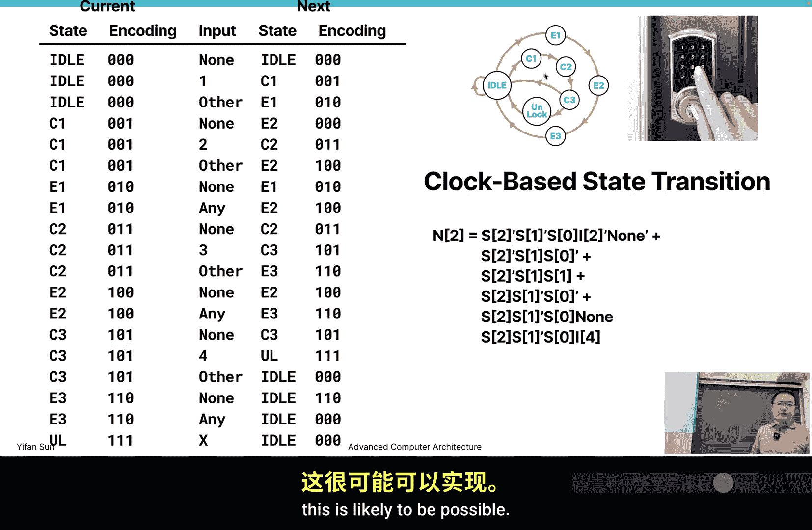

接着，我们可以根据状态转移图列出真值表，表中包含当前状态编码、输入信号、下一状态编码和输出信号。最后，为每一位下一状态和输出信号推导出布尔表达式，并设计出对应的组合逻辑电路，与寄存器相连，就构成了完整的时序逻辑系统。

**关键点**：在实际设计中，我们通常用**时钟边沿**来触发状态转换，而不是直接用不稳定的按键信号。这意味着在每个时钟周期，电路都会检查输入条件，并决定是否转换到下一个状态。

## 从电路反推有限状态机 🔍

理解了如何从设计到电路后，我们也可以反向操作：给定一个时序逻辑电路，推导出它实现的有限状态机。

假设有一个包含2位寄存器（状态 `S1, S0`）、2位输入（`A1, A0`）和1位输出（`Unlock`）的电路，其组合逻辑的布尔表达式为：
*   `Unlock = S1`
*   `N1 = S0 AND (NOT A1) AND A0`
*   `N0 = (NOT S1) AND (NOT S0) AND A1 AND A0`
（其中 `N1, N0` 是下一状态输入）

**推导步骤**：
1.  **列出所有输入组合**：包括当前状态 `S1S0` (00, 01, 10, 11) 和外部输入 `A1A0` (00, 01, 10, 11)。
2.  **计算下一状态和输出**：将每组 `S1,S0,A1,A0` 代入上述公式，计算出对应的 `N1,N0` 和 `Unlock`，形成真值表。
3.  **状态解码**：将二进制状态编码 `S1S0` 映射为有意义的符号，如 `S0=00`, `S1=01`, `S2=10`, `S3=11`。
4.  **绘制状态转移图**：分析真值表，找出每个状态在不同输入下会转换到哪个状态，以及输出是什么。例如，可能发现这是一个序列检测器，只有当输入序列为“3,1”时，才会进入 `Unlock` 状态（`S1=1`）。


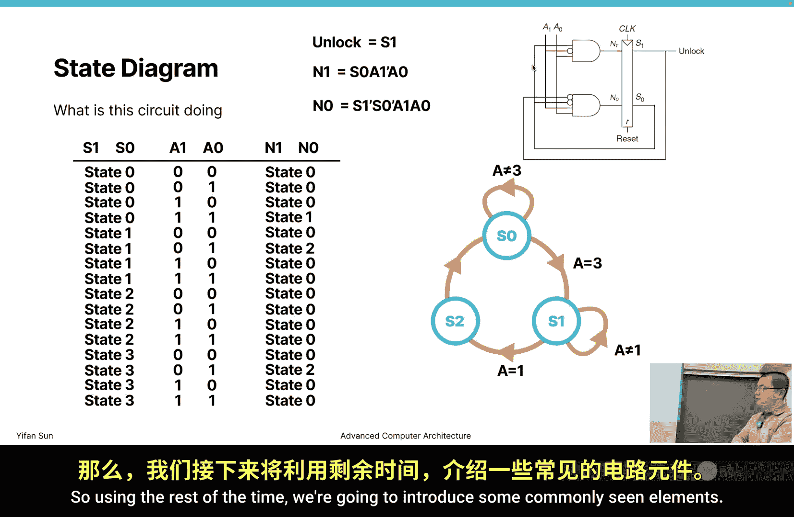

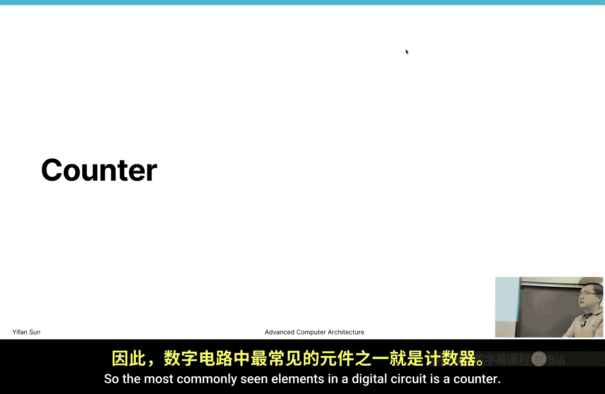

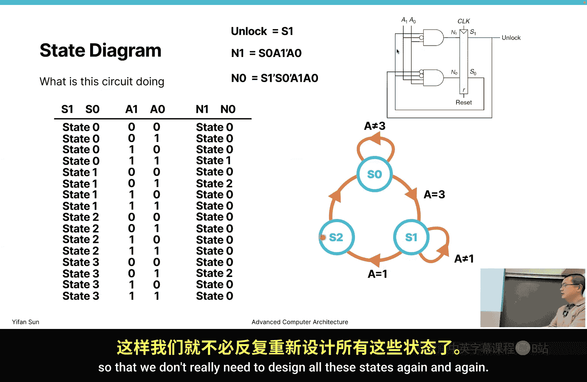

通过这个练习，可以加深对时序逻辑电路行为与状态机描述之间等价关系的理解。

## 常用时序逻辑构件 ⚙️

掌握了FSM的设计方法后，我们来看看几种广泛使用的标准时序逻辑构件，它们可以看作是特定类型的FSM。

### 1. 计数器
计数器是最简单的时序逻辑电路之一。一个N位计数器包含一个N位寄存器和一个始终加1的加法器。

```verilog
// N位计数器的核心行为（每时钟周期）
if (reset) {
    count <= 0;
} else {
    count <= count + 1;
}
```

它实现了一个状态循环为 `0 -> 1 -> 2 -> ... -> (2^N -1) -> 0` 的FSM。计数器是许多复杂功能的基础。

### 2. 分频器与数字控制振荡器
分频器用于降低时钟频率。例如，一个20位的计数器，其最高位的变化频率就是原时钟频率的 1/(2^20)。用这个信号驱动LED，就能实现约1秒闪烁一次的效果（假设原时钟为1MHz）。

数字控制振荡器则更为灵活。它通过改变计数器的**递增值P**（而非固定的1）来精确控制输出频率。
*   **公式**：`F_out = (P / 2^N) * F_clock`
通过调整P和N，可以在低于原时钟频率的范围内产生近乎任意的输出频率。

### 3. 脉宽调制信号发生器
PWM信号通过固定频率、改变一个周期内高电平的占比（占空比）来传递信息，常用于控制电机速度、LED亮度等。

其核心电路包含：
*   **一个N位计数器**：用于生成基础周期。
*   **一个比较器**：将计数器的当前值与一个可调的阈值（由期望占空比决定）进行比较。
*   **输出逻辑**：若计数值小于阈值，输出高电平；否则输出低电平。
通过改变阈值，即可线性调节输出信号的占空比。

### 4. 按键消抖电路
机械按键在按下或释放时，会产生持续数毫秒的电压抖动，导致被误认为是多次按压。消抖电路用于滤除这些抖动，确保一次按压只产生一个干净的脉冲信号。

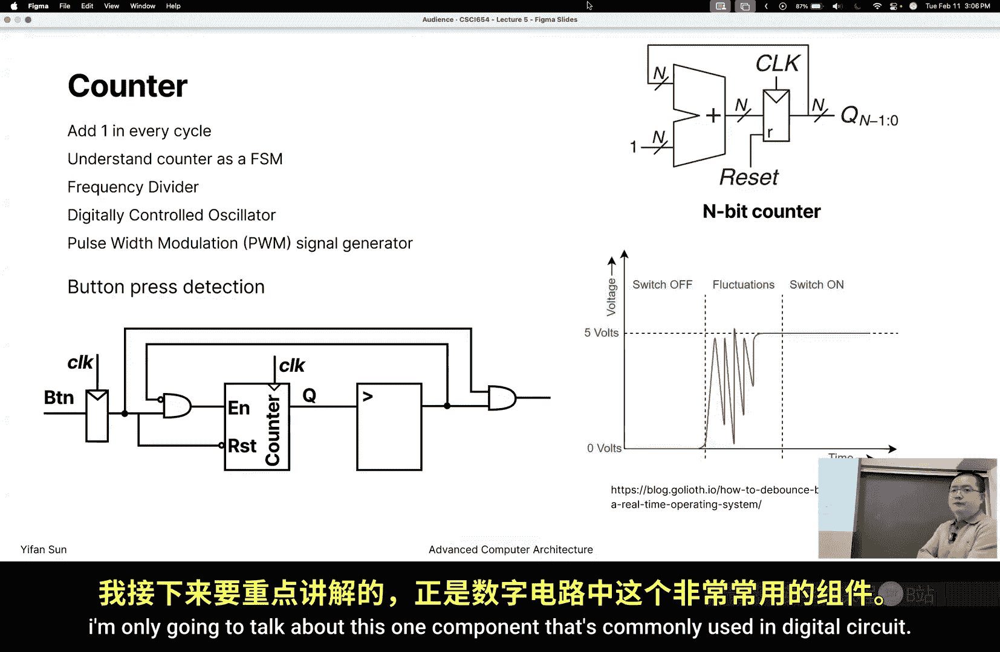

一种常见的消抖电路设计包含：
*   **一个寄存器**：同步按键输入，将其变化对齐到时钟边沿。
*   **一个计数器**：当检测到按键被按下（寄存器输出为1）时开始计数。
*   **一个比较器与反馈逻辑**：只有当计数器值超过某个预设的消抖时间阈值（如对应20ms的计数值）时，才最终输出“按键已按下”的信号。同时，该输出信号会反馈回去，在按键保持按下期间禁用计数器，防止重复触发。当按键释放时，电路被复位。

## 存储器阵列 🗃️

寄存器虽然速度快，但每个比特需要多个晶体管（如6T SRAM单元），密度低、成本高，不适合做大容量存储。计算机中的主存采用另一种结构：**存储器阵列**。

### 基本结构
存储器阵列的核心接口是：
*   **地址**：指定要访问哪个存储单元。
*   **数据**：要写入或读出的信息。
*   **控制信号**：如读/写使能。
其内部通常组织成**字线**和**位线**交叉的矩阵。地址经过**译码器**选中某一行（字线），这一行上所有存储单元被激活，通过位线进行数据的读取或写入。

### DRAM vs. SRAM
*   **DRAM**：每个存储单元由一个**晶体管和一个电容**组成。电容存储电荷代表数据。优点是结构简单、密度极高、成本低，是现代计算机主存的标准。缺点是需要定期刷新以防止电荷泄漏，且读取是破坏性的，读后需要重写。
*   **SRAM**：每个存储单元本质上是一个**锁存器**，通常由6个晶体管组成。优点是速度快、不需要刷新、非破坏性读取。缺点是占用面积大、功耗高、成本高。常用于CPU的高速缓存和寄存器文件。

### ROM
只读存储器在制造时就将数据“固化”在电路中，只能读取，不能写入。一种简单的实现方式是在存储阵列的位线和字线交叉点，有选择地制造连接（代表1）或不连接（代表0）。当某条字线被选中时，连接了该字线的位线会被拉高，从而读出存储的数据。

## 总结 📚

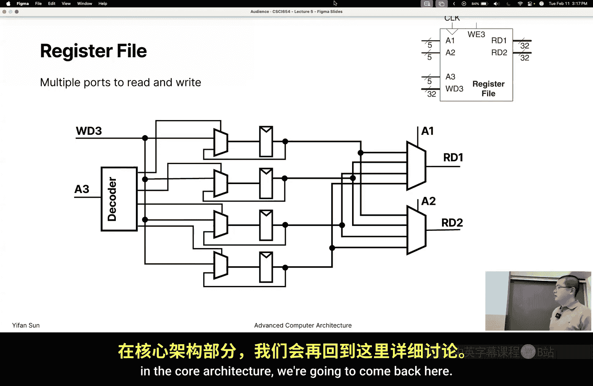

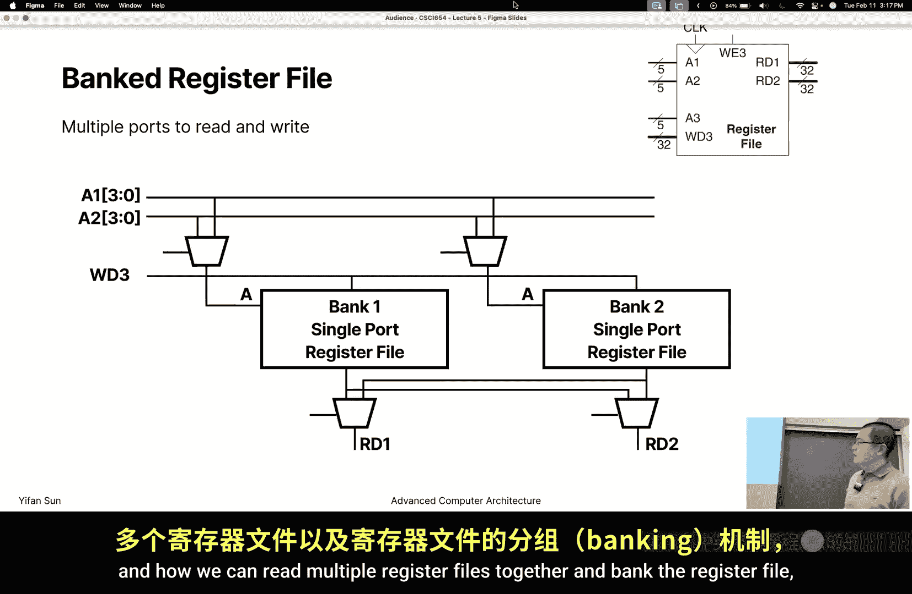

本节课我们一起深入学习了时序逻辑。
*   我们首先**回顾**了时序逻辑与组合逻辑的根本区别，明确了寄存器在存储状态和同步时钟中的核心作用。
*   接着，我们系统性地学习了如何使用**有限状态机**来设计和分析时序逻辑电路，并通过电子门锁的实例演练了从需求到电路实现的完整流程。
*   然后，我们介绍了几种关键的**时序逻辑构件**，包括计数器、分频器、PWM发生器和按键消抖电路，理解了它们作为特定FSM的应用。
*   最后，我们探讨了**存储器阵列**的基本原理，对比了DRAM和SRAM这两种主要存储技术的特点与用途。

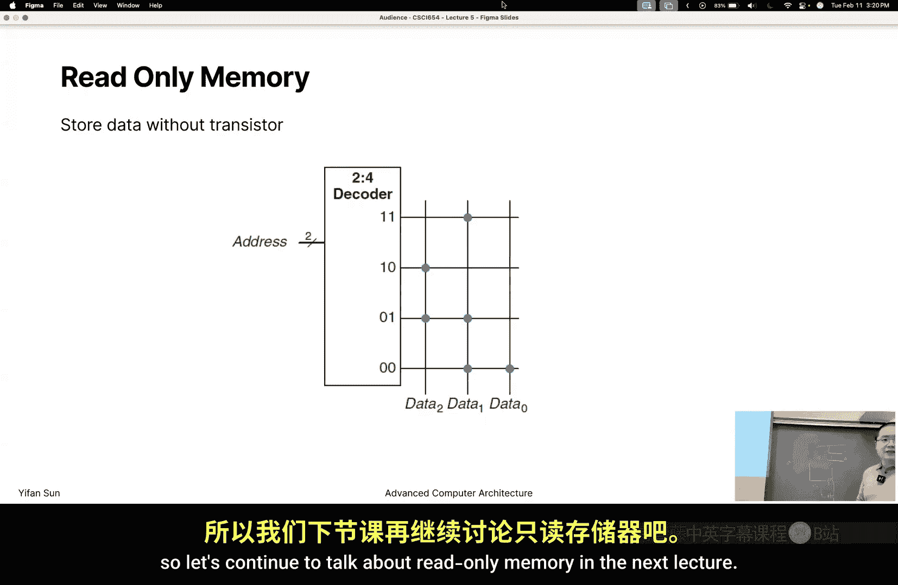

通过本讲，你应该对中大型数字系统（如CPU）如何由基本的时序和组合逻辑模块构建而成有了更坚实的认识。这些基础模块是构成复杂计算系统的基石。