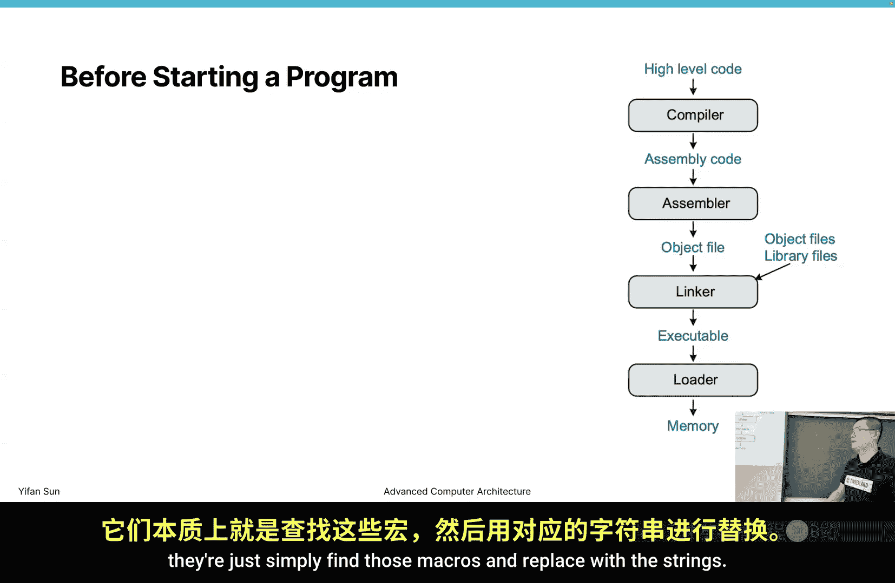
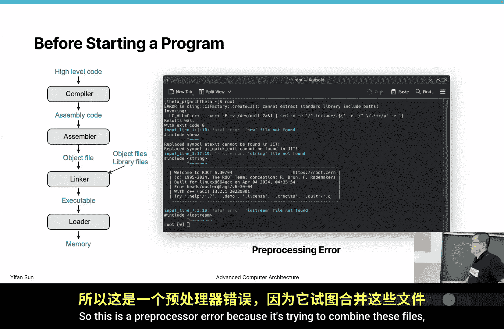
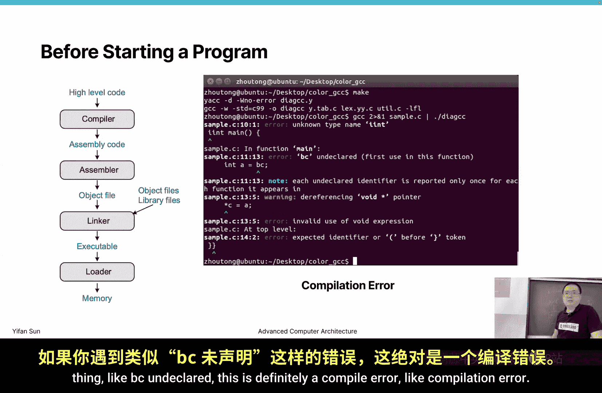
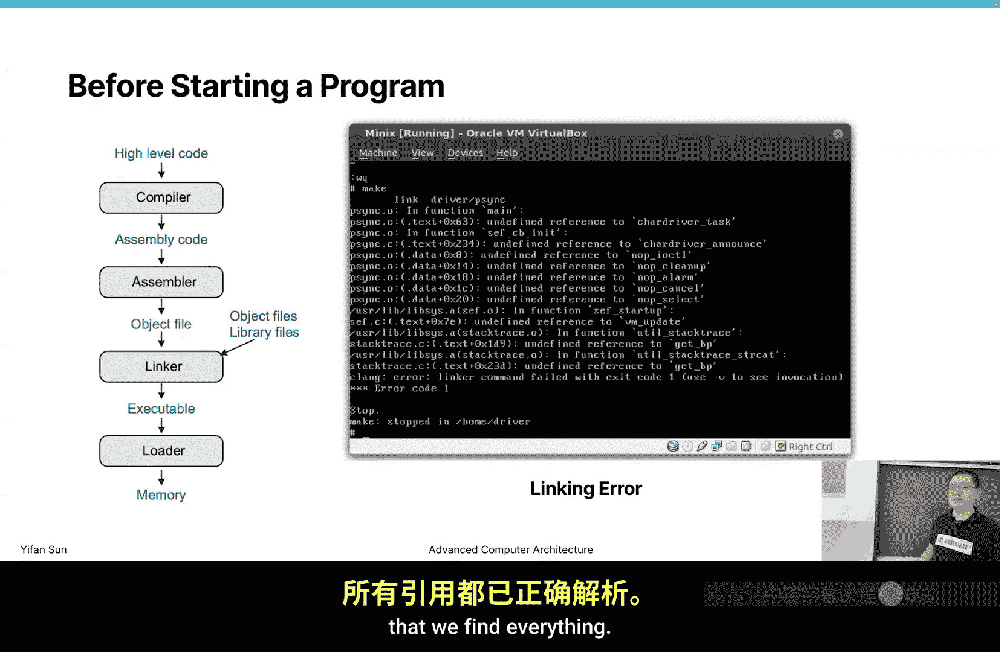
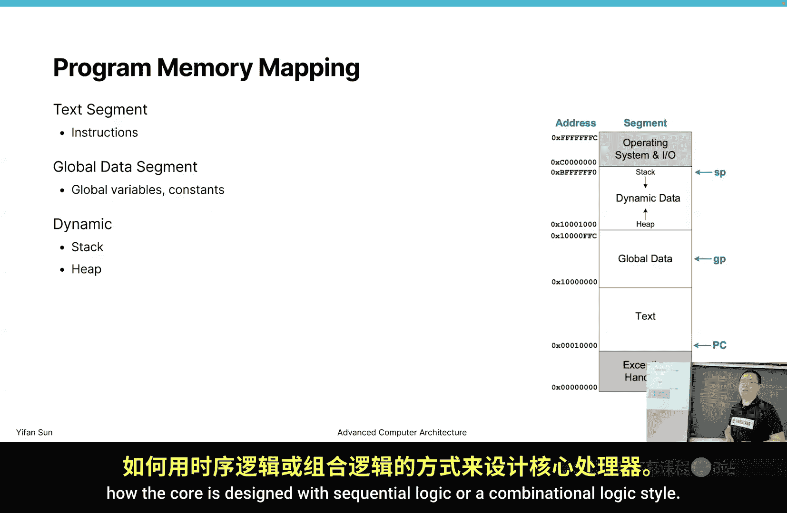

# 高级计算机体系结构：P12：RISC-V 指令集架构 2

在本节课中，我们将深入学习 RISC-V 指令的二进制编码格式、函数调用约定以及程序在内存中的组织方式。这些知识是理解处理器如何执行程序以及后续编写模拟器的基础。

## 二进制指令编码

上一节我们介绍了 RISC-V 汇编语言，本节中我们来看看这些汇编指令是如何被编码成二进制格式的。RISC-V 使用 32 位（4 字节）来编码每条指令。为了在有限的位数内支持各种指令（有的需要立即数，有的不需要），指令格式被设计为几种不同的类型，类似于 C 语言中的 `union` 数据结构。

以下是 RISC-V 指令的几种主要类型：

*   **R 类型**：主要用于寄存器之间的操作。
*   **I 类型**：用于包含立即数的操作。
*   **S 类型**：用于存储（store）操作。
*   **B 类型**：用于条件分支（branch）操作。
*   **U 类型**和 **J 类型**：用于长立即数和跳转操作。

### R 类型指令

R 类型指令的编码最为直接。其 32 位被划分为多个字段：

```
| funct7 (7 bits) | rs2 (5 bits) | rs1 (5 bits) | funct3 (3 bits) | rd (5 bits) | opcode (7 bits) |
```

*   `opcode`：指令的基本操作码。
*   `funct3` 和 `funct7`：与 `opcode` 结合，共同确定具体的指令（例如，区分 `add` 和 `sub`）。
*   `rd`：目标寄存器。
*   `rs1` 和 `rs2`：源寄存器。

每个寄存器字段是 5 位，因此可以编码 32 个寄存器。解码时，需要通过查表（如 RISC-V 官方手册中的指令表）来根据 `opcode`、`funct3` 和 `funct7` 确定具体的指令助记符。

### I 类型、S 类型和 B 类型指令

这些类型的指令编码稍复杂，因为它们需要包含立即数。

*   **I 类型**：包含一个 12 位的立即数字段。这个立即数通常以二进制补码形式编码，可以是正数或负数。
*   **S 类型**：用于存储指令（如 `sw`）。它需要两个源寄存器（一个存数据，一个存地址）和一个立即数偏移量。这个立即数被拆分并放置在不同的位域中，以保持与其他指令字段的对齐一致性。
*   **B 类型**：用于条件分支指令（如 `beq`）。其立即数字段被更复杂地拆分和重组，主要是为了在编码中保留立即数的符号位，并优化硬件设计。

U 类型和 J 类型指令的编码相对简单，分别用于处理 20 位立即数和大范围跳转偏移量。

### 系统调用指令：ECALL

`ECALL` 指令用于向操作系统请求服务（如输入/输出）。它是一条非常简单的指令，其 `opcode` 是特定的值，其他字段通常为 0。具体的调用功能（例如，打印字符串或读取整数）由事先约定好的寄存器（如 `a0`）中的值来决定。在后续的模拟器作业中，我们将实现几个简化的 `ECALL` 功能来支持基本的 I/O。

## 函数调用与栈帧管理

理解了指令编码后，我们来看看程序运行时，函数调用是如何通过寄存器和内存（栈）来管理的。

当一个函数被调用时，它需要处理参数、返回地址、局部变量，并且可能还需要调用其他函数。RISC-V 定义了一套**调用约定**来规范这些行为。

### 调用约定概览

RISC-V 的调用约定主要规定了寄存器的用途：

*   `a0`-`a7`：用于传递函数参数和返回值。
*   `ra` (`x1`)：存放返回地址。
*   `sp` (`x2`)：栈指针，指向当前栈帧的底部。
*   `s0`-`s11`：被调用者保存寄存器。如果函数要修改它们，必须在使用前保存其值，并在返回前恢复。
*   `t0`-`t6`：临时寄存器。调用者应假设这些寄存器在被调用函数中会被修改。

### 栈帧布局

函数调用时，内存中的栈会动态增长和收缩。每个函数的活动记录称为一个“栈帧”。

一个典型的栈帧可能包含以下内容（从高地址向低地址生长）：
*   调用者的保存寄存器（如果需要）。
*   返回地址。
*   旧的栈帧指针。
*   局部变量。
*   调用其他函数时的参数空间。

**示例：非叶子函数**
如果一个函数（称为“非叶子函数”）内部还要调用其他函数，它就需要保存那些调用者希望保留的寄存器（通常是 `ra` 和某些 `s` 寄存器）到自己的栈帧中，并在返回前恢复它们。

```
// 函数入口
addi sp, sp, -16    // 分配栈空间
sw   ra, 12(sp)     // 保存返回地址
sw   s0, 8(sp)      // 保存被调用者保存寄存器
... // 函数体，可能调用其他函数
// 函数返回前
lw   s0, 8(sp)      // 恢复寄存器
lw   ra, 12(sp)
addi sp, sp, 16     // 释放栈空间
ret                 // 等同于 jalr zero, ra, 0
```

**示例：叶子函数**
如果一个函数（称为“叶子函数”）不调用其他函数，它可能完全不需要使用栈，只需使用寄存器即可，这样效率更高。

调用约定的目的是在调用者和被调用者之间明确责任，确保寄存器状态在函数调用前后保持一致，同时兼顾性能（尽量减少对慢速内存的访问）。

## 程序的内存布局与地址空间

最后，我们探讨一个程序从源代码到运行在内存中的完整视图。

### 从源码到可执行文件







1.  **预处理**：处理 `#include`、`#define` 等宏。
2.  **编译**：将高级语言代码转换为汇编代码。此阶段检查语法错误。
3.  **汇编**：将汇编代码转换为目标文件（`.o` 文件），其中包含机器码和未解析的符号（如外部函数）。
4.  **链接**：将多个目标文件及库文件合并，解析符号地址，生成最终的可执行文件。链接错误常表现为“未定义的引用”。



### 进程内存布局

操作系统将可执行文件加载到内存中，形成一个进程。典型的进程地址空间布局如下：

```
高地址
+------------------+
|      栈         |  // 用于函数调用，动态增长（向低地址）
|      ...        |
+------------------+
|      堆         |  // 用于动态内存分配（如 `malloc`），向高地址增长
|      ...        |
+------------------+
|   未初始化数据   |
+------------------+
|   已初始化数据   |
+------------------+
|     代码段       |  // 存放程序指令
低地址
```

*   **代码段**：存放程序的指令（RISC-V 汇编中的 `.text` 部分）。
*   **数据段**：存放全局变量和静态变量。
*   **堆**：用于运行时动态分配的内存（如 `malloc`/`new`）。需要手动管理（释放）。
*   **栈**：用于函数调用，自动管理局部变量和调用信息。返回栈上局部变量的指针是危险的，因为该内存会在函数返回后被重用。

### 虚拟内存简介

现代操作系统使用**虚拟内存**为每个进程提供独立的地址空间。进程看到的地址（虚拟地址）需要通过页表翻译成实际的物理内存地址。

这种机制带来了关键好处：
*   **隔离性**：不同进程可以使用相同的虚拟地址，但指向不同的物理地址，互不干扰。
*   **灵活性**：物理内存可以比虚拟地址空间小，通过将不常用的“页”换出到硬盘（交换空间）来承载更大的程序。当访问被换出的页时，会触发“缺页异常”，由操作系统负责将其换入。

页的大小（如 4KB）是管理的基本单位，需要在翻译效率和换入换出开销之间取得平衡。

## 总结



本节课我们一起深入学习了 RISC-V 指令集的二进制编码格式，理解了如何通过不同的指令类型（R/I/S/B/U/J）在 32 位内编码各种操作。我们还探讨了 RISC-V 的函数调用约定，明确了寄存器的用途和栈帧的管理方式，这是编写正确且高效汇编程序的关键。最后，我们概述了程序从编译、链接到加载运行的全过程，以及操作系统如何通过虚拟内存管理为进程提供独立且可能超出物理内存大小的地址空间。这些知识构成了计算机体系结构中软件与硬件交互的核心基础，为后续学习处理器核心设计做好了准备。