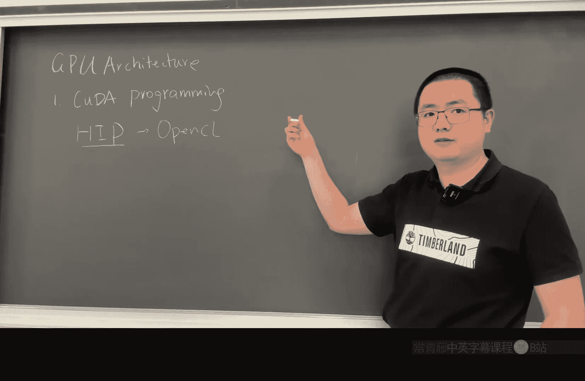
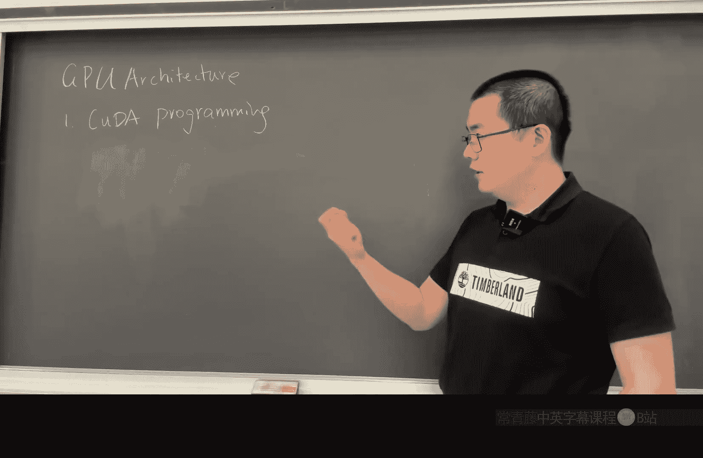
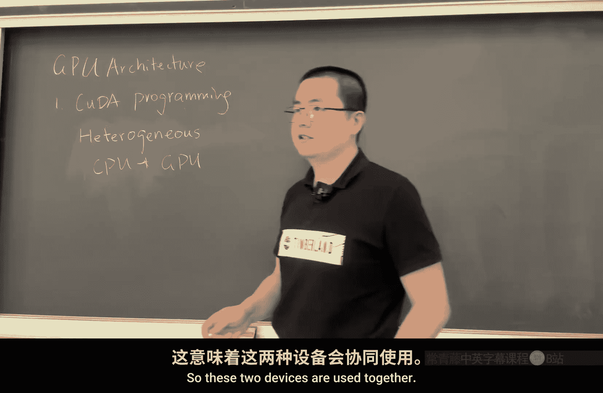
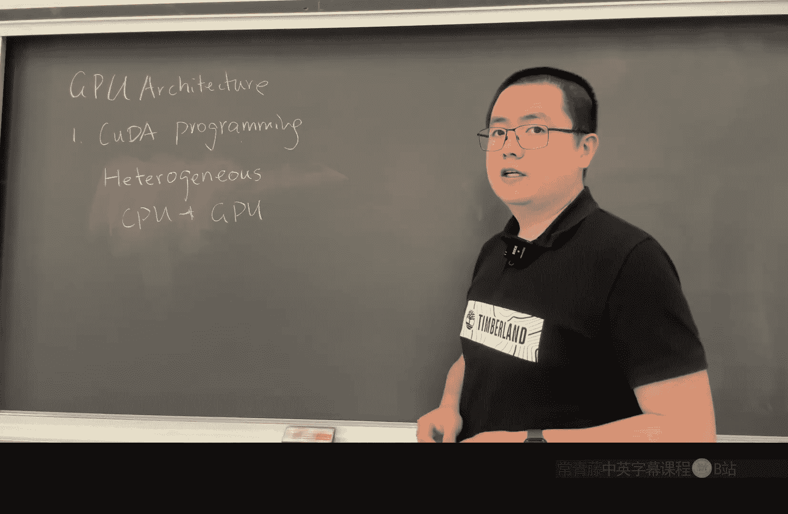
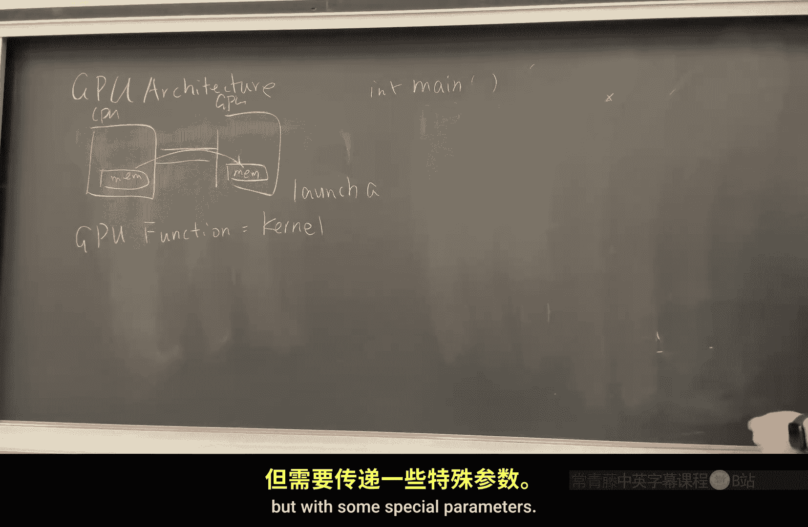

# 高级计算机体系结构：P14：GPU架构1 🚀





在本节课中，我们将学习GPU架构的基础知识。我们将从GPU编程模型开始，了解其核心概念，然后深入到GPU汇编层面，探讨其与CPU架构的关键差异。课程内容将涵盖异构计算、CUDA编程模型、SIMD/SIMT执行模式以及线程组织等核心主题。







---

## GPU编程模型

上一节我们介绍了课程概述，本节中我们来看看GPU编程的基本模型。GPU编程本质上是异构编程，即CPU（主机）和GPU（设备）协同工作。

在异构编程模型中，程序分为两部分：
*   **主机（Host）代码**：运行在CPU上，负责控制流程、内存分配和数据传输。
*   **设备（Device）代码**：运行在GPU上，称为**内核（Kernel）**，负责执行大规模并行计算。

以下是编写一个简单向量加法（Vector Add）GPU程序的基本步骤：



1.  **在主机内存中分配和初始化数据**：使用标准C库函数（如`malloc`）在CPU内存中为输入向量A、B和输出向量C分配空间并赋值。
2.  **在设备内存中分配空间**：使用CUDA运行时API（如`cudaMalloc`）在GPU内存中为向量`d_A`， `d_B`， `d_C`分配空间。
3.  **将数据从主机复制到设备**：使用`cudaMemcpy`函数，并指定方向为`cudaMemcpyHostToDevice`，将数据从CPU内存拷贝到GPU内存。
4.  **启动GPU内核进行计算**：调用以`__global__`关键字修饰的内核函数（例如`vector_add`），并指定执行配置（网格大小和块大小）。
5.  **将结果从设备复制回主机**：使用`cudaMemcpy`函数，并指定方向为`cudaMemcpyDeviceToHost`，将计算结果从GPU内存拷贝回CPU内存。
6.  **释放内存**：释放主机和设备上分配的所有内存。

一个典型的内核函数示例如下，它被设计为每个GPU线程处理一个输出元素：
```c
__global__ void vector_add(float *a, float *b, float *c, int size) {
    // 计算当前线程的全局索引
    int gid = blockIdx.x * blockDim.x + threadIdx.x;
    // 边界检查，防止越界访问
    if (gid < size) {
        c[gid] = a[gid] + b[gid];
    }
}
```
内核启动时的执行配置决定了线程的组织方式：
```c
// 假设每个线程块有256个线程
int block_size = 256;
// 计算需要的线程块数量（向上取整）
int grid_size = (size + block_size - 1) / block_size;
// 启动内核
vector_add<<<grid_size, block_size>>>(d_A, d_B, d_C, size);
```

---

## GPU线程组织与执行模型

理解了基本的编程模型后，本节我们深入探讨GPU如何组织海量线程并执行它们。GPU的线程是分层组织的：

*   **网格（Grid）**：一个内核启动的所有线程集合。
*   **线程块（Block）**：网格中的一组线程，共享一块快速的共享内存，块内线程可以同步。
*   **线程束（Warp）**：GPU调度和执行的基本单位。在NVIDIA GPU中，一个Warp包含**32**个线程；在AMD GPU中，一个Wavefront包含**64**个线程（CDNA架构）或**32**个线程（RDNA架构）。

GPU采用**SIMT（单指令多线程）** 或**SIMD（单指令多数据）** 的执行模式。这意味着一个Warp/Wavefront中的所有线程在同一周期内**执行相同的指令**，但操作**不同的数据**。

**公式**：`SIMT: 1条指令 -> N个线程 -> N个数据`

这种设计极大地降低了取指和译码的开销，使GPU能将更多晶体管资源用于计算单元，从而擅长处理数据并行任务。

---

## GPU汇编指令初探

从高层编程到底层执行，本节我们通过一个简单的数据拷贝内核的汇编代码，来看看GPU指令集的特点。我们以AMD GPU汇编为例。

考虑一个简单的内核：
```c
__global__ void simple_copy(float *in, float *out) {
    int gid = ...; // 计算全局ID
    out[gid] = in[gid] + 4;
}
```

其汇编代码的核心部分可能包含以下类型的指令：

1.  **标量（Scalar）指令与向量（Vector）指令**：
    *   **标量指令（S指令）**：操作**标量寄存器（S寄存器）**。一个Warp内所有线程共享**同一份**标量数据。常用于计算地址、循环计数等。
    *   **向量指令（V指令）**：操作**向量寄存器（V寄存器）**。一个Warp内每个线程都有自己独立的向量数据。用于进行实际的数据计算。
    *   例如，加载基地址可能使用标量加载指令`s_load_dword`，而从内存加载每个线程的数据则使用向量加载指令`global_load_dword v4, [v0, v1]`。

2.  **内存同步指令**：
    *   由于GPU内存访问延迟很高，GPU采用**异步内存操作**。当发出加载指令后，硬件不会等待数据返回，而是继续执行后续不依赖该数据的指令。
    *   为了确保在需要使用数据之前它已就绪，编译器会插入**等待计数（s_waitcnt）** 指令。例如，`s_waitcnt lgkmcnt(0)` 表示等待所有先前的本地/全局/常量内存操作完成。

3.  **指令示例**：
    *   `v_lshlrev_b64 v[2:3], 2, v[2:3]`：这是一个向量指令，将64位寄存器`v[2:3]`的值左移2位（即乘以4）。一个Warp中的32/64个线程同时执行此操作，但各自操作自己`v[2:3]`寄存器中的值。

---

## 条件执行与线程分化

在实际程序中，分支（如if-else）不可避免。本节我们看看GPU如何处理条件分支，以及由此引发的性能问题——线程分化。

GPU使用**谓词执行（Predicated Execution）** 和**执行掩码（EXEC Mask）** 来处理条件分支。核心思想是：Warp中的所有线程都遍历所有分支的代码路径，但通过一个掩码来控制哪些线程的执行结果真正生效。

以下是一个条件拷贝内核的示例：
```c
__global__ void conditional_copy(double *in, double *out) {
    int gid = ...;
    if (gid > 0) {
        out[gid] = in[gid];
    }
}
```

其汇编处理流程大致如下：
1.  所有线程加载数据`in[gid]`。
2.  所有线程执行比较指令（如`v_cmp_gt_f64`），将比较结果（真/假）存入一个特殊的掩码寄存器（如VCC），每个线程对应一位。
3.  通过`s_and_saveexec_b64`等指令，将当前执行掩码（EXEC）与比较掩码（VCC）进行逻辑与操作，并保存旧的EXEC。结果是，只有满足条件（`gid > 0`）的线程对应的EXEC位为1，可以执行后续的存储指令。
4.  执行存储指令`global_store_dword`。虽然所有线程都“执行”了该指令，但只有EXEC位为1的线程的存储操作会实际发生。
5.  分支结束后，使用`s_or_b64 exec, exec, saved_mask`恢复之前的执行掩码，以便后续代码继续执行。

**线程分化（Thread Divergence）** 是指一个Warp中的线程因为条件分支而走上不同的执行路径。由于GPU以Warp为单位执行相同指令，如果Warp内部分线程走if分支，部分走else分支，GPU必须串行化地执行这两个分支（先执行一部分线程的if块，再执行另一部分线程的else块），导致硬件利用率下降。

**优化目标**：尽可能让一个Warp内的线程执行相同的代码路径，以减少线程分化带来的性能损失。

---

本节课中我们一起学习了GPU架构的基础知识。我们从GPU的异构编程模型入手，了解了主机与设备的协作方式。接着，我们探讨了GPU独特的线程层级组织（网格、块、线程束）和SIMT执行模型，这是其实现大规模并行的关键。通过分析GPU汇编代码，我们认识了标量与向量指令的区别，以及GPU如何通过异步内存操作和等待计数来隐藏内存延迟。最后，我们讨论了GPU处理条件分支的机制——谓词执行和**执行掩码**，并指出了**线程分化**这一重要的性能考量因素。这些概念是理解现代GPU工作原理和进行高效GPU编程的基石。