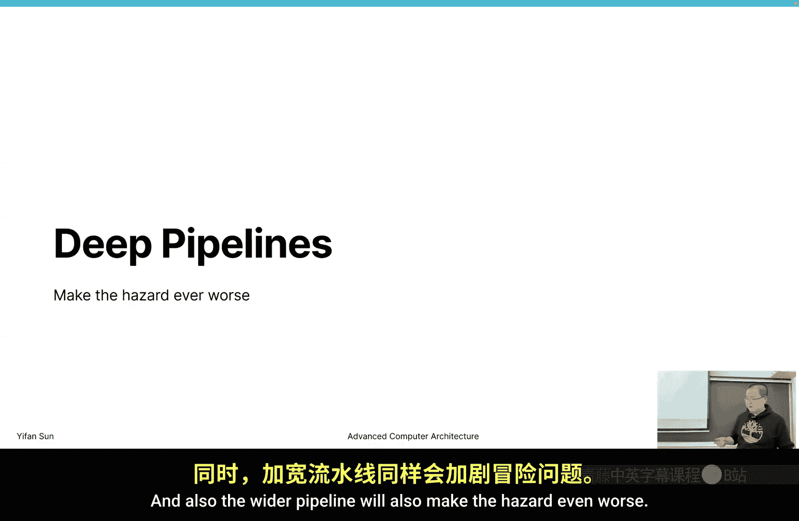
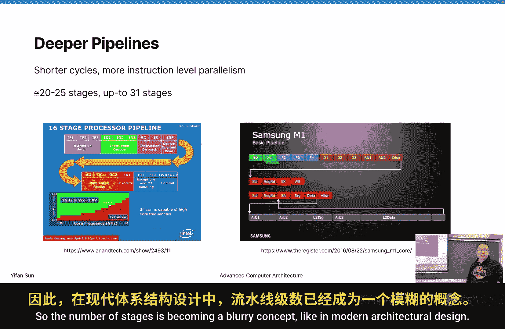
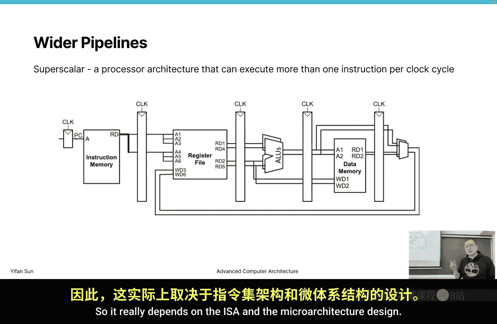
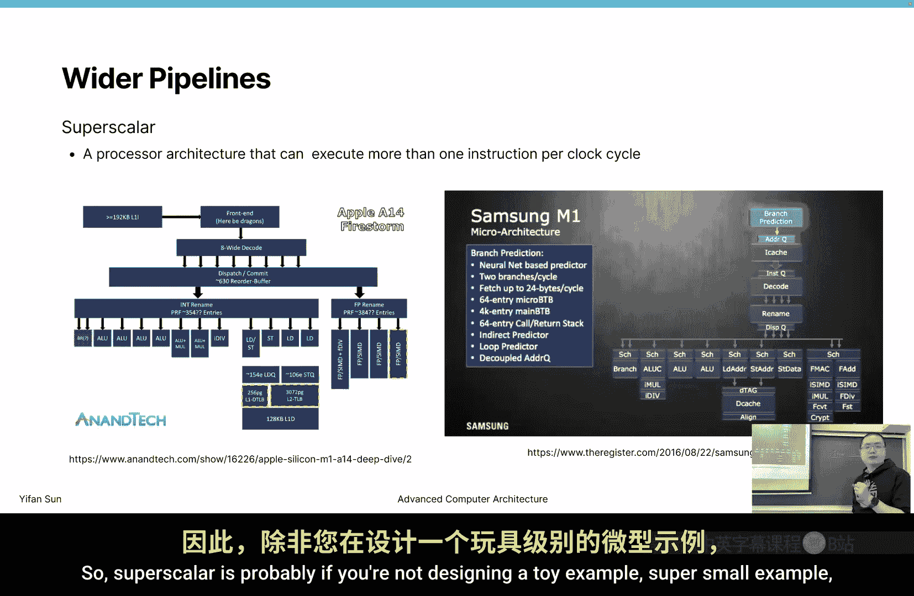
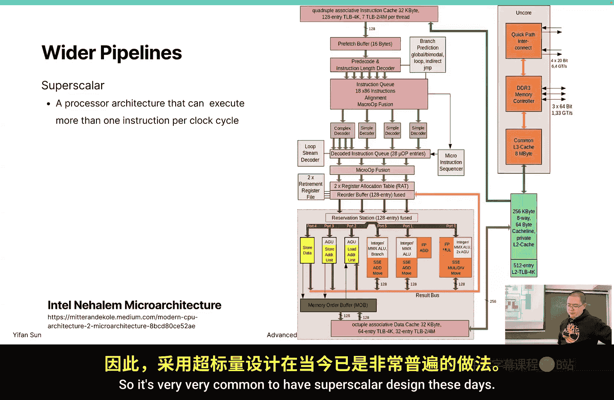
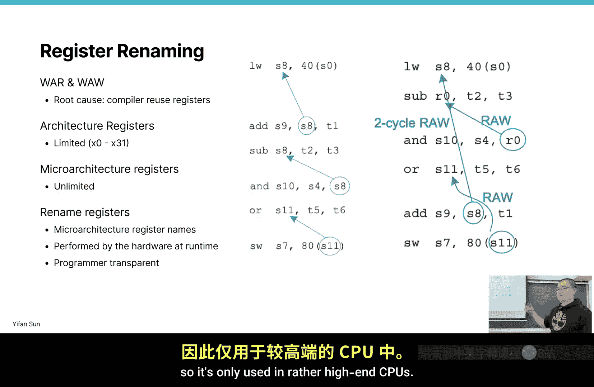

# 高级计算机体系结构：P15：高级CPU核心架构 🚀

在本节课中，我们将开始探讨高级CPU核心设计。我们将从经典的五级流水线出发，深入分析流水线执行中可能出现的各种“冒险”问题，并学习解决这些问题的不同方法，包括硬件和软件层面的优化策略。课程将涵盖数据冒险、控制冒险以及现代高性能CPU设计中常见的超标量和乱序执行等核心概念。

---

## 从五级流水线出发

上一节我们回顾了计算机体系结构的基础。现在，我们以经典的五级流水线作为起点。这五个阶段通常包括：取指、译码、执行、访存和写回。在某些设计中，译码阶段也包含读取寄存器文件的操作。

在一个理想的执行场景中，指令可以完美地流过这些阶段，每个时钟周期完成一条指令。下图展示了一个没有冲突的理想流水线执行图：

```
时间（周期） -> 1   2   3   4   5
指令1 (add):  F   D   E   M   W
指令2 (sub):      F   D   E   M   W
指令3 (and):          F   D   E   M   W
```

然而，在实际执行中，指令之间可能存在依赖关系，这会破坏流水线的完美执行，导致错误的计算结果。这种情况被称为“冒险”。

---

## 理解数据冒险

当后续指令需要用到前一条指令尚未产生的结果时，就会发生数据冒险。具体来说，这通常是一种“读后写”冒险。

考虑以下指令序列：
```
add  s8, s1, s2  # 将 s1+s2 的结果写入 s8
sub  s2, s8, s3  # 需要读取 s8 的值
```

在五级流水线中，`add` 指令的结果在周期5的写回阶段才写入寄存器 `s8`。但是，`sub` 指令在周期3的译码阶段就需要读取 `s8` 的值。此时，`s8` 中的还是旧数据（垃圾值），这会导致 `sub` 指令计算出错误结果。

**冒险**被定义为：一种阻碍指令流水线产生正确结果，但又不会中断流水线执行的情况。数据冒险主要源于寄存器间的数据依赖。

以下是可能的数据依赖类型：
*   **读后读**：多次读取同一寄存器，通常不构成冒险。
*   **读后写**：在写入一个寄存器后读取它。这是我们上面例子中的情况，称为 **RAW** 冒险。
*   **写后读**：在读取一个寄存器后写入它。
*   **写后写**：连续两次写入同一寄存器。

在简单的五级流水线中，最常见的是 **RAW** 冒险。解决冒险主要有三种思路：牺牲性能、增加硬件复杂度，或者寻找更巧妙的折中方案。硬件设计必须在极短的周期（如1-2纳秒）内做出正确决策，因此算法必须极其简单高效。

---

## 解决冒险的简单方法

面对RAW冒险，最直观的解决方案是让流水线“停顿”。

### 方法一：插入空操作

编译器可以在有依赖的指令之间插入特殊的 **`nop`** 指令。`nop` 不执行任何操作，只是作为流水线的“填充物”，延迟后续指令的执行。

```
add s8, s1, s2
nop
nop
sub s2, s8, s3
```

通过插入两个 `nop`，`sub` 指令的译码阶段被推迟到周期5，此时 `s8` 的值已经正确写回，从而可以读取到正确数据。

**优点**：
*   实现简单。
*   是纯粹的**软件方案**，通过编译器即可实现，易于修改和调试。

**缺点**：
*   **性能低下**：`nop` 指令占据了流水线阶段却不做有用工作。
*   **混合了体系结构与微体系结构**：`nop` 的数量取决于具体的流水线深度（微体系结构细节）。如果硬件将5级流水线改为20级，那么所需的 `nop` 数量也会改变，这限制了微体系结构设计的灵活性。

### 方法二：流水线冒泡

我们可以在硬件层面实现类似的效果，而无需修改软件。这种方法称为**流水线冒泡**。

当硬件检测到RAW冒险时，它不会让处于译码阶段的指令继续进入执行阶段，而是将其“卡”在译码阶段。从流水线图上看，就像在流水线中插入了一个“气泡”，这个气泡会向后传递。

```
时间（周期） -> 1   2   3   4   5   6
add s8, s1, s2: F   D   E   M   W
sub s2, s8, s3:     F   D   D   D   E   M   W
                        ^   ^
                        |   |
                      （气泡）
```



硬件通过控制流水线寄存器的“使能”信号来实现停顿。这是**纯粹的微体系结构方案**。

**优点**：
*   对软件透明，不依赖编译器。
*   可以灵活适应不同深度的流水线设计。

**缺点**：
*   性能与插入 `nop` 相同，仍然较低。
*   需要额外的硬件电路来检测冒险并控制流水线。

无论是插入 `nop` 还是产生气泡，本质上都是通过**牺牲性能**来保证正确性。随着流水线加深，这种性能损失会变得难以接受。



---

## 更优的解决方案：数据前递

我们重新审视问题：`add` 指令的结果在周期3结束时（执行阶段后）就已经计算出来了。而 `sub` 指令直到周期4开始时才需要这个结果。时间上并没有重叠，问题在于我们**必须通过寄存器文件**来传递这个数据。

如果我们能绕过寄存器文件，直接将执行阶段产生的结果通过额外的连线“前递”给需要它的执行阶段输入，问题就迎刃而解。这种方法称为**数据前递**。

```
add s8, s1, s2: F   D   E   M   W
                    |       |
                    |<------（前递路径）
sub s2, s8, s3:     F   D   E   M   W
```

硬件上，我们需要在ALU的输出端和输入端之间添加额外的数据通路和多路选择器。当检测到后续指令的源操作数是前一条指令的目的操作数时，控制逻辑就选择前递过来的数据，而不是从寄存器文件读取的数据。

**优点**：
*   **性能高**：消除了由RAW冒险引起的停顿。
*   对软件透明。

**缺点**：
*   **硬件复杂度增加**：需要额外的数据通路、多路选择器和更复杂的控制逻辑。
*   并非能解决所有情况。例如，如果第一条指令是加载指令，数据要到访存阶段结束后才能获得，此时可能仍然需要一个周期的停顿。

数据前递是解决RAW冒险的高效方法，被现代处理器广泛采用。

---

## 控制冒险与更深流水线

上一节我们解决了数据冒险。本节我们来看看另一种冒险。为了追求更高的时钟频率，现代CPU采用了更深的流水线（如20-25级）。但这带来了新的问题：**控制冒险**。

控制冒险主要由分支指令引起。考虑以下代码：
```
    beq s1, s2, L1  # 如果 s1 == s2，跳转到 L1
    add s3, s4, s5  # 下一条指令
    sub s6, s7, s8  # 再下一条指令
L1: or  s9, s10,s11
```

在五级流水线中，`beq` 指令要到执行阶段末尾（周期4）才能计算出是否跳转。但在此期间，其后的 `add` 和 `sub` 指令已经被取指并进入流水线。如果最终分支跳转，那么这两条指令就不应该执行。

最简单的解决方法是**停顿**：在分支指令之后插入气泡，直到分支结果确定后再继续取指。但在深流水线中，这种停顿的代价极高。

### 更优方案：分支预测与推测执行

更积极的方法是**分支预测**。硬件在取指阶段就预测分支的走向（跳转或不跳转），并**推测性地**继续取指和执行预测路径上的指令。

*   **如果预测正确**：性能无损，程序继续执行。
*   **如果预测错误**：硬件必须**清空**在错误路径上已经执行的所有指令效果，这个过程称为“流水线冲刷”，然后从正确的地址重新开始取指。

分支预测器是核心部件。一个简单的预测器是**两位饱和计数器**，它为每个分支指令维护一个状态机，根据历史行为进行预测，对噪声不敏感，稳定性好。

```
状态: 强不跳转 -> 弱不跳转 <-> 弱跳转 -> 强跳转
      (预测不跳转)         (预测跳转)
```

现代预测器极其复杂，甚至出现了基于神经网络的预测器。然而，推测执行也引入了安全漏洞（如 Spectre 和 Meltdown），因为这些被错误推测执行但随后被冲刷的指令可能会在缓存等微体系结构状态中留下痕迹，被恶意程序通过侧信道探测到。



---

## 提升并行度：超标量与乱序执行

除了加深流水线，另一个提升单核性能的重要方向是**加宽流水线**，即让一个周期内能处理多条指令。这通过**超标量**设计实现。



超标量处理器在一个周期内可以**发射**多条指令到多个执行单元（如多个ALU、加载/存储单元等）。描述一个核心常使用“N发射，M级流水线”这样的术语。



### 指令级并行与依赖挑战

理想情况下，如果指令间没有依赖，它们可以并行执行。例如：
```
ld  s7, 0(s1)  # 加载
or  s8, s2, s3 # 逻辑或
```
这两条指令操作不同的寄存器，可以在同一周期发射执行。

但当指令间存在复杂依赖时，简单的按序发射会遇到瓶颈。考虑一个更复杂的序列，其中存在 **WAR** 和 **WAW** 冒险。在简单的按序超标量中，这些冒险会导致流水线停顿。

### 乱序执行与寄存器重命名

为了挖掘更多指令级并行，现代高性能CPU采用了**乱序执行**。关键思想是：硬件动态地分析指令间的**真依赖**，并重新排序指令的执行顺序，只要最终结果与按序执行一致即可。

然而，**假依赖**（名依赖）会阻碍重新排序。假依赖包括：
*   **WAR**：写后读冒险，源于寄存器重用。
*   **WAW**：写后写冒险，同样源于寄存器重用。

**寄存器重命名** 是消除假依赖的核心技术。硬件维护一个比架构寄存器（如RISC-V的32个）更大的**物理寄存器堆**。当遇到写操作时，硬件为其分配一个新的物理寄存器，并更新映射关系。这样，即使多条指令在代码中使用了相同的架构寄存器名，在硬件层面它们也被映射到不同的物理寄存器，从而解除了假依赖。

通过寄存器重命名和乱序执行，硬件可以将一个存在假依赖的指令序列，转化为多个独立的指令子链，从而更灵活、更充分地利用多个执行单元。

---

## 总结与展望

本节课我们一起深入探讨了高级CPU核心设计中的关键问题与解决方案。

1.  **冒险问题**：我们首先识别了流水线中的**数据冒险**，特别是RAW冒险，并学习了三种解决方案：插入空操作（软件）、流水线冒泡和数据前递（硬件）。数据前递在性能和复杂度间取得了良好平衡。
2.  **控制冒险**：在深流水线中，**分支指令**会带来严重的控制冒险。我们介绍了通过**分支预测**和**推测执行**来隐藏分支延迟的方法，同时也提到了其带来的安全挑战。
3.  **提升并行度**：为了突破每周期一条指令的限制，现代CPU采用**超标量**设计来加宽流水线。为了更有效地利用多个执行单元，引入了**乱序执行**技术，并通过**寄存器重命名**来消除阻碍指令重排序的假依赖。



这些技术（深流水线、超标量、乱序执行、分支预测、推测执行）的组合，构成了现代高性能CPU核心的复杂微体系结构。它们的目标都是在严格的功耗和面积约束下，最大限度地提升指令级并行度和单线程性能。在接下来的课程中，我们将把目光从CPU核心移开，开始探讨GPU的核心架构设计。