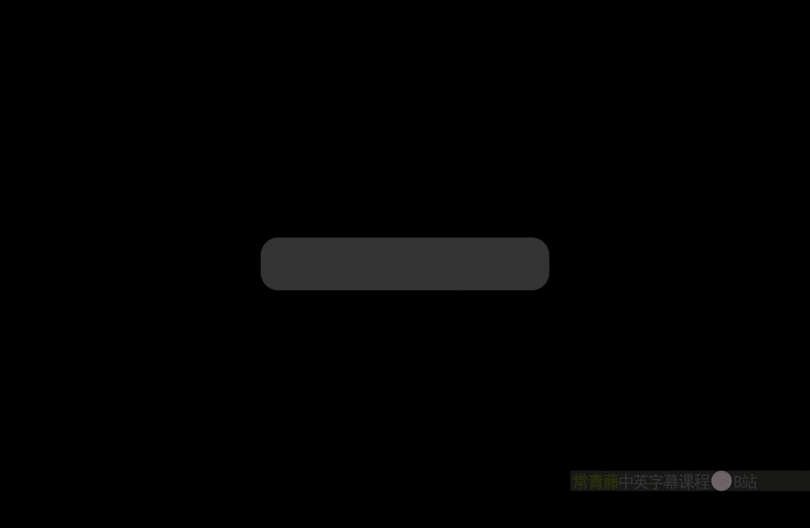
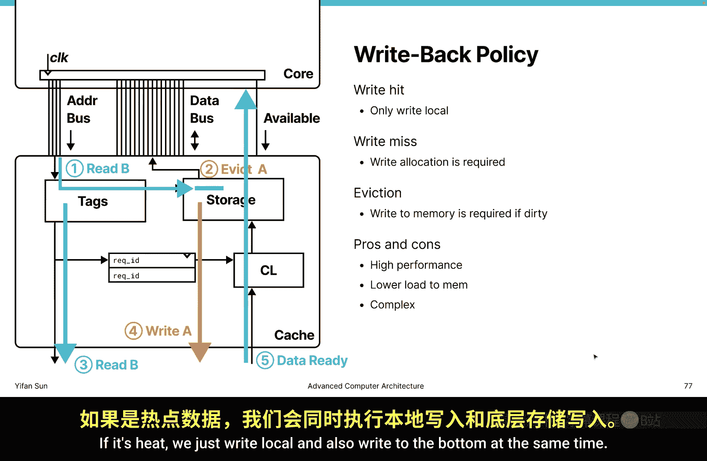

# 威廉玛丽学院【中英⚡高级计算机体系结构｜CSCI654 Spring 2025, Advanced Computer Architecture】 p18 P18 缓存设计 2 -BV1evfwBVEUG_p18-

So the last time we were talking about cash so we started with the basic cache interface。

 how cash works and we mainly talk about the read process right so today we're still going to continue with the read process making it more complex and we're like we' finish the right policies today hopefully we can finish this set of slides today so one important component in a cache is called missing status holding register and this is。

No standardner component。 If you design a cache， you don't really have to have this component。

 but it can significantly improve the performance with relatively small energy and di size cost。

 So let's review the cache interface。 right when you read the data when you read some data。

 the cache will respond some data whens a cache hit。Right， when you read a， then if， if you。

 if it's a cache meet， then when you read a and it's a cache meet， you。Pass this。

 the same memory request to the memory。 So when we say memory here， like when we。

Consider the cache When we focus on one cache， we always say the bottom element is memory。

 but it can totally be another level of cache。 Okay， but this cache should be the this。

 if it's another level of cache， it should have the exact same behavior as a memory。

 So we just call it memory。 Okay， so the cache。Will send another request to fetchax the data。

 Then the data will be responded by the memory。 Then the cache on one side will store this。

Pace of data locally on the other side will send the data back to the core no requesting element。

 and the same thing is we always call this requester a core。

 although it can be another level of cache or can be something else。 Okay。

 just make this term consistent and easy to understand。Okay， so if。

Consider another transaction A is already here if we read this A。

 then we can directly respond to this with this data without going to the memory。

 So we call this a cache hit when we have a cache hit。

 we reduce the load of the memory and can improve performance and reduce the latency required to respond this data。

So a quick question is if we do A and this a is a miss。

 then if then there's a B that is following this A and assuming this B is a catch hit。

So there is a problem that can we process B before a returns if we start with a。

 we definitely need to send a request to the memory and it will wait some time。

 it takes some time for the memory to return this data。Right， if we so when we are waiting for a。

 can we really process B。Then there are two problems。 The first problem is。

 can the core accept out of order return。Like cant accept this type of return can it will otherwise it will mix up。

 it will receive B data， but it will consider it's actually for a then the core will have some problems on the other side is the cash is capable to handle this transaction。

At the same time， while waiting for the A data to return。

So we want this to happen because it improves concurrency right so probably the memory itself can handle more than one request at the same time。

 or there may be different memory unit that can handle a memory unit that can handle this request at the same time or going to different locations。

Well， let's assuming both A and B are misses。 Or if B is a heat。

 we can actually process a while waiting for as data to return， we return。

 we wait for B so that we can reduce the latency of B。

 Otherwise B will have even longer latency than A， although even B is a cache heat we want this to happen。

 But the question is can we make it happen， What's the criterion and what's the requirement to make this happen So to check this。

 we need to look at the interface between a core and the cache and see what's are the interface and how how they works internally。

So these are the interfaces。 Those are the wires that are connecting the core and the cache。

 So I draw a few wires。 I just want to show this is a bus。 It's like a group of wires。

 It doesn't necessarily mean there are four of them like for address is typically 48 is smaller than 4 something like 42 if the cache line size is for the cache line size is 64 by long。

 and this address bus is always go from the core to the cache Now the data bus is by direction。

 If you read， then it' going from the cache to core if the right is going from the core to the cache on the other hand hand。

 we have this available and ready beat single wire and their。They are for control purposes。

 they meaning say。The meaning is。It's like this。 when there's a request， right。

 when there's a request sent。 I need to。 the core needs to send the cache， say， oh。

 my request is ready。 You can start to process whatever is on the address bus and on the data right so it can process。

 So when this available is set to one， then the cash no， okay， there's a request coming in。

 then I will start to process it。 one， So how I can know that how the core can know that the cache is done with that one and can prepare another one。

 right， then the。The matter is it can respond already。

It can respond with a ready like set this bit to one whenever it sets to one。

 then the core can mess up with this data and prepare another request and whenever this available。

 like right after this already is set to one the available must be set to0。

 then the core will start to prepare this data whenever this is ready。

 when this request is available， it will set this available to one。Okay then in this case。

 if the ready， if if the core can set this request ready in one cycle， so the ready is set to one。

 then in the next cycle， the available is set to one directly。 then in this case。

 the cache knows okay the request is immediately available in the next cycle。

 So this are the interfaces。 If you look at what's driving this interface。

 let's just consume assume this reader request。 Okay then this is going towards this direction。

 So there's a set of register that's on the core side thats controlling these a few these piece of data。

 this a few elements。 then there's another register that's on the cache size that's controlling this one。

 We are mainly going to focus on this part。So what's going on is there's a combination of logic。

 There's a circuit here。 So we'll take the read request and take the address and process it。

 And when it's ready， it will send the。Okay， I， I， I should write the other way。

 Like this is for write， and this is for read。 So it will take the address box。

 And once the data is ready， assuming it's a cache heat。

 it will go back to the core on the other side。 It will set this bit to ready， okay。佢。

In most of the case， we're dealing with the kshms。 So in Kashms。

 how we work is this cannot be a combination logic anymore。

 It has to be a sequential logic because it cannot be handled in one cycle， so。

We send the data here in cycle 1 right to the bottom to like general， take this information。

 necessary information。 and we send this request to the。Memory in cycle 1。

 and we wait for a few cycles in cycle N， this data comes back。 Then we can write the data back。

In this case， when we need to write the data back， we actually need this information。

 the address information， or some other bits that you requiring that is representing the sequence ID or the identifier of this request so that the core can match like this data is for this request in this case no data are actually being locked by this register。

 so while I'm processing from this cycle1 to the cycle N during this period。

 I still need that information that is being locked on the core side。

 so whatever that is providing this data on this wires。

 I still need after a few cycles when generating this response and send it back to the core。

So this means。That。We cannot really。Tell the core say， oh， I'm ready to take another request。

So that a core can mess up this data because I still need this part of data for generating the response。

 only when I'm done with generating a response， I can tell the core say oh。

 I'm ready so you can change the data that is on the wire okay so the wire is kind of like one element buffer or a set of register that is always providing this input in multiple cycles after receiving this input We do require the data that is on the wires。

 we still need to use it。Okay， so because of this reason。

 because there we need a data that is on the wire， we cannot really。We cannot really move on。

 We cannot process the next request， So that prevents request A and request B to be processed in parallel。

ok。So。The or goal is to process this in parallel。 So how can we make this happen。

Now we can make this happen by temporarily log whatever that is sent from this register by duplicating this register on the cache site so that we can temporarily store the data there we can temporarily store this data in the cache site so let's thinking in this way if we have a cache。

 we have tag and storage so this data goes to a tag we know oh it's a heat if it's a heat it goes to a storage and go back to the data bus Now for heat。

 no problem， we don't need to remember this data it's process immediately。Now for me。

 what we do is in case of MI， we redirect this piece of data in two directions on the one side we send it to the memory on the other side we store the original request data。

To a set of registers we temporarily lock it and since this piece of data is there。

 we can tell the core or we're ready and you can send another request in this case。

 if B comes it can go through this tag， go to storage and go back to this one。

 even if a has not returned we can process this heat heat request with shorter latency so there's no need to wait behind a queue。

Okay， now when this data returns。The this combination logic needs to take the information that is temporarily being recorded here and send the response to the。

Data bus and on the other side， we also write into the local storage。Because it's a heat。

 It's a miss。 right。 now， when the data returns， then we just lock it in case we just put it in all storage in case later on。

 we need to access this data again。Okay， so this is the whole process and what needs to be stored here？

And basically， this is typically considered as a very detailed information。

 It really depends on the architecture design。 So typically we do not say what is required here。

 but as a typical design， we need something like request I D。

Need to request ID so that response need to carry the request I back to the core side。

 the core can match which data it is for。Now it also needs to know which set and which way it is so that we know。

 okay， when this data， when this data is coming back。

 we know where we need to ride into the local storage。 Okay。

 those are the necessary element that is being stored in this。Register， and we call this register。

 give this register a special name。 It's called missing status holding register or for short M S HRR M S HR。

 so。Missing status， right， Its only holding the status when there's a cashm。Now。

 what's the purpose is to hold the status so that when the data returns， we know what it is for。

 so we we have a set of registers to hold the temporary state so that the data when data returns。

 we know what we need to do。ok。So we need to dis analyzeol a few situations and see how。

A messR works。The situation first situation is a hit after a miss。

So this is a typical case that we have a mis on a MI we directly send a request to the memory。

 and on the other side we store this information into MSR。On the other side。

I don't know why I'm drawing this part， but I don't need to draw this part it' on the second side on the second transaction。

 this is a cache kit， then we need to we can just directly go with the tax storage and go back to the top to immediate response。

 send the response back to reduce the latency。Yeah this is right。 this heat T2。

 and when later on data returns is the data ready for T1。

 then we send this data back to the top and go back to the storage。

 Then this because the MSR is there， we enable overlapping。

 we can overlaps more than one request at the same time。ok。Then let's look at the situation， too。

Double miss at the same address。 So may send one request and send another request。

 but I'm actually accessing the same data。 So this address same address。

 once say same address need to be careful。 It can be the same。Exact same address。

 or is two different addresses that is on the same cacheline， right？From the cache side。

 because we only have 3，42 B address， we cannot really tell what the queryries is actually looking for because we only send the cacheline I D。

 We removed the last six bit as the offset within the cacheline。Now， so the from the cache side。

 we basically consider they reading the exact same address。So a traditional way is doing this。

 we just send a request and send another request。Right sendend two requests to the bottom。

 and we can store2，22 entries， to MR elements to this MR then so that we can process them。

 But this is a special case because they are accessing the same address。

We actually don't need to send the second one to the bottom。

Because we know this data will return later We know it will return later。

 There's no way no need to send another one， So it will reduce energy consumption and reduce the load for the memory。

And reduce congestion on that side。 So we call this atmosphere heat。

So although it's miss in the text， it's hit in the mess jar。Then， is it a good thing or a bad thing。

 It's better than a pureese， but it's worse than a pure。 It's better than a puremese。

 but worse than a pure heat。 So it's somewhere in between。Okay， and also we call it a natural coaler。

 What is a coaler， Coer means to combine different requests at this point， and then。

And send only send one request down。 So this is are a natural coalizer。

 because no matter how many requests that you arrive at this point。

We can combine them together and only send one request to the bottom。Shes a natural coaler。那。

So amateur hit is a miss。 is， if you say it a， is a catch hit or a catch miss。

 if you really have to say， oh， what's my cash hit count， Ca miss count。

Then I would say it's a cache miss。 You should categorize it as a cache miss。 But in order simulator。

 we always categor into three types。 We have a cache heat MR means and miss cache means。 Okay。

 three categories。 But the so MR heat has a is's a miss， but with lower penalty。

We have two different ways to implement the MSR if you consider coalla capability。On one way is say。

 oh， we remember， okay， what's the address for this image this current entry， Then we require。

 we respond。 then we。Record one request I D and record another request I D。

 So there are multiple request I D slot within one MS charge slot。Okay。

 so I know this is the address and there are several requests that is requesting data on this address。

能。The advantage is is actually better for coalizing and the reduce。

 it doesn't really require you to have another MSR entry。To record the whole transaction。

 you only need to record the request I D。 Then the bad thing is。

 if coalizing doesn't really happen a lot。 Then you are actually wasting storage， right。

 You' are wasting storage for this actual request Is。 You probably most likely only use one of them。

So the second implementation is you can have multiple mR slots So in this case。

 this is a four MSR entry design。 So you have four of them you can just when the first one comes you just occupy one the second one comes then you can occupy another one So if you take the implementation one you actually have more effective MSR slot and then you actually have right but if you consider the second implementation they all goes to a different slot okay then it's totally okay then when it comes back and then you know oh。

It's actually for this one and it's also for the second one。 They're responding to the same address。

ok。So anyway， no matter which way iss implementing。

 this is also considered rather low level detail about MSR design， either way it works。

 and I do see in different simulators they have different implementation。人。Either way。The data。

 the missing status is recorded in MSR。 then when the data is returned from the bottom。

 it needs to look into the MSR， what is originally for So if this level has an MSR。

 the next level are also very likely to have MSR， right。

So the order may be return in the wrong order， so we cannot guarantee any order。

 So we probably also need to look into。Or which is which request is for then we find the original request。

 then we can generate the response to the top。Okay， so if one data ready comes from bottom。

 then we find two requests in the mess jar。 We need to generate two requests to top so that the top can get the same data。

Well， definitely the your core。 If your core is advanced enough， you can。

Somehow build some sort of MSR in the core， then you can actually only take one request。

 but if your core is simple， you need multiple requests to respond to the core side then the number of requests going from the core and number of reported response going back to the core should always be the exact same number。

Okay， it's its like in the。In a computer， in a chip network。

It's very different from a computer network， if you computer network when you watch a video。Like。

 pack it。Package dropping is natural， right， You don't care if you're like Zoom video jobs a few frames here。

This should never happen。It should never happen。If you get something that you send a request and never get responded。

Then。Your whole system got stuck。 and there's basically no way to fix it。Okay。

 let's look at situation 3。 If we have a double miss on the same address。 So if have。On different。

 double means on different addresses。 So in this case。

For every transaction we just go to the bottom like miss transaction 1。

 we record transaction one here， miss transaction 2， we record transaction2 here。

 so these two request can go to the memory at the same time。

 very likely your memory can handle these two in some overlapping way to effectively use the bandwidth that can provide you by the memory。

Now， in this case， if you a if missed in T3 again。Because you only have a two MR slot。

T3 have to wait。Then it goes back to the situation as if there's no a mixture。

You are are already overlapping two of them， which is a good thing。 Then the T3。

 we have no resources， then you have to wait。O。So。What does it mean to wait wait。There is a Qイ。So。

 okay， what doest mean by weight。W it means。When we process means T1， right none。

As long as we send the request to the bottom， we can tell the core we' ready then these wires can set to T2。

Right， these wires can set to the value that representing T 2。

 and whenever we send the request to bottom for T2， we can tell the core say， oh， you can。

 you can prepare4 T3。 So the core was set to these values43。Okay。

 the core was said this value is2 T 3 then。The cache will see， oh， I don't have MR value。 Im。

 I don't have MR space ready。Then。The cash will never send this ready back to the core。

Then the core will have to lock the values here， right it cannot change the value。

 It's always lock with the T3s request value。 Then on the core side。

 then it's really the course logic。 the core will see， oh， I cannot change this one。

 So if my next instruction arrive at the memory stage。I cannot move on， So I start there。

 So my whole pipeline is now moving。So this is called a。It's a local example of back pressure， right。

 Your memory is busy， so you cannot send me you cannot send T3 there。

 So your core your cache becomes busy because the buffer is full。

 Then you cannot move this this bus like you know the message on this bus anymore。

 Then you press back to the core side So this。Buffffer back pressure goes back to a core side。

 So you can consider this is a single element buffer in this case， right。

 everything is locked on the wires directly in some more advanced system or latency torant system。

There's a set of registers on the cash side。 So it's a buffer。

 It's a buffer for the incoming request so that the， the core may have。Less opportunity to stop。

 right like the core， sometimes the cash can go faster。 sometimes the cash can go slower。

 In that case， the core can go on its own pace for a longer time。 But in this case。

 if your buffer is full， then your core still needs to stop。 cannot generate new request anymore。

Okay， so that is weight。 So your core cannot send new request here。ok。O， in questions。So by the way。

 MSR is a scarce resource。 you cannot have a lot of MSRs。 remember last time were saying。

The comparator in the text are not are like occupying spaces， right。

Then consider when the data comes back， you need to check。

Like which address is it for or which sequence ID is it for， right？It's also comparator。

 although it's probably not that wide。 We can set this sequence I D to be as many as 3 B，4 B。

 and 4 B is 16 request。 right， Then that's a comparator。 Then if you consider。Like multi。

 if you consider multi request I D design， it's an even more complex comp， so。Its state decide。

 it requires registers and comparators so。It's it's a scarcef resources。

 You don't want to have a lot of them。 you only have like typically they are like 4 a 16。

32 and most like not a very large value。Okay， so。那你快些收 far。That's MR。 And I would say MR is。嗯。

Although it looks like optional， it pretty much。In all the caches that we use in modern CPUUs and GPU。

Okay， then let's talk about writing policies。 Then all， all we have been talking about are read。

 And now let's talk about writing policies。So simplify the interface a little bit and only consider tag and storage later on we need to bring MSR back and see how MSR matters。

So。I wouldn't directly jump to the right policies， but give you some questions for some how to handle some situations。

 Ca can be rather complex and you probably notice we're only talking about at the architecture level so when we talk about at the architecture level there are many low level decisions or that low levell decisions like cyclelevel decisions we not talking very carefully for example。

Let me let me just give you one example。So why architecture discussion is so。嗯。

Why architecture level is so like blurry that there are lots of low level detail we need to consider。

In this case， right， this is a rather easy to understand case， right？So let me。Ask you a question。

This data comes down。 This myth comes down。 We need to find a block that eventually holds the data that is returning。

Right。做。At what K， at what time。We need to change the tag for that cacheline block。

Just consider at least three cycles in this case， and in the previous lecture we're talking about simple simple cache design that the cache and storage are in one computational logic。

It's a textbook simplification。Okay， in real case， we may take a few cycles in tag。

 a few cycles in storage， a few cycles here。So at what time we need to right change the tax value。

Then you also need to consider tags itself are pretty much registers， right？Now， who can write。

 So there's a like cash controlling logic， probably， right。This catch controlling。

So who can write into the caches in the sorry， who can write into the tag。

 who can change the value in the tag， the tag controlling message。

 and also this computational logic that is monitoring from the bottom transaction。

 right both of them may probably need to change the tag values。At what time we need to change it。

Chaangnge the tag， the address that is attached at the tag。O， then even more complex question。

They say if I want to read this data， right， I want to read this data。 and when。系。I read this data。

 Let's assume I change the tags at this moment。At the very beginning。

 I identified the victim that something that we need to remove。Then we change the address。

 We change the， we change the address immediately。What if theres immediately there's another request that wants to read that data？

We may feel that's a hit。RightWe may feel that's a hit， although even the data is not there yet。

So then you need extra data to you need extra information in the tag saying， oh。

 we're currently reading this data， Don't read it for now， right。Now， what if at this time。

 it takes a very long time for this one to return， but there are several requests arriving at this point eventually。

The data that we want to read becomes a victim。 Then we need to evict it。Do we evict it or not？

We can evict it， but it doesn't look like a very efficient design， right。

 we just bring the data why we just evict it。friend。So now if we cannot evict it。

How we can handle new request， right， How we can handle new request。

 Does the new request wait there just for this one， or does the new request。

Find another piece of another slot。 Now which slot we need to look for。

 it's all low level decisions that need to consider at a typical computer architecture course。

 this is not something that you would not that is typically not discussed。 but if you're going。

To the computer architecture simulator level， you need to consider every cycle how this value changes。

 Now you really need to record these state so that。Things do not go wrong， then。

If you go to the R TL level。Like you writing very low code circuit level， cycle by cycle detail。

A lot of detox color cases you need to consider， and its super hard to debug。ok。So just consider why。

 like， probably in AM M D， theyre like about。20 people just working on a cash unit。

 Why it really required that many people working for many years。你。At architecture level is one thing。

Architecture design is one thing， and。RRTL level design is another level of difficulty。

 And because at AM D， a media， Intel， this level of company， they need extreme performance。

So right now， we're thinking， well， it's a address bus， data bus。 At most， we may have sequence I D。

It's simple， right？For their design， because they want extreme cases。

 the interface between L1 to L2 cache and the core to L1 cache and the L2 cache to memory。

 they are different。Then they they send different fields。

 so they just for extreme performance optimization， so it's getting really complex at that level。

 So at architecture level， I just tell you the overall process of everything。

 but when you go down in detail there still a lot of design decisions you need to consider。Okay。

 coming back here， we you have a right。I say， if thisst our heat， what do we do？嗯。You may think， oh。

 it's a。Simple decision， right。Just right here。 the hit。 No， just right here。

 The nurse comes a problem with cache coherency， although we're going to talk about coherency later。

 but I want to give you a preview a peek into coherency issues。In this case。This is data A。

 I intentionally market in two colors。 This is one version， the old version of a。

 then went to read back to the this cache is still in the orange form。Right。

 then we will write the data right in the blue form。 then you change the blue。Then this。

Provide this cr。Incoherent situation。It's not coherent。

Because this piece of data is newer than this one。RightIn this case。

 there are two specific terms that we describe these two piece of data。 We call this one dirty。

Not a bad meaning is just newer。Its 30 means it's different from the version that is on the bottom。

 On the other side， this is still。 It's not a。By other words。

 it's just the previous version of this data。Now， in this case。If there's another read， remember。

 you are not working alone， you do not only have one cache， then in a multi core system。

 you have another cache unit right you have another cache unit and this cache unit like in a multithread program。

 this cache unit also need to access this data and when it reads data， if there's no careful control。

On what's going on here。We're reading this stale data， and we cannot even call it stale。

 It's pure incorrect。Right， we're reading around data because we're not getting the up to date data。

Then for CPUus and GPUus， they have different methods to handle this problem。Now we later on。

 when we talk about GPUs， we will specifically talk about how GPUs handle this problem。But for CPUs。

 this is not acceptable。Right， so there are different approach to solve this problem。So anyway。

 to solve this problem， no matter if we can accept。

 no matter if we can accept this incorrect data here。

 eventually we need to write this piece of data to the bottom so that the bottom the memory needs to have an updated version right so to the question is。

At what time we need to write this data back to the memory site。O， then on the other side。

Right heat is quite complex。 Now what about right means right means we're talking about that's assumeoo 64 by line cache line and 4 B right okay。

嗯。We write no bottom， right， The first method is。If it's a miss， we can just give up local right。

 just directly right to next level。This is terribly bad if your next level is super slow。ok。

Or we can do this。If we're right。Right， we really want to write local storage and write the bottom at the same time。

Or actually， we can skip right in the bottom。 We just want to write a local story。 but。

 we only have four by the。We only have four by the data available。Right。

So how can we handle that4 bitte of data？If we only have a local right。

 we cannot mark that cachelon as valid because only that4 byte is valid。

 the other 60 byte is not valid。Right。we only have four by of data， right in this case。

We actually have to issue a read。To the next level of cash。 Now， if we need to read。

 we need to occupy an Mr。Im S HRR slot now wait for this data to return and combine this data and write into the local storage。

 or when this data returns， it rise first， and then we write on again to the local storage。

In this case， if the next level is super slow。It's also terribly bad， right？

So how we can handle this problem and what are the strategies？

So there are several different strategies that is commonly used today。 So that's allocate it that's。

Analyze them， Disc them one by one。You just make it easy It now that mostly。

It's not the simplest solution， but this is the。Typically in the textbook。

 this is considered easy solution。 It's called right through policy。

 We probably can guess what's going on with this name。The right through policy say。

When there's a right heat， no matter it's a right hit or right means we right through， that means。

As long as there is right， we always write to the bottom。O。The right， when there's a right heat。

We write to the memory， local the memory。Dirly， bottom memory directly。

 And we also write to the local storage right because it's a heat。

 it's very easy to ride into local storage。 We have the rest 60 by ready。

So we can still market as valid。 So the advantage of a right through cash is it's really。

 it's rather easy to manage this cash coherency。Because。Every time we write。To this level of cache。

 we always write to the bottom level cache。 so that we never have style data。We never have sta data。

 so these two are always synchronized。it's a totally lie that we never have a sta data。

 Just I think your next level cache， how many cycles it takes the next next level of cache to and to process things。

It can be 10 cycles， 20 cycles， 30 cycles， what what's happening within that 20，30 cycles。

 then your local has local cache has no idea that the right transaction is going on。

If this thing happens another cache， another cache that wants to risk this piece of data。

 we still have this problem。But， you know， at the architecture level。

 we don't consider this type of problem。 We just say next level， always have the newest data。

 although。You need to be really， very careful if you design R TL level thing or in the if design something in the simulator。

ok。But anyway， we have this right here， right， we say it's right through。

 then we write through the data。We always write to the bottom。

 no matter if the cache miss or a cache hit。 But in a cache miss， right to the bottom。

 Now we need to make a decision。Do we still want to ride local or not。Then， let's say。

It's a design decision。We can do either way。 And， let's do。Right to local， in this case。

Because we want to write to local， and we have the other。We need another 60 Bte。

 not only issuing a ride， we need to issue another read。At the same time。

Because we need the other60 by。Well， if you carefully design this interface。

 you can combine them together， say I'm writing for bitte。

 but also reading wantt read the rest of data together。 now， but let's just make it simple。

 We just created a tool request here， okay。Then， we read a。Take some cycle， and also occupy。

I miss a slot。DR is data ready。 When data ready comes back from this cache， we write into a storage。

 We combine them together。 Then we have this piece of data。lococally。ok。So another name this。

Process is called right allocation。Okay， this is a term to need to remember， right allocation means。

When we write a piece of data， we allocate one cache slot。And store there。Good。

 this is right All location。So we also call this write through cache。

 Sometimes it's also called write through with right allocation。ok。

r through with right right allocation。 then we'll have right through without right right allocation。

 That's another type of cache。ok。Then just want to give you a hint here， what if we have right myth？

And the cache line is 64 byte， and we're writing 64 byte into the cache。None that's easy。

 We have the whole cache line。We have the whole data， right， If we have the whole data on the other。

 On one side， we write to the bottom。 On the other side， we allocate a piece of data。Now。

 we' just directly right there。 We don't need the other 60 byte information。Right。

Because we have the 64 byte， we're writing 64 byte， we have the code cacheline information。

 It's always the new the data and the data that we want it to be。In this case。

 we save the read process and data ready process we can directly do a local right here。Okay。

 this almost never happens in CPU， but it's very common in GPU。Because like in GPU， it's very wide。

 right， We're writing many， many threads at the same time。 in this case， we。In this case， we just。

 it's very common to not even only write 64， but 128 to 256 is reasonable。O，就。Also。

 we need to consider an eviction how eviction happens。 say eviction。

 that means when you do allocation or when you even do read， right， You need to find， okay。

 here's a piece of data。Thats a piece of data。 I have no space to hold my new data。

 I need to get out， get some piece some data out of my cache。 Now let's say。Eviction。

 then when we say eviction， we always have a victim。

RightThis is the victim that is going to be kicked out from my cash。What do we do with eviction？

For right through， eviction is super simple。Right。If this eviction。

 if we don't need to write a new piece of data， if we just say we don't want this data anymore and we want to keep this stored empty。

 In this case， we can have one bit in attack， saying it's from a valid state。

It's from a valid state to a invalid state。ok。Just one bit， change one bit。

 market as invalid and don't use this data。 these data are actually already still storing there。

But we say it's invalid。 Just don't use it， right。On the other side。

 if we want to store some new data， then we just say， oh， we had just changed the block tag。

 we just changed the block tag to the new data I want to store here and just be careful。

 we need to somehow market。 The data is still not there yet， just wait a little bit。

 Don't read it yet。ok。Okay， so。嗯。This is eviction in right through cash then。

The advantage of right through cash is。First， it's very easy to manage coherency because the lower level always have the newest piece of data。

On the other side。嗯。Eviction is rather easy to handle。RightWe don't need to do anything。

 We just eviction is the eviction。The bad thing is。If the right cost is really high。

 it actually add a lot of latency to write。 for right， the cache is not useful。 It can even。

Increase latency。ok。So remember any level of cash。There's a chance of decreased latency。

 but there's also a chance of increased latency because you need to look into your cash into your cap tax and generate new transactions。

Okay， so this is right through。The second policy we're going to talk about is right around。Now。

 this is not that common terminology。 And some textbook of use this uses this terminology。

 some textbook use right through without right allocation allocation。 Okay。

 so these terminologies are。Different。But I use right around。 I think it's very easy to understand。

 right in in case you cannot allocate， you just write around it， just directly right to the bottom。

Then how does write around works for right heat， nothing changed。It is heat。

 because we just ride local and also ride to the bottom at the same time。

