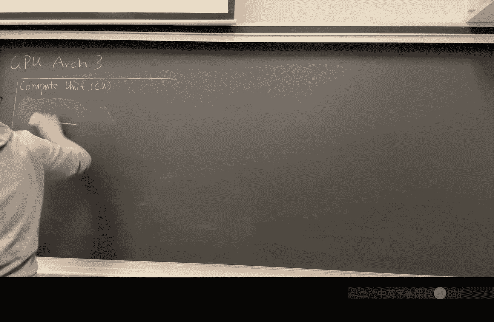
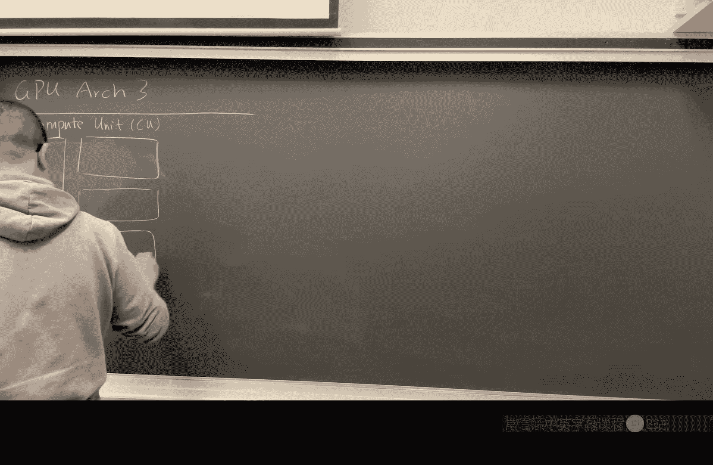
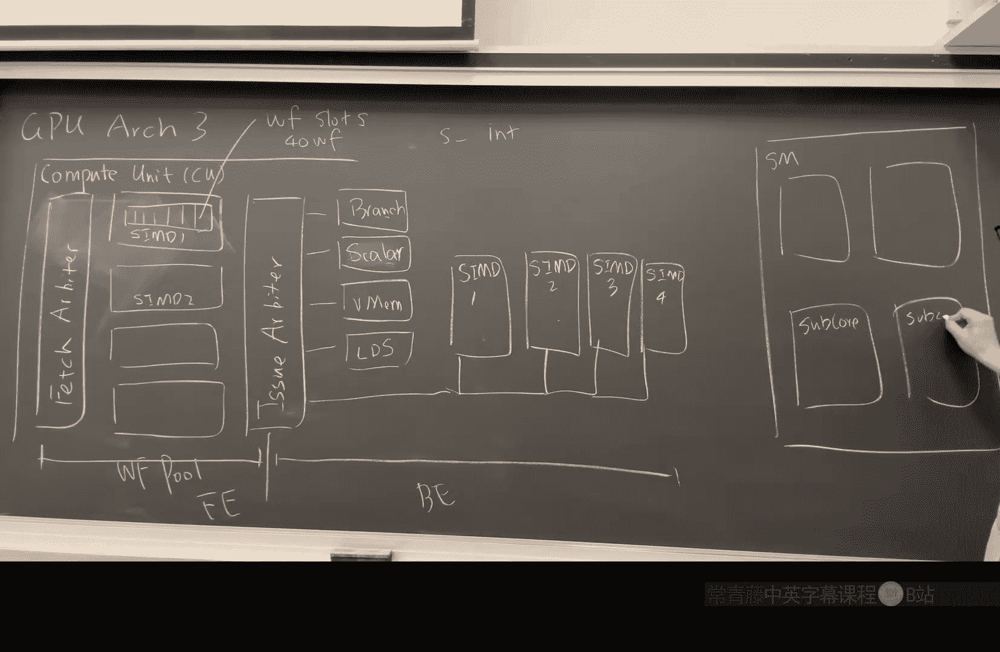
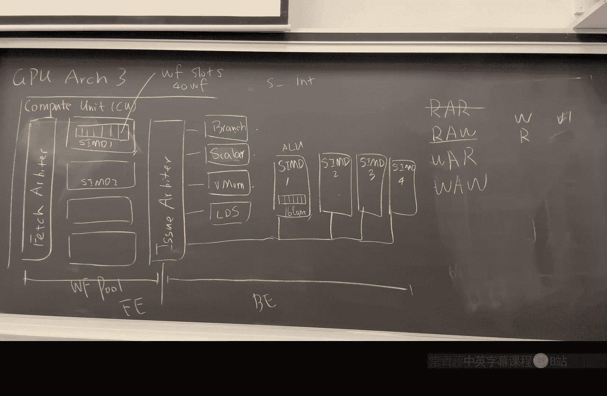

# 威廉玛丽学院【中英⚡高级计算机体系结构｜CSCI654 Spring 2025, Advanced Computer Architecture】 p19 P19 GPU 架构 3 -BV1evfwBVEUG_p19-

可以呃。We can get started， so as you can see I don't have a slide today。

 so we're going to keep talking about GPU architectures and today it's our GPU architecture3。

And this should be the last lecture for GPU architectures and for three lectures。

 it should be in general good enough to introduce how GPU works in general。In the first lecture。

 we talk about how to write how a GPU program is written and GPU assembly then in the second lecture。

 we talk about the GPU core architecture， so how GPU performs computation。

 how those instructions are excluded So in today's lecture。

 we're going to mainly talk about the memory system and how a GPU memory how the GPU memory system works。

 then the GPU memory system is actually rather simple， not that complex。

 So I don't really need one hour 20 minutes to talk about the whole GPU memory hierarchy。

 but so that starts slow then with some review about how the computational part works then starting from there we go into the memory system。

Okay， so we start with the compute unit architecture。

 What are the components in a computer unit architecture。 So this is a compute。Unit。我靠 C you。

Then in in V GPI in video in a video terminology， this is also called streaming multi processoror or SMM。

 Okay， they are basically the same thing。 A GP SM is slightly more powerful than an AMD compute unit。

 but theyre still anyway rather similar than。In the front end of a computer unit。

To leave a little bit space。

Then at in the front end， we have four。Unit for groups。

Now， we call them V front。Push。Okay， and with there are four way front pools per compute unit。

 and then each way front pool， there are 10 way front slots。

And pretty much in all the GPQs I have done is there are four away front push per compute unit。

 but this number， the number of。The number of wave front slot within wave from each wave from pool。

 This is a variable number In some low end GPUs， it can be a number of eight。嗯。Rotter than 10， okay。

 these are some configurable number。 And so those are away from cells。

Then we can assume that these bayfront slots are being occupied， right， So there are basically 40。

40 wave front。Sitting there and waiting to be executed。Okay。

 now before this instruction can be excluded， we need to first the instruction。 So the pipeline。

 the first stage of the pipeline is fetch。Okay， so this is a fetch orbiter。

A factor bitterder determines which bayfront can fetch instructions。

 so it can determine which instruction can fetch instructions with some rule and after that。

This is an issue ofbiter。Now before the issue are better， we call this part front temp。

And we call the rest of the pipeline back。So back end its responsible for executing the instruction。

 and the front end is storing fashion instructions， storing their waiting to be excluded。

 and they're decoupled by this issue stage。O。Now， where this instruction can be issued。

 there are basically five major units。 The first unit is a branch unit。first unit is a branch unit。

 Then we have a vector unit。Vector memory unit。And there's a scalar unit。 I should。

 I should put scar unit on top。Scalar。Scacalar unit on top。 then， if you check the M D assembly。

 both branch instructions and scalar instructions， both of them starts with as prefix。

 So they are both scalar instructions。 and also they are both。Integer operations。

 So branch is a integer operation that only only calculates the PC， right。

 So it's an integer operation。 and scalar is also the same。 So scr is。Integer only operation。

 So if you need to perform some floating point operation， you have to。Put it into the vector。

 although even if you are doing the same operation for all these 64 threads。

 you have to put it to the vector parts。 Okay， because scalar boast the scalar units does not equip floating point operation units。

Okay， so those are rather small components， like in terms of di size and energy consumption。

 And also， if you compare with the vector instruction or vector A use。

 then the computational power of this one and this one can be ignored。

 So that's why when we are calculating the computing power of the GPU。

 we do not even consider this two。ok。Then we have a VM unit。O。After B month。

 we have an L OD S local data share。 There's something we're going to talk about today。人。At the end。

Let's draw in this way。 Let's draw from like bottom input， okay。We have four。Unit or C D unit。Sim D1。

 C D 2。73。74。Okay， so if you check the AM D official documentation， you will see。

They call this thing S unit。They also called this thing away from pool。 They also call it C D1。

Sinly true。And so on， okay， this is in the official documentation。 So what does that mean is。

The wave front that are being allocated on this wave front slot can only go to 71。

 and this wave front can only go to 72。 This wave front can only go to 3，3。

 and this can only go to 74。So if you understand it in a more。

Nvidia style of when like how Nvidia draw this diagram。 Nvidia has a concept called subcore。Okay。

 so what is a sub corere in a media， They typically draw a data in this way。 This is an SM。Okay。

 within each of them， there are four sub courses。Subcore。

上库 right。So there are four sub courses in a video architecture。

 So if you look at compared with this diagram， now basically this C D and this C D there。

Pretty much one upward。Okay， but AMD just have more resources that are shared by this sub course。

But this， of course。 So， for example， the fetch arebitter is shared。 issue ourbitter is shared。

 Branch scalealr vector memory， L D， S are shared by all this。By all these AMD components。

 So that's why AMD prefer to draw this type of diagram in this way， rather not that way。

 then there's definitely a shift after the RD H and we talk about。

 we slightly talk about the RDA difference， hopefully by the end of today's lecture。

There AMD is also shifting towards more and more like this style。

 but let's still learn the classic AMD architecture is basically implemented in this way。O。

 so in each same D。The Cindy are a group of AOU， right。

The arithmatic logic unit is where this calculation can happen。 So combinational logic here。 Now。

 within same indeed， there are。16 lanes， we call them lanes。

 So basic 16 L use that can perform 16 operations per cycle。W say 16。These 16 lane。

We refer to single。Precision， floating point。lace ok。就。Then。For this one。

 this is standard for any GPU。 It says a standard GPU。 At least if we go back a few day。

 few years before， like these days， probably M will start to build GPU specific for L L armss。

 So even a media， if you look at their low end their。you know that media selling those desktop。

 these big like personal LM computers， right so why those computers can build those that small？But。

Can still do very high performance computing。 can still do L O M， because in those GPSUs。

 they do not have。FP 32 operation， they only have F4。Okay， floating point。

 four bit floating point numbers。They only have this low precision calculation。

 that's why they can do such a high performance computation。But。For a regular GPU。

 you cannot really only rely on F P4。 So for most of time， like in a classic understanding。

 the raw power comes from floating point332 overres。 okay， single precision。能。

If this is not a configuration， this is by standard， right， some other configurations。

 So for other precision， it's a。Like。诶。A parameter that can change from GPU to GPU， for example。F p。

C4。Double precision。What's the power of。P64， it can be from 0 to 16 length。Okay， so what is in0。

 So for some gaming only low end GPUus， they will have only zero length， no length at all。

 So they don't care about double precision operation。

then so rather standard is there may be two of them for regular gaming GPU。

 they reserve some capability of performing double precision operation， but not much。

 we can barely do it but don't expect to high performance。Then some others may have  eight or 16。

 what are 16 for example， those high performance computing MI 300。

 I don't really know what exactly is the number in MI 300 when those super high end professional graphic professional compute oriented GPUs。

 there tend to have 16 list。ok。Then we can talk about F 16。So in early ages。

It's 16 then there as F 16 is getting more and more important， is growing to 32 lane。

And today we're adding more FP。FP 8 and FP4 support， and they're likely to have something like。

Doubling the。Doubling the number of lanes。As we go down with the precision。

 because youre if we have a smaller precision， the the die size area is smaller， right so。For like。

 if we build a GPU today， high end computational only GPU， very likely we'll build something like。FP。

64， now we have something like two lights。2 to8 lengths，32 will have 60 lengths，60。

16 will have 32 layerss。8ight will have 64 lanes。 Okay。

 this is very likely to be a wasorster case for more than GPU。就 doubleou的calculation capability。

As we go down one level precision。As we half the precision。ok。So those are the links for AMD GPUs。I。

Don't have clear evidence that they can do concurrent calculation out of order or out of order calculation。

So。This is a typical interview question。For hardware design or for GU architecture。

 if you go to a company like AM D or a media， they may ask this type of question。

 what are the possible。Heed in GPU architecture。At least you know， classic understanding。ok。

What are the possible heaters？So when we talk about heater。

 immediately we should consider read after read。Read after， write， write after， read。

Right after right。4 possibilities， okay。Read after read is not a problem。

 We can read any times we want。What about read after write？In what case we can have read after right。

Read after right happens when we have a pipeline。And we have a one is the first instruction is a right instruction。

 and the second one is the read instruction that needs to read from that one register。 So。

 for example， this is V one and this one。This one right into V1。And this one read from We。 Okay。

 this is of， this is a read of the right。Problem， so can GPU have grid after right problem？能。

So if we don't do anything， if this issue abitter works exactly the same way as a CPU issue ater。

 it should have。Right。But it doesn't work in the same way。Let's talk about this。Heer。

Late before we talk about how this issue works。So， right after read。

Right after read and right after write， they both need。

say two instructions to go onto different paths， right？Can we have different paths？ Yes。

 we can have different paths。 For example， scalar can go much faster than a vector。

Right so this vector， we're only talking about something like floating point operations。

 Now we're talking about floating operations。 we're talking about add the modification。

 those rather regular operations。 and you also need to consider sine cosine log。

This type of non standard operation， those can take very， very long time。 Okay， so in that case。

 this two type of header can also happen。So how GPU issue abiter handles this problem？

It's basically in this way。So this issue a better hotel will check the status of each way front。

 Okay， if this wave front。Already has one instruction that is currently in the pipeline。

We cannot issue from there。O。做。Let me say again。If this instruction。

 if this way from has one instruction probably here in the pipeline。

RightIf that wave front has one instruction that is here， that is currently in the pipeline。

 the issue are bitter will never issue another instruction from there。ok。

At least this is how the classic AMD works， AMD GPU works。

 so if is this can guarantee so basically from one thread。There's no。

 it's impossible for one way front， there's impossible for two instruction to be on the pipeline。

Now if that is the case， if you consider from the perspective of one wave front。

It's not a pipeline execution。It's a single cycle execution。If it's a single cycle execution。

 there's no read after a ride。And there's no right after read。

 And there's no right after read after right， okay。Impossible。Okay。

 so this is only for classic AMD GPPUs。Now for NVDdia GPUs。I know from a very early stage。

 this is not the case。AM D and media has this double ising， why。

A media wants to take the opportunity of say， oh， I have a integer pipeline， right。

 I have an integer。 I have integer unit。 I have floating point unit。

Or then I have a integer instruction and floating point instruction。

 Now I can use the pipeline at the same time。To improve that performance。Okay。

 so A M D only rely on to find another thread that may have maybe。

 may be able to occupy another unit to。Improve this parallel。

 But N mediadia also tries to find opportunity from one thread。To explore these opportunities。O。

So Nvidia has multi issueu from one。One work。AD。And classic architecture。It doesn't allow that。O。

So theyre very common misunderstanding。Is。Contex switch。So when we say context switching。

 like it's in the GPU。Context。And women， women for sorry in a CPU contact。

When we say CPU contact reaching， a CPU core can only excludeude one thread at a time， right？

contactt switching means。We need to store in the context into the memory。And load another thread。

From the memory to start to exchange the other thread。 Okay。

 so switching from one thread to another thread。A associateage with overhead。

Then the quick question is， what is the contact switching overhead？For GPU。

So another good interview question。For architecture。Then the quick answer is there's no overhead。

 zero overhead。喂。Because if you do not consider it this way， just consider it as a pipeline。Right。

Just simplify as a pipeline。Remember， we say we never have one work。

Or one wave front to have two instruction in the pipeline， but the pipeline can still be full。

 How it can be full is full in this way。 This is for wave front 1 or word1。 And in this slot。

 we're actually excluding another instruction from wave front 2。Then this is way from three。

 way from four and way from five。So in CPU， what's happening is this is from T1， thread1。

 This is from thread2。 This is from thread 3， thread 4。It doesn't work in this way， right。

 I don't know why I'm writing this way。In CPU， how it works is different instructions from T1， T1。

 T1， T1， T1。替换要替。Right， in CPU。This is what's in the pipeline。There are different instructions。

 but definitely from one thread。This is the GPU way。 there are different instruction。

 but from different way from or different works。Okay， so contact switching is happening。And recycl。

So that's why context switching in GPU is overhead free。

There's no overhead for contacts with an interview。O。

So switching from one verb to another verb happens at every cycle， so there's no overhead。아니 과。

I think for all this weak front。Does it mean they are executing the same block good block？Okay。

 for a different way from are they each students the same block code block。

 So if you' are writing a kernel， let's say。I think what you mean by code block is basically block。

So the quick answer is no， they are not executing the same basic block。

 but they may they are executing the same。Program。They me execute the same problem。 So lets say。嗯。

If you have a kernel right you write a kernel， so typically a kernel is not super complex。

 but some kernels can be really complex， So all the way front。

 let's only assume one kernel is exclusion there okay。So all these thread。

 all these ver are executing the same program， the same function， the same kernel， okay。

But they maybe have very different progress。 Some may be like have been running for a very long time。

 like in 100 iteration already。 while， the other work may just。Just started。Okay。

 so they are running， they have different progress。

 but they are supposed to execute the same piece of program。So啊。For this can。

Does the each wall always goes through the， know， the fetch。I structure。

So this already have some sharing。で下。你哋啊。O。So is there any sharing in the instruction。

 quick answer is from the CEO level， No， there's no sharing。

 each one needs to go to sharing goes to the fetch and issue。So there's no quick way to do。

But at least at this stage， I don't want to。Go too fast。 but at this stage。

Just consider each wavefront is poorly independent。Okay， so if you talk about sharing where。

Like how we can reduce the。Overhead or fetching。 Fech is connecting to。L 1， I instruction cash。O。

So the fetch abiter is connecting to L1 Ic。 L1 eyec is super fast and。What's the likely heat rate？

It's pretty much always hit other than the first I missed， right？

Other than the first time it's pretty much always ski。 So it has something like 99。9% of hiter rate。

RightSo if this is like one cycle or two cycle latency， it's not a big problem。

 it can pump the instructions very quick。And in AMD design。Each L one I can。Provide four blocks。

Like this block can be something like 32 byte， okay。So it's pretty quick。

 can pump instructions back to the core pretty quick。In some corner cases。

 instruction fetch can be a performance bottleneck， but most likely it's not。O。So if if there some。

 you know， control their version between the wall in the。四。ていう。个路我哋个。哎，我天。

And we will load different cache lines。if these ver are excuse different parts， yes。

 they can access different instruction， different addresses in the instruction memory。O。

So quick answer is。Here the contact switching in GPU is overhead free。

 and then it's always happening。O。Then let's quickly talk about another concept is latency hiring。

呢呢阵线系列。So latency hiding for both CPU and GPU latency hiding is necessary。

 What is latency hiding is basically say your memory is slow。

 it takes probably 100 cycle to get the result back。人。

Your core shouldn't stay there and wait for 100 cycles for the memory to return。Right。And so。

This is true。This is the。Memory。Operation， it takes this long time to execute， right？Now。

 if we don't hide the latency， we'll wait until it's finished and excuse。AOU operation。

L U operations， This is a case for no latency hiding。And this part is the latency we're referring to。

O。So how we can we really want to hide this latency。

 we don't want this latency to dominate the experiment time。

 so the quick understanding is to move this ALU or to move some part of ALU to the front so that we can execute in this way。

Now， when the depending， they say this is actually the depending。Instruction。

Then you can immediately excuse after this memory returns， okay， this is called agencyency hiding。

Now in CPU， how we can handle a laency hiding is basically by looking for instructions from the same thread。

 right？And use the pipelines to hide the latency。Now in GPUus， how we can do latency hiding。

The idea is basically we have so many threads waiting there if one one third is waiting for memory and cannot move forward。

 we can select from other bay fronts。We can select from other way fronts in the wayfront slot Bayfront pool to exclude AOU instructions to hide latency。

 So when this memory returns。Maybe we can。Maybe we can already start to exclude our program or instruction and for the rest of time。

 we don't let the AOU to stay idle but we're letting the AOU to run something useful。Okay。

 so this is late in the hiding and the idea of。CPU latency hiding and GPU latency hiding is totally different。

So CPU mainly rely on instruction。来ve。P。Or ILP。Instruction level parism， and for GPU。

We typically call it either data level paradigmm， DLP or threat level paradigmm。TLP， okay， so they。

 they rely on different。Paraism。From the program and from the application， from the nature of the。

 the problem。To find opportunities to hide a latency。And you can see。

CPU is how hard it is to exploit instruction level paradigm， need careful compilation。

 careful hazard handling， and register renaming to be exploiting instruction level paradigm and also it's very going against human understanding because when you write one thread。

 you' are expecting it to exclude the line by line。

 but for data paradigm more thread parallelism when you are writing two different thread。

 you know this two thread will be excluded in parallel。

Right so it's much more easier and for the programmer to come in and to say， oh。

 I wanted to to execute in this way to to be paralyzed in this way rather than all hardware control。

 right， So there's always a dilemma you。You always want to make everything transparent to programmer。

 The program writes super simple program， like programmer can always write Python program。

 but can get quota performance。 That's the best。But it's very hard， right。

Because if you write a Python program， the program itself and hardware knows very little about the intention of the programmer。

 so if programmer can express more intention into their program。

 they have use more complex program languages and take more effort to write the program。

 so there's always a dilemma， so the more complex the program language。The higher performance。

 and the the simpler program language。The lower the performance， that's a general trend。

 although there are some outliers。Okay， so finally， we can talk about the memory。So， vector memory。

I see， I'm saying this a vector memory， you always need to be careful this vector memory actually also need to go through CMD unit。

 then go to a vector memory unit， So because it needs to do some address calculation。

 you still need CMD unit to do the calculation， but since AMD under official document is written in this way。

 then I will just take it。joy it in the same way， okay。就。What's in the vector memory unit？

The most important thing is something called a coal lesser。Okay， a coal lesser。 So a coal lesser。

 if you spell this word in like Microsoft word or grammarly。

 it will typically treat it as a misspelling because this is so rarely used。

 The word is not in the dictionary。 So it comes from the verb form of coales。

What is coaleses is means we combine different operations into a smaller one。

 as we're talking about MSR， we already have been talking about a coalescing effect， right。

So what is the call letter in the vector memory unit it's like this way remember this is a vector memory unit so in AMD GPUs that means where xx actually loading 64 different addresses right？

So let's make it simple。 We don't want to draw that money。 So let's say a very common case。

 the first case。Is if were loading 0 x 4，0，4，0，4，0，4，0。 So all of them are loading the same address。

How many men transaction we need to generate。We only need to generate one。Right。

So all the threads are actually loadeding in the same address。

We only need to access generated one transaction。So你。

Going from 64 operations down to one instruction。当初 one。Transaction is the perfect coalizing。

 It's the best coalizing as we can expect。So the fewer transactions， the better。

But we cannot always expect these good cases， so let's say， what is case two？

A more common case is we have a regular spread。So what is a regular spread？This is loading0 x40。

 this is loading0 x 44。Now，4，8。4 C。5，0 and so on。Okay， so what is case2 here。

 there's a term here that call strike。So it's like walking how large is your strike， right。

 it's that by 4 by or 8 by or 160 byte， this is the strike。Now orstride is four in this case。Then。

We also need to know how many byte that each thread wants to read。 In this case。

 it's very likely to be 4 byte in each thread， okay。So there are 64 of them。

So how many bytes are we reading？It's 4 by 64， right， for each， each of them are reading 4 byte。

 and there's no overlap。So we're reading 4 by 64。That's 2，56。But。Assuming 64 by a cashline。

What's the， how many cash lines are you reading。Work开始了。Right。So we're reading four cache lines。

So how many。Transaction， we need to generate。Yeah， so remember the CPU， sorry， the core。

And L1 cache interface。The data box is typically。A cash line size， right there's that menu of wires。

 that menu wires， so we need to generate four transactions。ok。F transactions。

That's pretty good We're reducing by 16 food right by 16 times we're starting from 16 transactions if we don't do coalescing then after coalescing we only need to send four transactions。

O。Let me you' raising in this part， C， it doesn't matter or memory。

So I can use this part of the whiteboard。The blackboard。Okay， so let's look at category。那。

Lets say if we have a memory。So if you have a matrix and the matrix is organizing in this way。

 this is a column major， right？0 x so4 address 4，0 is here。4，4 is here and so on。

 This is called column make， right。I always confused with which one is column major or which one is row major。

This is your major， okay。No problem so the idea is if or stride is going this way。

 so adjacent thread is loading。This part of memory。Right。We can coal us， no problem。Now。

 the co lab is case2。There is Ill call this standard。 This is perfect coales。

 This is standard coales， right。Then in this way， if our stride is going this way， this is standard。

好less。那。If we have another way of accessing if。We have to access it this way。

This is common right thinking about matrixmobil。On one side。

 you need to load in this way on the other matrix， you have to read load in this way。

Right so onll matrix multi。 So if you have another thread thats is loading in this way。And they say。

The lens here is 4 kiloby。 I'm just making up this value。

 so 4 kilobytes means this matrix horizontal dimension is1024， right not a super large。Matrix。

 so a reasonable size matrix。 that means here we're accessing 40。 now here we're accessing 4K by 40。

4K plus 40，8 k plus 40 and so on right So every address differs by 4K。

So this is the address that we want to access。 This one is accessing 4K8 k， although outside。

 this is 12 k and so on。Can we call us？Then the quick answer is we cannot right if they're not accessing the same address。

 then we cannot。We cannot call us here。So and not only we can call less。

 if we're considering address translation， we need to do address translation on each axis。

So we need 64 transactions。O。In this case， I would call this is the worst。Coll less。Okay。

 so there's no way for us to call us。 and we have to。Gennuary 64 transactions。

And sometimes they can have even more than 64 transactions。 In what case。 So， for example。

 the last of award is right at。So that's let's say your your address is something plus。60， okay。

 this is a cashline starting address。So you want to read this particular address and you want to read E byte。

Okay， so even one thread plus the thread may go across two cache lines in this case。

 you may have you may need to upload load signified transactions that can happen。

So your hardware has to handle this。Cases， right to generate right number of transactions。

 This is definitely the worst performance that you can expect。and。

We can try to see if we have opportunities to。Addressing this problem。

In by carefully writing our program。Okay， so this is coalizing。 Now， as you can see。

 the coalizing can be quite complex， for example。We can have something like this。So here is one。

 here's one， here's four， here's 64， 16， here's 64。Okay， here， then is 60 again and 8 and so on。

 right so。In some cases。Those addresses can be。Everywhere is there no certain stride。So or。

Or coal lesser has to be able to reorganize or actually sort。Everything， sort everything。

 then try to find opportunities to。Cos。Then sort sounds very easy in high level programming。

 Then just imagine if I ask you to write a computationalal logic to sort something， how hard it is。

It can be really hard。 Okay， so the coal lesson is not that simple。

 Earlier GPUs cannot do coal less at 64 transaction level。

 so they may probably only do say 16 or even 8 threat to do coal less。

And the early GPUs can also do something like， oh， we can only consider likeregular threat。

 we cannot consider irregular threat。Okay， if if we encounter an irregular threat。

 well immediately start a new transaction。Those are early stage co lessers。 Now today in GPU。

 I think as far as I know， they have perfect coal lesser already， they can do everything。

Just directly coal lesser， but don't expect it can be completed in one cycle。Okay， it may take many。

 many cycles to perform this operation。ok。So in。GPU typically in like when we learn the risk five part。

 the instruction pipeline， the memory is part of the pipeline。Or if you consider L1 cache is there。

 then L1 cache is the pipeline。 So if it's the part of the pipeline。

 that means the latency is one cycle。 You have to get the data one cycle。

Then we measured the L1 cache latency in online9 nano GPU。Releaaseed in 2015。

 you guess what latency we get？We get 1，40 cycle latency。And one catch is 140 level laency latency。

That is something going tick tell others， they won't believe in that。 and then this is absurd。

 no L1 cache should be this high， then L1 cache can be5 cycle agency。

 but it cannot be 140 cycle agency。一。I think the other。Experiment also validated or experiment。

 Now today， L1 cash for GPU is much faster， but still is now five cycle latency。

So in state of our AM M D and media GPU， you can expect 20 to 30 nanosecond latency。If you consider。

 like， we don't know what's their。Frequency， right， if it's 1 gigHz is 22 cycle 30 cycle latency。

 If it's 2 gigHz， it's about 40 to 60 cycle latency， there's still quite a large value for GPUus。

 right。So I can tell you why Arna nano is so slow at that time。

 GPU was originally designed for graphics， right。In graphics。

 you probably heard of this term called Pyrabeid。You know what's a pyramid。Pyramid in just in plain。

 in plain。English context。Egypt pyramid right so what is a pyramid in the graphics context is in this way。

You have a texture image， right？It's your a texture image。 Then if on the screen it's very far away。

 you don't really need full resolution image。 You can use lower resolution。

 So there's an image with half resolution，1 fourth of resolution，1 is of the resolution， right。

GPU allows you to specify。 Okay， I want this one at this location。

Then the hardware will automatically determine how far away it is and which level we need to use and recalculate the address to get the equivalent pixel。

ok。So thinking about how complex this operation is， these are all built into the pipeline。

Then this is all built into the pipeline， which makes the vector memory unit。

 the addressing part address calculation super complex， and by that time， 2015，2 even before 2015。

 GP GPU， general purpose GPU is not a very popular thing yet。Right。W it's not a very p north thing。

These thing are in the instruction pipeline itself。Okay， in this pipeline， so it's very。

 very complex and very slow。And because it's very slow。Then later on。

 when GP GPU is becoming more and more important。These two parts separate if you really need this pyramid operation。

 you go to pyramid part。RightIf you don't need pyramid。

 just do the quick coalizingcing then coalescing may take like 10 cycles， for example。

 Now that's why it can significantly reduce the latency from something like140 cycles down to like 20 to 30 cycles。

Not not only pyramid。 there are a lot of very complex things that are on graphics specific that are being splited from them。

Pipeline and to make it more graphic specific in the GPU architecture。ok。This is vector memory unit。

Then vector memory unit， assuming we have the memory transaction generated。

 Now we need to start to look at the memory hierarchy or the L1 caches， L2 caches。

 Let's talk about that。Now， when we talk about that， we don't need this figure anymore。

 We need to look at at the whole GPU level。Look at the whole GP P level。

 We still start with a computer unit。O。Then each computer unit will have one。L1 V。

And you're super familiar with VR it's for back cash， right？So four Cs。When enjoying four of them。

Is this also called a shadear array。By the way， a C in a graphics concept is also called a Scher。

Why is a shader？ What is a shader。 Shadr is a lake。multityus the term。So in graphics。

 a shader means something that can calculate the color of something。Right。

It can be either a hardware or a program。 You sometimes you write a shader program。

 sometimes it just refer to a hardware， it can do the calculation。

 So C is also called a shader and for C is called a shader array。Okay。

 when we have something like a term that describes a group of something， we have something。

 some resources， hardware resources that are shared。In this case， what are shared？

We have one extra cash。 that's called L1。S。Then you have V。 You have S， right。

 Shar a scalar and vector。Then we have another cache that's called L1 I cash。Instruction cash。Okay。

 so these are shared by compute units。By every four comm units。ok。

So why they are likely to be shared？So you need to know instruction shared， that's very common。

 right， So shaders are helping each other。 If one shader loads the rest here。

 then all others for other， when one C loads the instruction。

 the other three instructions the the other three Cs will already have it to reduce the。Heat rate。

Reduce the mystery。S scalar is also the same idea。 So scalar， what does scalar memory do。

So by the way， scalar memory is the responsible by the scalar unit。

 it can also generate some load like a read and write request into a1 S， no write only read。

 So this is a read only。This is a reading。Im writingri this is a read only is actually not exactly a read only。

 but you can consider it a read only like why we need to write into instruction cash， right。

 but it's not important Just consider this is a read only。Cash。就。Those these star read only cash。

 and L1 S is responsible for calculating addresses， loading some like kernel arguments。

 some launch parameters like what's the block size， What's the kernel size， these thing that are。

Not will not change， right， So every。Every problem， every thread will need that part of information。

Every thread needs not part of information and it will now change， so it's better to be shared。Okay。

 so that's why they are shared and everyone cash is also larger。Right so another question is。

A very common question is also its CPU when you have a like a data cache and instruction cache。

 then someone may ask you。An interviewer may ask you。Why they need two caches。

 Then the always right answer is they have different locality。 They have different access pattern。

 right， For example， this one we are very likely to hit。

 Then the cash hit rate here is actually quite low。ok。But anyway。

Those are the L1 caches and auto caches， okay。Then in online nano of GPU。We have。16 S。喂。

We have 16 shader array。And that makes sick for a computer unit。ok。Then on the other side。

 we have L2 caches。There are several of them， okay。

So how many I don't exactly remember the number and。Is either between 8 to 16。Okay。

 now are this number of L2 caches。And。诶。There are some memory controllers。Let's just make it simple。

 Each L2 is connecting to one memory controller。I'm writing De up。Der。And d run。ok。

So why we want to design in this way is because。Those are directly connected。

Because we want to maximize the throughput。The， we want to maximize the。band度。From the memory。

 So we want to pump data as fast as possible to the core side。 Remember， in CPU。

 we may have like a few cores，64 cores at most， right。And how many， how much data that we can load。

 not much and how much data we can load on the GPU side。 we can easily load。Like。

Thousands of thread at the same time， they're all pumping data to the GPS to the the cool。

So we really need high搬ing the way to。Provide high bandwidth is to provide high。系。Paraism。

 right so that these irs can provide data as quick as possible。Okay。

 so how we can make it as quick as possible with design in this way。We ask them。

 we allocate address range in an interleaved way。So they's say if this has the rest of 60 to 127。

Okay， theyre either one，2 cache line， 264 byte catch line or 1128 byte cache line。

 and this one will have address of 128 to255。ok。And so on。Then you go back to here。 And if number 8。

 then you go back to 2 K。To2 k plus 100。27，2 k plus 1，28。就2 k plus 255。ok。So this is interl。

Because you want to load a lot of data like， you want to load a lot of data and the probability of loading into each bank。

Often these L2 caches are likely to doA。 We can even distribute the load to all these banks。Okay。

 we can even evenly distribute all these loads to all these banks so that they can provide the data at the same time to maximize the bandwidth。

ok。Now， let me ask a quick question。What's the address range for each of one cash。

So this has an address range， right， although we can keep writing this。When there is a address ring。

 Whats the address ring for I want cash。嗯。0 to 2 k。No， why2 k。For the for round。Yeah。

 so we didn't say how large the memory is the GPU， right？就。Because we have6。嗯。よろしかす。嗯。

So let me let me tell you also here。So it's basically from zero to infinity。

So the core wants sum address， we have to provide that address。

The court can ask any address at once As is within the range of the whole J is not bounded by 2K。

 like thinking about today D。They' are easily 40 gig， right。

ToI think that 0 to 2K because they have a full catch oil。就开始。是啊。有就就he。The thing is。

 these L1 caches are not mapped to address range。 They have to cover。

 So whatever the data that DC C wants to access， it has to be able to provide that。 So basically。

 there's no certain range， it can needs to cover everything。That is you want， okay。

 so it needs to cover everything it wants， so all of them will have zero to infinity。

 zero to infinity， and so on。Okay， so what do we call this type of cache， we call this coreite cache。

And this side。And you may already guess the name， right we call this site。Memory side cache。

These are member side cache because each L2 is only responsible for one era these are member side cache and these are core side cache for core side cache。

 we have to cover the whole address range， no matter what the core one。

 we have to be able to catch that。For memory site， it's okay。

 we only cover the address range that this neuro controller is working on。ok。So。Then the quick。

 the question is。If there's a port here。Which L tool it needs to connect to？All of them， right。

 so because it needs to access all the addresses。And this one needs to access to all of the addresses。

This one needs to access all the addresses and so on。How many clients are there？I mean。

 how many clients of the L2 caches are there。It's basically by calculated by 16， multiply by 6。

 right？Equs to 96。So six。Six01 caches。Might by by 1696 L1 caches。

So what's happening is there's a huge。Network。We call it interconnect。

Or if you want to know the technology here in most of GPUus， this is found by a crossbar。Okay。

 crosspar， like people typically write X bar， but crosspar is CROS SS bar。Okay。

 it's a big network that is connecting all the L1 caches and all the L2 caches。嗯。ok。And。

This crossfire in GPU。Takes a lot of energy and also dieize。Then。That's only。16 Shadar array， right。

 Think about the net future generations of GPUus。人。M 100 has 120。Compareuter units， these are only 6。

64 C，120 then。Like something at H100， I don't really know the number。

 but it's a quite large number 200 something。Okay， is this crossbar still scalable？

We call this a scalability problem。We call this a state scalability problem because。

As we keep adding more comb units and more L2 caches， this one crosspar can now hold。Now。

 what can they do。They， what they actually do。In NviDdia GPU。Is partition。

We don't provide one big crossbar。We we generate two cross bars。Right。嗯。

We generate a connection between these two crossbars to reduce their wires。

Reduce the number of wires。 We connect them together。And this connects to their own L2 caches。O。人。

There are some L2 caches。えチえ。It really depends on the design。

 If we also want to partition the L one side or not， we can do or do not。

 Like let's assume we do partition at one side， okay。

So you say if this part needs to access this part of the L1 cache needs to access this part of L2 cache。

 by the way， by the way， this tool。On the job you one，你 is。Becoming。Complex。It's becoming complex。

So let's say this is one L1 cache， there are two， this mega symbol of two L1 caches。2 or1 caches。

 okay。And this is a crossbar。Network， and this is one network。And this is L2。要 two。还 two还2。ok。

So we have two partitions。嗯。There's still many design decisions， for example， here。

 we can assume that this L2。Can this L2， this2 L2 needs to hold address from 0 to infinity。

 although we can interve with them within them。Now these L2s can have zero to infinity， right。O。

 that means。This part only need to access this part and that part only need to access that part。

 right？Shouldt draw this here， in this case。But in the memory， we only have one set of memory。

 we only have one set of memory。We only have one set of memory。

 so we cannot allow a piece of data to be stored in two memory， that's too expensive。

 We only have 40 gigabys of memory and we want to maximize them。So here's the memory。

The memory controllers。O， let me drop six of them。So that means。We need another。

Crossfire at this point， so that。So this one may connect to。

Just just make it simpler to a four of them。 This one may connect to these two。

 This one may connect to these two。This one connects to。This one and this one。

 and this one connects to this one and the third。ok。

So where actually then compare this crossbar is several hundred by tens of several hundred input。

 tens of output。 This one is a few input and a few output。 So the crossbar here。

 the complexity is is。Significly lower than a big cross part there。 Okay。

 that's what media GPU is doing。 I don't know if recent CPU AMD GPU is doing this or not。

 but this can reduce the scalability of the problem， but definitely at a cost that。嗯。

If you are accessing from one part to another part， then the latency penalty is higher。

 the performance is not as's high。Theyre very unlikely they use a crosspar here。

 but they use some sort of。Switch that if you need to act another part of memory。

 then they actually need this thing to。So they probably do something like this。

SoThere's another wire here， right， If you need to access that partition， you need to go。

Moval hops to go to the destination， so licenseency is higher in a mediatri。O， then。

And see we'll have 10 more minutes， see if we can finish these。Hard or not。coherenceency一术。

Then what is coherence issue？Let's make it simple。L two cash。L one cash。L one cache， right。し。

If this is cacheline A。And here we're loading cache1 A。And we read cacheline A。Both read are okay。

 right， And they say they version1， version 1。This originally has version one。

 but then we do all right。It has version  two。Okay， a you year。What if after done one is doing I2？

We do a read。We're reading a1 here。Although， by the way， if this is all right， remember。

 GPU L1 cache are all right through cash。We' don't say it's a right through or right around。

 but it's a right through family。ok。So a one will also go here， but this one。

If we don't have careful consideration， this one will still have a1。these one still have a1。就。

What can we do， How we can solve this problem。We broadcast the right request， right。

 to think about how large our GPU is， how many cores are there。Hundreds， of course。

So that a scalability issue。RightFor CPUs， we can do that。For GPS， can we also do that。

Now the quick answer is the GPU wants to be as simple as possible。

So we only do the useful part with discarded the non useful part， so how GPU solve this problem。

DPU tellss programmer。 This is wrong。 Don't write this type program。O。

So you should never write one piece of data。And expect to other site to load it。In that one kernel。

If you load it， it can be old data。 if you load old data， don't blame anyone。

 that's the problem of your problem。Okay， so this is something called。Programmer。Control。Coherency。

So theres actually a very interesting discussion at the micro last year in the conference。

 so was the keynote speaker was saying that then was Todd Austin who was like speaker here last week right So he asked a question about some architecture。

 I don't exactly remember what's the architecture he was asking。So why we are so like。Just。

Tick or hardware that much to follow the habit of the programmer。

 So why we not not write something like in GPS。Just don't do this。 This is not good。

 This is not good for performance。 Just don't do this。Right。Well， I think that's a very reasonable。

Consider now if we want high performance， we have to have some constraints。

 So just programme don't write this type of problem。

 Then what if you really need another thread to read the data。How you can do that。

At the barrier is not good enough。 Barrier is a consistent issue。 It's complex。

 but it will still have this one here。So atomic can work。

Atomic can broadcast and force eviction of other kernels。 But atomic， if use too much atomic。

 is's a performance panel， right。The right answer is to stop the kernel。 start a new one。Okay。

 just stop start stop stop the kernel and start a new one。 The new one were loaded from the memory。

 So at the kernel boundary， we need to flush a one cache。 not， not really flush。

We actually only need to invalid in our one cache。So from a V state or from valid state to an invalid state。

Okay， we only need to。Do a B2 I conversion。ok。So just mark all the cache lines are invalid then at the beginning of the next kernel。

Just load everything back because。After that， we already have everything all up to date data in L2 cache。

If we really need to write somewhere from one grid and load from an aircraft。

Write them in two different。看。So GPUs encourage you to somehow write simple kernels and to say。

 this I matrix to my location then。Only write a measure experiment， don't combine other links here。

And we also encourage you to say each thread will only have a。Certain。

Addresses now you want to write into， right。So don't try to have two thread right into two one part or one thread right here。

 then the other thread read you're goingt do that， It's not something that you should do in a GPU program。

嗯。So many people eventually were still asking this question how GPU is。

Handling this type of coherency。 And the quick questions， GPU doesn't。And GPU doesn't care。

 it's the programmer's responsibility to do that。Just one thing。

It's a certain term that I should talk in the cash coherency。

 the regular lecture of cash coherency that I was planning to give today。Then。

It's a fact called boss sharing。Okay， what is false share？Ft sharing is like this。我找一次拉这儿。

This is our2 cash。Then this is our cash flow。This is L1 cache。嗯。For this L1 cache。

 we only need to write into this part。Right。Then for this L1 cache。

 we only need to write into the second half。This is totally legitimate。No problem at all。

Because programmers shouldn't really know which part of data， which by are in one catch line。

But in hardware， you have to consider this type of situation。就有些。If you write through。

Now this type will write through。Thispers the right through， this second right through。Right。

 what will happen is， let say， this is a。2， and this is a 3。Now this is a1， right， Ideally。

 we wanted to have a2 and a 3。But if we don't do anything， will happen。Into。Are you1， a3。

Because here is a1。Here is a1， A1， the second half over A1。ok。How we can solve this problem。

 Just imagine you are the GPU designer， how we can solve this problem。

II'm giving an oversimplified example that we're writing half of cash。 it can be。sma。

It can be one byte。Two byte， four byte and so on。Okay， I don't think have time。

 I will tell you the answer。 Okay， so。Other than data。We carry something called a right。Mask。

Which part we want to write。 And this right bus mask is 1 feet。For four bys。ok。1 bit for 4 B。

So we mark which part is 30。 And when we write， say， okay。

 this part we want to write and when it's combined， okay， we only on update that part。

 then you can merge at this part and have a2 and A3。Just a counter page。

 if you really have one instruction to write one byte。What happens。Is to do a right event。Or。

The already vector is the easiest way to do if you only need to write one bitete。

What bite can be represented by it？This， right。Just write down here and write to the whole cache line here。

Because this one should already have already happened。

 right this see rightthrough has already happened if you only run to run by one byte and don't have right mark just right。

Did they hold each other。O， so immediately right there and EV。

Here then you don't have this type of coherency problem。

 They say called false sharing because you feel you are sharing this cacheline。 but in the program。

 you only need part of the cache line。 it is not real sharing。

