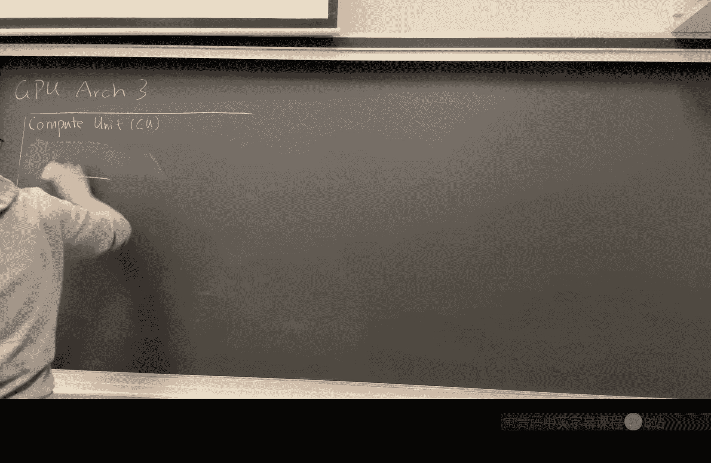
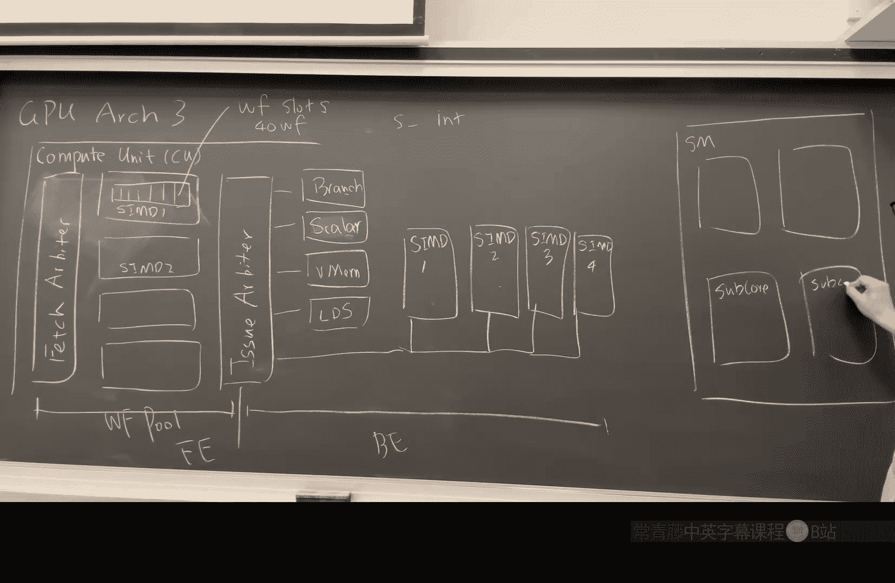
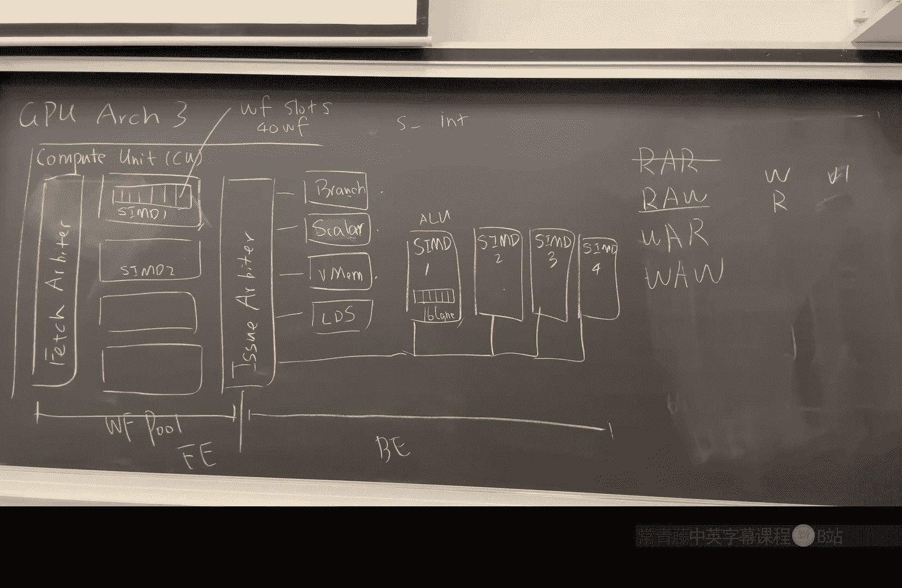

# 威廉玛丽学院【中英⚡高级计算机体系结构｜CSCI654 Spring 2025, Advanced Computer Architecture】 P19：GPU 架构 3

在本节课中，我们将继续探讨GPU架构，重点介绍GPU的内存系统。这是关于GPU架构的第三讲，也是最后一讲。我们将从回顾计算单元架构开始，逐步深入到内存层次结构、访存合并、缓存一致性等核心概念，帮助你全面理解GPU如何高效地处理数据。

## 计算单元架构回顾

上一节我们介绍了GPU的计算单元架构，本节中我们来看看其核心组件。一个计算单元（Compute Unit，CU）在NVIDIA的术语中也称为流式多处理器（Streaming Multiprocessor，SM）。其前端负责指令的获取与调度。

以下是计算单元前端的主要组成部分：

*   **波前池（Wavefront Pools）**：每个计算单元通常有4个波前池。
*   **波前槽（Wavefront Slots）**：每个波前池包含多个波前槽（例如10个），用于存放等待执行的波前（即线程束）。
*   **取指仲裁器（Fetch Arbiter）**：决定哪个波前可以获取指令。
*   **发射仲裁器（Issue Arbiter）**：决定哪个波前的指令可以进入后端执行流水线。

前端与后端通过发射阶段解耦。后端包含多个执行单元，用于实际执行指令。

以下是主要的执行单元类型：

*   **标量单元（Scalar Unit）**：处理整数运算和内核参数等标量数据。
*   **分支单元（Branch Unit）**：处理程序控制流跳转。
*   **向量单元（Vector Unit）**：执行SIMD向量运算，是计算能力的核心。
*   **向量内存单元（Vector Memory Unit）**：处理向量加载/存储请求，包含关键的访存合并逻辑。
*   **本地数据共享（LDS， Local Data Share）**：一种高速的片上共享内存。

在AMD架构中，向量单元通常被组织成多个SIMD单元（如SIMD1-4），每个SIMD单元包含多条车道（Lane），用于并行执行操作。车道数量根据运算精度而变化。

以下是不同精度下的典型车道数量配置：

*   **单精度浮点（FP32）**：16条车道（标准配置）。
*   **双精度浮点（FP64）**：0到16条车道（高性能计算GPU配置更多）。
*   **半精度浮点（FP16）**：可能达到32条车道。
*   **更低精度（如FP8/FP4）**：车道数量可能进一步翻倍，因为硬件单元面积更小。

## 流水线冒险与零开销上下文切换

在深入内存系统之前，我们需要理解GPU如何管理指令间的依赖关系。在CPU中，我们关注读后写（RAW）、写后读（WAR）、写后写（WAW）等数据冒险。GPU如何处理这些问题呢？

在经典的AMD GPU架构中，发射仲裁器有一个关键规则：**如果一个波前已经有指令正在流水线中执行，就不会从该波前发射下一条指令**。这意味着，从单个波前的视角看，其指令是顺序执行的，不存在上述数据冒险。这简化了硬件设计。

这种设计也带来了一个重要的特性：**零开销上下文切换**。在CPU中，切换线程需要保存和恢复上下文，开销较大。而在GPU中，流水线可以在每个周期切换执行不同波前的指令。因此，GPU的上下文切换是持续且无额外开销的。

关于指令共享，虽然所有波前执行的是同一个内核程序，但它们可能处于不同的执行进度。指令缓存（L1 I-Cache）被所有波前共享，具有极高的命中率，能快速提供指令流，因此指令获取通常不是性能瓶颈。

## 延迟隐藏

内存访问延迟很高，GPU需要有效隐藏这些延迟。CPU主要依靠指令级并行（ILP），通过乱序执行、寄存器重命名等技术从同一线程中寻找可并行执行的指令来填充流水线。

GPU则采用不同的策略，主要依靠**线程级并行（TLP）**。当一个波前因等待内存访问而停滞时，调度器可以立即从其他就绪的波前中选择指令来执行，从而保持计算单元忙碌，隐藏内存访问延迟。这种机制使得GPU能够容忍较高的内存延迟。

## 向量内存单元与访存合并

现在，我们进入本节课的核心——内存系统。首先从向量内存单元开始，其最关键的功能是**访存合并（Coalescing）**。

当一组线程（例如一个波前中的64个线程）执行加载或存储操作时，它们可能访问多个内存地址。访存合并器的作用是**将这些分散的访问请求合并成尽可能少的内存事务**，以提升带宽利用率。

以下是几种典型的访存模式：

*   **完美合并**：所有线程访问完全相同的地址。只需生成1个内存事务。
    *   示例：所有线程加载 `0x40404040`。
*   **标准合并**：线程访问连续地址，具有固定的步长（Stride）。可以合并成少量事务。
    *   示例：线程0加载`0x40`，线程1加载`0x44`，步长为4字节。64个线程访问256字节，在64字节缓存行下，需要4个内存事务。
*   **最差情况（无合并）**：线程访问的地址分散在不同的缓存行，甚至跨越大内存间隔。需要生成与线程数相当（或更多）的事务。
    *   示例：矩阵转置中，线程访问相隔4KB的地址，无法合并，需要64个事务。
    *   更坏情况：单个线程的访问跨越两个缓存行，可能产生超过线程数的事务。

早期的GPU合并器能力有限，可能只支持规则访问或少量线程的合并。现代GPU的合并器功能强大，能够处理复杂的访问模式，但合并操作本身可能需要多个周期来完成。

值得注意的是，早期的GPU（如2015年的AMD R9 Nano）L1缓存延迟异常高（约140周期），部分原因是其图形管线中集成了复杂的纹理寻址逻辑（如多级纹理金字塔Mipmapping）。随着通用计算（GPGPU）变得重要，这些图形专用功能被分离，使得现代GPU的L1缓存延迟显著降低（约20-60周期，取决于频率）。

## GPU内存层次结构

接下来，我们俯瞰整个GPU的内存层次结构。计算单元之上是各级缓存。

在计算单元级别，通常以**着色器阵列（Shader Array）** 为单位组织资源。一个着色器阵列包含多个计算单元（例如4个），并共享以下L1缓存：

*   **L1向量缓存（L1 V-Cache）**：缓存向量数据。
*   **L1标量缓存（L1 S-Cache）**：缓存标量数据（如内核参数），通常是只读或极少写入。
*   **L1指令缓存（L1 I-Cache）**：缓存指令。

共享这些缓存可以提高资源利用率和命中率。

所有L1缓存通过一个**交叉开关（Crossbar）网络**连接到多个**L2缓存**。每个L2缓存通常连接一个**内存控制器（Memory Controller）**，负责访问一部分DRAM。

为了最大化内存带宽，GPU采用**交错（Interleaved）寻址**方式将地址空间分布到不同的L2缓存/内存控制器上。这样，连续的大块内存访问可以均匀分布到多个通道，实现高并行带宽。

这里有一个关键区别：
*   **核心端缓存（Core-side Cache）**：如L1缓存，必须能够覆盖整个地址空间，因为任何计算单元都可能请求任何地址。
*   **内存端缓存（Memory-side Cache）**：如L2缓存，通常只负责一个固定的地址区间。

随着GPU规模扩大（计算单元数量可达数百个），一个巨大的全局交叉开关在面积和功耗上变得难以扩展。解决方案是进行**分区（Partitioning）**。例如，将计算单元和L2缓存分成若干组，每组内部使用一个较小的交叉开关，组之间通过额外互联。这虽然可能增加跨组访问的延迟，但解决了可扩展性问题。NVIDIA GPU通常采用此类层次化互联设计。

## 缓存一致性与假共享

最后，我们讨论GPU中的缓存一致性问题。在CPU中，多核间保持缓存一致性是硬件的责任（如MESI协议）。GPU则采取了不同的哲学。

**GPU通常不在不同计算单元的L1缓存之间维护硬件一致性。** 如果一个计算单元修改了某个数据，另一个计算单元的L1缓存中可能仍是旧值。GPU将此责任交给了程序员。

程序员应遵循以下准则：
1.  避免在同一内核中，让一个线程写入数据后，另一个线程读取该数据。
2.  如果线程间需要通信，应使用**原子操作（Atomic Operations）** 或通过**全局内存**进行。
3.  更常见的模式是：在一个内核中完成计算并写入全局内存，然后启动下一个内核来读取这些结果。在**内核边界**，GPU硬件会**失效（Invalidate）所有L1缓存**，确保下一个内核从L2缓存或全局内存中加载最新数据。

然而，有一个硬件必须处理的问题：**假共享（False Sharing）**。当两个线程修改同一缓存行中的**不同部分**时，虽然从程序逻辑上看没有共享数据，但硬件缓存行是共享的最小单位。

例如，线程A写入缓存行X的前半部分，线程B写入同一缓存行X的后半部分。如果没有保护机制，直接写透（Write-through）可能导致数据混乱。

GPU的解决方案是使用**写掩码（Write Mask）**。当执行非对齐或部分写操作时，内存请求会附带一个掩码，指示哪些字节是有效的。在L2缓存或更高级别，硬件可以利用这些掩码正确合并来自不同线程的对同一缓存行的部分写入，从而避免数据损坏。

## 总结

本节课中，我们一起学习了GPU架构的内存系统核心知识。我们回顾了计算单元架构和其零开销上下文切换、延迟隐藏的特性。重点探讨了向量内存单元中的访存合并机制，它对于提升内存带宽效率至关重要。我们剖析了GPU的多级缓存层次结构，包括核心端与内存端缓存的区别，以及通过交叉开关和交错寻址实现高带宽的设计。最后，我们了解了GPU独特的缓存一致性模型——将一致性责任赋予程序员，并讨论了硬件如何处理假共享问题。理解这些原理，有助于编写出更高效、能充分发挥GPU并行计算潜力的程序。