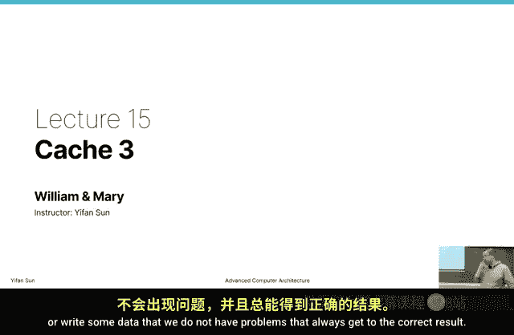
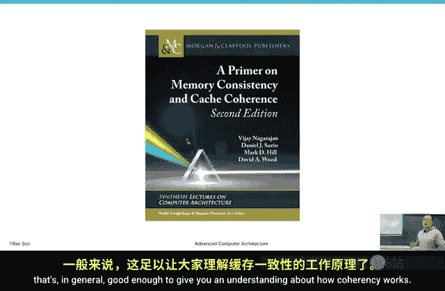
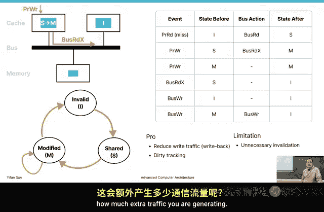

# 威廉玛丽学院【中英⚡高级计算机体系结构｜CSCI654 Spring 2025, Advanced Computer Architecture】 p20 P20 缓存设计 3 -BV1evfwBVEUG_p20-

Okay， we going get started。So last time was。We spend two lectures talking about caches and talk about how the cash is internally organized and talk about how cash rises handle different right policies。

 So in Cat3， we're going to focus on cash coherency and we already talk about cash coherency in GPU architecture。

 but for GPU architecture， cache coher is much， much easier because we。

Simply do not care that much about cash coerency。 Cash Coerency is。

Achieevved thereby by flushing by flushing back into the memory。

Then today we're going to talk about cache coherency and our coherency is mainly for CPUUs。

 and we will really care about if we want to read some data or write some data that we do not have problems that always get to the correct result。

Okay， so today's content is mainly comes from this book is not from or the textbook or syllabus。

 but from this book， this is actually a very good book。

 It's the classic tutorial for memory consistency and cash coherency。

 So we're not going to talk about memory consistency。

 But we're going to focus on cash coherency in this our course。 Okay。Then for catch coherency。

We're probably only going to spend this one lecture and probably will talk a little bit in the next lecture。

 but that's for one lecture that's in general good enough to give you an understanding about how coherency works。

Now for coher， I always have a feeling that。For one lecture。

 it's definitely not good enough for you to understand everything then like when I in my mind。

 when I know I actually know everything about how cache coherency works when I try to implement cache coherency protocols in a simulator。

 I always find。Marurner so many things。 There so many detail a one or two psycho。

Difference what how to handle this type of difference is there different internal state or transient state。

 how we can handle those cases。 Okay， so you give one lecture short of time。

 I can only give you a very high level introduction to how generous things work。

 And there are different level， different type of caches right through right back right e right around and how to support those things are something that you can。

Think about is when you really need those things。 Okay， so we start by talking about cash hierarchy。

 then you're not there， you're not also familiar mirror with this cash hierarchy。

 So what talk about in architecture cash hierarchy what or so。At the beginning。

 we talk about a core and a D， right， but for cash pro， we always talk about multiple core problems。

 where at least there are multiple caches that are involved， multiple caches at the same level。

So when there's a D， when there's only one unit， there's no problem at all。 when there's only one D。

 there's no problem at all。 But after we in caches and we entered L1 caches there。 like， for example。

 here， these L1 caches which typically call them。Core side caches in Gio terminal ref the core side caches。

 Then we start to have cache coherence issue because this L1 cache and least L1 cache will have a different version of the data。

Then in some organization， these L2 caches are organized in this way。

 These are still useful because these L2 caches can be larger。

 but to have more distance from the core so that it can have larger space， but slower。

This slower memory access time， more latency， but this is not a more general case a more general case is more like this。

 so L2 caches is shared by some course， I'm still not talking about is a memory side cache because you will see how L2 scales as we add more course。

 but this L2 cache is shared by a group of L1 caches。

 and this makes cache coer problem even more complex。Then let's look at this。

 if you have a four core system， there should be core three and or four。

 if you have a four core system， each core may have private L cache， right？

So aesthetic access the fastestest speed that we can get the data and our larger L2 cachees that are some shared by a cluster。

 of course。So if you look at this L2 cache， only look at this L2 cache。

 then consider this the effect of core 1 and core 2。

 so core1 in core 2 can both be brands and enemies like when your brands say core1 may access some piece of data。

 then core2 may access the same piece of data the same cache line in that case。

 core 1 may read the data for core2 so that core 2 may reduce the memory as latency。

RightNow on the other side， they can be enemies so they can stretching each other。 So， for example。

 core 1 and core 2 are accessing totally different data。

Then they may access totally different data then， but they need large。 they。

 they both need access relatively large range of data。

 The core one will load the data then to e data that is load by core 2。

 and core 2 is also loading data。 that is。For the data that is eed by。

Core 2 is loading data and weing data loaded by core 1 right so they are threashing each other now making none of them can get data。

 all of them， both of them need to get go to the D to access data so they can be so this type of relationship it can be very complex when we're talking about core sharing caches。

So then we talk about cash coherency and first look at the interface of cache coherency and how。

And how we define cache co。So in a cache system， we consider a cache two cache。

 two same level caches and the interconnect that is in between。

So we only for simplicity for teaching purposes we only consider one level of cash so these caches are share are connected to a Dorem and at the beginning we only consider two caches okay you can consider this Dorem or this memory as just another level of cache now it's managed in another way。

 but in reality if you consider multilevel of caches things can be more complex than a single level of cache。

Okay， so say if both of data， both of the caches， both of course wants to read the data。

 then this there's no problem， then we can simply duplicate this piece of data to both sides。

 then they can keep reading this data so if you have read data reading。嗯。

If you if you read only data， you can duplicate as many shares as possible and there's no problem。

Right， but once you have right data， if this side wants to write data and this side wants to read the data。

 there's a problem because。You are expecting you should read。

 Always read the most recent version of the data。 Now in this case， you are reading the wrong data。

 right， So there's a little bit。Picking into the memory consistency part。 So memory consistency part。

 there are different type of consists， for example。

If we read to for some different definition for consistency， If we read the data。

 we we read around data， This may be okay for some time， but eventually。

 we need to read the right data， for example。On one side。

 we say a wait until a equals to 42 on B side， we start right into the increment a until 42。

 So it's okay that for sometimes a is not reading the most up to date data。

 but eventually it has to arrive at this point。 if you don't have anything that can e this part of data and。

Get the newest data then the。Li said this core may get stuck by that point。

 but this is not strictly a memory consistency definition for memory coherency we're talking about。

 always talking about one particular cache line。What are done。

Like the behavior that when we're accessing one cacheline Now for right for memory consistency。

 we're talking about different cachelines， different addresses。 So if I read one thing。

 if I write one thing and write another thing， there must be an order。

 say read right A happens before right B， then this right order。

What's the observation like from from the perspective of another cache。

 It does another or from another coreor。 just the other core may observe around the other direction of right。

 right， read and write orders。Are the things that really matters in。Memory consistency。

 But here we're not talking about memory consistency。 We're talking about cache coherency。

 So in the domain of cache coherency， we only want to read the most recent data。 Okay。

 so in this case， we consider this is a mistake。 This is an error that we cannot allow these things to happen。

So what are what definitions for memory consistency or cache coher is we only consider these cases。

So it's called a single writer， multiple reader。Style of。Cohererency。

So we're talking about for any given memory location。

 So we're only talking about one particular or each particular memory location and。Tpically。

 you are talking about cashlines Now， for any moment in time。 now we're talking about a moment。

 So how to understand this moment is a little heart is is there's no clear definition is not a cycle。

 Okay， we typically call it an up。 It's a more like a logic time。

 a logic time means when this part right。 when this part of right data and when this part needs to read the data。

The the time between this ride and this read are considered a book okay。

So this is a pure logic concept that you cannot really say how many cycles is an I book here。

 there's no clear design is in terms of logic that another read or write even happens。 Okay。

 so within one i， we can allow two cases， either a single core。

 it's just one core is rise to it or some other course may。Or some number， of course， may read it。

 right， so we can have。A limited number of course that reading this data。

Or we can have a single core that is writing into it。 So this defines what's what are allowed， right。

 So what are now allowed is。More than one core is writing the data， or one core is writing the data。

But out of course are still reading from it。 This is something that we do not allow。惊。

So in one logic period， we can only allow either one course writing data。

Or some courses are reading the data， some number of course are reading this piece of data。

 so read and write should never overlap in terms of our logic pile。Okay。

 so we should exclude which steps totally separate read and write。So。So on。

So there is a definition here is。For a given memory location， we have already talked about epo。

 right， then for a granularity。For the other part， the memory location。

 the memory location that we can actually talk about granularity that are we talking about bytes or cashized。

 so there can be different things like in GPUus we already can see that the cache coherency if we still call it coherency。

Is maintained at cash at byte level， right， or at every 4 byte level， then is achieved by right mask。

Or dirty mask。 Then for CPUs， we typically talk about coherence in cacheline level。

 So if we're writing only one by within this cache line。

 we're thinking we're updating the whole cache。Okay。

 so this is the granularity difference in the CPU and GPU domain。

 although there are still many different variations of like cache design that you can hybrid some CPU and GPU design decisions that you can even do something like。

 oh part of this cache line is valid。 Part of this， the other part of this cache line。 is not valid。

 This are also something that is totally possible in CPU design。Yeah， well。

 we talked about false sharing last time。 So what different what different parts。Right。

 different parts， but considered as a conflict。 So for example。

This writes to the first half and this right to the second half， right？

 So this is called false sharing because the first one only needs 32 by。

 The second one needs 32 byte。 theyre accessing different part of data。 So there's no sharing。

 But if we consider at a granularity of a cache line， we have sharing。

 And if one side wants to write it。And if the R side also wants to write it， it's a conflict。

 now we cannot make it to happen。how to prevent this thing to happen is to serialize them to process one right first and process the other one。

 so this slows down the whole execution。It can be sometimes can be really bad because the communication between this cache and Dorm。

 this cache and Dem can be really complex。Okay， so I guess slow down the。

It can slow down the exc significantly， but for no benefit because the sharing are not real。

 we're not really sharing the data， it's only because we're using the catchline granularity。Okay。

 so to solve this type of cached coherency problem。We use cash coherency protocols， though。

We use solve fix this coherency issue with complex mechanismss。 So whenever we face some problem。

 we add you one layer of indirection， we add more resources to solve this problem。

 Then theres always a discussion that if this complexity is worth effort。

 definitely as we look at today's CPU architecture nature。

 you can almost almost find any consumer product that only has one course。 today。

 even cell phones have many， many course and coherency is always there。 So in general。

 coherency is something that is necessary in today's design。So this complexity worst the effort。

 worse the difficult because of the benefit of multi core system。

So we start from a very simple coherency protocol as we call it the VI protocol。

Then VI stands for a ballot， whenever we say some coerency protocol， we use the name。

He used the state names to represent this coherency proate。So PI stands for valid and invalid。

So here we talk about a boss assumption。😡，What is the bus bus we talked about before in。

When we talk about。Digital design， a bus is basically a bundle of wires。

 They can say a data bus or a address bus is a bundle of wires that are sending data or receiving data。

Altogether to represent one unit of data here， it's a little bit getting into the network domain or a network on chip domain。

 So the pass has a slightly different definition， but not conflicting。 So a pass is a。Unit。

 it's a set of wires， still a set of wires。对。Is still set of a wire iss still a set of wires。

 but can allow multiple。Ss。Or receivers。S we talk us by saying， oh。

 this this cash unit and this cash unit。Can share this bus。O。When they can share this boss， miss。

There must be an abiter。A better decides who can use this bus in a cycle。

Do they first need to somehow connect to communicate with thebiter say oh。

 I have something Just send。 Then the ourbiter say， oh， you send it。 Na say this cycle， decide it。

 send it， decide， this， send it。 Okay， This is a bus。

So bus is not a very efficient design because the communication must be serialized。

Right in terms of like heavy traffic。Communication。

 like when there' are a lot of traffic and they have be stic。 So the bandwidth is limited。

 It's better。A better solution is auto all connection， right， A， this cache to this memory。

 this a connection， this cache to this memory， there's a connection。 If this cache needs to park。

 there's another connection。 Okay， that's the best。 But if we have an auto connection。Then， we need。

A lot of die size， a lot of wires， right， and a lot of energy。 So that's a problem。

 So bus saves dieize saves energy at a cost of performance， but it's not always a bad thing。

It's not a always bad thing， so when we want to broadcast something right if we want to broadcast something from this cache to this memory and to the other caches。

 bus is very natural because all participants， all everything that is connecting to this bus can overhear basically if its not the message is not intended for for you for this cache。

But this cache can still monitor what's going on in the cache。

 And chance still get just get a global understanding of what's going on。

 If you consider this is an optimal connection。We need this cache to send to this memory and this cache to send this to this cache to achieve the same effect then that's。

Less effective， less efficient。So there's always a trade off between using a bus or not using a bus。

 Then the general trend is。Not to use a bus。Not to use a bus for high performance data on and use a bus only for efficient systems。

Okay， so here is a box now for all the cohersency protocols at this stage we're talking about。爸爸是。

On option， So whenever this cache sends a data to this memory or this memory sends some data back to this cache。

 the other cache is knows what's going on。Okay， and there's a way。 It also assumes there's。

We allow peer to peer communication to when say peer cash， this cash and this cash their peers。Right。

 peer to peer communication is possible because it's a boss。 If I send， I just send onto the boss。

 then I don't care who is picking up the data。O。So， let's look out。Different actions。

We want to read the data， we read data， then we get the data risk data ready。 No problem。

 It's just as if it's a simple catch。Right。な。We market as V state， as valid state。

 So it's a one bit flag。It's either V or I。But here we just need to be careful。

When we talk about cash coherency and cash organization， when we talk about cash organization。

 we say， oh， there's a cash line right， a cash line has a major part that is the data。

And that's the largest part， right we always have a add。Right。And we have a V I bit。Right。

So we say this cashline is valid or invalid。But that assume that this tag is actually being stored in that cache right that's when we talk about cash organization or when we talk about cash coherency。

Even if this cash line is not there at all， It's not this in a cache。 If it's not there at all。

 we say it's in invalid state， okay。So all the cache lines that is in the memory。

 all the data in the memory， we consider they start with invalid state within the cache。

Although it is much larger space， it requires much larger space。Okay， but anyway。

 when we read the data。We send the re to the memory and they already counts fact the data has stored there with market as valid Okay。

 so as we draw at state diagram， we convert from invalid state to a valley state。

Then on the other side， we can do the same thing。Now， when the other side wants to read the data。

 we can。Get the data。 And in a way state。So there's a slightly designed distinction。😊。

That a variation of Vs design。 Do we allow V to coexist in two different places。 Okay。

 they have pros and cons， But as assume we allow that。 We can stay at the different side。

 So if there are V and they can load data at the same time。Okay。

 they can read the data at the same time， no problem concurrency。

So let's look at right when we want to write data。What happens？We need to write to the bottom， right。

 so we're talking about right through cash for now。Because VI doesn't work for right back cash。

 we'll see why it's a case later。We write this to this me， and we write to the bottom。

Can we still allow this site to be in this state？No， we cannot， right， because later on。

 if this V is still there and what if the read happens on this side。

RightIf there's another read or check， oh it's valid。

 I can directly use it and that's a wrong result。So we cannot allow this simple right through design anymore。

 we have to have some other messages to notify something something has happened。So what we call this。

 we call this is a processor right， PR right， on market later。

You'll see other examples On the other side， we actually will generating a bus ride。

 bus ride means we're writing to the memory， and this right action is written into the bus。Okay。

 and this bus ride is not only sending the memory and not only the memory is updating。

 and this bus ride is also over her。By。で。By this cash， right。 So this cash knows， oh。

 there's another bus ride， right， There's another bus ride。 So I cannot hold it anymore。

 I just simply。Change my bid from one to their market asset valid， don't use this data。

 this data is not valid anymore。Okay。So this is the simplest coherency traffic。

 although there's no extra traffic at this moment。Okay。

 so we're pretty much completed with a VI design。 That's simple。

So sometimes we also define a state transition diagram that we say different action in different state when different actions that are happening。

 what action we should do and what state we need to transit into。Deer in this state。

There's no problem。If in this state， when processor read the data。

 we just simply send the data back and we mark it still in this state when there's I state and processor read it。

It should not be no bus action。 We should do a bus ride。

We read from the memory and we mark it as V state。When there's a PR right and when processor wants to write the data。

 now we can send it to B state and we send a bus ride In this case， we can do either way。

 this is depend on right policy， we can change stay at B state or change the I state and triggers a bus right In this case。

 we know whenever there's a processor right， we have to write to the bottom we have to notify other。

We have to notify other L1 caches， other caches。 Theres are right。 you have to invalid， right。

 That's why。TheVI protocolcol only works for right through caches and impossible for right back caches。

Now for pass read。Right， the need to be careful。 This are bus read and bus ride。

 Those are overheard data。Overheard messages where this cache is not the intended destination。

 I hear someone is reading the data， right。Here， in this case， we said， oh。

We're currently in this state and some our cache is reading this data， that's okay。

 we can keep it in this state。Right， if our in ice stake， we can。Actually。

 there is a chance that we can get back to this state， right。

 because the data ready is also a broadcast。But in most cases。

 we consider this is I state it's not intended for me why I'm changing to V state and if I'm changing to V state that means we're actually changing another cacheline to I state。

Because if we want to push something into the membrane and into a cache。

 we have to e to something from the cache。So for most of that time， although it in theory。

 it's possible to change to be state， we don't want to do it， we want to stay it in eyecach。

Now in case of a bus ride， say some other caches is writing into the memory。

 what do we do is we change from V state to I state， we invalid our own version so that later on。

 if we read it， we can fetch it from the memory。Okay。

 so this is a state transition diagram that describes all the possible communication。cases。Rightice。

So also， this is called a snooping protocol。What is a snoping protocol， Snoping means。You keep smell。

 something you keep。Small something that you keep getting this data。

 what is something that you you' are taking in， you're taking in what data is on the bus， right？

So you keep hearing what you listening to the。Transactions on the bus and make your local decisions。

Or in other cases， if this is not a bus， if this is other cases。

The lower memory or this cash needs to initiate dedicated traffic to notify others， say。

I'm I'm writing usually et I'm writing usually e it should go I should this intentionally send this traffic to all other all other caches。

 okay？So what's the snoopping problem is really need to notify the other peers upon any action？

Depending on the protocol definition。I should。Need to broadcast some data and。For every。Cash。

 it needs to lessen and to make the right decision。ok。😊。

So Pro is generally low latency for small systems and is simpler designed and common is it's。

Poor scalability and traffic。 then if it's not a bus。

 then the traffic is huge right So what in on the country of snooping protocol is called directory protocol。

 a directory based protocol。 then all the protocols we're talking about today can still be have another version of directory based protocol。

 So what's that if directory based protocol It is basically this protocol is defined on the member side。

There are not the proable extra data is stored on the memory site。So。

The memory side need to keep a reference saying， oh。

 this this cache has the data and this cache doesn't really have the data。Right， that in that case。

 well， I send a right to this memory。Then this memory knows， or if this third all is a beast state。

 I need to send this boss right。To this cache， right， if this on this cache is a I state。

 I don't need to send it because I know it doesn't really have that pair of data。

Right let me say again， the memory knows which cache has the data。Right so in this case。

 the memory knows oh， there's a V and here's an I， the memory I need to keep a directory to record all the cache state status on every cacheline。

That in this case。We know there's only one V here or there's a one v and there's another B later out right so whenever there's a right into this memory。

 we only need to send the V the cache that owns that。Cashlan， it has a copy of the cashline。

 And only to invalid that on that part， there's no need to generate this traffic。 So directory based。

 as you can see。It requires much more overhead to record status， but can reduce traffic。

 So it works pretty particularly well when the。Connection is not a bus。

 it like switches or even multilayer of switches in complex systems。Okay。

 so this is snoping is the product and directory based particle。Now for VI protocol in particular。

 was the pros and codes。It's rather simple。 It's as simple as did I only need one bit overhead and I wouldn't say it's an overhead because you need to keep it a V and I anyway。

Right， then so it's a minimum overhead in terms of state bit and it's really simple。

 and common is every right need to generate the broadcast is think about this pattern of read modify right that read modify right that if I keep accessing keep modifying one piece of data that actually need to generate a lot of traffic to the to the memory and this is the same limitation as right through cache right for read through cache for every ride I have to write this data to the。

呃。🤢，Right， every ride。Cut through this right to the memory to the next level of cash for every transaction。

 it actually generates。脑层。嗯。Actual redundant。Traffic and so sometimes for simple， when people say。

 oh， what is the cash coherency protocol for GPU？We sometimes still say it's a VI protocol because we need to mark V and I anyway。

 right in GPU。Still， I don't think it is accurate。Description for GPU to say it's a VI protocol because for GPU there's really no need to broadcast this bus right to others。

What other L1 cache is if in GPO， if other L1 cache is in least state。It's okay。

 now we just ignore it。 The there might be something wrong It's a be race。

R it's a risk condition because triggers a data risk， two different。

Two courses are writing into one piece of data where one course is write， one course is read。

 this is a data race condition， Now we may get some undefined behavior and if if we specify is undefined and the result is really undefined。

That is totally O。Okay， that's how deep your handle is。And let's make it slightly more complex。

 Let's see how this problem。 these counts can somehow be solved by slightly more complex。

 and why did they use the protocol。 Now I can tell you that in most of CPUs V protocol is not used because these tools。

Too simple。 And performance is not adequate good。 And for CPU right back is a more reasonable。

At design rather than right through Cas。Okay， so to solve this problem。

 we just make it a size simple we we。Expandundent the V state into two states as A and I state。

 there stands for modified， shared and In cash coherency protocol。可，我是。Read nothing special。

 read the data。 We get the data ready。 We market as shared， although it's not shared。

 when we just market as shared estate shared is。At least it can be shipped。Can potentially be shared。

 Okay， we mark it as shared shared with is clear。O。可以，妹。It has the same margin as whatever。

 in memory。ok。So shares clean peer may hold it， and share may have another copy of the data。

If on the other side， I read it。Then I generate a password read。

I come back with the data ready that is in shared state， so I am write this type of。Rementation。

 it's a。Sly simplified table from different version is not listing all the possible cases。

 but only the most useful cases to have an event， the event is a PR read， Okay。

 the processor read the processor is reading this data and we only talk about means。

 It is a hit is not generally anything。The state before its eye， we start from invalid state。

 and the bus action which trigger a bus grid with read from the memory。

 then the state after is shared with changes to share state。O， now what。

What do we do when there's a right operation？Processor right。

And assuming if there's S and there's S here。The question is。Which state can we change to。

And do we need to generate a bus， right？So。Then the first question is rather easy。

Though we can change it to an am state， right， enemies is modified。Modified means is 30。

And it doesn't allow any other cash to share it。Because it's 30。 and only one。Cash line。

 only one copy can be dirty。Okay， now if we if we still keep this data unchanged。

 what is there's a read into this cash on？And it's the same problem as in the VI protocol。

 so we can consider S is a special ca case for V as a special case case for V that if there's another read in to read this cacheline will think it's valid and will return it。

 which is a mistake。In this case， we're considering。Yes， we need a right to the。Next slide， right。

We need a bus ride。But in fact。We need we what we actually need to send is to notify onto the bus。

 say there's a read。 there's a right， right。So， but let's assume these caches are right back caches。

 and these caches are right back caches。By definition， we shouldn't write back。

 we shouldn't write to the memory， writing to the memory is slow。

We don't want to write into the memory。So the solution is rather than generating a bus ride operation。

We generate， we just create another traffic message type。 We call it bus read X。Okay。

 so what does pass rate ads do？M is。为。We say no to other， read。Right。If I say， okay， bus read eggs。

All other places， all other caches don't read from here。 We exclusively read， right。

Don't want it to happen In this case， whenever this cash this cash receives a bus rate a。

We mark it into I state， we don't allow it to be in the S state。Okay， we mark it to be I。

 So this one， this M state to be the solo owner of this cat。O。😊，Now we're mark into state。

When on cash went all in cache right and we also change from I state to the invited state。

 actually addarrow here from S state to I say when the event is a boss read X。

 so it's a different type of event that we never seen before。So one never saw Pug。Processor right。

 it starts from a share state we generate a boss read x and you convert to the M state Okay。

 so boss read X is less expensive than a bus to right。Because the next the landlock memory is slow。

Okay， so what if we have in this case， we have a right again in M state。

If we are in M state and there's a processor right， if we want to write into this piece of data。

 we know where the solo owner。And we know we're dirty。

 then changing to the two even dirty is still dirty。So it's okay， just ride locally。

 right into it and don't generate any bus traffic。As you can see。

 if we keep modifying one piece of data， it can actually save a lot of traffic because we don't need right through。

 we don't need to generate a bus ride and we don't even need to generate bus rid X operation。ok。

It's the advantage over the VI parameter code will reduce ride bus ride traffic。O。In our case。

 what is we want to read into I？We already talk about reading to I， we know it' is going to ads。

 but this is a slightly more complex situation because we have a modified version on another cache。是。

Bus ride。一。So that you predict my passion。We want a bus three， right？

And eventually it was sent day ready。But this one can be overheard by this one。

So is any problem with this data？是。First。Yep， so in this case， memory has re。

We eventually want here to have V2。 This one has we already has V2。

 We eventually want this one to have V2， So this is a round design because we're still reading V1。

Right， so we have to read V2， how to write V2。It's basically by charity another bus， ride？

And we can either change it to I state or I state year。Now， in this case， we mark it as shared。 Okay。

 so you can consider this is a rather complex behavior and definitely a motorcycle。

 So just ignore any network。Traffic， network， non， non network traffic， network latency。

 consider everything can be completed。Every transfer can happen in one cycle。

 What is actually happening is we're generating a bus Ri。Right。

We need to wait one cycle for my peers to say。Well， I have the data。

And I have to wait one cycle if there's a latency， that's more than one cycle。But in this case。

 we have one cycle then if you consider wire designs or network design。

 wires are actually what wires are actually needed at this moment。In this case。

This is the one cache line， right？I sorry this is one catch， and this is another catch。

 So other than this read transaction， read the right transaction theor， I will join in with。

 She's working writing into the path anyway。So other than this regular， read and write data。Passes。

 we need at list。For here we need an unfo wire as saying。I。等一下。Right。So when this read。

 when this one triggers a bus read onto the bus。对。This is what happened in cycle 1， in cycle2。

 this one needs to respond。Say one is， I have the data。人。Or in zero is I don't have the data。

If if it responds with0 that in a third cycle。对。Soy supposed ster， right in a sero cycle。

This can go back。Be ready can go back， right？In case if this one is saying one。Right， it may。

Wait extra process。 or say in a third process， I don't even want to say this is third cycle。

 It's not likely to be completely。There is psychois。That this is a right plaque， right？

To right back and evict。 And in this case， this happens as the force。Stage。😡。

And these controllers actually can be quite a complex。Right。

If you consider something like during this process。

There's are great comping how we can handle this have cases。Right。And。During this process。

 there's another really here。So it just make this type of design super complex that the simplest way is。

When there's a read and whenever this one like detects。

In some of this state needs to go on to a transient state， temporary state。

 so the temporary state blocks all the red actions。ok。Something like this， so it can be。

Really complex。 And when you， if you go down to the simulator level or。Into the microarchural level。

 is not only about three state there are many transient state that can help to prevent the all the corner cases and to。

Guaranteed that there's no corner cases that you have never thought about。It is really。

 really complex。 It need long focus and the。Consider all differences hit。

And you really have a clear mind so that you can design this type of system， Okay， in this case。

Anyway， we have a bus ride and it triggers a bus ride and then the data ready can come back from D how to catch。

ok。So what's a pro and role？Or at least what problem is MSI solves or VI protocols。

 it reduces right traffic right because we can support right back cash。

And it supports  dirty0 tracking。AndSo we know with study tracking。

 if we need to write one piece of data， then。Again and again don we're still saving buying traffic。

But what are costs？In this case， Im slightly modifying the previous example in the previous example。

 they both are in as state right。But what is I slightly change it。

 say there's a right and this is an I state。What do I need to do？Ideally， we want to do nothing。

 right， but can we really do nothing because。Just you need to turn on the fog of the world， right。

So you need to consider what information you， you have available。 Well， you can see from the。

Bers I will know everything。You know， this has eyes state but。When we make a decision。

You are to consider this cache as an agent itself。 It only has the information that is available to this cache。

This agent or this cash unit knows。Im mean a state， but Im mean a state that is a shared。

 it can other cash can hold it， so I don't have the information that other caches do not hold it。

 right？So the quick answer is， I still need to generate bad redx。

 I still need to wait for this one to tell me， oh， I don't have it。Right I don't have it。

 then this one goes。No。These one still need this one to say， I don't have it。

 I don't need to do anything。Lear this right can happen。Okay， so at least a limitation。

 I don't say is a con when you say problem and con you need to say what youre comparing against the limitation is we have this unnecessary invalidation and this can happen actually a lot。

Why， because very likely you have one thread， one program running in one core。

 another core running on Earth thread， and they're running totally different data so。

Exclusively owned by this cash line is very common in CPU exclusion。

see how likely you are running single core programs。Very very likely。

 lots of programs are written in a single core design。 if you， for every right。For every right。

 it it's not in modified state， for every right。You need to send a。Bosing validation。

 how much extra traffic you are generating right， so this a big penalty for performance。

