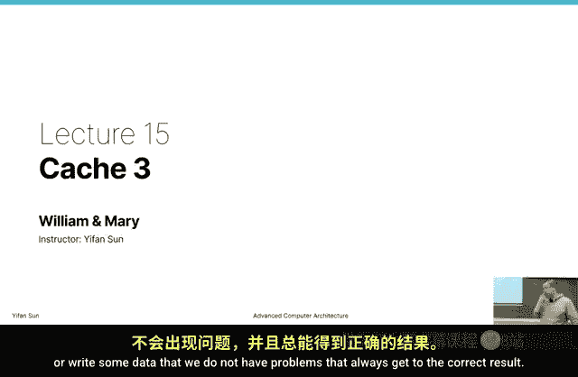
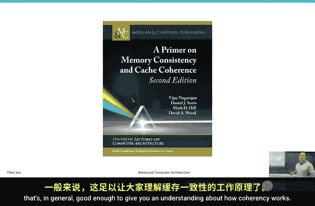
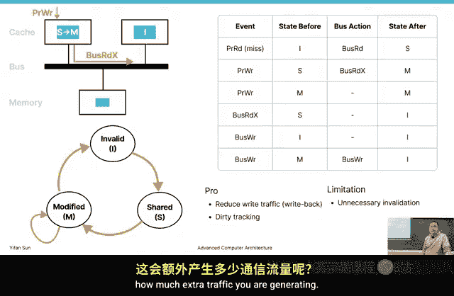

# 高级计算机体系结构：P20：缓存一致性协议





在本节课中，我们将要学习缓存一致性协议。上一节我们介绍了缓存的组织结构和读写策略，本节中我们来看看在多核系统中，当多个缓存副本同时存在时，如何保证数据的一致性。我们将从最简单的协议开始，逐步理解其工作原理和局限性。

## 缓存层次结构与一致性问题

首先，我们需要理解缓存一致性问题出现的场景。在单核系统中，只有一个缓存，不存在一致性问题。但在多核系统中，每个核心通常拥有私有的L1缓存，并且可能共享L2缓存。


当多个核心的私有缓存（如L1）持有同一内存地址的数据副本时，如果其中一个核心修改了数据，其他核心的缓存副本就会变得过时。确保所有核心都能读取到最新数据，这就是缓存一致性协议需要解决的问题。

## 缓存一致性的定义

缓存一致性主要关注对单个内存位置（通常是缓存行）的访问。其核心原则是“单写者多读者”模型。

*   **在任何一个逻辑时刻**，对于给定的内存位置，只允许两种情况之一发生：
    *   一个核心在写入数据。
    *   零个或多个核心在读取数据。
*   **不允许**的情况是：一个核心在写入的同时，其他核心在读取或写入。

这个模型确保了读写操作不会在逻辑上重叠，从而避免了读取到陈旧数据的问题。需要注意的是，这里讨论的**一致性**与**内存一致性**不同。内存一致性定义了不同内存地址的读写操作在所有核心看来应遵循的顺序，而缓存一致性只关心单个地址的数据副本是否正确。

## 解决一致性问题的思路

为了解决缓存一致性问题，我们引入了缓存一致性协议。这增加了系统的复杂性，但在多核成为主流的今天，这种复杂性是必要的。

协议通常基于两种主要架构实现：

1.  **侦听协议**：所有缓存都连接到一个共享的“总线”上。任何缓存向内存发送的读写请求都会被总线上的其他缓存“侦听”到。每个缓存根据侦听到的消息更新自己缓存行的状态。
2.  **目录协议**：在内存控制器侧维护一个“目录”，记录每个缓存行被哪些核心的缓存所持有。当发生写操作时，内存控制器只向持有该缓存行的核心发送失效消息，而不是广播给所有核心。

侦听协议实现简单，延迟低，适合小规模系统，但总线带宽有限，可扩展性差。目录协议减少了不必要的通信流量，扩展性更好，但需要额外的存储开销来维护目录信息。

## VI协议：最简单的侦听协议

我们从最简单的**VI协议**开始，它只有两个状态：**有效**和**无效**。

*   **状态 V**：缓存行中的数据是有效的（可能是最新的，也可能是共享的）。
*   **状态 I**：缓存行中的数据无效（等同于该数据不在缓存中）。

以下是VI协议的核心操作：

*   **读未命中**：核心请求的数据不在其缓存中（状态I）。缓存会发起一个**总线读**事务，从内存获取数据，并将该行状态置为V。
*   **写操作**：当核心要写入一个状态为V的缓存行时，它必须发起一个**总线写**事务。这个事务有两个作用：
    1.  将数据写回内存（假设是写直达缓存）。
    2.  总线上的其他缓存侦听到这个“总线写”消息后，会将本地对应的缓存行状态置为I，从而使其副本失效。

VI协议的状态转换可以总结如下：

```
当前状态 | 事件（本地核心） | 总线动作       | 下一状态
---------|------------------|----------------|----------
 I       | 读               | 发起总线读     | V
 V       | 读               | 无             | V
 V       | 写               | 发起总线写     | V (或 I)
 I       | 写               | 发起总线写     | V (或 I)

当前状态 | 事件（侦听到总线） | 动作           | 下一状态
---------|---------------------|----------------|----------
 V       | 总线写             | 使本地副本失效 | I
 I       | 总线读/写          | 无             | I
```

**VI协议的局限性**：
它强制所有写操作都更新内存（写直达），无法支持性能更好的写回缓存。每次写操作都会产生总线流量并无效化所有其他副本，即使该数据是某个核心独占写入的，也会产生不必要的通信开销。

## MSI协议：支持写回缓存

为了支持写回缓存并减少写操作的总线流量，我们引入更常用的**MSI协议**。它包含三个状态：

*   **修改**：缓存行中的数据已被修改（脏数据），与内存中的内容不同。该缓存是此数据的唯一有效副本。
*   **共享**：缓存行中的数据是干净的（与内存一致），并且可能有其他缓存也持有该数据的副本。
*   **无效**：缓存行中的数据无效。

MSI协议通过引入“修改”状态，允许脏数据暂时停留在缓存中，无需立即写回内存。同时，它引入了一种新的总线事务来处理写操作。

以下是MSI协议的关键操作逻辑：

*   **从“无效”状态读**：发起**总线读**，从内存或其他缓存获取数据，状态转为**共享**。
*   **在“共享”状态下写**：核心想要修改一个处于共享状态的行。它不能直接写入，因为其他缓存可能有副本。此时，它需要发起一个**总线读独占**事务。这个事务通知其他缓存：“我要独占这个数据，请你们的副本失效”。其他缓存侦听到后，会将对应行状态置为**无效**。发起写的缓存则在获得数据后，状态转为**修改**，然后可以执行本地写入。
*   **在“修改”状态下写**：核心可以直接写入本地缓存，无需任何总线通信，因为它是数据的唯一所有者。状态保持为**修改**。
*   **在“修改”状态下读未命中（其他核心）**：当另一个核心试图读取一个正处于其他缓存“修改”状态的数据时，它会发起**总线读**。持有“修改”状态数据的缓存侦听到后，必须**拦截**这个读请求。它会将脏数据写回内存（或直接传给请求者），然后将自己缓存行的状态降级为**共享**（因为现在有了另一个读者）。

**MSI协议的优势**：
它支持写回缓存，对于被反复修改的独占数据，可以避免频繁的总线通信，显著提升性能。

**MSI协议的局限性**：
即使一个数据实际上是某个核心独占使用的（其他缓存根本没有副本），当该核心首次写入一个处于“共享”状态的行时，它仍然必须发出“总线读独占”事务来确认独占权，这会产生不必要的无效化流量。在实际系统中，很多单线程数据访问模式会受此影响。

## 总结

本节课中我们一起学习了缓存一致性的基本概念和两种经典的缓存一致性协议。

*   我们首先明确了缓存一致性要解决的是多核私有缓存中数据副本的同步问题，其核心是保证“单写者多读者”的访问模型。
*   接着，我们介绍了通过**一致性协议**来解决此问题，并区分了**侦听**和**目录**两种实现方式。
*   然后，我们深入分析了最简单的**VI协议**，它只有有效和无效两个状态，但强制写直达，限制了性能。
*   最后，我们学习了更实用的**MSI协议**，它通过引入修改、共享、无效三个状态，有效支持了写回缓存，减少了不必要的内存写入和总线流量，但也存在对独占写入仍需通信的开销。



理解这些基础协议是掌握现代多核处理器中复杂一致性机制的关键。在后续课程中，我们可能会看到对这些协议的优化扩展（如MESI、MOESI协议），它们旨在进一步减少协议开销，提升系统性能。