# 威廉玛丽学院【中英⚡高级计算机体系结构｜CSCI654 Spring 2025, Advanced Computer Architecture】 p21 P21 虚拟寻址 -BV1evfwBVEUG_p21-

ok， then。Let's keep talking about computer architecture and today is the last lecture of the semester。

 so we're going to finalize the discussion with the virtual addressing and we have been talking about the virtual addressing at many different places and let's just finally talk about this concept at a central location and virtual addressing so it tries to solve many different problems with one extra level of redirection and there's always a saying in computer science that you can always solve a problem by adding an extra layer of redirection。

 unless you have too many layers of redirection so this is one of layer of redirection that is added to the computer system that is widely accepted is almost always used in today's computer system。

 especially CPUus today GPUs also used virtual memory but some xators some domain specific like。

use may not really use virtual addressing。

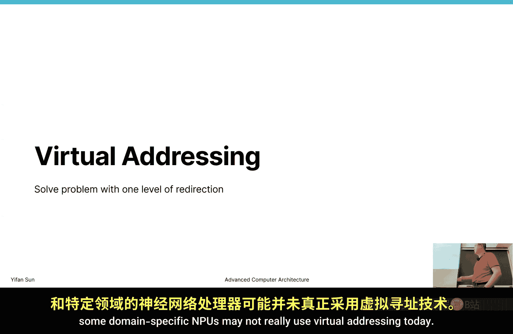

Today， okay， so this virtual addressing is one layer of direction that actually solved many。

 many problems and it just so common。 so useful。 Okay。

 so the first time that virtual memory is used is in this system called Atlas is also known as the first supercomputer。

 So as we see， this one was actually developed in 1962。

 and this particular picture is in 1963 and it's used in the University of Manchester in。

In Great Britain。U， okay， so they want to solve a problem。 By that time。

 the memory is so expensive that you really don't have a lot of memory。

 So the memory on this type of supercomputer is way smaller than the memory that we have on our phone or even on our watch today。

 So then the memory size is so small。 And also the。

Program that needs to be executed by this type of program is getting larger and larger。

 So eventually by that time programmers typically use manually managed memory to manually managed their memory to avoid using too much memory。

 so they explicitly say， place this part of a memory here。

 place an another power memory there store a memory to the hard drive and bring it back something like this by that time it's not even hard drive iss something like drums or some magnetic drums or whatever that is super slow that at least they can store some data there。

So the whole problem， well we want to， we want to have the whole program that fits into the memory。

 but our memory is not that large， but we don't want the programmer to manually control this。

 So then they say， oh， we want to。Store part of the memory into the disk。 Okay。

 and how we can store the memory into the disk。 Then today。

 you may know this is done by virtual memory and by swiping。 So that by that time。

 this is the first introduced in this in the other machine and is。

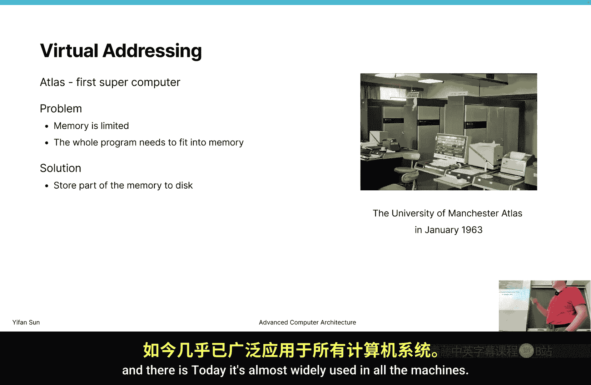

Today is almost， almost。Why do you see all the machines？So a virtual。

 let's talk about virtual addressing。 When we talk about virtual addressing。

 there's always a corresponding concept that is called physical addressing。

 Ph addressing is the address that is actually being used in the hardware in a D in the memory system。

 Now virtual addressing is the address that is only visible or。Is always visible by the program。

 So the program can only see virtual address。 A program。

 a user space program can never know anything about the physical address。

 So you don't know where you' are actually accessing。 You just know a relative location。Okay。

 so it's visible by the program。 And its the。Ares that used by the hardware is the physical address。

 So we want to decouple this physical address and the virtual address。

 That's why we have this type of system of virtual addressing and physical address。

 So what type of problem that is solved then it solves。Memory isolation problem。I don't know who in。

In。Early days。Like when I play computer games on Windows 98。

 we use those things called game modifiers。Have you ever used this style with thing？

So so something like I produce a very high level。Unit， I produce two of them。

Then there's another software can scan for the memory to just for number search for number two。

 So a scan find many destinations again in number two。

 then I will go back to the game then I change this I split this to unit or I intentionally kill one unit so my element becomes one Now I scan the whole thing again So it's a sub search search within the element that we have already search for number two Now I search for number one and typically there's only one or two of them。

Turning into just being selected。 So I know， okay， that piece of memory。

 That address is for the number of units。 Now I can use the modifier to change it to 9，9，9。

 Then I have a lot of unit。 I'm super powerful at time。 So that time is。Because。

Or system or computer。Or operating system do not really have a careful。

 like a very well managed memory so that one program can modify the memory of another program。O。

 so after Windows X P。I cannot find it。 Windows 7， then basically I have no way。 I don't see such。

 say it's basically forbidden by the opening system。

 So memory isolation by that time is a convenient feature。 but although at the same time。

 it's a very dangerous features。 Just think if you accidentally run something some program that you cannot trust or you don't know what software。

 what code is being embedded in there， then you're also running a Chrome browser typing your password。

 it's very likely for the other program to get your password right so。By using virtual memory。

 then the virtual memory in process one and the virtual memory in process two。

 although they are pointing to the same address and they're pointing to totally different memory spaces and they have no way to directly communicate。

By reading and accessing memory， right So if you， if this part of memory is assigned to this program。

 it's always for for this program。 and even today， your Chrome browser。

 each tab works in their own processes so that they avoid tabs to communicate with each other。

And it's a uniform address management for all programs right so we want our program to have something like memory starts from zero and from this range to this range is for stackG that ranges for H。

 then we can easily achieve that without worrying say what other programs is being co-run in your system and also memory access authorization that is。

AndSay if I want to access some piece of data， Can I write it into it， Can I read it into it。

 For example， like later on when you talk a page table， page table is a dedicated part of memory。

 If your program wants to do something right into the page table。Part。

 or if you want to write into the program part。RightThe program part is read only。

 If you try to write into that part， there must it's usually a sign of this program is hacked and is' trying to do something it shouldn't be doing right So in this case。

 if we can authorize so this action is allowed on this part of memory。

 then we can prevent a lot of bad things from happening So if we have this type of feature of virtual addressing we we can read and write into very every virtual address but when you access to the physical memory just because we have this translation process。

 we can authorize very memory access and see if we can allow this action or not。Right， so it's a。

 it's a one feature， one redirection that solved many problem problem。

 I didn't even mention the swiping problem， right， So it's one pro one simple feature that solved many problems。

Then how it in general works is in this logic understanding， so we have a core。

RightWe have the core that generate memory addresses and the core has register in it。

 The registers in the core always stored virtual addresses So when it issues a read and write request to a memory system。

 it always generate a virtual address。 then it needs to go through this logical unit called address translator。

 It's not a real unit， but it's a logical unit that always translates that memory that converts a virtual address based to translation。

 a virtual based transaction into a physical based transaction。

 then it can access or memory system which uses physical memory。Okay。

 once we go through this address translator part， this is all controlled by hardware and no other we have no software directly control the memory that can guarantee that this part is safe because we can trust the hardware。

 but we cannot trust another piece of software that is excluding in our system。

So when we talk about addresses， then when we talk about virtual address。

 we have to talk about this concept called pages， right， So we need some granularity。

 basic granularity that we can。Like like say what translation is based on。

 So what are pages pages are consecutive regions that are consecutive both in the virtual address domain and in the physical domain right so every time we do the translation。

 we just translate the head address， the initial address of the page now from the virtual address to a physical address then we actually automatically translate all the rest of the addresses within this page so for most of the systems that we use today they use 4 kiloby system and this 4 kiloby system have been used many。

 many years more than 20 years and this number is now changed and everyone is still using 4 kiloby pages。

做。Then later on， we will talk about how this page size matters。 and there's definitely a push。

 especially for GPU domains that are pushing for larger page sizes。

But why they initially select the4 kilobyte pages？I's because。

The system also defines that the hard drive， the disk writing unit is 4 kilob。

 So if you want to write a 4 kiloB system， you have to write if you want to write into the hard drive。

 you always just directly write 4 kiloB。Inside， right。

 So what is if you only want to write4 by in the system in a hard drive。

What happens is very similar to cacheline management。

 You have to first load data write into the memory and write it back to the hard drive， right。

 So because virtual addressing is originally designed for swiping memory to hard drive and swipe back。

 So that's why they selected the 4 kilo by size so that you will always。

Move in and move out a full unit of this disk。Disk sizes， right。 So every time we swi。

 we swipe a page， then that's 4 kB。

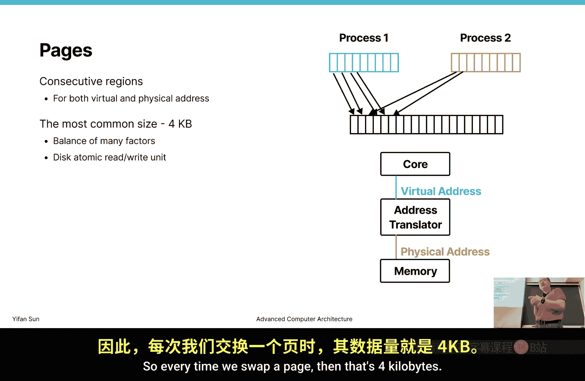

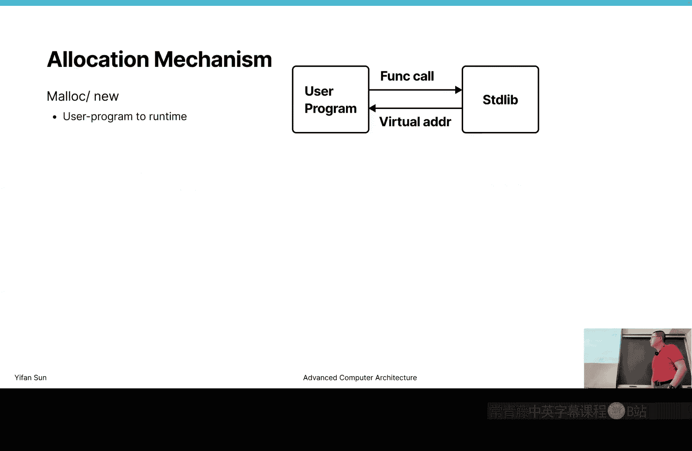

ok。😊，So that's why 4 kiloB was originally selected。 So today if you check the huge pages。

 then definitely there's a push of using larger pages today。

 we're using like we're accessing much more memory。

 where memory speed is much faster where calculation is much faster。

 so it's very reasonable to go to larger sizes， but larger sizes also have disadvantages that we'll talk about later。

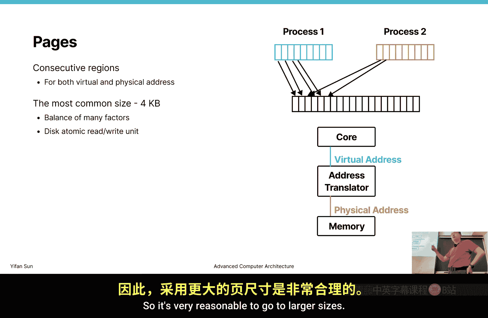

Then allocation mechanism。 So how these pages are first being written into a system and how these pages are determined。

 So let's talk about how this allocation mechanism。 So when we call malllo or this new keyword。

 What is actually happening in the system。 So we use this malloc and keyword system。

 we actually were writing a user program right， our user program is calling malloc with parameters。

Now we going into this space， we call it the runtime space and runtime space is still user space。

 but it's just something that user typically do not just take it as granted just think oh is always there and it just can do whatever I want for example Malo。

 then it will the runtime STD， the standard library will just return me the part a buffer that is always useful that belongs to me right So when we call this function called this malllo function or using a keyword new then the STDIB ST live always return a virtual address that I can use。

Then the question is how standard library implements Maoc。Just Maoc is not something magic。

 not something determined by the hardware iss actually something written as piece of code。

 but just as a piece of code that is typically provided by the operating system or the compiler。O。

 so。In general， the STD LB， the standard library maintains a memory pool。

 maintains a memory pool like this is also in virtual address。 This in user space。

 if you are in user space， you don't know physical addresses。

 it's always virtual addresses So maintain a memory pool。

 no matter if you allocate 4 kiloBte you allocate 4 by 8 by 12 bytes。

 no matter how many bytes you allocate or try to try first to see the local pool is large enough or not and allocate some addresses for you and send it to the send it to the user program In this case。

 we don't need new pages because these pages are already allocated and are already in the pool of standard library。

Now what if the standard library is actually run standard library is running out of memory or when you want to allocate a huge part of data that spans across multiple pages。

 In this case， the standard library use a system call。

 The system call in Linux domain is called memory map or M map。

Then a system call is is a specialized call that is calling into the opening system。

 It's a service provided by the opening system So when you call it the opening system will start to work on virtual memory and physical memory and eventually it can return the virtual address So look at here we start to have this boundary between user space and privileged space or opening system space when're dealing with opening operating system space opening system can have access to the page table Now it knows physical address so it knows what to do with it。

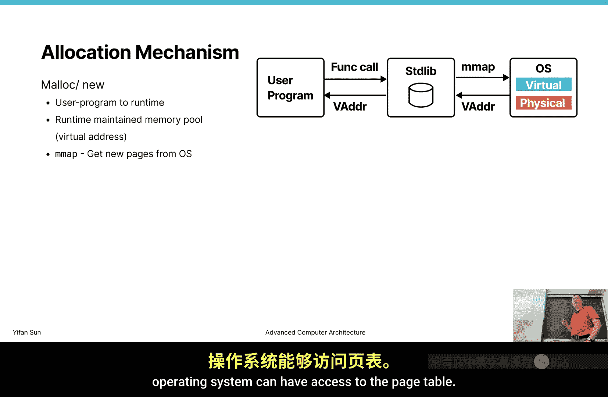

Okay， so what does。The operating system do at this moment at a high level with us is it actually maintains two address spaces。

 One is the virtual space， one is the physical space。 In this case。

 we intent write this virtual address space into two parts like the stack is always growing up while the hip is growing down。

 actually。In the operating system， they typically like to talk in the other way the stack growing down while the hip growing up。

So let's say if we allocate some space in the heap。we just say it's keep， okay。

If we want to allocate some pages in the hip， we allocate， okay。

 we mark this page as being allocated。Okay， then on the other side， we find in physical space。

Try to get into 151。no。So in the no system also has a page that mark that has some data that records what addresses。

 what pages are being used on the physical address。 And this physical address， just be careful。

 It's not only used by this one process It's actually shared by the all program in that is currently running。

So we know which addresses is now being allocated。 Then we find one page that is allocate in a memory space。

 Then we link them together， link the virtual space and physical space together。

 How we can link them is basically we use the page table。

 We record this information into the page table and we put the P ID there。

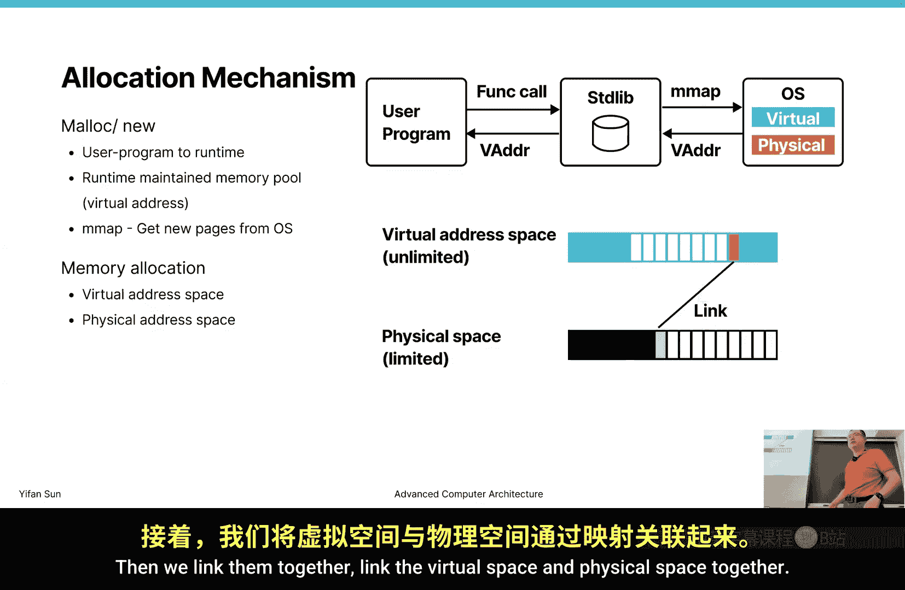

We put flags in there。 then when flags we just market。

 if we can read into it or we can write into it， who can read， who can write。

 I it only opening system can do things or is it like the user space can do things with it。

Now virtual address， physical address， and there are also some other flags like these page valid or not is。

Sometimes being migrated to some other places so all the data is can be stored in this fact region。

 So for here， we just make it simple。 We just list as a set of flags。

 just mark marking the status of this page。They have virtual address and physical address that is being stored in this virtual in this address table then if this。

P， I D and virtual address。This process Id and virtual address are stored here and linked with a physical address。

 Now we're linking a physical address page and a physical address page and a virtual address page together So we know。

 okay， there's a mapping between this virtual address to this physical address。Okay， so in reality。

 this is just a logic representation of a page table。 In reality。

 we actually don't need to store the physical address， the P ID and the virtual address。

 We will talk about why we don't need to store these fields later。이 all 페이지 table。Right。Okay。

 so this page table is nothing special but some data that is stored in a D。

 but only your old printing system can access this part of memory。 Okay。

 your your user program have no way to either read or write this part of memory。

 otherwise something bad can happen。Then， so what is actually being stored here。 So remember。

 we actually don't need a virtual address， the full address now being stored here。 Remember in cache。

 we talk about cache， a cache line is 64 by size， right， So the6， the last4 the last six bit。

Are actually offset within that cacheline。Right， within this cache line。

 So since we don't care about things within that cache line。

 we don't really need to store that part of data。 that can save some bit。 In this case。

 we also need can save some bit。 So just consider where physical address or virtual address are。

Although it's 64 bit long， but for most of time， we don't really need。Super large address spaces。

 So for most of time，48 B is good enough。 So this number really depends on the hardware and opening system。

 Okay， especially on the chips that using。 So the chips can decide what are actually the number of bit that were using。

Then this bit number of bit can matter a lot because it decides the number of wires that we need to pass this data from one component to another component。

Now， here。If we're using it 48 B。Now， what's the actually bit that we need to store is 32，36 B。

24 kiloB，4 k B is 24K is 2 to the power of 12 right So for 12 bit。

 the last 12 bit are offset within this page。 We don't care about those bits。

 Then we don't really need to store there。 So here we have two special names， we call VPN。

 the virtual page number and physical page number at Pf。嗯。It's。Physical frame number。 O， P Fn。

So we only store this number here， which is the only the useful address for address translation。ok。

So when we are executing a program， how address translation happens is that our program our program runs in the core and threads runs in the core and a register only stores the virtual addresses。

 so for memory every memory access we need to do the translation we send the virtual address to the address translator。

 then the virtual the address translator perform transaction。

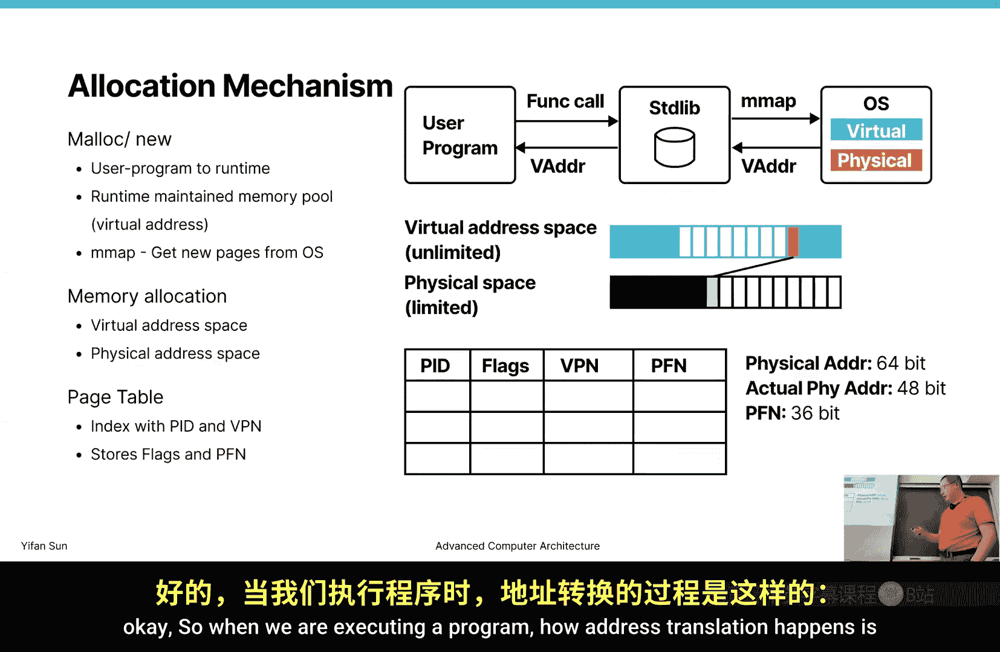

This is only logical in real hardware， There's not such a thing called address translator okay so extend something to the MMu。

 the memory management unit that can translate can convert virtual addresses to physical addresses send back the page and sometimes the MMU can just know oh this access is not allowed if it's not allowed it will write something called a page fault a page fault needs just notify the opening system say there's something wrong with accessing this page where sometimes this address doesn't even exist So this virtual address is not you're not supposed to access this virtual address。

So I think if you have written a C program， you must have seen segment fault。

 So segment fault is one of the most common scenario of page fault。

Now you are accessing a segment that you are not supposed to access。 and very。

 very likely you are trying to access No pointer。 No pointer has address 0 and address 0 is some segment that is preserved that a user program should never access。

 and actually， any program should never access that part of memory。Okay。

 so then for most of the case， we assume it's running correctly。

 Now we'll go back and give a physical address to the address translator。

 address translator converts this original transaction into the physical address and。Well。

 it's accessing the memory。 Okay， I mistake here。It's accessing memory。呢。

So when we talk about distance address translation， we also have to clear our concept。

About what is thread and what is process。那。Thread is a sequence of program is sequence of instructions that are being ituted in your course。

 So if you don't talk about hyperthreading， one core runs one thread。

Now it's also a set of registers。 It's a set of actual register that storing data。

 So register 0 and in one thread and register 0 in another thread stores different data。

 but they have the same name。 Okay， that's threat。Then one process。

 one program can have multiple thread in most of case。

 we talk about one program as one process then although actually if you consider a hierarchy。

 one program can have multiple processes， but what is a process， A process is a virtual memory space。

so。A process can have multiple threads， right， So address。4，0 in one thread and address 4。

0 in one thread。As long as they are using the same process， they have same。P ID process ID。

 there are actually this 40 a pointing to the same address， same physical address。

 So that's why if you write a multith program， you can easily write within from one thread and read from the other thread。

 No problem because they're actually pointing to the same location。

 but you cannot easily achieve the goal of say if you have two process and address 40 in process one and address 40 in process2 a pointing to different locations。

 So it's not easy for two process to share。地头。Okay。

 it's very difficult for two processes to share data。Unless you some advanced technologies。

 So in Linux programming or in C programming， this is a specific term called inter processces communication。

So the most common style of enterprise process communication is to use a socket。 Okay。

 as long as you for， as long， I see if you are communicating with a program running on another system。

Okay， then although there are some other techniques， say you can actually in theory。

 you can map two virtual addresses into one physical address。 It is possible。

 but it's not a very common use case。Now， what is context。

 when you say context here is in terms of context switching。Okay， so context is more like thread。

In the typical CPU。Context， okay， when we talk about CPU， when we talk about context switching。

 a context switching means we're swapping from one。Thread to another thread。

 But when we talk about contact and CPU。It means the register state that is being stored within this CPU core。

 and if we' are swapping out of a thread and swapping in a thread。

 we're switching the context that is being executed within a core。 So that is a context switching。

Okay， so for most of time， contact switching is referring to swapwiping from one thread to another thread。

 Then does it matter if it's swapwiping from one thread1。

Same process thread or different process thread Well see if the performance implication can be very different。

ok。Now since we're talking about MMU here， the MMMU is where the address translation happens。

 Let's talk about how MMU works。

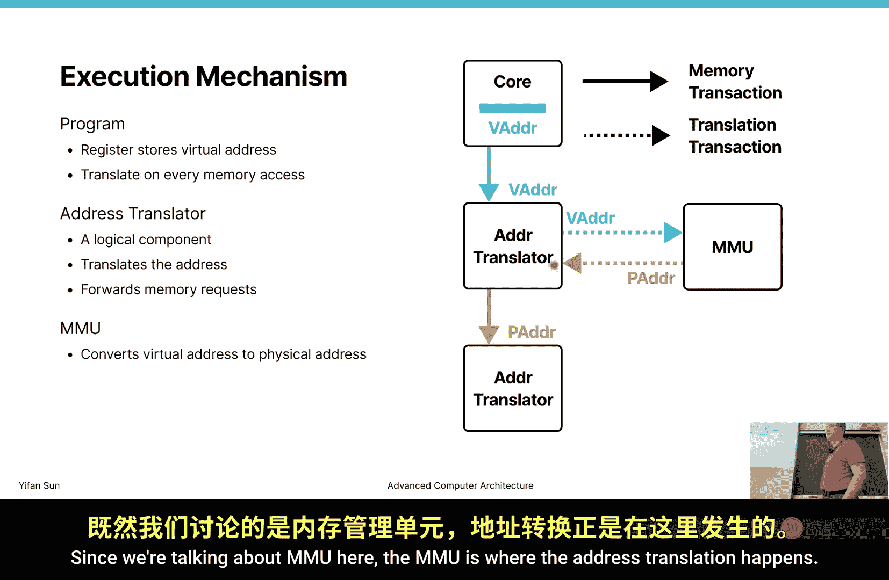

What is MM M U， The MM M U is basically the part that is working the page table。

 So give it a virtual address and P I D， it will give you a physical address。 Okay。

 so let's consider if our page table is implemented in this way。而就 the logical way。

What we need to do is basically if given a PID and VPN， we need to run this type of program。Right。

 just run a full loop and access each page and check the P I D and check VPN。 If we find it。

 we return it。 Otherwise it's a page fault。ok。So any problem with this design？

Before talking about problem。It can be either software based or hardware based。

 It's a matter of if your hardware provides this type of hardware to execute this part of program。

Or it's basically a small piece of As that is just accessing the memory in this particular way。

Or it can be software based that when you say software based， the open system will take over。 right。

 So for some opening system， even the hardware can support it， we will always just do it。

In a software way， So software style。Okay， the problem with that is。

This translation happens at what granularity。Happens at memory access granularity， right。

We only want to access one piece of memory。Then， accessing the page table is a access of memory。

Right， accessing。A page table element is one axis of a memory。

 Think about how large this page table can be。Right， we only want to access memory once。

 but here we're accessing memory in each iteration of this loop。So how are our pages。

 let's just make it simple，4 kilobyte memory， so4。Gigabyte memory4 kilo each pages is 4 KB size。就。

Gabyte divided by k kilobyte。 that's exactly 1 million， right，10 to the power of 6。So just。

We only want to access memory once。 and this O N of complexity。

 we may end up accessing memory 1 million plus  one times just to find out this address。喂。So this is。

Not practical at all。And this is the overhead is too large， way too large。

100% of overheads are only doing translation， never doing real memory access。Right。

So how we can solve this problem and a real system is never designed in this way。

How we can solve this problem。多。

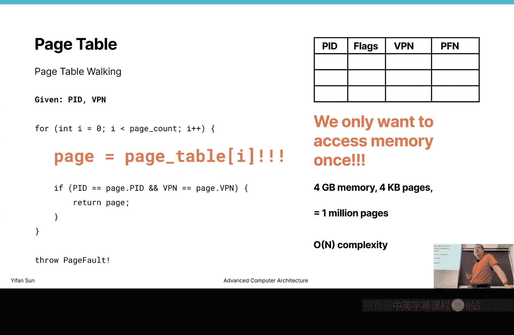

This each P ID has their own table， right， It's much easier。 Each P ID has their own table。

 So we first have a P ID。 We first have first have a table。那是。I call it page table table。 Okay。

 but anyway， it's a P I D is the index and。Remember。

 page table is nothing special but a segment of memory， a part of a memory that's storedor in the D。

 we can store this page table base address in this table。 And when we first given the P I D。

 we first find a page table。Page table， base table and get a page table。

 Then we also need to change a page table。 There's no way for us to list everything there。

 So remember。How in what's the general way of converting an O N operation down to an O one operation is to use a hash table。

 right。Then hash is slightly more expensive here。Because this is so fine granularity there。

 what we can simply do is to have a direct access table。A direct access table is simply use VPN 0。

 V PN 1， and so on and allocate slots there。ok， so。If we know our VPN number is 0。

We can immediately pinpoint to one access， one location。ok。

If we know where OVPN is by one member access。But one to2 memory access one axis is into that table and one access into this table。

By one to two axis， then we can basically find out her address。

 which is a significant performance improvement。At what cost is。你。We actually。

Whenever we start a process， we need to create this table for it， right。

So how large is in this table， let's just make some a simple estimation， a brief estimation。

 let's assume there's one million interest。44 gig of memory。 That's1 minute interest。 right， so 2。

2 power 32， that's when the address space is 32 B。That's the maximum number of entries now we actually need。

Right， then consider 4 B per entry。That's 4 million，4 megabyte。

The4 overhead for a 4 gig memory system。It's okay。 It's not a big problem。 So one over 1000 overhead。

 right。So 0。1% overhead， which is acceptable。 But just be careful， it's per P ID。

 So you create another P I D， you create another process， then you know。And you。

 you need to recreate this table。 So if you're using a computer。

 check how many processored that currently running。Very， very likely more than 100， right。

 So that actually can be some address space allocation。But this problem is getting much。

 much worse when we're going towards a 3064 Bta address space。Now we are doing 3064 beta address。

 and we have this many number of interests。 Remember， this interest is determined by the VPN。

By the virtual address space。 So 30。Ctic4 billion address， although the physical address。

 physical size didn't change much， but our virtual size actually increase a lot。Right， in that case。

We may have this number of entries because pretty will talk about 6 32。

36 entries that are being stored， right，8 by per entry。 We need this number of。Page table。Purpe I D。

 which is not practical。Right， so we cannot use this solution。Now what's the solution down there。

Now one way is definitely hashing and hashing is complex。

 we don't want these low level things to be that complex。We design a multi level page table。

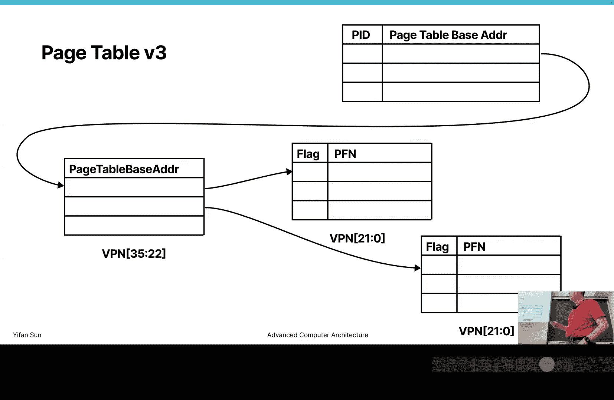

We already have a multile pay table， by the way。🤧嗯。Here， Y S say 1 to2 access。

 Y is not always two access， because for most of time， we don't really need to bring a P ID。

 We execute one program for some time， right， So we'll process many memory access before this context is being swept out。

 So when we swap into a context we use that。Process Id。 Now， by that time。

 well look up into this table once。那 for的。Following memory access。

 we don't really need to access that table anymore。 We already have the base address for this table。

Okay， so for most of the time， there's only one access in this case。ok k。

So that's also a cause of like inter processces contact switching versus intra process contact switching。

 When we're switching a thread within one process， we don't need to tell M M U to say。

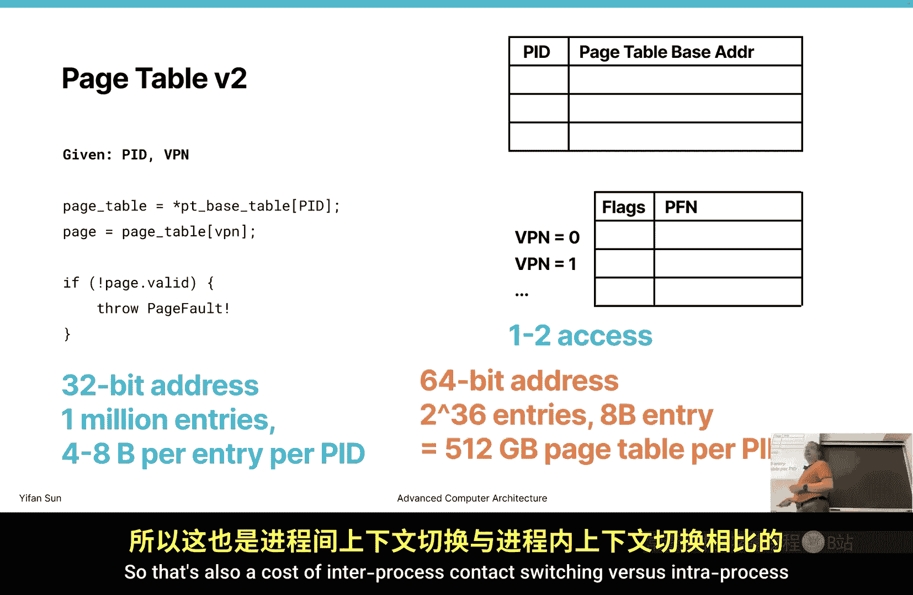

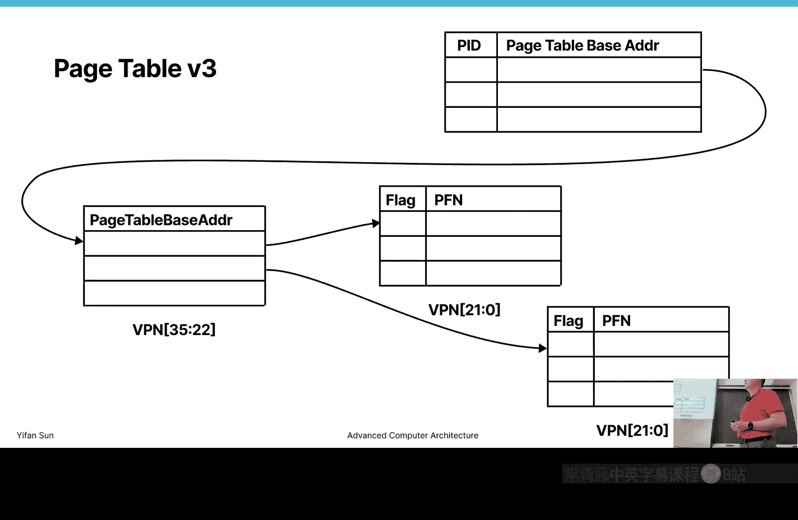

嗯。Swipe to another page table。 We can continue to use the original page table。 So intro。Process。

 contact switching has lower overhead。ok。Now， in this case， we want to make more level of indirect。

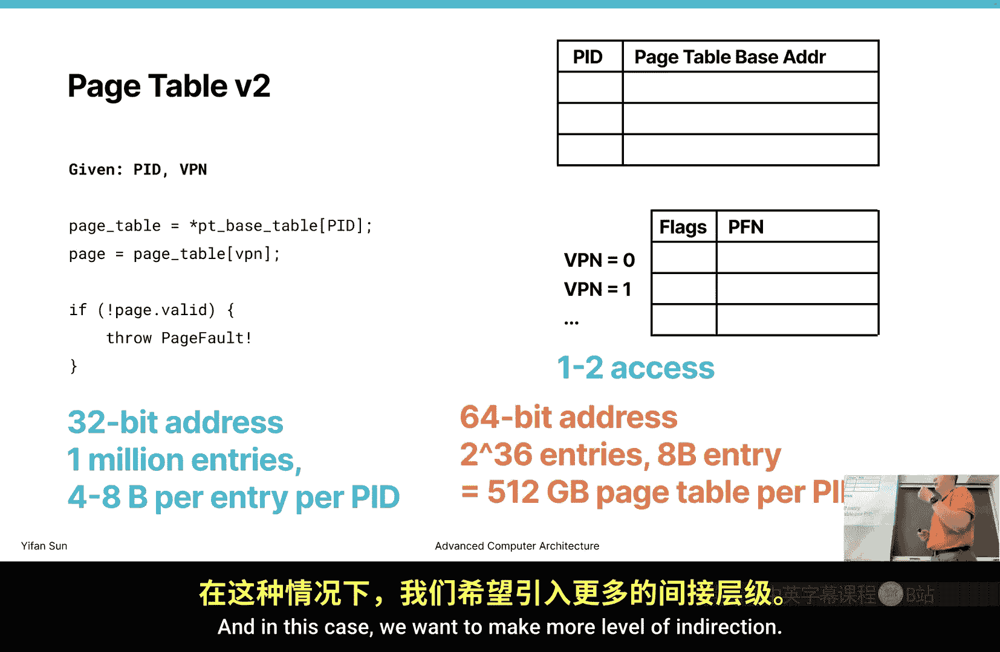

What's more level of indirect is we have a base address。 We have another table。

 This table is indexed by some bits within the VPN， higher bits。Okay。

 so if we use this a few bits to find to directly access this element to then to access this part。

 then we know， okay， then。It's actually pointing to this page table。Then within this page table。

 we're using the lowest 22 bit。To access。To directly access the elements there。ok。So。

 the advantage is not。If we are using the whole address space。

 it will have the exact same large memory address table。 But if we don't have a。

 if we have a smaller。Like， we only used a few by， a few kilo B of the memory。

 Probably we only have one sub。Page table， we don't even need to create this page table because our memory access are close to each other。

 If it's close to each other， it will always have the same higher bit address。Right in this case。

 we're only。Creating a subset of the page table。 But we don't need to create the whole page table。

 all the subts at this。In this case。So以 feel if we。Consider this。

222 bit right so 22 bits means 4 mebytes， not 4 mebyte is 4 million pages4 million pages consecutive virtual spaces now we need 32te storage for each subt which is much smaller than 512 gigabs pers same so if our program only use a small part of memory likely we can on handle everything with one sub table with 32 mebyte storage。

Which is only a fraction of the 512 gigyte that we have introduced before。

 and we also need this level here。 It's only two to the power 13 entries。

 which is very small and only takes a few kiloby inside。ok。And in reality。

 we're still not happy with two level design。 We still think these 32 MBby storage is too much。

 So we're moving into even more level of indirect。 So in more than operating system where're using either four layer page table。

 which is eventually 12 its the page offset。 So it supports 48 bit addresses。

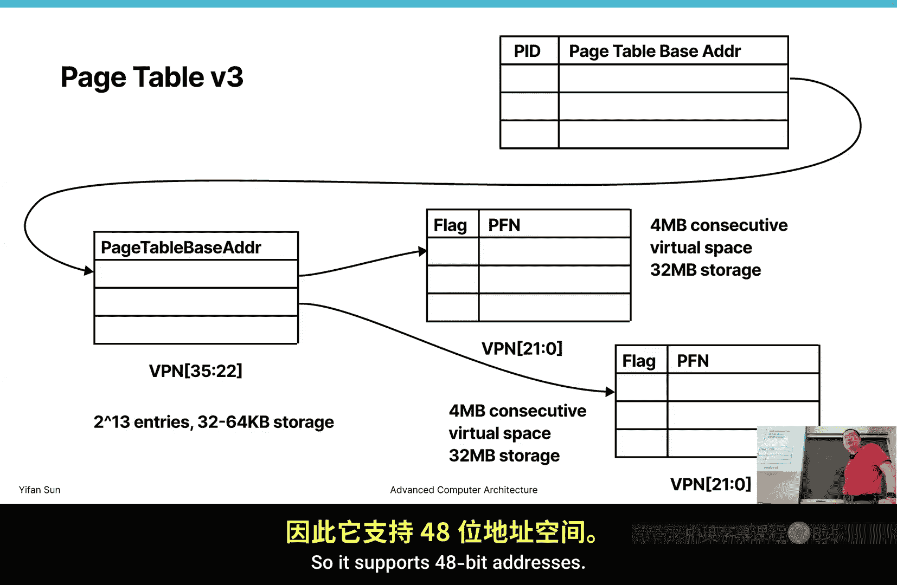

Okay， in some even more powerful system， they added the fifth level of page page table。

 So I would say modern。Page tables， Intel A M D CPUs。

 This is the standard that use 5 layer of address and support 57 B address system。

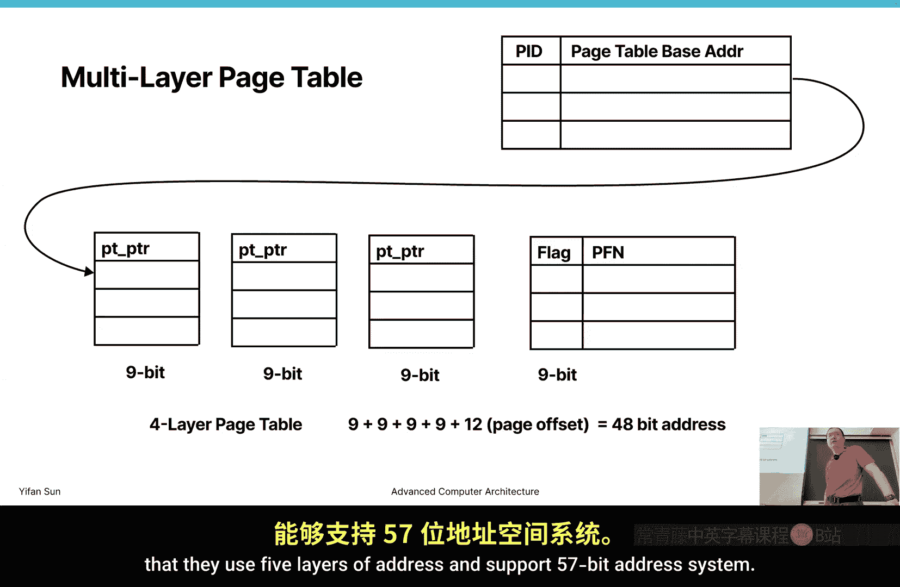

ok。So the more layers that we have。The fewer， the smaller memory address that we can support。Okay。

 and if we use smaller address ranges for storing these addresses。It's。

 it's not only storage overhead。 It's also about cash locality。 It's more easy to be handled。

To get information from the cache rather than from the D D， to reduce the。translation latency。Okay。

 so five layer of cash。 we first identify the P ID。 The P ID will point to this address。

 Now within the address， we take 9 bit out。 Then we can directly use99 bit to find element right。

 find the element。 Then we find this address。 This is a base address of this table。

 then use the next nine bit to directly find。 okay， this is the element we're looking for。

 Then it's actually pointing to the base address of this table and use the next nine bit to find this location。

 and。Again and again， eventually，9 B to next layer。 Then eventually， the last 9 B is the。

Page table that we' are looking for。So eventually， remember。

 I say virtual address and P ID are actually， we do not really need to store and。

We do not need to store P I D and virtual address in the page table。 Theyre indexed。 there we use it。

To locate the entry within the page table。Okay，因 in this one， we don't really need to sort PID。

 We can just make it a direct exhaustive。Assortive derived asive storage。Okay， so that's saying。

We have five memory access per translation。Okay， we do not consider this one。

 this one as a memory access。 So one access 2 access 3，4， and eventually5。 Okay。

 we need five memory access per translation。Then it's good or bad， then。It's not ideal。

 but it's way better than millions of memory access。So think about these for one member access。

The worst case， we may need five memory access just to do the translation。Right。

It's still lots of overhead，80，90，80 something percent overhead， right。

Now we need to still reduce this overheads。And this overhead， if they're all handled by DRM。

 is 250 to about 300 cycles latency。 It's a brief estimation。

 it can differ a lot from the D technology that we use。 for example， in GPU， GPU uses DDR， sorry。

 GPU use GDDR or use HBM。And what's the difference between GDDR and H HBM。

 GDDR is used for gaming or graphics。 It's designed more for lower。Latency。

 so more responsive for HBM we don't care about latency that much。 we care about throughput。

 we care about how much data can pump into the memory， so like AI chips。

 H100 B100 those machines use HBM HBM has much， much longer latency and much much larger throughput in that case。

 the latency for GPU translation can be much higher than this number。ok。No anyway。

Let's talk about how we can reduce the latency of these cases and the method is with two different level type of caches。

 one is called MMU cache and the other type is called TLV。

 two different caches and whatsner use cases。 and in this case。

 we want to reduce the latency of page tablework。Okay， so look at M M U。

 then M M U in this particular situation is just very similar to a core， right。

 And if it's handled by software， then it's executed in the core。 So it needs to access。

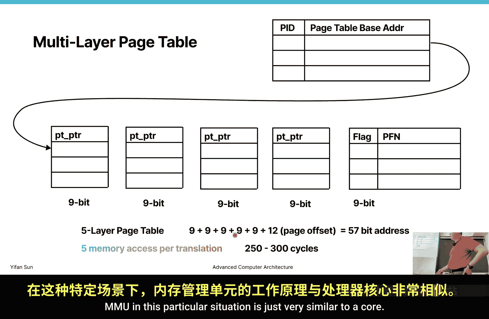

The memory to get the。Table， address table。

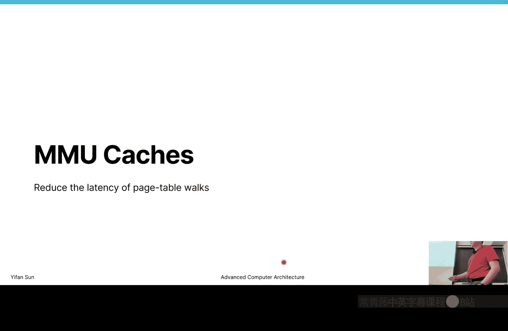

So it initial grid request to the D and guess the data。The nurse locality。

 nurse to temporal locality。 That means if we access data on one page。

 we're very likely to access data again and again on this page。

That's temporal locality and spatial locality。 Yes， we access one part of the memory。

 then we are very likely to access adjacent part of memory。

 and especially if you consider for cache line is 64 by， right。😊。

So for some data structure that we're processing， it's very likely that we're going to the just adjacent access is going to another catchline because it's not large。

But for kilo by level data， it's very likely that we need to spend some time within one page。

 process it， then eventually move to another page right so the locality of addresses are actually much better on pages are much better than cash cache lines okay so if we have the locality and we are accessing memory we want to reduce the latency。

 we can actually add caches here。Right， the M M U cache stores part of the page tables。Okay。

 it stores part of the page tables and is implemented in a rather regular way。

 It's just a weight sortive cache。 and the cache line size can be still a 64 B，32 B or 1，28 B。 Okay。

 it's just a regular weight sort of cache。 thats see being inserted here。

 But everything that is stored there is in the segment of the。Page table。ok。

And even more what we can do here is we can actually plug into the whole system if you consider MMu is a software concept。

 in this case， we can just plug into the L1 L23 caches and just on top of L1 regular L1 L23 caches。

 we plug in a small MMU cache Now we add an extra layer of cache here it's just because we don't want the data access to evita page data there。

Okay， so what is being cache in M M U cache， It can be any layer。Of this page table。 Okay。

 its just we can use an LR U least recent use the replacement policy in the M M U cache。

And sometimes。We also case see cases that L1 caches and L M M U caches are alongside each other。

 So the core， the core connects to the memory side， that connect to the。On one side。

 connect to the MU cache the page cache on the other side。

 connect to the L1 cache with static for data， then their merges back at the L2 cache level。O。

 those are also common， common designs。So。Then we want to slightly analyze the latency of this element。

Okay， the best cases， we have 5 L0 or M M U cache heat and can reduce this latency down to even smaller than 50 cycles。

 Okay， a really small level value。 and typical cases is hit somewhere sometimes hit here sometimes hit L 1。

 sometimes L2， sometimes L 3， but most of them hits at the rather higher level。 The typical cases。

60 to 70 cycles， right。

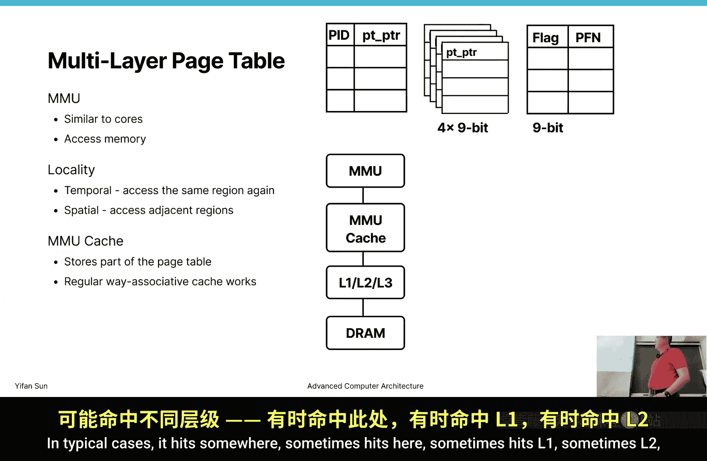

Now hit LLC， all hitting the last level cache is this number。 Now if it's all in D access。

 it can be several hundred of cycles。ok。So are we doing better。

 Are we doing better here from 300 cycles down to 50 cycles， reduced the overhead by six times。

Rightend。However， think about web memory access。If this memory axis is a one catch hit。

I won't cashki take how many cycles。Probably less than 10 cycles， right？For L1 hit， if we do L1 hit。

It's10 cycle thing or sometimes even less than10 cycle thing。The best case is 50 cycles。

We're adding a log of overhead， 10 times the overhead。嗯。It's definitely not ideal。

So what is the ideal case？These are all cases。We want one cycle translation。We just。If。

 if the memory axis is one cycle。Or less than five cycles。 We， we can probably accept。

Like 20% of overhead。 But we don't want to pay for them。Much overhead， right？

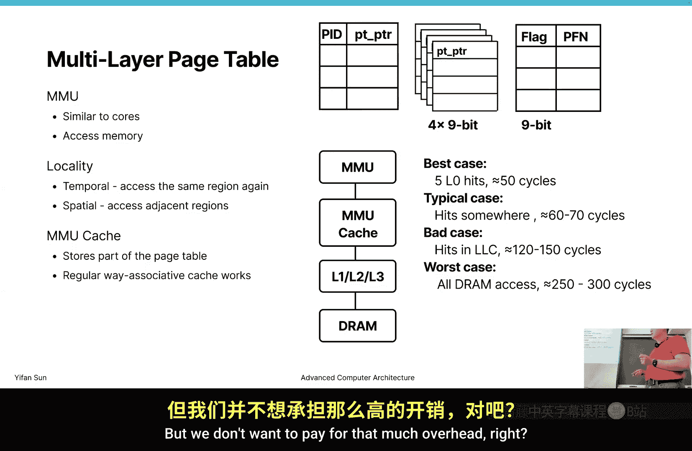

like。Five times overhead what we really want a possibility of how one cycle latency。

How we can do that is achieved by this thing called translation look buffer。

Or more commonly known as T L B。ok。What is TLB， and TLB is super simple。It's just did in this way。

It's a small。P table。It's a small page table。Now， what we store here is we're storing VPN flags and page frame number there。

Okay， this time we have to store VPN。Okay， we have to store VPN。

 This VPN is more like tax for your addresses， for your for your cash， right。

 So if provided a VPN from the core。

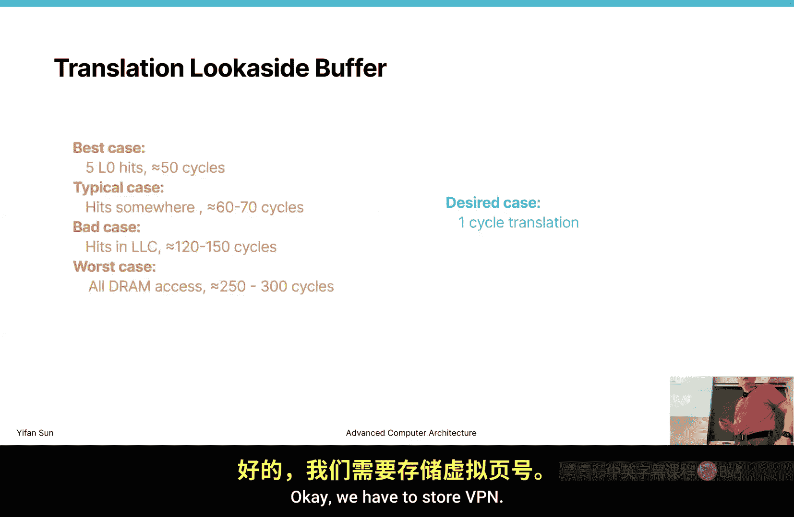

Then we first check if equals to something that is already stored here。ok。Now， if we find the heat。

 it goes back here， then we directly return the flag for address tables。

Then with this thing it's designed in a super simple way right if cache can if this type of four entry or 10 in。

16 entry，3 or2 entry， a small cache can be handled within one cycle latency。

 this thing can also be handled within one within one cycle so we can achieve we can do the translation in one cycle。

ThenSo there are some design decisions or parameter selections that for TOBs then TOBs。

 especially at1 TOBs， strongly prefer fully assive cache。

 fully prefer asive design or highly asive design because it wants to increase heat rate as much as possible because it's rather small right。

 it's rather small so even adding a lot of comparators。

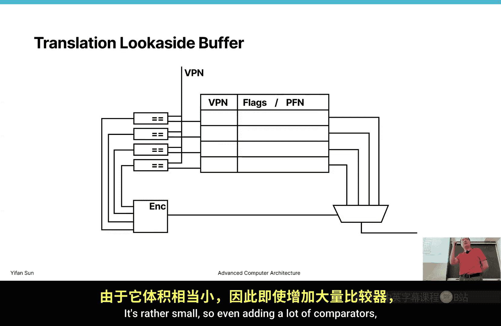

It's not adding a lot of。Mem sizes。So sometimes a TLB can be only 32 inches，16 inches。

 64 inches in this this size。 Now for cache lines， you can almost never see such thing and also for TL B。

 whole large size it can cover right， It can actually cover a rather large space。

 We talk about TLB coverage zone。So。It's a relatively small cache。

 and the address it's covering is relatively。 It's actually very large。

 So the overhead is not that terrible。 And we also have high missed penalty。

 So if it means in the L in the T L B， then we go to the memory， then go to the memory。

 it can be several hundreds of cycles of latency。 So in this case， we want to increase the。

Heat rate as much as possible to by paying some energy and gu size cost。 In this case。

 we put a lot of compar here and to make it fully asuciative。

Then TO B is also have multi level design， right， then for everyone TO B， as we said before。

Our goal is to reduce heat latency as much as possible and targeting at one cycle。one cycle latency。

 translation latency。 The L 2 T L B has a different goal or L 2 or even L3 D TL B。

 It needs to be as large as possible and try to avoid going to the MM M U as much as possible。

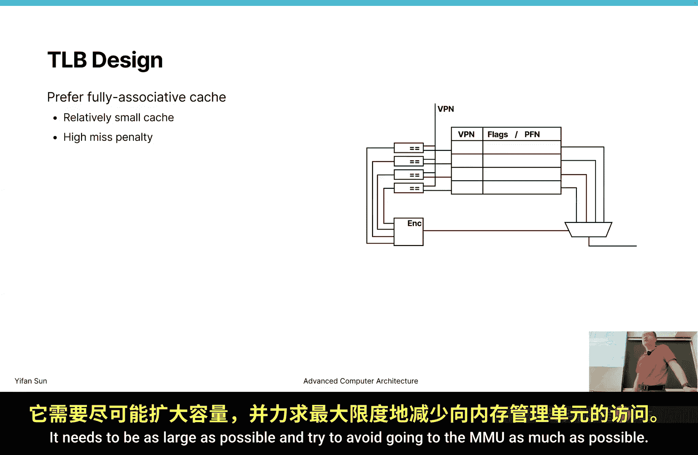

RightIn this case， a lower level and shared TLB， we really wanted to have large sizes and rather quick responses。

 In this case， sometimes it would choose a lower way of sensitivityivity。ok。

Then it's also eventually， if we miss an all2 TLB， we go to the MMU for address for page table working。

Then think about if we have these type of distributed caches， then there are coherency issues。能。

We can have something like massive for our coherency issues， but for most of time。

 we don't want this type of thing because modifying a cache entry。Do not happen very often。

It's rather stable， so in this case， a more common design is shut down based it。嗯，T比。

So what is show down base is basically say， oh， this address， just go away from this cache。

 Just remove this entry from this cache。 Some， some T Lbs are even designed in a super simple way。

 It doesn't even have the address boss for eviction。Okay， it just say。Evict， then evict everything。

Just the whole cache set every， every every entry to be invalid。ok。So， that's a。

AQu and dirty way to evict the T L B。 But just consider we care about the quick response。

 and we don't really have a lot of frequency to do T L B shutdown。 Sometimes that's okay。人。

By the way， talking about T L B coverage。 and T L B coverage is an important concept that we're talking about here is what size is covered by T L B。

 Now think about。If assume or TL B has 64 inches， that is a rather large T L B。For a cache。

 if it's only 64 entries， it's a really small cache for TLV is 64 is rather large how many pages it can handle。

It how how large a page is a 4 kiloB page， right？ So if you multiply this together， it's actually 2。

56 kiloB。That is。Actually， quite good for a program to run sometime that to only process data within this range。

 okay。And just to on to add one point here for GPUus。 today， we see GPUs also do dress translation。

 And GPU also follows this type of design that has a compute unit here。 uses is the core。

 Then it needs to go to its L1 T L B。那L two调皮。Our two TLB is shared and rather large。here。

 there's a debate。 if we need a page。We call it GMMu。

 a GPU MMU Now for most of time if you consider this GPU only needs to access the data that is on this GP on this GPU。

 yes， this GMMU is very useful that I can handle all the address translation within this GPU。

 but sometimes if you consider a media has this technology because GPU peer to peer direct。

P to P direct direct。That it allows to access the data that is on another GPU。In this case。

We may have GMMM U miss， although it's a page table worker。It can have missed。 Now。

 what happens is it eventually needs to go through this PC Ie network。Now， move to the CPU side。

Within CPU nurse a unit called。IOmu。inputput output memory management unit， I O M M。

IOM Mu is responsible for managing the pages that is on the peripheral devices。Okay。

 so this thing will eventually provide address translation and go back through this whole process in this case。

This is very slow。And this also， in this case， do we cache data， Do we cache remote data here or not。

 Its something that is。We actually don't know how real GPU handles in these type of things， and。

There are pros and cons for this type of things。 Pros is it can reduce something super expensive。

The count is if this page， some pages are being modified， we probably need to show down multiple GPU。

 now which can be very expensive。Okay， especially you consider in a media GP。

 their technology called unified memory， right， we can move。

 Unified memory allows page to migrate automatically from one device to another。

 So unified memory is something。Quite complex and can create a lot of complexity in this system。ok。

Let let's talk about cache design。 Now just revisit cache design。So by the way。

What is the difference between TLV and MMU cache。And why do we need both。TB stores。Hes address。

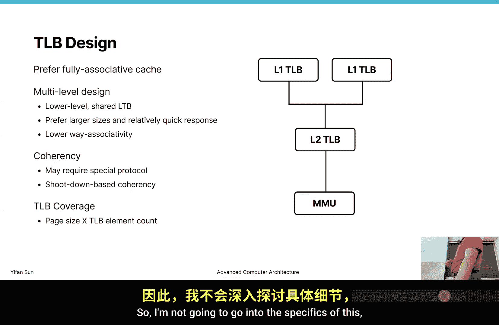

对。Yeah that's that's the most important distance。 So TLB stores whole address translation and T LB。

 if it's a hit， it can just complete address translation without even going to the MM M U right for MM M U M U cash stores。

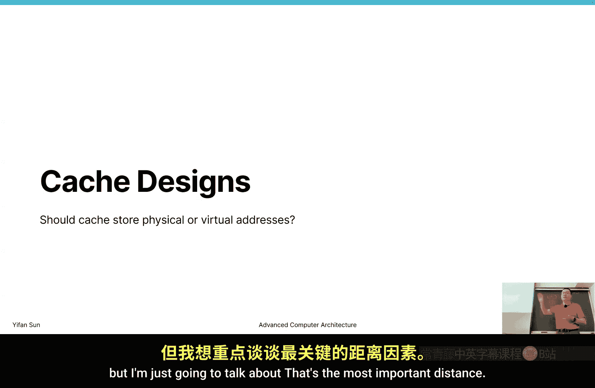

The multi layerer structure， theres a data within the table。 the multilayer structure。

 So it only is useful when we're working the page table were find looking when finding that address。

 right。So why they are both useful is。T L B have a good chance to significantly reduce the arrest latency。

The translation latency and can reduce it to down to a few cycles。But eventually， if we go to M MU。

 we still want to reduce the latency。In a， in a bad case， in that case， I'm。Im M you cash。

Can save we can significantly reduce the working latency。ok。

就 look at cache design want looking at revisit a cache design。This is。All about our data cache。

 not memory cache or TL B， okay。Now， were in a cache did。 This is a figure that I used before。

 We have a 40 B sorry，40 B tag here and also a few bit for。Index。

 which represents for the set that we want to use。 Okay， so the quick question is。

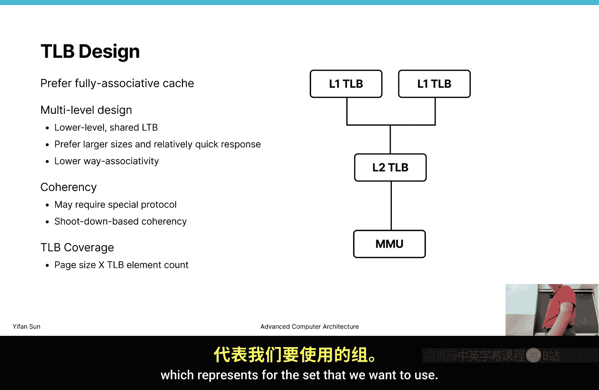

For tag and index offset is not here。 So that is for tag and。Index that is being used here。

 Do we use physical address or virtual address。Now for everything that we have talked。Earlier today。

 were using。Physical address。Right。We're using physical right， we think， oh we just translate it。

 then we access the cache。Right， then just think about。We assume translation before cache access。

 Let's think about the N GPU design。 This is on particular case， we have L1 Icache instruction cache。

L1 Ic instruction cache has very high heat rate。So pretty much the cache itself is good enough to hold the whole program that we're running because GPU programs are typically small。

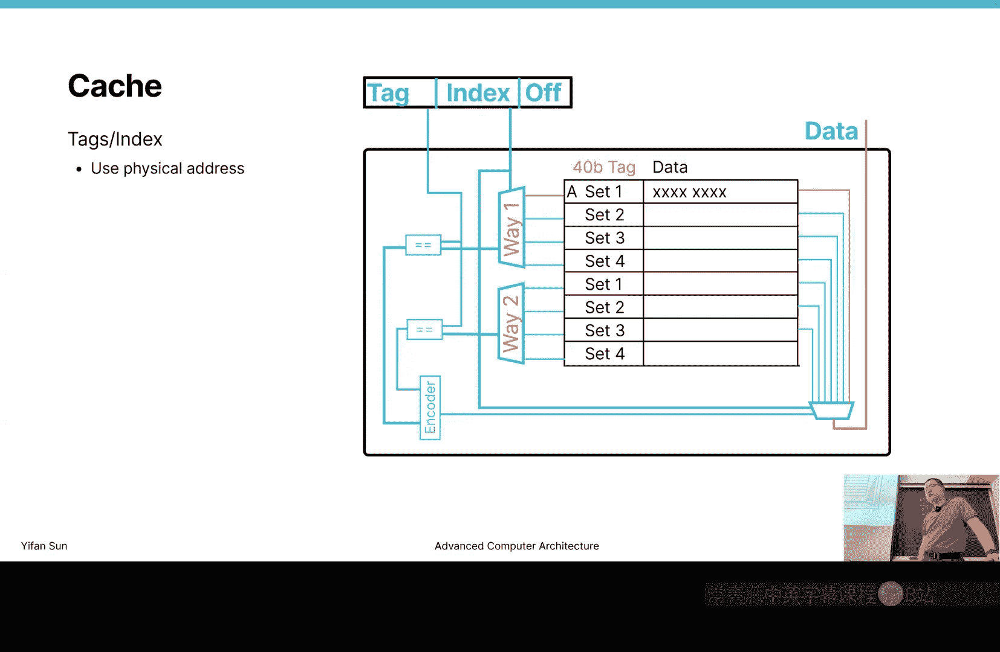

It has a high heat rate。And it has a high。Bund requirement。

 We're expecting that this cache L one cache is pumping data every cycle into the core。 Otherwise。

 if we don't provide the data in any cycle or core may stop executing we have a high bandwidth expectation。

 and we have a low latency tolerance。 We cannot expect， We cannot wait for anything。 We just。

Every cycle， just give me the address。 and next cycle data goes back， right。

 or you probably five cycles， data goes back。 So it has a really， really。

Tight design in L 1 I cache needs to return the data。能。If we translate。If we do a translation here。嗯。

Hopefully， we can do a translation in one cycle if we have a。TL， if I have a TL B meet。

 we go to the MM M U。 there can be hundred cycle latency。 If the MM M U is busy。

 it can be thousands of cycle latency。Right。There's something we cannot wait。

 And even if we have one bubble in the whole pipeline。

 it can wait 1000 cycles and it's just significant reduce stakes reduce the performance。So we don't。

 We don't want to pay for translation for every access。 We know it's just give me the address。

 that I can， I can find the thing for you。 It's immediately just。Why not。

 why has to have to translate， even going to L1 TLB is some energy consumption， right？In this case。

 the quick question is， can we just use the virtual address， it seems if we use the virtual address。

Identify that address， identify that data。 We don't need the translation。

 Just go back and send the data back。 It's very quick and reduce the translation requirement。Right。

 and the quick answer is the quick answer is， yes， we can。 We can use the virtual address in caches。

So just think about this memory hierarchy in a logical understanding。

 there's no such thing called address translator in real hardware， just a logical understanding。

Address translation。We just need to happen somewhere between before Dran before hitting Dran。

 anywhere in the hierarchy works， right， So in this case。

 we put a address translator here that is physical on top virtual on top physical below。

 In this case， L 1， I or L 1 cache is。

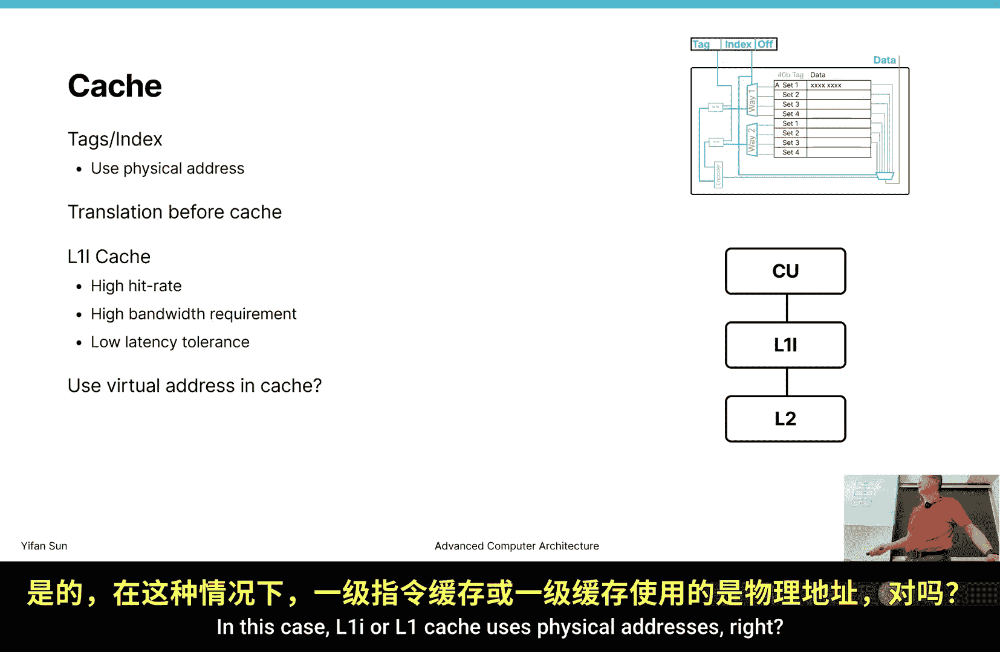

Uses physical addresses， right。 But what if we move the address translator down， we can move it here。

 In this case， we allow L1 cache to use virtual address。Right。Then not in this case。

 or cache will use virtual addresses。No， advantage of virtual addresses is。

It has lower latency if we have a heat。 And it's rather pretty much the same latency if a。Cash miss。

 right， If we have cache miss， let's just go down and then do the address translation。 It's just。

Which one happens first， the thing？不。Now， what's the disadvantage of cash with virtual addresses？

AndUse physical addresses。 if we point and say， oh， that's the data we want to access。

 then we access that data。 No ambiguity， no problem。For virtual addresses。

 there can be two special cases。Right we can have two processes and have the same address。Okay。

 two processes have the same address。Now how we can know if were running the core is running two processes。

 right， Im running one process and running another process。

If we're running two processes at the same time or even hyperstaring， right。

 hyperstaring come from two processes if we support it。Now if we run two process at the same time。

 or if we do contact switching， let's switch to a thread， running another context， another process。

 what can we do。InAnother case， a special case is called a。No， this is not alienliaism。

 This is alienliaism。 This is another。Call renaming。 So in this case， we may have。

Two threads that have two different virtual addresses。

 It's actually pointing to the same part of memory。 and in opening system， this is allowed。

 and this is sometimes as a use as a method of inter processcess communication。

So the cache have no way to know， okay， these two things actually means one thing。

 then coherency can be super annoying。ok。So those are the problems。Weve virtually addressed caches。

Now I will not address this one， but I will talk about how first one is addressed。

 at least the first one is much， much more common and it's always happening right It's two different approaches。

The first approach。Is， we can flush。The T Lbs， when we' are doing intro process contact switching。

Now means every TLB。I want tell me how to tell me。Needs to be flushed。And just be careful。

If we do that。Or L2 tellbi， if or L2 T B is shared across all the。

Course and different course may run different process。It's actually super annoying， right。

 We need to flush。We probably have to use the second way for L2 TLB， but for L1 to L1 TLB。

 a easy quick thing is when we're doing intra process contact switching， we just invited everything。

 then we reload everything back to the TLB Now it's definitely a bad thing because it increases misses right at least at the beginning。

 right immediately after contact switching， everything in some is。

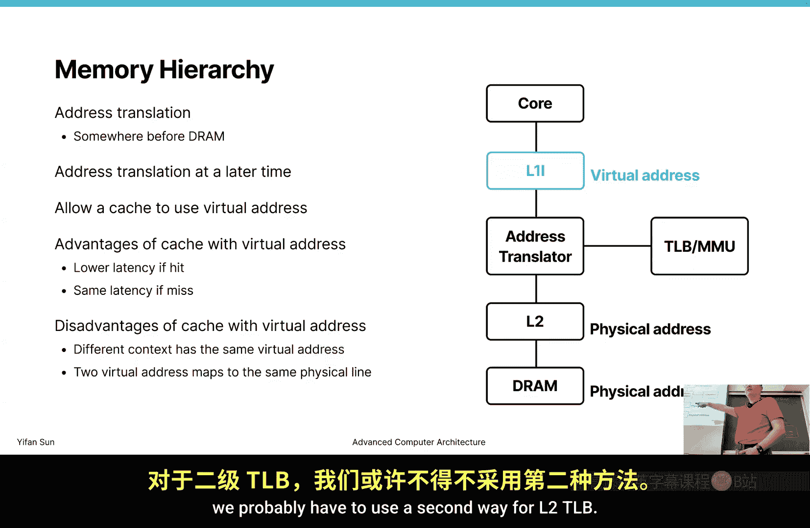

At beginning， right。So flush at a cache switch is easy implementation， but at a cost of more misses。

On the other side， we can include a PID as part of the tag。

 So previously we're comparing a address itself， right but this time we need to compare PID with the virtual address。

 If both of them matches， then we think it's a cache hit。RightOnly address match does does not work。

 Now， you may happen to access data that belongs to another process。Right。

So we can include a P ID as part of tech。 Then that's definitely some overhead。For2 byte PD well。

 for2 byte PD。That's。For every 64 byte of address， we need two extra byte to store it。

 Now sometimes we may need 8 byte P ID。 that's even more。what's the common P I D。

 P ID can go to 64 kB， right。64 kiloBs less。That's too。 That's too bite。That's too bad。Okay。

 so is there another way that we can。Combine these things。

So here what we're talking is cache types in terms of classification。

We're talking we're talking about using one type of address for the tag part and the index part。

 index part determines which set we we are using。Right。哦。

So VIVT is virtually indexed and virtually taed。So over virtual to address。

PIP T is physically indexed， and physically tagged。ok。PIRPD is simple， right。

Is something that we have all discussed。 have always been assuming is P IP T。 And today。

 we introduced the V IVT， the virtual index of virtual type。

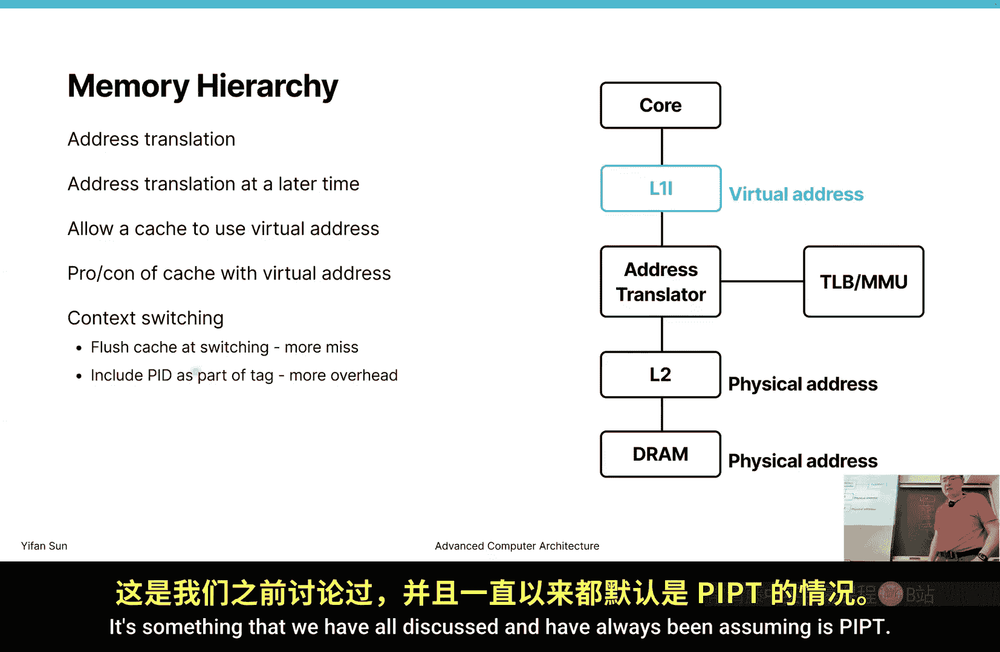

人。So if we consider two combination of two parameters， right，2，1 bit parameters。

 now we have four cases。We have。VIPT virtually in， physically tech。And P I Vt。Right。

 now I don't list the P I V T here because there's no advantage of P I V T。

 So it's almost never used。 It's only P I V VIP T is sometimes used。So what is VIPT。

 And we can explain in this figure。做 advantage of VIPT。yes。On two things。

 First thing is we can do this address translation and cache access by somehow overlapping some small latency。

Think about the step one， just don't think this can necessarily happen in one cycle， okay。

 just consider this as step one。In step 1， we already have the virtual address。

 We send a virtual address。 We send a virtual address to T L B and soon took to the cache at the same time。

 it can be a boss that broadcast。Now we send this virtual address in one cycle at the same time。

 So here we can do this thing。 We can get， we can identify the set， select the set。First。

And also on this side， do address translation at the same time。O， so。In real world。

 the cache is not as simple as this design。It's not as simple as this design。

 seems we can complete everything when in one cycle。 Now， typically， there's a。

Like a tag stage that is processing a tag， identifying address。 Its actually， if you look at cash。

 it's has or another address translation process。 What is address translation process。

 It's given an external address。Then internally， it has a sram array， right？就。

The first process is to use this information to find it a heat or a mis， right。

 just assume it's a heat need to identify the set and identify a way。

 So identifying the set and identifying in a way is actually an external address to an internal address translation process。

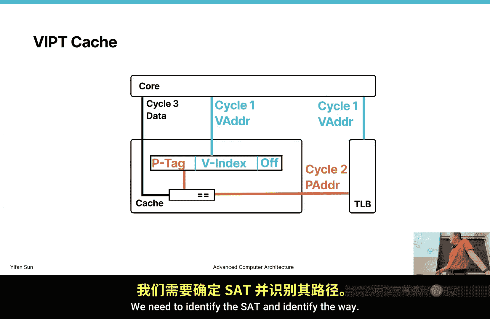

Then we find the internal address， then we go to the SRM array to get the data。

 then the some slower asRM array， if there are some tools that can allow you to calculate how many cycles it requires。

 the larger the SM， the more cycles you require okay， so it's a two step process。Now， in this case。

The first we can somehow process the first step a little bit if it takes a few cycles and do the address translation a little bit in some cycles。

 hopefully they can finish in one cycle time。 Now when we get a physical address then we come back and compare with the physical tag in this case。

 we know it's a cache hit or a cache meets then move on In this case。

 we're paralyzing executing the cache part and address translation part so we can reduce the latency by a small amount okay on the other side。

 if we're storing physical address here， now it's much easier to manage coherency and avoid a problem that we say about alienliaizing or renaming as we talked before。

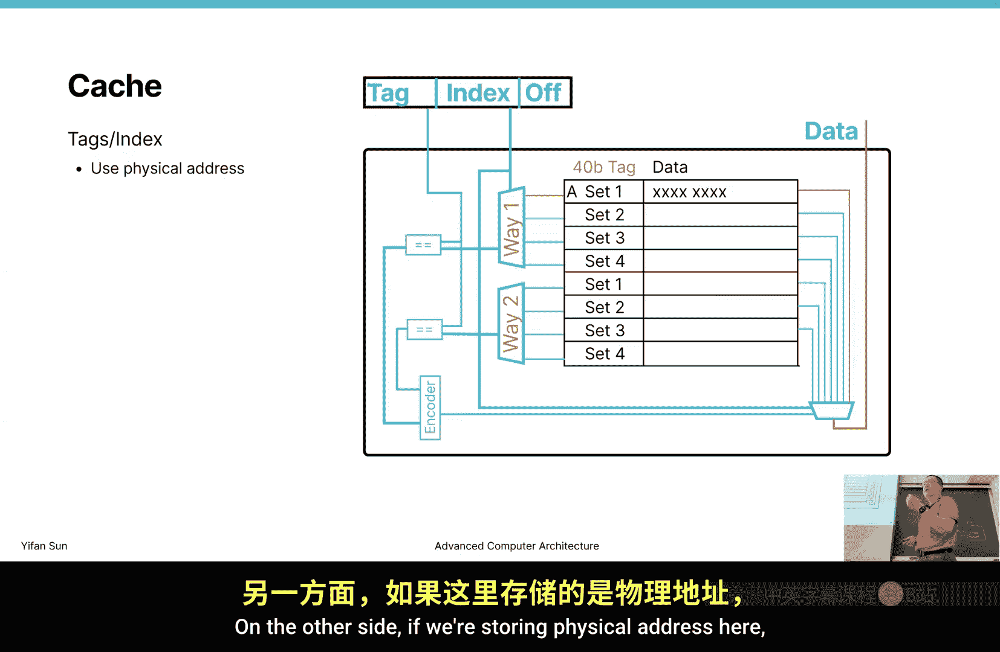

Okay， so this is the advantage of VIPD cashs。 So general today， we see。We generally see a trend。

 especially in GPUus。 They are more moving from this side to this side。 Okay。

 I cannot say it's either V V or V PD， but for L1 cache in GPUus。Because of the latency requirement。

 we're more and more moving towards virtual using virtual addresses。Okay。

 and it's in GPUs context switching， we say。Contact switching is basically almost within。A process。

So the alienliaizing problem is not a big problem。 And we don't really need so advanced the feature of。

Renaming or mapping two virtual addresses into one physical address we I almost cannot thank any use case for that。

 I don't even know it's supported or not。 So without this complex situation。

 GPUL1 caches are actually super suitable for these two caches， these two type of caches。Okay。

 and that's the last slide I have。 So we're just going through the whole memory system then。

The address translation system， then see how address translation is done。

 then why it's used and all this thing is to reduce the latency。

To allow us to do this virtual address。OK那现。Today， most of systems are using virtual addressing。

 It seems this overhead problem has been pretty much solved。 Okay。

 but sometimes we still work on papers that address address translation problems。

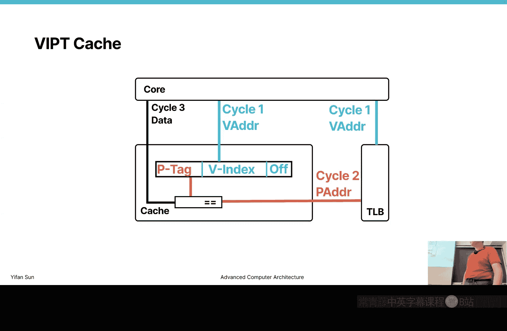