# 高级计算机体系结构：P21：虚拟寻址 🧠

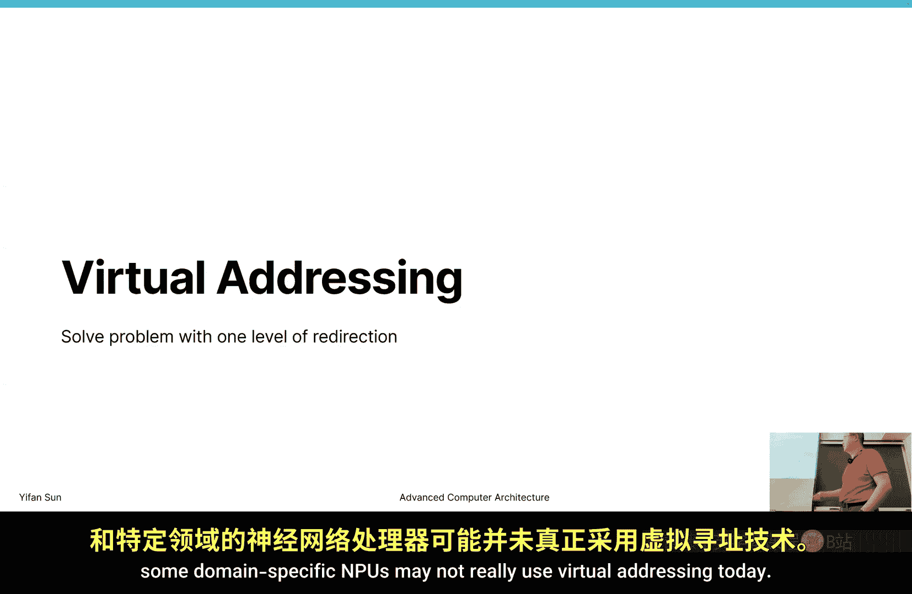

在本节课中，我们将系统性地学习虚拟寻址这一核心概念。虚拟寻址是现代计算机系统中广泛采用的一项关键技术，它通过引入一层间接性，解决了内存管理中的多个核心问题。我们将从历史背景、基本概念、工作原理到具体实现细节，逐步展开讲解。

---

## 虚拟寻址概述

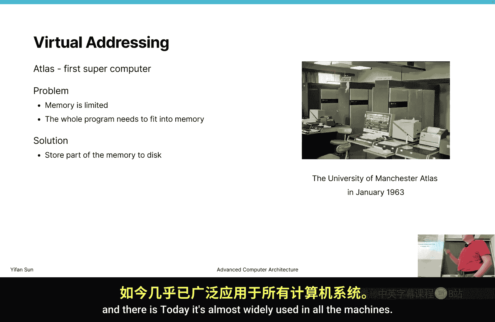

虚拟寻址试图通过增加一层额外的间接性来解决许多不同的问题。计算机科学中有一句名言：任何问题都可以通过增加一层间接性来解决，除非间接层太多。虚拟寻址就是被广泛接受并几乎在所有现代计算机系统（尤其是CPU）中使用的一层间接性。如今，GPU也使用虚拟内存，但一些特定领域的加速器可能并不真正使用虚拟寻址。

虚拟内存最早应用于名为“Atlas”的系统，该系统也被认为是第一台超级计算机，于1962年开发。当时，内存非常昂贵，容量远小于我们今天手机甚至手表上的内存。程序却变得越来越大。程序员通常需要手动管理内存，以避免使用过多内存，例如将部分内存存储到硬盘（当时可能是磁鼓等慢速设备）再读回。虚拟内存的引入，旨在让程序员无需手动控制，就能将部分内存“交换”到磁盘。

## 虚拟地址与物理地址

当我们谈论虚拟寻址时，总有一个对应的概念叫做物理寻址。
*   **物理地址** 是硬件内存系统中实际使用的地址。
*   **虚拟地址** 是程序可见（且始终可见）的地址。用户空间程序永远无法知道物理地址的任何信息，它只知道一个相对位置。

虚拟寻址系统的目标就是将物理地址和虚拟地址解耦。

## 虚拟寻址解决的问题

虚拟寻址这一层间接性解决了多个问题：

**1. 内存隔离问题**
在早期系统（如Windows 98）中，一个程序可以修改另一个程序的内存，这带来了安全风险。通过虚拟内存，进程1和进程2的虚拟地址即使相同，也指向完全不同的物理内存空间，它们无法通过直接读写内存来通信。例如，现代Chrome浏览器的每个标签页都在独立的进程中运行，以避免标签页之间相互干扰。

**2. 为所有程序提供统一的地址管理**
我们希望程序的内存布局（如栈从某地址开始，堆从某地址开始）是统一的，而无需担心系统中同时运行的其他程序。

**3. 内存访问授权**
通过地址转换过程，系统可以授权对每一块内存的访问。例如，页表是内存的专用部分，如果用户程序试图写入只读的程序代码段，这通常意味着程序可能被入侵。虚拟寻址允许我们在访问物理内存时进行授权检查，防止许多恶意行为的发生。

此外，它同样解决了内存交换（Swapping）问题。总之，这是一个简单的特性，解决了众多问题。

## 工作原理概述

从逻辑上理解，其工作原理如下：核心（CPU）生成内存地址，核心中的寄存器存储的始终是虚拟地址。当它向内存系统发出读写请求时，总是生成一个虚拟地址。这个地址需要经过一个称为“地址转换器”的逻辑单元（并非真实硬件单元），该单元将基于虚拟地址的事务转换为基于物理地址的事务，然后才能访问使用物理地址的内存系统。

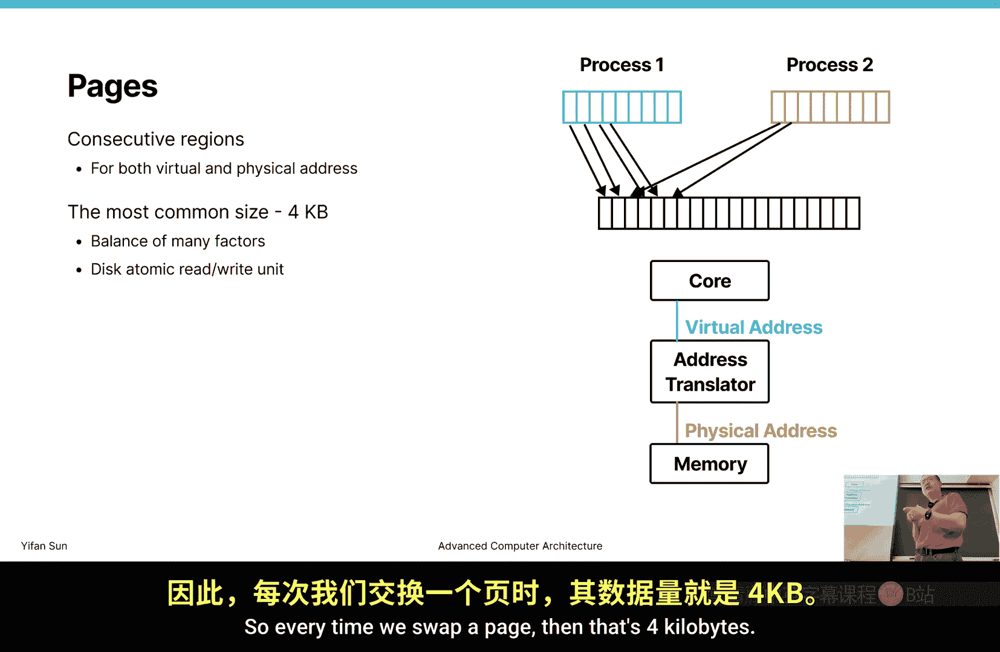

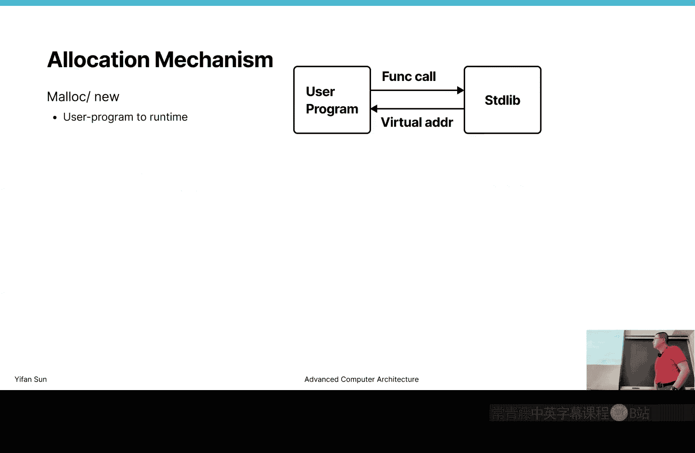

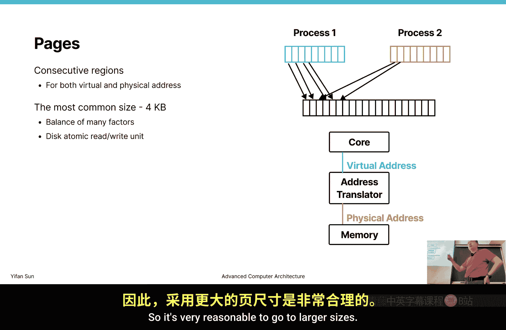

地址转换器部分完全由硬件控制，没有软件可以直接控制内存，这保证了该部分的安全性，因为我们可以信任硬件，但不能信任系统中运行的其他软件。

## 页的概念

当我们谈论地址时，必须引入“页”的概念。页是虚拟地址空间和物理地址空间中连续的区块。每次进行地址转换时，我们只翻译页的起始地址（从虚拟地址到物理地址），然后该页内所有其余地址的转换会自动完成。

今天大多数系统使用4KB大小的页，这个标准已经使用了超过20年。后来我们会讨论页大小为何重要，特别是在GPU领域，有推动使用更大页面的趋势。

最初选择4KB页大小的原因是，当时系统定义磁盘的写入单元也是4KB。如果你想向硬盘写入数据，总是直接写入4KB。虚拟寻址最初就是为将内存交换到硬盘而设计的，因此选择了与磁盘块大小匹配的4KB，以便每次交换都能移入/移出完整的磁盘单元。

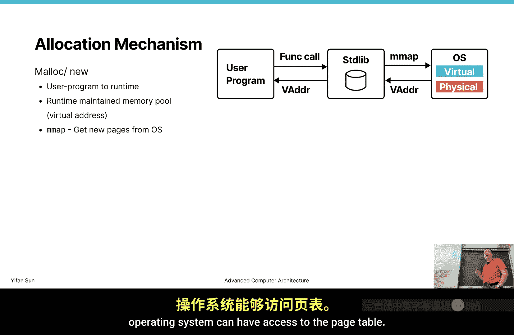

## 内存分配机制

接下来我们看看页是如何在系统中被分配和确定的。当我们调用`malloc`或`new`关键字时，系统中实际发生了什么？

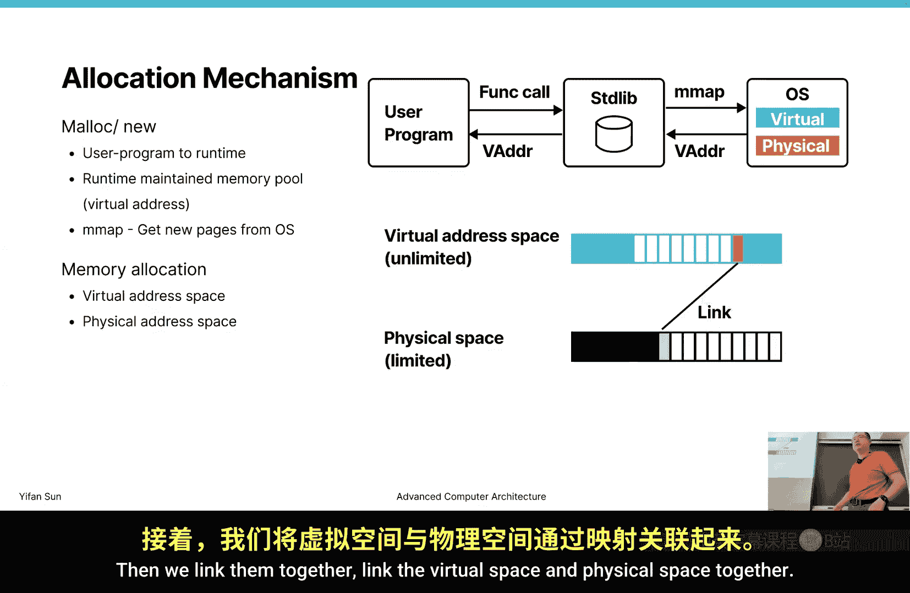

我们编写的用户程序调用带参数的`malloc`。这进入了运行时空间（仍是用户空间）。标准库会维护一个内存池（在虚拟地址空间中）。无论你分配4KB还是4字节、8字节，标准库都会首先尝试从本地池中分配地址并返回给用户程序。此时，我们不需要新的页，因为这些页已经分配并存在于标准库的池中。

如果标准库的内存耗尽，或者你要分配跨越多个页的巨大数据块，标准库会使用一个系统调用。在Linux领域，这个系统调用是`mmap`。系统调用是调用操作系统服务的特殊调用。当你调用它时，操作系统开始处理虚拟内存和物理内存，并最终可以返回一个虚拟地址。

这里我们开始看到用户空间和特权空间（操作系统空间）的边界。当处理操作系统空间时，操作系统可以访问页表，它知道物理地址，因此知道如何处理。

## 操作系统的高层操作

操作系统在高层上维护两个地址空间：虚拟空间和物理空间。虚拟地址空间通常分为栈（向下增长）和堆（向上增长）等部分。

如果我们要在堆中分配一些空间，就在虚拟空间中标记该页为已分配。同时，在物理空间中，操作系统有一个记录哪些物理页已被使用的数据结构。物理地址空间由当前运行的所有程序共享。

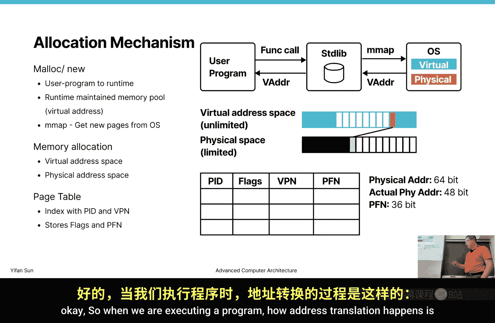

然后，操作系统找到一个可用的物理内存页，并将虚拟页和物理页链接起来。链接的方式就是使用页表。我们将这些信息记录到页表中，包括进程ID（PID）和标志位（如该页是否可读、可写、是否有效等）。

## 页表的逻辑与实现

这只是一个页表的逻辑表示。实际上，我们不需要存储完整的物理地址、PID和虚拟地址。我们稍后会讨论为何不需要存储这些字段。

页表本身并不特殊，它只是存储在DRAM中的一些数据，只有你的操作系统可以访问这部分内存。用户程序无法读写这部分内存，否则会发生错误。

实际上，我们不需要存储完整的虚拟地址。就像在缓存中，一个缓存行是64字节，最后的6位是该行内的偏移量，我们不需要存储这部分数据以节省比特位。对于虚拟地址也是如此。虽然地址可能是64位长，但大多数时候48位就足够了。具体位数取决于硬件和操作系统。

对于4KB的页，最后12位是页内偏移量，我们不需要关心这些位。因此我们有两个特殊名称：**VPN（虚拟页号）** 和 **PFN（物理页帧号）**。我们只存储这些编号，它们是地址转换唯一有用的部分。

## 地址转换过程

当执行程序时，地址转换是这样发生的：我们的程序在核心中运行，线程在核心中运行，寄存器只存储虚拟地址。因此，每次内存访问都需要进行转换。我们将虚拟地址发送给地址转换器（实际上是MMU，内存管理单元），MMU执行转换。

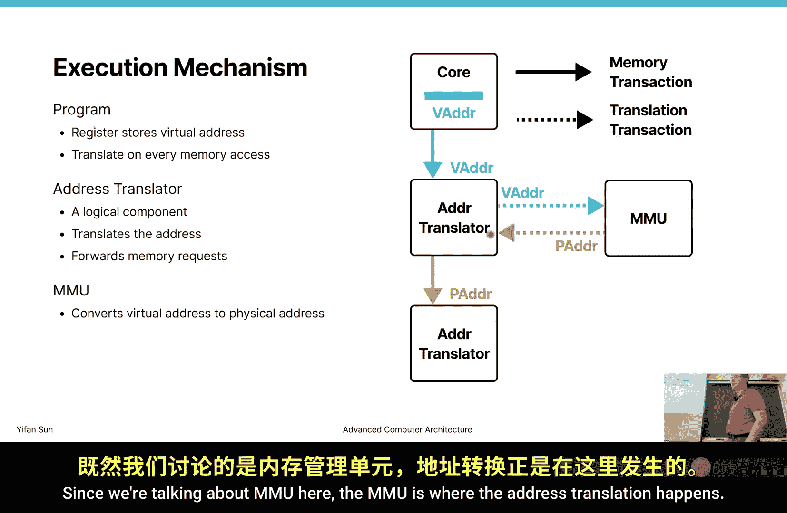

如果访问不被允许（例如，试图访问一个不存在的虚拟地址），MMU会触发一个“页错误”来通知操作系统。如果你编写过C程序，很可能见过“段错误”，这就是页错误最常见的情况之一，通常是因为试图访问空指针（地址0），而该地址是保留区域，任何程序都不应访问。

在大多数情况下，我们假设运行正确。MMU将物理地址返回，转换器将原始事务转换为物理地址并访问内存。

## 线程、进程与上下文

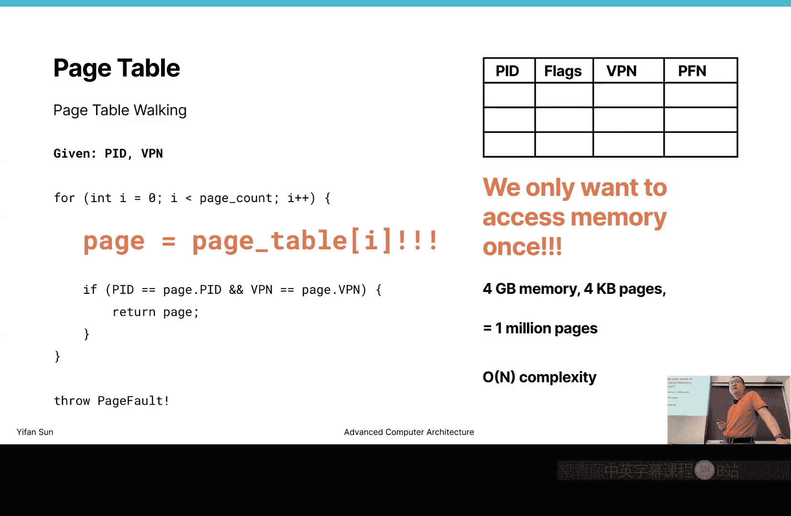

我们需要厘清线程和进程的概念。
*   **线程** 是在你的核心中执行的一系列指令序列（如果不考虑超线程，一个核心运行一个线程）。它也是一组存储数据的实际寄存器。不同线程中的同名寄存器存储不同的数据。
*   **进程** 是一个虚拟内存空间。一个程序可以有多个线程。只要线程属于同一个进程，它们就拥有相同的进程ID（PID），相同的虚拟地址指向相同的物理地址。这就是为什么在多线程程序中，你可以轻松地从一个线程写入，从另一个线程读取。
*   两个不同进程中的相同虚拟地址指向不同的物理位置。因此，两个进程之间共享数据并不容易，除非使用一些高级技术（如进程间通信IPC，最常见的是使用套接字）。

**上下文** 在这里指的是上下文切换。在典型的CPU中，上下文切换意味着从一个线程切换到另一个线程。上下文指的是存储在CPU核心内的寄存器状态。如果我们换出一个线程并换入另一个线程，我们就在切换核心内执行的上下文。

上下文切换的性能影响在进程内线程切换和跨进程线程切换之间可能非常不同。

## MMU的工作原理

MMU是进行地址转换的部分。给定一个虚拟地址和PID，它会返回一个物理地址。

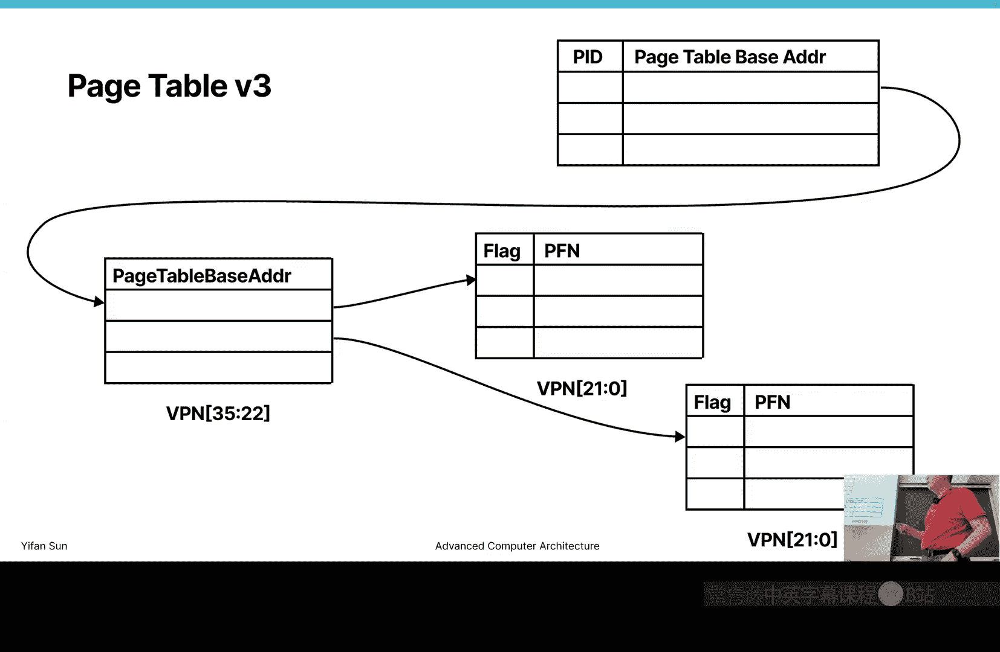

假设我们的页表以这种逻辑方式实现：给定PID和VPN，我们需要运行一个循环，访问每个页表项，检查PID和VPN。如果找到，就返回；否则就是页错误。

这种方式的问题在于，地址转换发生在每次内存访问时。访问页表项本身就是一次内存访问。考虑一下页表可能有多大。如果我们只想访问一次内存，但这种O(N)复杂度的方式可能最终需要访问内存上百万次（对于一个4GB内存、4KB页的系统，有大约100万个页表项）才能找到地址。这完全不切实际，开销太大，100%的开销都花在了转换上，而没有进行真正的内存访问。

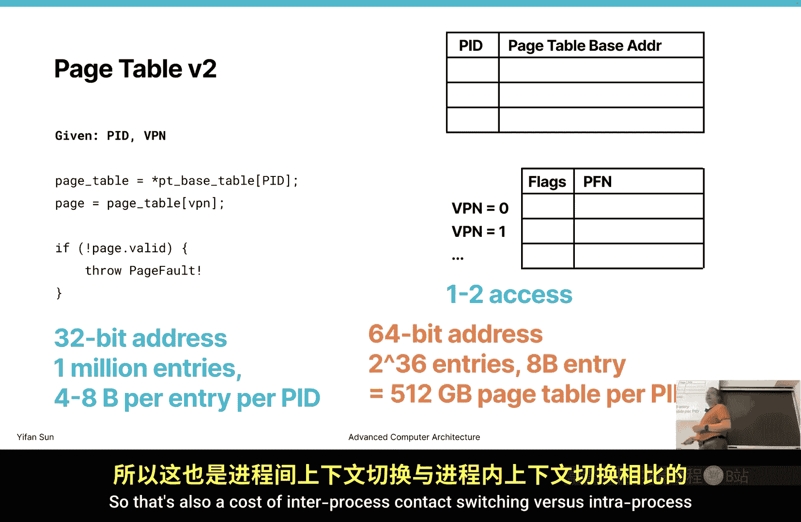

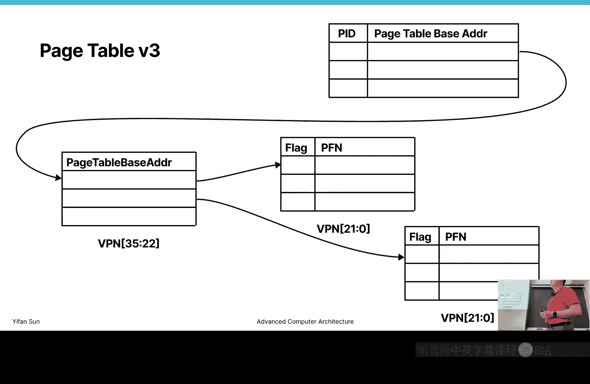

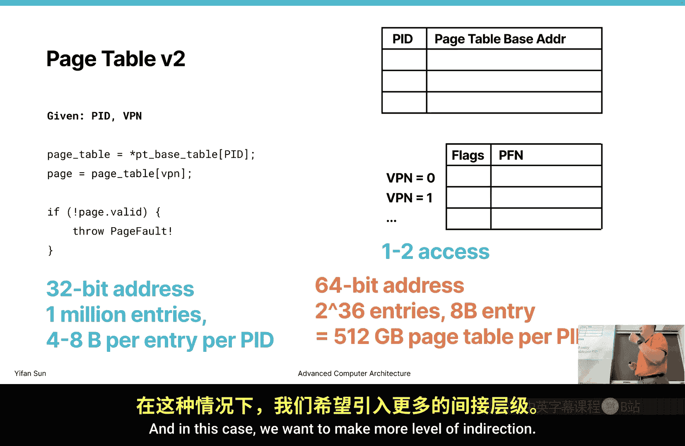

## 优化：多级页表

真实的系统永远不会这样设计。解决方案是使用多级页表。

首先，每个PID都有自己的页表。我们首先有一个“页表目录”（或类似结构），PID作为索引。页表本身只是存储在DRAM中的一段内存，我们可以将页表基地址存储在这个目录中。给定PID后，我们首先找到页表基地址，然后访问页表。

将O(N)操作降至O(1)操作的通用方法是使用哈希表。但由于粒度很细，我们可以简单地使用直接访问表：使用VPN 0， VPN 1等直接分配槽位。这样，如果我们知道VPN编号，可以立即定位到一个位置。通过一到两次内存访问（一次访问目录，一次访问页表），我们基本上就能找到地址，这是显著的性能提升。

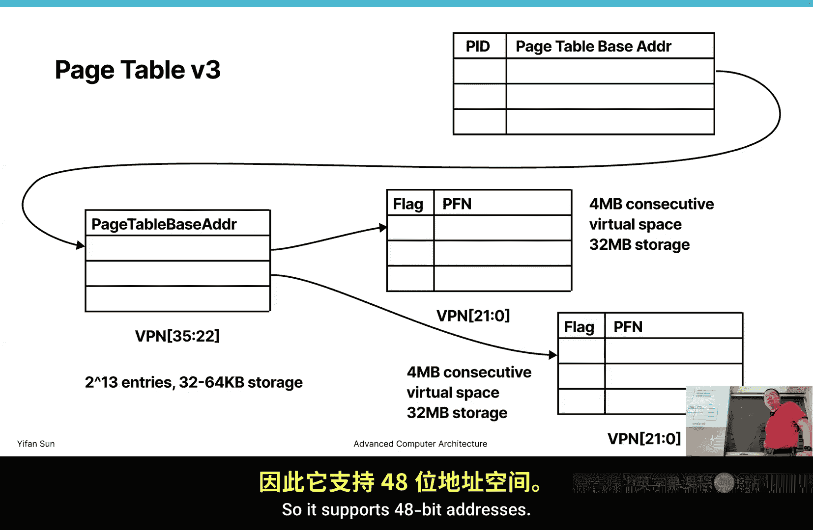

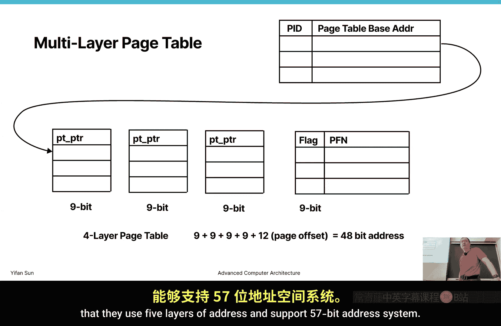

代价是，每当我们启动一个进程时，都需要为它创建这个表。对于一个4GB内存、32位地址空间的系统，最大可能有约100万个页表项。假设每个条目4字节，那就是4MB的开销。对于4GB内存系统，这是0.1%的开销，可以接受。但要注意，这是每个PID的开销。如果你创建另一个进程，就需要另一个表。

当转向64位地址空间时，问题变得严重得多。虚拟地址空间变得巨大（虽然物理大小没变那么多），页表项数量激增，导致每个PID的页表大小变得不切实际。因此我们不能使用这种简单的单级方案。

解决方案是设计多级页表。我们已经有了一层间接。更进一步的间接是：我们有一个基地址，指向另一个表，这个表由VPN中的高几位索引。如果我们用这几比特直接访问这个元素，然后访问页表，在页表中使用低几位直接访问元素。

优势在于，如果我们使用整个地址空间，它仍然需要同样大的内存。但如果我们只使用一小部分内存（例如几KB），可能只需要一个子页表，甚至不需要创建其他子页表，因为我们的内存访问彼此接近，高位地址相同。这样，我们只创建页表的一个子集，而不是整个页表。

现实中，我们仍不满足于两级设计，认为32MB存储仍然太多。因此我们转向更多层的间接。在现代操作系统中，通常使用四层页表（支持48位地址）。在一些更强大的系统中，甚至增加了第五层页表。现代Intel/AMD CPU的标准是使用5层页表，支持57位地址系统。

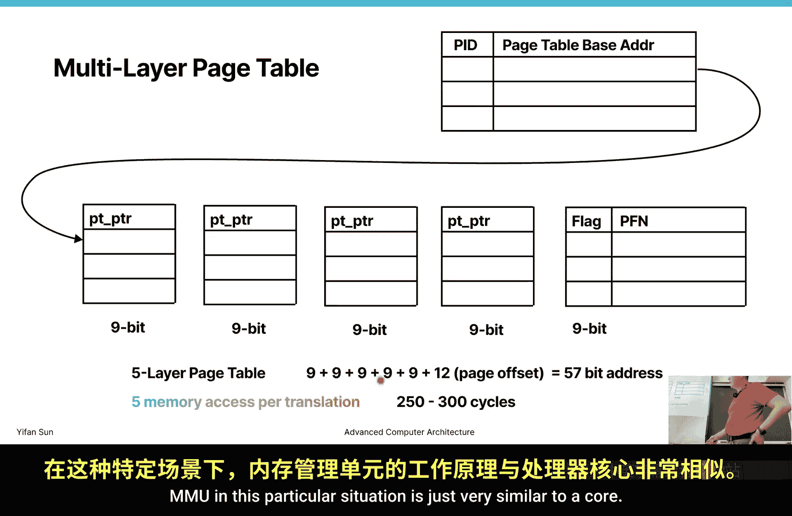

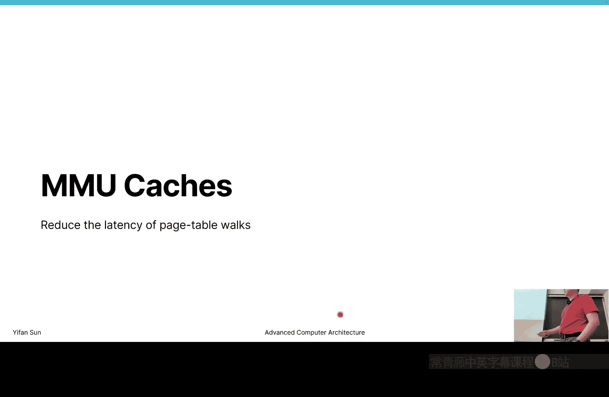

层数越多，我们能支持的连续内存范围就越小（指单级表覆盖的范围）。这不仅关乎存储开销，也关乎缓存局部性。数据更容易从缓存中获取，而不是从DRAM中，从而减少转换延迟。

## 转换过程与开销

在五层页表中，我们首先识别PID，PID指向一个地址。在该地址内，我们取出9比特直接找到元素，这个元素是下一级表的基地址。然后使用下一个9比特找到下一级元素，如此反复，直到最后一级。最终，我们不需要在页表中存储PID和完整的虚拟地址，我们用它们来定位页表中的条目。

这样，每次转换最多需要五次内存访问（不考虑PID目录的那一次）。这虽然不理想，但比上百万次访问要好得多。考虑一下，对于一次内存访问，最坏情况下我们可能需要五次内存访问来进行转换。这仍然是很大的开销（80-90%）。如果全部由DRAM处理，延迟大约在250到300个周期（取决于DRAM技术，GPU使用GDDR或HBM，延迟可能更高）。

## 降低延迟：MMU缓存与TLB

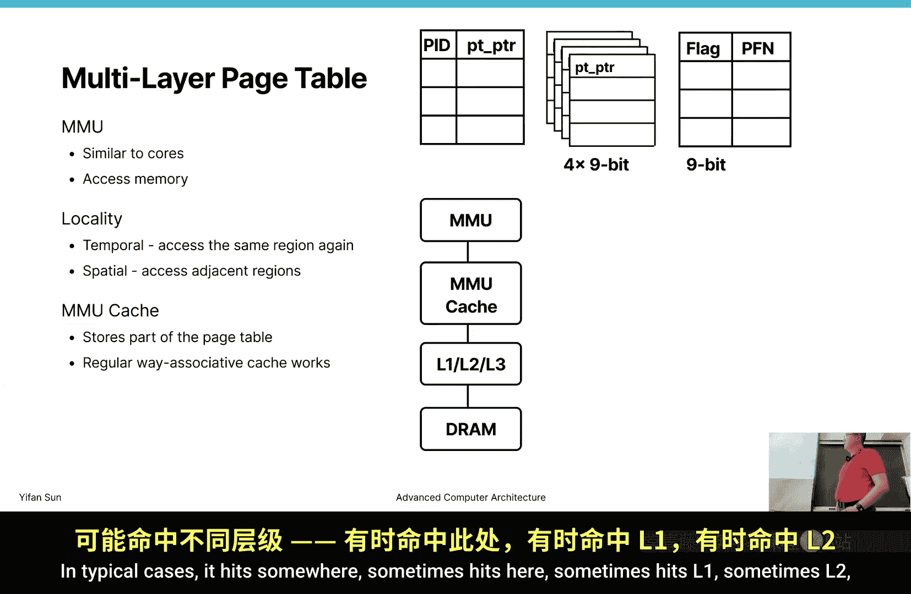

我们需要降低这种延迟，方法是使用两种不同级别的缓存：MMU缓存和TLB。

**MMU缓存** 存储部分页表内容，实现方式类似于常规的组相联缓存，缓存行大小可以是64B、32B等。它被插入到内存层次结构中，甚至可以直接利用L1/L2/L3缓存，或者在它们之上添加一个小的MMU缓存。其目的是避免数据访问将页表数据逐出。

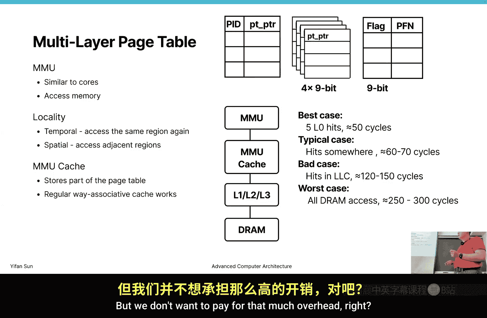

MMU缓存可以缓存页表的任何层级。我们可以使用LRU等替换策略。有时L1缓存和MMU缓存是并行的，核心一侧连接到MMU缓存（页缓存），另一侧连接到L1数据缓存，然后在L2缓存级别合并。

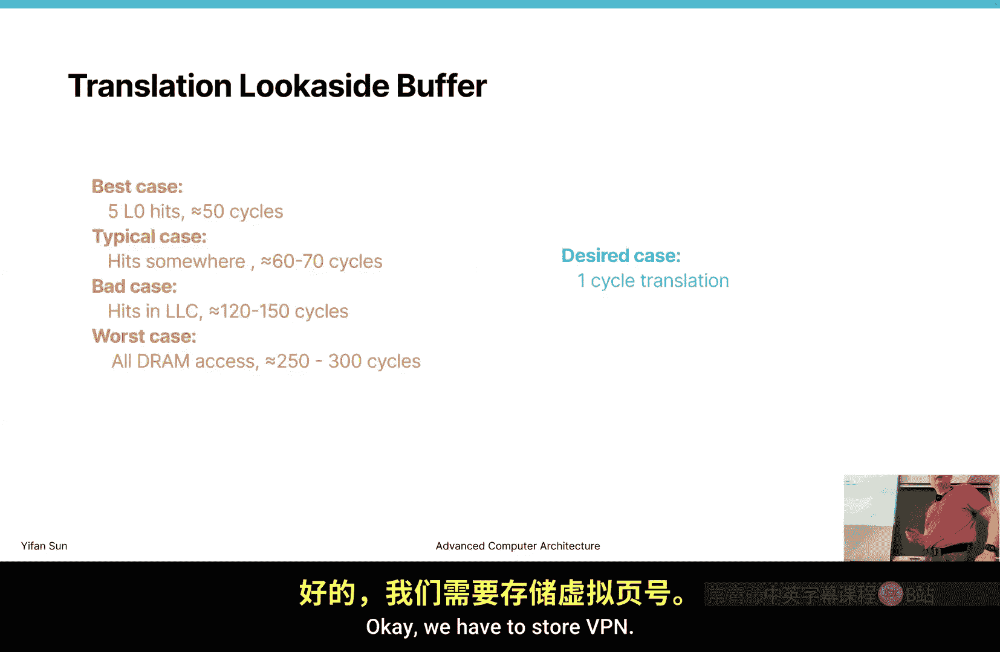

分析其延迟：最佳情况是所有访问都命中MMU缓存（或L0缓存），延迟可降至50周期以下。典型情况是部分命中不同级别缓存，延迟在60-70周期。如果全部访问DRAM，则可能需要数百周期。

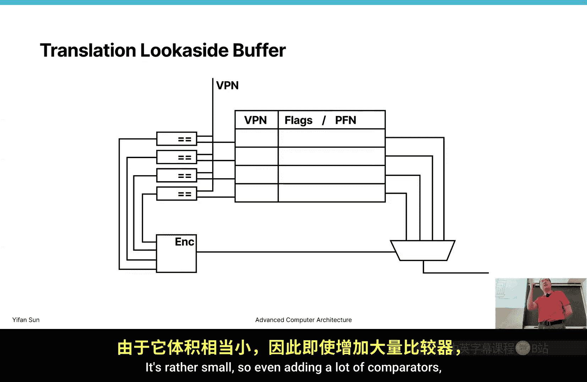

虽然我们将开销从300周期降低到了50周期（减少了6倍），但考虑一下内存访问本身：如果是一次L1缓存命中，可能只需要不到10周期。最佳情况50周期仍然增加了大量开销（5倍），这并不理想。我们理想情况是接近1周期的翻译延迟。

## 转换后备缓冲器

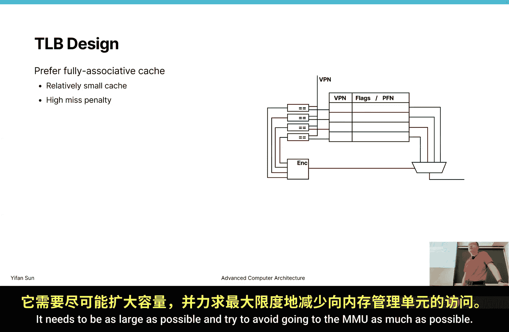

实现接近单周期延迟的方法是使用**转换后备缓冲器**，更常被称为 **TLB**。

TLB非常简单：它是一个小的页表，存储VPN、标志位和物理页帧号（PFN）。这次我们必须存储VPN。当核心提供一个VPN时，我们首先检查它是否等于TLB中已存储的某个VPN。如果命中，我们直接返回标志位和物理地址。

如果TLB设计为只有少数条目（如32、64条），一个小型缓存可以在一个周期内处理完毕，从而实现单周期翻译。

TLB，尤其是一级TLB，强烈倾向于使用全相联或高相联度设计，因为它希望尽可能提高命中率。由于其本身很小，即使增加大量比较器，也不会增加太多面积开销。TLB的覆盖范围可以很大，因此开销并不那么可怕。同时，TLB缺失的惩罚很高（需要访问内存，数百周期延迟），因此我们愿意付出一些能量和面积成本来尽可能提高命中率。

TLB也有多级设计。一级TLB的目标是尽可能降低命中延迟，瞄准单周期。二级（或三级）TLB的目标是尽可能大，以避免访问MMU。较低级别的共享TLB通常选择较低的相联度以换取更大容量。如果所有TLB都缺失，则转到MMU进行页表遍历。

考虑到这种分布式缓存，会存在一致性问题。但大多数时候，我们不需要复杂的协议，因为缓存条目被修改的情况并不频繁。更常见的设计是基于“冲刷”的简单方式，例如直接使整个TLB集合或所有条目无效。

## TLB覆盖范围

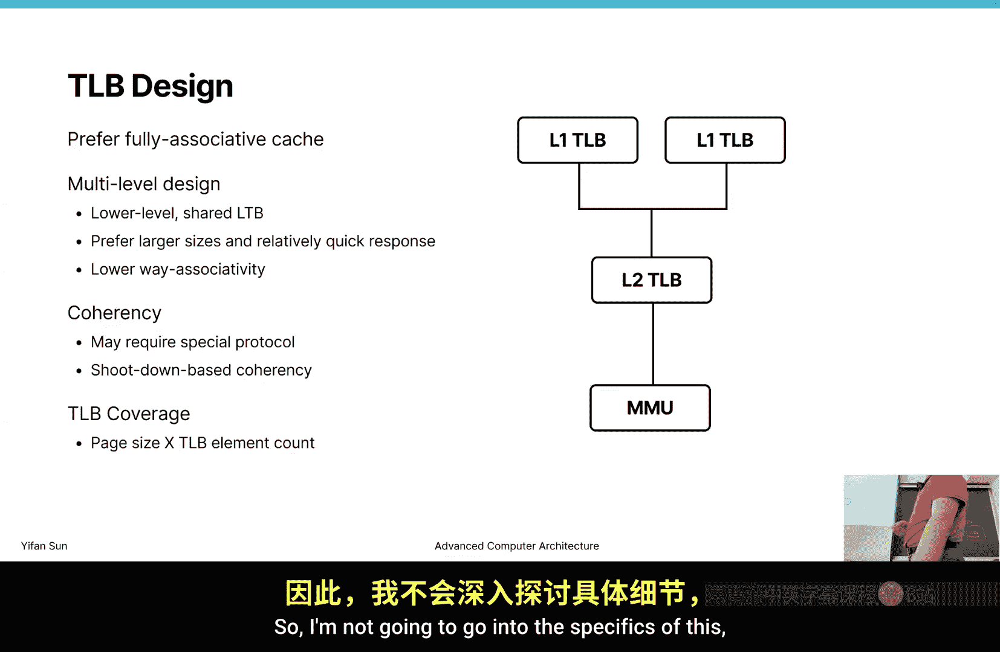

TLB覆盖范围是一个重要概念，指TLB能够覆盖的内存大小。假设一个TLB有64个条目（对TLB来说算大的），每个页4KB，那么它能处理 `64 * 4KB = 256KB` 的内存。对于一个程序来说，有时只处理这个范围内的数据是足够的。

补充一点，对于GPU：GPU也进行地址转换，并遵循类似的设计。计算单元（核心）需要访问其L1 TLB，然后访问共享的、容量较大的L2 TLB。这里存在一个“GMMU”（GPU MMU）的概念。大多数时候，如果GPU只访问本GPU上的数据，GMMU可以处理所有地址转换。但有时，在支持GPU点对点直接访问的技术下，GPU可能需要访问另一个GPU上的数据。这时可能出现GMMU缺失，最终需要通过PCIe网络转到CPU侧的IOMMU（输入输出内存管理单元）来处理，这个过程非常缓慢。这还涉及到是否缓存远程数据等复杂问题，特别是在支持“统一内存”（允许页在设备间自动迁移）的技术中，会带来更多复杂性。

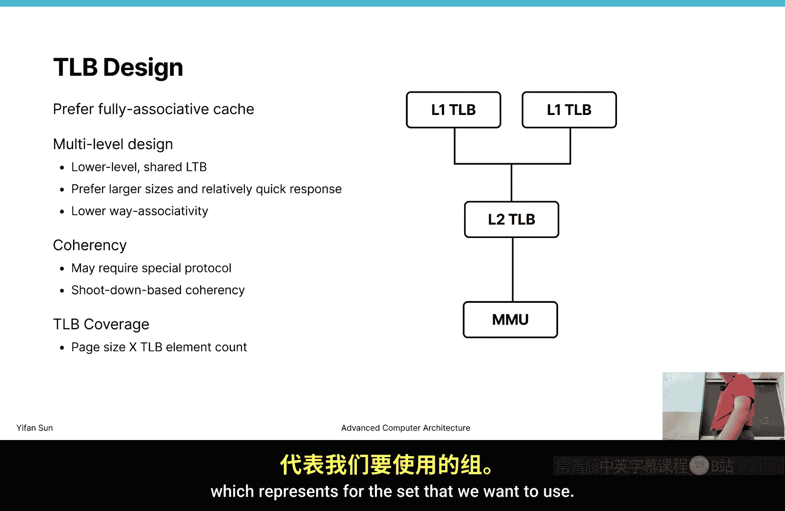

## TLB与MMU缓存的区别

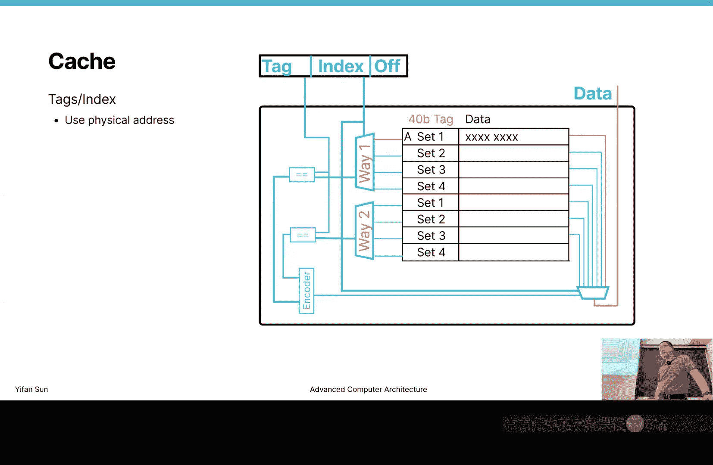

TLB和MMU缓存都需要，原因如下：
*   **TLB** 存储完整的地址转换（VPN -> PFN）。如果TLB命中，它可以在不访问MMU的情况下完成地址转换，显著降低翻译延迟至几个周期。
*   **MMU缓存** 存储页表多层结构中的数据。它仅在遍历页表、查找地址时有用。在TLB缺失的坏情况下，MMU缓存可以显著降低页表遍历的延迟。

## 缓存设计回顾：物理地址 vs 虚拟地址

现在回顾缓存设计（指数据缓存，而非TLB）。一个关键问题是：对于标签和索引部分，我们使用物理地址还是虚拟地址？

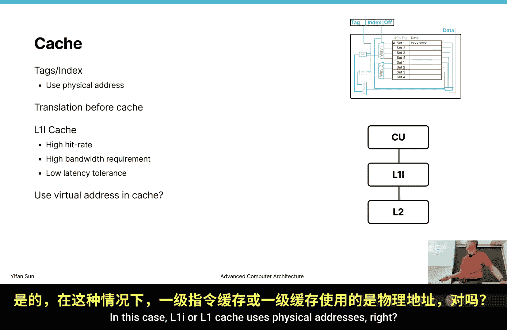

到目前为止，我们讨论的都是先进行地址转换，再访问缓存，即使用物理地址。但让我们思考一下GPU的设计。GPU的L1指令缓存有很高的命中率，因为GPU程序通常很小。它对带宽要求高，延迟容忍度低，期望每个周期都能向核心提供数据。如果我们先进行地址翻译，即使TLB命中也可能增加延迟，如果MMU繁忙则延迟更高。我们不想为每次访问都支付翻译开销。

那么，能否直接使用虚拟地址呢？从逻辑层次上看，地址翻译只需要在访问DRAM之前的某个地方发生即可。如果我们把地址转换器移到缓存层次的下方，就可以允许L1缓存使用虚拟地址。

使用虚拟地址的优势是：如果缓存命中，延迟更低；如果缓存未命中，再进行地址转换，延迟与使用物理地址的方案类似。

使用虚拟地址缓存的缺点在于：
1.  **别名问题**：两个不同进程可能有相同的虚拟地址。如果核心同时运行两个进程（或进行上下文切换），缓存无法知道这两个虚拟地址实际上指向不同的物理位置。
2.  **重名问题**：两个线程（可能属于不同进程）的虚拟地址可能映射到同一个物理地址（用于进程间通信）。缓存无法知道这两个东西实际上是一回事，这会使得一致性维护非常麻烦。

## 虚拟地址缓存的解决方案

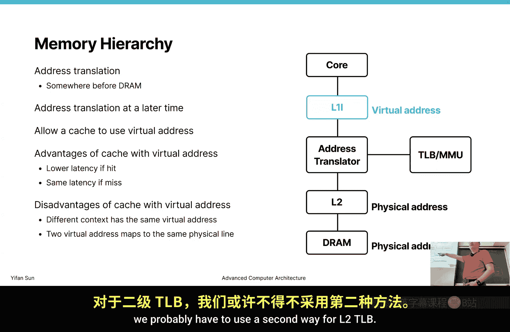

对于更常见的第一个问题（进程间隔离），有两种主要方法：
1.  **上下文切换时冲刷**：在进行跨进程上下文切换时，冲刷所有TLB（和虚拟地址缓存）。实现简单，但代价是切换后初期缓存缺失率会升高。
2.  **将PID作为标签的一部分**：以前我们只比较地址本身，现在需要同时比较PID和虚拟地址。两者都匹配才认为是缓存命中。这会带来一些存储开销（例如，每个缓存行需要额外的字节存储PID）。

## 缓存的分类

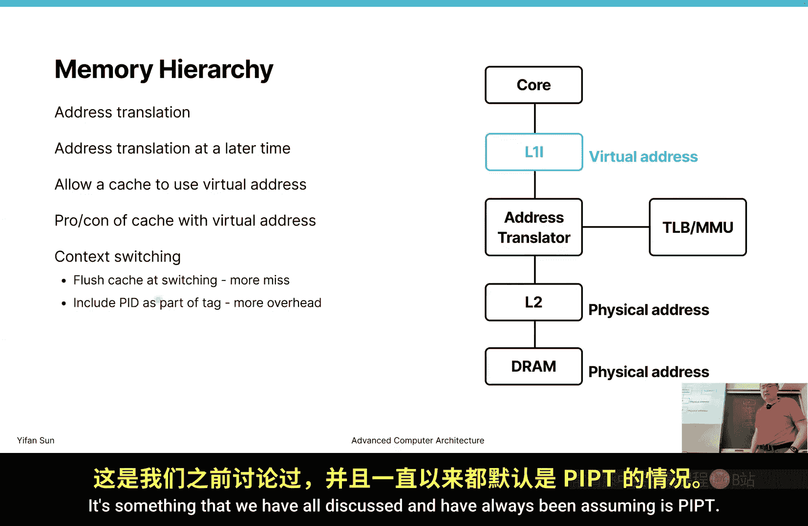

根据索引和标签使用的地址类型，缓存可以分为几类：
*   **PIPT（物理索引，物理标签）**：我们一直假设的方式。
*   **VIVT（虚拟索引，虚拟标签）**：我们刚刚介绍的虚拟地址缓存。
*   **VIPT（虚拟索引，物理标签）**：有时被使用。
*   **PIVT（物理索引，虚拟标签）**：几乎没有优势，几乎从不使用。

**VIPT的优势** 在于两方面：
1.  **延迟重叠**：我们可以将地址转换和缓存访问的部分过程重叠执行。在第一个周期，我们将虚拟地址同时发送给TLB和缓存。缓存可以用虚拟地址的索引部分来选择组，同时TLB进行地址翻译。当获得物理地址后，回来与缓存中的物理标签进行比较。这样并行执行可以小幅减少整体延迟。
2.  **易于管理一致性**：由于存储的是物理标签，更容易管理缓存一致性，避免之前提到的别名和重名问题。

## 趋势总结

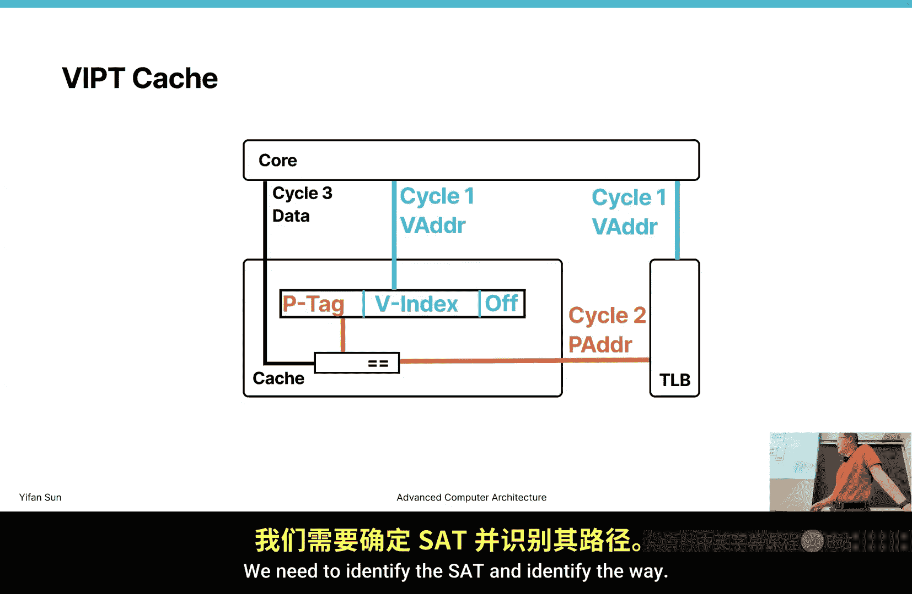

总的来说，我们看到一个趋势，特别是在GPU中。由于延迟要求，GPU的L1缓存越来越多地转向使用虚拟地址（VIVT或VIPT）。在GPU中，上下文切换通常发生在进程内，因此别名问题不严重，也不需要复杂的高级重映射功能。在没有这些复杂情况的前提下，GPU的L1缓存非常适合这两种类型的缓存。

---

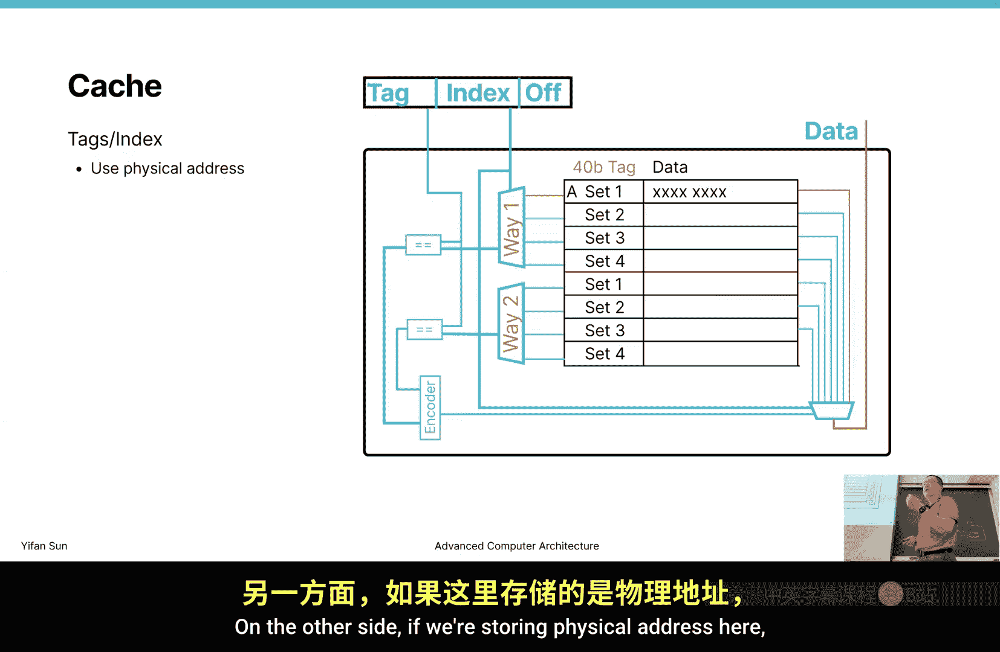

## 本节课总结

本节课中，我们一起深入学习了虚拟寻址系统。我们从内存层次结构出发，探讨了地址翻译系统，了解了地址翻译是如何完成的、为何被使用，以及所有这些技术如何协同工作以降低延迟，使我们能够高效地使用虚拟地址。

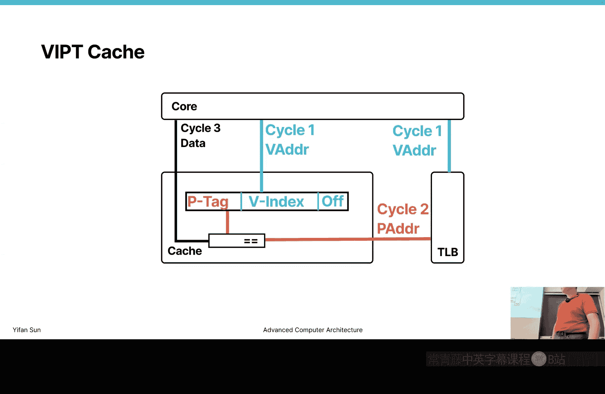

今天，大多数系统都在使用虚拟寻址，似乎开销问题已经基本得到解决。然而，在学术研究中，我们仍然能看到一些论文致力于解决地址翻译带来的新挑战，特别是在异构计算、大内存和低延迟场景下。理解这些基本原理，是进一步探索高级体系结构优化的基础。