# 002：计算机工作原理 🖥️

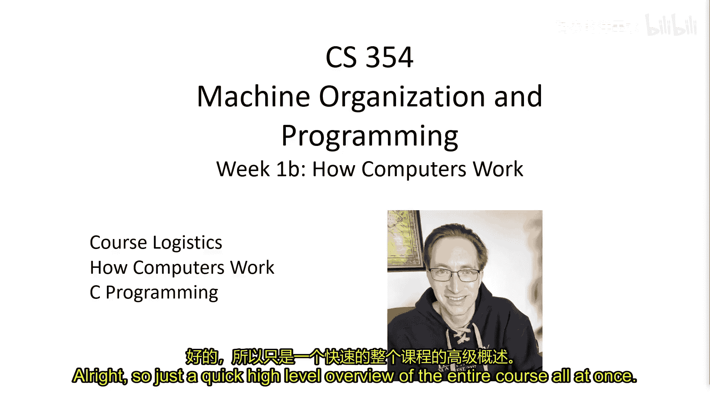

在本节课中，我们将要学习计算机内部是如何工作的。我们将从宏观层面了解计算机系统的构成，并深入探讨一个简单C语言程序从编写到运行的全过程，包括编译、加载和执行。

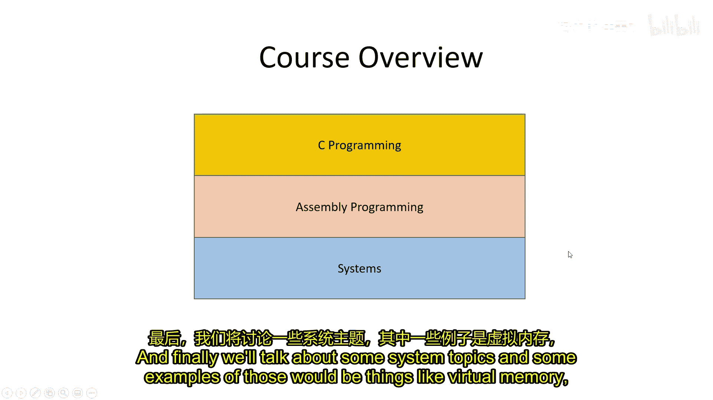

## 课程概述

上一节我们介绍了课程的基本信息，本节中我们来看看整个课程的结构安排。

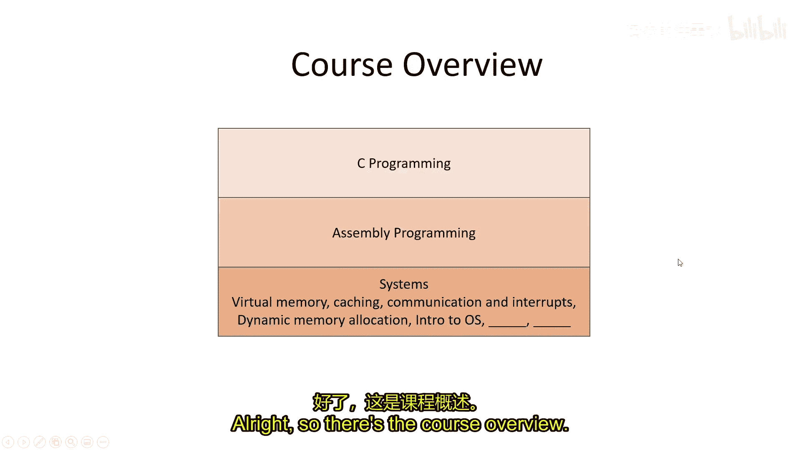

接下来的课程将分为三个基本部分：
*   **C语言编程**：学习高级编程语言。
*   **汇编编程**：学习非常底层的、一次执行一条指令的代码。
*   **系统主题**：讨论一些系统级话题，例如虚拟内存、缓存、中断、动态内存分配和操作系统。

## 计算机系统层次

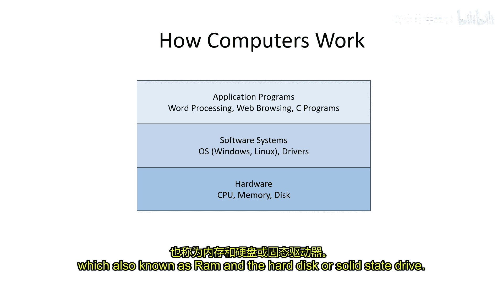

现在，让我们开始深入今天的主题。首先，花一些时间谈谈计算机是如何工作的。

从最明显的层面看，我们面前有一个大机箱或一台笔记本电脑，这是**硬件**。同时，我们也在运行一些**代码**，可能是网页浏览器、自己编写的程序或PowerPoint。在硬件和应用程序之间，我们有**软件系统**。

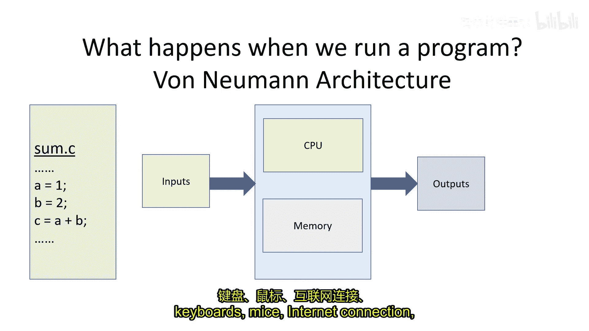

以下是计算机系统的三个主要层次：

*   **应用程序**：例如文字处理、网页浏览、C程序、PowerPoint等我们关心运行的程序。
*   **软件系统（操作系统）**：连接应用程序与计算机硬件的软件，例如Windows、Linux。也包括硬件驱动程序，例如显卡驱动。
*   **硬件**：我们今天将讨论的三个主要硬件部件是**CPU（处理器）**、**内存（RAM）** 和**硬盘（或固态硬盘）**。

## 程序如何运行：冯·诺依曼架构

为了理解程序如何运行，我们需要从一个特定的视角来看：**冯·诺依曼架构**。这是一个多年前（大约20世纪50年代）描述的计算机系统模型。

该模型中的计算机有一个**处理器（CPU）** 来执行所有逻辑和数学运算，还有**内存**来存储数据，两者连接在一起。没有输入和输出，这个模型将毫无价值，因此我们也将**输入/输出设备**（如硬盘、显示器、键盘、鼠标、网络连接）视为模型的一部分。

从内部物理结构看，如果你打开机箱，可以看到内存芯片、处理器（以及它上面的大风扇）和硬盘。它们都通过主板上的无数导线连接在一起。

## 源代码的存储位置

现在，思考一个问题：当我编写完代码（例如一个名为 `sum.c` 的文件）并保存它时，这个文件具体存在于哪里？是在处理器、内存还是硬盘上？

答案是：它存储在**硬盘**上。当我们编写文件并保存时，它会直接进入硬盘。

## 编译：从源代码到机器码

处理器无法直接理解像 `a = 1;` 这样的高级语言。它只能读取**机器码**或**二进制码**（0和1）。因此，我们需要一个**编译器**将这种可读的高级代码转换为计算机可以读取的东西。

以下是几个核心定义：
*   **源代码**：在文本编辑器中编写并保存的代码（如 `sum.c`）。
*   **编译器**：我们将使用的编译器是 **GCC**（GNU C Compiler）。
*   **可执行文件（目标文件/机器码）**：编译后生成的二进制代码文件（如 `sum`）。

编译后，生成的二进制代码文件（`sum`）同样存储在**硬盘**上。

## 加载：将程序放入内存

在Linux机器上，我们通过命令行（如 `./sum`）运行程序。此时，操作系统会运行一个名为**加载器**的程序。

加载器的工作是将硬盘上的机器码加载到**内存（RAM）** 中，并分为两个部分：
*   **代码段**：存储实际执行的指令（例如 `c = a + b;`）。
*   **数据段**：存储所有变量及其内容。

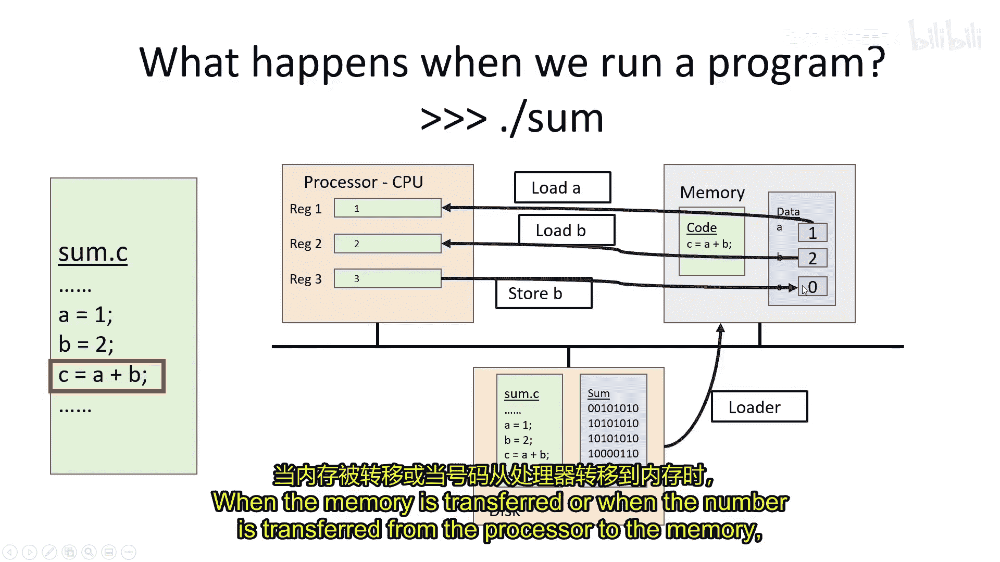

## CPU执行：取指、解码、执行循环

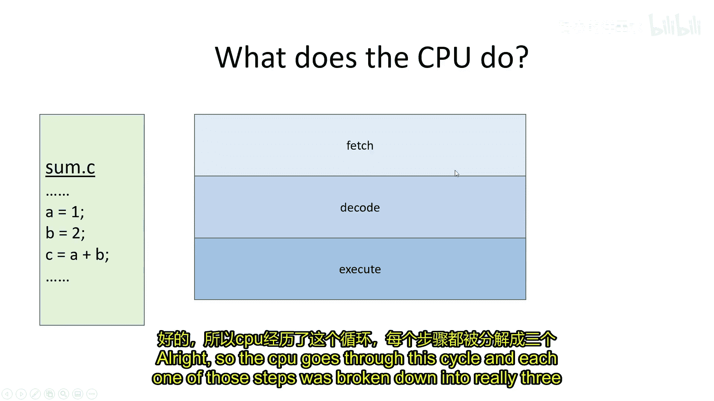

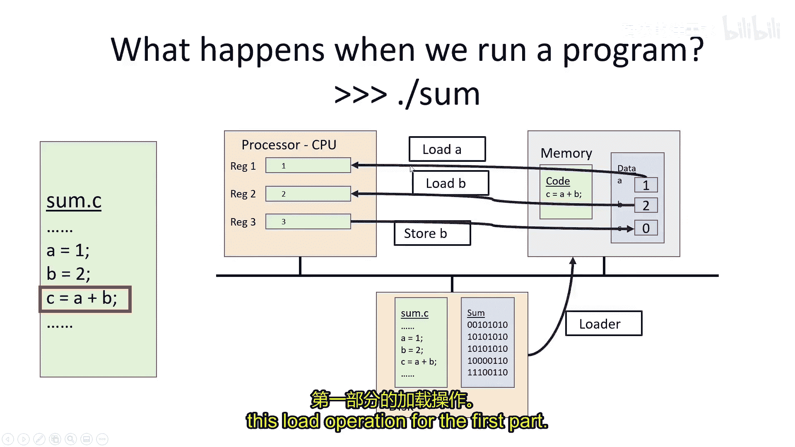

程序加载到内存后，CPU开始执行。CPU内部有少量高速存储单元，称为**寄存器**，用于临时存放数据。

以执行 `c = a + b;` 为例（假设 `a=1`, `b=2` 已在内存中），CPU需要执行以下步骤：
1.  **加载**：从内存中取出 `a` 的值（1）放入寄存器1。
2.  **加载**：从内存中取出 `b` 的值（2）放入寄存器2。
3.  **加法运算**：将寄存器1和寄存器2的值相加，结果存入寄存器3。
4.  **存储**：将寄存器3中的结果存回内存中 `c` 的位置。

CPU执行每一个步骤（如一次加载操作）时，都遵循一个核心循环：

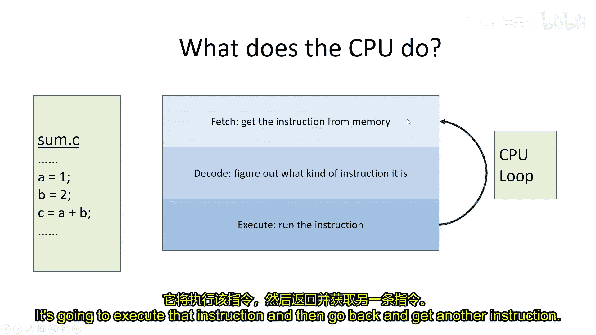

1.  **取指**：从内存的代码段获取下一条指令。
2.  **解码**：解析该指令，确定其类型（是加载、存储还是数学运算）。
3.  **执行**：执行该指令的实际操作（如从内存取数、进行加法计算）。

这个 **取指-解码-执行** 循环会无限重复，直到程序结束。

## 构建过程详解

最后，让我们详细了解一下从源代码到可执行文件的完整**构建过程**。编译器本身是一个由多个程序组成的工具链。

构建过程主要分为以下四个步骤：

1.  **预处理**
    *   **输入**：源代码文件（`sum.c`）。
    *   **工具**：预处理器（`cpp`，C Preprocessor）。
    *   **作用**：处理源代码中的预处理指令（如 `#include`），移除注释，生成一个中间文件。
    *   **输出**：预处理后的源文件（通常为 `sum.i`）。

2.  **编译**
    *   **输入**：预处理后的文件（`sum.i`）。
    *   **工具**：编译器本体（`cc1` 或 `gcc -S`）。
    *   **作用**：将高级语言代码转换为**汇编语言**代码。汇编语言是低级但人类可读的。
    *   **输出**：汇编代码文件（通常为 `sum.s`）。

3.  **汇编**
    *   **输入**：汇编代码文件（`sum.s`）。
    *   **工具**：汇编器（`as`）。
    *   **作用**：将人类可读的汇编代码转换为**机器码**（0和1），生成**可重定位目标文件**。
    *   **输出**：目标文件（通常为 `sum.o`）。

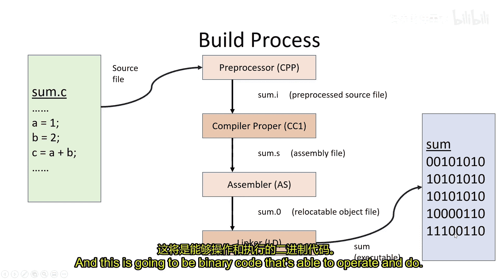

4.  **链接**
    *   **输入**：一个或多个目标文件（如 `sum.o`）及所需的库文件（如C标准库）。
    *   **工具**：链接器（`ld`）。
    *   **作用**：将所有目标文件和库合并，解析它们之间的引用关系，生成最终的**可执行文件**。
    *   **输出**：可执行文件（如 `sum`）。

## 总结

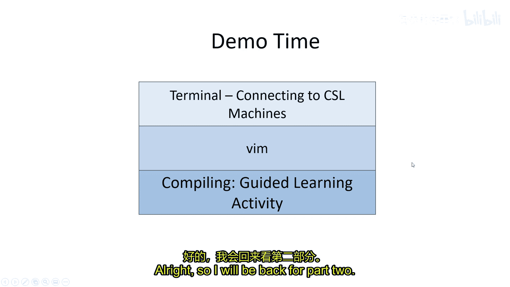

本节课中，我们一起学习了计算机工作的基本原理。我们从计算机系统的层次（硬件、操作系统、应用程序）开始，然后以冯·诺依曼架构为模型，跟踪了一个简单C程序从源代码（存储在硬盘）到运行的全过程：包括**编译**成机器码、由加载器**加载**到内存、以及CPU通过**取指-解码-执行**循环来执行指令。最后，我们详细剖析了GCC编译器将源代码构建为可执行文件的四个步骤：**预处理、编译、汇编和链接**。在接下来的部分，我们将通过实际操作来演示这一过程。