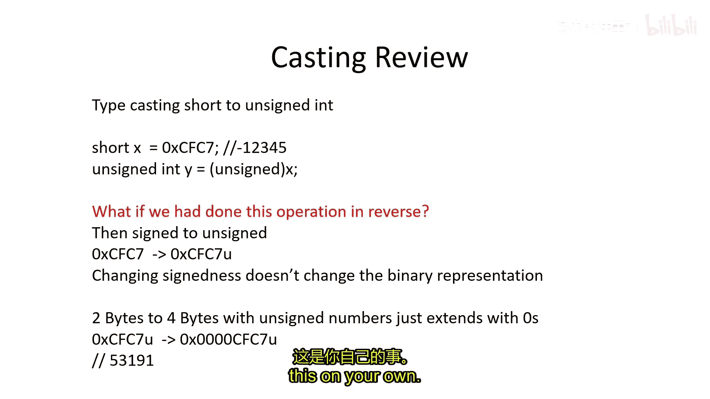
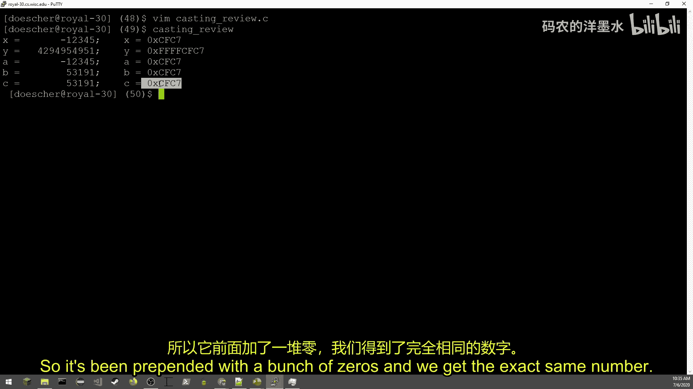
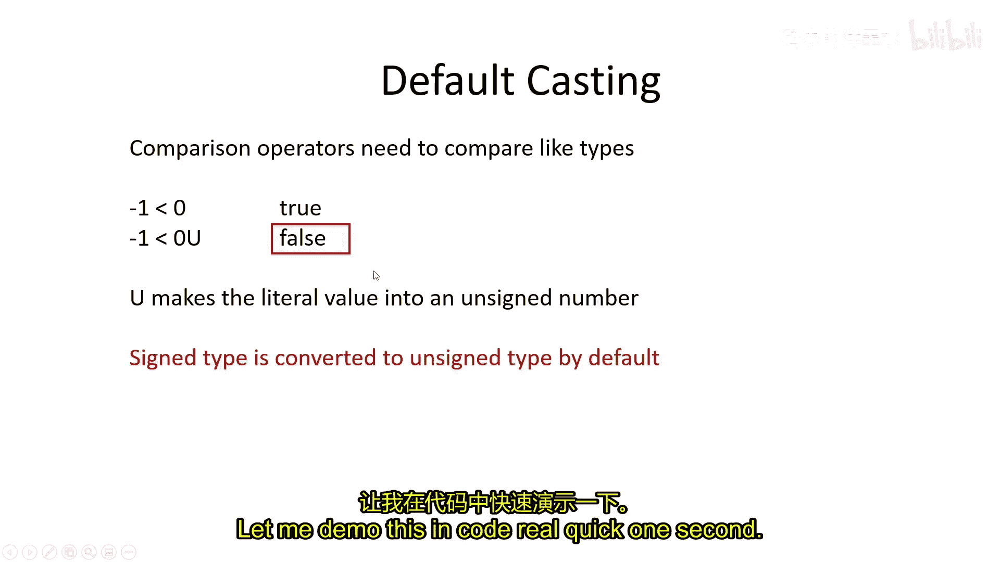
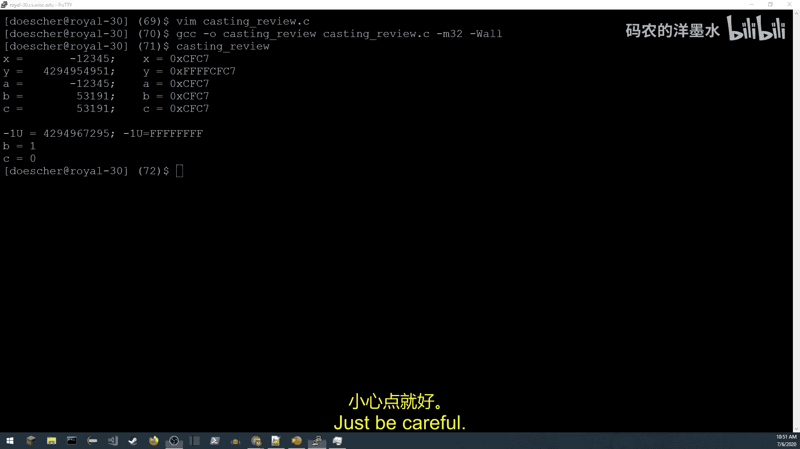
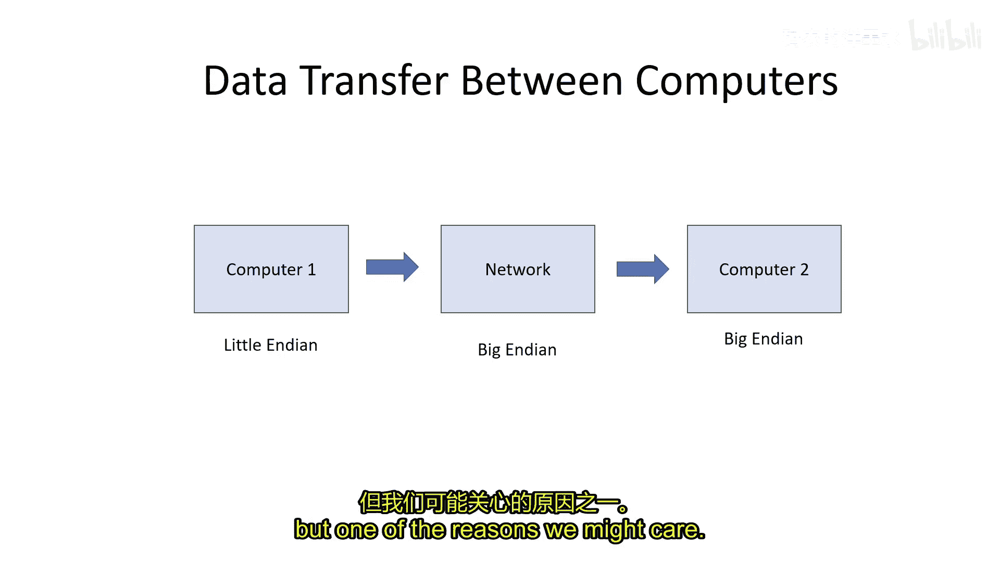
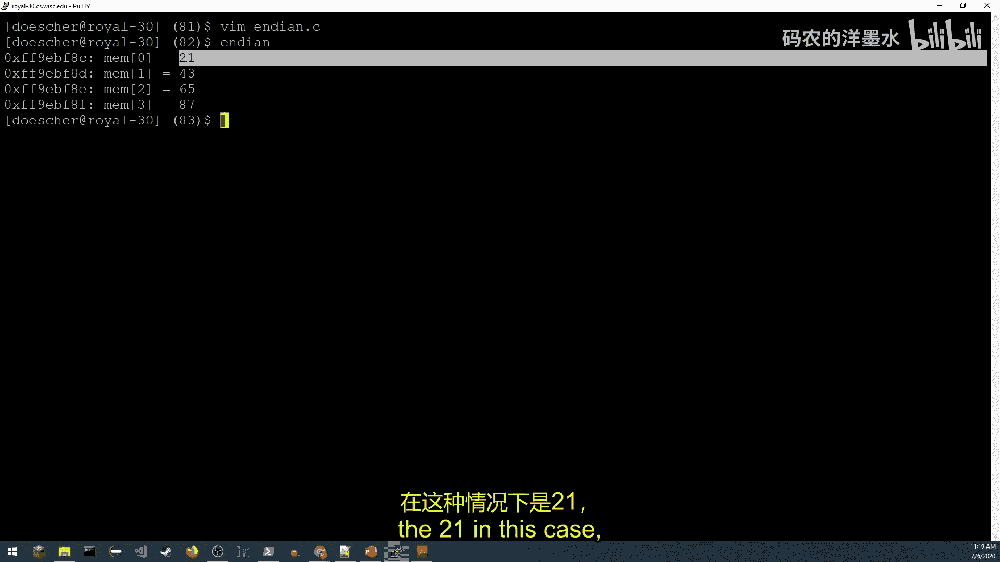

# 006：类型转换与字节序 🖥️

在本节课中，我们将要学习C语言中的类型转换机制以及计算机存储多字节数据的方式——字节序。理解这些底层概念对于编写高效、可移植的代码至关重要。

上一节我们回顾了C语言的基础，本节中我们来看看数据在内存中的具体表示和转换规则。

## 类型转换回顾 🔄

类型转换是指将一种数据类型的值转换为另一种数据类型。当操作涉及不同大小的类型或不同的符号性（有符号/无符号）时，转换顺序会影响最终结果。

### 转换顺序的重要性

考虑一个将短整型（`short`）转换为无符号整型（`unsigned int`）的例子。这涉及两个变化：从2字节变为4字节，以及从有符号变为无符号。问题是，哪个转换先发生？



**答案是：首先改变大小（进行符号扩展），然后改变符号性。**

以下代码演示了这一过程：
```c
short x = -12345; // 假设为 0xCFC7
unsigned int y = (unsigned int) x;
```
转换步骤：
1.  **符号扩展**：将2字节的 `short` 扩展为4字节的 `int`。由于原始值是负数（最高位为1），扩展的高位字节全部填充为1。`0xCFC7` 变为 `0xFFFFCFC7`。
2.  **改变符号性**：将 `int` 重新解释为 `unsigned int`。位模式 `0xFFFFCFC7` 不变，但C语言会将其视为一个巨大的正数（4,294,901,191）。

如果顺序相反（先改变符号性，再改变大小），结果将完全不同：
1.  先将 `short` 重新解释为 `unsigned short`。位模式 `0xCFC7` 不变，但值变为正数（53,191）。
2.  再将 `unsigned short` 零扩展为 `unsigned int`。高位填充0，最终结果为 `0x0000CFC7`，即53,191。

### 比较操作中的隐式转换

在比较操作中，如果操作数类型不同，C语言会自动进行转换。**默认规则是将有符号数转换为无符号数。**



考虑以下表达式：
```c
int a = -1;
unsigned int b = 0;
int result = (a < b); // 结果为 0 (false)
```
尽管直觉上 `-1 < 0` 为真，但在比较时，`-1` 被隐式转换为无符号数，变成了一个非常大的正数（`0xFFFFFFFF`），导致比较结果为假。这是编写代码时需要特别注意的地方。

## 字节序：多字节数据的存储方式 🥚



字节序（Endianness）指的是计算机在内存中存储多字节数据（如 `int`, `long`）时，字节的排列顺序。

### 两种字节序

假设有一个4字节的十六进制数 `0x87654321`，其四个字节分别是：`0x87`（最高有效字节）、`0x65`、`0x43`、`0x21`（最低有效字节）。



以下是两种存储方式：
*   **大端序**：将最高有效字节存储在最低的内存地址。
    ```
    内存地址递增方向: 0x1000 -> 0x1001 -> 0x1002 -> 0x1003
    存储的字节:     0x87     0x65     0x43     0x21
    ```
*   **小端序**：将最低有效字节存储在最低的内存地址。
    ```
    内存地址递增方向: 0x1000 -> 0x1001 -> 0x1002 -> 0x1003
    存储的字节:     0x21     0x43     0x65     0x87
    ```

术语“字节序”源自《格列佛游记》中关于打鸡蛋应该从大端还是小端打破的争论。在计算机领域，不同的处理器架构采用不同的字节序（如x86为小端序，某些网络协议采用大端序），这在网络通信和数据交换时需要特别注意。

### 如何检测系统的字节序

我们可以通过编写一个小程序来检测当前机器的字节序。思路是：创建一个多字节整数（如 `int`），然后通过字符指针（`char*`）逐个访问其字节，观察它们的顺序。



以下是示例代码：
```c
#include <stdio.h>

int main() {
    int num = 0x87654321;
    char *bytePtr = (char *)# // 将int指针强制转换为char指针

    printf("内存地址及内容：\n");
    for (int i = 0; i < 4; i++) {
        printf("地址 %p: 值 0x%hhx\n", (void*)(bytePtr + i), bytePtr[i]);
    }
    return 0;
}
```
如果输出显示最低内存地址存储的是 `0x21`，则系统为**小端序**；如果存储的是 `0x87`，则为**大端序**。

---



本节课中我们一起学习了C语言中类型转换的底层机制，特别是转换顺序对结果的影响，以及计算机存储多字节数据时的字节序概念。理解这些原理有助于我们避免因隐式转换或平台差异导致的程序错误，并编写出更健壮、可移植的代码。在接下来的课程中，我们将深入探讨位运算，这是与硬件交互的另一个基础工具。