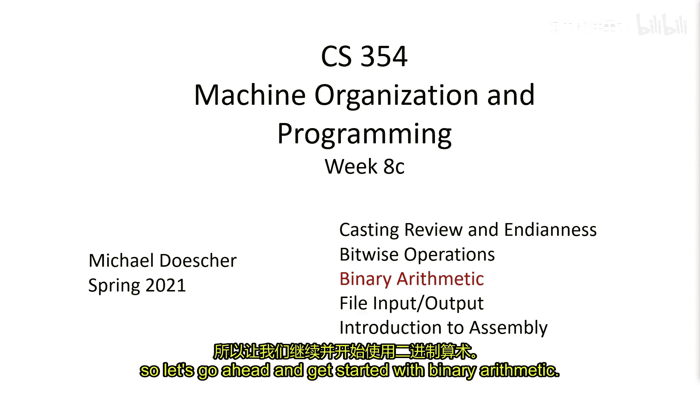
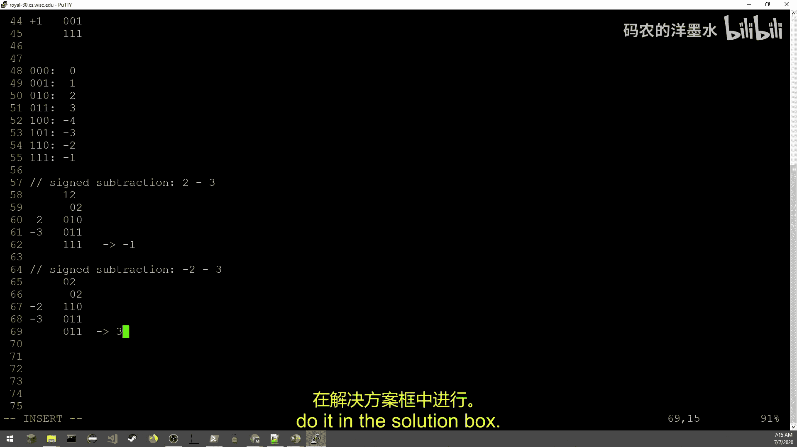

# 008：二进制算术 🧮

在本节课中，我们将学习二进制算术的基础知识，包括无符号数和有符号数的加法、减法，以及溢出和借位的概念。我们将通过简单的例子来理解这些操作在计算机底层是如何实现的。

---



## 无符号数加法与溢出

上一节我们介绍了二进制的基本概念，本节中我们来看看无符号数的加法。二进制加法的过程与十进制类似，但只涉及0和1两个数字。

以下是二进制加法的基本步骤：
1.  从最低有效位（最右边）开始相加。
2.  如果和为2（即 `1 + 1`），则在该位写下0，并向高位进1（进位）。
3.  重复此过程，直到所有位都处理完毕。

例如，在一个3位机器上计算 `3 + 1`：
```
  011 (3)
+ 001 (1)
------
  100 (4)
```
过程如下：
*   个位：`1 + 1 = 2`，写0，进1。
*   二位：`1 + 0 + 进位1 = 2`，写0，进1。
*   四位：`0 + 0 + 进位1 = 1`，写1。
最终结果为 `100`（二进制），即十进制的4。

然而，计算机的存储空间是有限的。在3位系统中，无符号数只能表示0到7。当我们计算的结果超出这个范围时，就会发生**溢出**。

例如，计算 `5 + 3`：
```
  101 (5)
+ 011 (3)
------
 1000 (8)
```
理论上结果是 `1000`（十进制8）。但由于我们只有3位存储空间，只能保留最低的3位 `000`。因此，存储在内存中的结果变成了0，而不是8。这就像数字在一个圆环上，超过了最大值7后，又从0开始。

**判断溢出**的一个简单方法是：如果两个正数相加，得到的结果小于其中较大的那个数，则发生了溢出。

---

## 二进制减法与借位

理解了加法后，我们来看看减法。二进制减法也遵循类似十进制的“借位”规则。

以下是二进制减法的基本步骤：
1.  从最低有效位开始相减。
2.  如果被减数小于减数，则需要从高位“借位”。
3.  借位相当于从高位减去1，并在当前位加上2（因为二进制中高一位的值是当前位的两倍）。

例如，计算 `2 - 1`：
```
  010 (2)
- 001 (1)
------
  001 (1)
```
过程如下：
*   个位：`0 - 1` 不够减，从二位借位。二位变成 `1-1=0`，个位变成 `2-1=1`。
*   二位：`0 - 0 = 0`。
*   四位：`0 - 0 = 0`。
最终结果为 `001`，即十进制的1。

---

## 有符号数与补码运算

在计算机中，负数通常用**补码**来表示。使用补码的好处是，可以将减法运算转换为加法运算，简化硬件设计。

**补码的转换公式**分为两步：
1.  **取反**：将原二进制数的每一位取反（0变1，1变0），得到**反码**。
2.  **加一**：在反码的基础上加1，得到**补码**。

例如，求 `-1` 在3位系统中的补码表示：
1.  `+1` 的二进制是 `001`。
2.  取反得到 `110`。
3.  加一：`110 + 001 = 111`。
因此，`-1` 的补码是 `111`。

现在，我们可以用加法来做减法。计算 `2 - 1` 等价于计算 `2 + (-1)`：
```
  010 (2)
+ 111 (-1的补码)
------
 1001 (理论结果)
```
我们只保留3位，得到 `001`，即十进制的1。注意，这里最高位的进位 `1` 被丢弃了，这是补码运算的正常现象。

---

## 溢出与下溢

对于有符号数，同样存在表示范围限制。在3位补码系统中，可表示的范围是 -4 到 3。

*   **溢出**：当运算结果大于可表示的最大正数时发生。
*   **下溢**：当运算结果小于可表示的最小负数时发生。

例如，计算 `-2 - 3`（预期结果是-5）：
1.  `-2` 的补码是 `110`。
2.  `+3` 的二进制是 `011`。
3.  执行减法 `110 - 011`（或等价地 `110 + (-3的补码)`）。
4.  最终在3位系统中得到的结果是 `011`，即十进制的**正3**，这显然是错误的，因为实际结果-5已经超出了3位补码的表示范围（-4到3），发生了**下溢**。

---

## 总结

本节课中我们一起学习了二进制算术的核心概念：
1.  **无符号数加法**：涉及进位操作，结果超出位数限制会导致**溢出**，表现为数值“回绕”。
2.  **二进制减法**：涉及借位操作，规则与十进制类似。
3.  **有符号数与补码**：负数以补码形式存储，使得**减法可以转换为加法**。转换公式为 **取反后加一**。
4.  **溢出与下溢**：当运算结果超出数据类型所能表示的范围时发生，会导致结果错误。对于有符号数，大于最大正数为溢出，小于最小负数为下溢。



理解这些底层原理对于编写正确、高效的代码至关重要，尤其是在处理边界数值时。