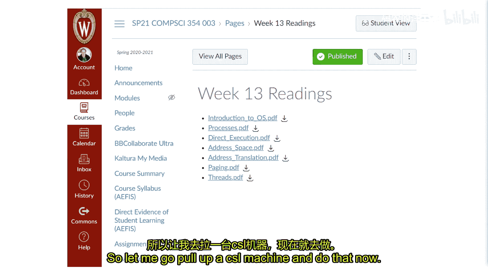
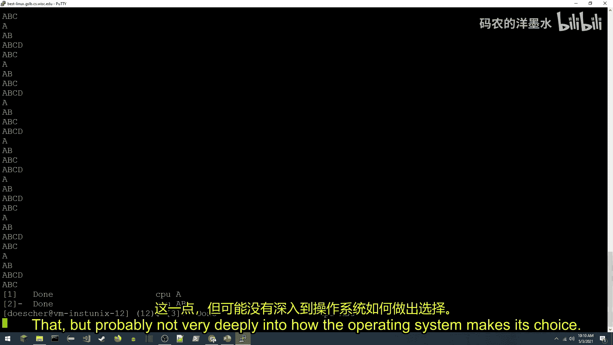
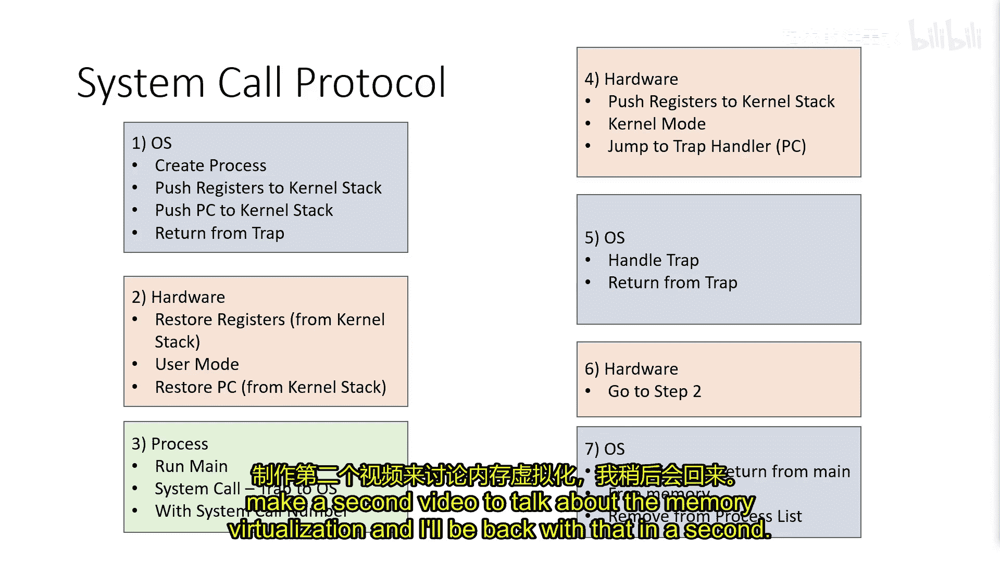

# 012：CPU虚拟化 💻

在本节课中，我们将学习操作系统如何通过**CPU虚拟化**技术，让单个物理CPU能够同时运行成百上千个程序。我们将探讨进程的概念、操作系统如何管理它们，以及硬件如何协助实现进程间的安全切换。

---

## 概述



操作系统的一个核心功能是**虚拟化**硬件资源。本节课，我们聚焦于**CPU虚拟化**。其核心思想是：通过**时间共享**，操作系统在多个进程之间快速切换CPU使用权，从而创造出每个程序都独占CPU的假象。

上一节我们介绍了操作系统的基本概念，本节中我们来看看它是如何虚拟化CPU的。

---

## 进程：运行中的程序



进程是**一个正在运行的程序**的抽象。它不仅包含程序的代码，还包括运行时所需要的数据、堆栈、寄存器状态以及打开的文件等资源。

当我们在终端中运行多个程序时，操作系统会为每个程序创建一个独立的进程。例如，同时运行多个`cpu`程序实例，每个打印不同的字符串。

以下是演示代码的核心逻辑：
```c
int main(int argc, char *argv[]) {
    char *str = argv[1]; // 获取命令行参数
    for (int i = 0; i < 30; i++) {
        printf("%s\n", str); // 打印字符串
        spin(1); // 等待1秒
    }
    return 0;
}
```

当我们同时运行多个实例（如 `./cpu A`、`./cpu AB`）时，输出顺序并非严格按照启动顺序。这是因为操作系统在它们之间进行了**时间共享**切换。

---

## 虚拟化的机制：如何实现？

关键问题在于：如何用有限的CPU（例如一个）模拟出近乎无限的CPU供应？答案是结合**硬件机制**和**操作系统策略**。

*   **硬件机制（How）**：负责实现进程间的安全切换，主要依靠**定时器中断**和**内核/用户模式**位。
*   **操作系统策略（Which）**：负责决定接下来运行哪个进程，这基于调度算法。

进程切换时，操作系统必须保存和恢复其**状态**，主要包括：
1.  **内存状态**：代码、数据、堆、栈（即整个地址空间）。
2.  **寄存器状态**：所有通用寄存器、程序计数器等值。
3.  **I/O状态**：打开的文件、网络连接等。

---

## 进程的生命周期与系统调用

操作系统通过一系列**系统调用**来管理进程的生命周期。以下是核心的操作：

*   **创建（Create）**：启动一个新进程。
*   **销毁（Destroy）**：终止一个进程。
*   **等待（Wait）**：暂停当前进程，等待另一个进程结束。
*   **控制（Control）**：挂起、恢复或切换进程。
*   **获取状态（Get Status）**：获取进程的资源使用情况。

创建新进程是一个复杂的过程，操作系统需要：
1.  在**进程列表**中添加新条目（即**进程控制块PCB**）。
2.  为代码、数据、堆、栈分配内存。
3.  设置好命令行参数和运行环境。
4.  初始化寄存器（通常清零，出于安全考虑）。
5.  将控制权转交给程序的`main`函数。

进程在其生命周期中会在不同状态间转换，例如**就绪**、**运行**、**阻塞**和**终止**。操作系统根据策略决定状态转换的时机。

---

## 从直接执行到受限直接执行

最初的简单模型是**直接执行**：让进程直接在CPU上运行，直到它主动结束或执行`yield`指令。但这带来两个严重问题：
1.  **无限循环**：一个进程陷入死循环会独占CPU。
2.  **安全问题**：进程可能执行危险操作（如访问他人文件）。

为了解决这些问题，我们引入了**受限直接执行**模型。其核心是：
*   **用户模式与内核模式**：CPU有一个模式位。在**用户模式**下，进程不能执行特权指令（如I/O操作）。在**内核模式**下，操作系统代码可以执行任何操作。
*   **陷阱（Trap）与返回**：当用户程序需要执行特权操作（如读取文件）时，它执行一条特殊的**陷阱指令**。这会触发硬件将CPU切换到内核模式，并跳转到操作系统预设的**陷阱处理程序**。处理完毕后，操作系统执行**从陷阱返回**指令，切换回用户模式并恢复程序执行。

陷阱指令的跳转地址在系统启动时就被设置在**陷阱表**中，用户程序不知道其具体位置，这增强了安全性。

---

## 系统调用与上下文切换的完整流程

以下是结合了进程启动、系统调用和定时器中断的完整流程示意图：

1.  **进程启动**：操作系统在**内核模式**下创建进程，初始化其PCB和内核栈，然后执行“从陷阱返回”，切换到用户模式并开始运行`main`函数。
2.  **执行程序**：进程在用户模式下运行。
3.  **发起系统调用/定时器中断**：
    *   **系统调用**：进程执行`trap`指令。
    *   **定时器中断**：硬件时钟到期，触发中断。
4.  **切换到内核模式**：硬件自动将寄存器保存到该进程的**内核栈**，切换到内核模式，并根据陷阱表或中断表跳转到对应的处理程序。
5.  **处理请求**：操作系统执行相应的服务（如处理I/O）或**调度决策**（如决定是否切换进程）。
6.  **恢复执行**：操作系统执行“从陷阱返回”指令，从内核栈恢复寄存器，切换回用户模式，程序从上次中断处继续执行（或开始执行另一个被调度的进程）。
7.  **进程结束**：当进程执行`exit`系统调用或从`main`返回时，操作系统在内核模式下处理，释放其资源并将其从进程列表中移除。

**受限直接执行**的关键在于，通过硬件支持的**模式切换**和**陷阱机制**，操作系统在保持对CPU控制权的同时，为进程提供了高效、安全的运行环境。

---

## 总结

本节课我们一起学习了**CPU虚拟化**的核心原理。我们了解到：
*   进程是运行中程序的抽象，操作系统通过管理进程列表来追踪所有活动程序。
*   **时间共享**是虚拟化CPU的基础，它依靠硬件（定时器中断、双模式）和操作系统（调度策略）的协作。
*   **受限直接执行**模型通过**用户/内核模式**和**陷阱机制**，既保证了程序执行的效率，又确保了系统的安全与控制。
*   进程通过**系统调用**请求操作系统服务，而**上下文切换**的过程涉及精细的寄存器保存与恢复。



下一节，我们将把目光从CPU转向内存，探讨操作系统如何实现**内存虚拟化**。