# 013：内存虚拟化 🧠

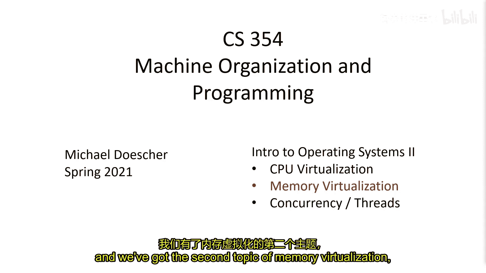

在本节课中，我们将学习操作系统中的一个核心概念：内存虚拟化。我们将探讨操作系统如何让每个程序都认为自己拥有整个内存地址空间，而实际上物理内存是有限的，并且被多个程序共享。我们将介绍两种主要的内存管理模型：分段和分页。

---

## 概述 📋

内存虚拟化的核心思想是，为每个运行的程序（进程）提供一个独立的、连续的虚拟地址空间视图，而操作系统和硬件则负责将这个虚拟地址空间映射到有限的物理内存上。这实现了内存保护、资源共享和更高效的内存利用。

---

## 历史模型回顾 🕰️

在深入现代技术之前，我们先回顾一下历史上的内存管理模型。

### 早期模型：单道程序

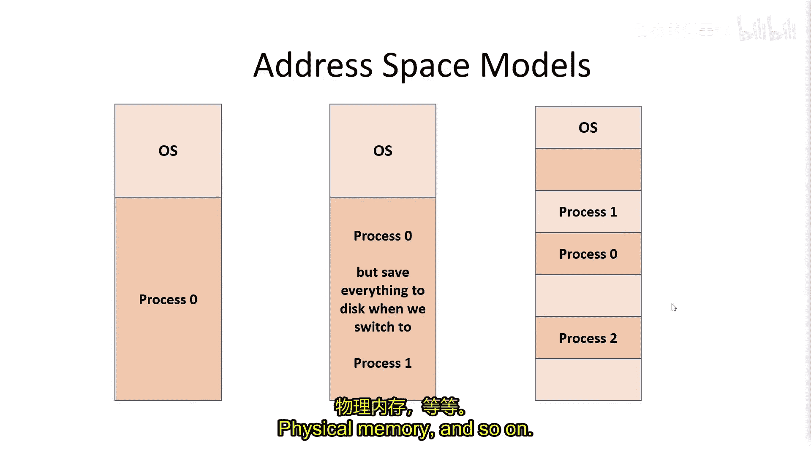

在早期计算机中，物理内存非常有限。操作系统被加载到内存顶部的一小块区域（例如512KB），而整个用户进程则被加载到剩余的所有内存中。进程知道顶部有一块保留内存（操作系统），当进程结束时，操作系统会加载下一个完整的进程。

**特点**：
*   一次只能运行一个程序。
*   不支持上下文切换或分时共享。

### 改进模型：交换

随着发展，系统开始支持进程切换（分时共享）。操作系统仍常驻在物理内存中。当需要切换到另一个进程时，当前进程的所有状态（内存内容）会被保存到磁盘上，然后从磁盘加载下一个进程。

**特点**：
*   允许多个程序“同时”运行（分时）。
*   将内存内容保存到磁盘（交换）的速度很慢，是主要瓶颈。

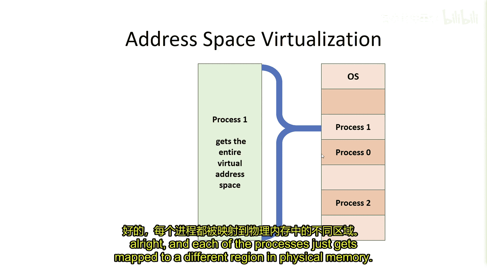

### 现代模型：内存分区

现代计算机将物理内存划分为多个区域，分别分配给不同的进程。操作系统仍常驻在物理内存的某个位置，而每个进程被分配到一块独立的物理内存区域。

---

## 虚拟地址空间 🗺️

我们整个学期编写的程序都基于一个假设：每个程序都拥有整个地址空间。在32位机器上，这意味着程序可以访问从 `0x00000000` 到 `0xFFFFFFFF`（2^32个）的所有地址。

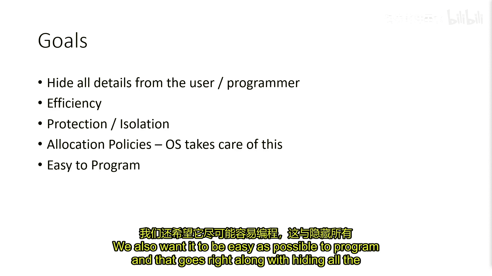

这个地址空间的布局通常是：
*   **代码段**：存放程序指令。
*   **数据段**：存放已初始化的全局变量和字符串常量。
*   **堆**：用于动态内存分配（如 `malloc`）。
*   **栈**：用于函数调用和局部变量。

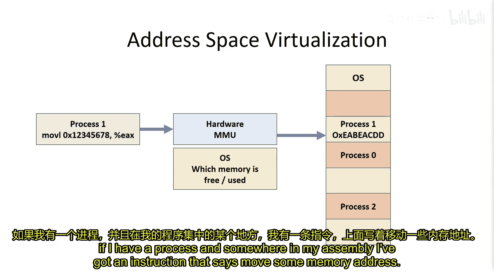

然而，计算机并没有那么多物理内存。操作系统和硬件协同工作，将这个庞大的**虚拟地址空间**映射到有限的物理内存（RAM）上。如果物理内存不足，部分数据可能会被暂时交换到硬盘上。

每个进程的虚拟地址空间都被映射到物理内存的不同区域。

---

## 内存虚拟化的目标 🎯

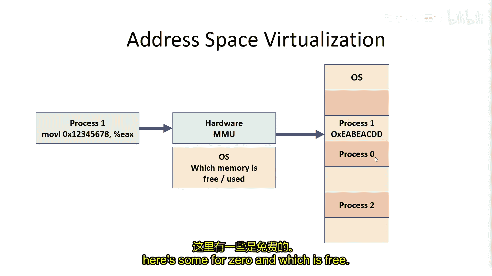

内存虚拟化旨在实现以下几个关键目标：

1.  **透明性**：对程序隐藏所有细节，让每个程序都以为自己独享整个地址空间。
2.  **高效翻译**：能够快速地将程序使用的**虚拟地址**翻译成实际的**物理地址**。
3.  **内存保护**：保护一个进程使用的内存不被其他进程访问。例如，用户A的程序不能读取用户B程序的内存。
4.  **资源管理**：由操作系统负责管理内存分配，决定当内存不足时哪些数据应被换出到硬盘，并在需要时换入。
5.  **简化编程**：让程序员无需关心底层内存布局，简化开发。

---

## 地址翻译机制 🔄

地址翻译的核心是**基于地址的虚拟化**。当程序执行一条指令（例如 `mov eax, [0x12345678]`）时，它使用的是虚拟地址。

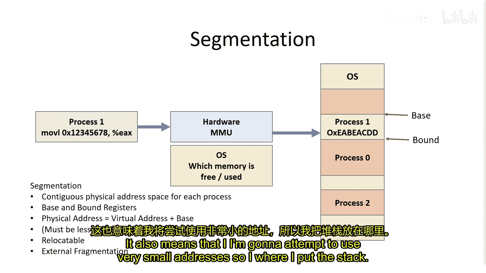

硬件中存在一个称为**内存管理单元**的部件，它负责将这个虚拟地址翻译成对应的物理地址。你可以将其想象成一个查找表，操作系统负责维护这个表，记录哪些物理内存区域分配给了哪个进程，哪些是空闲的。

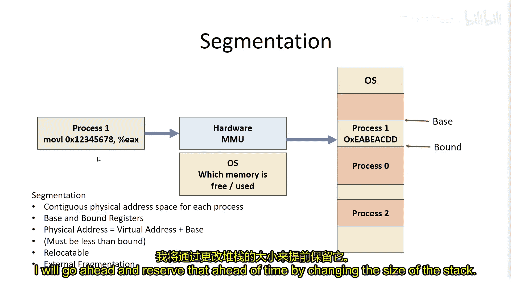

**公式**：
```
物理地址 = 地址翻译函数(虚拟地址)
```
这个函数由MMU和操作系统共同实现。

---

## 内存管理模型 📊

有两种主要模型来实现虚拟地址到物理地址的映射：**分段**和**分页**。

### 模型一：分段

在分段模型中，操作系统为每个进程分配一个**连续的**物理内存块。

**工作原理**：
操作系统为每个进程维护两个寄存器：
*   **基址寄存器**：记录该进程内存块在物理内存中的起始地址。
*   **界限寄存器**：记录该内存块的大小或结束地址。

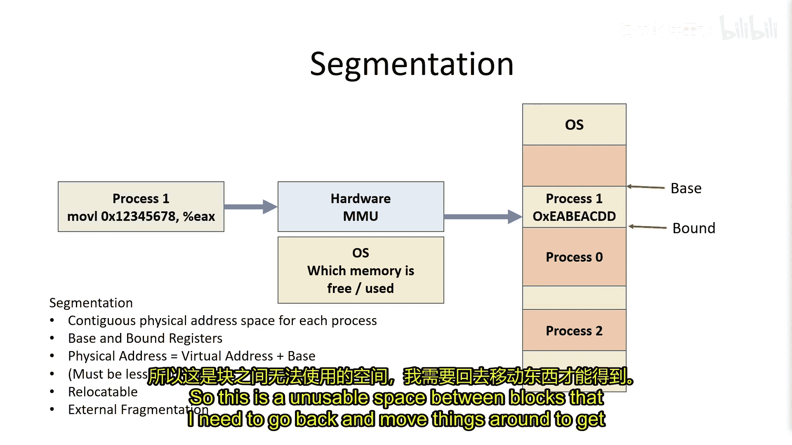

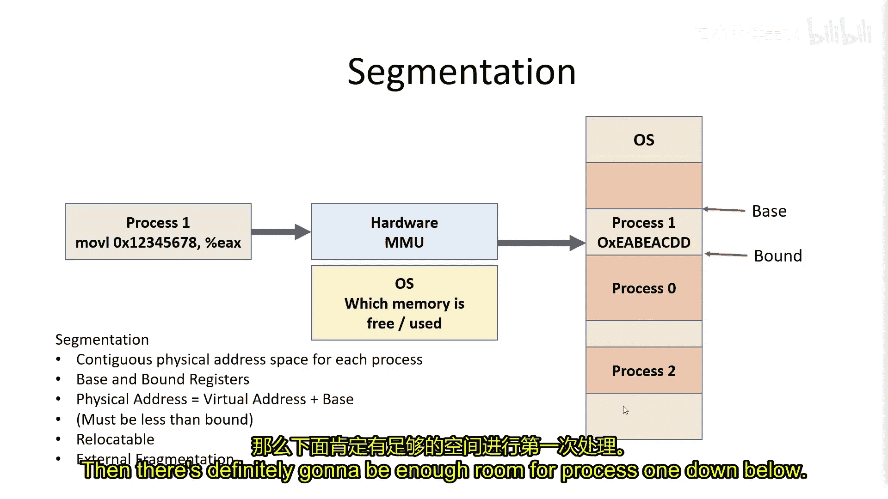

地址翻译非常简单：
**公式**：
```
物理地址 = 虚拟地址 + 基址
```
同时，系统会检查虚拟地址是否超出了界限寄存器规定的范围，以进行越界保护。

**优点**：
*   实现简单，翻译速度快。
*   **可重定位性**：如果进程需要更多内存，而当前区域相邻空间不足，操作系统可以将整个进程的内存块复制到物理内存中另一个更大的空闲区域，然后只需更新基址和界限寄存器即可。

**缺点**：
*   **外部碎片**：随着进程的创建和终止，物理内存中会产生许多分散的、大小不一的小空闲块。这些空闲块可能因为太小而无法分配给新进程，造成内存浪费。需要定期进行“内存紧缩”来合并碎片，这个过程较慢。

---

上一节我们介绍了分段模型，它管理连续的内存块。本节中我们来看看另一种更主流的模型。

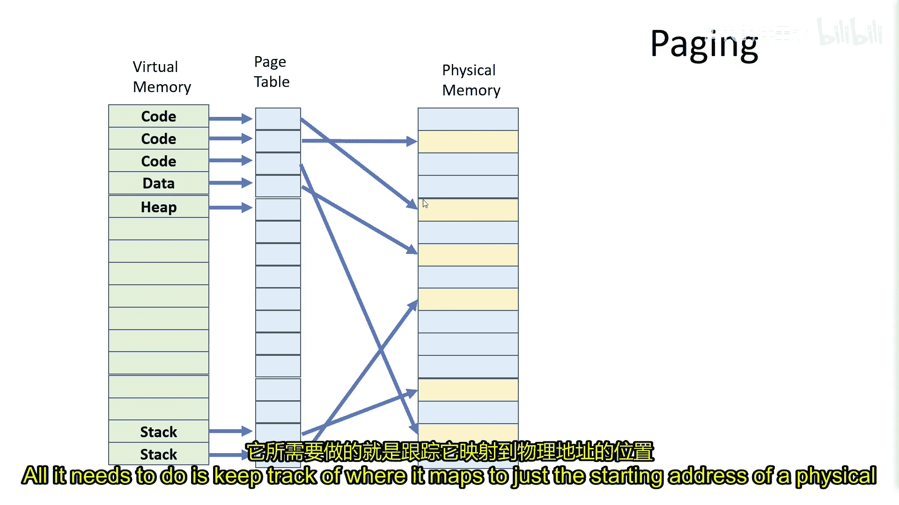

### 模型二：分页

分页模型解决了外部碎片问题。它将物理内存和虚拟内存都划分为固定大小的块，称为**页**。典型的页大小是4KB（4096字节，即2^12字节）。

**工作原理**：
1.  虚拟地址空间被划分为多个页。
2.  物理内存也被划分为同样大小的**页帧**。
3.  操作系统为每个进程维护一个**页表**。页表的每个条目记录了该进程的一个虚拟页映射到了哪个物理页帧。

地址翻译过程：
1.  **拆分地址**：虚拟地址被拆分为两部分：
    *   **虚拟页号**：高位部分，用于在页表中查找对应的条目。
    *   **页内偏移**：低位部分（对于4KB页，是最后12位），表示在该页内部的字节位置。
2.  **查表**：通过虚拟页号在页表中找到对应的物理页帧号。
3.  **组合**：将物理页帧号与页内偏移组合，得到最终的物理地址。

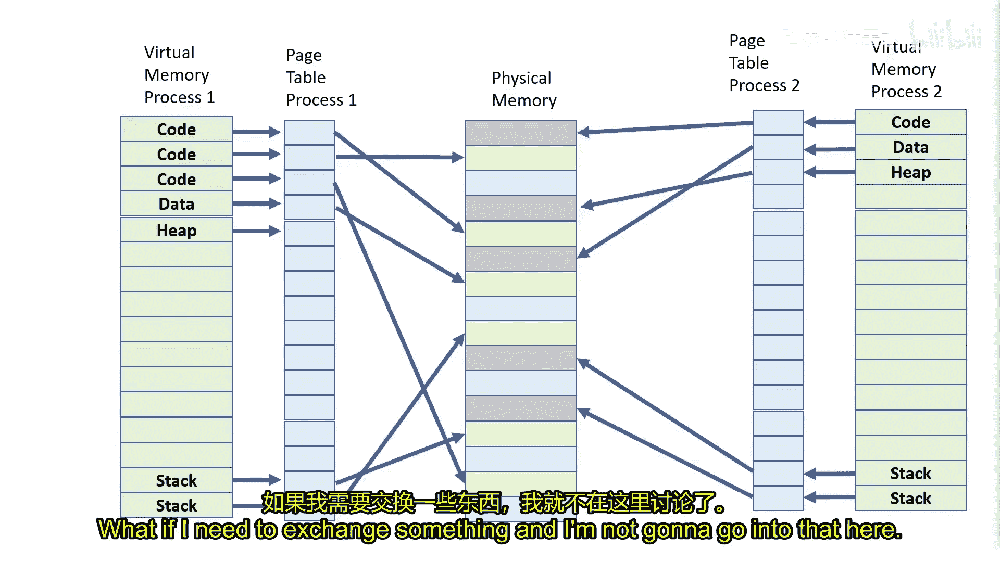

**代码示例（概念性）**：
```c
// 假设虚拟地址为 32 位，页大小为 4KB
uint32_t virtual_address = 0x12345678;
uint32_t page_mask = 0xFFFFF000; // 获取高20位（页号）
uint32_t offset_mask = 0x00000FFF; // 获取低12位（偏移）

uint32_t virtual_page_number = (virtual_address & page_mask) >> 12;
uint32_t page_offset = virtual_address & offset_mask;

// 通过页表查询（此处为示意，实际由硬件完成）
uint32_t physical_page_frame = page_table[virtual_page_number];
uint32_t physical_address = (physical_page_frame << 12) | page_offset;
```

**优点**：
*   **无外部碎片**：内存以固定大小的页为单位分配，任何空闲页都可以分配给需要的进程。
*   **灵活高效**：一个进程的虚拟页可以映射到物理内存中任何位置的页帧，不需要连续。
*   **简化交换**：以页为单位将数据换入/换出硬盘更高效。

**挑战**：
*   **页表大小**：对于32位地址空间和4KB页，有 2^32 / 2^12 = 2^20（约100万）个虚拟页。每个页表条目通常占4字节，那么一个进程的页表大小就是4MB。如果有100个进程，仅页表就要占用400MB内存，且每次地址翻译都需要访问这个庞大的表，会影响性能。
    *   **解决方案**：现代操作系统使用多级页表、翻译后备缓冲器等技术来优化，这将在操作系统课程中深入探讨。

---

## 总结 📝

本节课中我们一起学习了内存虚拟化的核心概念。

1.  **目标**：内存虚拟化旨在为每个进程提供独立、连续的地址空间视图，同时实现保护、共享和高效利用物理内存。
2.  **关键机制**：通过硬件（MMU）和操作系统协作，将程序使用的**虚拟地址**动态翻译为**物理地址**。
3.  **分段模型**：为进程分配连续的物理内存块，通过基址和界限寄存器实现翻译。简单快速，但会产生外部碎片。
4.  **分页模型**：将内存划分为固定大小的页。通过页表实现虚拟页到物理页帧的映射。解决了外部碎片问题，但页表本身可能很大，需要优化。

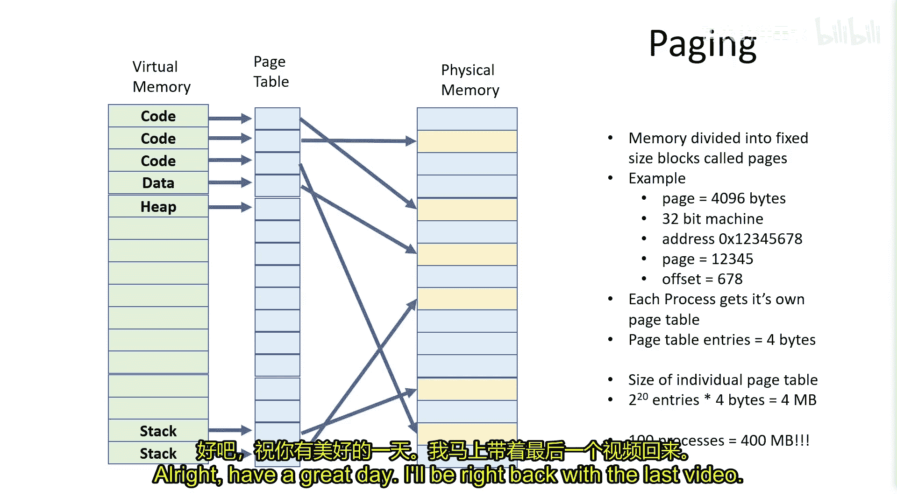

内存虚拟化是操作系统的基础，它使得现代多任务计算成为可能。理解这些概念是进一步学习操作系统、系统编程和性能优化的关键。