# 【全集】威斯康星大学 C语言编程与计算机底层原理 中英字幕 1080P p01 Lecture 1 - 导论 -BV1BViQBwEiS_p1-

Good morning， everyone。 Welcome to Comp Science 354 Ma organization and programming。

 My name is Michael Dosher。 I'm the instructor for the course。

 This course is offered through the University of Wisconsin Madison。

 if you found the videos on YouTube， you are welcome to watch them of course。

 if you won't have access to any of the content hidden behind our canvas paywall。 apologize for that。

 I'm not allowed to share some of the copyrighted content that I'm using let's see I want to begin today with just a brief introduction to the course。

 So for that， let me jump over to the canvas page。 And you guys not from Wisconsin can get a peek behind the scenes。

 and you guys who are taking the class from you know enrolled in the class。

 pull this up and follow along。 Allright， so here we are looking at our canvas homepage。

 my version probably looks a little bit different than yours because I've got all the editing buttons and tools over here。

 Allright， welcome to computer Science 354。 up here in red at the very top。

 I will have all of the really super important links， announcements。 these are almost。😊。

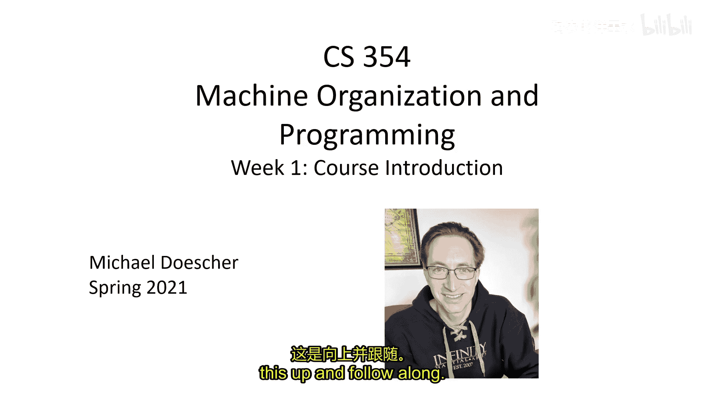

going to be about when I'm late getting things out there that I should have already done In fact。

 this first announcement here was about yesterday where I was not having a great day。

The next section is gonna to be just some important links and I will keep adding to this。

 This page is gonna to be under construction throughout the entire semester。

 we'll just keep building onto it。 First up， so important links section we have the syllabus officers instructions I'm gonna come back to this in a second this next part for weeks one through 15。

 there'll be a section here with the playlist the PowerPoint slides the quiz that we'll have or the midterm。

 whatever homework assignments we're having for the week homework one will be released probably Thursday or Friday the reading assignment。

 and it's just gonna to look like something like this。

 I just put this up is sort of a mockup because I'm making the playlist right now and then down at the bottom here we have the tentative topic list the course is really broken down into。

3 sections。 So the first part beginning here， see programming basics up through。About right here。

 low level C programming， the first five weeks of the course are about programming in C。

Following that the middle part of the course is going to be about assembly。

 so starting in week  six assembly assembly assembly assembly right through yeah through a week 11。

 somewhere around there we're going to be talking about assembly language programming and most of what we'll do is we'll write C code。

 generate the assembly from it and then take a look and understand how it's working under the hood and then the last four weeks of the class of 11。

12 1314 are going to be special topics of some kind we'll look at dynamic memory allocation and an introduction to operating systems。

All right， so I've got two midterms on this schedule right now midterm one is going to be wherever we finish C programming。

 we'll have a midterm about the C programming if I finish a week early。

 it will probably won't move this up if I take extra time， we'll move it back one。嗯。

And same with the midterm 2， it's going to follow whenever we finish the assembly language section。

 Then we'll have the midterm。 I have no plans to move it earlier。 but if I need to。

 I'll move it later， even though it might squish it really close to the final exam。

 So midterm1 is going to cover C program mid term 2。

 because we're generating all of our assembly from C， it builds on the first section。

 and then the final exam covers absolutely everything。

 So it does build up as we go through the entire course。Okay， next up。

 I want to take a look at the syllabus。Allright， first up。

 this is machine organization and programming。 We've got two sections of this course。

 Section 3 is the virtual one offered through UW。 That's the one the majority of the students watching these videos are gonna be enrolled in。

 So welcome And then I'm also teaching an inper section at E on their campus。 That's section 10。

 So I'll be going over there Wednesday afternoons Wednesday evenings to deliver an inper lecture It's three hours on Wednesdays from 5。

30 to 8，30 PM。 The E folks， if you're watching this video。

 you are perfectly welcome to watch the video sequence。

 I have to apologize if you're in the virtual section， section 3。

 do not have the power to go over to E and view the lecture on their campus。

 That's for E employees only。 So apologize for that。 All right， let me introduce the team first。

 let me start with myself。 I'm the instructor， Michael Douchher。

 I've got a PowerPoint slide Let me pull that up real quick。😊。

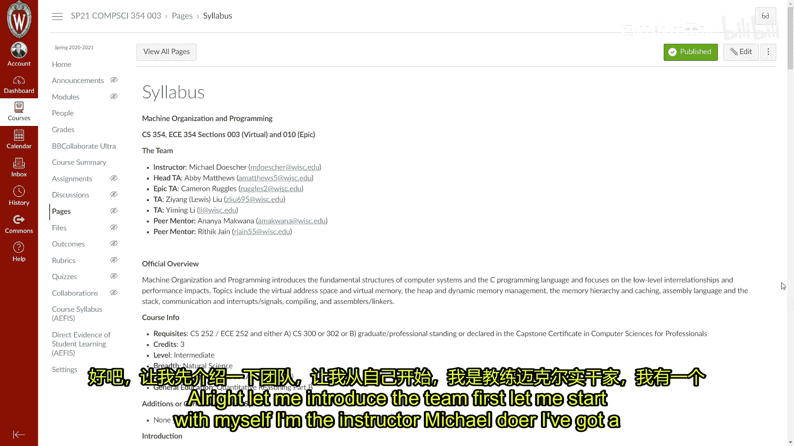

Allright， so go ahead， please call me Mike My email address is there I'm Dosher， I Wed I you。

 It's all over the website。 it's not difficult to find me。 So my PhD is actually in chemistry。

 I went to Luther College in Iowa got my PhD at the University of South Carolina where I worked on probe microscopy and an electrochemistry After that I took a job working for the naval research laboratoryatory in Washington D where I worked on some top secret stuff involving more electrochemistry inorganic chemistrytry and sensors following that I took a job teaching chemistry at Benedictine College a little tiny college in Atchison。

 Kansas and it was there that Curio got the best of me and I just needed to know more about computer science and that's when I started taking undergraduate classes in computer science and then I actually got into the University here UW Madison finished my master's degree here Once I finished that I took a job working at art software a small startup company。

InMaison， where we developed software that engineers would use to I helped design parts to try and figure out you can see an example of a part over here on the right and try and figure out how they can reshape this to make it lighter you know this is a part in progress I could drill more holes into it。

 make it lighter that sort of thing the company ultimately didn't make it and I took a job well during the whole time I was teaching a onecred night class usually C plus plus at the university and then I just applied for the full time faculty associate position and now I'm here full time。

This is actually， let me think here， eight years teaching chemistry。

 this is my fourth year teaching computer science， and this will be my second semester as a faculty associate。

Yeah， so I enjoy getting out。 I've done four tough mothers now。 It's a pretty good picture of me。

 Yeah， obstacle course racing。 I hiked the Grand Canyon last year and went winter camping。 I do。

 I'd like to call it adventure travel is sort of just for fun。 I workout like crazy。

 And I got to talk a little bit too about some of my health issues that'll probably affect the class。

 They were probably last semester。 I don't see them going away anytime soon。 So last September。

 my heart actually stopped。 it's not technically a heart attack。

 that would involve the blockage of blood vessels。 In this case， there was a nerve。 Okay。

 so the truth is they've done every test that they can think of。

 they only really test for bad things and didn't find anything。

 So they really don't know what's going on。😊，Ext best guess is that it's some sort of electrolyte imbalance。

 So perhaps low low potassium or something like that。

 which affects the nerve impulse going and telling my heart what speed to beat at。

 which show is a problem because I， I still have occasional bouts where my heart doesn't go fast enough。

 and I feel incredibly fatigued and really light headed。

As part of the reason the course is designed with this weekly schedule。

 because on average over the course of a full week， I have many pretty good days。

But every now and then there's a day where I'm not doing so well。

 And what I'm hoping is that if I have a bad day if there's not enough of them。

 you guys will never even notice that I'm upstairs just resting on the couch。嗯。Anyway。

 that's my goal。 And the rest of it is sort of smooth over rather than trying to keep like a regular Monday。

 Wednesday， Friday schedule。 I found that a lot more difficult to stick to。 I'm also a single dad。

 And so my son is here halftime and having him here trying to do school is also very distracting。

 That's another reason for the weekly schedule。 It to sort of like。

Take those moments when I feel good when he's not bothering me and I get all the work done all at once。

That's the goal。 we'll see how that really works out。 All right， With that in mind。

 I also spend a lot of time going to the gym for my cardiac therapy at this point I'm just just workout。

 just do cardio at the gym pretty much every day。 I also go to the hospital a lot So as far as like with global pandemic going on global places that you know a global pandemic I go a lot of places that are not particularly safe。

 I'm probably not the safest persons， and I have not yet gotten coviId。

 I'm super careful because I know I go these places。And pretty much nowhere else。

 So hospitals and gyms。Anyway， just wanted to share all that stuff so you guys have some sort of background as to what's going on and I'll keep you up to date if it ever affects the class or how it affects the class it probably will。

All rightLet me jump back over。

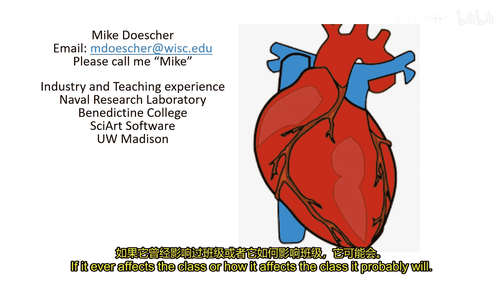

To the syllabus All right here we are so I've got a team of well there's seven of us we've got four Ts those are gonna to be graduate students helping us out as well as two undergraduate peer mentors this term Our head TA is Abby Matthews she's the one who's already reached out to you guys with the survey we've got a special TA who's going to focus on helping the folks at E feel free to write to him as well Cameron our official E T and then I's see just go through some of this stuff。

😊，This is the official course description I fixed the grammar from the catalog。

 but other than that it's the same thing we're going to talk about computer systems。

 the see programming language， we're going to look at the interaction between the code that we write and see and how it gets translated into assembly and then how that actually interacts with the hardware we'll talk about the address space。

 dynamic memory， operating systems， the assembly language compiling process。

 all right that kind of stuff。I'll see important course info。

 This is we're required to put that here。 Let's see。Introduction， go ahead and read that on your own。

Yep， here we go。 So we've got two sections for this。 There's the online lecture version。

 That's the one you're watching this video right now。

 This is gonna be a weekly series of YouTube videos。

 I taught this course over the summer and I' prepared videos for that course。 Also。

 I'm gonna take advantage of all of the good videos that I made over the summer and just keep using those pieces。

 So you may be looking at the clock in the lower right hand corner and see that this was recorded over the summer。

 It's because I liked what I've done there and I'm keeping that segment。

 There are a lot of places where I like have learned a new tool and want to bring in a new idea or feel like I could do a little bit better or have a different example。

 So I'm gonna create all new content for all the pieces where I think I can do better。😊，U。

So's see the plan is to release a weekly playlist。 It's gonna be a composite of the pieces I liked the new stuff that I'll be adding。

 It turns out to be honest， let's face it， video lectures are probably one of the worst ways to learn computer science。

 There's no interaction。 If you just sit there and watch the video。

 you're not gonna get a lot out of it， especially if you're in a room with distractions。 You know。

 if you're like kids are playing Xbox or something or your roommates playing Xbox or your sisters playing dance dance revolution or practicing violin。

 while you're trying to watch， especially if you've got this on a mobile device and you're trying to like follow along with a laptop。

 It's hard to do。 I'm gonna do my best to make everything as big as possible。 actually look at that。

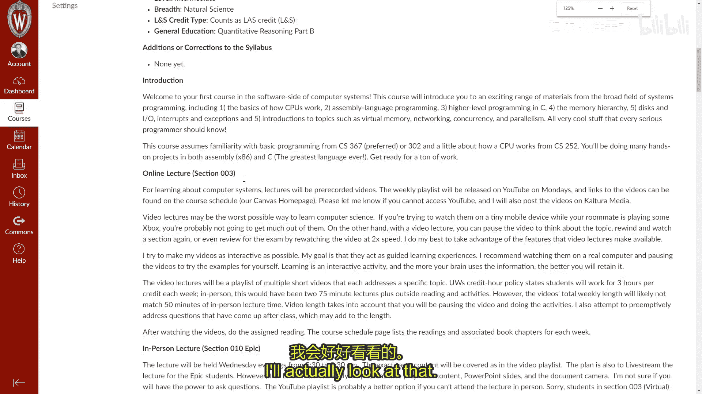

I can do better。 there we go big as possible so you guys can still read it。

And I'm also going do my best to make these videos， obviously not the one about the syllabus。

 But the rest of them as interactive as possible。 So youca can pause the video， try an activity。

 That's the best way to learn。 It's actually do it yourself。 particularly with computer science。

 You've got to type these things。 And you've got to try。 You've got to make the mistakes。

 See what the error message says。So that's the idea。

 I'm going to make these as interactive as possible。

 and I'm going to take advantage of the like all the things that YouTube lets us do。 for example。

 you could pause the video。 you can walk away， you're not going to miss anything。

 You can break this into pieces。You can pause the video and try something out if you need to hear something again。

 you can rewind and replay that section。 And if you're just studying for the you know midterm or something you can play the video at you know2 X speed and just cruise through it and just like remind yourself And if there's a piece that you missed。

 you could slow it down and listen to that again。 So YouTube offers a lot of features for us that I'm gonna to try and take advantage of things you don't get in a real in-person lecture downside is it's really difficult to ask questions。

 So we're providing a number of avenues for a communication。

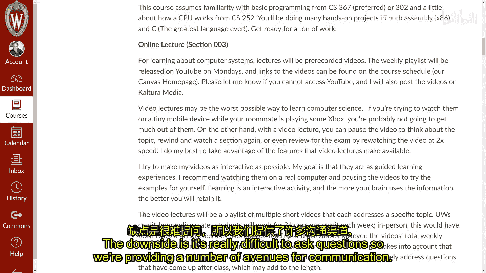

Let me see here。 All right。 So the video lectures， they're likely， you know。

 if this is a three credit class， normally it would meet Tuesday， Thursday for 75 minutes。

 the videos are likely not going to match up to that 1 hundred50 minutes per week。

 Take into account of the fact that I expect you guys to pause the video。

And do something that's gonna to make it a little bit shorter。 And all those questions that come up。

 particularly over the summer thing people would ask things on Piazza。

 I'm going try and incorporate those questions into the lecture and address things that you know people may come up and ask you know after class and a normal lecture class So that's gonna to make the videos a little longer when I try and like guess what questions you guys might have ahead of time So somewhere hopefully it'll be about 150 minutes。

 but likely likely shorter than that to be honest。

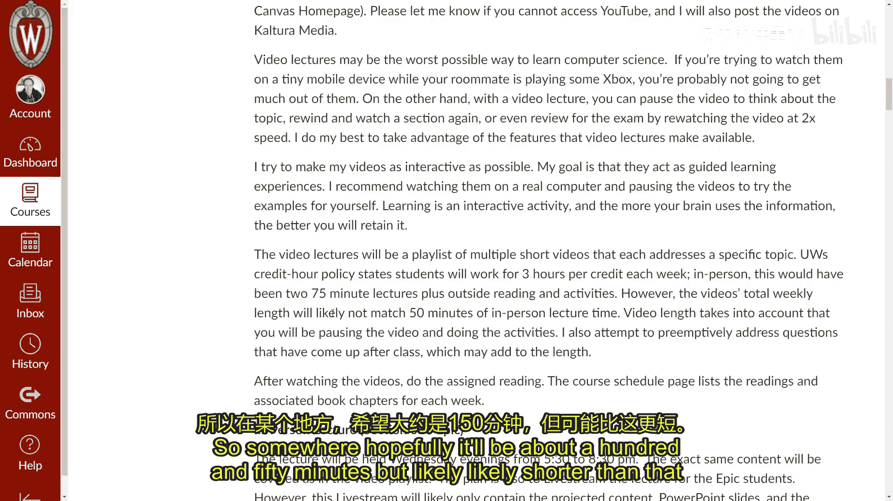

And the weeks that do go longer， the goal for a three credit classes that you spend。

So the university wants one hour of substantive interaction and two hours outside of class。

 so you can just think of the video as part of those two hours outside of class if it runs along。

All right， again for the E section， if you're watching this。

 the plan is to deliver a live inperson lecture on the Epic campus will be live streaming the lecture for the epic students so if you're on campus trying to watch it in your office I send an email this evening about how to connect to that and I'm working with the AV team over at E to figure out how that works and I don't they have a plan and I haven't been told it yet so。

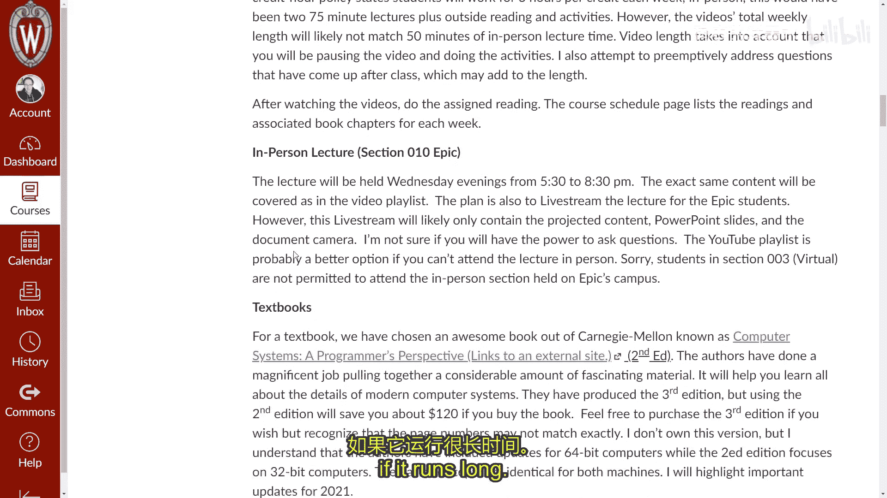

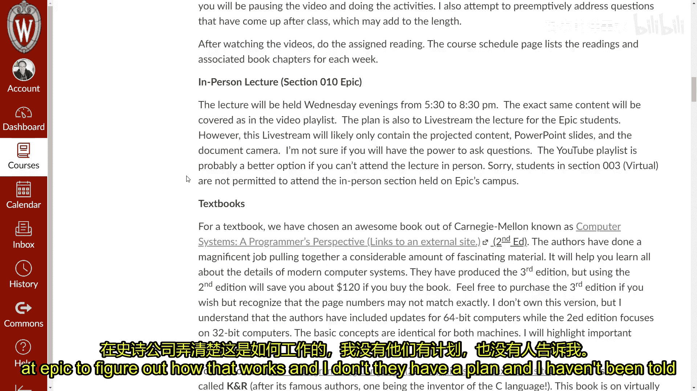

We'll see what happens。Alright， next up， quick commercial break。 We'll be right back。Alright。

 today's lecture is brought to you by computer systems。

 a programmers's perspective I will be using the second edition for the class。

 It's completely possible to get away with a third edition if you guys want。

 I don't actually own a third edition。 My understanding is that the major differences is that they've added a lot of material for 64 bit computers so they go into all the different names of the extra registers and the extra commands that you will need to choose the 64 bit registers instead of the 32 bit ones And my opinion it doesn't actually add that much extra to the class to have that extra complexity they work the same way。

 And so and as far as like the like super advanced details， we're not going to get into those anyway。

All right， but please be aware that as you are。Making your selection。

 the page numbers may not exactly match up to what I'm doing with the I' I'm going to refer to the second edition。

 and it'll save you guys about 120 bucks if you go with the second edition instead。Allright。

 you will also need。M see。The C programming language。

 This is a book that actually is written by the inventors of the C language itself。

 This is the second edition。 It's a classic。 Every programmer should have this on their shelf。

 And again， there are actually a bunch of free places you can get this book。

 I've got the link to Amazon right here。 If you look around on the Internet。

 you can just do a quick search， you'll find multiple places where you can download it for free。

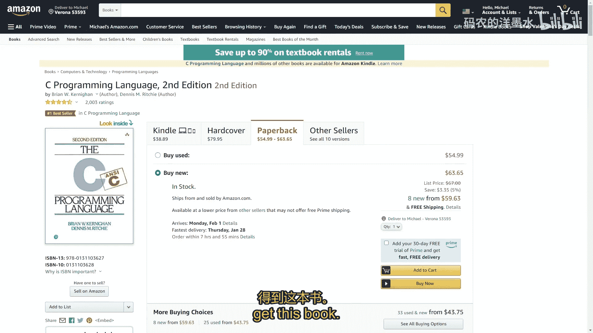

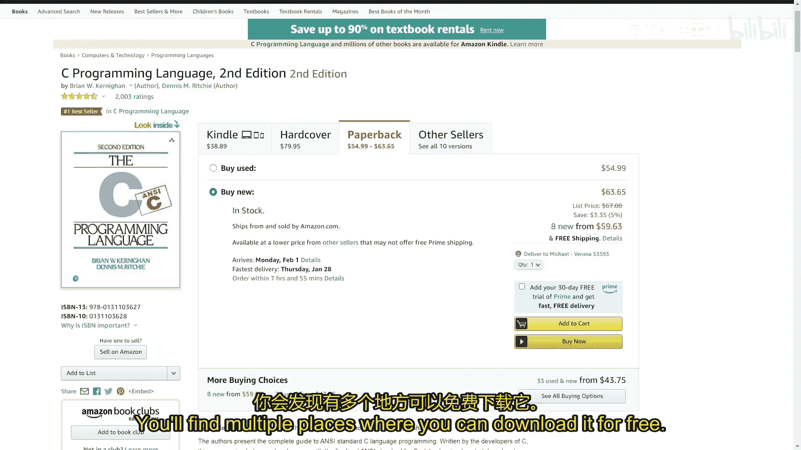

Al right， in order to provide you guys with the opportunity for substantial communication and interaction like get in row class and not just watching videos。

 I've got a bunch of different ways that we'll be using to communicate for the course content First Canvas is going to be are clearinghouses where everything will be linked from to the most important the most important page is the homepage where all the announcements and the schedule will be。

Alright next up piazza is an online form you guys can use to ask questions if you're new to the University of Wisconsin just go ahead and click the link it'll bring you over there if not I'm sure you've used it in another class a couple notes first please do not post code that you've written for homework that's more than five lives long This is considered cheating and then lots of students are going ask questions here so it's a great place to go and see what questions they have we strongly encourage you guys to answer each other's questions。

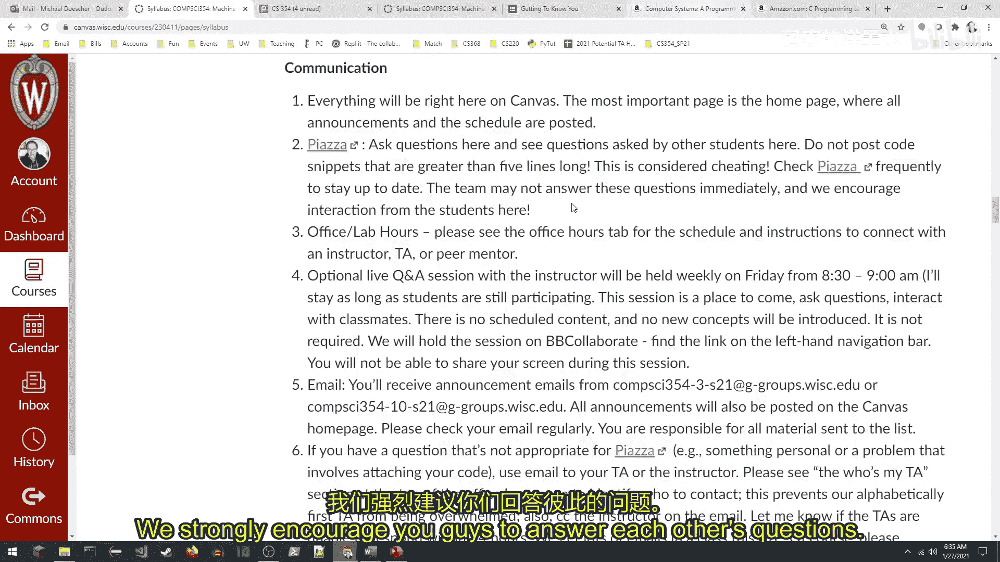

I've got one post it looks like this。Please be aware the couple things。 First before posting。

 make sure you do a search and see if there's any。Similar questions where you may have already had your question answered this is known as Piazza bloat when we have many。

 many questions on the same topic and it makes it makes it hard to search for things that are actually useful So when posting。

 please make your post very clear I'm trying to do this。

 Here's the error message I get here's a screenshot of something cryptic I don't understand。

And then as you guys just go through， we're going we're probably not going to respond immediately the team of TAs and peer mentors and myself。

 we're going to give you guys a chance to try and answer each other's questions there's really a lot of value in trying to explain something to a classmate。

And then just。I got to highlight this before you respond to a question。

 it is It is incredibly fun to spot a duplicate question。

 And then sort of like a little passive aggressive way to like say， hey， you guys didn't search。

 do better job searching。 you can use the ad link to reference that post。

 So up here you can see in my URL bar。 This is C ID equal 5。

 I can just reference this as at 6 that's a 6， not what am I thinking。😊，Yep。To。

Indiic a duplicate post right again， please don't post any code publicly。

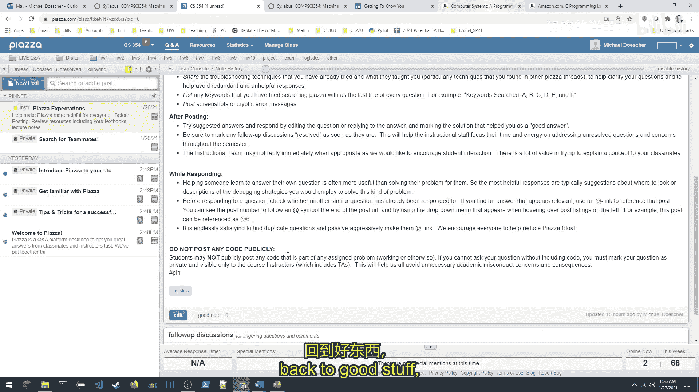

All right， all right， back to good stuff。Office hours and lab hours。

 we've got a special tab I'll be coming back to that in a minute with the instructions and schedule。

Also we'll be holding， I'm going to be holding an optional live Q&A session on Fridays we'll start at 8 30。

 I'll hang out till at least nine if there's nobody there and in the past。

 especially in like the first week of class， it's been pretty empty。But if anybody has any questions。

 you just want to like get to know me a little better， come and hang out。

 I'll be there Friday morning。And if you want to just talk to the other students there's no there's no scheduled content I'm not going to introduce anything new。

 this is just a way to provide interaction between me and all of you guys that's not just me sitting in my office in the gymness sun hasn't come up yet it's actually cold down here by myself so it's probably good for me to you know get out and meet you guys too。

All right， let's see here email。 I've got the groups。

 University of Wisconsin sets these up for me so you'll be getting announcements from me from Ggroup at W@duu for either section 3 or Section 10。

 And again， all the announcements are going to be posted on canvas so you can just check that。

 The email will mostly be I've put a new announcement up。

 there's new material ready or something about it being delayed because of my health。

 One of the two are most likely going to happen。Let's see also if you have a question that's not appropriate for Piazza。

 something that's personal， you can like email your TA or the instructor on the TA page I've got a who should I contact and if only needs an extension or something like that you can send that to a TA we'll get you on the list it's something that requires my direct attention absolutely send me an email。

All right let me see here next up So office hours so we have office hours and lab hours Office hours are basically you'll schedule a one on one appointment。

 I'll show you the system in just a second， but you'll send us a meeting link and then we'll go we will join your meeting link so choose something where you know how to share your screen。

 This is a great place to work on debugging your code or looking for issues or if you have questions about the course content。

😊，We're also going to be providing lab hours。 These are a little different。

 We'll hold them over on canvasva's Blackboard Collaborate Ultra， which can't see from the screen。

 I'll show you in a second where it is。 It's on the left hand tab。Maybe I'm just trickle out too far。

Yep， Blackboard collabo Ul right there up the top。There we go。

 okay and during lab hours so a peer mentor or TA will be there。

 you guys can go multiple people can just join these sessions。

 It's a great place to talk about strategy for solving the homework problems you can use it a lot like office hours Probably we won't see more than a few students at a time。

 However， you will not have the power to share your screen during these sessions。

 if you wanted to like talk strategy with other students though you know there may be other students present also So this is just another way for us to provide sort of a live interaction experience for the students。

Alright， next up grading。 How do I pass the class， This is probably the reason you've been fast forwarding through the video right up until now。

 Here's the idea。 We're gonna do homework in the form of projects。These are going to be。

Let me just go over this。 We'll have So we'll do projects multiple homework assignments throughout the semester that gives you the opportunity to practice。

 There's gonna to be either a quiz or a midterm every week beginning next week。

 And the first week we have our survey。 So there's something every week in the like category of quizzes。

We'll drop some of the， I believe the two lowest quizzes， is that what I said yep。To lowest quizzes。

 And these are just gonna be questions about the previous week's content just as a way to like help you guys stay on task to keep up。

 It can be really easy to just see a weekly YouTube playlist and not focused。

 have it on the background or say， oh I'll watch it later。 I'll do it later。

 not get started So this is just for me。 and it's chance for you guys to just check and see。

 So I watched the videos。 Did I really get it。 That's the idea。 It's supposed to be。

What's the word not stressful， low stress。 Just did I get it。

 I w to give you guys some points for doing it。 if you like， take the time to go through my quiz。

 So that's why we're gonna be awarding 10% of the grade for that。Let's see。

 then we've got two low stakes midterms， 10% each and 20% on that vinyl。 Let's see。 It's that it up。

 Yep， looks good。All right， I need to comment here on the scores too。

 I have an extremely harsh grading curve set up 95% to getting A。

 it's probably one of the most rigorous in the university。

And the reason for that is because on all of these projects， like 50% of the points right here。

 it's a coding assignment where I say here's what I want you to do。

 Here's a test that will tell you when it works。 So you will know when youve got 100% on all of these projects。

 And if you don't have 100% yet， you should keep working because some of the tests will fail or it won't give you the answer that it's expected。

 So to be honest， these projects， you can take them to office hours， you get help。

 you can get more help， you can get help after that， you can read on piazza。

They're not a great way to assess whether you've learned the material or not。

 because almost everybody gets a perfect on almost every project。 if you like spent the time to。

 you know， to go through it， they are like grading is results based if you like。Turn something in。

 and it doesn't work。 You're obviously not going to get the points。

 But it so it's not a good way to assess whether you've like learned the material or not。

 to be honest， but it's a great way to get practice。

 So it's very important for the like practice aspect of things。These projects 50% of your grade。

 they do take a long time， they are a bunch of work， but the idea is you will get practice。

 so don't procrastinate， start right away， get to work。Yeah， the late policy。 yeah。

 And this only applies to projects That's the only thing we'll be worried about turning in late。

 given the global pandemic， we're not going to penalize late projects this semester。

 What I saw last semester was that。You know， there were so many students who， you know。

 not just needed an extension， but like needed two weeks。

 Something went horribly wrong in their life and they struggled。 you know。

 someone in their family got CoviId。 They got Covid mental breakdowns。

 they had to take care of their little sister because school was canceled， whatever it was。

 people needed more time。 here's what I want you guys to do if you need an extension on a project just send the T A or myself an email we'll get you on the list。

 I don't need to know why what I do need to know is when you actually think you'll get it finished。

 And heads up， we cannot accept projects after the last day of class。

 We also really don't have the resources to grade absolutely everything during the last week of class。

 So if this looks like it's about to be abused and we won't have those resources to great things。

 we will change this。 But right now this is what I'd like to do。

Turning your work in on time gets you a couple things when we grade your work。

 we're going to review it and give you some comments。

 offer suggestions about how to become a better programmer and。

If something goes wrong and you would like to request a regrade， it gives you that power too。

 So if you turn it in late， if it's the last read class， we will just grade is what you get。

 we will not be accepting regrades。A couple of things that we will like automatically let you guys fix。

Basically， your code has to work。 It's result space。 If it doesn't compile。

 if it doesn't work for some reason， there are some things we'll go ahead and work with you。

 We will not fix any issues。 We will not grade code that looks almost correct， but doesn't work。

 instead you have to fix it。 But a couple of these configuration issues are number one。

 if you work on a Windows machine and then you submit it and we graded on the Linux machine。

 The different system may have different issues and may not compile。

 So we will be grading all of the projects on the lab。 Linux machines。

 so please verify your code runs there before submitting it。

 and better yet write your code on these machines。 Vide coming soon about how to access the CSL machines and use the Vm editor。

In case you've never used any of those before， welcome to Wisconsin if you haven't。 All right。

 some some bugs don't cause problems every time if you run into a random bug that causes it to fail when we test it。

 but it works on your machine， we'll go ahead we'll work with you， you can fix those issues。

 obviously， if you cheated or faked the results， you've got big problems，That's no good。 And again。

 here in black， we will never fix the code for you。

 never manually give you a better grade for code that almost looks correct。

A couple of other things I catch， especially since we've moved online。

 I've caught a lot of students cheating。So a couple things that I just feel like this is important。

 What can you do and what can I do， So feel free to talk about the code。

 talk about strategies for solving things。 Oh， I used a loop for that。

 You can share a pseudocode or diagrams。 You can share like links to online resources。

Copying code from online resources that is not specific to your project。

 you just need to cite your code， just like quoting in an essay。

 you if the project gets leaked and someone posts the results。

 you find it from a previous year and you use that that's not acceptable， don't do that。

So not acceptable， looking at someone's code and attemptinging it time by line， that's not the same。

 you know， that's copying。Straight up copying and pasting it or emailing code to someone who's a。

we don't actually have partners in this class， so everyone will do all of the work on their own。

 I should probably update that a little bit。Don't email your code。

 don't take pictures of someone else's project。Looking at someone else's code can be dangerous if you've got a roommate who's taking the same class。

 it's。Really easy to look and see what they've done and then go type it in。 You know。

 your brain just likes says， oh， I get it。 Finally。

 it's much safer for the person who has finished it。

 finished their project to go look at the code of someone who has not yet finished it。

 And then they can offer suggestions verbally when your eyes actually see the answer on someone's screen。

 It's very difficult to not copy it。 And We're actually using some really advanced software to spot similarity。

 It's the moss。 Let' see measure of software similarity detection system。 It's very advanced。

 It doesn't matter how you renamed the variables， shuffle the order the code。 It looks at。

The code structure and can figure out who is copied Who's。 And to be honest， I've caught。

 I believe I caught 11 people over the summer， and we caught probably 25 during the fall semester。

Don't cheat。 And if you want to， if you really want to cheat。

 there's some actual scientific articles about how to defeat the moss system。

 you're going to want to read those before you copy anyone else's work。

 or before you try and copy a solution you find online。 It's。

 it's actually a lot easier to re on code than it is to learn enough about how moss works to not get caught。

Let's see here。 Oh， how to side code just is all I need。 This is some Python code。 So just comment。

 It'll be the double flash and C and copied from wherever you found this block of code。All right。

 let's see here， if you require any sort of accommodations if you need extra time on a test or anything else I can help you with due to a disability。

 please go to the McBney Disability Resource Center and have them contact me with with your visa and let me know what I can do for you。

Let's see learning objectives， we're going to learn some C， some assembly and some machine or some。

Advanced concepts。Right， if you're new to Wisconsin。

 you'll need your CS S account in order to log into the CSL machines。 There's a link right there。

 I believe that's one of the links on my very first announcement link page at the top。

 So you'll need to take care of that。Let's see， recommendation letters。 Yeah。

 a lot of times students will ask me for a letter of recommendation after finishing the class。

 and especially now that we've gone virtual， it's， it's very unlikely that I will know you guys。

You know， well enough to write a good letter。 So to get into graduate school。

 they ask questions like。Please tell me about this language proficiency， curiosity。

 ability to perform research。 other than gonna to be successful in graduate school。

 And if all I've seen is some homework that you've turned in。

 I really don't know enough to write a letter about those topics。

 So the best way to get a good letter is to actually do a project something that。

Is outside of the class and show me what you've worked on。 I just need something I can write about。

 And， you know， getting an A in class isn't enough for me to actually write a good letter。 In fact。

 the universities or internships， they already have a copy your transcript and they know you did well。

 And if all that， my letter says that you did well in class， they're actually abbreviated。

DWIC letters， they're going to ignore that， it actually detracts from your application because it really says that you don't have someone else who can write a better letter for you。

All right and from here on down official statements required on the syllabus。

 This is just sort of copyied and pasted from like other places。

 The university requires this for accreditation， but some of this stuff is really important。

 you guys have the opportunity to evaluate me and evaluate the course。

 This is really valuable for me I value this feedback and I use it to make my course better every semester So when the evaluation comes。

 please fill that out。You take academic integrity very seriously if you cheat。

 I will be turning you in if you're if anyone's curious about how that process works。

 if you've never been called before and you want to know exactly what happens。

 be happy to walk you through it。Let's see accommodation for students with disabilities。

 this is through the McBney Center again， here's the required inclusion statement。Check。

And then diversity of inclusiveness。Yeah， everybody here is valuable and I believe it makes the community better if we all get along and find ways to respect our differences。

So I'm going to go ahead and do my best。 I know， to be honest。

 it's really hard when this is online because I can't see anybody and it's hard to know that people have differences and。

Alright， I'm gonna do my best。 We'll see if we can figure out a way to。

Bridge that like virtual gap and get to know each other a little better。

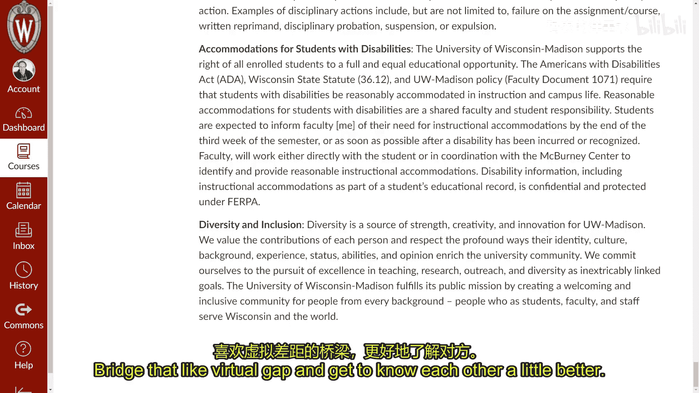

Okay， so that was the syllabus。 really briefly。 I already talked about the difference between office hours and lab hours office hours。

 basically you will create a one on one session with one of the Ts and we'll come to your meeting link that way you have the power to share your screen。

 you can use a technology familiar with could be Zoom Webex I'm a big fan of Google Meet We can actually set something up with Blackboard Collaborate if you like really at a loss and do it that way。

Let's see here。 Yeah， Officer right here。 So private sessions meet one on one。 There's a。

Submit a ticket request。 Let me pull this up。So basically you'll click that link I'm going to try and get it embedded so it's actually right there in Canvas。

 haven't figured out how to do that yet。 Canvas has some limitations。 But anyway。

 you'll just put in your email address， your name， pronouns are optional create a meeting link so in this case we recommend using Google Me if you don't have a preference if you're a huge fan of Zoom send us a zoom link it doesn't matter just somewhere and you can share your screen with us。

See us log in， what kind of question either about a concept or debugging。

 should probably have another option there， choose conceptual if it's not debugging。

If it's anything else， brief description of your question。

 And then after you do that when you click submit。That's going to take you and create' going to create a ticket。

Up on the trello management board。Here's what this looks like。So when you first appear。

 your ticket will appear over here in the to do list。

 This does take between one to two minutes for this ticket to arrive。

 It doesn't automatically update instantly。 The Ts have a spreadsheet so we can see when you do come all of the Google forms go to a spreadsheet and that updates automatically。

 So we can see instantly when you arrive。 But this is just sort of a management system for if it's busy。

 let know the day homework is due or something。 So your ticket will appear over here on the left on the to do side。

 when one of the Ts arrives and takes a looks at your work。

 that'll move you to in progress just like that。 And then after your question is answered。

 we'll put you back in the done column。 if you if we attend like if we put this meeting blanket。

 let's see where's the meeting link okay， she's put in Bucky Bager。

 If we go to the meeting link and you're not there。 if we fail to connect。

 we'll move you over to not present。 in which case you can send us an email and say， wait。

 something went wrong。 here's a new link。If you send in a ticket outside of when we have scheduled office hours。

 no one's going to be there。But what we'll do is we'll see that you have sent something again。

 we'll send you an email and ask you， did you resolve your question。

 remind you where the office hour schedule is， which is currently under construction。

 we can see that。Only my office hours are available right now。 So Monday day through Thursday。

830 to 830 to 9，30。 I'll be on duty。 And then Friday is when I'm doing my live Q& A session from 830 to 930。

 So my week is gonna be busy in the mornings。 the rest of tea we have we'll fill this in after we get the schedule the survey where you guys say。

 you know， I work at E I'm busy all day evening office hours at the only times that work。

 please put them during the evening。 we'll figure out a schedule that works for as many students as possible you know if this prepan。

 this would just be like normal business hours。 but truth is we have students all around the globe taking this section because it is the only virtual section 100% virtual for 354 all the students who were not like in Madison signed up for this one first if they could get in So we've got a diverse group of people from all over the world。

All right， then for lab hours， this is just going to be。

 you'll just go to the Canvas BB Collaborate Ultra link also right here during office hours so Friday。

 click this。Then let's see。 There will be。

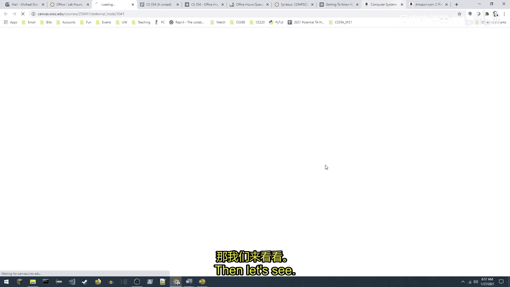

A session right here。

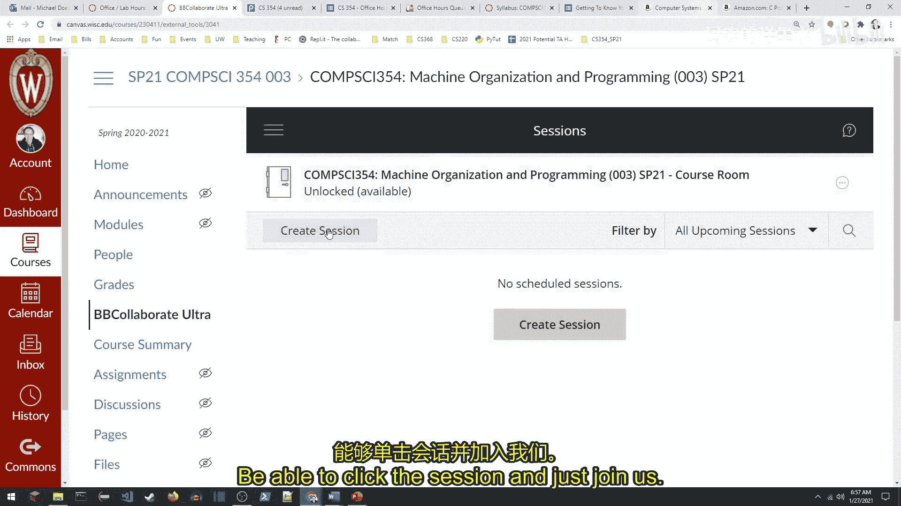

Be able to click the session， and just join us。All right， in last little detail。

 the who's my TA just so that Abby isn't bombarded， she's alphabetically first in all the lists。

For you guys in section 3， if your last name begins with A through G and you need to request an extension or something like that。

 an issue that just some sort of logistics for the course。

 please email Abby if your names begin with H through P， please email emailing。

And if you name O through L， Z， O through Z， I'll go ahead and email Lewisis here， if you're at E。

 go ahead and email Cameron for any of those kinds of requests。All right。

 for regrade requests on the submission you'll make a submission to Canvas if you go check that submission again in the comments section。

 it'll tell you which TA grade did you work and who you should talk to for regrade requests go ahead and email that person directly and for anything else if it needs my attention definitely send me the email。

Allright， just a few more details before we wrap up this entire video first under the important links here。

 click Piazza， go sign up， register for this class。

 think of it as participation points I don't think I know there are no official participation points but do it anyway Also if you've not yet done so if this is your first semester at UW Madison。

 please activate your CSL account or if this is your very first computer science class here activate your account。

And if you were a Windows user， we're gonna need to connect to the CSL machines to do the work。

 you know， that's where we're gonna grade it。 That's where you guys should be doing all of your work for this semester。

 If you're a Windows user， please go ahead and install putty or some other way to create an SSH connection。

 If you've already got a system you're happy with， definitely keep using that。

 No need to use putty in that case。 I've got a video demonstrating this and coming up next and。

This is the list of the CSL machines that are available if you have a specific， let me open this up。

A specific machine that you would enjoy using like Emperor 1 through 7。

 you can connect to that far better option。And I'm gonna keep this right here at the top for a while is to use best Linux dot C S I wish I you that will go through all of these Linux machines and figure out which one has the lightest load。

 And that's the one you'll be logging into。 So just quick way to。

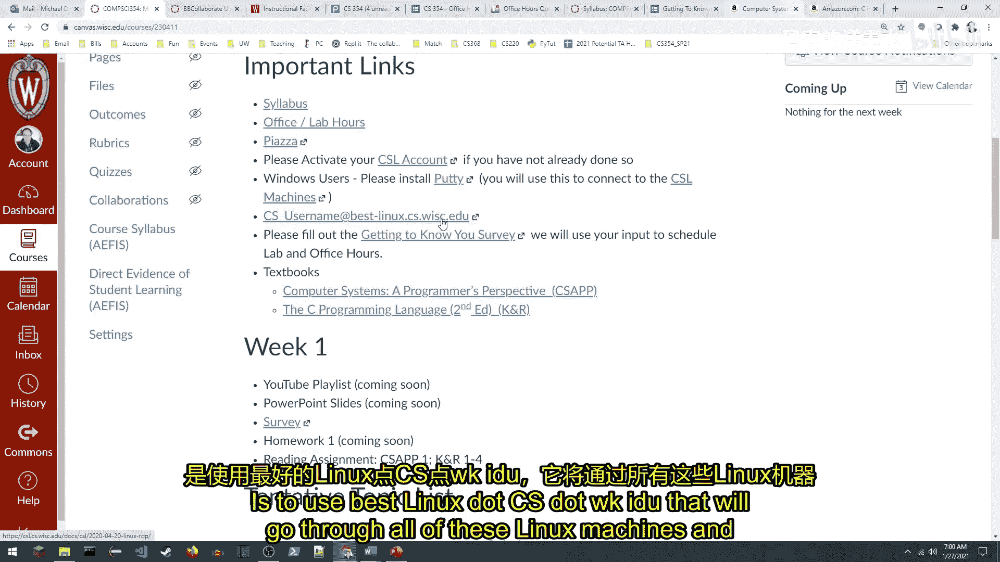

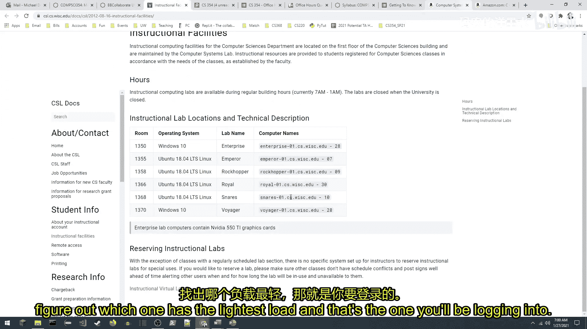

Identify the best machine and get connected， and this will be a separate video coming soon。

Please fill out to get to know you survey number one thing on this is when do you want to have office hours And as soon as we get enough input from students that。

You know， I everyone here is located。 Well， we're located around the globe。

 I think a lot of people are in Madison， but we've also have a number of students in China。

 India and Africa。 So I want to know when you guys want to attend office hours。

 And there's probably a big part of the group who wants。 like I worked during the day。

 I want evening office hours。 So I we'll get this figured out as soon as we actually have some data from you guys。

All right， there's links to the textbooks again and。Alright， I'm， that's gonna be it。

 I'm gonna wrap up the video right here。 See in the next video。

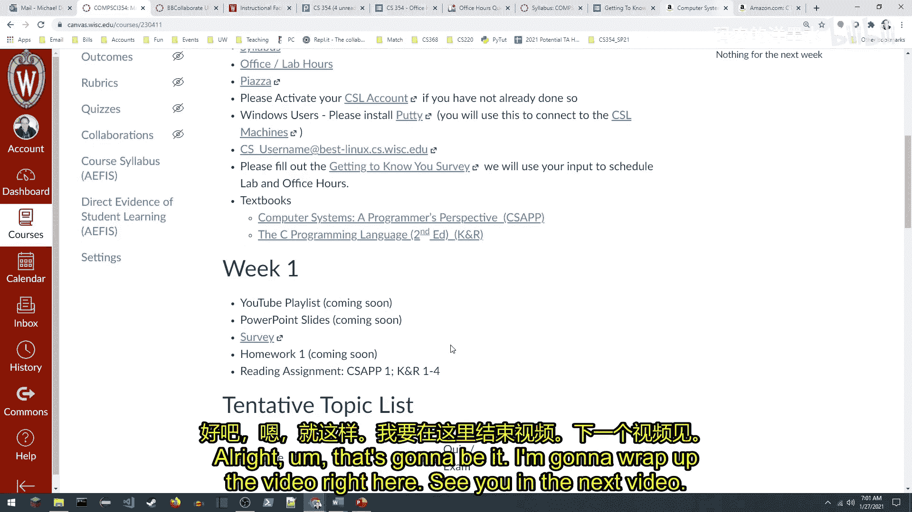