# 威斯康星大学 C语言编程与计算机底层原理：1：课程导论 👨‍🏫

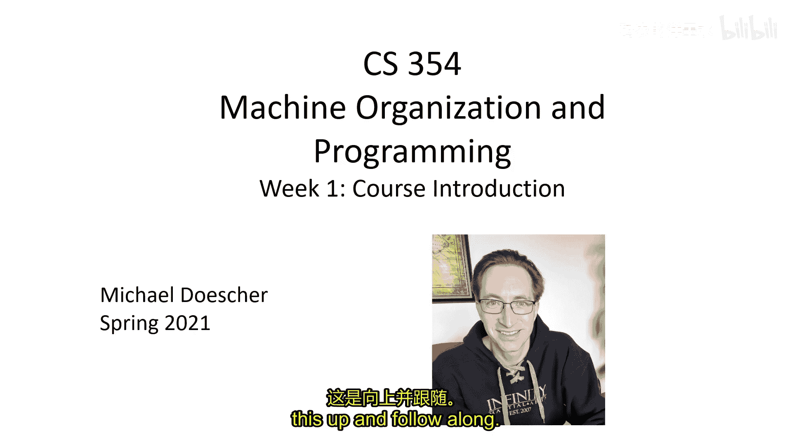

在本节课中，我们将要学习课程的整体介绍，包括课程结构、教学团队、学习资源、沟通方式和评分标准等核心信息。

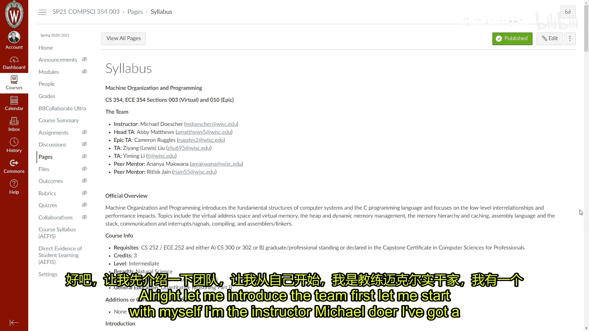

大家好，欢迎来到计算机科学354课程：机器组织与编程。我是这门课的讲师，Michael Dosher。本课程由威斯康星大学麦迪逊分校提供。如果你在YouTube上找到了这些视频，欢迎观看。对于无法访问Canvas付费墙后部分内容的情况，我表示歉意，因为我不能分享一些受版权保护的教学材料。

## 课程概览与结构 📅

首先，让我们对课程进行一个简要介绍。课程主页上方的红色区域包含所有非常重要的链接和公告。接下来的部分是重要链接，我会在整个学期中持续更新这个页面。

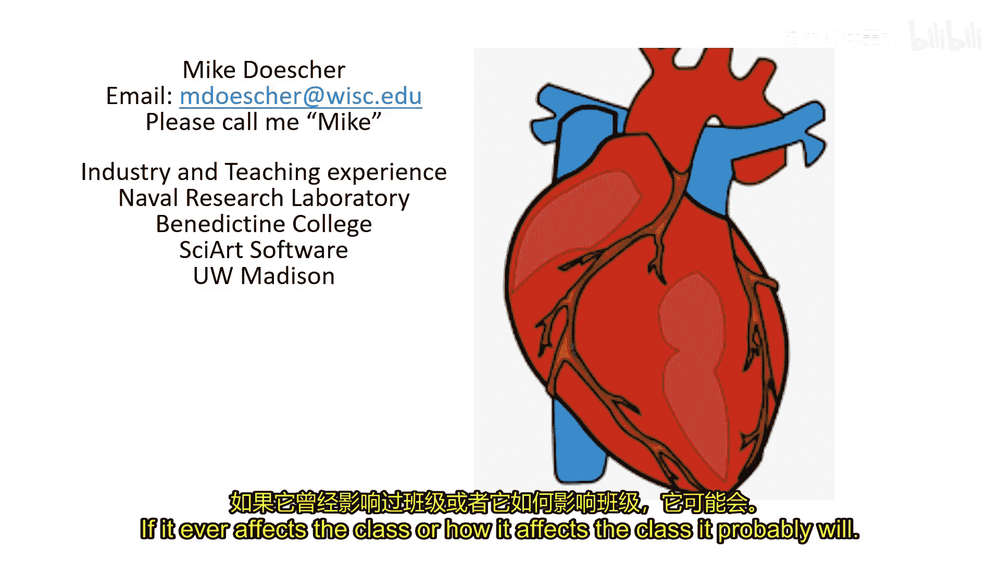

课程内容主要分为三个部分：
1.  **C语言编程基础**：课程的前五周，我们将学习C语言编程。
2.  **汇编语言**：从第六周开始到大约第十一周，我们将学习汇编语言编程。大部分内容会通过编写C代码，生成对应的汇编代码，并理解其底层工作原理。
3.  **专题研讨**：课程的最后四周（第11至14周），我们将探讨一些专题，例如动态内存分配和操作系统简介。

课程安排有两次期中考试。期中考试一将在C语言编程部分结束后进行，期中考试二将在汇编语言部分结束后进行。期末考试将涵盖整个课程的所有内容。

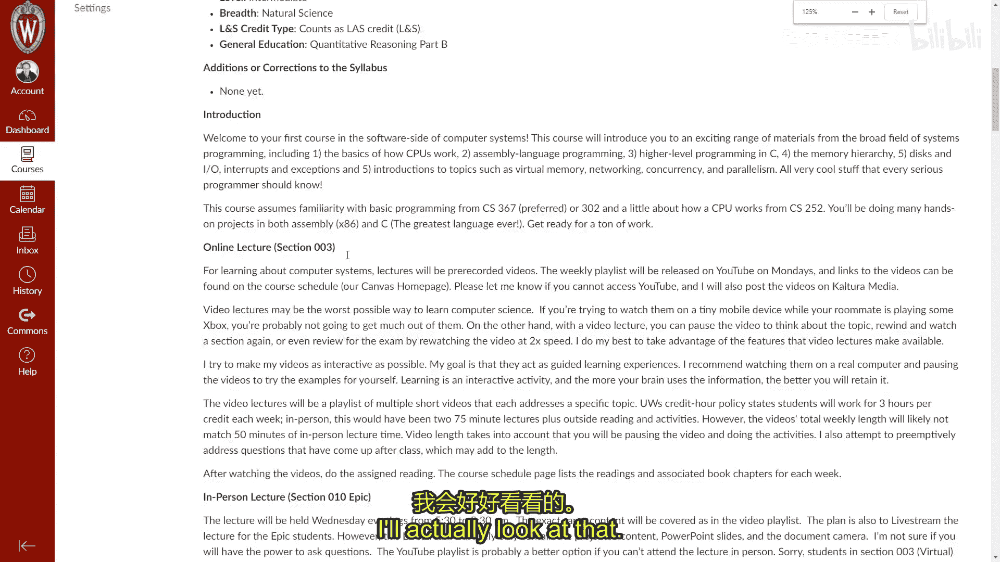

## 教学团队与讲师介绍 👥

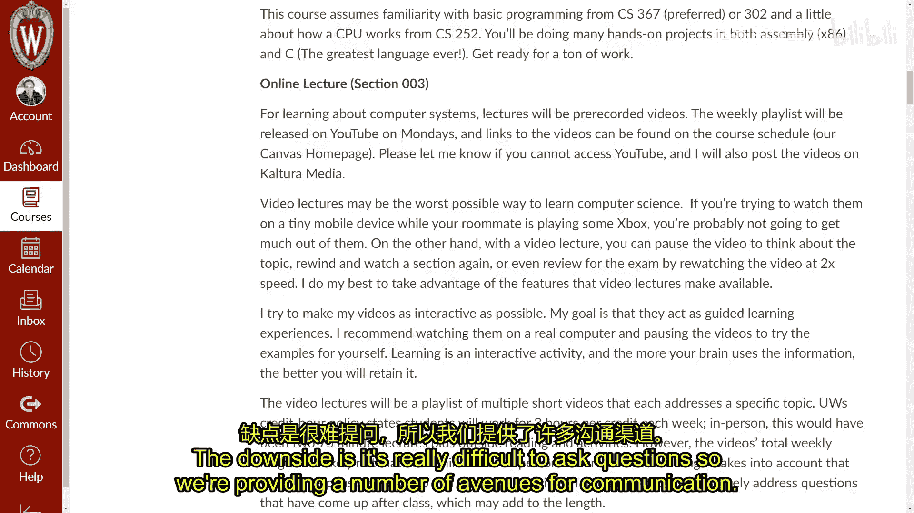

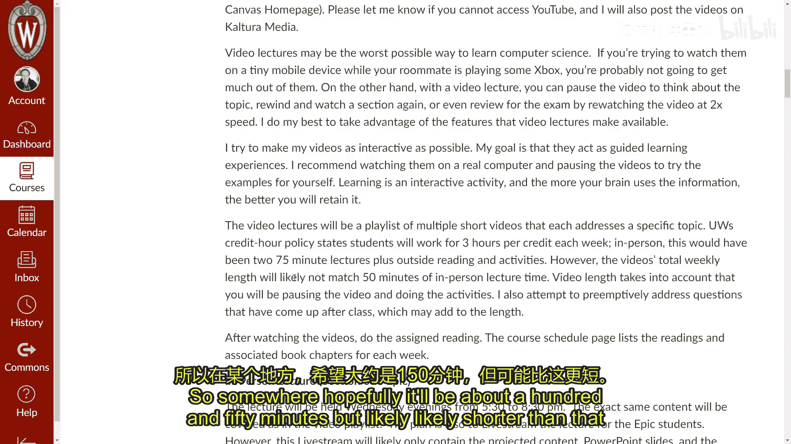

我是本课程的讲师Michael Dosher，请叫我Mike。我的背景比较特殊：我拥有化学博士学位，曾在美国海军研究实验室工作，后来在本尼迪克特学院教授化学。出于对计算机科学的好奇，我开始学习相关课程，并在威斯康星大学获得了计算机科学硕士学位。我曾在一家初创软件公司工作，目前是这里的全职教师。这是我的第四年教授计算机科学。

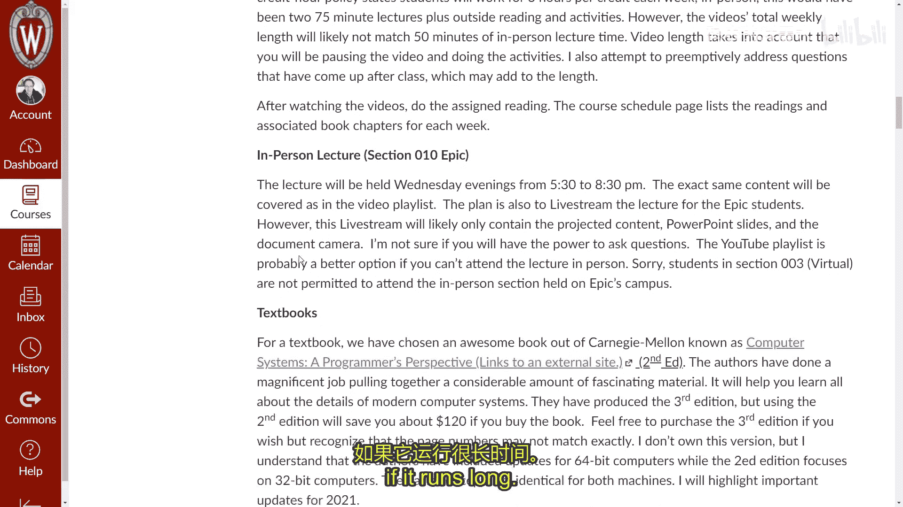

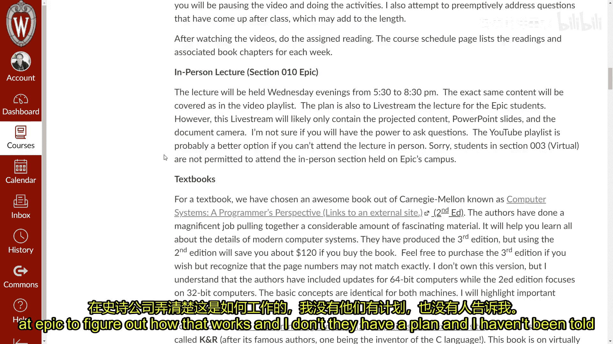

我需要说明一些可能影响课程的个人情况。我有一些健康问题，可能导致偶尔状态不佳。因此，课程采用周计划模式，以便我在状态好的时候集中完成工作。同时，我也是一位单亲父亲，需要照顾孩子。我会尽力确保课程顺利进行。

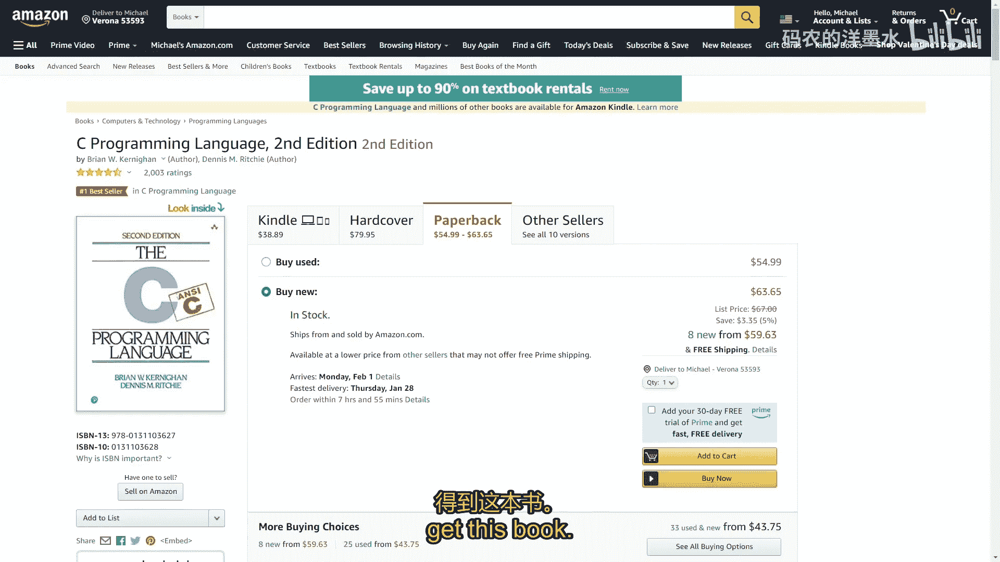

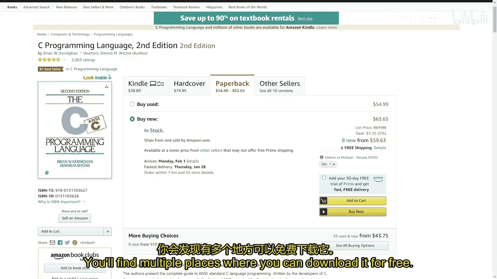

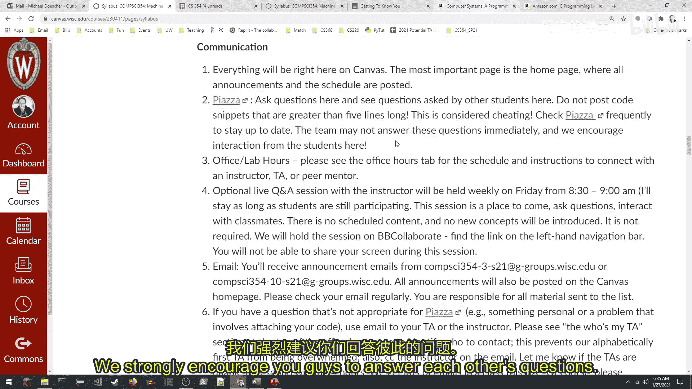

我们的教学团队包括四名研究生助教和两名本科生同伴导师。首席助教是Abby Matthews。

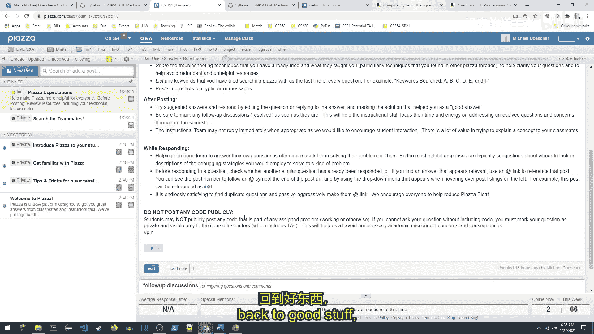

## 学习方式与资源 📚

本课程采用在线视频讲座的形式。视频将每周发布一个播放列表，其中包含我认为优秀的旧内容和改进后的新内容。

请注意，单纯观看视频是学习计算机科学效率较低的方式。最佳的学习方法是动手实践。我尽力使视频具有互动性，你可以随时暂停视频进行练习、尝试代码或回放不理解的部分。

以下是本课程的核心学习资源：
*   **主要教材**：*Computer Systems: A Programmer‘s Perspective* (第二版)。使用第三版亦可，但第二版性价比更高。
*   **C语言参考书**：*The C Programming Language* (第二版)，由C语言发明者撰写。你可以在网上找到免费的电子版。

## 沟通渠道与支持 💬

为了提供充分的互动和支持，我们设立了多种沟通渠道：
1.  **Canvas**：课程门户网站，所有公告、日程和链接都会在这里发布。
2.  **Piazza**：在线论坛，用于提问和讨论。**请注意，严禁公开张贴超过5行的作业代码**。提问前请先搜索，避免重复提问。我们鼓励同学们互相解答问题。
3.  **Office Hours (一对一答疑)**：你需要通过指定链接预约与助教或讲师的一对一会议。请提供一个你熟悉的、可以共享屏幕的会议链接（如Zoom、Google Meet）。
4.  **Lab Hours (实验室开放时间)**：在Canvas的Blackboard Collaborate Ultra中举行，多位同学可以同时加入，与助教或同伴导师讨论作业策略等。**在此环节中，学生无法共享屏幕**。
5.  **周五直播问答**：每周五上午8:30，我将举行一个可选的直播问答环节，用于互动和解答问题。
6.  **电子邮件**：用于接收课程公告。如有个人或隐私问题，可直接联系你的助教或我本人。

## 评分标准与学术诚信 ⚖️

课程的评分构成如下：
*   **作业项目**：50%
*   **测验与期中考试**：40% (每周有小测验，计入10%；两次期中考试各占10%)
*   **期末考试**：20%

**关于作业**：作业项目旨在提供实践机会。评分基于结果（代码是否能正确运行并通过测试），因此大部分认真完成的同学都能获得高分。请勿拖延，尽早开始。

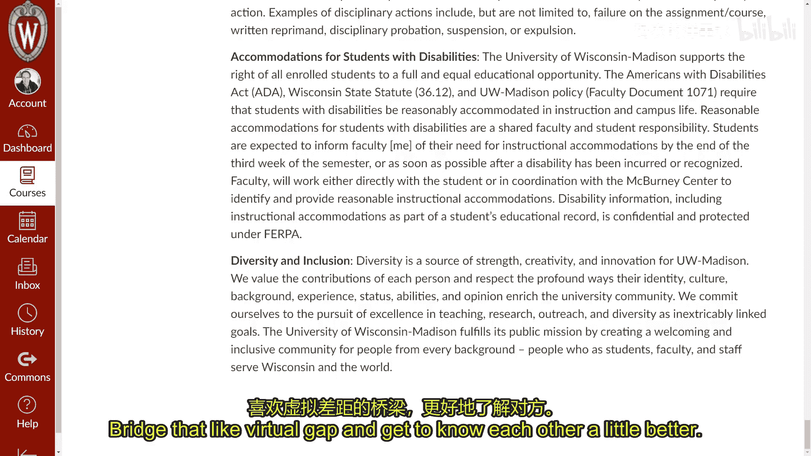

**迟交政策**：考虑到疫情等特殊情况，本学期作业迟交不会扣分。但如果你需要延期，**必须**提前发邮件给助教或我说明，并告知预计完成时间。我们无法在课程结束后接受作业。

**学术诚信**：我们严肃对待学术诚信。允许讨论解题策略、分享伪代码或图表，并引用非针对本作业的在线代码（需注明出处）。**严禁**的行为包括：抄袭他人代码、逐行模仿、使用往年泄露的答案、互发代码文件等。我们使用先进的MOSS（软件相似性检测系统）来检查代码抄袭，违规者将受到严肃处理。

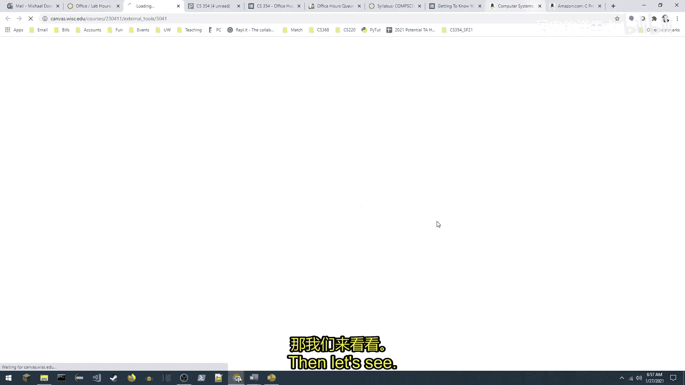

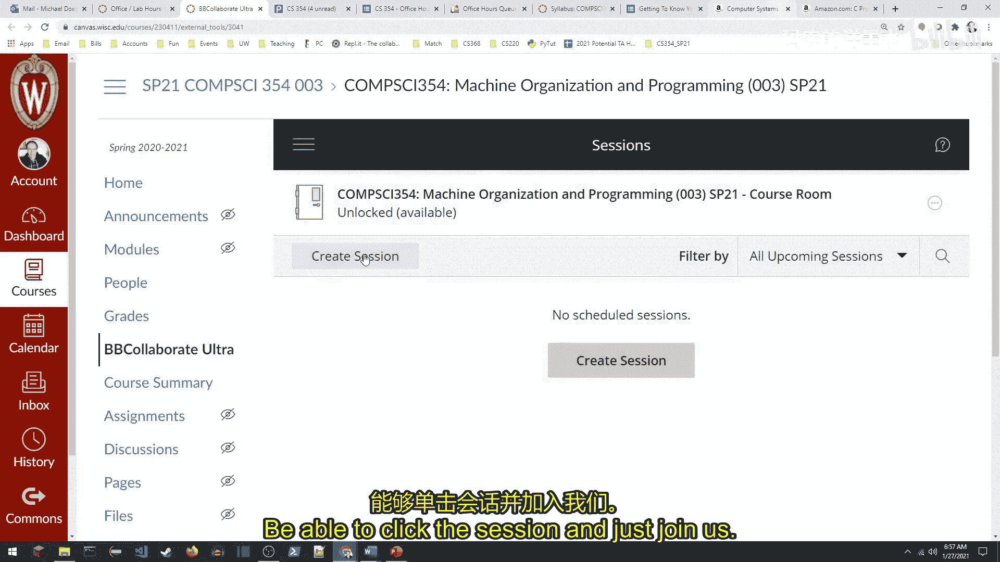

## 其他重要事项 ℹ️

*   **残疾便利**：如需因残疾获得考试延长时间或其他便利，请通过McBurney残疾资源中心联系我。
*   **推荐信**：由于在线课程限制，我很难深入了解每位同学。仅凭课程成绩不足以撰写有力的推荐信。如果你需要推荐信，最好能通过参与课外项目等方式向我展示你的能力。
*   **账户与环境**：你需要激活威斯康星大学的CSL账户，以便登录学校的Linux机器完成和测试作业。我们将在CSL的Linux机器上评分所有作业。
*   **课前任务**：请尽快注册Piazza论坛，并填写“认识你”调查问卷，特别是关于你希望的答疑时间，以便我们安排日程。

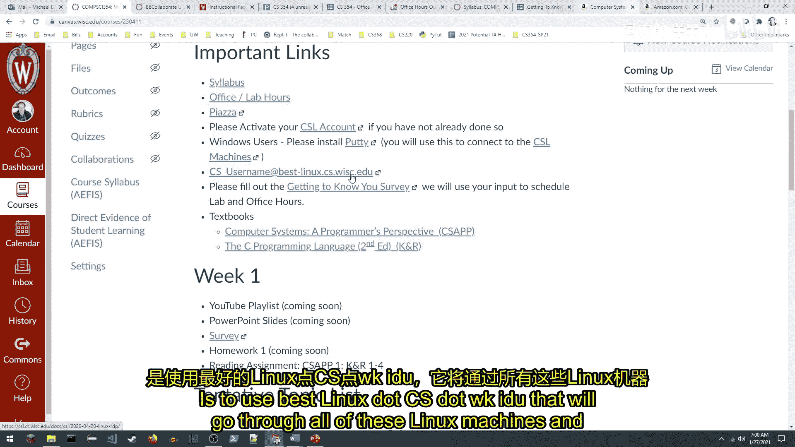

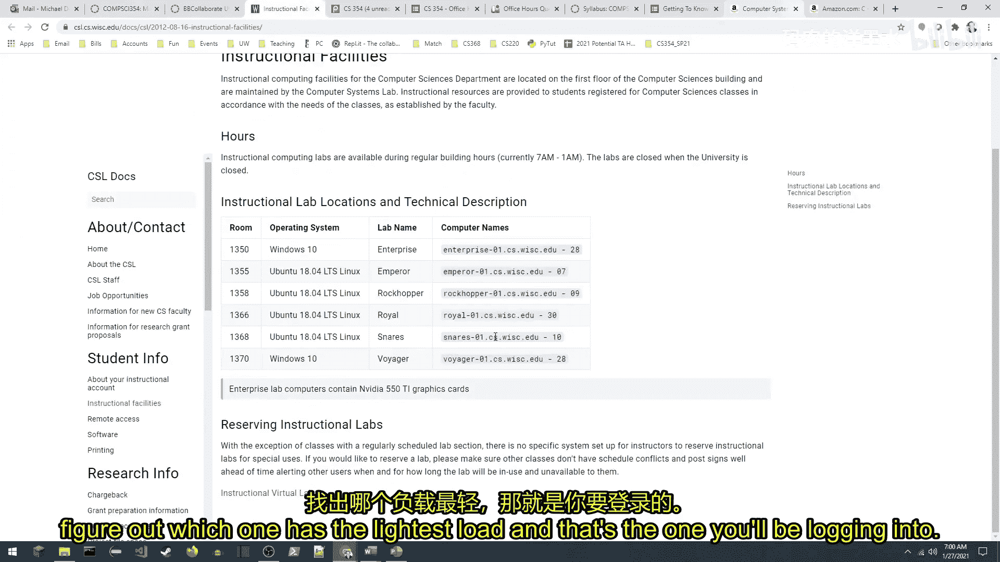

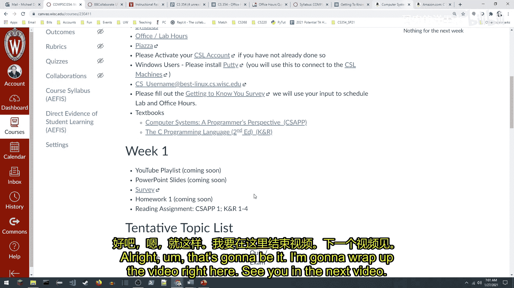

本节课中我们一起学习了“机器组织与编程”课程的总体框架、教学团队、学习资源、沟通方式、评分标准以及需要完成的课前准备。下节课，我们将开始进入C语言编程基础部分的学习。