# 【全集】威斯康星大学 C语言编程与计算机底层原理 中英字幕 1080P p02 Lecture 2 - 计算机工作原理 -BV1BViQBwEiS_p2-

Hello， everyone， welcomee back to Computer Science 354 machinech organization and programming。

 In this next piece， we're going to be looking at how computers work on the inside。 Alright。

 so just a quick high level overview of the entire course all at once。

 The next weeks are going to be broken down into three basic sections。

 The first one is going to be about C programming。😊。

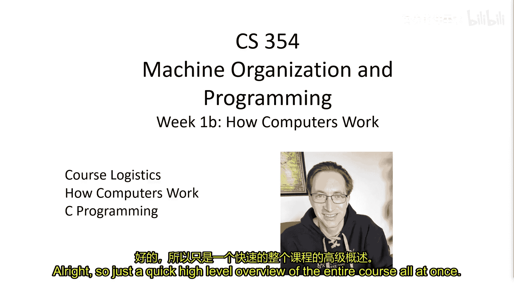

The second half of this of course， is going to be more or less focused on assembly programming。

 very low levelvel stuff code that does one instruction at a time。 And finally。

 we'll talk about some system topics and some examples of those would be things like virtual memory。

 caching， communication and the interrupts， dynamic memory allocation。

 operating systems I've got some blanks here if you guys have some topics that you'd love to hear me talk about send me an email。

 let me know what you're interested in take a look at the textbooks。

 those back a couple of chapters have a lot of stuff that've I've got to choose some things and I don't have time to do all of it。

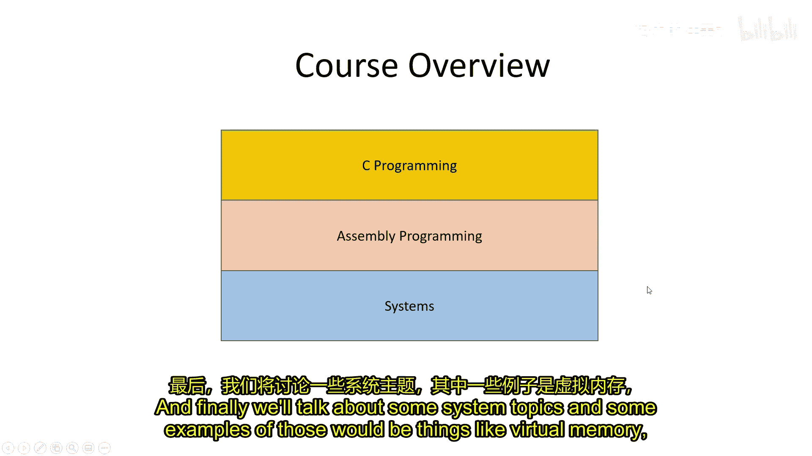

Alright， so there's the course overview。 Now let's start digging it into today's topic。 First。

 I'm going spend some time talk a little bit about how computers work。

 So just the really obvious things。 I've got a big box over here on my desk， or I've got a laptop。

 That's hardware。 I'm also running some code。 It could be a web browser or a piece of code that I wrote or a PowerPoint。

 something。 I've got a program I'm running in between that， we have software systems。

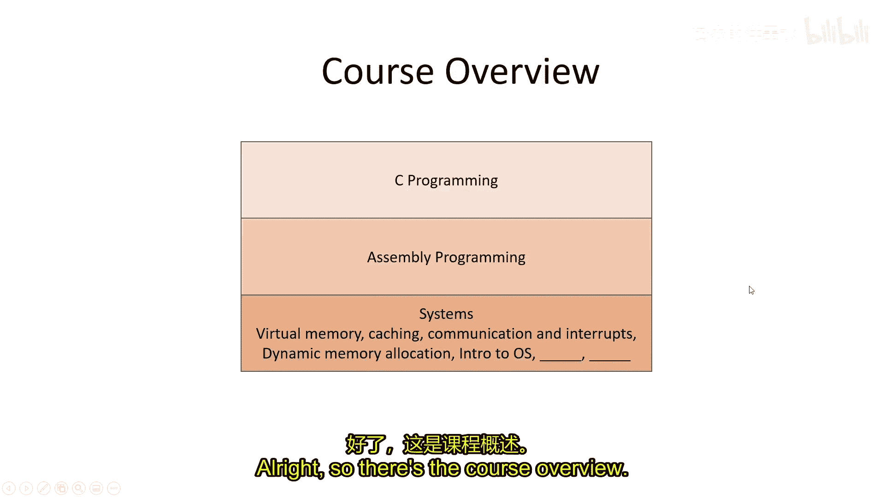

And this is going to fall into。Oh way out here。 I made some slides。

 So word processing web browsing C programs， PowerPoint。

 things like that would be applications under software systems。

 This is gonna to be our operating system。 Things that connect an application program that we care about running to the computer hardware So it does stuff So a Windows Linux。

 Also any sort of hardware driver like your graphics card。

 Nvidia tells me every single week that it's got a new update for my graphics card。

 things like that that would be a software system。 And finally， the hardware。

 three major pieces we'll be talking about today are the CPU， the processor。

 the memory which also known as Ram and the hard disk or solid state drive。

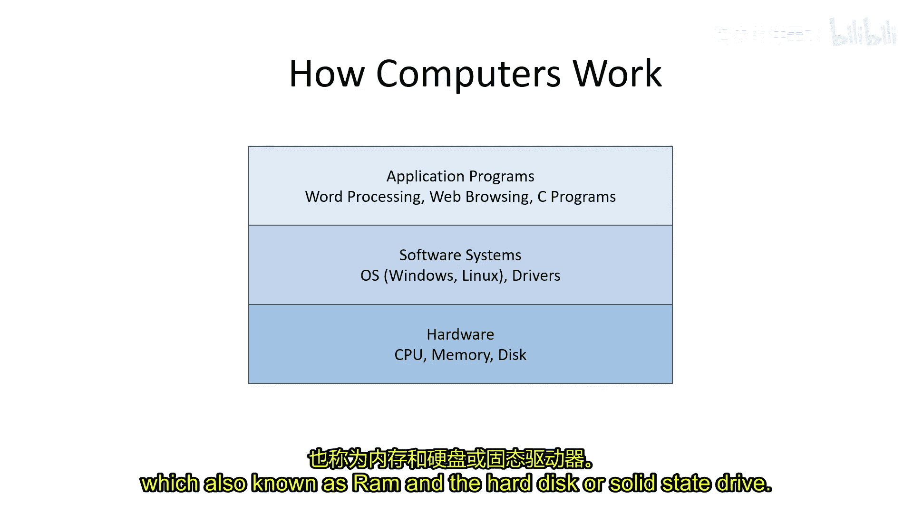

That is the。2。So let's take a close look at what happens when we run a program。

 So here I've got a couple， just three lines out of a much larger C program called sum。

 All this program is going to do is take two numbers。

 store in variables and add them together and store that in a third variable。So as we run this code。

I want to take a look at this from a very specific point of view。 the Vanon Nean architecture。

 So this is a computer system described many years ago， maybe 1950s where。

The model of the computer has a processor， the CPU that does all of the logic and math operations。

 and it's got some memory， those two are connected together。

 so a place to store the numbers and something that manipulates the numbers。Now。

 without input and output， this would be pretty worthless。

 so we're also going to be using input and output as part of the model we're looking at and input and output could possibly be the same device like a hard drive。

 I can input data into memory， manipulate on the CPU from a hard drive。

 and then I could save the results， but things like monitors， keyboards mice。Internet connection。

 all those would be inputs or outputs。

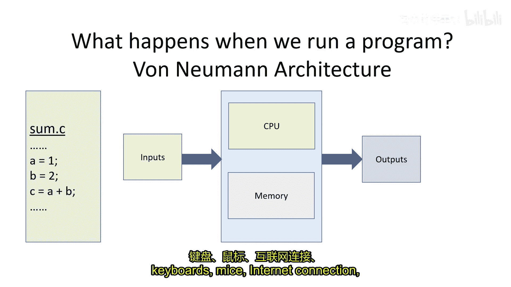

From this point of view， Okay， so I want to draw this same picture a little differently now。

 if you actually like take the cover off your computer and look inside， you can see the memory chips。

 You can see the process。 you can see the giant fan on top of the processor。

 and you can see your hard drives。 So they're all connected。 They're just pieces in the computer。So。

What I want to ask is just take a second and think about this。 If I come if I write this code。

 I opened up an editor I。Type in all the lines and then I save it。Where exactly does some dot C。

 that's the name of my file， where does that exist？Is it in the processor， the memory。

 or on the hard drive？Alright， so make a commitment， make a decision。

 put your finger on one of those three boxes and in 3，2，1， I'm going to click。There it is。

 it's actually stored on the hard disk when I write a file and save it。

 that's going to go straight to the hard drive。The next thing that we do when we're going to run a program is we need to compile it。

 So the processor cannot deal with language like this。 It can't say a equals 1。

 B equals 2 and actually understand what's going on。 It only reads machine code or binary code。

 the zeros and ones。 So the process of turning this high level code that's actually readable。On on。

 where's my mouse pointer， pointer options， arrow， visible， there we go。

So we can turn this code into something the computer can read。 We're going to use a compiler。

 You guys have likely seen this before if you took Java。

 Java has a compiler that generates bytecode that then runs on their Java interpreter。嗯。

And this is just going to be binary at the end of it。 In fact， this file， after we're done compiling。

Is also stored on the hard drive。 Oh， that's the next slide。 All right， So a couple definitions。

 This code over here that I write in my text editor and save is the source code。

 The compiler that we'll be using is Gcc。 That's the compiler available on the Linux machines in the lab。

 That's an abbreviation for G N U C compiler。And GNU actually stands for GNU not Linux， not UniX。

Misp there。 Gnu not Uniix。 So it's a recursive definition if you think about that a little bit because this GNnu also stands for Gnu。

 not Uniix。 and keep going forever。 So anyway， this is just our C compiler。And this code。

 the binary code， is known as the executable， it's also called an object file or machine code I'm going to use all three of those to mean the same thing。

Okay， now this is slide I was thinking of this one right here。

 So the binary code in my sum file is also stored on the hard drive after the compiler is done with it。

 So check us out。 My source code has the dot C extension。 When I compile it。

 it's just gonna be sum without an extension。 And in fact， on the Linux。

 if you list all of the contents of a directory， it'll have a little star because it's inexecutable。

All right。In the computer， the motherboard that really colorful mine's black。

 I believe they used to all be green， just circuit board in the background that all of these things attached to have。

Millions of little wires that connect everything together。millionsions is exaggeration。

 but lots of little wires all embedded in that circuit board that connect the processor to the memory to the hard disk。

 And in fact， if you look at typical hard disks， the newest flash drives are actually built right into the motherboard。

But if you have like a mechanical hard disk， they're going to be off to the side with a probably a satta cable these days connecting that hard drive to the motherboard。

嗯。Do I want， I don't have a screwooter ever right here as I pull this part and show you guys。

Allright， so the next thing we're going to do after we compile the code， I'm looking up the top here。

 I've got my three arrows。 This is the prompt command prompt。

 when we run a computer program on a Linux machine。

 we need the dot slash that tells me to use the program in the current directory just in case I have more than one program called sum out there。

 and then I need the name of the program and running。

So the first thing that happens when we start running this code is the operating system is actually going to run another piece of code。

 a program called the loader， and that's going to take this machine code and actually store it in memory on the Ram chips。

And it's going to be divided into two sections。 There's going to be a code section。 So in this case。

 I'm just looking， I just copied one line here。 This is the part that's actually going to do something。

 So C is equal a plus B。 that's going to go in code。

 And we'll also have a data section where we're going to store all of the variables and the contents of those。

Armed。Varis。Okay， so all right， the load is a program that CPU runs that just moves data from them hard disk to the memory。

 so it's ready to go。Alright， if we take a little deeper look at the process。

 so we're going to find that it also has some locations for memory。

 There's really only like 10 of these on a typical computer processor and the one I've drawn here only has three。

 So these registers are locations where we can store numbers。

So the next thing that happens as we look at this， I've got a is equal to1。 We're going to copy that。

Okay， let me let me read my own。 but when I'm looking at only this line in the red box in order for my processor to execute this line。

 these numbers are stored in memory。It doesn't work with numbers and memory。

 It only works with numbers that are in registers。 So the first thing it needs to do is actually go and grab a from memory。

 So this is going to be a load operation。 So it's going to get the number one from the memory location where a is and stick it in a register。

 And in this case， I'm putting it in register one。 The next thing it's going to do。

 it needs to get this number B。 So it goes to memory。

 grabs the two there and stores that in another register。And finally。

 it can do this arithmetic operation， the addition。

Add those two numbers together and store that in another register。

 It actually could be stored in one of the two we've already used。

 We're done with those once we get the sum。 So， but in this case， Ive stored it in register 3。

 And then finally， it needs to go back to see。 this is the assignment operation。

 And so when the memory is transfer or when the number is transferred from the processor to the memory。

 That's a store operation。 So we're storing B。

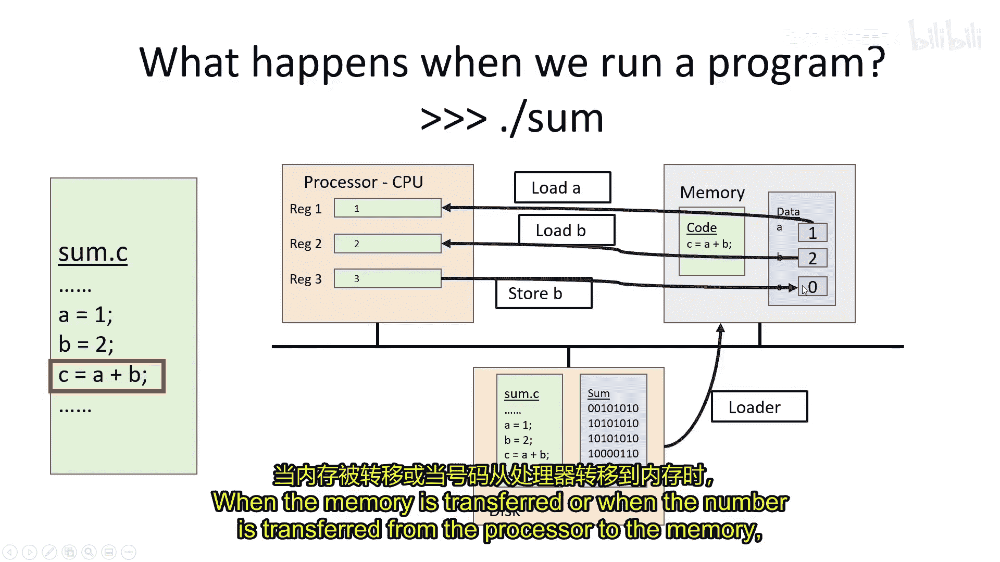

Alright， so the CPU goes through this cycle and each one of those steps was broken down into really three parts。

 So if I back up a second， this load operation for the first part。

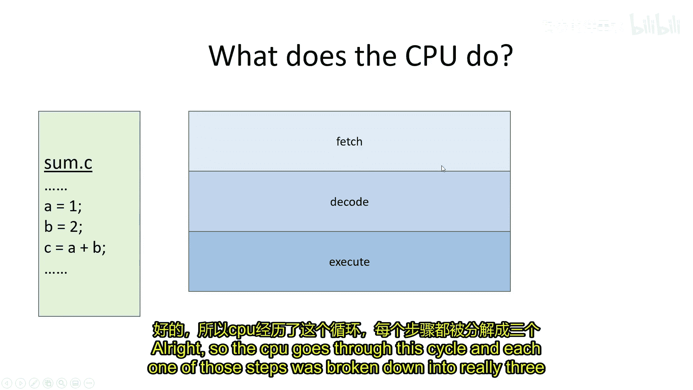

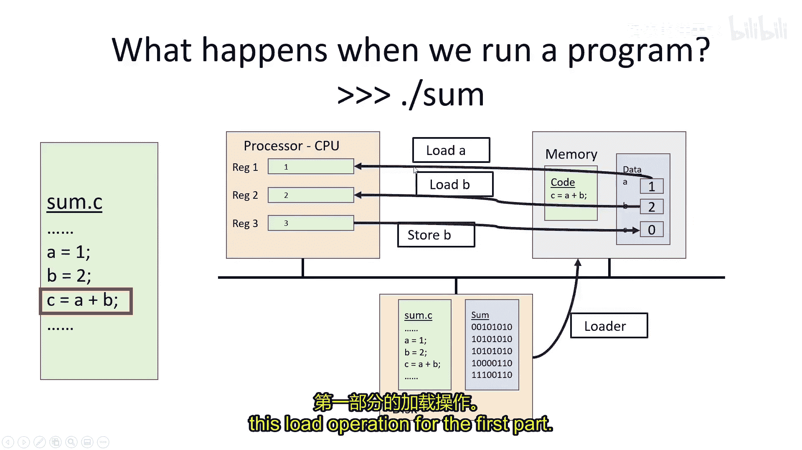

Would be first thing it's going to do is fetch the instruction that says I need to load something。

So fetch is going to be the first thing that happens。

 it's going to get an instruction from the memory。 that's going to be from the code side of things。

Then the next thing it's going to do is decode that。

 It needs to figure out what kind of instruction it is。

 So I'm going to have instructions that fetch that store I'm sorry。

 that load that store that do math。 it needs to figure out what kind of instruction we're looking at。

And finally， it's going to execute that instruction。 So if it's decided it's a load instruction。

 This is the part where it goes and grabs the number and sticks it into a register。

 If it's a math operation， that's where it's going to do the the math and add the two numbers together and then stash that in another register。

Alright， And this is going to be just repeated in a loop endlessly。

 So as soon as it's done doing the first instruction and as soon as it's done executing。

 it's going to go back and fetch the next instruction。

 it's going to figure out what it's supposed to do by decoding it。

 It's going execute that instruction and then go back and get another instruction。

 It just does this forever。

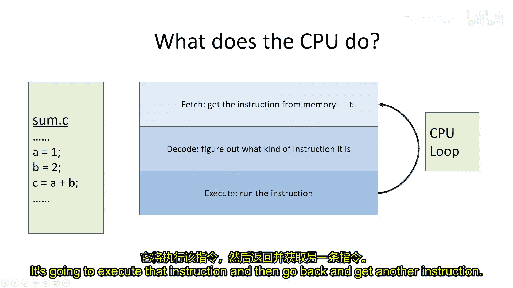

嗯。Okay， so the last thing I want to talk about in this first half of the lecture for today is what happens when we actually compile our code。

 the build process after we're done writing the code and I've stored that in a file。

 some'm do see in this case for this program， and then I run the compiler to actually produce my machine code。

The first thing that the compiler is a program it's actually a series of four programs that are run by the CPU that manipulate the code from this file。

 transform it in a number of steps into my machine code at the other side so it takes in the source file the first thing that happens is the preprocessor is going to operate on my source file This is going to go ahead and remove all the comments that the rest of the compiler doesn't need if there is any preprocessor or compiler directives like to include another file actually the preprocessor is kind of its own little programming language and we'll see a lot of pieces of this throughout the course。

But it's going to go through and produce another file， and this typically has the dot I extension。

For like intermediate code and this is also known as the pre processces source file in the next section then like part two of the video。

 I'm going to go through and break down the build process into each of these four steps and just show you what these files look like after we're done preproces them。

Okay， so the next thing it happens is the compiler proper。 This is given the abbreviation C1。Oh。

 the abbreviation for the preprocesor， CPP stands for C preprocessor。Capital P。

 capital P right there。Okay， so yeah， the next thing that happens is compiler proper。

 This is going to produce a code that's actually written in assembly。

 which is mostly human readable I'll be pulling up an example of this when we actually do the demonstration in part two of the video。

So the typical extension for this is dot S assembly。Right there， it's the second letter。

And this is going to be， I'll show you a demonstration in the part two of the video。

 but this is generally human readable after you've had some experience learning it。It's not easy。

Okay， the next thing that happens is the assembler will take this sum dot S file and generate what's known as an object file or more specifically a relocable object file。

 And this is going to be machine code at this point。 It's going to be in binary， So ones and zeros。

But it's not going to be the complete everything we need。

 If we've included anything from another library， the standard library， for example。

 then we'll still need one final step to linker abbreviated LD。

 abbreviation actually comes from the fact that the linker and the loader used to be one component。

 And so the L D is stuck around。As the abbreviation。

 But this is going to go and grab all of the object files， some do0， or if I've got another。

 I've included something else like something from the standard library。

 it's going to go get the object code for that and merges them together to finally create the executable。

 and this is typically without an extension。No reason you couldn't put one on there。

 but typically without， and this is going to be binary code that's able to operate and do pretty much run the entire program。

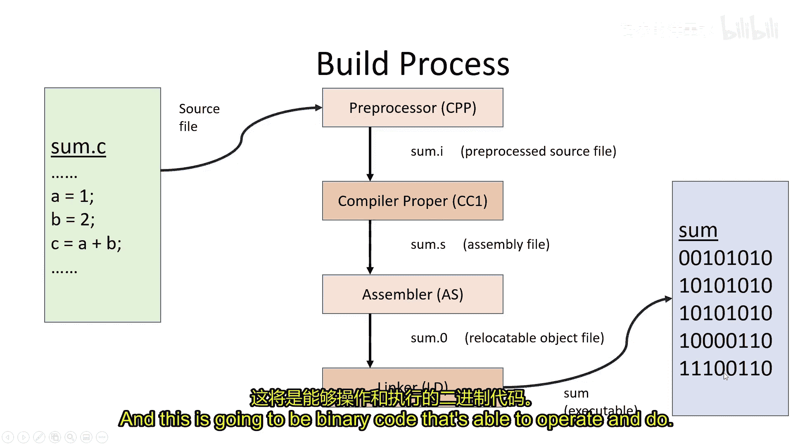

Alright， so I'm about to switch over to the demo。 That will be the second video down in the list。

 and I'm actually gonna break this down into about three parts。 I'm going to do this last one first。

 the guided learning activity that way， if you guys are already familiar with how the terminal works。

 and how to use an editor like Vim or Emax。 you can just follow along。

 I think these will be interesting。 hopefully you'll learn something。

 but youll have the skills already you need to do this。

 if you're not at all familiar with Linux or navigating using a terminal。

 this will be valuable experience。 And if you're not familiar with the Linux editor Vim or another。

 you can use any editor you want。 if you prefer emax， feel free。

 there's a number of good ones out there。 I'm gonna to use Vm for this class。

 and so I'm going to do a little demo with all the features and how Vm works。 Alright。

 so I will be back for part2。😊。

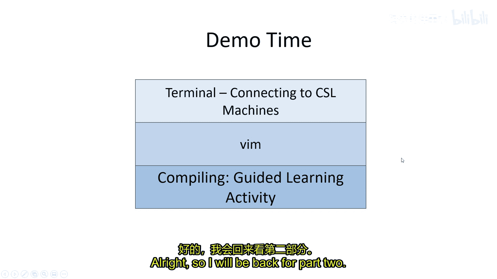