# 【全集】威斯康星大学 C语言编程与计算机底层原理 中英字幕 1080P p03 Lecture 3 - 数组指针等价性 -BV1BViQBwEiS_p3-

Hello everyone， welcome back to Computer Science 354 at the University of Wisconsin Madison。

 this is machine organization and programming beginning week three。

 talking about pointers and arrays。All right， but let's get started with just a quick review。

 sort of to nail down our place in the course so far。

 We began the course talking about programming in C。 And so far。

 we've covered the basics of control flow and data structures。 So in control flow。

 we have conditionals like the if statement loops。 we talked about the while loop。

 the do while loop and the for loop。 and just a basic function calls。

 Also in this control flow section。 We've got the switch statement。 I'm not going to go into that。

 We're not going deal with the switch very much other than it might be in some menus that I write for the homework assignments。

 but I'm not going to ask you guys to write one。 It's there。 look up how to do it。

 works the same as most other languages。 but we're not going be diving into that when we like make the connection to assembly language。

 So I'm going to just skip over that。And then as far as data structures go。

 we covered the primitives。 So we started looking at a care and float and doubles the four basic data types。

 And last week we talked about how to create a very first one dimensionmenional arrays Today。

 we're going to be looking a little bit more at character arrays and like one little difference between character arrays and arrays of integers and we introduce the idea of pointers Today is gonna to be a deep dive into pointers and arrays。

 some thingss coming up。 I'm also going skip over enums。 they really go hand in hand with switches。

 there'll be some examples where I use these in like the homework assignments。

 You'll see how they work look up how to use them if you're interested We probably won't do more than that in this class。

 And then today we're gonna now I spend about a third of the class talking about multidimensional arrays in particular。

 the memory model， how C is gonna like when the compiler runs allocate memory on the stack or on the heap for these multimensional arrays and primitive arrays too we'll start with those。

And then we'll wrap up with an introduction to structures。

 If you're familiar with classes from other object oriented programming languages。

 structures are the。C version of that。 So C is not an object oriented programming language。

 We don't have classes， but it's a composite data structure that lets us do things a lot like classes where you have containers for data。

 but it doesn't let us have functions that go along with them to process those pieces of data。

 So technically， we're not creating objects。 We're not having functions that operate on them。

 But we will have data packages。 All right， I'm going to jump back over to a CSL machine we'll pull up some code。

 And the way I want to approach this today is to just start off with a quicker view。

 and we'll do some， I guess experiments， I kind of want to like show you guys。

 if you're trying to learn a brand new programming language on your own。

 how I approach this by just learning a little bit， try an experiment and see what happens。

 And at the same time， we're gonna to try and learn about how the compiler is allocating memory to go along with all of these data structures。

 So that's the go for today。 once again， let me hop over to O Cma CSL machine and pull that up。

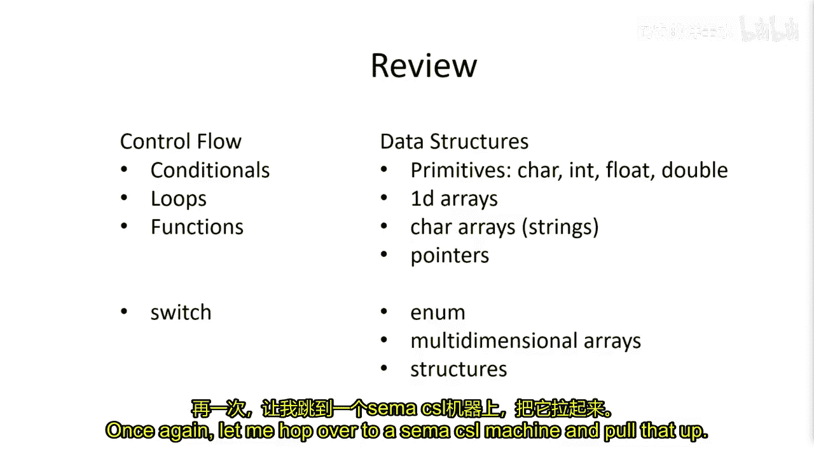

All right， I'm back。 I'm actually using Powerhe。 This is my local machine。

 I was getting some truly horrible lag trying to deal with the CSL machine just now。

 And so I'm just gonna scrap that and go with Powerhell I don't have them installed in my computer。

 So I' be using Nopa plus plus It's the lowest level editor that soda give me。

 gives me the features that I want。 And I don't want to use like a powerful IdeE package today that might hide some of the details that as I like。

I want I want to remind myself what I need to talk about。 So that's what I'm already doing for today。

 So as you can see here， I've got my teaching directory where I've created a demo do C file to get us started。

 When I compile this， this is gonna go by really fast from now on。

 I'm using Gcc as my compiler on this computer。 If you guys don't have a C compiler installed in your Windows machine。

 I installed the min Gw package to give me the Windows version of Gcc。

 I'll go ahead and write a note to remind myself to put that in the description。

 It's kind of a pan to install just find some directions and go through those。

 follow along with the directions and it'll get you there。 right I named a demo do C。

 I'm gonna using the M 32 to compile my code for 32 B machines for everything I do today。

 This is gonna give me 32 B addresses when I look at all the addresses that are stored in pointers。

 It means that my pointers will be4 bys。 because that's 32 B。

 as opposed to the default 64 B that my machine is gonna give me and I'm。😊。

Have all the warnings turned on because I make tons of mistakes。

 and I want to be able to talk about them and talk about good coding practice。 Alright。

 so let me just go ahead。 We'll run the compiler right here。 my demo program。

When I compile on a Windows machine， this is going to give me a dot EX file for an executable file and to run that。

I need to use dot s demo dot E X E。 And if you screw this up。

 if you're doing Powerhe if you're trying to follow along on your own computer。

 it'll give you a message。 So all this program does right now so far as print out。

 Wele to week 3 of C S 354。 me pull that up。 I just wanted to a framework to get started when I I just needed to know that it compiled。

 And I didn't have any dumb mistakes in there。 All right， so I'm going go ahead。

 I'm gonna to write a little bit of code。 you guys can pause and copy the code in yourself。

 as soon as I get this written。 I'm hoping that。

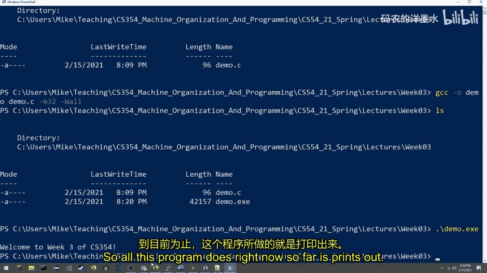

If I just pause the recording， it'll speed it up a little bit for you guys。

 the video will be a little bit shorter if you're reviewing this later。

 you know before the exam or something， you can watch it on double speed and not have to watch me type anything and to get a good review。

But at the same time， as you guys are going through watching this for the first time。

 you should have the video pulled up。 And this is today is one of those days where you should follow along and do everything yourself。

 You're gonna make little mistakes。 You'll have typos in there。

 they're gonna give you error messages。 All of those are very informative。

 You'll learn a lot more by making a typo or getting a result it's different from what I get。

 I'm on a Windows machine。 I'll explain what I see and why my compiler is doing， what it's doing。

 why the memory is allocated a certain way。 Your machine's probably going to be different。

 It's not going to use the same memory addresses。 It might do things in a different order。

 And those are all very informative learning opportunities And if you get something really truly weird。

 throw it down piazza and we'll go through it and break it down。

 And it's going be a great opportunity for everybody in the class when those things come up。

 All right。 So let me I'm gonna pause now and write some code。😊，Alright。

 so I just finished writing a little bit of code。 This first piece here， starting on line 7。

 we're just going do a quick review of pointers and what they do。

 And then I want to take this and try and connect it very deeply to the memory model。

 know what's going on inside the machine。 So I've just created two integers A and B。

 I've given them some values 3 and 4。 Then I've created two pointers。

 remember that any time I have the name of a type like in here followed by a star This is going to be the creation of a pointer。

 in a little bit， I'm going to be using just the star without the type there。

 And that's going to be dereencing the point or following the pointer to the data。😊，Okay。

 and this first pointer， PA is a pointer to variable A。

 and I'm giving it the address of a so that it actually stores， you know， pointers。

 store memory addresses of other variables。Same thing for B。 So I'm creating a pointer to variable B。

 So P for pointer B for B。 and giving it the address of B。

 Then I'm just going to be printing out everything I can possibly think of about these things。

 So for A and B， they're just integers。 They are contain a value。

 So percent D is going to print the decimal version of that value right there and A。

 and I can print the address。 and that's going to be percent P to get the。

The pointer code or something that's gonna print in hexadeimal， I guess。

 And I'm going to give it the address of a。 Remember the Ampersent is the address of operator。

 I'm going to do the exact same thing for B。 I just wanted more than one thing。

 So when I draw a picture of the memory model， I've got like some actual stuff there。

 and it's not looking pretty empty。I'm going to do the same thing for my pointers P and Pb。

 I'm going to print out everything I know about them。

 So first I'm going to be dereferencing them And because they're integer pointers。

 this will print a decimal value。 The percent D is the format code there。

 I'm also going to be printing the vex value， the contents of that pointer and again。

 pointer store addresses So I'm using percent P to get a hexadeimmal memory address。

And then I'm going to print the address of P where this is actually stored。

 So here's the de referenceence。Here's the actual contents。

 and then this is the address of PA or where PA is stored in memory。

 and then the exact same thing for PB。

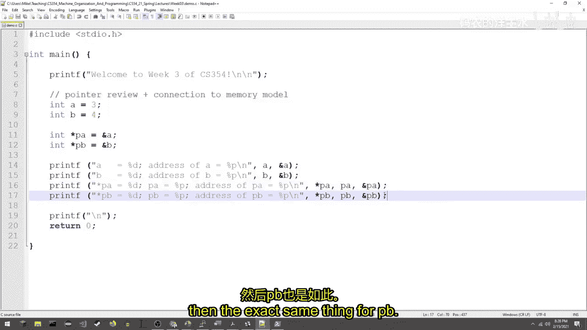

Al right， let me pop back over to Powerhell。 I just got this work。 I tested it。

 I didn't make any mistakes。So here's what we're looking at。 A contains 3。 B contains 4。

 That's exactly what I initialize them to。 That's looking pretty good。 We can see that it's storing。

A at hex and decimal value 0，0，6，1， F F 1 c。 from now on I'm going tobbreviate these。

 I'm just gonna be talking about F F 1 c or maybe even just 1 c because they they're all going be really close together。

 and I don't need the leading digits there， I mean， all of these 0，0，6，1 F F 0，0，6，1， f F。

 I'm going stop repeating that。 And until we're getting to， I mean。

 all of these memory addresses are on the stack。 They're all very close together。

 when we have memory addresses for things that are not on the stack Then I'm going highlight the difference in the the leading digits will be different in that case。

All right， again， let's see here。I'll pause for a second just of which one of these is bigger is 0，0。

6，1 FF1 c greater than or smaller than FF18， Which one comes first。Just pause the video make a guess。

 figure it out when you draw the picture in the of the memory in just a second。

 I I want to make sure I put all of these in the exact right order so you guys can check and make sure that it matches。

Alright， and then with the pointers。 So I've got a pointer here。 When I de referenceence it。

 that means follow the address store to that pointer and go get the actual data。 So that's 3。

 It's a pointer A。 It's getting that number right there。The actual pointer contains an address。 So 0。

0，6，1， FF 1 c， This address right here is the address of variable a。 So this was the address of a。

That's the value contained in this piece of data right there in that memory location。

 And the address of P A is So P is a pointer。 It stores a memory it's actually located in memory itself。

 And I can go get the memory address where it's stored。 I can see here this is at F F 1，4。Again。

 is this bigger or smaller than F F1 C， F F1，8。I want to make sure I put these in the right order。

 you guys need to check me。Alright， and then same kind of thing for PB， it contains the value 4。

 The address it points to 18 is the address of B perfect。 And again。

 it's got its own memory location。 In this case， F F 1，0。 Alright， So I'm going just pause the video。

 I'm going go pull up a PowerPoint slide。 and I am going to actually。

 I'm going to grab a screenshot of this one right now。

 pull this up in PowerPoint and draw a picture of what's going on in the memory。 one second。😊。

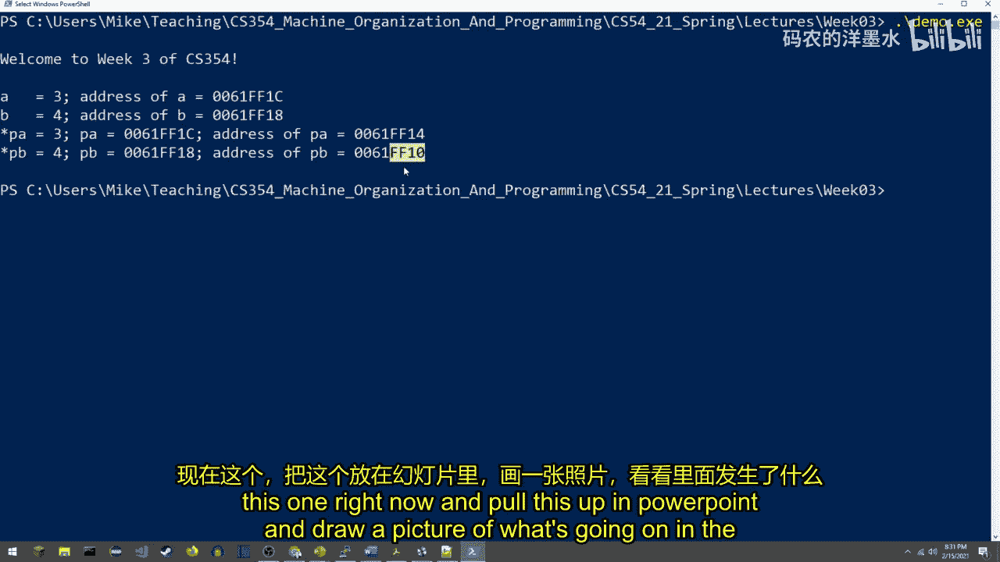

Allright， guys， I just started making this picture using the power shell data。 And I was。

 I was trying to put these addresses in。 I'll show you that slide in a minute。

 But this just struck me as really weird that these were so small。 You mean， they starting was 0，0。

 Now let me take a look at this。 I haven't introduced this idea yet， but。All of the space。

 all of the memory that your program gets is divided up into a bunch of sections。Up the very top。

 like address 0 is reserved。 We can't use address 0。 And I'll talk a little bit about that。

 We're frequently going to set uninitialized pointers to address 0 because it cannot be used。

 We cannot write there。 And that way， we will know that that pointer is uninitialized。

 It will cause the code to crash and crashing is better than weird random errors that are in unpredictable。

 So that's like safety。 We'll talk about that in the null pointer section。 coming up soon。

 Then after this reserved memory。 is memory reserved for the actual instructions。

 When I compile my code。 It generates those binary numbers that are represent the instructions。

 The CPU fetches， decodes and executes them。 Those are stored up at the top at very low memory addresses。

😊，Below that， below the code section。 and I should also mention that sometimes the operating system for security reasons will offset this code by a random amount。

 So it makes the addresses unpredictable。 So address space randomization means that it's a lot harder for someone to hack your computer if they don't know where the instructions are。

 And they'll just put a bunch of like reserved blank space in between。The code and address zero。

Alright， so this is unpredictable where this is in general。 following the code。 Oh， by the way。

 if you get the chance， computer security is an amazing class。

 I highly recommend it 640 or something like that， I might have the number wrong Great class anyway。

 after the code section the compiler is going to reserve space for any of the text that's hard coded into the program like right here。

 I've got this welcome to week 3 of CS 354。 that code the representation of that text is going to be in this section right here for text and for global variables。

 anything that I need that I know I'm reserving space for global variable will be in this section up here because it's going to be accessible to any of the functions below the text section we have the heap the heap is for dynamically allocated memory。

 That's next week's topic right now we are not using the heap， it should remain at size 0。

 we're not using any of it。 but as we dynamically allocate。😊，More and more memory。

 it's going to grow from address 0 up the top here to larger and larger numbers。

The rest of the memory is the stack。 Now， the stack is where all of the functions are going to reserve memory for their local variables for parameters。

 I've got the list right here for parameters for local variables and return information the kinds of things it needs if there if it's a function that has a return value。

 Itll reserve space for that return value like main， for example， returns an integer。

 It also needs to know the return address。 So where to jump to in this case。

 Powerhell is going to be the bottom of frame Powerhell is what I'm using to call my demo do C or demo dot EX function。

 And that has a main function。 So when main is done running。

 it's going to return0 and go back to Powerhell。 So there's a return address into Powerhes code。

 So it knows where to go。😊，Anyway， we don't have any parameters。 There was no。Command line arguments。

 So that's all gonna be just0。 for as local variables。 I don't have an array yet。 that's coming soon。

 but I do have A， B，PA A and P B。 So those are the local variables。

 They're going to be stored on the stack。Now this typically starts out at really enormous addresses at the end of the address space and grows towards smaller numbers as I。

 if I write a function in main and call that function， or if I call the function from main。

 it's going to get it a new stack frame or a new activation record with all these things。

 It's going to have space for parameters， they're going to reserve space for local variables。

 return information， yeah， again， the return address， the return value。

 some pointer information to remember where all of how big the stack frame in main is。

 that'd be the base pointer， well come to that in the middle third of the class。

 as we break down what happens with a function call。😊，But so this just。

 this struck me as really weird that it starts with 0，0 because the stack starts with the very。

 very like largest addresses。 And apparently， Power shellll is just not giving my program very much space to run。

 It doesn't need very much space。 It's got four variables and just prints them out。 Doesn't need it。

 We're not using a huge amount of memory。 But it just， it seems weird to me。

 And so I wanted to go and compare to what happens when I do log into a C S L machine。

The lag was still bad。 I'm gonna to stick with Powerhe for the rest of this lecture。

 But there' are some differences。 So on the Windows machine on Powerhell， the blue 1。

 I'm using MGW is my compiler， which mimics the Gcc that we see on the Linux machines。

 The Linux machines， of course， is using Gcc the genU compiler。

 here I've got them using the same command M 32 all the warnings。 same file name。

 same file just copied it over to the CSL machine， It's printing the same stuff。 But now。

 check this out。 So a is still at value 3。 That's good。 address of a is now And again。

 here's a difference。 It's printing the 0 x when we use the Gcc compiler。

 So print F on the Linux machines is slightly different than the print F on M GW compiler is this did not print the 0 x for the hexademal。

 And it's also using the much larger address base。 This is an image I can't highlight， but。😊。

It's starting at FF， the very largest bottommost addresses that are available。And yeah， F， F， F， F。

 F， F， F， F， and all these start out 0，0，6，1，0，0，6，1， like nowhere near the end of the address space。

Okay， second difference when you count by fours because all of these a pointer is 4 bytes an indigerous 4 bytes on a 32 B machine。

 so we'll start with 10，4 bytes later is 144 bytes after that is 18。

4 bytes after that is 1 c it starts out here with the you know P B， the pointer that I defined last。

 I that the lowest address and so 10，14，18，1 c。It's just counting up in that order。 Now。

 check this out。 Maybe be a little easier to see。 We've got 9094，98。 They're in the reverse order。

 So the message， the takeaway message from this experiment。

 I that the compiler has a lot of control over where it's deciding to choose to put things。

 The writers of compilers at some point needed to make a decision。 So I have a function。

 Its in this case， main is reserving some space for some local variables。

 Where am I going to put those。 What order am I to put them in。

 And so they had to make a decision about what order they went in。

 And clearly the writers of this compiler chose a different order than the writers of this compiler。

 They backwards。All right， for the rest of this lecture。

 I'm going to continue using Powerhell and Notepa plus plus the Windows machine version。

 be aware that there are some differences。 If anything strikes me as weird that I suspect will be different。

 I will go back over to the CSL deal with the lag。 I know I can edit all of that out and you guys will never even know that it's pretty bad today。

And， you know， now that I think about it， I wonder if the lag is coming from my son's room where he's playing video games。

 It might not even be the CS S L。 It could really be my local problem。

 but I'm going to keep going with the local machine and anywhere there's a difference。

 I'm going to pause and point that out。 All right， one sec。All right， guys。

 I just put these things into a PowerPoint picture of the memory。

 So what we're looking at right here， this is the screenshot from the output from my very short pointer review program。

Over here， I've got a picture of what's going on in memory。

 Now memory in the computer is just a linear array from address 0 up through some maximum value of addresses and each of those addresses will be holding you know1 byte。

 so 8 bits of data。 I've got these blocked into groups of four because all of the data that I'm looking at right now are either integers or pointers and those are all four bytes in memory each of these you know each byte is going to be represented by two hexadecimal bits。

 So they're 00，6，1 FF 818 means that we've got all 32 bits accounted for in hexadecimal or 8 hex digits。

And again， as I've got the picture here， I've abbreviated all of my addresses。 this 0，0 right here。

 I intend this to be 00，61 fF and then 00。 and so right here I've got 1 c。

 if I go down this 1 c right here where I've got variable a is going to be this 00。

61 fF I left off the 006，1 fF just to shorten this all up So at 1 c I've got the data for variable a and what's in this location is just the number three。

 And again in binary that's going to be 32 Bs。 the first 30 of them are gonna to be 0s。

 and then we've got 11 and again for B， this is going to be a binary it's going to have 29 zeros followed by 1 and then followed by20 after that when the computer uses this memory it doesn't know how many digits we have it doesn't know how many significant figures there are it always uses。

All 32 Bs that was one of the questions that came up on Piazza。

 and I just want to make sure that everybody like gets that message that even though it's on a limbm。

 it's only like three very small， it still uses the exact same amount of memory as 30 million does。

And every calculation the computer does all of the bits go through。 So if I add two， if I add。

 you know，3 plus 4 together， all 32 Bs go into the adder for both 3 and 4。

 It adds the first 30 zeros together。 It adds the first 29 zeros together for A And B。 Theyre。

 they're all there。 They're used。 They're just used in parallel。 So it's very fast。Okay， anyway。

 that's my picture here。 I've got the memory addresses here on the left。

 I've got the data that they're contained。 and then I jotted down。 And in fact。

 maybe I should put these in parentheses。Just to kind of remind us that after the compiler runs。

 these names are no longer needed。 They're completely obsolete。 The compiler doesn't keep this。

 The only thing the machine cares about is the memory address。

 That's what it's using for all of the names。It doesn't care about A， B，PA A， P， B。

 It only uses memory addresses，0，0，6，1， F F 1，8， and they get replaced。 you know。

 essentially what the compiler does。 First time it goes through， it says int A。 It's going say， okay。

 I need to remember A。 So it puts it in what's known as the symbol table。 And then it says， okay。

 it's an integer。 Go grab 4 bys for memory somewhere and says， all right， let's here you go。

 Here's 1 C。 And it just remembers that a is in the code。The computer needs to know1 C。

 and it gets replaced by the time this is compiled。

 and you're looking at the binary code that's executable。 There is no a anymore。 That's gone。

 It's all been replaced with 0，0，6，1 F F1 C Any。 There's an a。

 It's now that binary code for that address。Anyway。

 but I jotted these down to make it easier to understand that this is where things are going。Alright。

 next up。So a contains 3， B is 4。 I've got these addresses on the Windows machine。 there。

 this is in the reverse order that I declared them on the Linux machine。

 they were backwards from this at different addresses。 But I'm sticking with this version。 All right。

 And then when I've got my pointers at F F1，4， I've got the pointer， A P P A。

 This contains a memory address。 So this address 0，0，6，1， F F 1， C， check it out。

 Let me see if I can highlight。And get it to show up。 It doesn't work。 Okay。

 so this 1 C is actually this1 C over here。 I really hope my mouse pointer is recording because this is going to be a lot of like garbage。

 If it's not。 You can't see where I'm like indicating Yeah， that  one C and that 1 C are the same。

 So let me see。 Let me grab an arrow。One second， I think I can do this pretty fast。

 Where's the arrow。 You need the good arrow。There it is top that down， so hit there PA。

Stringgate points up right there。 So any time I use the star。 So P A， the compiler sees a P A。

 it goes， it grabs this address right here。 It's got this data， this address，0，0，6，1， F F 1 C。

 The star says， okay， now go to that address。 So it goes， I've got 1 C。 It goes to 1 C right here。

 and then gets that3。 That's what the star means。 it says。

 go get the address and then follow that address and get to that number。 All right。

 I've got another pointer here。 I'm just gonna real quick。Make this a little more confusing。

 We'll add a second arrow because PB is pointing to that spot right there。

I know I've got two arrows on top of each other。 Hopefully that's not too confusing。

 The way Ive built it up。 Maybe you guys， let me know if it is in the comments。

 and I I'll stop doing that。 If it works， don't do anything。 Alright， so next up。

 I feel like this is a， great introduction pointers。

 The next thing I'm gonna to do is go put together an array in memory。 We'll print that out。

 And we'll look at all the same information。 And we'll start talking about how the computer is gonna deal with。

 with arrays。 one second， let me go build that。 and I'll be right back。Allright， guys。

 I'm back with my next example。 I've just got a I'm gone and created a simple array。

 just an array of integers。 It has five numbers in it，0，10，20，30 and 40。

 And then I'm just going through it。 So I've got a four loop。 and I'm just printing them mount。

 So I'm printing out array。 This is going to be array 0，1，2，3，4。

 And then the decimal value of that array entry。 So 0，10，20 where like that。

Then at address and then again， my little prompt saying array index 0，1，2，3。

4 and the address that it's actually at。 So to get the address of an array element。

 I need to basically use the index notation to go get that array element and then give it the address of operator。

Other us to it when I okay， so pause the video go ahead put this code into your own machine。

 It took me four lines to add a couple things and run this yourself so you can compare the memory results that I'm getting with what you're seeing and just make sure that you understand there's likely going to be differences。

Between my picture and yours。 Al right， let me pop over。 I already ran this on Powerhell。

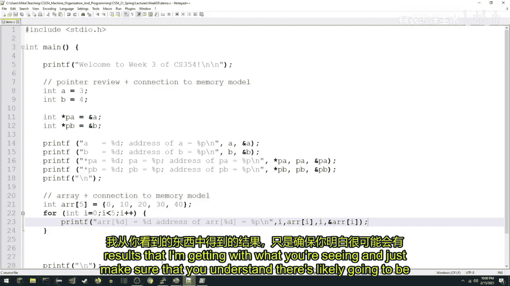

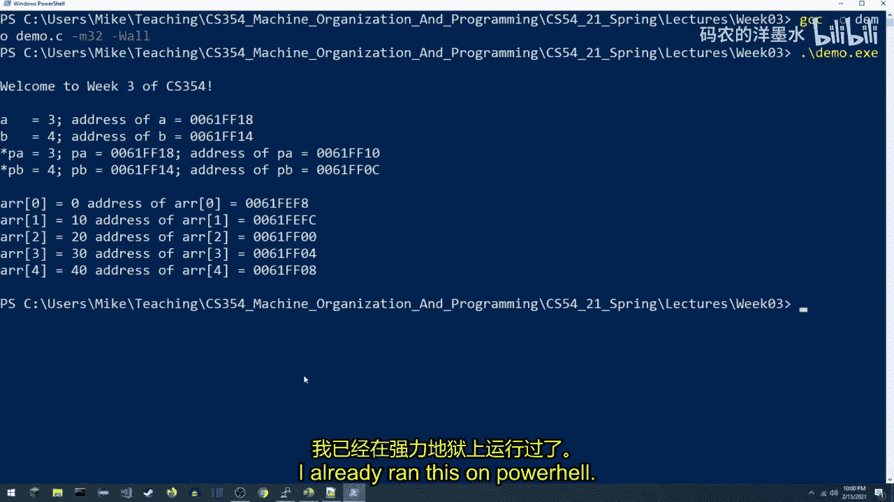

Wait， one more thing。 So this is sort of a nice， easy way to just do it。

 But I've hardcoded a couple things right here。 At first。

 I've hardcoded the number 5 as the size of my array。 And then I've got an array 0，10，20，30，40。

 a better way to do this instead of hard codingd the5 in and having to type it twice right here。

 would be to use a variable。 Let me let me go ahead and real quick。

 And the way we do this typically and see is to define a variable。 And defined variables。

 these are when I'm using defined anything that begins with a hash is going be a compiler variable So I'm defining a compiler variable。

 not a C variable， something for the compiler。 In this， I'm going to call it array max。😊，Like that。

 I'm going to do all caps。 And then to define a compile variable， I， there's no equals。

 It's just name of the variable and what I'm defining it as。

So I'm going to copy and paste this in place of my five here。There we go。

 And the other thing I'm going do in case I want to go back and change this and make it smaller。

Rather than hard coding my numbers。I'm also gonna。He's a for loop。I listen。Plus。嗯。A I equals。

I times 10。 Okay， there we go。 Now， this should give me the exact same thing。 But now I've。

 I'm using much better programming practice and not hard coding any of the sizes of my arrays。

 part of the reason I wanted to do it this way using the constant or the the compiler defined variable is that in C I'm going speak very。

What's the word？Inaccurately， I guess， supposedly requires。

That the compiler know the size of the variable ahead of time。 the size of an array。

 it must be compile time determined。 That's not entirely true。

 They've added a variable length arrays in actually a revision that was quite a while ago。

 So C no longer needs to know the size of an array ahead of time， but older versions and of。

 definitely did。 So we still see this kind of structure where we define a compiler variable。

 And this is just find and replaced。In the code。 So the very first step and we had a four steps to the compiling process。

 the very first step dealt with all of these compiler commands。

 So include just copied and pasted the entire file studio standard I O do H。And。

Defined is just going to find and replace anywhere that we've used array max and replace it with number 5。

Alright， that's all I wanted to say here。 And let me go back over and show you。

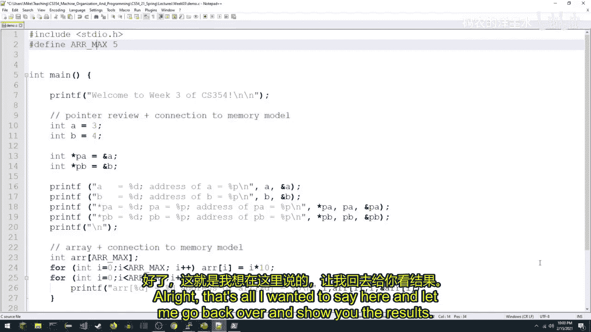

The results， Okay， so I compiled it without that change。 but let me quick。Recompile and then save it。

Save。Compile again。Clear that and now let's run this。There we go。Now， check this out。

 So I've got the old code right here。 I already see one difference because I've got the other monitor open with these addresses。

 The addresses has changed just by a little bit。 So I'm going to go grab a screenshot of this and pull it up and we can compare the the old screenshot with the new screenshot of where these things are and talk about why they changed。

And then I can see that I've got my new information about the array。 So in a screenshot。

 I'm going to talk about these addresses and how the compiler chose to lay these out in memory relative to this other day that we've got in there。

 Once I got， let me go do those things I just said I was going to do。

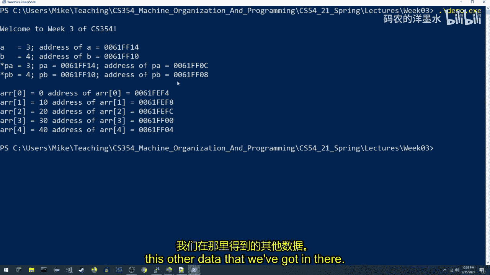

All right， guys。 I made a new slide。 I've got the old version up here with the original addresses for that program that just declared two integers and two pointers。

 And then here's the new version， the upgrade where I've created a 5 element array。

 And I've printed out the values and their addresses。 so check this out。

 If we just look at this very first variable A A is located address F F 1，4 in the new version。

 and it had been at F F 1 C。 So this is the picture of the old version at 1 c right there。

 I've got a。 And this is moved to 1，4。 So it moved up by two addresses。 And in fact。

 we can see they're all in the same order。 It's just shifted this entire block up by 8 bys。

 So pointer B is now at 0，8。😊，A is at 1，4， so shifted by two lines。

So I'm going to go ahead and I will change this for this example。 But from now on。

 I'm probably not going adjust that when they move things around。 So chances are。

 if we go back two slides to this picture or I was looking at things。

 something changed down here in the stack frame for Powerhell and it needed more space。

 I did run some more commands。 Probably expanded the history。 I'm not sure what it is。

 I'm totally guessing here。 Something changed that。 we also。

 we recompild and we changed the length of the code。

 So the code is no longer because I've got extra code for that array。

 And there's now more global data， more text。 And let me pull this up。 in this right here。

 printf address of it's now got this text。Also， stored in the。Text section right there。

 still not using the heap， nothing dynamically allocated。And then， of course。

 we now have the array that's also going to be stored with the local variables in main。

 So main has reserved a little more space for local variables。

 And I'm not sure but all of those things cause something to change but it was a minor change and we just see these addresses shift by by two the size of two integers8 bytes right so let me go ahead and put all of this in the picture the other thing I noticed。

 And so this is gonna be a problem is that we're looking at here the very last entry F 04 is right here。

 FF 04 and then we've got FF 00 and then we're off the top of the picture。

 So I'm going shift this whole picture down a little bit so that this FF4 address is actually not off the screen。

 So this is why this lecture takes so long to record because I keep having to redo the memory picture after I do an experiment。

 give me a sec let me go put this picture together。

 All right I've got this put together now So I've gone ahead and。Sed all the addresses。

 I had to add an extra digit because we're now spanning from E E4 E8， E EF0。

 EF4 EF8 here it rolls over to the next X digit in the third position so E to F So I needed a third one and we have 4804804804804。

 It looks like I didn't make any mistakes yet if I spot one， I'll get it fixed。Allright。

 and then these addresses is moved for all of these。

 these first four pieces of data from my first experiment like A， B，PA A and P， B。

 So I've got them moved。I forgot to update those addresses hold not time off。

So PB actually holds an address 8 left that should be at 10 and PA is actually at 14。Now。

 that looks good to me。So the next thing I've done is I've gone ahead and added in the array。

 So I can see that my array，5 elements number 0 through 40 increments of 10 are at these addresses，0。

0，6，1， F E 4。EF 4。 so at E F 4， I've got the0 right here for array element 0。

 E F 8 contains array element 1， So 4，8 c，0，4。4，8， C，0，4。

 So that's what they're looking like in memory。 couple little things。

 Notice that the compiler chose to allocate all of the memory。

 And we're using these sort of in reverse order here。 So a was the first thing initialized。

 B was the next thing。 P A then P B。 And then the array came next。

 But the array elements are in the reverse order from that。 Theyre in increasing order。

 So element 0 is up here。 and then one。 So there。I guess the moralist story is the compiler designers can do pretty much anything they want with their array。

But with how they allocate memory for variables。 But typically what we'll see with as is that the very first element is at the lowest address。

 And as you go across an array or along an array， we're going to see them at increasing addresses。

 I'll pull this up on the Linux machine to make sure that that is true。 They are also actually。

 let me go ahead and do that right now。

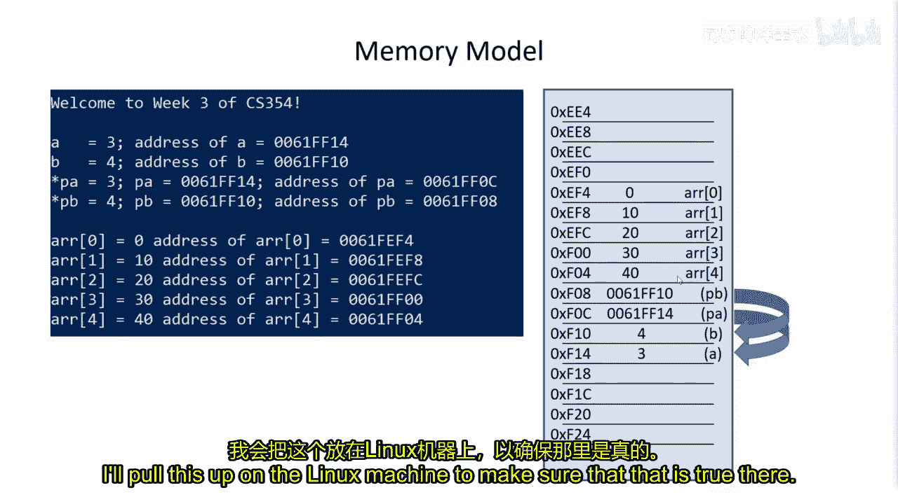

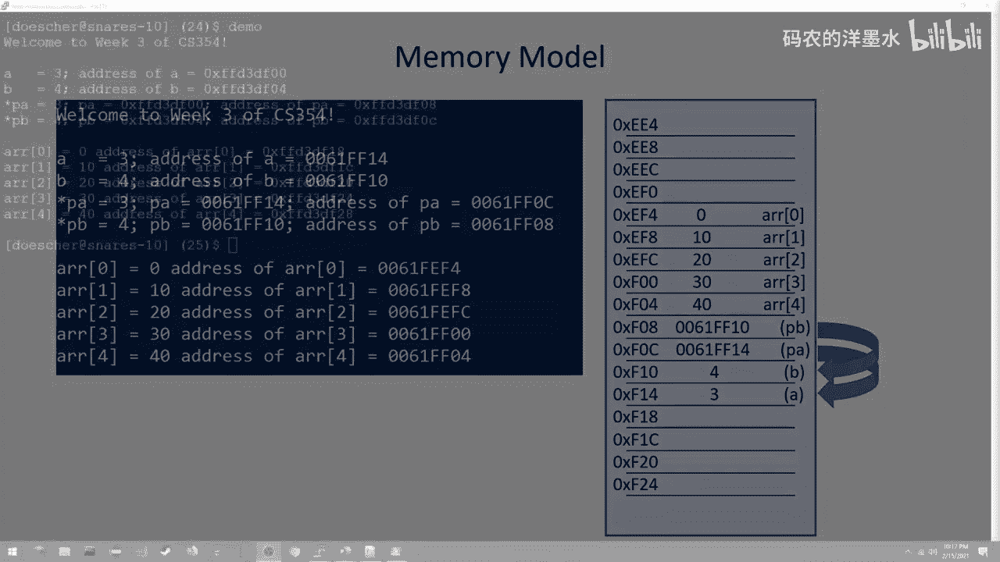

Yes， that is true。 So check this out。 Here we're going F 0，0， at 04。F0，8， F0 c。Okay， but then。

Over here， we've got F18， F1 c， have 2，0，2，4。2024，28， These are all an increasing address order。

 And theres also， they've shifted around a little bit。 So this first one was。Let's see here， D F 0。

 D F 18。 So these are again， above this in the memory space。

 So it's the compilers reserved a block of memory for all this stuff。

 And then at the very top address， the lowest address， it's putting in A， then B， then P A， then P B。

Have 0 C。ImRight there。 And then it's skipped a bunch of space。

 There's some empty space there between F 0， C and F1，8。 So I've got F like 1，0 and 1。

4 are both empty not used in this particular example。 I'm not going to draw the picture of that。

 but just an observation。 But the point I wanted to make is that the array start continues in increasing order。

 Let me pull this back up I'm grabbing PowerPoint next。

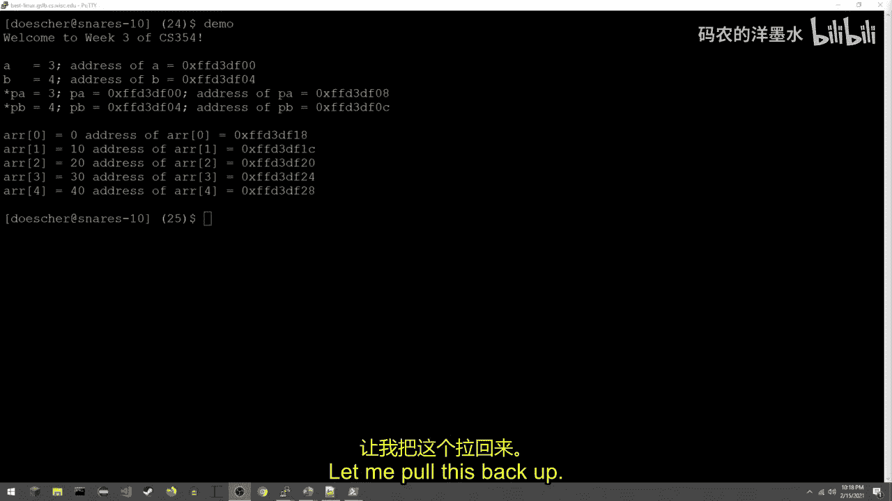

I one， that PowerPoint。Now， when we have this address space that looks like this。

 when I start declaring variables， local variables arrays in stack frames。

 the very bottom most thing in a stack frame is that return address info。

 where the function goes when it's done executing。And if I have an array that's accepting information from a user。

 and I don't do anything to check the length， it's going to put element 0， then element 1。

 then element 2， then element 3， then element 4。 and then something eventually has the power to start writing over memory that's not been reserved for it。

 And eventually， I can overrite that return address。And again， this is one of the。

 this is the buffer overflow attack。 I highly recommend you guys stay computer security。

 That was a really great class。 I loved it。 One of the very first programming assignment is to write a buffer overflow attack that requires you to like。

 really understand what's going on。 So this class is like。😊。

Gold for getting ready for computer security。 all right。

 back to back to what I'm talking about over here。There it is。 So， in fact。

 you can see the increasing array。 So in this stack frame， I've got local variables。 Here's my array。

 If I kept going。 if I over， like， if I added another element to the array in my code。

 I stopped it at array max。 If I were to go and just say， well， here。

 let's just initialize my array with some extra stuff here。 I've got room for 5。 Let's make this 25。

😊，If I go make that change， it's going to overwrite all of that this information。

 it's going to overwrite A， it's going to overwrite B。I kinda want to see this。

 I'm claim that this is going to work。I want to see it happen。Let's go ahead and do this。

And I'm not going to do 25 here。 Let's just do four extras。

 So we'll make this9 and see what happens when I print all this information out。 So let me save that。

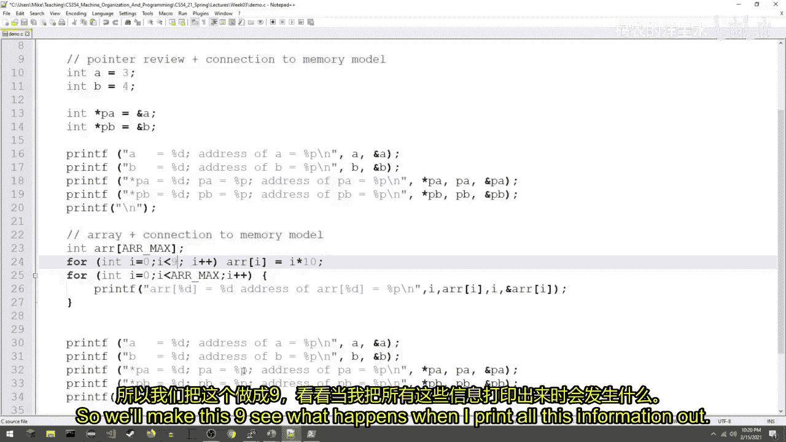

Again， like I said， I wanted this， here was me copying it back over to CSL。There we go a compile。

And run it。Soject this out。 So A started out at 3。 B was 4。 Here's my array，0，1，2，3，4，102030，40。

 A and B were overwritten。 So because I， I didn't stop writing out my array at。

In the maximum element， I just kept going writing beyond it。

 I actually overwrote the value for a and the value for B。

 because of where they're located in memory。 So I， this is one of those really common things。

 C programming errors as the programme I your responsibility to know how big all of your arrays are and keep track of that yourself。

 The compiler does not help。 There was no warning at all。 Was there， I just compiled this， Let me。

I've got warning all warnings turned on， no warning that you overrote the other data。

That that by not checking， it makes this go faster in two ways。 first compiling goes faster。

 I don't need to worry about any of that checking and running the code goes faster。

 It no longer needs to check at runtime to see if my array elements are inbounds or even valid。

 I'm pulled this screen back up。 I'm changing it back。 I'm going put it back exactly the way it was。

 That was just sort of me being spontaneous。 while recording doing an experiment because I wanted to see what happened when I did that。

 I highly recommend you guys try this out on your own machine and see if you can overwrite that other data。

 The Linux version would not have done that because it moved the block of A B。

 P PB to lower addresses are higher on the list than the array。

 So it would have not overwritten those。 but the array would have。

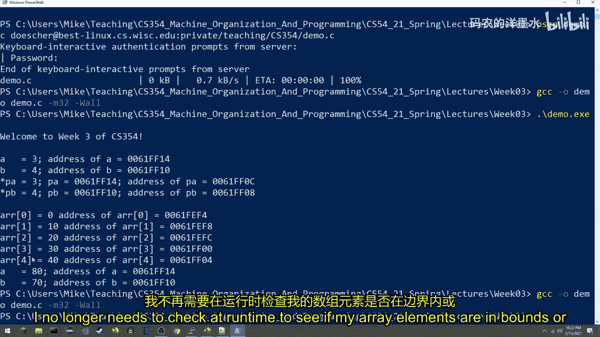

。Overridden， like whatever came after。Alright， let's see。 I need to get rid of this。 I。

 I also want to print out one more thing here in this block。 I want to know where a A R。

 where my array is actually stored。 So here， let me grab。And see one of these lines。

 it'll be fine A R。I'm going to print out the value and the address of ARR。And just see what。

I I'm pretty sure this will give me some sort of error message when I try and do this。

But I want to see what it says so I can talk about it， save。Mike， you're not on Vm。 save that again。

 All right， let's try compiling this。

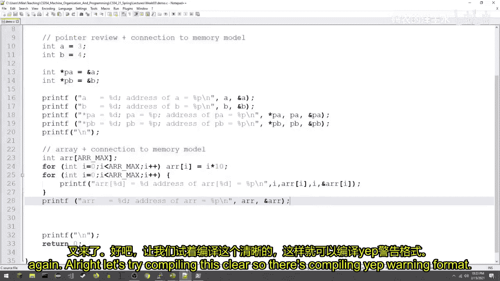

Clear， so there's compiling。 Yep， warning format， the decimal format string specifier expects an int。

 but this has a pointer。That's because it's an array。

 We're going to see that arrays and pointers have really a lot in common。So right here。

 let me go ahead and change this。 It expects So array is actually a pointer as far as like the print app function as concerned。

 So let me go ahead and switch back over here。

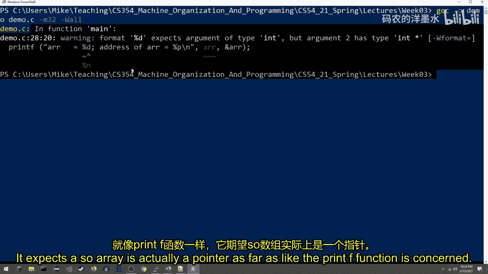

And change this to a P。Now now it should be a printing out a pointer， saveve that real quick。

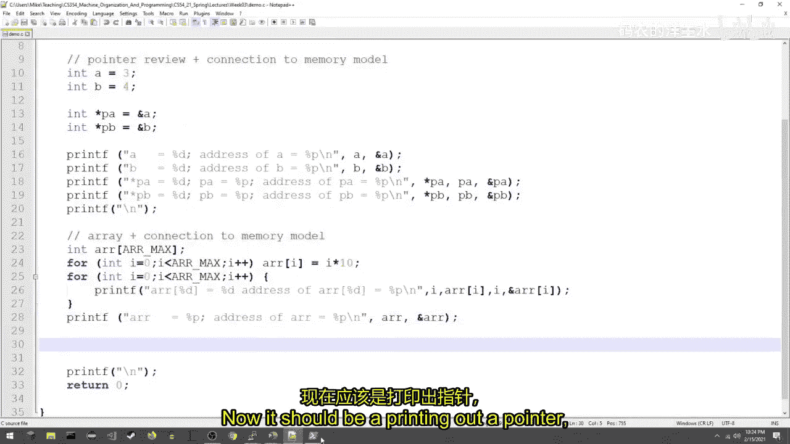

Compile that again， now my warning goes away。And I should be able to run this and get some extra information out about where my array variable is stored。

 I got this wrong last year。 If you were watching the videos from the summer。

 that's a great resource。 This is one of the places where I know I made a mistake and learned a lot since I recorded that lecture。

 I don't believe anybody pointed out in the comments。 and I'm not going to like。😊。

Go claim I made a huge blunder。 It's a pretty minor。 What I had done before。

 as I had said that array actually gets its own space in memory somewhere。 when， in fact。

 what happens is it's actually got the same address as the very first element。

 So when you compile C code。 Let me see if I can break this down。All of the different variables。

 in this case， I've got A， B， PA， PB， and an ARR array。

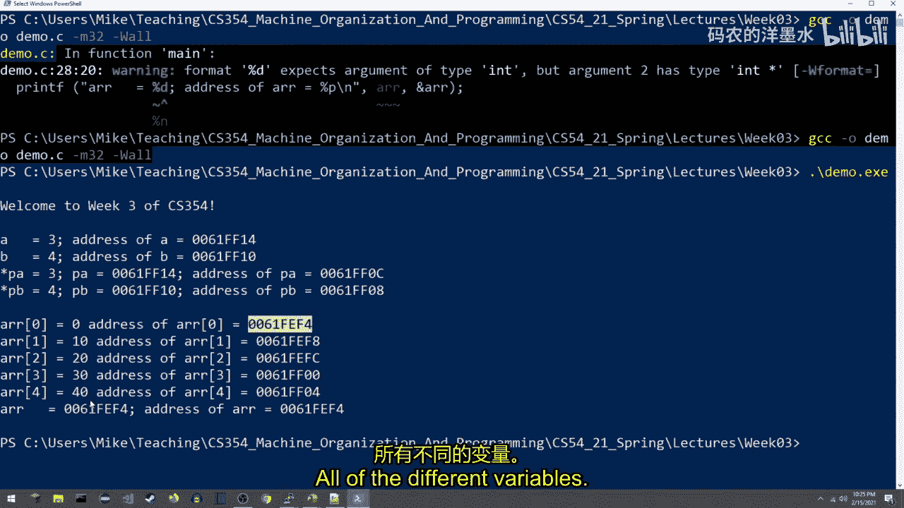

The compiler reads that， and it puts the names that I chose in a symbol table。

 And then on the other side of that table， it matches that up with the memory addresses that it's going to be using。

 Okay， if I have a pointer that points to an array。

 that pointer gets a memory address where it's stored。

 and the value stored there is the first address in the array。 Now。

 if I'm just creating a primitive array using the bracket notation like this。

 This A R is not stored somewhere in memory， it's not a pointer to that memory address。

 it is that memory address。 So let me。Try and make this a little more clear。Where is PowerPoint。

The other PowerPoint， hold on， that's the wrong screen。There we go。 So I've got my array right here。

 on this line right here， I've got the first。Element of ARR。This is also where we have。

A are without any brackets。嗯。And I'm not。 this is probably where I need some more space outfit。

 This is not the best way to write this。 There's not。 There's not a good way to write this。Tpo A。

There we go。Technically， the symbol table inside of the compiler is just associating that variable ARR。

 it's treating it as a pointer that points to this address right here。And it's also giving。

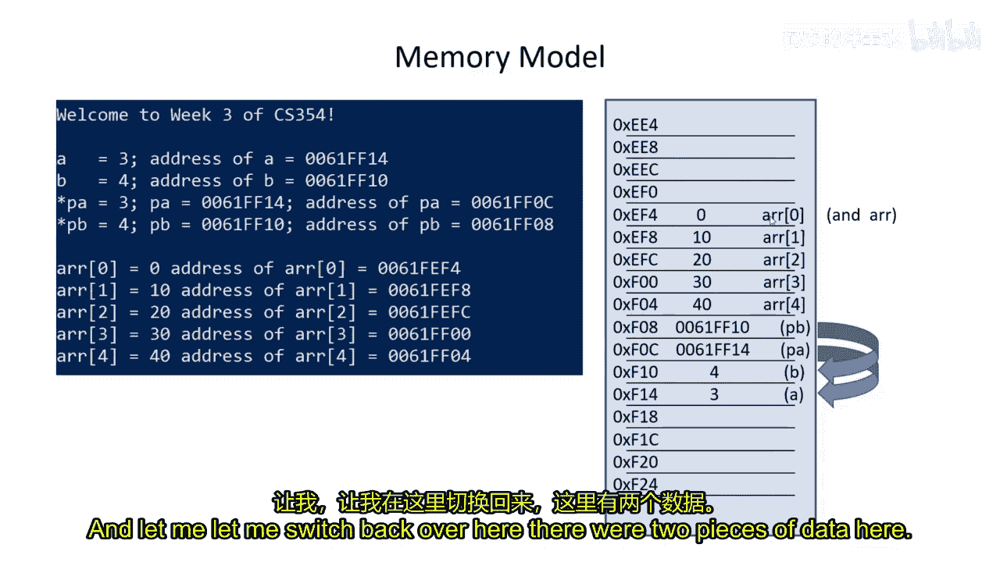

Let me let me switch back over here。 There were two pieces of data here。 I printed out F4。

 and it's also located at address F4。So both of those， it's basically a pointer that points to。

PowerPoint。 there we go。 It's a pointer that points to right here the first element。

 and it is that element。 So it's a little confusing。

 This is one of the primary differences between arrays and pointers。 So it is kind of important。

 It has a programmer。 it actually has very few consequences。

 It just means if you declare an array using this notation。

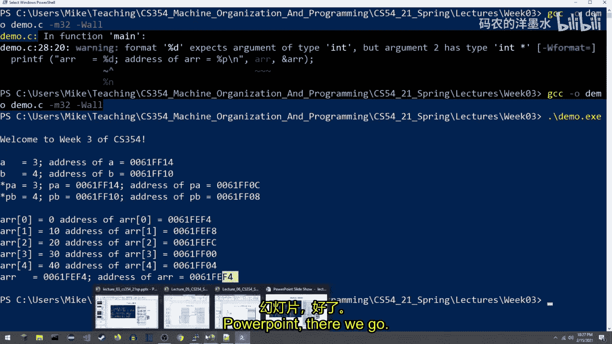

Like this， it actually takes up one fewer memory spot。 than if I have a pointer to that array。

 which saves us4 bytes。And this is also going to be considered constant。

 We won't be able to change this to another array。 Pointiners are really very powerful。

 and it's pointers are going to let us point to different parts of an array。

 I can switch from one array to another。 so there are a lot of advantages to using pointers。

But it does have to keep track of like， not only does it store the pointer somewhere。

And you switch back。And I'll I'll add a pointer picture to this in a second。

 But that have to store the pointer somewhere with an address。

 just like P A right here points to that value。 I would need a pointer to this array that would point to address。

 E F 4 A R doesn't take up memory。 It's not in this picture at all。 I've got an in parentheses here。

 And I guess that's the point。 It's not in this picture。

 which I guess is like showing that somethings not there is not super useful。

 but it's important to understand。 of the differences between pointers and as because they are so similar。

 And this is one of the minor differences between them。All right。 next up。

 I just thought of another experiment that I want to try。 I'm going to make my array a little bigger。

 real quick。 We'll make it 25 elements。 So we're going reserve more space。

 We're going to initialize more things， and then we're going to print out more stuff。 Now。

 I didn't test this。 It's getting late。 And I just want to see what happens。😊。

If we skip initializing and we just print out what's in this array。We should be finding that。

Somewhere in there， we've got a three and a four and some memory addresses because。Oh。

 that's it only I wait I take that back， that's if I reserve 25 places。

That's not going to overwrite them。 If I reserve five places。

 then we should see them in there somewhere。 Let's try it this way first。So quick experiment。

 if this doesn't make sense what I'm doing， pause video and stare at it， I'm creating a small array。

Then I'm printing out 25 values from it。 In fact， let me just change this to 25。There we go，5 and 25。

 And this array was in memory in front of all these variables before A， B，PA A and P B。

 And I didn't change any of them。 I didn't initialize anything。

 So we' just should be just looking at whatever the memory space is right there and。

An extra 20 elements beyond it。 Alright， so save this。

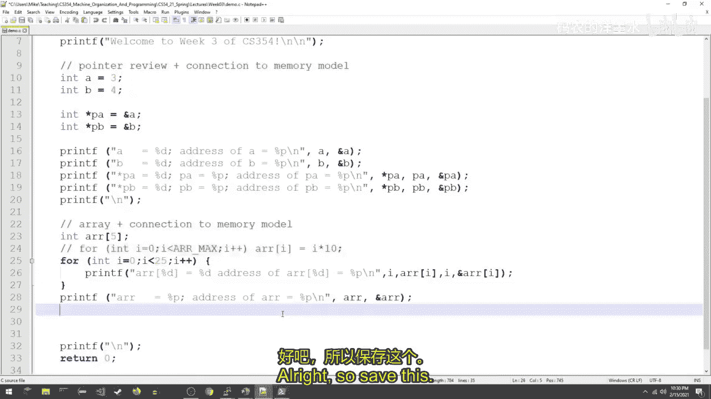

Yeah， like I said， I didn't test this yet。 let's just see what it looks like。Allright， cool。

 So here we go。 I've got A B， 3 and4， got some memory addresses。And then the start of my array， El 0。

1，2，3，4。 This is just going be whatever garbage was in that memory。Cause I didn't initialize it。

 So C does not do any initialization for us。And then let's see here， we got down to。Yeah。

 here's the three and the four。 And above that should have been pointer to A and pointer to B。

 This is the decimal version of those， I believe。嗯。And， in fact， let me see here。Yeah。Yeah。

 here's 18 and 14。 so 18 and 14。Yeah， looking good， looking good。 And then the point is。

 these aren't 0。 They were not default initialized。

 I'm actually looking at memory that overwrites another part of or doesn't overwrite。

 But I'm like out of bound to accessing things。 I should not have the power to access。 But I do。

 It's not。 It's not invalid。 It's just really bad practice and leads to giant， disastrous errors。

Alright， I just want to do that。 show you what happens if I， if I don't initialize it。

 I'm going to go put that all back， and then I'm going grab a pointer to my array and start talking about pointers and arrays and their connection。

 Al right， I got that stuff put back。 Here's what we're going do next。

 I'm going create a pointer to an array of integers。 And to do that。

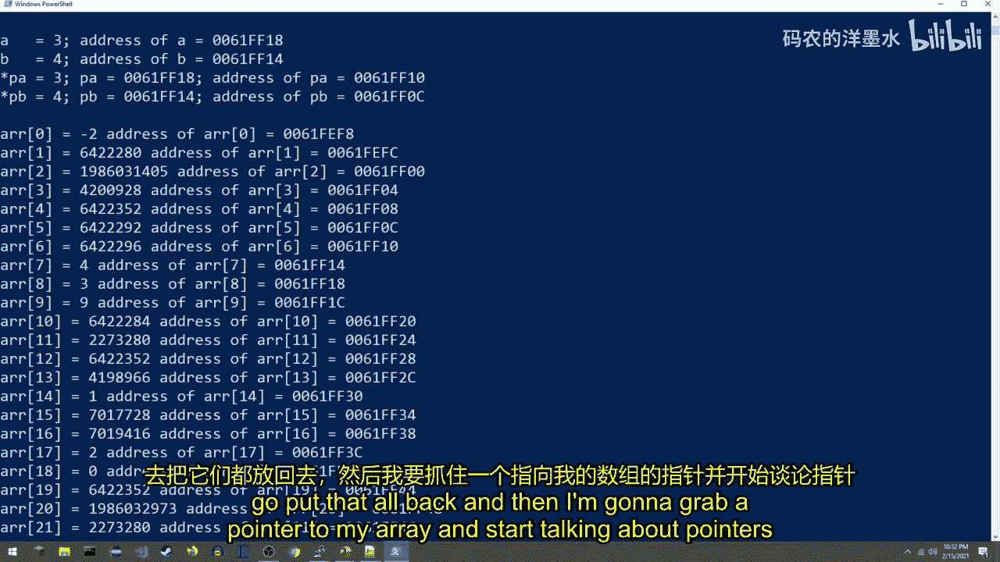

It's just a pointer to an integer。 let's call this P。

A our par from now on pointer to array right there。 And when I initialize this。

 I need to initialize all of my pointers。 Otherwise。

 they're just pointing to random garbage memory because it's going， you know。

 there's something in the memory that it's reserving for that pointer。 And I need to give it。

An address。 And what we just saw is that a raise。When used like this are actually addresses。

This only worked because I needed to put in the address symbol for printf。 So I do not need。对呀。

Hampersand signed in order to access the array， This is actually gonna give me an error because。

The address， wait， no， it's not because this also worked。 Hol on。 This works。This works。 Let me。

 let me show you， this works。

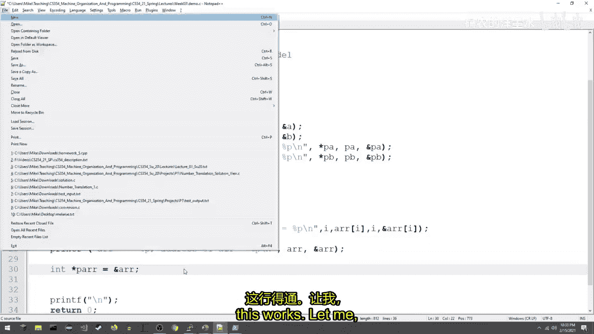

Cile。Initializing in from incremental pointer type。It's a warning。Unusable， it does work， though。

 Okay， so it's just noticing that these types don't match。But it does work。W。

 let me switch back over here。 I've also got a huge array。

 I changed that to 25 minutes switch back back to 5。

 This should also be good because ARR is also a pointer。

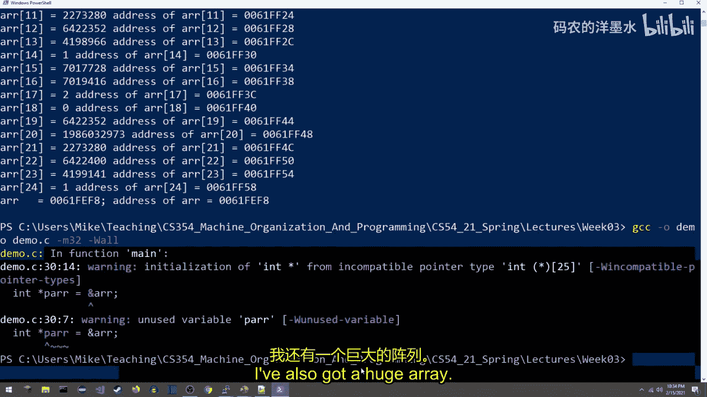

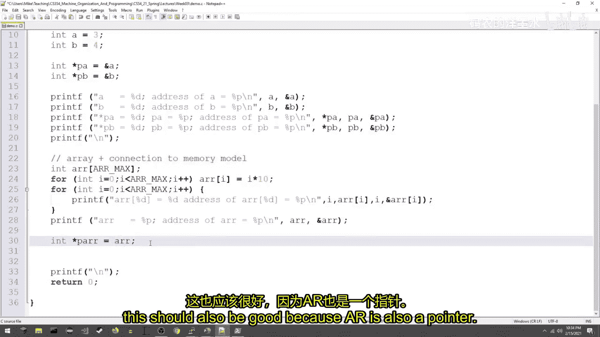

Save that。 Let's go compile this。And now the only warning I'm。Here。

This is got a lot of stuff on the screen。 The only warning I'm getting is that I haven't used my pointer of the array yet。

 okay。

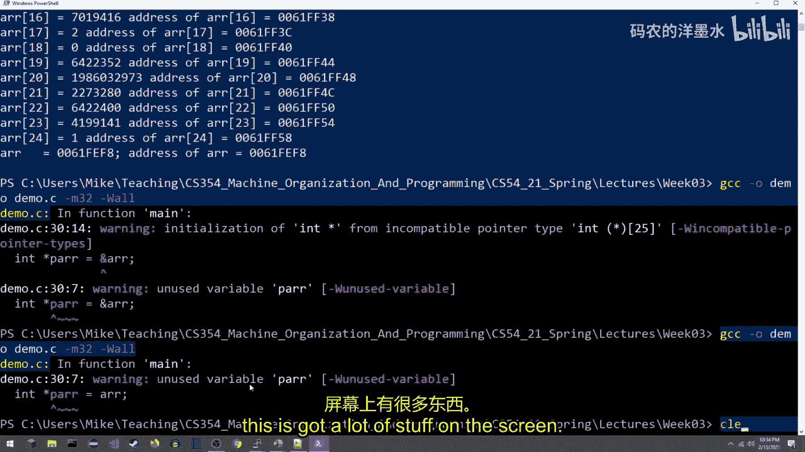

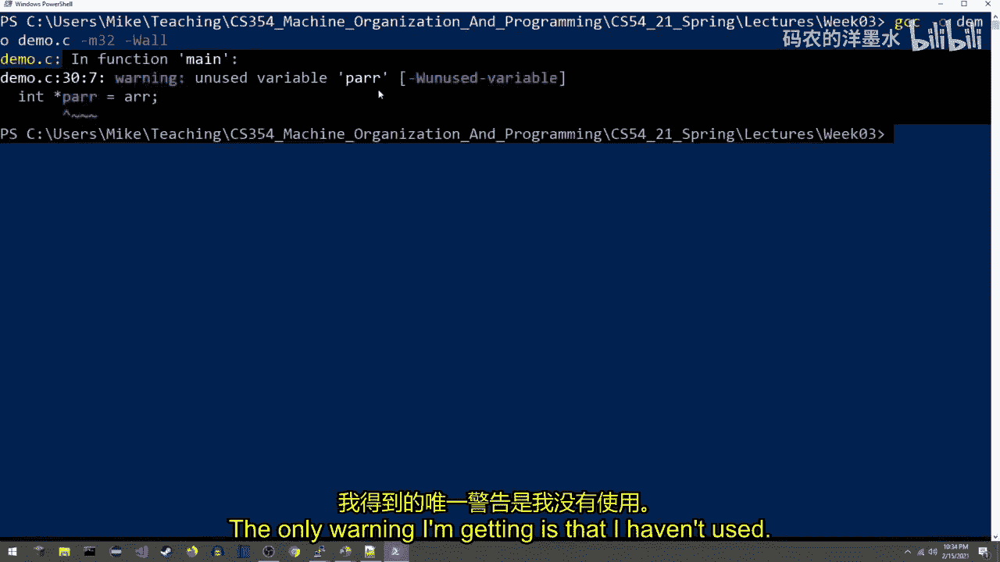

So this is the preferred way to initialize a pointer to an array。 And now。

 let me go ahead and use this。 One of the things I can do with this is I can go ahead and use the pointer to print out everything in the array。

So where I've got。A R here printing that out。I can use PRR。Yep， let me just do it this way。

I think I got all the right things changed。

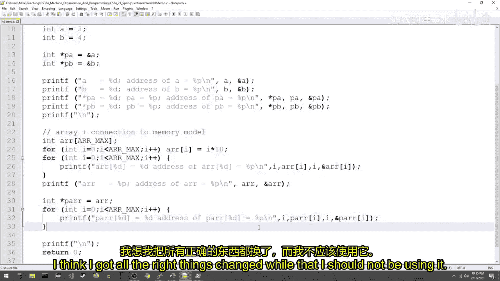

Pile that， I should know I'm using it， no warnings。Run that。And what I see here is first。

 I'm printing about my array， printing out some information about the actual array。

 It's the first address。 This is all the same stuff I just went over。 Now。

 I'm also using the pointer to that array to print out the exact same information。

 and I'm using the exact same array index notation with brackets will'll talk about a couple of different ways。

 the terminology for using brackets is called array index notation。

 So when I use brackets to access either an array or a pointer and pointers can be access the exact same way with these brackets。

 and I'm getting the same value 0，102030， the address of these guys， EEC EEC。 I if they moved。 Asome。

 So my pictures is gonna be bad now， but。😊，The point is they've got the same addresses。Alright。

 let me print out one more thing。 I didn't print out where I pointed my array stored。

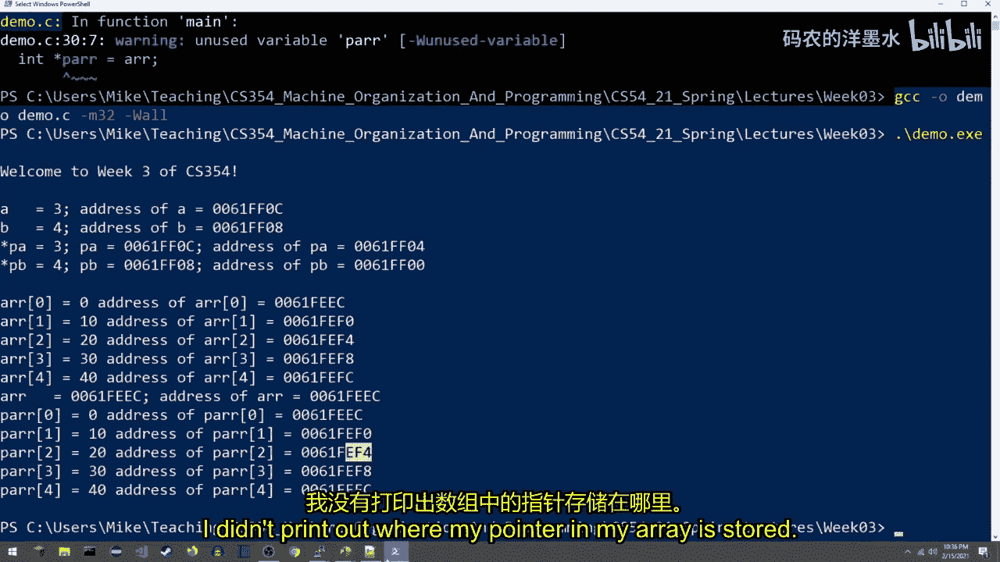

Let me go ahead and copy and paste here this one's printing out information about。

The array will do the same thing for pointer to the array。The point of the array is not going to。

 so the point of the array is actually contained the memory address， so I do need the percent P。

And address of that is。Soone address。There we go。 So now I'm printing out， yeah， all the right stuff。

 Let me go ahead and recompile。

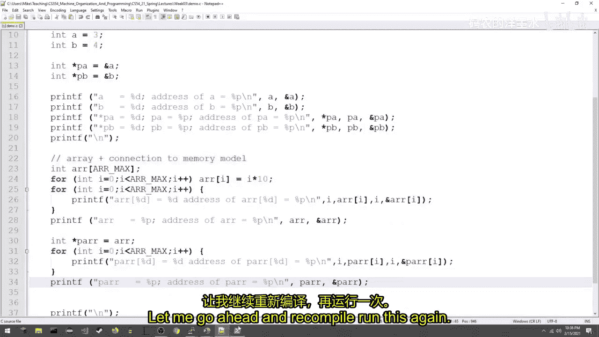

Run this again。And what I can see here is the pointer to the array。

E F 0 should be the very first address of the right E F 0。

 Also where array is stored and where the address of array is stored。Those should all be the same。

Okay， and that array is actually stored somewhere completely。 I'm sorry。

 The pointer is stored completely somewhere else different in memory。 So these two are the same。

 E F 0， E 0。 it's because this is the array。 The pointer to the array gets its own address。

 So EEC in this case。 Let me see。 that would be。Alright， EEC is going to come right before E F 0。

 Let me go， let me go put this in a picture。 just staring at these numbers and hackxes not working for me。

 I need a picture Once I let me go make that。

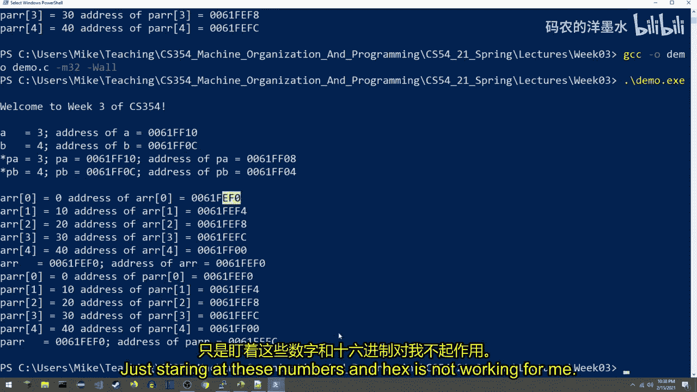

I've got everything in its new spot。 So A is down here now at address F10 B is at F0 c。

 So this should match up with what we hear10，0 c yeah，0，8，0，4 Okay， so those look good。

 I've got the array in array starts at EF0 F0 and goes through F00 F00 looks good。

 And then my new pointer to the array is at address EEC。

 All right there it is right there E easy to put in。

 now that I've got a picture and the value it contains is E F0 right there E F0。嗯。So here。

 let me grab another arrow。We'll drop this up here because this is a pointer。

 It points to that array just like that。 And then I'm covering up the text。Hopefully。

 you guys remember what that says。 So here's the idea。 It's a pointer to an array。

 It's located at this memory address。 And when we dereence it。

 we're getting array 0 and this using bracket notation just like we did array index notation right here when we printed things out right there highlighted P array of index I that basically is the same thing as dereencing。

 and I'm going to do some math in the next PowerPoint slide to talk about this specific interaction between the bracket notation and the pointer indexing and pointer arithmetic So it's coming really soon。

 But I just wanted to put together this PowerPoint picture this one showing you that if I have a pointer view array。

 it gets its own memory address。 it points to the array in memory and I can dereence it the exact same way I do with array bracket notation。

differenceiffence is that for array， I don't get a memory address for A R R。 It， in fact。

 the compiler， if I ever request it， just gives me the first。

 Well basically the address of the first element back。 No matter if I ask for the address of it。

 or if I just ask for the its value， both of them return the same memory address。Alright。

 so that's the the first major difference between pointers and arrays。 Alright。

 the next thing I want to do is show you that I can also print this out， print using。

The pointer notation， pointer D referencing。 So if I D reference P A R。

 that's going to be a decimal value should be a 0 because that's what's in array element 0。

There we go。 And yeah， that's all I want to print right here。 So we'll just do star P R R。

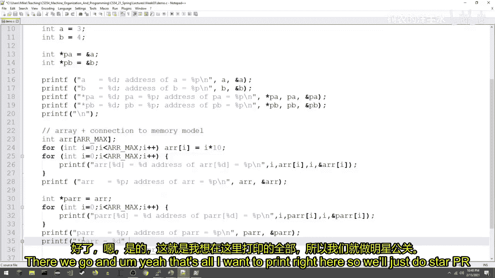

Ill that run this real quick， make sure I'm not making mistakes。So I can also dereference。

 I can use pointer notation to grab the value right here。 I believe this also works with。

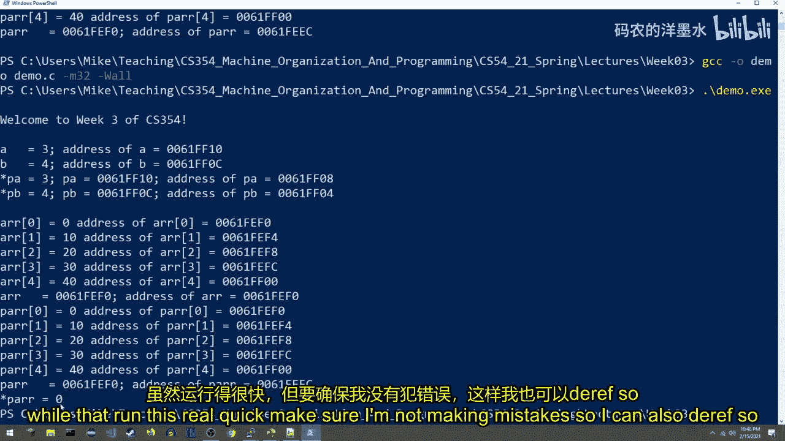

Yeah， let me just do one more thing。 We'll also do it with Dreference ARR。And that is equal to。

Deestimal value。We' going have to edit this if this doesn't work。

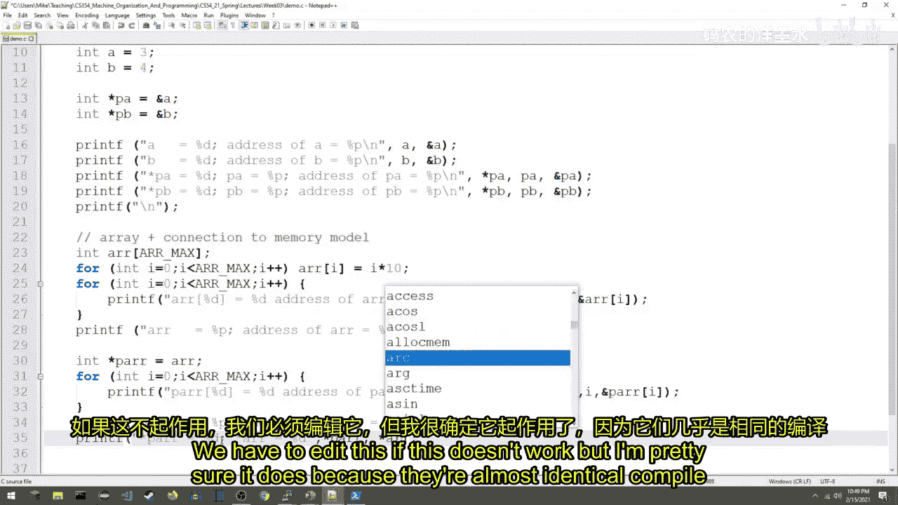

But I'm pretty sure it does， because they're almost identical。Compyle。Yep， okay。

 so we can also dereference the array like that。All right， next up。The next。

 like major difference between pointers and arrays is that pointers are variables。

 and arrays are essentially constant pointers。 If we want to think of them like that。

 So here's one of the things I can do。 I can go ahead and say。

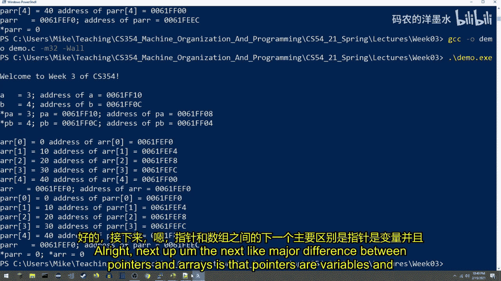

Here are equals。The old value plus one more。 This is going to move it one integer size。 Yeah。

 In fact， let's print this out again。So'll do that。And。Yeah。

 let me just run this with just this much。

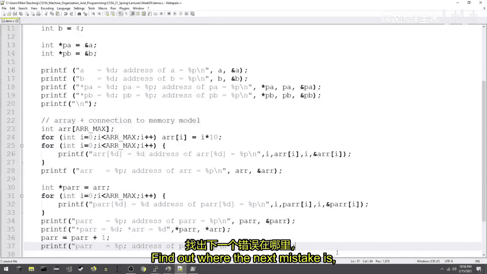

Find out where the next mistake is right here。 Nope looks good。 Okay， so de referencing P R R 0。

 de referencing the array is still 0。 Then I did。

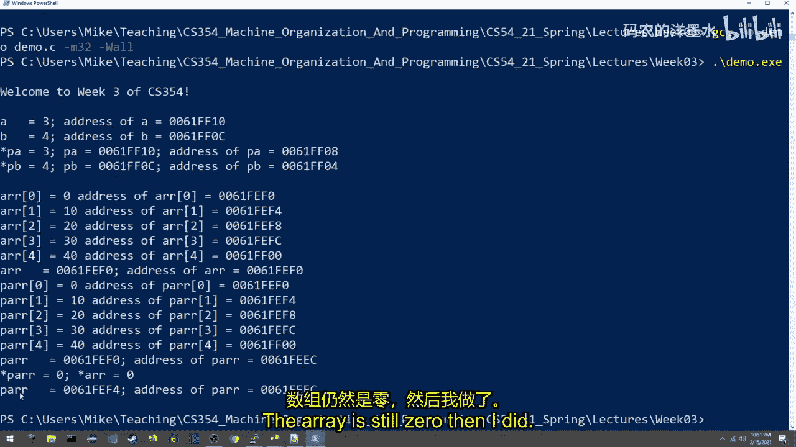

I want go， I want one more line， Hol on。This line again。

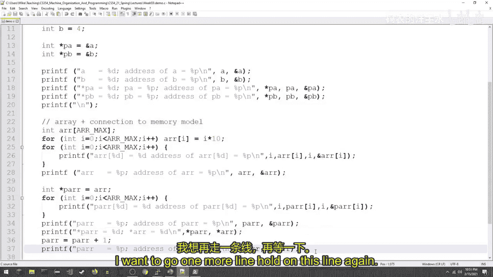

Alright， there we go。 So I've got a twiceys。 starts out0， starts out0。

 It starts out pointing to E F 0。EF0 was the ray element 0。Then we incremented it。

 And now it contains the value E F 4， which is actually the second one。

 So the line I did was par equals par plus 1。 Now， the compiler already knows that it's a pointer to an integer。

 And so it knows that the size of integer is 4 byte。

 So it's automatically taken care of that and incremented it by 4。 not just one。

 I'll go back with a PowerPoint and walk through this a little more carefully。 but it went from F 0。

To F 4， it's because the compiler knows the size of integers on this computer is 4 B。

And so when we do reference this one， I see that I now get the 10 because my pointer is now pointing to this memory location。

Not the original 1。 I upgraded。 I changed it。 Also。

 note that the pointer is still at the exact same place， EEC C。Pointed is at E，EC。

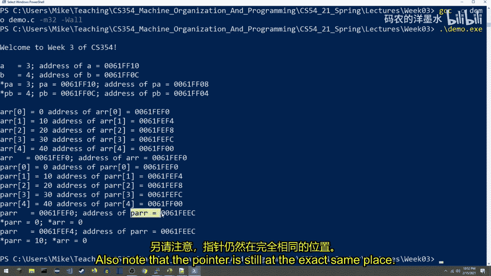

So in the memory model， I pull this one up。What I did here was right here， this value。

 I incremented it。 So instead of this being AF 0。It's now， yeah 4。And my pointer， I grab my arrow。

 is now pointing one spot down to right there。That's all I did by changing the code。

 The pointer is still in the same memory location right here， but it's now got a different value。

 here's the address。 E E， but the value is now different in points somewhere else。

 We can't actually do this with arrays。 arrays our constant pointers。 So here's what I did。 I've got。

P equals par plus 1。If I do that with just the array， if I try and change where the array points。

I can't do this， this is going to give me a horrible compiler error and like actually I think it might be one of the useful ones。

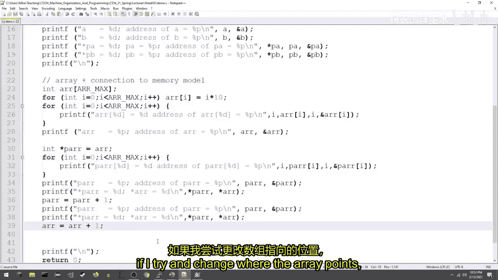

Yep， assignment to an expression with a array type。 So this is an assignment statement。

 I've got the equals there。 single equals can't assign to an array。

 So that one's actually pretty useful。

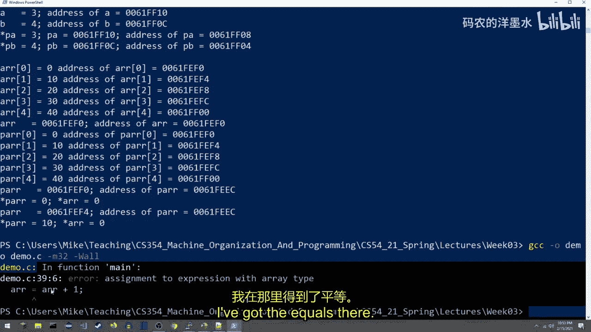

Okay， so this line right here is the one that totally failed。 I cannot。Assigned to an array。

 And that's what this is doing。 These other two more options for incrementing an array。Pa plus， plus。

Should work and。Pa plus equals one or hover money elements I want to ship by those are also going to reassign the value to the next element in the array and shift it down。

 We can see this used a lot in like loops。 for example。

 let me go ahead and I'm going to pause and just write one and show you using a pointer to index through an array one sec。

Okay， so we're looking right here。 I've just added a quick loop。

 This is going to declare a pointer to the array， and it's going to start out pointing to the very first element of the array。

嗯。While it's not equal to the last element of the array in this。

Is actually the array max is one element past the end of the array。

 so it'll still capture the last element。 It'll get all the way 10， 20，30 and 40。

 So the notation here P is the actual address。And I'm comparing that to the address。Of the element。

 one past the end of the array。Okay， so it's not equal to that。 we're just going to keep doing stuff。

 And what we'll do is using each element one at a time。

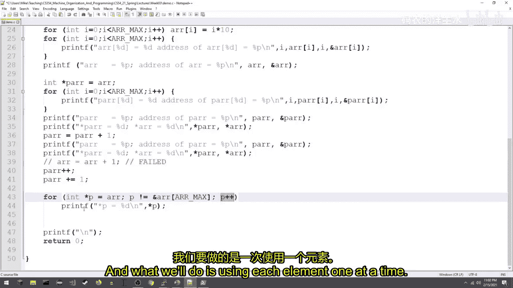

And all I'm doing is printing it out so we can see that it works。

ll jump back over to Power showler I've already run this code。

 It took me a couple tries to get that totally right。 I had some extra。Typos in there。 But anyway。

 it's printing out 010203040。 It stops。 It's not an infinite loop。 Things are looking good。

 The The downside to doing it like this is we lose the access to which index we're looking at by using a pointer we no longer unless we have a special counter that counts how many places along we are。

So this is useful if we want to go through and do the same operation to every single element。

 like if you're like working through an array of characters of string。

 you want to make them all uppercase or something。 We don't really care what the index is。

 We just need a pointer to that。To that character so we can change it。

But we do lose access to that to the index。So， it's。An interesting way to do things。

 it's got some power to it。But has that disadvantage also。

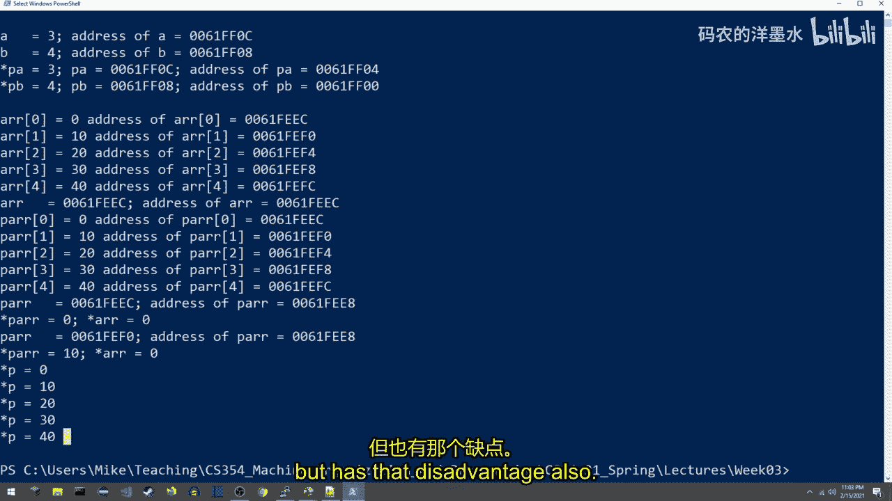

I want to talk a little bit about how does array access really work。

 What's going on inside of the machine now。 So in all of the other computer science classes we teach error just we give it the bracket Annotation 3。

 This just gives us the third element of an array。 So， but on the inside of the machine。

 what's really going on is that this error 3 is actually being translated to。

The base address of the array。 I've got that right here。What is here element zero。

That address is going to be offset by。I'm clicking the wrong spot。 There we go plus 3。

 because it's 3。 But I also need to know the size of whatever these things are， three times size of。

And。Alright， and that means that error3 is going to be equal to， let's see here。A R is equal to。OX。

 E F0。Plus three times four。That's equal to 12 by plus E F 0。 That's going to be。 what is it， O， X。

 E， F， C。Yeah， okay， so that's how we were gonna inside the machine， get to that particular element。

 Now， I need one more thing because this is an address。 And this doesn't actually， you know。

 this much doesn't give me an address。 It gives me the actual value。

 So I need to de referenceence the memory address。So that's going to be the de referenceence operator。

Like that。 So I need the star operating on this entire address after I compute it。

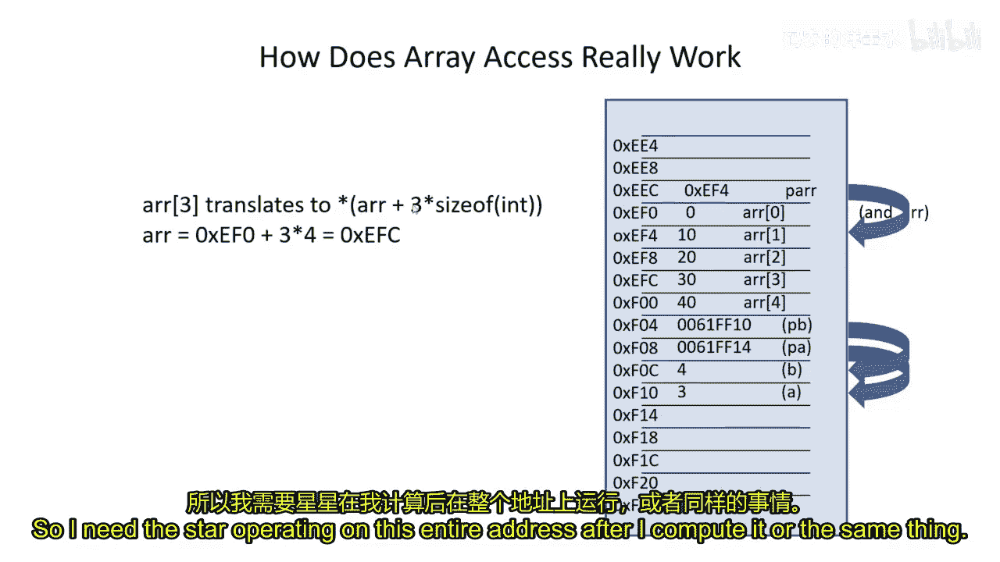

Or the same thing。Oops， oops， oops， oops。

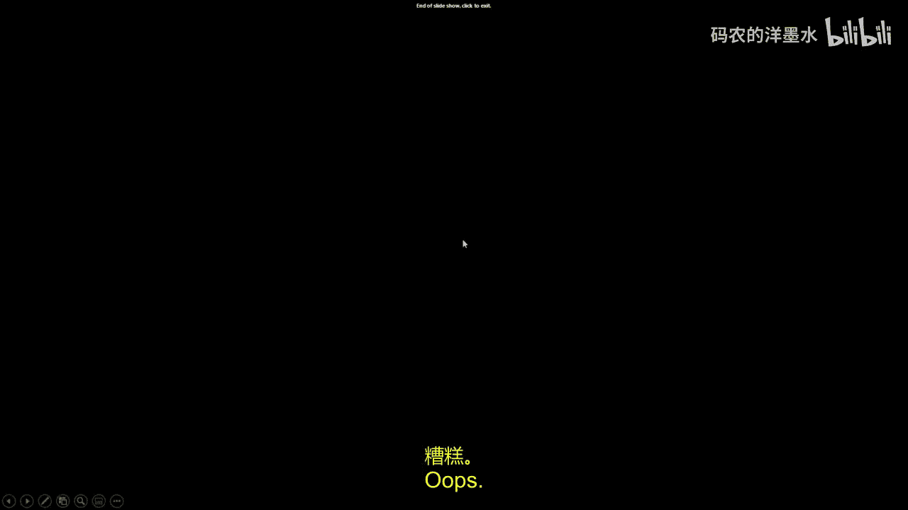

But there I click the wrong spot。嗯。Operating on this much。And again。

 I throw a star in right there to dereference it。Or star like that， something like that。

 So start a de reference to go get that value。Cool， so the next thing。

 we don't actually need to type that。As programmers， instead。

 the compiler is going to take care of knowing the size of whatever the data type is。

 So we don't need to type size of int in order to move from one element to another accessing race。

 Instead， what we're going be doing is。Let's see here， ARR。3 is going to be equal to just。

D referenceence。Address era plus 3。 So this would work just fine to go give me the value at。

Index 3 of my array and the size of。Rock screen。Size of is taken。

By the compiler because it already knows what type it is。 just makes it a little easier for us。

 And it makes our code a little more portable。 if we go from a4 byte integer machine to something that uses2 byte for the integer。

 we don't want to have to worry about changing the size of an integer anywhere in the code。

 So I mean size of is great。 But it's a lot of extra typing。

 when the compiler already knows that's what we mean。Alright， in， in general， let me just put this。

We're also going to have error of I is just going to be equal to。Gets translated to。

Size event like that or we type。And lost app parenthey right there。Okay。

 so this bottom version right here， let me move this up a little bit。There we go。

 This bottom version that we type。 This is the array axis bracket notation。 array。

 What did I call before。 Oh， I'm blanking on the name。 It's getting late。

 array bracket array index notation， something like that。 Ar index notation。 That feels good。

 And this is gonna be the pointer notation version。

 This is the 1 I want you guys to use in homeworkmark 2 when it comes out in a few days。😊，U。

To do everything， to just take care of doing all of the pointer math。

 the pointer arithmetic on our own and not relying on the compiler to do it for us as the compiler runs。

 What is he going to see in the middle section of the course that all of the assembly language uses this notation right here。

And not the bracket notation over there。Okay， let me pull my next example and I'll be right back。

All right。 I decided my next example is to actually show you that this actually works。

 Even though I just claimed that using a pointer notation was difficult because we couldn't change the array。

 this is not changing the array。 This is computing an address and dereencing a new address。

 Nowhere am I assigning to the array。 So that's what I'm going to do next。

 I'm going to go ahead and come back over here。 And just grab something that prints out a line。

Let me a copy that。And we'll print。 Let's go with。A R R of three。 that's what I just did。

 and we will print that out not using A R of3， but instead we'll use D reference。

The address of the array， plus 3。Just like that。

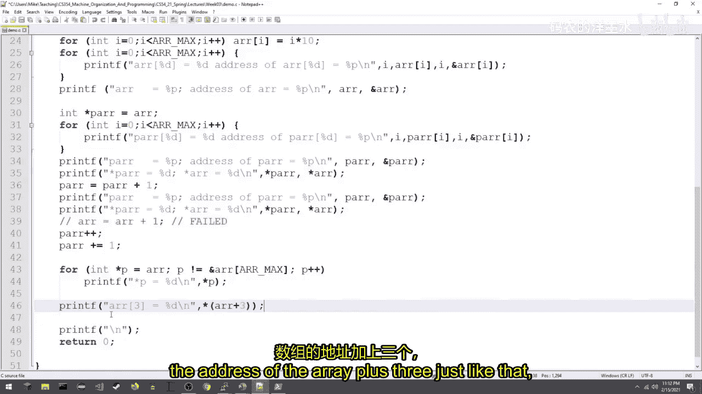

Save that。Clear the screen we compile。And we'll run this。There we go。 indexing the array。

 using that pointer notation。 you know what else is kind of fun。 Don't ever do this。 please。

 this it works。 It's not technically against the rules。

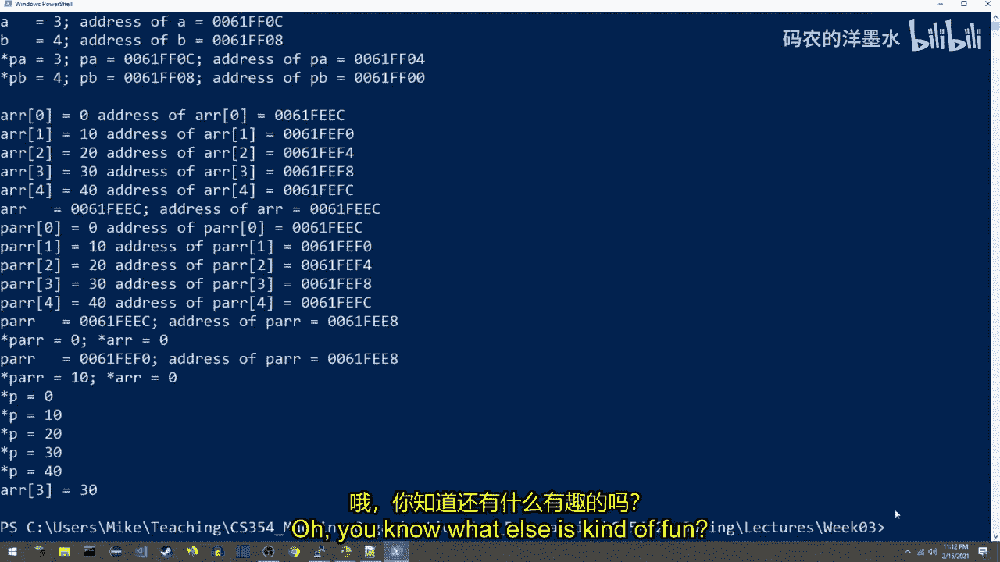

But。What the compiler is doing is its's doing addition。 It's grabbing an array element。Right here。

hoops that way and an address right there and adding something to it。 This is just addition。

 And if you are doing addition， you can also write。嗯。This is actually equal to I plus。A2。Right。

 I can put the addition in any order I want。 That's the commutative property of addition。

 And what that means is that I can also rewrite this。One more way here。

 Instead of printing it out with this notation， I can also do3。With the array in the brackets。

So it's this。With the three and the array switch。 So the three is outside the brackets。

 this will work just fine。 Also， as a programmer， though， nobody expects to see it like this。

 It's confusing。 It's hard to read。 No one recognizes it， but just。

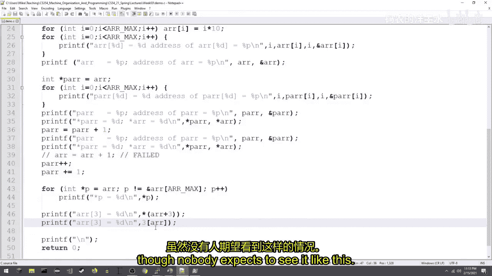

This is the one course where someone might demo this。 So there it is。 It works。

 There's no compiler error。

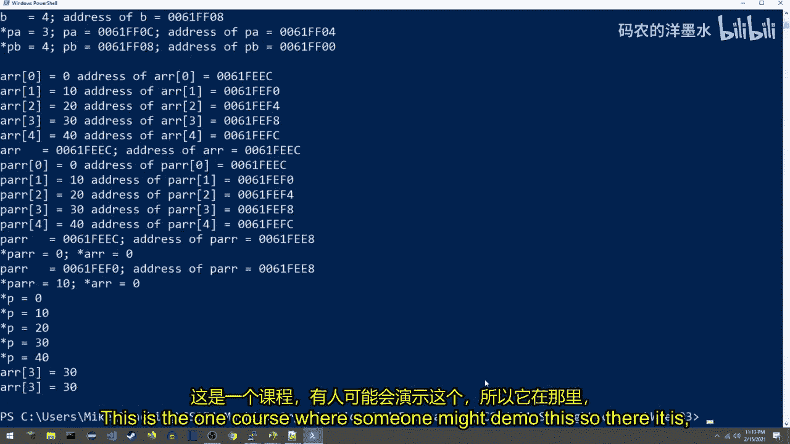

This， believe it or not， is not against the rules of C。 Allright。

 please don't ever a write code that does that。 You'll just confuse me。

 This is the only day of the year that I ever even remember that this works。

 And I'm lucky that I did。 All right， Now I'm going to go set to my next example。 I'll be right back。

All right， so the next thing I want to talk about is actually passing arrays to functions。All right。

 so starting a new section right here， let me just。Grab some new lines， put some of those in。

 break this up a little bit。 And what I'm going to do is I'm going to be using a function that just prints out an array。

 So here's the code that prints out the array and the addresses of the array。

 Let make sure I got the right one。Can make that look a little better。

 so we go two blank lines from zero to the max of the array。

 we're going to print out the array and its address。Perfect， that looks great to me。 Alright。

 and then we're gonna call a function that prints the array。

 So we're gonna to get the array printed twice。 It's called the function print。A array。

 and this is going to take an array array。Let's give it that one。

And need a semi that should all be good。 Oh， I need to go write that function。

 So it's a void function that doesn't return anything， and it requires an array。

So let me go ahead and。Up at the very top， the compiler is going to need that to be defined before it ever gets to that line。

 And what it really needs is the return type。 So that down here。

 it knows that if I have this assigned to a variable that it should give。

 it should give me an error because it's a void function。

 It also needs to know that it should expect an array right here。 So this is an interteger array。

 let's call it I'm going to go with array to be like super original。

I'm going to go ahead and put a size in right here。

 but we'll find in just a moment is that size is completely optional， I do not need that。

 and I'm also not going to be changing it inside the arrays。

So make a cons just so that I can't change it。That looks pretty good。 I feel like， alright。

 So that's my， my function prototype。 You know， I'm just going to go ahead and write the function right here。

 We can put the definition here in the first lecture。

 I demonstrated writing the function prototype at the top of the file and then putting the function definition at the bottom。

😊，Just be consistent would be my advice is when you're writing code。

 Almost certainly you will have a boss somewhere that wants it done one way or the other。

 I'm going to do it right here so that if when I change the function prototype， I。

Don't have to change it in two places。And then I'm going to actually go back and move this so the functions below and the prototype is at the top and show you what happens when they don't match。

Just to like'cause it's interesting there， the error messages are worth taking a look at。 Okay。

 so I just want a function It's gonna print out the array。

 I named it the exact same thing so I could just copy and paste that line。 Got a little extra there。

Nope， we need one more closing bracket， there we go。Alright。

 so print array is going to accept an array as a parameter and it's going to go through that array and just print it out。

 still using array max。That looks good。Letm me go to Powershell。

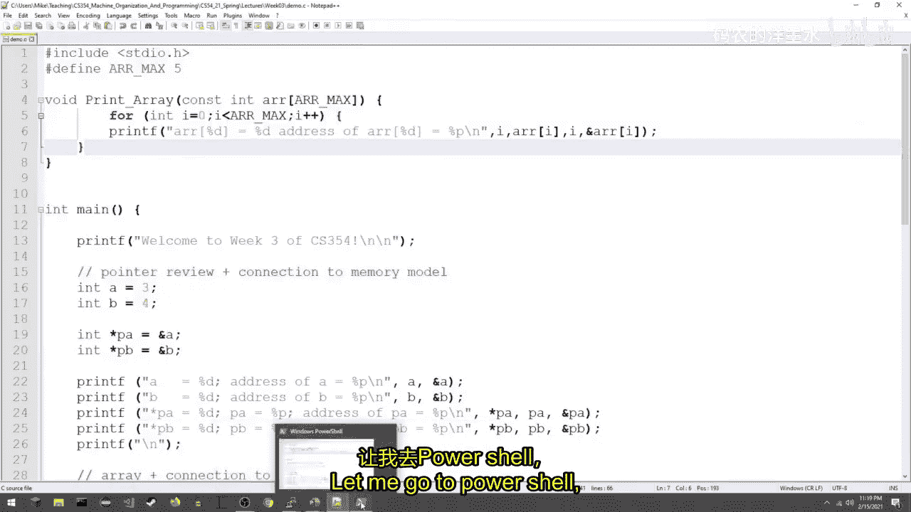

Compile that tyypo is no， no typo is sweet。And run this。 Okay。

 so we've got those two blank lines now I'm printing out the array and printing out the array again with my print function。

 Let me go ahead and just talk about this for a second。 So check this out。

 If we look at the very first line， we see that it's at address F E E 8。Okay。

 that's in the main stack part of the stack。 When we go to array0 element0 in the function call。

 this is at E E8 also。E see， all right， so what we've done here is。

Essentially past an array by value。 everything in C is passed by value。

And what we're actually passing is a pointer。 So the value that got passed is an address。

 So we see is that when we print out the array， we're getting all of the same memory addresses。

 That's because an address was passed。 So things like arrays look like they， their past。

 they look like called by reference。It's it's deceptive。 and that's why I wanted to do this example。

 I'm going to do the same example again with astruct at the end of the like part 3 of this lecture。

 it'll probably be the third video， and we'll see that that actually gets copied and each end of the individual individual data pieces is made a copy of。

 So in here by'm passing an array， it's the address that's getting past。

And so it's essentially a call by reference type of experience。

 even though the value everything is called by value。 But the value that got passed was an address。

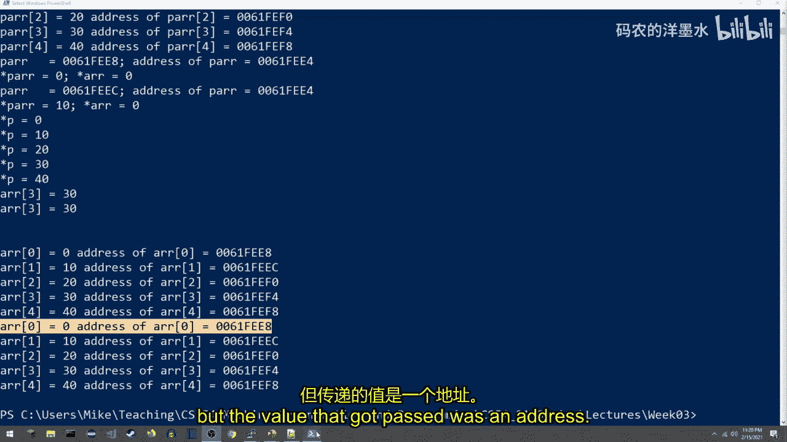

Alright， let me go back to the code here。 And just a couple of other little details。

 This size is optional。 It doesn't care how many things。 It just needs to know that it's an array。

 And inside this function。We， as the programmer， are responsible for knowing how big this is。

 So a lot of times you'll see functions to take。The size of an array as another parameter。

 That's very common。 I'm going to leave that out right here because I don't want to break everything。

But I am going to go ahead and run this code again and demonstrate that。I'm also going to add a。

A little note here indicating that I'm calling print array。

And we'll run this again。The tyypo is good。 yep， there it is。 There's print array now。

 And we can see that it worked just fine， even though I took out the size of the array。

Oops， that's the wrong。 Not what I wanted。 It doesn't need it。

 It just needs to know its's an array of integers。 And the only reason it needs that int is for the size。

 So it knows when I'm incrementing。When it's doing this， this address computation。

 it needs to know that through an integer so that I gets multiplied by the right size of。All right。

One other thing that we can also do is。Instead of using the bracket notation here。

 we can also call this as a pointer because arrays and pointers are equivalent。

 So let me go ahead and run this code。 I'm going to add one other little detail right here。Yeah。

 right here。 I'm going to print out。See， I I already have this line。I printed out the array address。

 right。Where was it。Yeah， this one right here。 I want to do this again。

 Make sure I'm not actually telling lies。So this should print out the address of the array and the address of the array。

um。I'm gonna like， I'm going to copy this one one more place。 So this is right after。Yeah。

 right there， so right before I call print array， I'm printing out the one in main。

And I'm printing out the one in my function。

So compile that。Run again。

Oh， I didn't mean to do that every single time in the loop。 Hol on。

And you've got this bracket in the wrong place。Bracket。

There we go， that looks good。Okay。I got this now。There we go。 Okay， so check out。

 I'm still getting all the same addresses。 E E 8， E E 8。 That's where all the data is located。

 It's called by reference or by value co by value。 We've copied the address。Now check this out。

Aray is E E 8 in Maine。 That's the same here， E E 8。And it's also Ee8 here。

That's the value stored in this pointer。So I'm declaring a pointer。

 that's a local variable or a parameter。 I'm sorry。 I let use the right language a parameter。

 but this parameter。Is actually located at E C 0。 So this is going to be in the stack frame for theel。

Its that for the。A print array function。 So this is a different address than right here。

 So let me go ahead and in PowerPoint。Yep， I've got。

Let's see。 where did I had a picture up at the very beginning where I had my main function。

 Let me go ahead and。Real quick。I don't need all this stuff。The one I care about is parameters。

Call that we'll turn that out parameter in locals， got main， this was not main， this was print。Aray。

 and by Para and locals， the 1 I'm particularly interested in is A R R。

 And we've also got the return address information。 So I'll shrink that down。

 stick it up bit here above main。Kind of running out of space。 But so mainine has。There we go。

 A local variable in array， A R R。 When we passed that to the function。

 it created a pointer to that array and copied the value。 The value that got copied was the address。

 So this is a pointer to the array in main。

And that's why。Right。Here， these addresses don't match。 So this is the array in main E 8。

 This is the where the pointer is located。 The E C 0， somewhere in the stack frame。

嗯。The stack frame for that function。

There we go。 And it contains the address of the array。 This is what got copied。

And that's why all these values are exactly the same。 That's a tricky way to do call by reference。

Okay， the next thing I want to do is introduce a character arrays。Also known as strings。There we go。

 okay， so first we're just going to make a quick character array。Let's put in 10 letters。

Let's see here and I need to be a little careful because strings are terminated by a null terminating character。

So I'm going to make my string right there in just a second。

 And what's going to go in this string is actually the character a。BCD。第。啊。注。H。哎。J， all right。

 that's too many， isn't it？I don't only save room for it。So this will be one，2，3，4，5，6，7，8，9。

 and then the very last character is going to be the null terminating character。

Which is kind of just a flag built in to C saying this is the end of a string of characters。

 And there are just tons of built in string functions There are techniques to work with strings that rely on the fact that all strings are going to end with a 0。

 not to ASI value 0， the actual number 0。 Remember。

 I told you you could use characters to do math with limited like numbers of bits。

 If you like had a memory starved system。So at the end of this string。

 there's going to be one more character than an non terminating character。嗯。Sees to be a comment。

 There we go。So that's what this is going to look like。 Let's go ahead and we'll just print this out。

 So let's see。 we'll do it two ways。Print F。 Let's see。 I got a bunch of other stuff in the way。

 So we'll put some new lines in first。 Then we'll do string equals。

Percent S is the code for printf to understand that what it's getting is a an array of characters。

Yep， you mind close that up。And give it my string。And then the other thing I'm going to go ahead and do this in a loop。

Let' see for in in this case， let's go with。 I want the index notation so I can go past the end of my string。

 and then I'll show you the， the version of the pointer。 So let's see here int I equals 0。

 I less than。Let's go with 15， we'll grab some extras。

So we go past the end of the string that will show us that we do get a zero。I want to do I plus plus。

 and then I want to print out a bunch of things here。 Let's go with print F。

First thing we'll print is I，7 be% D。In my quote。And then we'll print out the character。Percent C。

And then， we'll print out。The address。Let's see here。 that's gonna be。Percent P。

Maybe let's do STR of。P D。Instead of just that。There we go， and that'll give us。i。

Its the R I and the address address。

Yeah， it looks like very good。First attempt at this and see what typos I made。

God that I got this right or small， if you like。

All right，What I do， Ron？Iant to take a look at the very first error message。

 STR is undeclared first use。

Oh， I put those them backwards。Yeah， it's getting late okay。Now my fingers are on the keys。

 so it's a character array。

Charac comes first。 All right， now what mistakes did I make。Next up。

 we have missingterinating character。I forgot the quote。

There it is。Right。

There。There we go， no more errors。So any need do slash， that slash。

De say perfect， okay。I forgot the new line。 This is no good， no good。

Right there。

W run， there we go。 looking good。 Okay， so here's my string， ABC， D， E FG， I。At string position 0。

 we have an a。 and that's going to be at this address。00，6，1 F E D 6。 All right， Now。

 characters in C are only one byte。 So we would expect that the very next character to be at 7。

 and then 8 and then 9， one apart were no longer counting by fours。 A， B， D， E， F。

 Maybe we should have started with this。But here's the deal AB，C， D， E， F， G， H， I。

 And then this is a non printing character that backslash 0 that terminates all strings。

So it doesn't print it。 We just get nothing。 And then there's some other symbols。

 This is just random garbage in memory beyond the end of my array。

Let me go back and do one more real quick thing， and not only do I want to print out the value of the character as a character。

But let's also print it out as a decimal value。And I can show you that it's actually really equal to 0。

And to do this this will just So in memory， every character is represented by an ASIciI code。

 like A is 97。 The lowercase A is 97， and lowercase B is 98。 I could be wrong。

 We'll see what they really come out a second because I'm printing them。

 and print out is just taking whatever data A goes and reads from that memory。 It's a bunch of bits。

 ones and zeros。 And it's saying， okay， treat it as a character when you do this。

 And that's why it's printing out A B and C， it's translating into the ASciI。

 If it's a percent D It says， okay， treat it as a decimal print it out as a decimal。

 So you should get 97，98。

啊。Let's actually see that。There we go， so 97，98。I think that's what I said it was。 And again。

 at position 10 or index 9， we have a non printing character equal to the value 0。

 So what this means we can do is that we can write loops that will take advantage of the fact that a de referenced pointer to this character will actually give us the value 0。

 which is going to be considered false in a loop。 So what's second， Let me， let me。

II'm going to pause the recording。 I'm going to go get this line， make sure I get it tweaked。

 so it actually is correct， and I'll be right back。

All right， this is just a fun one， I just want to walk through this example using pointers to array in a loop to do string copy。

So here I've got my original string with the A through I letters and the alphabet。

 And then the backwards Z Y X。 I've got a second string。

 and I'm going to copy one string into the other。 So I've got this one initialized from Z to R going backwards。

I'm just going to print them both out their starting values that I copied and pasted this line after string copy。

 that's the ending version。And in the middle here， I'm creating a pointer to the first string， SR。

 a pointer to my second string， Z， Y X。And then this is where the magic happens right here。

 There is so much going on in this one line。 And this is the kind of power you would see from the like the the programmers from the 70s who needed everything to be as fast and as simple。

 Now， this is not simple as fast and is short as possible。

 So that this line would compile as quickly as possible。 Now。

 what's going on here depends on like a dozen assumptions。

 The first one is that P And Q are both pointers to strings。

 that the string being copied Q is actually terminated by a 0。 at decimal value 0。

 That null terminal backslash0 character。😊，So what's going through。 first thing it happens。

 These plus pluses and increments happen after the rest of the the loop。

 So ignore those for a second。 Star P is going to be dereencing the pointer to that first string。

 which is going to be the character A。 The very first thing。 That's what's right there。

 Star Q de references the second string。 That's a Z。 And we're doing assignment。

 So it's going to take the Z and replace the A with a Z。Okay， that's what star P equals star Q does。

Alright， then we're going to increment。 So both of these pointers， first ones pointing to a。

 which got changed to Z。 it's going to increment and now point to B。Okay。

 the Q is going to increment and go from the Z now points at the y。Al right。 Now。

 because this is an assignment， the assignment has a return value of whatever was assigned。

 In that case， it was the character Z。 So whatever the ASI value for Z is。

 it's something like 123 or something like that is not 0。

 So this is going to be a true statement when I use assignment inside of the condition for a while loop。

And then the semi colon here just means that there is no function， no statement here。

 just a null statement like pass in Python that does nothing。 And so the while loop continues。

 All of the magic happens inside of this while loop。Now， when we get to the very end of the string。

 remember， there's a null terminal character， something like that at the very end of the string。

Now right theyre actually drewru it， it's right here， this one。This is going to evaluate to 0。

 So as soon as it copies that0 has a decimal value into p to terminate the P string STR。

 So actually it's this0， the one at the end of the Z y x because I've got Q that way。Yeah。

 as soon as that happens， this is going to return that0， which evaluates defaults。

 and that terminates this string copy loop。 So let me go ahead and run this。

 We'll print this out and we see that it actually does copy。

Let me compile this。Oh， it gives me a warning。 Let me， Let me talk about this for a second， too。

 This is just good programming practice。 What I did was totally legal。 There's nothing wrong with it。

 But because I'm using assignment inside of a conditional。

 the the condition of a while loop or a condition of like an if statement。

 they recommend using double parentheses。 just to give other programmers and myself later on a clue。

That I'm using assignment inside of a conditional。 So just like that。

 that's the like signal to other programmers that were doing something a little more complicated than it just looks like。

 I didn't just forget the double equal。 I intended this。

All right， let me go back compile this again， warningning's gone now。We'll run this。

 We see the two original strings A through I， and then backwards Z through R。

 And after the string copy statement， we now have both of the strings equal to the Z through R version of the alphabet。

Alrighty。

Yeah， just important safety tip。 I think I'm not gonna to do any more examples。

 I feel like this is a really long video already， but strings must be terminated。

 there's got to be room for that terminal character。

 And if you overwrite it or leave it off or something，' you'll see very strange behavior。

 something like string copy without that terminating character could copy millions of characters when all you wanted to do was you know the 10 from your array。

 if you if you don't save space for it。 or if you accidentally overwrite the terminal character。

 just important safety tips， I'm not going to do any examples of that this is turning into a long video。

 I'd like to encourage you guys， though， to experiment with that。

 And if you end up with an infinite loop。😊。

That you need to kill。 remember that holding down control and mashing sea a bunch of times。

Will kill a loop or a very long piece of code if you do accidentally overwrite your back slash 0。

 and it's copying forever。It doesn't stand for copy。 It stands for Kale。

 so might be useful if you're experimenting。 Allright。

 that's going to wrap up this first part of the video。

 first first video for week three Next up is two dimensional arrays。 I'll be right back with that。

In a few minutes。