# 【全集】威斯康星大学 C语言编程与计算机底层原理 中英字幕 1080P p04 Lecture 4 - 多维数组 -BV1BViQBwEiS_p4-

Alright， hello everyone。 welcomelcome back to machine organization and programming at the University of Wisconsin Madison。

 That's computer Science 354。 I'm Mike。 Today， we're going to be continuing with part 2 of week 3。

 where we dive into two dimensional arrays。 So last time we took a look at one dimensional arrays and their connection with pointers。

 We're going to be continuing that connection with pointers looking at two dimensional arrays。

 And then in the third part of this week， we'll have just a brief。😊。

One more video about structures and again， how they are connected with pointers。 All right。

 let me go ahead and talk about two dimensional arrays just briefly and then we'll dive into some more like write some code experiment with it。

 See how Cs putting it in， you know， storing the data in memory and the tools we have available within C to learn about C itself。

 Okay， so here's the idea。 I'm going to be creating。Well， that's kind of cool。

 I get that neat shadow effect。 That's clearly a glitch。 I'll get that fixed。

 I've got two copies of my table there。 I'm creating a matrix。 That's the idea。

 I'm looking at two dimensional data。 This could be something like a matrix that we're using for mathematical operations。

 or it could be something like just a list of words where I have an array of strings and the strings or arrays of characters。

 So something like that。 Both of those will see frequent applications as two dimensional arrays in C。

😊，So an array of strings is an array of。Arays of characters or matrices。 So anyway。

 I'm going to go write some code that builds this particular matrix right here where I've got。

 you know， in the three rows，5 columns where cell 1，1 is actually 1，1。 again， dear all 0 index。

 So I'm not a little bit of math。 So this is actually right here row 0 column 0。

 but I'm going to put these numbers in。 the only reason I'm doing that instead of row 0 is because I get the 1。

1 instead of a 0，0。 It won't print 0，0。 just routes down to 0， It doesn't print the leading 0。

 And I'm neurotic and I want it to look really good。 so。😊，That's what I'm doing All right， let me go。

Switch to right here。 So I've got a template set up。 This is my welcome to see week 3 file。

 I'm going to be using Power shellll again because the lag was truly horrible and it continues to be。

 But my kids upstairs playing games。 So it's probably on my end。

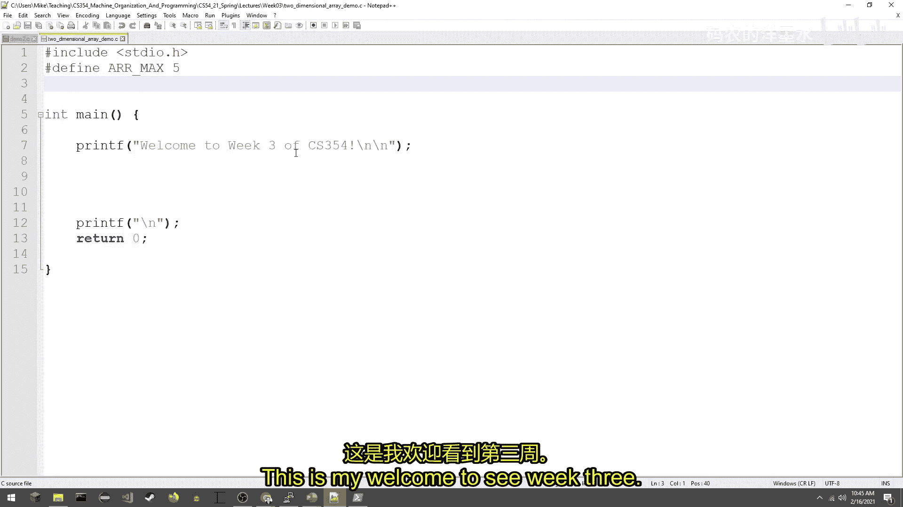

Yeah， so okay， we're we're gonna be working with the two dimensional array demo file。

 I renamed the one from last time to array pointer equivalentvalence demo so that it's a little more clear what's going on in that code when I upload it。

And here's the idea。 I'm still going to be compiling with GCC。

 This is the Windows Min GW version of Gcc。 So it's got some differences from what we'll see from the Linux machine。

 and I'll point those out where appropriate。And I'm using the M32 option。

 so it's compiled with 32 bit addresses， so they're a little shorter， a little easier to look at。

And all of the warnings。 so let me go ahead and make sure this works。Run this。ep there it is。

 Welcom to week 3。 Alright， so I'm gonna go hop back over here and real quick， just print out。

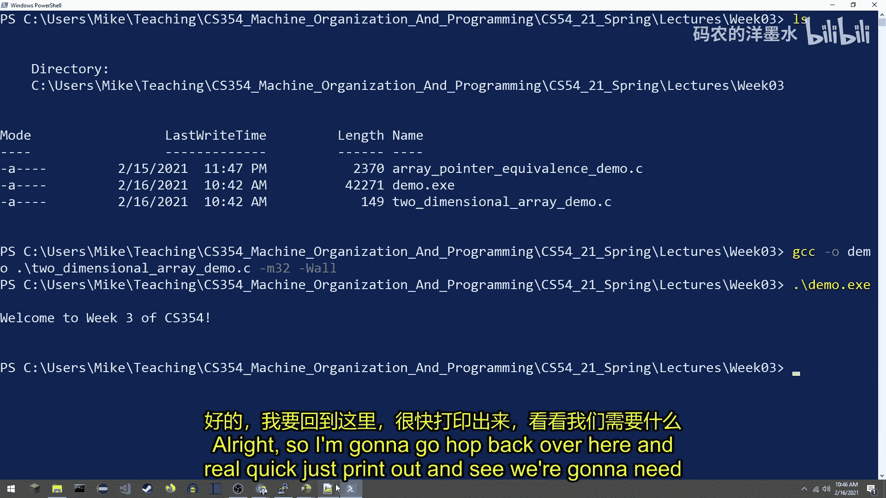

Let's see， we're gonna need that。 Okay， I called it am in the video。 So， and it's going be。

Let me go ahead and just type this up， and then I'll rewrite back。

 Don't need to waste your time watching me type。All right。 I'm back。 I've got some code that works。

 Firsts of all， I'm declaring my array right here in line 10。

 I'm going to call the array M because I'm M for matrix。

 It's going to have three rows and five columns。 So to declare a two dimensional arrayancy。

 all I need to do is follow the name of my array。Well。

 the type name of the array with however many bracket pairs I need for each dimension。 in this case。

 I'm declaring a two dimensional array。 and this tells the compiler it needs to reserve space for 15 integers。

It's going to do that in just a linear sequence of memory。

 It's going to grab that memory and then do a bunch of complicated math to figure out which。

Element goes with which pair of indices。All right， to initialize the array。

 we could just use this same row column notation with due brackets， so I've got two loops here。

 I goes from zero to 3， j goes from zero to five。You know what， I hard coded these values。

 and I've found myself repeatedly typing。The dimensions。

 Let me go ahead and use some defines instead。 So let's go with。Max row。

And we'll make that three rows。We're good to find。Column five columns。

 and I'm just going to go ahead and use these variables。In place of my threes right there。

 So this first loop just initializes the matrix。 The second loop just prints out。

 so we can see that it's working。 All right， I've got a  five right there，5 right there。

5 right there。 Okay， there we go。 So it's gonna to loop through a double loop to get all of the cells。

Now， here's the formula that I'm using to put the 111213。 Basically， it's taking whatever row。

 So it's going to start out at 0。 Add one to it， multiply it by 10。 That'll give me the first digit。

 So I'll have 101112 to get that offset。To go from 10 to 11。

 we just need to take the which column is it J and add one to it。 So I as rows， J is columns。

And then Sambi for printing this out， I'm just using a double loop where I goes from0 to maximum rows。

 J goes from0 to max columns。 We print out each of the values using the array bracket notation。

 And then after。The first row is complete with those lines。 We'll put a new line in。

 and I'll go back and do the second row as the outer loop repeats。 Allright， let me save this。

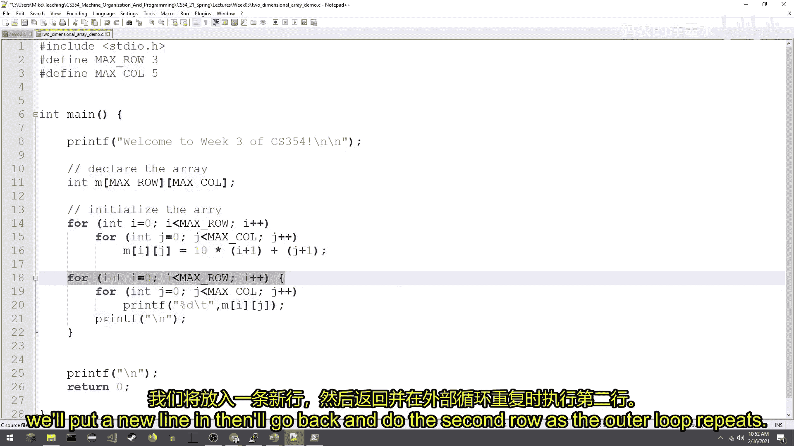

I'm going jump back over here。 I got it working before I put in those constants。

 Let's just make sure that it still works。With the constants theiggo。

And this is what the matrix looks like when I' printed it out。

 I've got tabs between all of the numbers。Alright， so next thing I want to do。

 I'm gonna go back and write a little more code that tells us where each of these things are stored in memory。

 and then we'll go to a memory picture， the memory model and put all of them in。

 So no reason for you guys to watch me type that code。 I'm going type it。

 You can pause the video and then type it in yourself and follow along and try your own experiments。

 but I'm not gonna waste your time with like watching me type。 I'll be right back。😊。

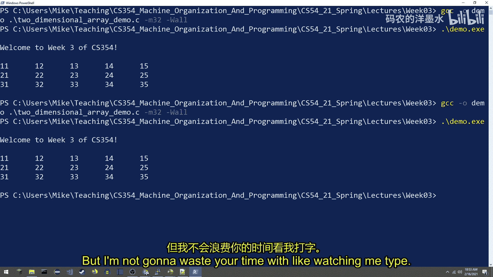

Alright， I've added just a little bit of code here， the where are all the numbers stored section。

 And I've， again， just， let me walk you through this。 I've got a double loop。

 so it accesses all of the elements in my two dimensional array。

I'm using a printup statement that's going to print out the array index。 So M of like 11。

 that's going equal to。 and then it's just gonna grab the value。

 So I've got I and j going into M1 of2 or whatever place it is in the matrix。

 I'm printing out the value stored there So we can keep track of you know，111213。

 you know where they are。 makes this a lot more sense because I've got my picture with the cells labeled。

 And then right here， I'm also printing out the address and memory where these are stored because it's a memory address。

 I'm using the percent P format string specifier。 And this is just the address of that piece of data。

 So one integer。 All right， I already ran this。 I got it working on the second try。

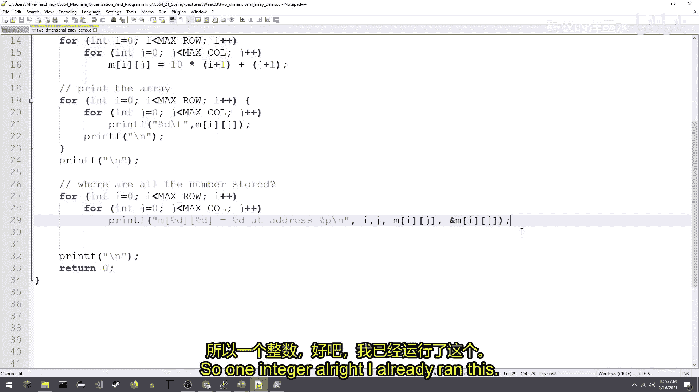

嗯。So here's what we're looking at here the matrix is being printed out。

 and then I'm printing out all the cells。 So M00， that's the cell right here that contains the 11 found at address 61 F ECC。

The one，2 just it straight across the row and then second row and then third row 11 through 15。

21 through 25，31 through 35。 I can see these addresses。 So if we just count in hex。 So we have C。

 you add four to that。 we get D0。 and then4 bytes after that is 4，80，4，8 c，0，48。 So D4 D8 D。

 then that increments the second digit here。 So E0 E4 E8 E。

 and then this turns into F F4 So they're right in order。

 they've given us a linear sequential block of memory and just basically unwrapped this matrix into a one dimensional array and stored them all in order。

 let me go draw a picture of this。 So we have to like the visual。

 and then I'm going to start doing some experiments on it。

 once cycle I go prepare that and actually get these addresses copied in just just right。

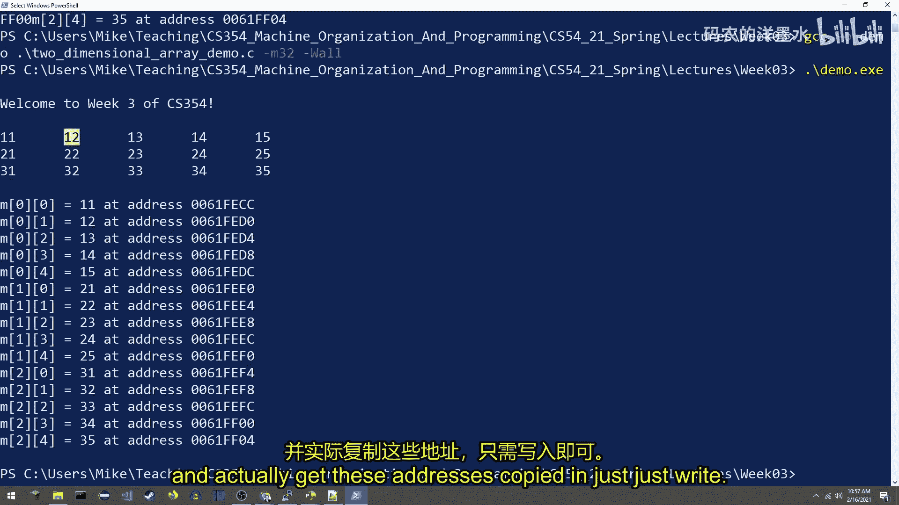

Alright， guys， I got this slide prepared。 Here's what we're at。

 This is a screenshot of the data that I just collected from my matrix experiment。

 printing out all of the addresses where things are。

 You see that the matrix starts up here at addressh， blah， by Ecc。

 So I've got my memory model where I'm starting at E C 0 E C is down here。

 that's where I'm stor the 11。 and that's matrix element is 0，0。 All right， great。

 I went ahead and I put in all of these。 I mapped them all。

 And we can see now maybe a little more clearly that all of this data just gets mapped directly in memory in order。

 It takes the first row。 Then the second row， than the third row。

 So I've got all these addresses lined up。 and put this in a picture。😊，Allright。

 next thing I want to do is go through how C is actually computing the address of all of these places in memory。

If you remember back to the previous lecture， I had a one dimensional array， If I wanted element 3。

 then the way C approached finding that value on the inside was to actually use pointers。

 It would take this A R R。 That's the base pointers。

 the very first address of my array for this matrix。

 The very first address is going to be Ecc right here where I've got M0，0。

And then it needed to shift over by three positions on that array。

 and to it already knew that the size that this was an array of integers。

 And so it needed to multiply by the size or four bytes for this example。

 if we have a machine with a different number a different size of int。

 then it'll see we'll just take care of that for us。

 But I would just wanted to emphasize that integers are four bytes here。

 when we do this calculation by hand and use pointer math。

 pointer arithmetic to access array elements。 we do not need the size of C takes care of that for us。

 All right， so quick reminder， what I want to do is develop the same formula for multidimensional arrays。

 In this case， I'm only going to do two dimensionsional。 I'm not going to go beyond that。

And if you want to， it's， we'll just extend the same idea。 In fact。

 this is a great opportunity for you guys to just pause the video and see if you can write a similar formula for a two dimensional matrix。

 How do we get to element 1，2。 See， element 12 is right over here。 The answer should be E E 8。😊。

When we get to the that's that's address where it's stored， the value stored is actually 2，3。

 So row 1。Element 2。Is that the one I wanted？Row 1， element 2，1，2 is 2，3。Okay， 0，1，2。 Okay， yeah。

 yeah， I'm confused myself。 I've got the one based in labeling and the0 based indexing， so。Yeah。

 all right。Row 0， row 1， column 0， column 1， column 2，1，2 right here。 Thiss the number 23。

 That's the one。 Go ahead， pause the video， write a formula。

 and then I'll walk through my development of it。 Allright。Alright， guys， I'm back。

 Let's go ahead and take a look at the formula for getting to。That memory address。 Al right。

 we're going start with the base pointer for the matrix right here。

 we need address Ecc to get started。 That's the one that's actually stored。

 So I'm going to need the letter M right there to get that very first address。All right。

 the next thing I'm going to need。Is we need to shift down by however many things are in one of these rows。

 We need to go and get to row 2。 And the way to do that is we need to know how many columns there are。

 In this case， there are five columns。 So I'm going to be。Oops， oops， os。Hope so am I doing。

 I' click in on the wrong screen。 I've got the editing screen on the right。

 the recording screen on the left。So I need to know that there are five things in each row。

 and I need to shift down by。1 row， in this case， that one came from。Right here。

 the number of rows were shifting down。 If this been a two。

 then I would have needed to shift down by two rows。Alright， so far so good。

 That's going get me to this position right here。 address E E 0。 Now， I've only got two more to go。

 I need to get to the right column in row 2。 So to do that。Remember the other screen mic。

 I need to add the number two to this。 that two came from right here。

 That's the number of columns I'm shifting over。Alright， And once I've got that。

 this whole thing right here， that mun is what we're going to multiply by the size of an integer。

And again， remember， when we do this and are typing it into C ourselves。

 C takes care of this multiplying by the size of an integer。

 So what we type in to get to a particular address if we're using the pointer notation。

 we leave that out。Alright， and last step， because this will get me an address。

 and if I want to print this out， it's going to return the hex decimal value， blah， blah bh， E E8。

Now， chances are that's not what I really want unless I'm testing where things are。

 What I really want is the value stored there。 I want the 23。 So in order to get that value。

 I need to de referenceence。And then everything else here is the computation of the address。

 so throw some parentheses around that。Right， there we go。 Two step process to get to that value。

 I needed to shift down by a certain number of rows。 That's the five times 1。

 Then I needed to shift over by however many columns there are。 If got look a little better。

 All right， Now， I'm going to write this in more general terms real quick。

 If I want M row I column J。I'm gonna have something very similar here。

 Let me see if I can get that lined up looking good。

 So I'm going have the base address for the matrix。I need to add to that。 the number of columns。

And I named that max column  5 in this case。 in my example。 So I'm just going to leave it like that。

 So it matches my example Time how many rows I'm shifting down。 Okay， so I've got I rows。

 and there are five things per row。 So that's going to be every time I shift down to another row。

 It's going to jump over everything in a row。To it again。 click the wrong screen。 Allright。

 and then I need to add how many elements I'm shifting over in that particular row。

 So that's going to be the J part right there。And then close up the parentheses around。

this part right here， I'm going to throw in the size of。And then last step will be to dereence this。

To get the value stored there。Alright， I want to highlight one thing right now here。 In fact。

 let me go take a look at this code in this formula。There's a piece that's actually missing。

 that something I don't need。 Let me pull up the code that I was looking at a moment ago。 So in this。

Piece of code right here， everything we're doing。I've defined maximum rows， Max column。 So that's 1。

2。 I've got a matrix。 This gives me the base address。

 That's three things to get to a particular element。 I've got I and J。 So that's 4 and 5。

 Ive about five pieces of data that are important to getting to to defining an array in using it。

 a matrix。 a two dimensional array。But for the commut of a particular address。

Let's see where is PowerPoint pull this back up。I didn't need to know the maximum number of rows。

And again， C never actually checks array bounds。I can have a one dimensional array and access things that are well out of the bounds。

 Ne indices。 Way huge positive indices。 And same thing here What we'll find is that C has no restrictions on the number of rows。

 I can access row 4， row 5， row 6， with no problem， even though they're not there。

 It's going to give me garbage data。 I might overwrite something important if I write to it。

 but C doesn't stop me from doing that。 This computation does， however。

 require the maximum number of columns。 So C at some point in the code needs to be able to go backwards。

And figure out。You know， if I'm doing some sort of right down here in this very bottom row。

 I'm accessing element I J as I print out everything。

 it needs to know how many things are in each column row。

 how many columns there are in the matrix in order to do that computation that I just developed。

To get to the right piece of data。 and in this case， right here， we've defined M。

Up here on the declaration。And it can get the back some roof columns from right there。 that value。

 Now， the problem we run into is when we pass a pointer to a function to a two dimensional array。

'll see actually loses this piece of information。 How many things are in the column。

 If we just pass a single pointer to an array。 let me go ahead and I'm going to write a function。

 I'm going to write a function。 actually， that prints out。 How about all of this stuff。

 How about just this piece。 We'll keep it small。 And then we'll pass the matrix to it。

 and I can demonstrate what goes wrong in the error messages we get。 Good stuff。Actually。

 this isn't that hard。 Let me just walk through。 It's just a bunch of copying and pasting。

 I think there's some value in just like taking a look at what I'm doing。

 So the first thing I'm going to do is I'm going to put a space。啊。

Between the old work and the new work。 And then I'm going to call a function。

 We'll call it print matrix。And I need to give it the matrix that I'll be printing。

 just M in this case。 M is a， it's a two dimensional array that's more or less the same thing as a pointer to that base address。

 So then I need to go write this function。 I can see that it's a void function。

 It's not returning any value， and it takes that matrix as a parameter。

 So I'm going to go ahead up here， read the prototype first。 It's a void function。 oops。Print。Matrix。

 there we go。 And this is an integer array called I'm going to keep it in so I can just copy and paste that text。

I need， so I'm going to do the prototype right here。 This has。Max Rose。And max columns。 And for now。

 I'm just going to put in as much detail as I can。 Some of this is optional and screw some of it up is really bad。

 So I'm just going to put it all in for right now。 And now I'm going to write my function definition down here at the bottom。

 I did it everything at the top in the previous lecture。

 So I figured I would break this out into prototype and function definition。This is the definition。

This is the。Decoration or。Prototype。I spell that right。 Yeah， that looks pretty good。 Alright。

 so I've got the and the these signatures they need to match。

 So this signature right there absolutely must match what's up here。All right， next thing。

 all I want to do is print out the matrix。 I've got code for that。Right here。Priinnt the， I call it。

 let's call it matrix。Initialize the matrix。Clar the matrix。

That just keyword for me that says it's two dimensional。Alright， then next thing， let's go ahead。

just like。This is where I'm the print matrix function。It's actually starting。

And it hasn't underscore it。

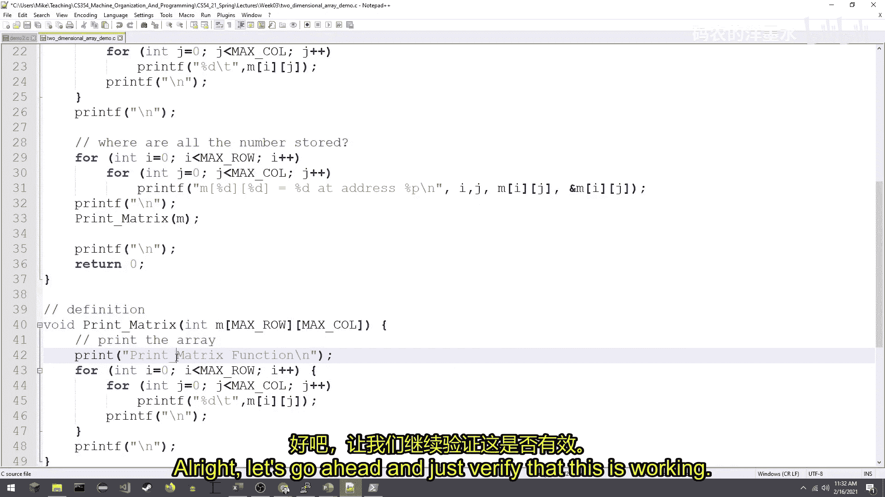

Alright， let's go ahead and just verify that this is working。 So I'm going to save this。

 jump back over to PowerShell in this case。 We'll compile it。And let's see。

 that looks like I made a mistake。And function two dimensional warning。

 implicit declaration of print that I mean print out。 Okay， so somewhere I've messed up。

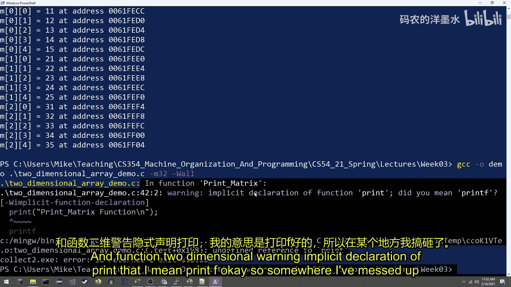

I have a print when I mean there it is right there， print F。

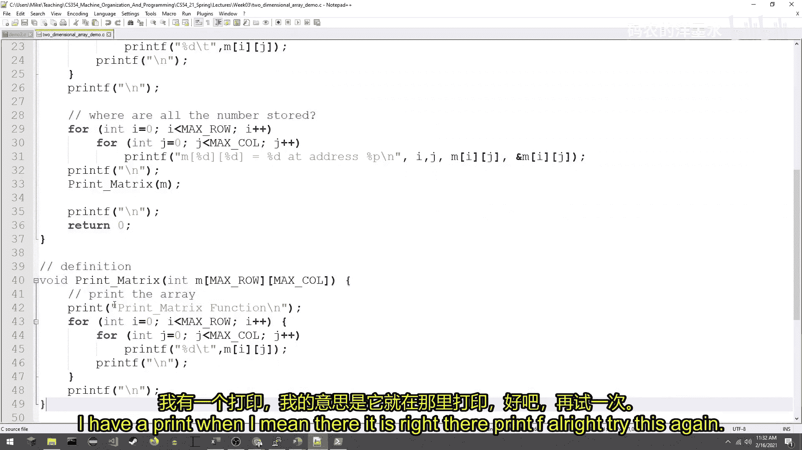

2。Try this again。There we go， no warnings， no errors。 Let's go ahead and run this。

And now I can see that in my print matrix function， it's actually printing this out just fine。

 no problems。Alright， so next up， I just want to do a little experimenting。

 So in the computation of our address， we learned that we only really needed。

 We needed I JM and the max columns。 We did not require this max row number。 I'm just gonna。

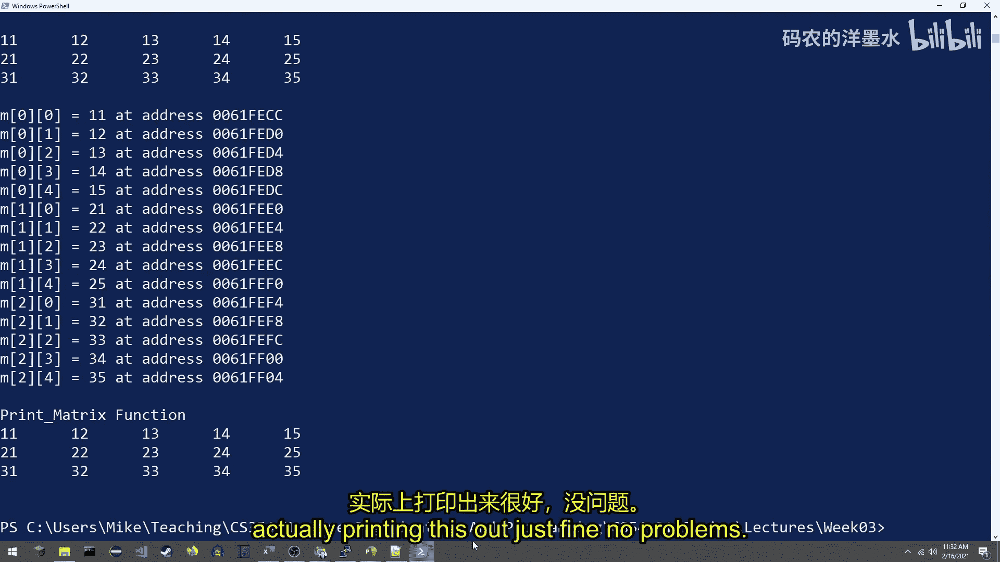

Take it out。Okay， so I'm passing a matrix where I'm not giving C all the information it needs。

And I want to highlight one more thing。 I've got M here twice。

 This is a question that came up on piazza about just the one dimensional arrays when we call functions。

So we've got actually two different Ms right here， and maybe this would be better with a different variable。

 let me change that just to highlight the difference In my main function。

 I have a variable M that's essentially a constant pointer to the very first starting address of that matrix。

I'm going to change this here。 let's call this mat inside of the function。 So let's see here， I J。

 here's the only place I'm using it。This is now going to be a pointer inside of this function。

 So in the function call， it's going to add an activation record or a stack ramping the same thing for synonyms。

This is going to be a pointer that holds the address。Of。This matrix right here， M。

 So this is actually different。 This is a local parameter to the function。 Alright。

 let me go ahead and。So I took that out there。I left it in up here。 So that's my first experiment。

 I'm going to see what happens when the prototypes don't exactly match。

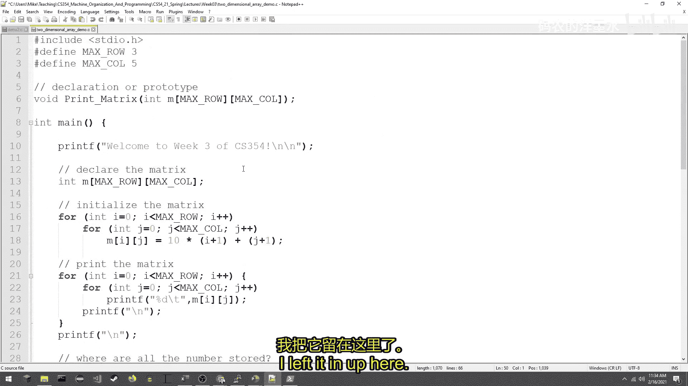

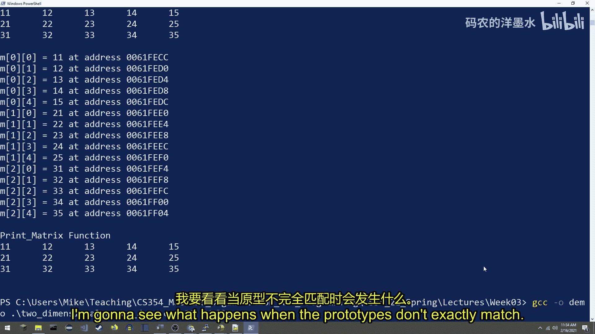

We run that。 No problem。 In fact， C completely ignores whatever is in this first parameter。

 It doesn't care how many rows there are in your matrix。 It doesn't need that。

 And it's faster if it doesn't have to keep track。 So it doesn't。

 It just completely ignores whatever is in the first bracket。 It does need the information。

 how many columns there are， how many items are in a row in order to compute like。

The values at indices。Beyond the first row。

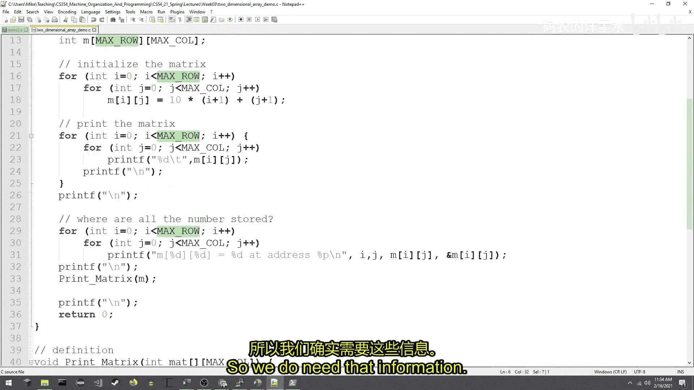

Alright， so we do need that information。 Let me go ahead and just run this。

 make sure it still looks good。 Still looks good。 Alright， next thing I wan to do。

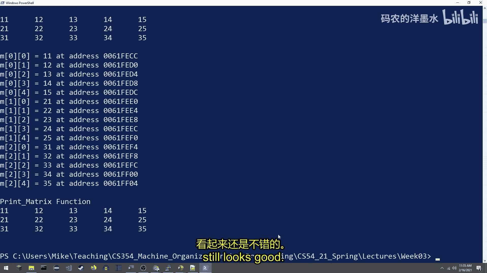

Next experiment is what if these， what if they don't match。 So right now， max columns is set to 5。

 real quick。 Let me change this to 3。Alright， Ellen， I can take this out。

 Max Rose is absolutely not required。 And let's just take a look at the。

 this is going to generate an error message。 But I think learning about this is is valuable。

 We can see a little bit about what's going on。

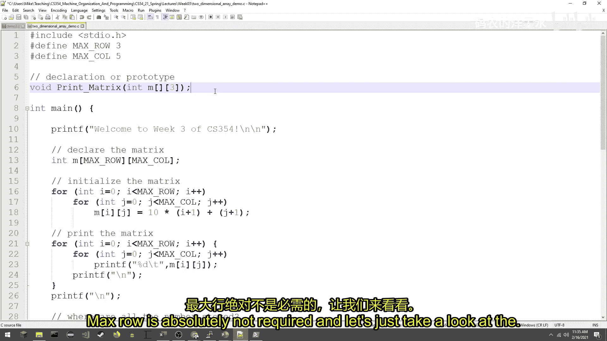

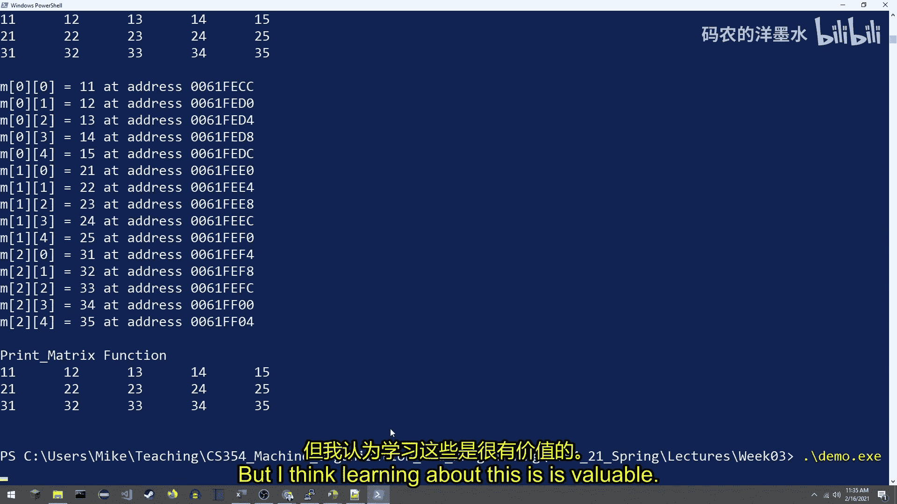

So here we go。 warning passing argument of print matrix from incompatible pointer type。

 So print matrixtri M， it knows that this is a matrix that has five values per row。

 I want to highlight too that this is a warning。 This is just， it'll let us do it。 No problem。

But the function is expecting three things in the matrix。Okay， and this is my function prototype。

 So it's going from top down。 First thing it does。

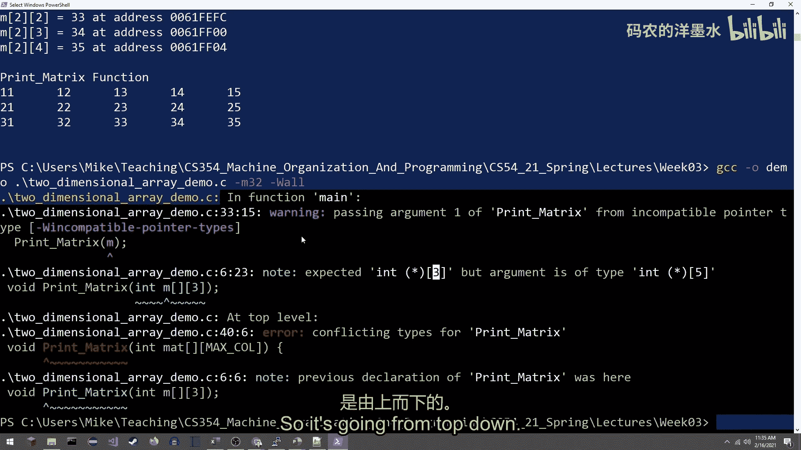

Records the prototype and knows that I should expect matrices with three elements。

We get to right here where we print it out。 and it finds that this doesn't match。 M is a matrix with。

 in this case， five elements。 So that's where that warning came from。 It's not going to stop me。

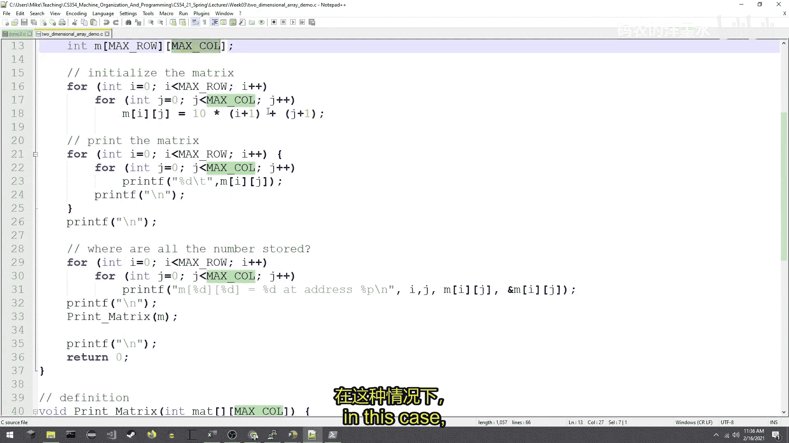

And then呢。I write the next thing in red right there。Blld red is the error message。

 conflicting types for print matrix。 So as it continued to go through the code。

 it finally reached the definition and found that this did not match the prototype。

 That's where the error is coming from。 Those of you absolutely must match the declaration and the prototype。

 So I'm going to go ahead and change。

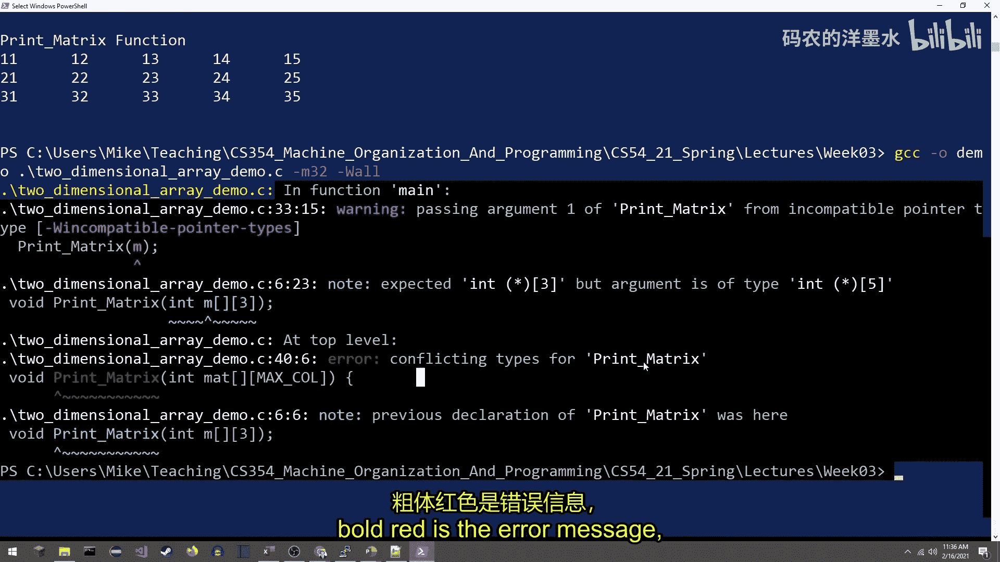

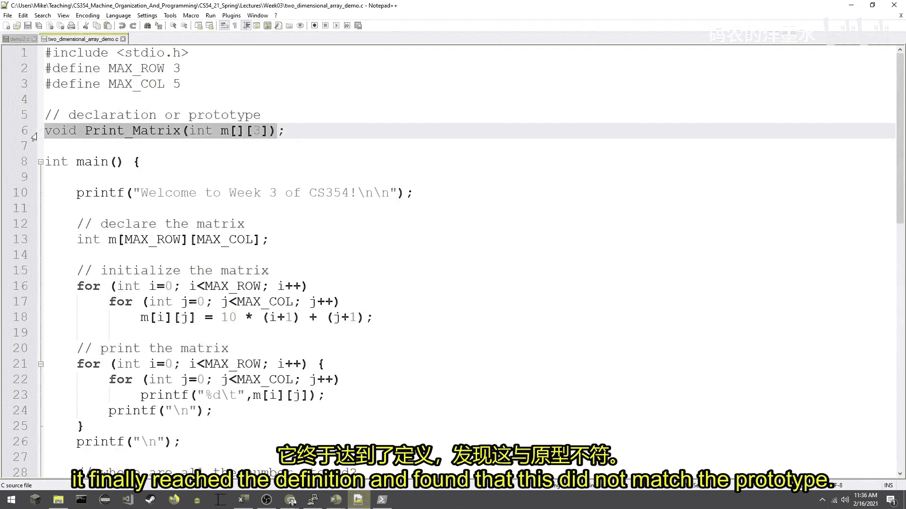

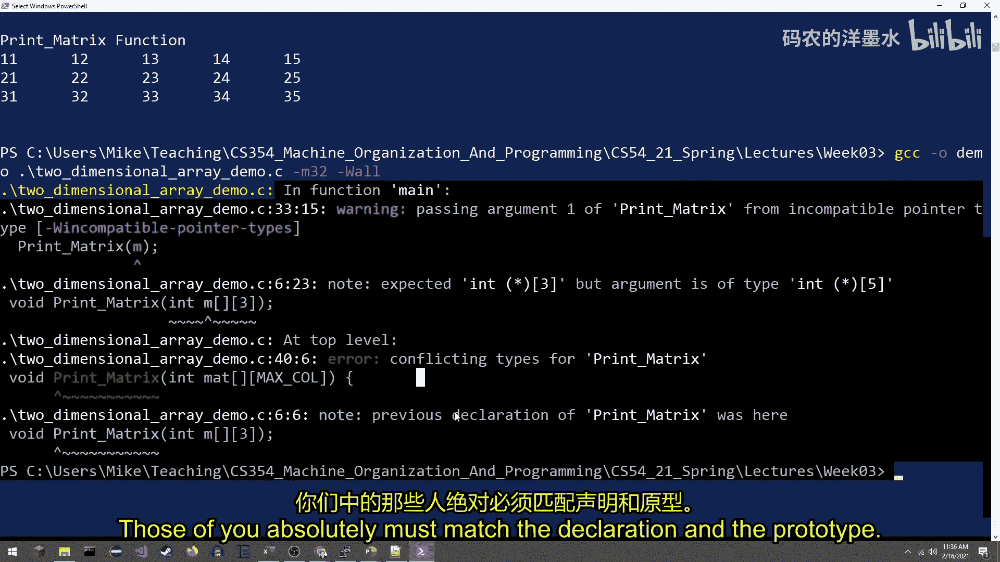

The prototype so it matches， I'm still going to be using incorrect dimensions here because this is a great experiment。

And really does a lot to highlight exactly what the machine is doing on the inside。 Alright。

 so I've changed this value。 I need to save this。

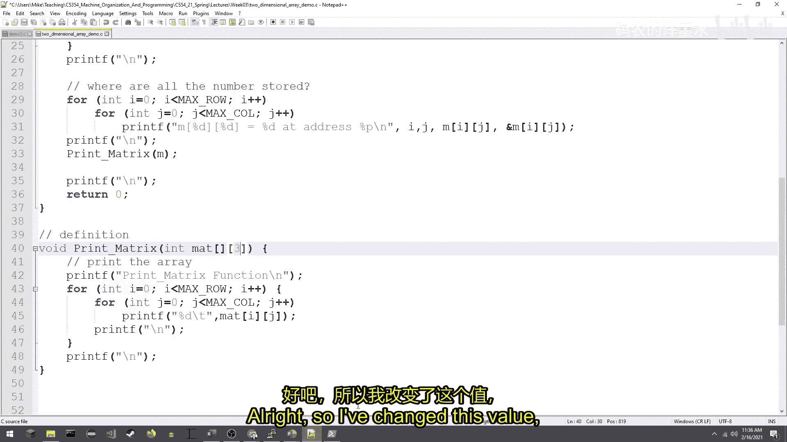

And then we'll go ahead and compile us again。 This should still give me that warning。

Let's see your yep compile。

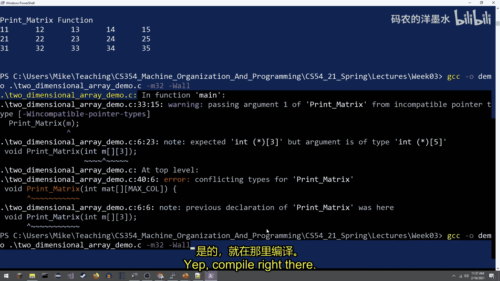

Right there， Here's the warning。 I'm going to highlight that。

 That's what I'm looking at incompatible pointer type。

 This is the one that's telling me that the function expects a matrix with dimension 3。

 but I'm giving it a matrix with dimension 5。 But it's not going to stop me from letting me do this。

 And in fact， I think if I remove all the warnings。Oh， it still gives me that warning。 This is a。

 this is a big one。 Okay， so I'm gonna put warning back on。Go my mountain， you've got in the way。

 and I mis typed there。 right。 So now we need to run this and see what it's doing again。

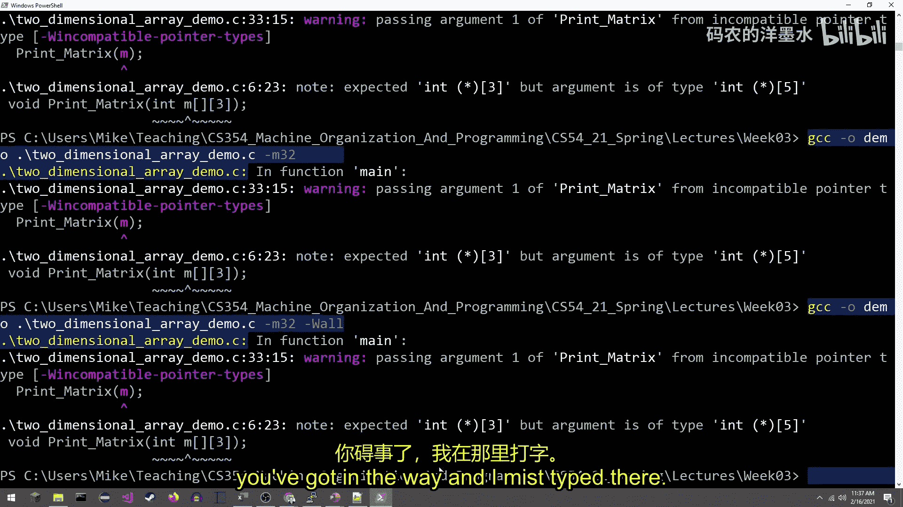

Alright， so here's the original matrix。 This is the one in main up at the top right there。

Here's where everything is located。And then in the print matrix function that I messed up。

 I changed things。 It's now printing the matrix。Al right， what I want you guys to do。

 this is a brain twisting experiment。 And when you figure it out。

 it will really solidify for you that you understand how that address computation is working。

 But pause the video。 stare at this。 here's the problem right here。 This value is 14。

 It's supposed to be 21。 This value is 15， supposed to be 22。Its value is 21。 It's supposed to be 23。

 Okay， just check this out。 The first row works fine。

 So this is one of those places where if you mess something like this up。

It might work some of the time。 First row is good。 The rest of these values from the first row and beyond。

 all the values are wrong。 They're being grabbed from the wrong place。 Alright， so pause the video。

 give this some thought。 Think about what's really happening here。

 and I'll be right back to explain this。All right， I'm back。

 I added one more line to this code so that I could use my formula here without having to switch back and forth between PowerPoint and this screen right here。

 the output screen。 So what's happening here。 row1 works just fine。

 It's computing the address starting with M。 that's gonna give me this base address right here。

 The F ECC address。And then to get like everything in row 1， the I value here is going to be 0。

0 times anything is going to be 0。 So we add J to it。

 and that'll give me the J is 0 gives me this first entry。 J 1 will give me the second entry。 J 2，3。

4。 Then we get to the 5。 that's the end of the row。 Okay， so we got a new line that prints out。

And then when it's computing the second row， we're getting a 14 here。 This is the incorrect number。

 What we've done is we've started with the base address， F ECC。

And were incrementing by I times the number of columns。 Now， I didn't put max column here。

 That would be 5。 Go that defined in there。 Instead。

 what it's using is the value that I passed to the function。 In that case， that was a three。

 So when I is one。Multiply that by3。The very first entry here will be J 0。

 So instead of shifting over by the entire first row， we've only shifted by three things。

 So we start 11。 We go 1，2，3， and we ended up at position 14 in that matrix because I have the wrong number of things in each column。

And that's where the 14 is coming from。 It's because this column that we use to tell the matrix that this is a row only got three things per row。

嗯。Is wrong。 So that's what's going on right here。 So if this address computation made sense to you guys。

 this formula， the error is right there。

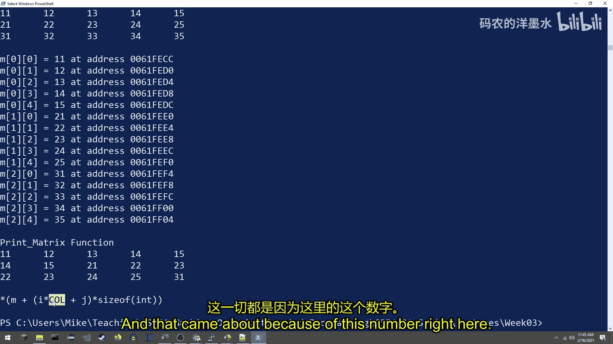

And that came about because of this number right here， the mistake that I made。

This is like a really good reason that we should always use these defines for dimensions of all matrices。

 very common in C to use something like this。 In fact。

 I'm going to go ahead and just change these back right now。嗯。If you guys have any doubts whatsoever。

 what I'd like you to do is do an experiment， change max columns to something else。

And give this a try and just see if you can compute the address and figure out what you should be getting if you make a different change。

 make a prediction and just verify that your address computation matches up with what you think you're getting。

Okay。Yeah， that's going to end this section。 I also want to do one more thing right here。

 So right now I'm declaring the matrix。I'm going to just print out a bunch of stuff。

 one in the function and one outside the function。 So right here， I'm printing。My matrix。There we go。

 that's the entire matrix being printed and where all the numbers are stored。

I also want to print out just where M is located and。Is at。Address， and then you need an address。

 percent P。And this is going to be， let's just print down。That you give me the address。

Okay looks good。And then inside my function， I'm going to go ahead and put mat inside the function is stored at this location。

Save that。

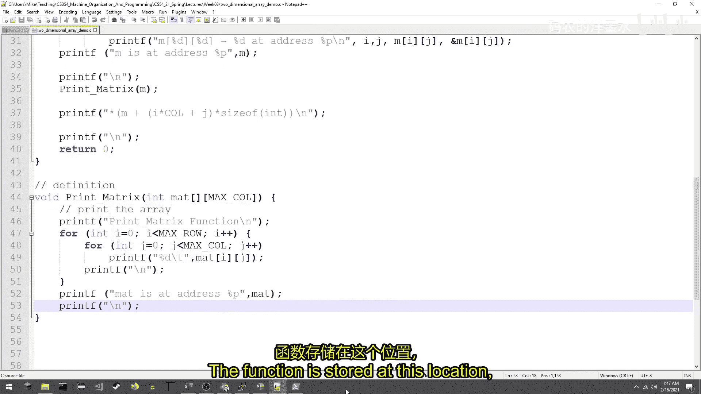

Compile。Y， I fixed all mistakes。 So we're no longer getting that message。 We run this。

 The matrix is back to normal。 Allright， and again， here's what's going on inside of main。

 I've got M。 This is my， my matrix。 It's essentially a constant pointer to the very first element of the matrix。

Excuse me， FBCC。And then when I go ahead and look inside the function。

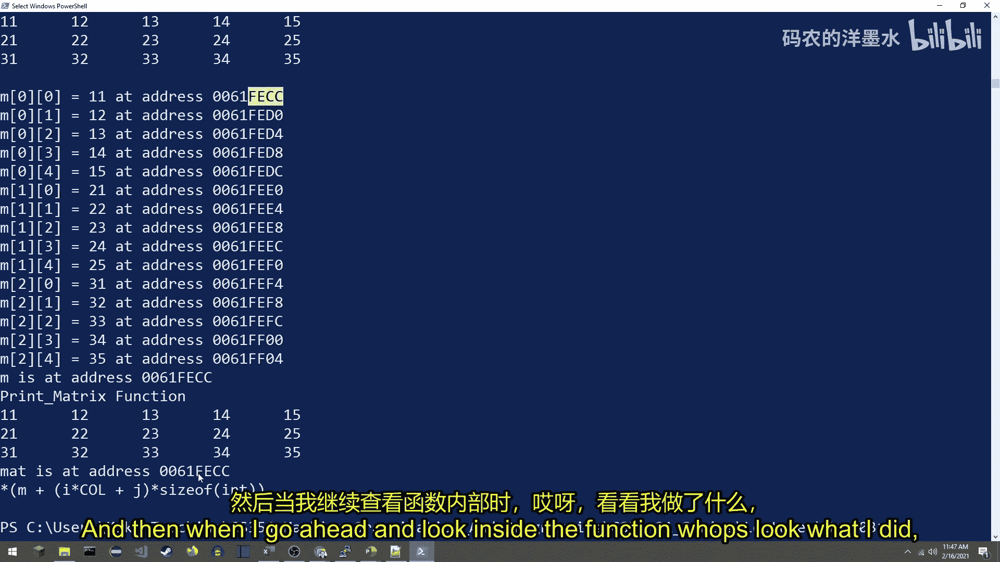

Oops， look what I did。 I printed the wrong thing。 Let' me go back to the code and show you what what my mistake is。

 So what I'm doing here。Is printing out Matt。 This is a pointer。Right here， this is the pointer。

Aray notation， but it's still a pointer。 I'll change that in a second and show you another way to declare these arrays。

 But I'm printing out the value stored in that address， not the actual address。 So Matt equals。

Percent P， and it's at address。I mean， the address of Matt， Okay， that's what I really want。

 And in fact， let me go change。This line up here where I'm doing the same thing for M。

But we'll change this down。Because mat does not exist outside of the function。

And we'll make the grammar look a little better。All right， save that。

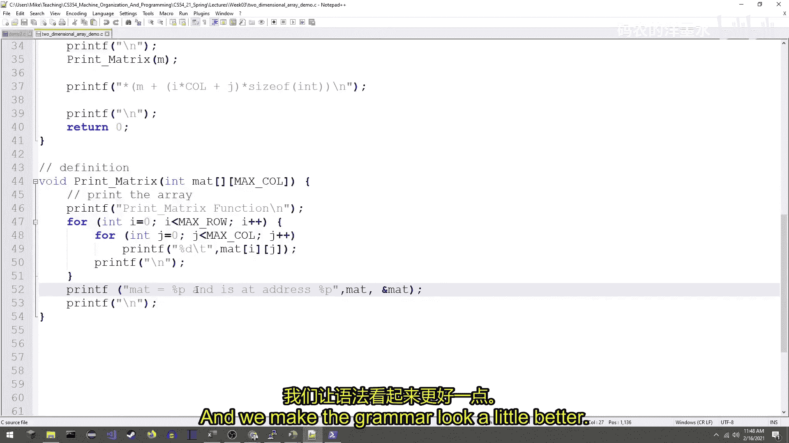

By。Run， okay， is it better？Much better， much better， okay， excellent。M is a constant pointer。

 and when I do the address of it actually gives me this F ECC。

 So it's not a pointer that's been given its own memory address and points to the start of the array。

The compiler， when it uses that symbol table during the compiling process。

 just assigns the location of M， you know where it would be stored as the first element。

 And that gives us everything we need for the compiler。 And then as soon as we're done compiling。

 It's done， it's been replaced this address of mat or address of M with this binary number or hexadecimal number for the address in every place。

Now， when we call the function， we're actually passing this address。In fact， in the code。

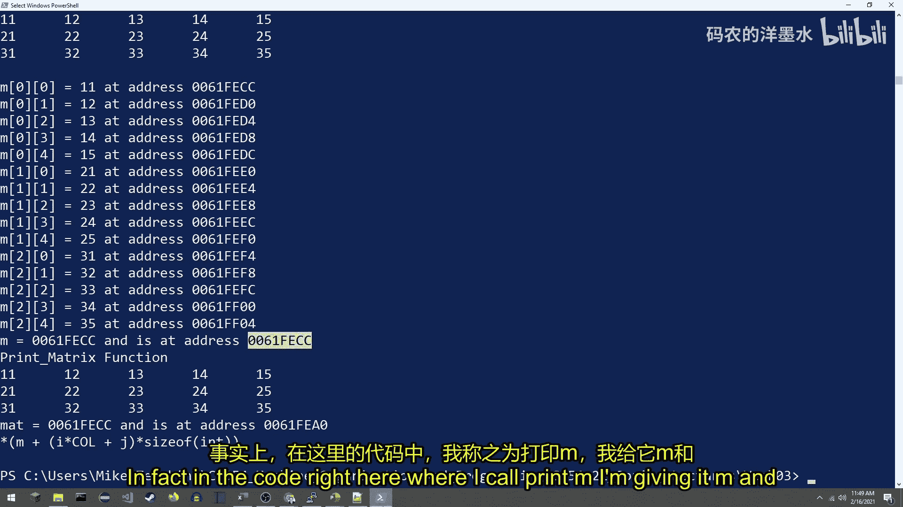

Right here where I call print M， I'm giving it M。

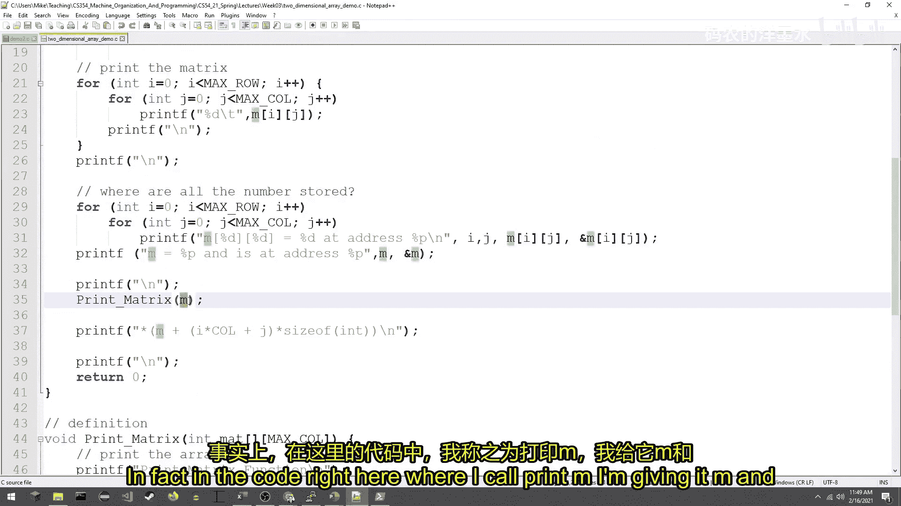

And I printed out M right here。 It's giving it an address。

 And that's assigning this address to the pointer。 whoops I missed。

 I should be highlighting that one， passing that address to Matt。

 And that's why the value of mat is the same address as the starting value right here。However。

 mat is actually stored at a completely different address。 F E A 0。

 So check us out a 0 is way above all of this stuff。 The very first element is F E。

 CC A comes before E。 So this is going to be much higher in memory。And when I've。

My stack frame for main is at the very like bottom of that array。 It's at very high addresses。

 When I add another function， and I I've got to have a bunch of things。

 I need the return value This one doesn't have one。 It needs the return address。

 It needs to know where the next stack frame is located。 The base pointer。

 It needs to know the parameters。 And In fact， we've declared a new parameter for holding mat。

So this is one of the things that came up in Piazza about the homework assignment in that you're converting binary numbers to decimal numbers。

 decimal numbers to binary， hex to decimal decimal to hex。

 and I've got a arrays stored in main and when you pass those to the functions。

If you make changes to where the pointers and the functions are， for example。

 if you declare your own array， do the computation and then reassign that pointer。

You're reassigning a local variable to a new location。 Basically， you're changing this number。

 and it no longer a points to the matrix outside the matrix in main。

 So this is essentially a way to do call by reference。But everything is called by value。

 We're just passing the value of a pointer。 So it's a little deceptive and can be one of those things that trip you up。

 I just wanted to take a minute and talk about that because it did come up with the homework。

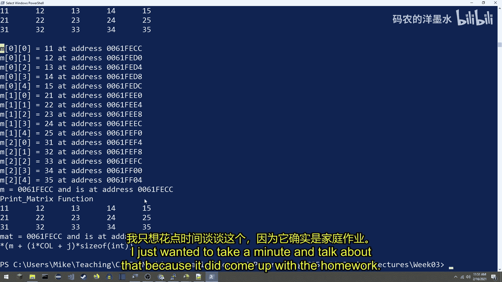

Alright， that'll almost do it for me。 I just took a look at my notes and found one more thing I'm missing。

 if I'm trying to print a matrix。Of words， matrix of strings。 instead。

 what that's going to look like。 It's going to be a character array。嗯。Mattrix of strings。

I need the pointer here for I can make this in。 In this case， I'll have rows。I'll have columns。

And I'll have number of characters。Let me try and make this look a little better。Like real variables。

 I'm not actually going to do this as an example， but I just wanted to highlight one thing。

 so I will create an array that's got three dimension in this case， multidial。

And if I have a function， print。Mattrix of。St， something like this。 We'll give it。

This variable as we pass again。And then the prototype。And the function declaration， when I do this。

 I can make it look good。 Funs。 start with capital letters。It doesn't return anything。

 because this will be a void function。And it requires my variable。I need to know the type。

 so it's going to be a character。Matri of strings。When I type this in， I need。Oopsimist。

Trying to talk and type at the same time。 whoops， now working so good for me today。

 I don't need the number of rows。 It no law C doesn't care about the first dimension。

 but in order to compute a particular characters position。 Figure out where it is。

 I need to know how many columns there are。 how many like words I have across the first row of the matrix。

 So it can jump down。 And I need to know how many characters are in each of these things。

 that's true for any multidimensional array， This is the one that's optional。

I don't need the very first dimension， but I do require to the how many things are in every other dimension。

I just wanted to mention that I'm just going to leave this stuff right here in my file as a note。

if you guys like， this is a place where I would encourage you to set up your own experiment and try just a three dimensional matrix example on your own。

 it works the same way which is adding one more piece of information to this computation。Alright。

 that's gonna to do it for this video。 I'm gonna go grab some lunch。

 and I'll be back after lunch with the final part for this week。 Have a great day。😊。

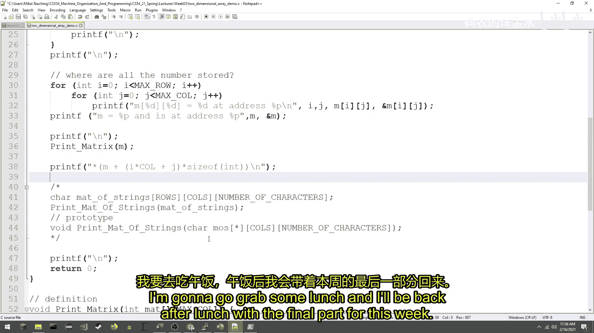