# 【全集】威斯康星大学 C语言编程与计算机底层原理 中英字幕 1080P p05 Lecture 5 - 结构体 -BV1BViQBwEiS_p5-

All right everyone， welcome back to Computer Science 354 Mach organizationization and programming。

 my name is Mike and this is the third part of week three's lectures we're going to talk about Strs So a structure in C is basically a composite data type。

If you're familiar with classes in Java or C+ plus those are object oriented programming languages and a class in those languages are going to have both data and functions that go with them。

 we use classes to create instances of objects of that type those objects will have data and functions that manipulate those pieces of data Now C is not an object oriented programming language so we don't have classes or objects in the same sense structures are just going to be their data structures where I've got the ability to put a whole bunch of different maybe even unrelated types of data in the same structures。

 So in this case I'm just going to go through an example and hopefully it makes a lot of sense。

 I'm going to be creating a student struct The student will have both a name and an ID number so I wanted two different types of data and I wanted to keep it as simple as possible so we're only using two types。

And then I'm going to go ahead create an instance of that stroke here we go。

 This is what it's going to look like， I'll go ahead and put this in actual code and walk through it。

 but the name of the student is going to be a string。

 so we'll have a character pointer to the string data and we'll also have the ID number just as an integer。

And I'll walk through that in actual real code， and then I'm going to be creating an instance of that structure。

Which and I'll assign the values， you know， the name Mike and my student 9 number。

 please don't take advantage of my student9 number or don't use it to check out books from the library。

 it's top secret。Allright， I'm starting a brand new demo file。

 I've got my basic hello world structure so that it'll print something I can see that it's working when I do some testing and the first thing I'm going to do in this lecture is createstruct。

The keyword。To create astruct isstruct， and I need to give it the name。Of mystruct。

 So it's going to bestruct student。 Then everything。

 all of the data that we're encapsulating in this composite data structure is going to be contained within two curly braces and it ends with a semicolon。

 So whenever I write astruct， I always fill this in。

 and then I just break that part and then put in my data。 So in this case， we're going to be。

Having a name。And an ID number， the name is going to be a character pointer。Like that。

I've got my semi my calling and the ID will be an hintt。Just like that。There we go。

 that's all there is to creating astruct。Then let me just compile this and make sure I don't make any mistakes。

 so I'll save that。

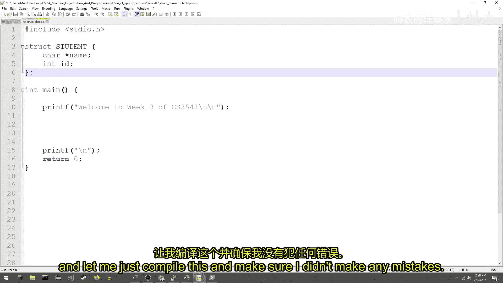

There we go。 We're again compiling with the 32 B option so that the address base is a little smaller when we look at how it's storing these trucks。

 all the warnings， but it looks like it worked。 Okay。

 so the next thing I want to do is give it some data and print that out just to make sure that it's like really working。

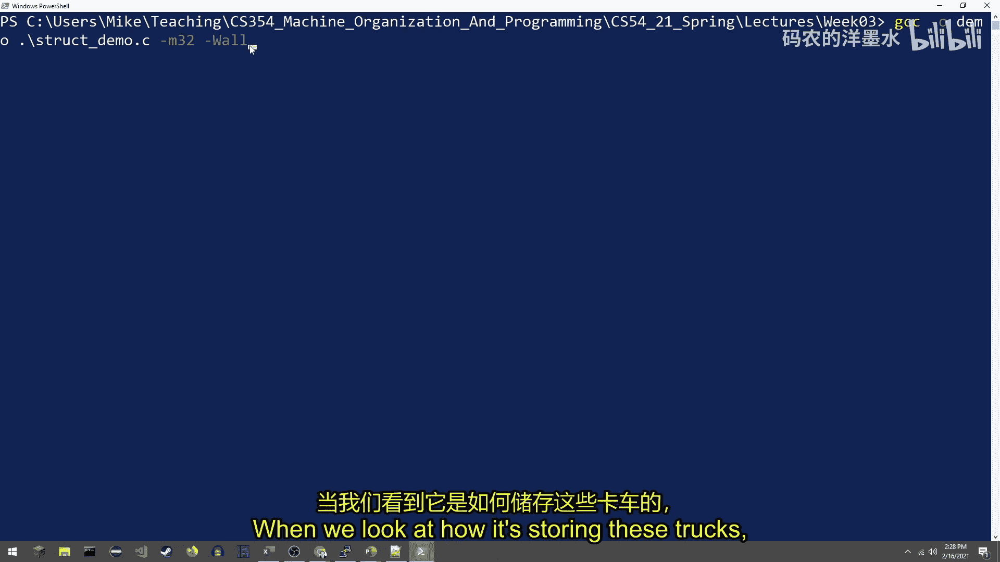

Just the definition。 So this is the definition of a struct that much didn't give me any compiler errors。

 So in order to declare an instance of a struct。I need the name strokeed。

And now I've created this data type， and here's an namestruct student。

And I'm going to create this first student， it's going to be what's calling student。

We use lowercase to differentiate that。Between the name of the struct and who we're creating。

And then。In order to fill in these data values up here， the name and the I D。

 we will go ahead and use。Dot notation to access the data members。 So student dot name。

 I can give that to name Mike。And then the student ID。I'll go ahead and give that。I missed the one。

My student ID number。And on that we can go ahead and print these things out so in order to do that。

We'll just print out name。This is going to be a string， so percent S。Student by name。And。第一。

That's an integer so we printed it out as decimal value。Zoom ID。Oh。

 and I want to put some new ones in right there。And another new line。I'm not using Vm， all right。

 save it， so well compile us and print it out。

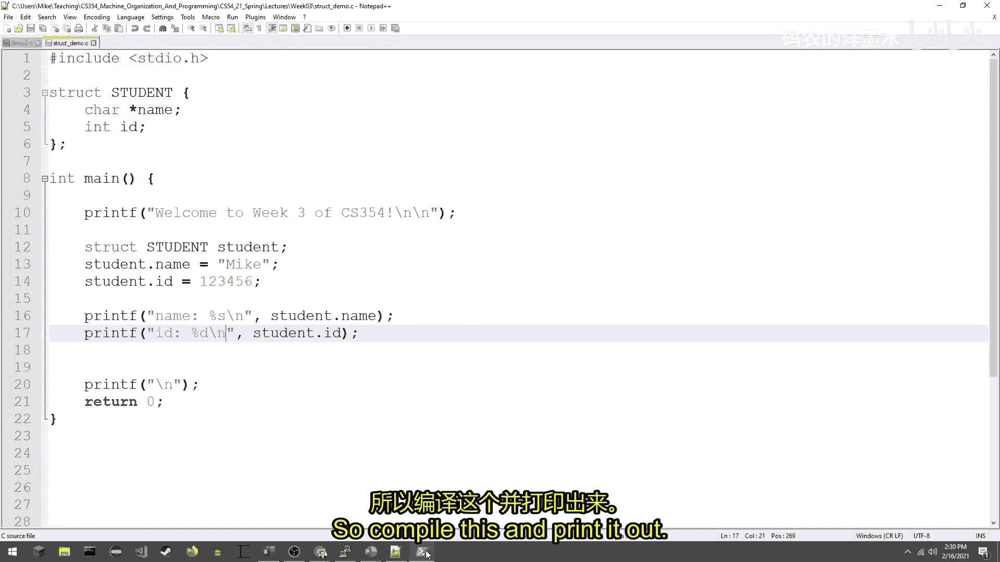

There we go， compiles no problem。And we'll print it out there it is。

 So looks like the struct is working。Next thing I want to do is print out the addresses where all of these where the two data members and the struct are stored in memory。

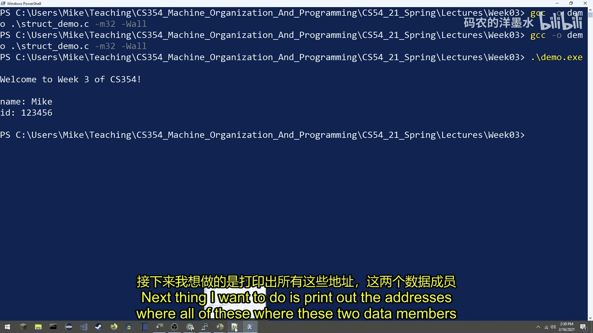

So I'm just going to go ahead and add this right here。Name student。

That address and that an address is going to be percent P。Same deal with the。Id number。

So print out the memory address for that， and then I' need to add those items。So this is going to be。

So that name。But I need the imp percent， There we go for the address of and。List。again。

Studon ID address of student ID， and then one more final thing。

 I'm going to put it up to the top here。P dev。I to get the actual student。Address of。

That's percent P because we're getting an address。Iserv。So let's take a look at what these give us。

Think this。

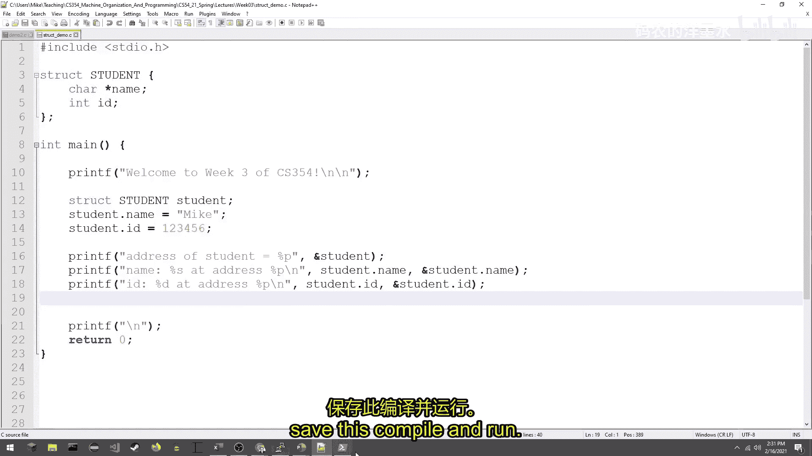

Compile， hand run。I forget a new mine， unacceptable。

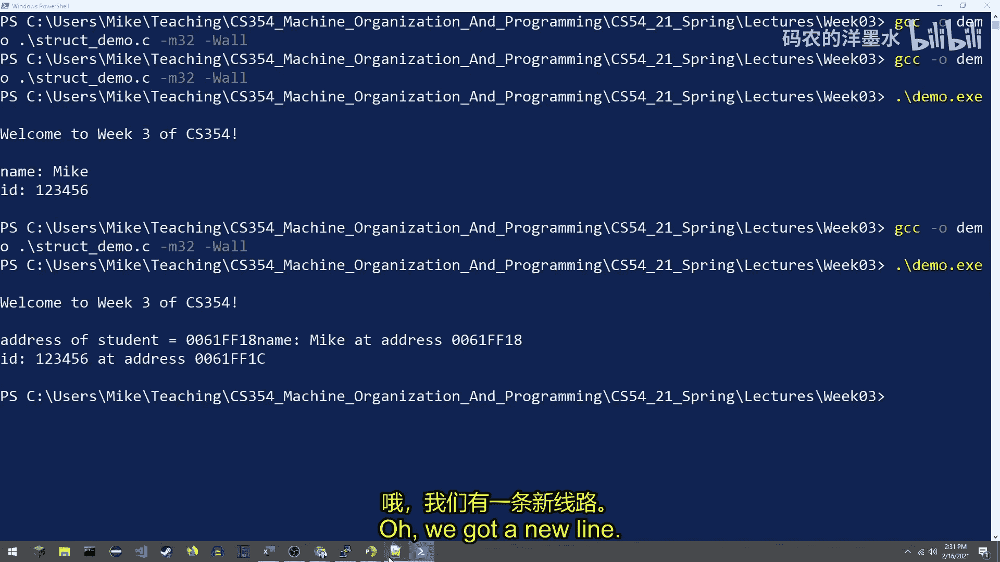

2。

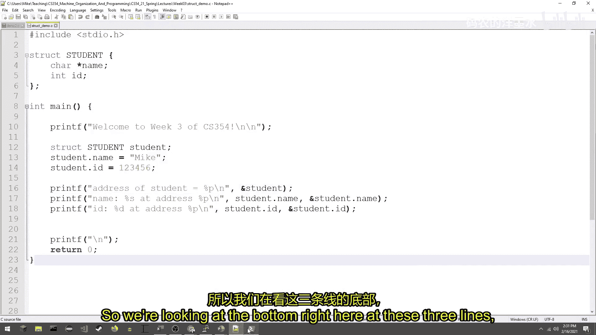

There we go。 So we're looking at the bottom right here at these three lines。

Get those highlighted first， the address of the students。

 this is the like overall struct is found at looks like FF 18。And then we've got two pieces of data。

 a pointer to a character string FF 1，8。 So the address of the struct is actually the same as the first piece of data。

 So it works just like the arrays did。 The address of an array was the first piece of data in the array element 0 for a struct。

 the address of the struct is the very the address of the very first piece of data。

 And then we've got the the second piece of data at one。Actually this is4 byte tire。 Now。

 Mike as a string is going to have four letters and one more character for that null terminal。

 So this would actually be a5 byte piece of data。 This is actually just a pointer， though。

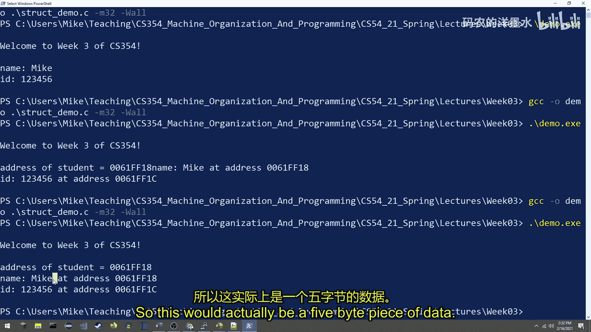

In fact， right here， that care star means that this is a pointer and all pointers depend on the address space that we're looking at。

 And it's a 32 B address space。 So 4 Bs is how much space they take up。 once like。

 let me see if I can figure out to print out where the address of the actual word mic is。

Once I get let， I put that code in。All right。 I actually got this right on my very first tribe。

 But my confidence was obviously pretty low from the tone in my voice。

 But here's all I had to do right here。 Pri out address of string mic。

 That's actually what's stored in this pointer right here。 The address of this array。

 So all I needed to do was give print f。 The command printed out as like。It's a pointer。

 Give me that address where it's pointing。 And here， when I was printing out the name。 In fact， here。

 check this out student not name。 It's exactly the same thing that I printed out here。

 The difference is I told it， this is a string。 So what print F is going to do is follow that pointer and print out the characters of the string。

 Like we expect it to do normally。 normally， we won't want this address。 during you know。

 typical usage of a string。 But in this case， I want to highlight one little quick thing right here。

 Let me pull this back up。 These are the new lines。 I've got。

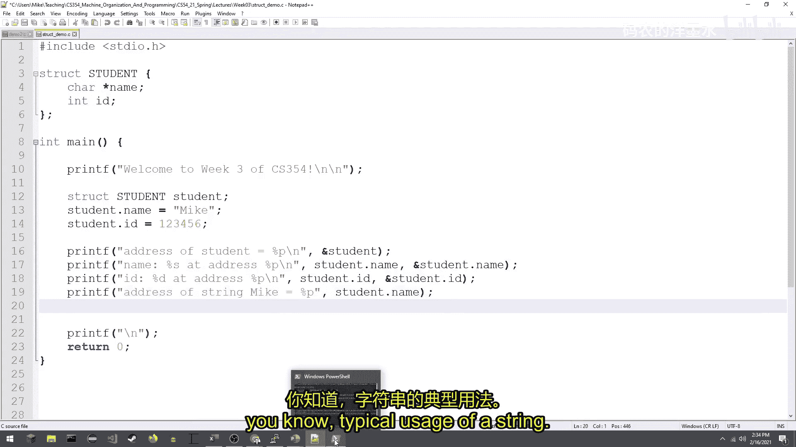

Address the student at F F18， the first piece of data， the name at FF18。

 That's where the pointer is stored。 And this pointer。

 the character pointer actually contains this address。 This 0，0，4，0， 5，0，6。

1 and this is much larger address is， then where the data for the word mic is。 Now。

 if remember back two lectures ago， I had a picture of the entire address space。

 me let me pull that up in a second。

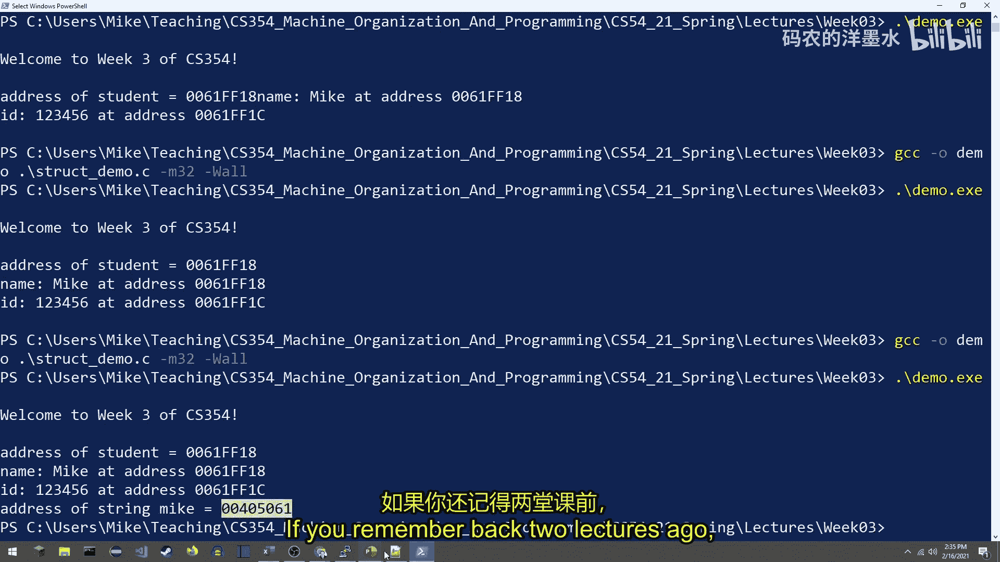

But it had the。Actually， let me pull that up right now。 let's see that was a PowerPoint。Right there。

 And it was like， way at the beginning。Yeah， right here。 this is the picture I'm talking about。

 So in the address space for the entire code that's available， address 0 is reserved。

We use that to assign to pointers to indicate that they've not yet been assigned。

 Then we've got a block of memory reserve for the code。 There's not that much here。

 And then this is the piece right here。 This next section is reserved for all of the string literals and global variables。

 And see， it's known as the text section。

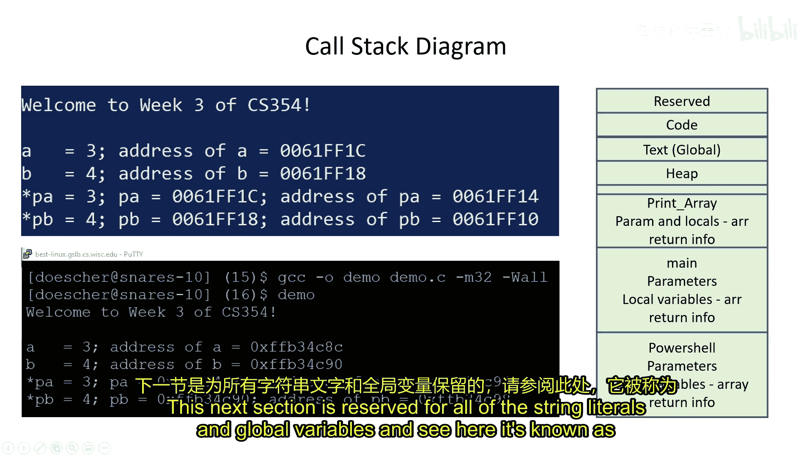

When we go back to this， we can see that this is actually a string literal。

 and it's being stored in that block at much higher。

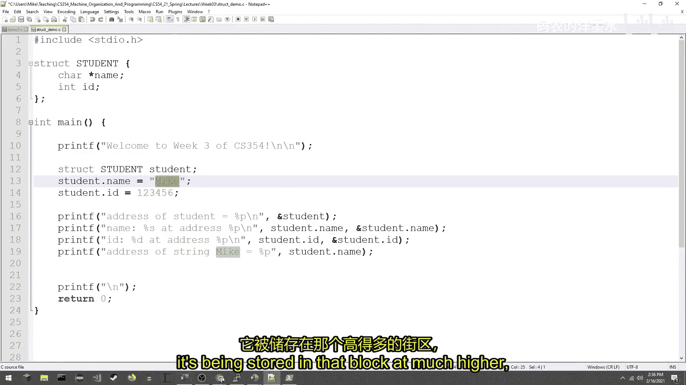

Much higher memory addresses than the heap。 And then all of the stack is going to be at the very bottom most addresses。

 So we would expect。

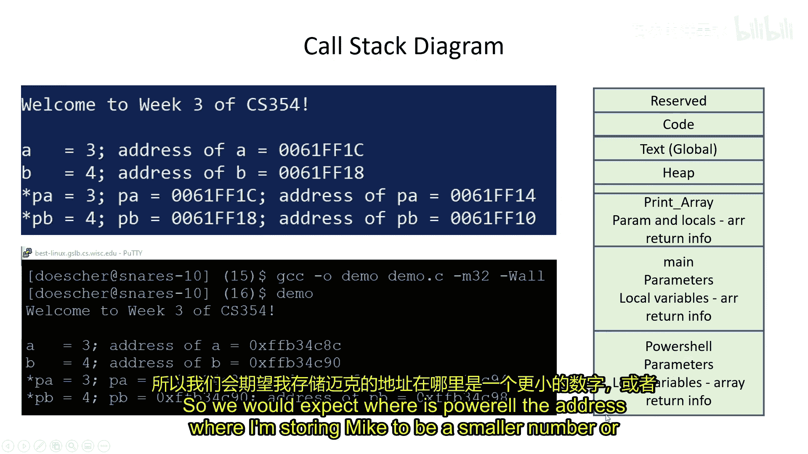

Where does Power show the address where I'm storing Mike to be a smaller number or closer to the top of the address space than the stuff that's on the stack。

 these three pieces of data。Alright， next up， what I'd like to do is talk about the connection between obstruct and the memory model。

And I also， there's only two numbers here。 I mean， drawing a picture is gonna have very few things in it。

 Actually， let me go ahead and do that anyway。 We'll just build this up。 Let me go draw that picture。

 and I'll be right back。 Alright， so I've got my picture put together here This is all the same from the previous slide。

 Here's the screenshot from Powerhell。 And then I've got two places in the memory。

 This is that text data section at address 0，0，4，0，5，0，6，0。😊。

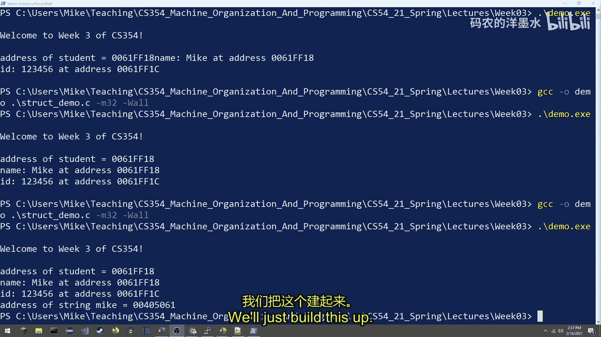

Oh， that's not right。 Hol on。Is there a 6，1。 Give me one second here。 I get this edited。他在跟。

Like that back， there we go。 That looks good。Okay， yeah， address 4，0，5，0，6，1。 I've got the letter M。

 It's the first character in my string。 note， this is now at a odd number。

 It's not a multiple of you know，40，4，8 C that we saw with all these integers。

 typicallyy what we'll see。Is that the starting value for any particular data structure is。

Divisible evenly by the number of bytes in that data structure。 So in intest 4 bytes。

 the starting addresses are going to be divisible by4 characteract data has one byte。

 So it's going to be divisible by one or anything is possible。

 Something like a double is going to be have 8 bytes with it。

 the starting addresses for doubles will be divisible by 8 bytes。

 And we'll see that like the beginning of stack frames。

 And the amount of data reserved for local variables frequently。

 that will be straight up divisible by the largest possible thing that we might have。

 So the largest possible data type is a double we'll frequently see that those like beginnings of stack frames are divisible by 8 bytes。

 whatever the largest sizes。Allright， little aside there as to why this starts on a1。

 so then for the data， what's actually stored in these things。

 this first address right here that's got something， the 6，1 FF 1，8。

 This is the address where thestruct is storedred。 It's also the address。 the first piece of data。

 That piece of data is a character pointer right here。 Care star。 And so it contains an address。

 And that address is the 0，0，4，0，50，6，1。 That same。 let me let me it's a pointer。

 Let me grab an arrow。One sec。 Here we go。 Here's an arrow。You can get that flipped around。

 pointed at the right spot。 There we go。's a good。 It's a pointer to that address。

 And then the other piece of data that we have in thestruct is the ID D number。

So it looks like this particular compiler has chosen to put the pieces of data and thestruct in this order。

 It's up to the compiler how they're going order things。

 And that's just what this one happens to look like。 Typically， though they will be in this order。

 And if I don't remember ever seeing them not in that order， I might。Yeah。

 I might have any some more experiment and see if I can trick it into changing that。 it might not。

 Okay， all right。Enough rambling。 Mike， the next thing I'm gonna do is I want to create a function that's actually gonna print this out。

 And we'll compare what happens to main to when we pass a structure to a function。

 Let me go pop back over to。

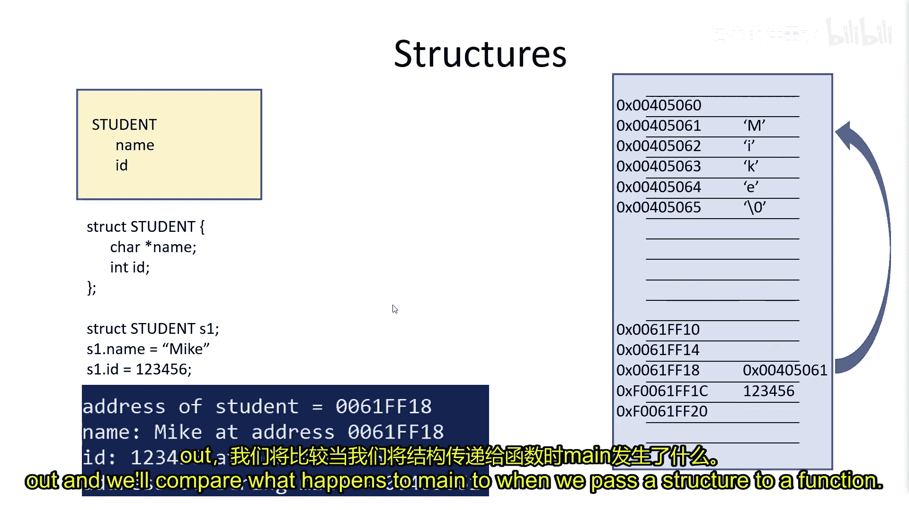

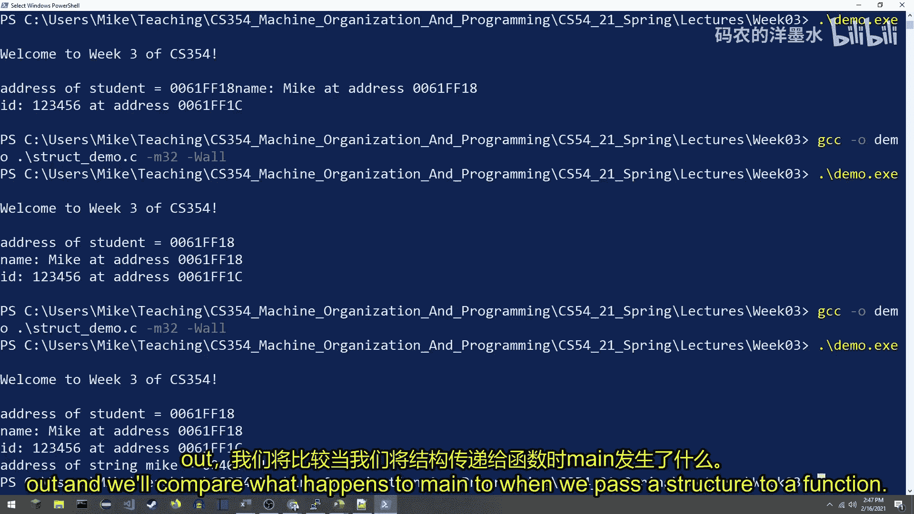

Here we go， my editor。 And what I'm going to do is print out this same struct with a function call。

 So I print。Strt， how let's call out student。To students。

 this is going to take the name of a student structure。Student is my name。

And we'll just print it out。 Allright， I can see right now it's a void function。

 I need to put it after my definition of the struct needs to come after that because we need to see this first。

 and then we'll have print。Student， it's a void function， No return value。

 It takes a struck student type。Just like that， and we'll call this as inside the function。

There's my prototype。Let me go ahead and now write the function definition down here。

 get it out of the way。 So that means I get with semicolon。 we had some brackets。

 And when I'm going to be printing out all of this good stuff right here。

So print the address of in this case， I'm going to just change this in the address of S。S， S， S， S。

 S。There we go。 got all the word students changed to S because that's what I'm calling inside of here。

And clean that up a bit。 right let me go find out what all the mistakes I made。

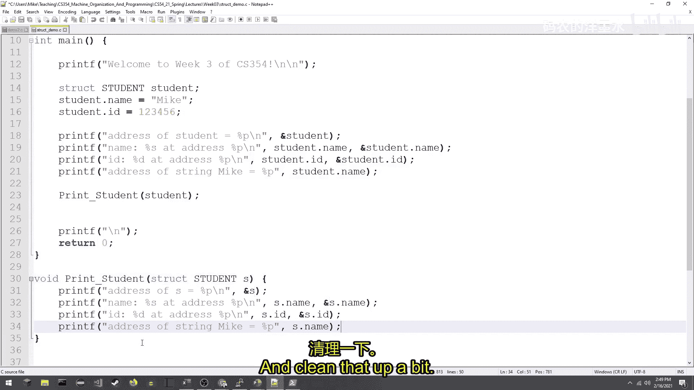

So save it， pop back over here， compile。No mistakes。 Al right， let's run this。

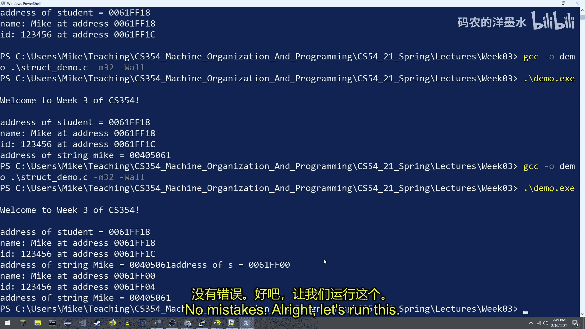

Oh， I'd forgot a new line right there。 All right， let's get that fixed。Where was that one right here？

I'm going to put in two actually， and leave one right there。

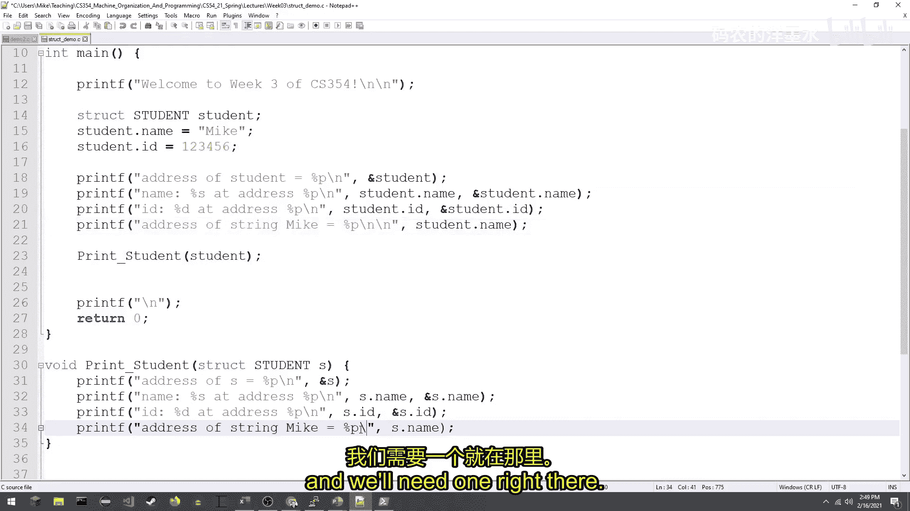

So that second one will leave a blank line between the two print statements。There we go。 Okay。

 so this first block， this is the one from the function in main printing out the student。

 And this is the one from the function call， the print print student function call。 Alright。

 so none of these look like they've changed。 I still have the address of the student at F F1，8。

First piece of data， F5181C is4 bytes after that address of this string， 5061。Yeah。

 that hasn't changed。 I've got the my other monitor has that slide opened up。

 So if you've got PowerPoint， then you're looking at the slides， you can see they haven't changed。

Al right， next up， when we actually pass this data structure to the function， I can see that I've。

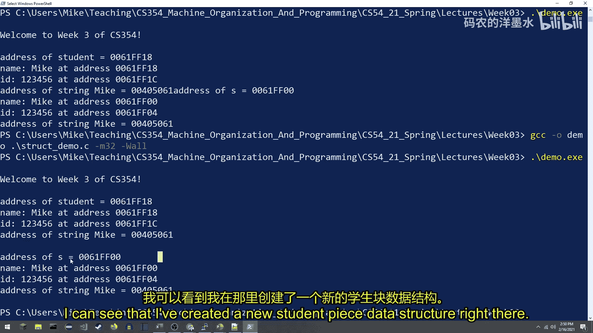

Created a new student piece data structure right there。

 It's a struck student of named S typesstruct student。 When we pass that。

 everything is called by value。 So we're making copies。 So this is a new struct at this location。

 F F0，0 doesn't appear up here。

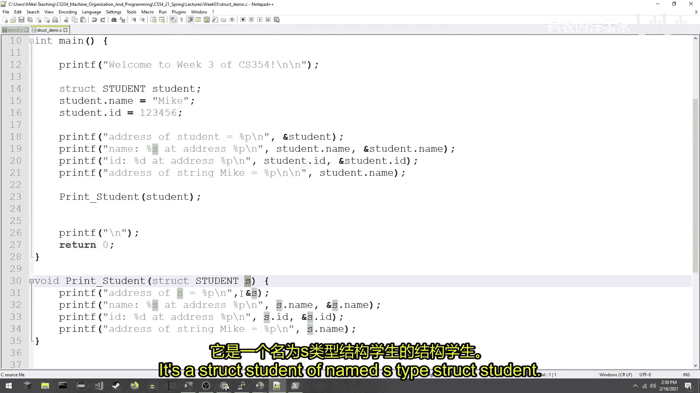

The first piece of data， the address ofmic， got copied into F of 0，0 right there。

Which is the same the name of thestruct goes you know。

Ass a lot like a pointer to the first piece of data， the 13456 got copied into this address。

 the next one， FF0，4。 And what we see is that this， this name is a pointer。

 and it needs to point to the very same string that this one does。 It's called by value so。

The ID number 1，2，3，4，5，6 got copied， the address in that pointer got copied and should be the same address as right here。

So that pretty good。 me。 Let me go ahead and copy this into my memory model picture and just show you where everything is all laid out Now。

 Once I let go build that slide， bear it back。

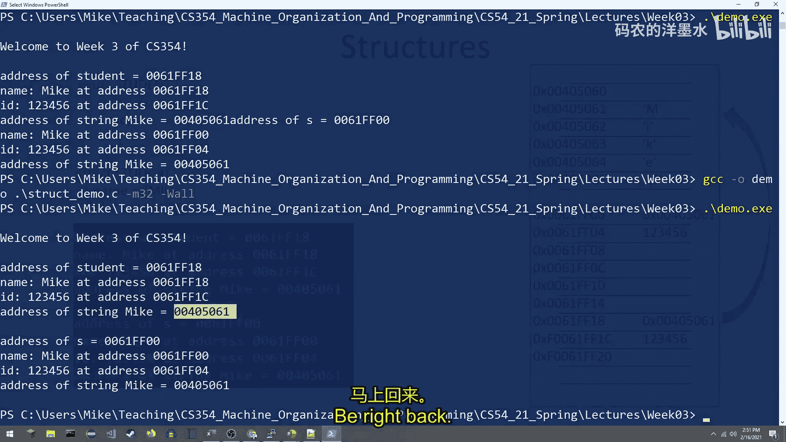

All right， got this put together。 here's the screenshot from the previous the PowerPoint or PowerPoint。

 the program output。I can see that none of this original data from what it was printed in Ma has changed。

 All the address are still the same。 So this number here， and this number right here。

 This is my original studentstruct in main。 In the text section。

 I still have the string mic terminated by that null terminal character still are at the same address。

 So that's all good。 Now， when I called the function。 Everything is passed by value。

 So we've just made copies。 It's created a newstruct object。 And remember。

 the stack is growing towards smaller addresses as a， you know。From that very first picture。

 I've got the main at the very bottom of the And then the next stack frame， the print。

 whatever goes slightly above that。 So these should be at lower addresses， but probably， you know。

 still in the stack， they should be pretty close to these guys。 And， in fact。

 there's only a few empty。Well， they're not， they're not empty。 but a few bys in between them。

 This is gonna be reserved for things like the return address， the base pointer， some padding。

Things like that。 And now we can see that。What we've got here is the very first piece of data at my struct so this 61 FF 00 address is the name of the s struct inside my function。

 it's the parameter of the function We've done is we've copied in this address0040。

5061 got copied into the first piece of data which is located at the same location the s struct is the same location as the s dot name When I start looking at address for structs and then that ID number is the very next well4 bytes down because this is a pointer。

 takes up4 bytes My I number is an integer will' take up four bytes also but we've just made a copy of that All right so that's how this works if I use call by value with the struct Now this is not super efficient I've gone ahead and made a copy of well both pieces of data right so let's base it it's 8 bytes that wasn't a big deal but suppose I were looking at something like genetic data。

I had a genome that I wanted to pass to a function to print out or to print out a piece of it or something。

 This is very inefficient to copy large pieces of data。

 So a better way to do this would actually be to pass a pointer to this student object。

 So let me go ahead and write a function that。Works essentially the same way。 In fact。

 I'm just gonna go ahead and write it right here， void print。Student with。Pointer。

This will take data typestruct student， but now it's a pointer to that student。Ne some of these guys。

 and then we'll just print this out。 I'm just gonna copy this。

 It gives me a really useful error message when I， when I do it like this。 This doesn't work。

 I no longer have astruct student。 This is a pointer to astruct student。 So this is gonna fail。

But I want to show you that error message。And I also need a prototype over at the top。

 So let me go ahead and grab that。嗯。Now needs a semicolon。

 and then we're also going to need to call this function。Speed that up a little bit。And let's see。

 let's put another blank line in right there。 so they're separated a little bit。

The blank line right there。

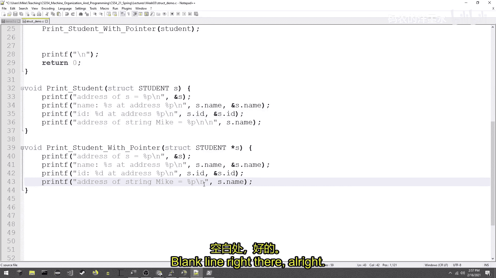

2 right。Looking good。 Next up compile。 really super useful error message。

 I want to take a look at the top1 first。 So this is an incompatible type for argument 1。

 I didn't give it。 I gave it the student， not a pointer to the student。

 So a pointer needs to take an address。 That problem came from right here。

 So I'm trying to copy this student data into what's supposed to be a pointer。 So instead。

 pointers take the address。

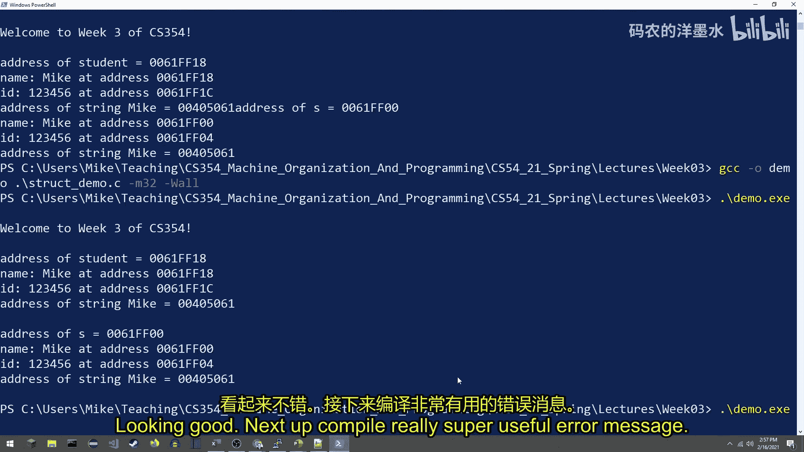

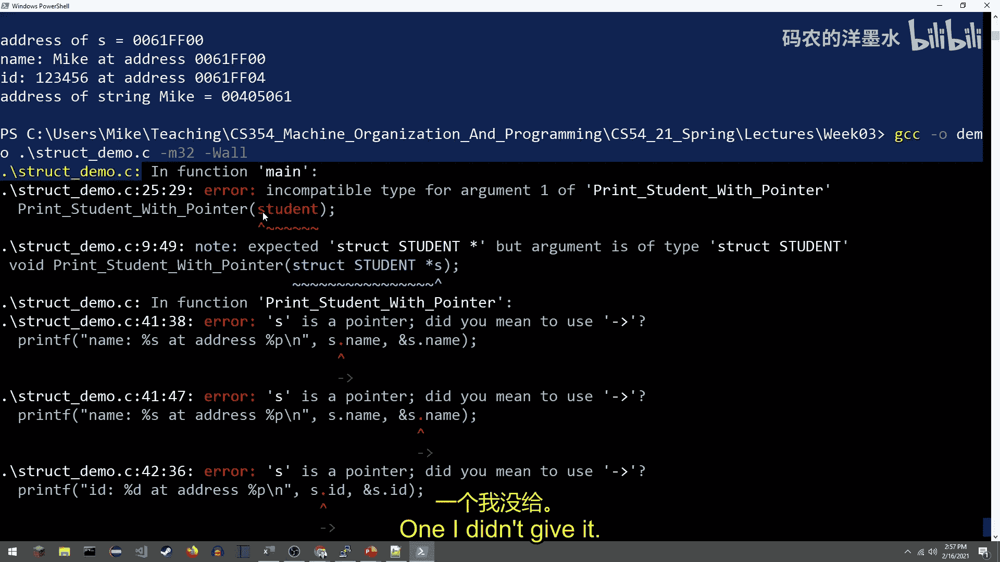

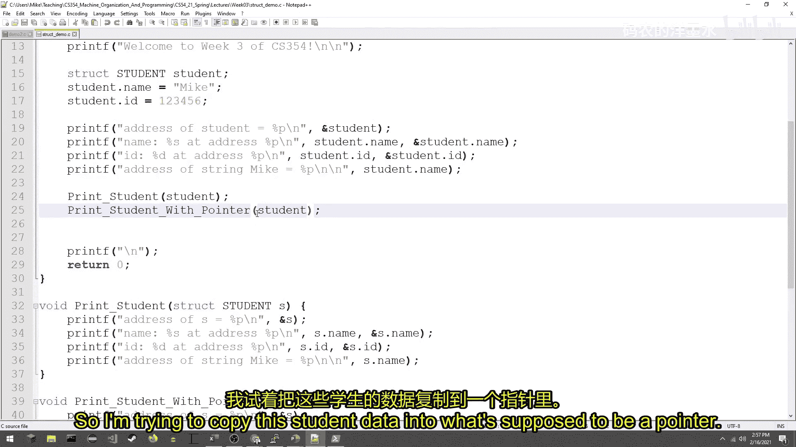

So there we go。 That error message again was。Incompatible type。

 it says expected struck student pointer， but it's struck student。

 So that just means that I needed the address of。

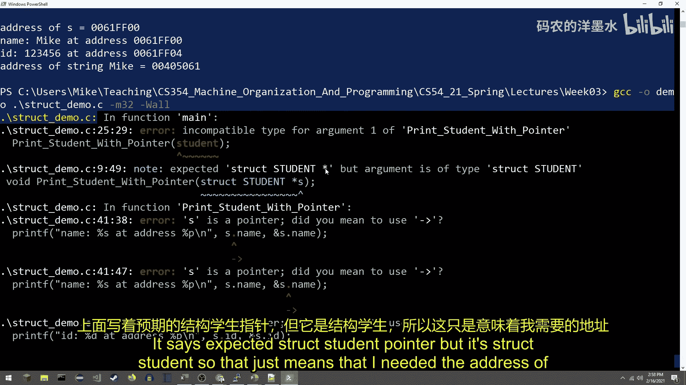

All right， next up， let' save that。

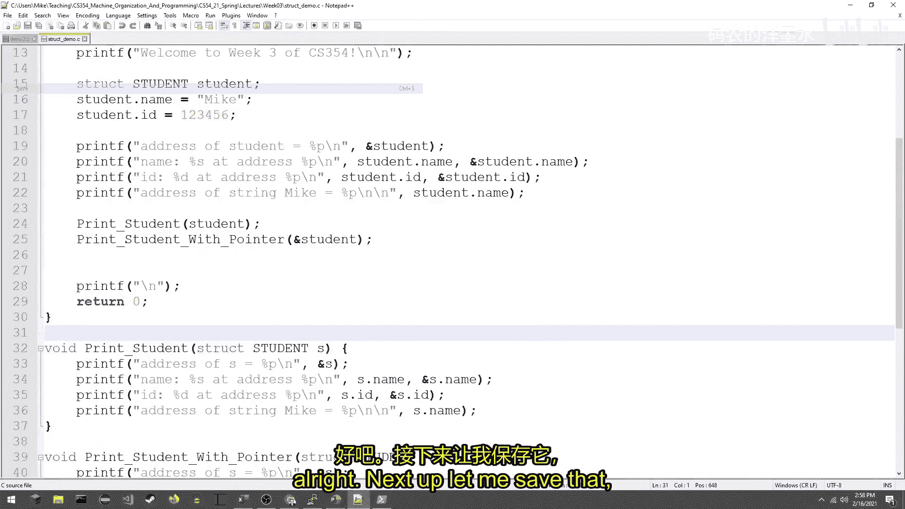

Pil it again。And now I should get some different error messages。

 So here is the new top error message。S is a pointer。

 then I mean to use the dot dash greater than or the arrow I'm just going to call that the arrow from now on instead of that dot。

 So this is really useful， It tells me I need to use that arrow instead of the dot and that's going to go anywhere I have dot。

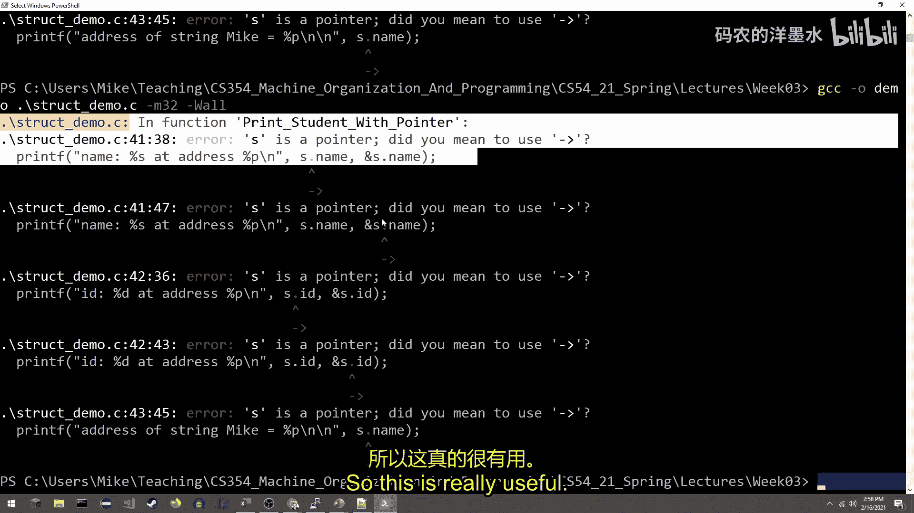

In the pointer version。嗯。So here's the problem。 When I've got something like like this。

 and I try and。De referenceence it or use it。 Instead of this。

 what I'd really like is to dereence the pointer and then grab the I D。 Now。

 the problem is this dot is a really high precedence。And that means it's going to take S。

Which is a pointer。 And it doesn't have any of these data members。 It's a pointer。

 It's 4 bys with an address in it。 It does not have a dot I D。And in fact。

 let me go ahead and we'll do this this very first instance right there。

I want to show you the error message when I do put in the star。

But because this is so high precedence， this is still going to give me a problem。

 but it's a different hair message。

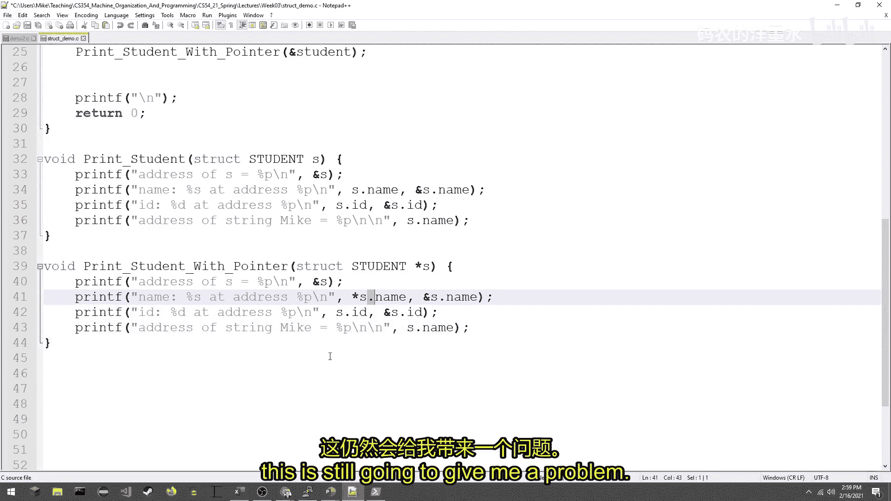

Let's go ahead and。Compile that。We'll see error S is a pointer。 Did I mean to use  error。 still。

 it's the same， oh， it's the same error message。 And that's because it's trying to do this first。

 S dot name。 And it's telling me S is a pointer。 It doesn't have a dot name data member and suggests that I use that arrow。

 So another way to do this is to say， well， that star operator is low precedence。

 We can use parentheses to make this higher precedence。 So this should now work。

 And I should get another error for the next。

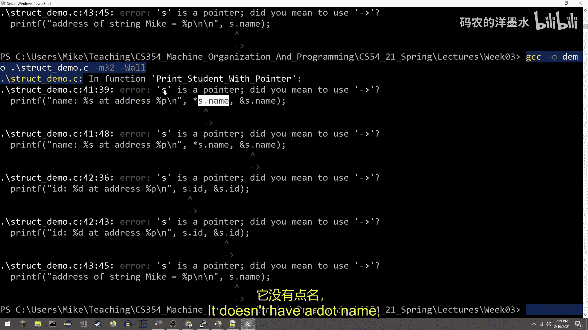

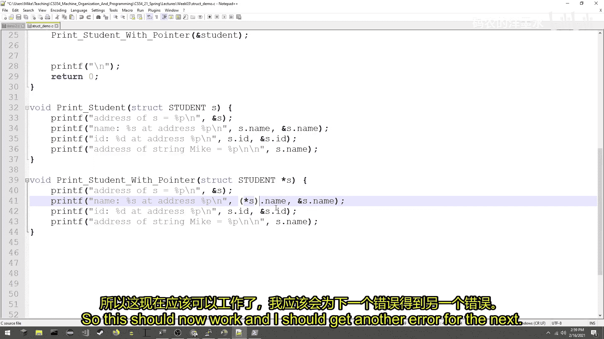

I believe this one， let's find out。I didn't save it。There we go。Pile that， there we go。

So let's see here， Prince student right here name。 Yep。

 it's now giving me an error message for this one because this S dot name also。

Does not have as is a pointer here also， But this one now is no longer giving me the error message。

 So I can either do this or I can use these arrows， so。

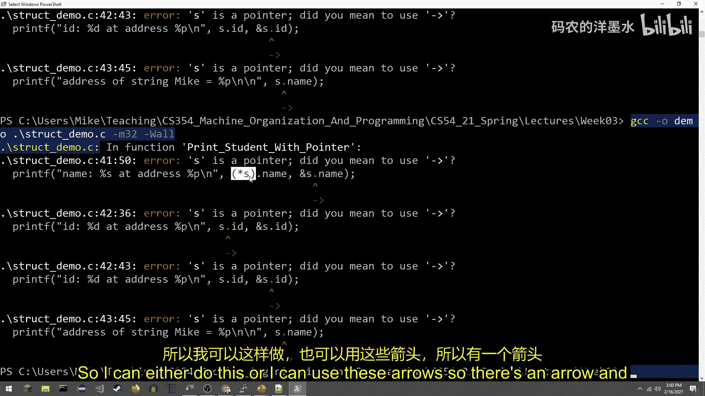

There's an arrow。And anywhere I haven' an asked in this because at the pointer。

 I will need that arrow。There we go。 And the， the arrow is just shorthand for doing this。

 That's all it means。 And let's face it。 As you're going through。

 this is something the programmers who are developing C wanted to have because it's really hard to remember to type parenthees star as parenthesy dot。

 Every time I need to use the dot。 It's much easier to type S and then think， oh， yeah。

 it's a pointer。And after you've typed it， and and not have to back space and replace that。

 So they instituted this arrow operator。Actually， I don't know that that's the reason the arrow is really convenient。

 I really enjoy using it rather than this sort of syntax。All right， I think I got all the places。

 save that， let's go run this。

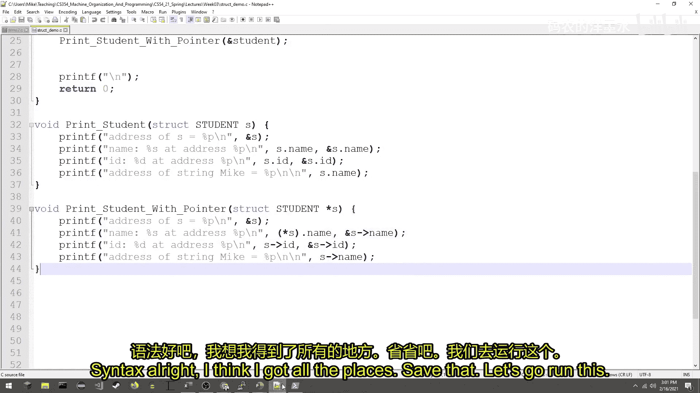

Compile first， then run it。 There we go， looking good。

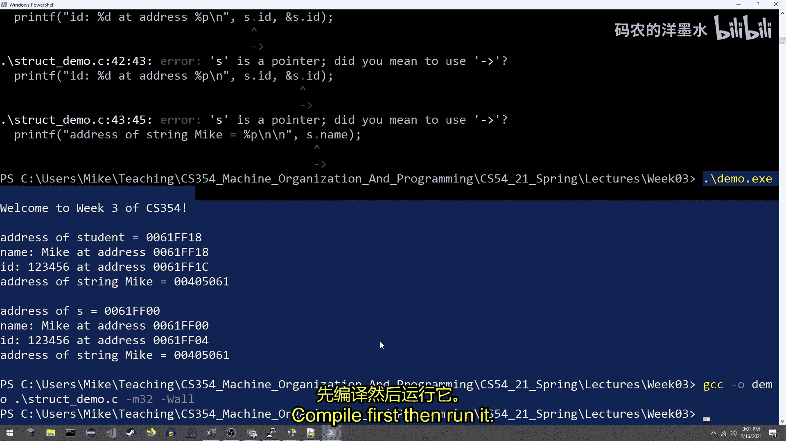

This first block is the data getting printed out in Maine， addresses have not changed。

This second block， we've called the function。Allright， this is the origin of the second。

 the very first print student function。 so we're making a copy。 The data here is at FF00。

 that data is at FF0， that's the newstruct， and we've made a copy of both of these data members。Okay。

 and the location of mic still has not changed。Now， when we did the pointer version。

 we still created a pointer address of S。 This is now S is now a pointer here。

 It's still given the same address because we've just。

 we've popped off the stack frame for this print function。

 And now we're generating the stack frame for this print function。 Now， because this is a pointer。

 It's actually pointing to this data right up here， though stuff in main。

 So these addresses should be exactly the same as the addresses in main。

 I only had to copy 4 Bs for a pointer。To this location right up here in Maine。

And same thing down here， this is the same address as that one。

 So I had to copy four bytes instead of the entirety of well it's only8 bytes here。

 So not a huge deal， but I didn't have to copy the whole thing。

 A mere four bytes of data got me what I wanted。

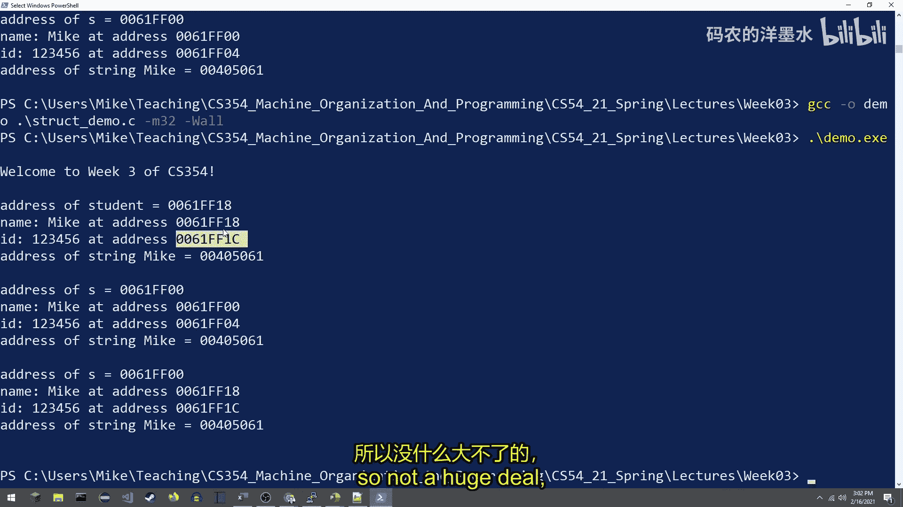

Al right， just thought I put this into a picture， too to try and make it a little more clear what's really going on。

 And it gives me a second chance to talk about it。 So if you didn't get it the first time。

 maybe this will make sense。 So this is what happens when we call print tune with pointer。

In the previous slide right here， this  one， I called print student， and it made a copy。

 So I had two pieces of data that I copied。 The first one was the character pointer to my address。

 let me actually add another arrow。And get this in the right spot。Something like that。

 So copied that pointer。And then we had to copy the data also now。

When we called the print student with pointer function。

 all we did was create a pointer to the data that was already in main。 So this now。

 instead of getting yeah， basically， this is the address of my struct 00，6，1， F F1 c。嗯。Oh。

 that's the wrong address。 It's the first one。1，8。There we go。 my ahead。

 So we're getting a pointer to this very first piece。 this address right here。

 And then from there that I can use that to access both of these pieces of data using that arrow operator。

All right， I just take my notes and there is one more thing that I do want to talk about today and that's。

Here the idea that I have to typestruct studentstruct student anywhere I wanted thisstruct student。

 I keep having to type the wordstruct over and over and over again。

 C gives me a way to rename my data types。 So this is me creating a brand new custom data type that holds two pieces of data。

 I'm going to leave that right there， But for the moment while I'm exploring。

 I'm going to comment this piece out。And then show you some alternatives。 So the first one is。

Well here， let let me do it this way， I'll break it down a little more。Before I do that。

 there's a function typed up。What this is going to let me do is rename data types。

 so in this case my data types that I just created isstruct student。Just like that。

 I can rename this to anything I want， in this case let's call it just student。Now。

 I did this because this is so common and it can be confusing because I've got the word student twice in a row right there。

 but this much is the data type that I've just created right here in the line above it。

 and this is what I really want to be calling this Now this code will compile no problem because I can use the original name it didn't go away it's still there。

 but I can also now use my new name which is just that much just student。

So I can go ahead and delete this and it should still work just fine。

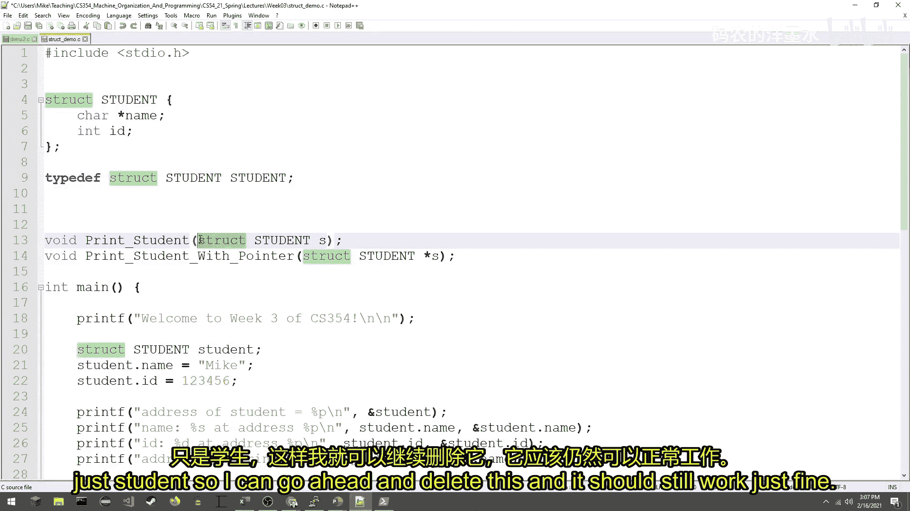

Let me go ahead compile， demo this。 I'm not just gonna run。

 I'm just gonna compile it and show you that there's no errors。

 So C was totally willing to accept my new renamed student data structure。

 This is really common using the same name twice。 So I'm going to go ahead and leave it。

 but there's no reason you couldn't shorten this up to something。

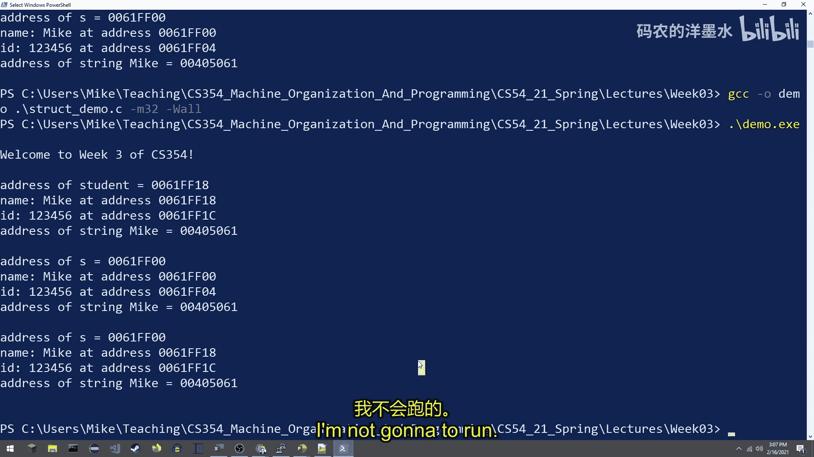

Here one's called stew for student， and then I can rename it this one stew。

 and this should also work。 It's just I've renamed it something different。

So if that makes more sense， go ahead and think about it that way。There we go， Sp that right。

Ohoops under that。That， that， okay， now it's back to the way it was before。 Now。

 I've got some other options， too。 I can actually， let me comment this out for a moment。

And we'll comment this part out。嗯。And I'm going to copy and paste my new my original definition。

 I'm going to put it all on one line for a second。啊。There we go。

 So now I'm just declaring a struck student。 I've got all my data in one line。

 C does not care about spacing like Python does or indentation。 It does not matter at all。

 What I can do is say this is my definition for a student in a struck student instead of just this much。

I can just replace that with this。 So in this case， I can say。I'm going to just copy my type de line。

And now I'm going to take my definition for thisstruct student。

 the entire thing right there and just put it in right here， copy and paste that。

 I don't need the semi going right there because I'm creating a type def of a struct that I'm naming student。

Alright， and this should be enough I still have my student here without thestruct。

 just name this student。 so this should also still compile。 Let me save that。

 make sure that I really don't have any typos。

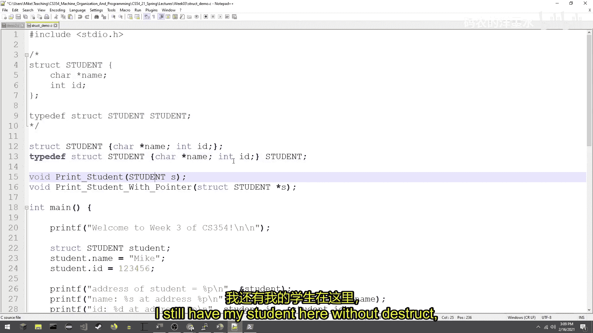

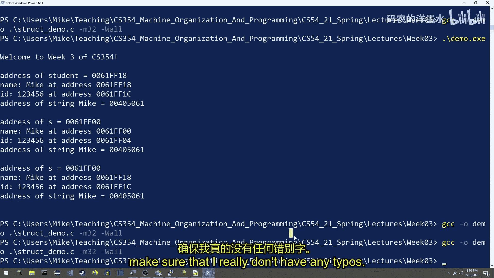

I do O definition， so somewhere I here， I've got it twice。Yeah， breath there。I need to。Do that。

So here I was declaring struck student and here I'm also declaring it again。

 I think that's the problem。

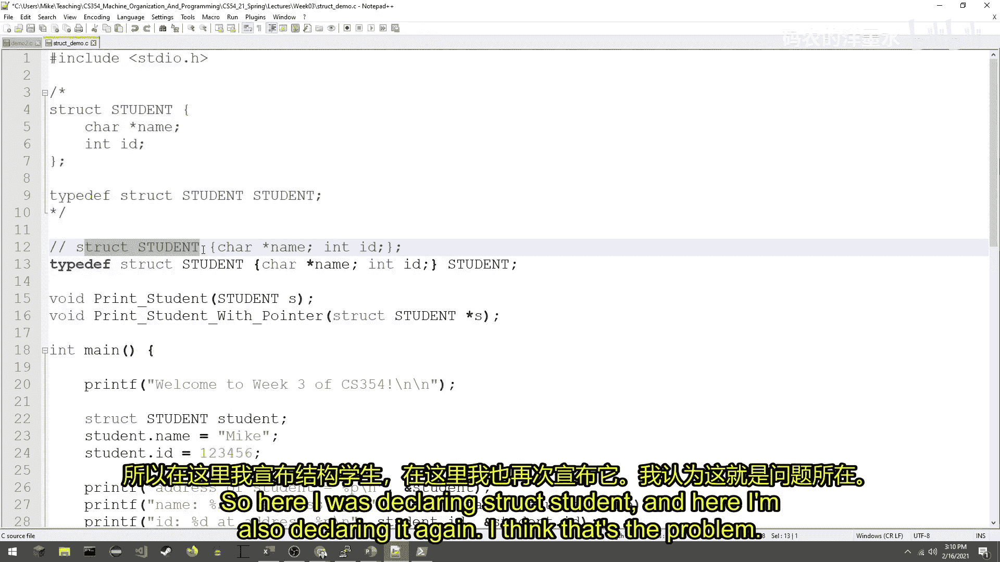

你美食。

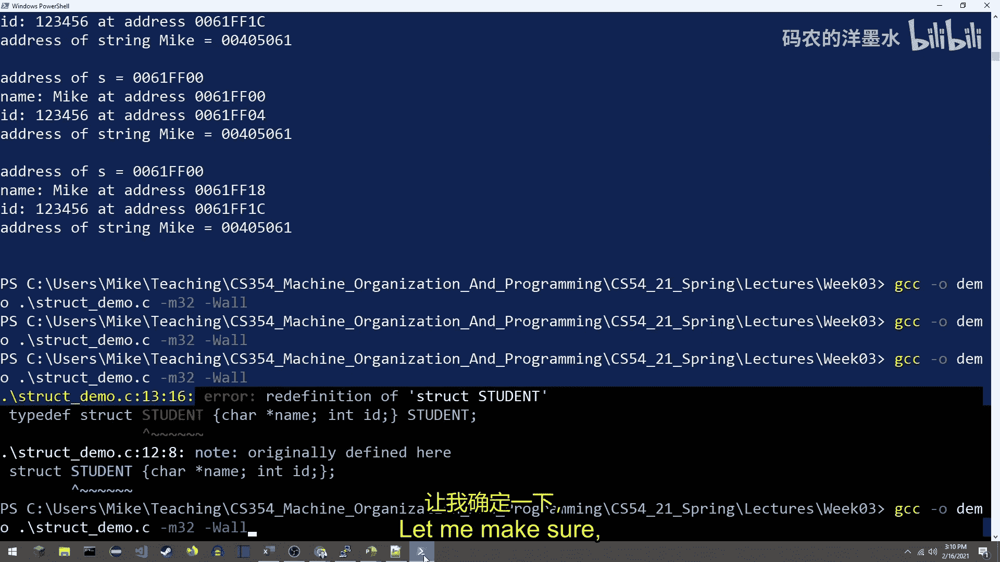

Yep， there we go。 I had a twice。Alright， so now this is basically this line of code right here takes care of the creation of an entire struct。

 I'm going to do one more little thing because I've got the name here twice。

 I don't actually really need to give it a name at all right here。 I can get rid of that student。

I don't want to redefine it。 I only want one of these right here。 This， I believe。

 is the absolute shortest， most concise way to create a struct with its particular name and not have to worry about having a type struct over and over again。

 Let me make sure I didn't have any typos in that this works by compiling it。

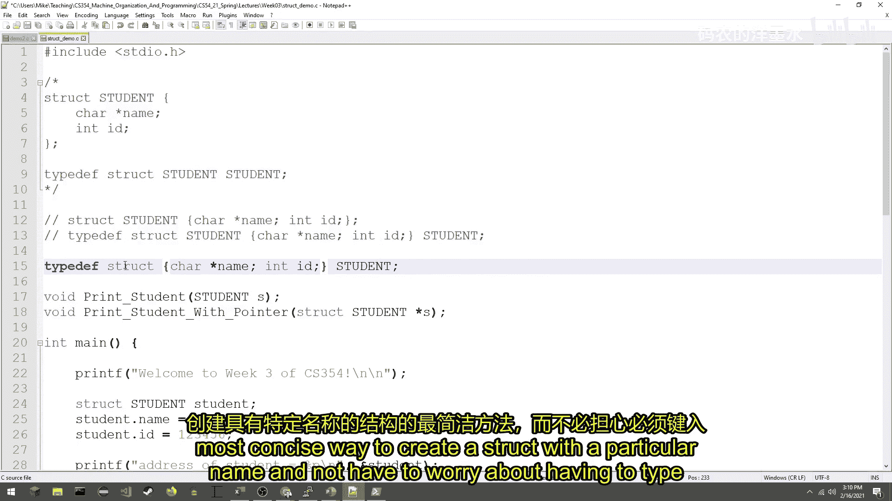

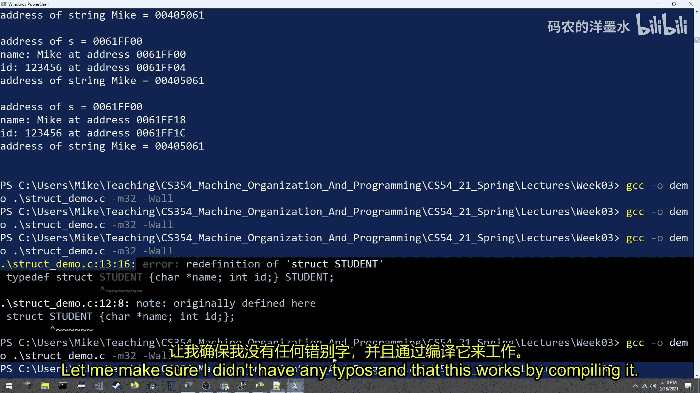

You have problem， I have a hypo somewhere。I found my mistake。

 so this was actually pretty straightforward when I removed the word student right here。Okay。

 I'm creating an anonymousstruct。That told the compiler that I no longer have this。

 it's now anonymous and I'm just calling student and then all over my code。

 I was callingstruct student， instead of student， I no longer havestruct student available like I did before by putting the name in right there instead what I need is to get rid of the wordstruct。

Everywhere except right there。 So if I delete that one。Let's see where else if I got one。

 here's astruct right there I need to delete that one。

Then down here in my function call in my other function call。Did I get them all？

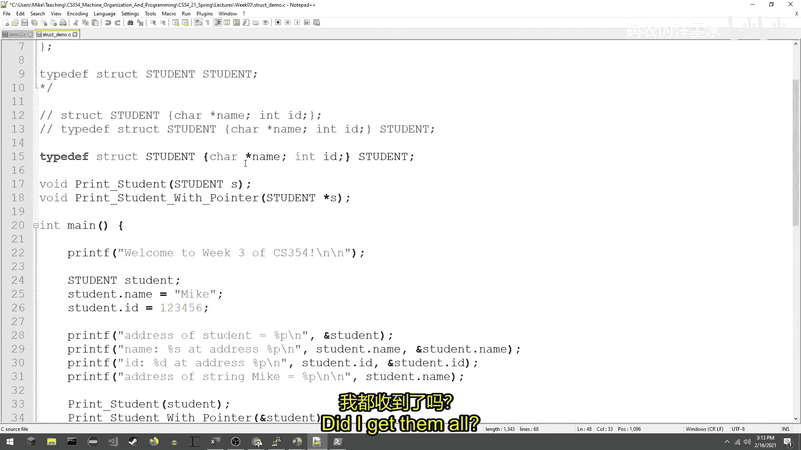

Student do， I believe so。So now this should compile。

And there it is compiled just fine let me go ahead and run this。

 We can see it's producing the exact same output as before。Yep， looks like FF18， FF 1C， same output。

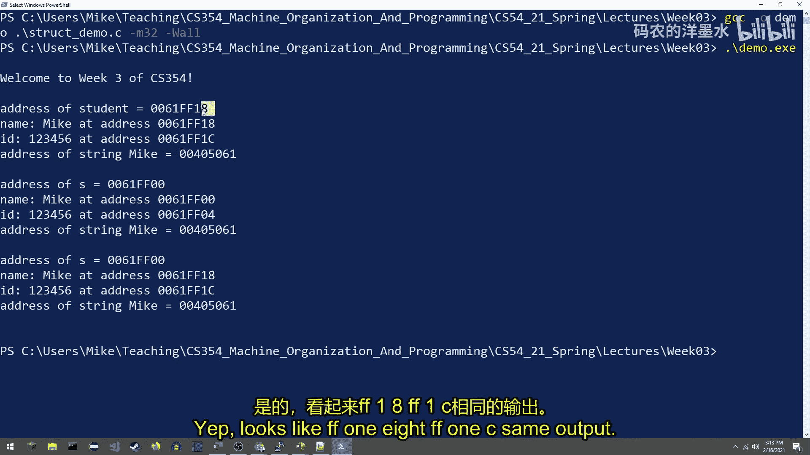

So anyway， this type dev idea， it's a way to create an alias。

 it's a way to take the name of a type usually used with structures。In a second。

 I'll show you another way， I've seen it used， but it's a way to just rename something。

 So I don't have to type the word struck over and over and over again。 And I can also just， well。

 here， here's another way that I've seen this used。 I may have。Type F。Floating point numbers。

 So what I'm going to do is rename float to T。 It's actually creating a second name T for type of numbers。

 I suppose， and now if I do all of my variable declaration using T instead of float。

 floating point number computation is at least a little bit faster than using double precision numbers。

 it takes up less memory。But if I want more precision， I can change my entire code。

To use double precision numbers， slow it down， get more accuracy by just changing one word right here。

 But then in my like main function， I'll have， you know T。The bomb caps lock。T of x equals 3。0。

 T of y equals 4。0。 T of z equals x plus y。 So there I've got all of these are right now。

 double precision numbers， type double。 And if I want to switch them to floating point numbers。

All I need to do is change the what my alias refers to， what my type depth refers to。Okay。

 so I'm going to go ahead。 I'm going to leave that in。 It's an example。

 I'm going to return all of my comments so that I'm using the most basic original version。

 I'm going to keep this one only。Right there。I'll keep these commented out and I'm going to put the words struck back in all over the code。

Like this。Like that。So when you guys download this code。

 it'll start out looking like it's got everything it needs。To operate with the original definition。

 and then you can go ahead， play this， delete it yourself， make sure it all still works。

And I think I got everywhere， there's one more。

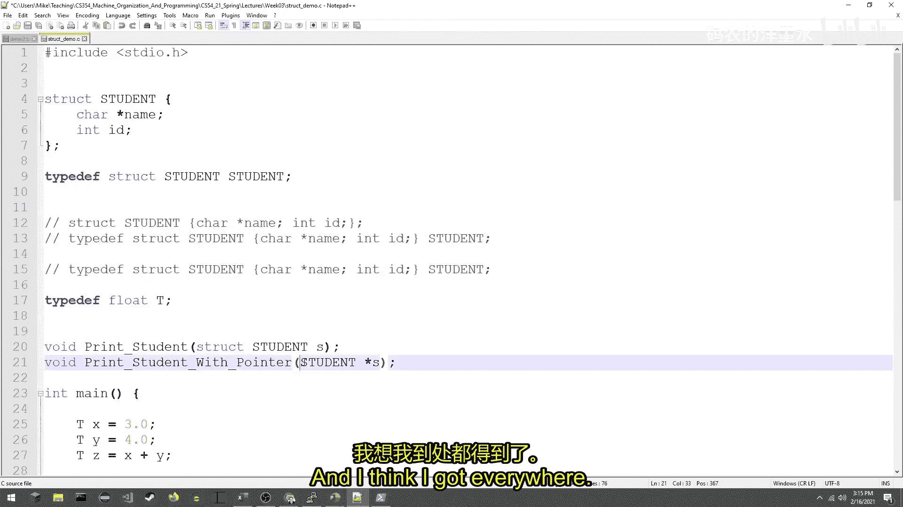

And compile this and run it， make sure the code that I give you guys works。Got one more， Oh。

 unused variableable， all right。Not a big deal。

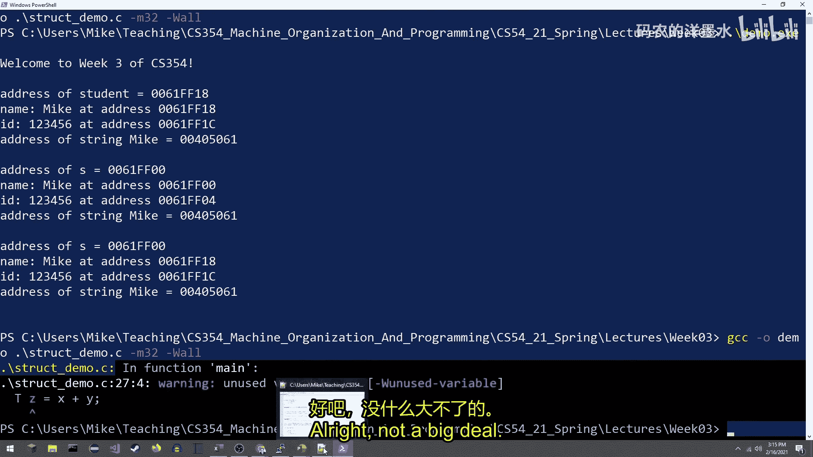

I'm going to leave that warning in there。 All right， that's going to do it for me。

 that's everything I wanted about Strs， I believe。There was。No， I think that's it。 Alright， Anyway。

 have a great day。 Let me go edit this video。 I'll get it put up on YouTube。

 and I'll send everyone an email。😊。

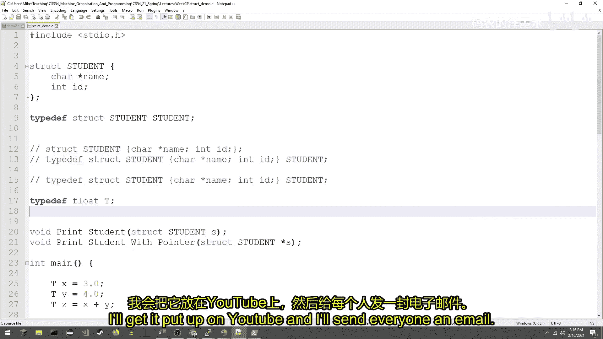

Have a great day。