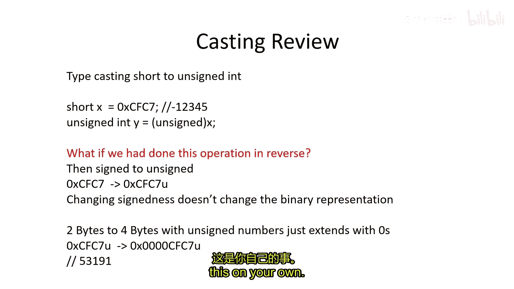
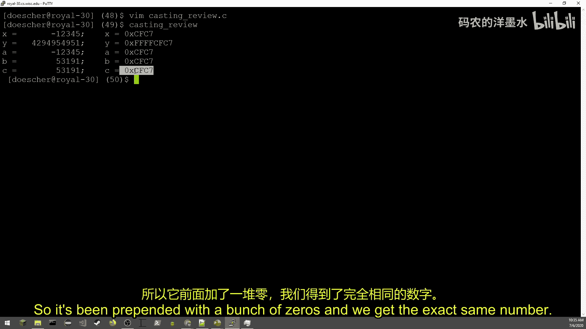
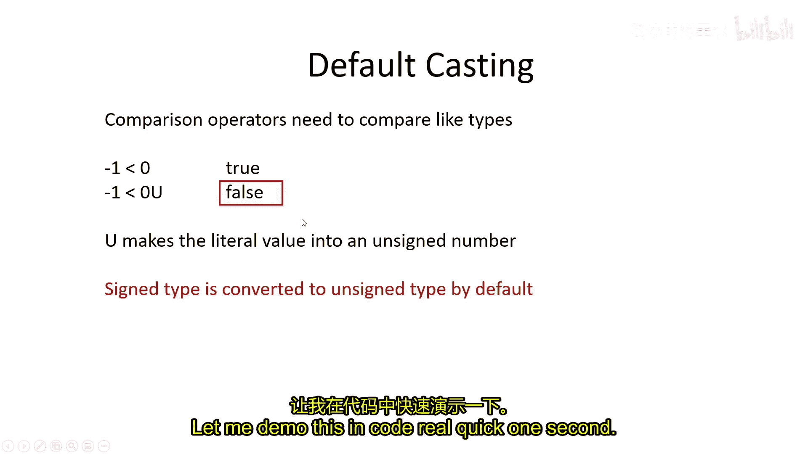
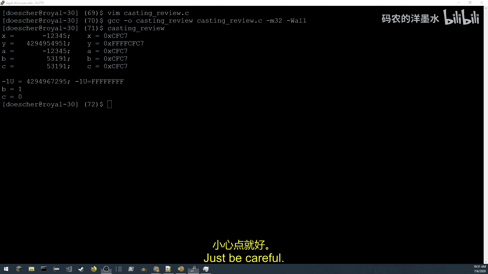
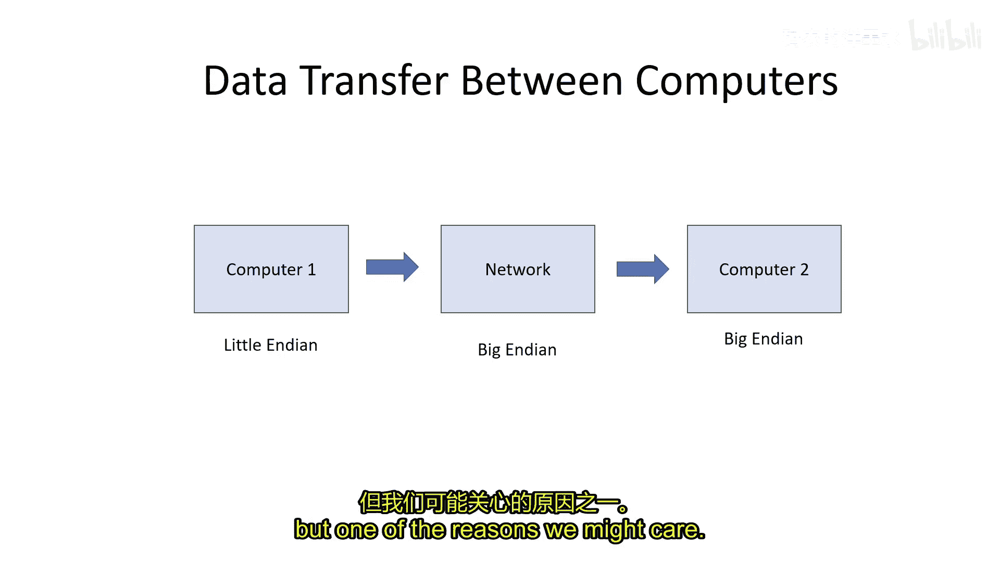
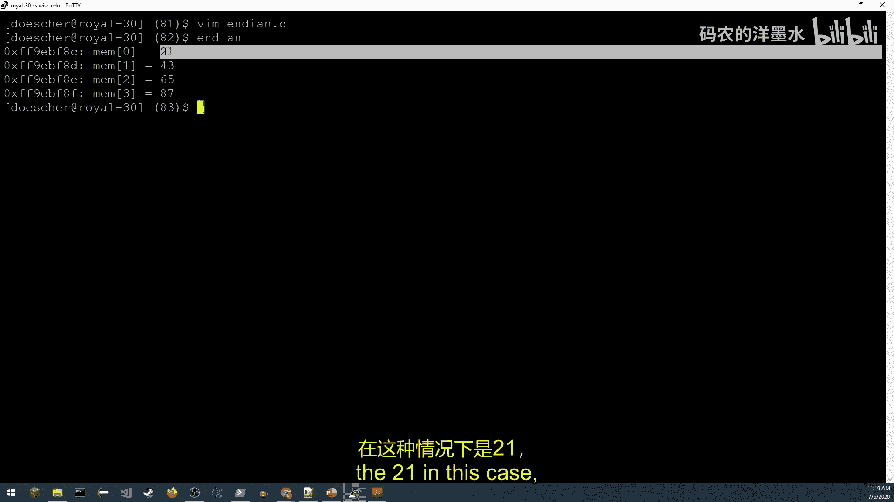

# 【全集】威斯康星大学 C语言编程与计算机底层原理 中英字幕 1080P p06 Lecture 6 - 类型转换与字节序 -BV1BViQBwEiS_p6-

Hello， everyone， welcomelcom back to machine organization and programming。 We're in week 8 now。

 We're about one week behind schedule。 We do have some time reserved at the end of the semester for review and makeup。

 So we'll use that time。 and we're going to be okay。

 just want to reassure everyone we are going get through all the rest of the course material。

 And it's not going to feel like I'm dumping a whole lot of material on you all at once。

 It's going to get spread out。 So just a heads up there。 All right， in this week。

 we're moving into this middle third of the course we're going to be talking about assembly language。

 We're going start with a review of casting and then an introduction to ending in this。

 This is sort of the very low level details about memory and how the computer is going to actually store numbers and keep track of the types of numbers。

 And then we'll move into bitwise operations。 So again。

 more extremely low level detail bit wide operations。

 binary arithmetic to sort of talk at the at the hardware level。

 So the first five weeks of the course for about C programming。

 We're going talk about the hardware level and then。😊。

language is what's gonna connect those together because the CPU requires it's got very few instructions it can actually do。

 We need take all of our highlevel C statements and break them down into multiple steps so the processor can actually deal with these more complicated C statements using its very limited set of instructions。

 And then in the middle there I've got the very last topic from C file input and output。

 only need that for the next homework assignment I just seem like a good place to put it in there before we bring in assembly So the casting review section This is from section 2。

2。4 in the computer systems book。 people have been asking about practice problems。

 The practice problems at the end of every section of this book they're excellent。

 I highly recommend taking a look at all of those the answers are available in the book。

 let's see the section on andd and is from section 2。1 of the book。

 great story about Guverse travels in there highly recommend taking a look at that as well。

And something else， our textbook， computer systems goes very deep。

 It's a very thorough And so the lectures that I want to provide with you of here are designed to provide an introduction to the material so that when you get to it and you see that all the complicated formulas they're using and the code names they give all their formulas that those kind of make sense。

 So what I'm doing here is sort of a description of the algorithms。

 but then you can go and see they've given it some sort of code name and map posts to nomenclature。

I'd also like to mention that the lecture that I'm recording right now。

 I'm using pieces from the summer lecture。 I'm just cutting it up， rerecording some of it。

 bringing in pieces that work well from the summer。

 So if you see like a timestamp and it's from summer I borrowed that because I thought it went really well just a heads up。

So what I want to look at is reviewing casting from one type to another。

 The example I want to do is one of the more complicated ones。

 What I'm going to do is is an example of casting a short to an unside integer。

 So this is going to go from a2 byte。Actually， I think that's my next slide。 Yep。

 so it's going go from a2 byte short to a 4 Bte int going from a signed variable。 And in fact。

 we'll be choosing a negative number to an unsigned variable。

 So I just want to show you what happens and what the result is when we do this。

 So the code for this will look something like this。

 I'm going to declare a short assign sign it value。

 I wanted to make sure there's a one in that very first position of byte1。 so that it's negative。

So C is equivalent to 12 and is let's see1，0， no， 11，00。So it starts with a one。

 That's the only thing that matters's why I chose C and negative 1，2，3。

45 is kind of a nice convenient number to check and make sure and it's easy to remember。

So the next thing we're going to do is we're just going to take that X， which is a short。

 cast it to unsigned。 and this is a short cut for unsigned integer。

 So the way I cast is just use parentheses followed by my variable。

 I'm going to store that into an unsigned int。As we do this， we're making two changes。

 so we're going to change from two bytes to four bytes and from sign to unsign。

 so the question is which come first？Which comes first， And the order here matters。

 The answer is that the size is changed first。So。To do this， remember。

 we're going to be using signine extension。 So it goes from CF 7。 This begins with a one。

 So we're going to add an extra2 bytes of completely filled in with ones to go from a short to an int。

 So in Hexadeimal， that's just going to be adding four fs to the front of this。And when I do this。

 if I compute this， I get it 4，2，9，45，49，5。As the final answer， oh wait， Id love to step out。

 After that， I needed to convert from signed to unsigned。And when I do that。F， F， F， F， C， F。

 C 7 does not do anything。 It's still the same bit pattern。

 It's just how C is going to use that number in the end。

 And that's going to change depending on whether we're doing a comparison like a less than or I'm printing it out and telling it how to use that anyway。

42 billion something。 So remember that changing the sideness doesn't change the binary representation。

Only sign extension is going to do that when we go from small to larger。All right。

 So the next question I have is， I want to show you this is different。

 What if we had done this operation in reverse。 If we did the sign first。

 that's not going to change anything， It's the same binary representation。 So I still get CF 7， CF 7。

 But now this is going to be a positive number。And then when we， in fact。

 it's this number right here， when we go from two bytes to 4 bytes to make this the unsigned numbers。

So the positive numbers take up more space。 We just fill in with zeroes。

 So instead of extending this with ones， we're just gonna fill in with。16 extra zeros。

 And the final result is 53000。All right， let me jump over some code and actually show you this in code and how you could do this on your own。

Alright， guys， so I jumped over on CSL machine。 I'm gonna fill in most of this in a second off camera。

 But just the highlights here， I'll be creating a short。Integer x is equal to -1，3，4，5。

 So we got the negative 1。 We'll be casting this to an unsigned integer。Unigned。And。Y is equal to an。

Unsigned is the unsigned int is unsigned is just a shortcut for unsigned in。

 I don't actually need the int。 And I'll be casting variable X to this unsigned integer。

 And then I'm gonna print this out。 printnt F。 let's see。Print out X is equal to。

 We'll do it in decimal。 And when I do this， I'll be looking at some big numbers。

 I'm gonna to give myself a field of width 12。 And this will just print this over on the right side of that field。

 So it's gonna to reserve 12 characters。 printed it on the right side of that。

 which should be plenty of space。 And then I'm going to print this out in Hex。 Also So percent sand。

I don't care how big the field is here。 It'll just use what the rest of the space。

 I we'll go ahead we'll put in 12 anyway。And the command for hexasmal printing for a short is H X。

 I looked it up。 It is there。 I was really struggling to find this before。 So S is for strength。

 So S has already been used。 H is the second letter in short。

 I think that's where this came comes from。And then x is the symbol for the format code for exodadecimal。

Alright， so that should do it。 And then we've got printing X twice。Alright， looks good。What's。Oops。

 ups， ups， up，a， stop， S up。Oh， what's we do， What's re do， Sa。There we go， okay。Copy， paste。

 there we go。 Now I want to change all these and do the same thing for why。 so place that with why。

So that with a wide， not that one， that's how because that's not a ride。Why why， Okay， there we go。

 That's what I'm looking at。 I'm going to go ahead fill in the rest of this。

 So it's a real program and be right back。All right， filled in the rest of this， we forgot return。

0 and I made one mistake here right there under the cursor。

 I needed a U instead of a D to print this as an unsigned variable。All right。

 let's save and quit this。And then we will compile this， so GCC。Well call it casting。

Whatever I call the casting of， do that。That's the file M32。All the warnings and then I need this。

Dash O， okay， now I run this。Casing the view。 Here's what I got。 X is equal to -1，2，3，4，5。

 exactly like I thought。 Check this cell。 printingnt as hexademal with only four letters worked。

 CF 7。 I'm getting lowercase。 Oh， I need the capital X in my code。

 I'll show you in a second where that goes。When I cast this。

 I do get a very different number from this one， enormous number， in fact。And。Yeah。

 it's just prepened this with all of the ones there。So啊。Oops， I've got to need the volume。Castinggr。

c right here， I need these guys to be capital X。Now it should print。As capital letters。 Okay。

 I prefer that。 That's the way I like it to look。All right， next up。

I want to go back and show the other demo where we're doing these in the reverse order， one sec。

All right， so yeah I just added a little bit of extra code here。So right here。

 I'm declaring a short A equals 9-12，3，45。 just like I had here， this is my equivalent of x。

 I'm going to be casting this unsigned short or this short to an unsigned short B。

And then we'll be casting the B to an unside integer and join that in C。Alright。

 And then when we print these out， I'm printing out the original one in both decimal and in hex as a short。

 This one's also a short B， but it's all an unsigned。 So we'll be printing that at unsign。

 Then when we cast the toce unsigned in， we'll be printing that out as。

Unsigned and the full hexademonal。 But that won't matter， as you'll see in one second。Save a quit。

 And then I already。Compiled this。 So when we print this out。

 we see that a is the same number exactly as we got for x， exactly like I put in。

 when we cast this to an unsigned short first， though， it keeps the exact same bit pattern here。

 It doesn't prepen it with all of these ones。 So no sign extension happens。

 It just decides how it's going to reintert the bits。 It doesn't actually change any of them。Okay。

 and then the next thing we do is。Convert this to from a2 byte short to a 4 byte int。

 And that doesn't change this either。 It's still the same bit pattern。

 It just adds a bunch of zeros here， which the printing function print F doesn't actually show。

 So it's been prepened with a bunch of zeros。 and we get the exact same number。

Allright， so next up， I just want to talk a little bit about default casting when we do comparison。

 So if I have a comparison operator like the less hand here， I need to have both sides。

 the left hand side and the right hand side be of the same type in order to do this comparison。

 So this top one here，-1 is less than0。 That's obviously true， very easy。

 Theyre both integer literals because default value is for a number is integer。

So that one will be true。Now， if I add this U here。

 that's going to say make this zero an unsigned number。

And so when I compare it to the -1 is less than an unsed0。 This is the question。

 which way do we do this conversion， It's automatically going to convert one of these numbers。

And the answer is that it converts the negative one into an unsigned value。

 So it switches them to unsigned by default。 And when I do that。

 this negative one becomes as an integer， all ones。

 And this is going to be the maximum possible value of an unsigned integer when I do this cast。

 So it's going to be 1，1，1，1，1，1，1 is less than 0。 That's obviously false when I do that。

Let me demo this in code real quick。

One sec。Allright， so I put some of this into code below the line of slashes。

 which is a common row of slashes， which makes a great divider。 I've created a new block。

 I'm using the brackets here for scope because as I was  tapping this I just typed in B equals minus1 less than 0 that'll take the result of this expression and it returns a number either0 for false or one for true and it'll store it in B。

But I had already used B up here。 So that gave me a compile error when I tested this。

 So rather than change the variables。 I stuck this in curly braces。 So now this B is a different B。

 because it's in a different scope。 That was just me being lazy。

 Sorry if that's confusing for anybody。 Then I did the same thing。 except I added the U here。

 So I'm storing the comparison between the negative 1 as an integer and 0 as an unsigned。

 And then I'm printing some stuff out。 I just want to demo that this the negative1 when it gets converted to the unsigned printing that out as an unsigned and as the hexadadeciimmal。

 And putting in-1 U for both of those is， in fact， really ginormous number。

 And then I'm printing out B and C。 So B is the result of this computation C is the result of the unsigned version。

 Okay， so。Let's jump over here。 We'll compile this。And then we'll run it。Im to show you what we got。

 Okay， so this is the new stuff down here。-1 U is， in fact， a really huge number。

 maximum possible integer， unsigned integer and。It's all else。

Sorry about that I've got still got my phone on because I'm expecting the results of my COVID test。

 they're going to call any second。嗯。All right， All right， All right。

 And then when I did this comparison for both as integers， negative one is， in fact， less than 0。

 So I get one。 And when I did the other version where I did negative one is less than 0 unsigned。

 This one came out false， even though it looks like it should have been true。

 So the moral of the story here。 I this is one of those little differences between that makes C special。

 And those are the kinds of things that are gonna to appear on the exam。

 those little I guess they are a tricky thing。 I don't intend them to be trick questions。

 But it's just something that you guys should be careful of as you're writing your own code。

 If you're doing comparisons between signed and unsigned。

Anything it's going to convert them to unsign。 And you may end up with results that are unantipated。

 The compiler will never tell you that's a problem。 It knows exactly what to do。 It trusts you。

 as an expert programmer。So。あ。Just be careful。

All right， one last topic， just a small thing before we get into the bitwise operations。

 the core of today's lecture。And that is how do we store multi byte numbers in memory。

 So in the past several lectures， I've just been saying we have a 4 byte integer。

 I'm listening this is 0 x1000 is the memory address and then I'd have the next memory address as 10。

04 and ignore what's going on。 the fact that this is actually4 bytes of memory。

So if I consider a four byte integer， 8765，4321， I've got the big numbers here as the in the positions of the most significant bit so I can remember that which way they go。

But I have more than one choice when I store these in memory so。

Lets see here this 87 will be bit a byte。 Oh man， I said bit。 I meant byte the whole time。 byte 3。

 the 65 will be byte 2， The 43 will be byte 1， and then the 21 will be byte 0。

So I can either put them in with the。87 first。 so I can go with byte 3，2，1。

0 with the most significant byte first， or I could do in the reverse order。

 So if I do the most significant。Byte first， it's going to look like this 87，65，43，21。

 This makes a lot of sense to most people。 This is kind of how I've been writing it in the past when I've done some of these multibte examples or the like very beginning of semester。

 But I have another choice too。 I could put the least significant byte first。

 So I can put the 21 first and then 43，65，87 And these are known as endingdianness。

 because I'm looking at the end of the multibte integer。 Which end do I list first。

The name actually comes from Guver travels。 I'll put the。The little story up in a second。

 you guys can pause and read it。But so I've got two choices。 The big end first。

 big endn means I'm going to put the most significant by first。 So the 87 in this case。

 And then I'm just going to list the others。 the little endN。

 I'm putting the least significant by be 0 here first， So 21， then 43，65 and 87。

And believe it or not， this is still today a huge controversy in computer science。

 It's been going on since the beginning of computer memory where we had multibyte numbers。

 Which way do we store these and about half the machines in the world using half very loosely are big Indian machines。

And about half the machines out there are little Indian machines。So you really。Well。

 there's a pretty easy way to tell。 I'll show you how to do that in a second。 and with some code。

 you can do a little experiment。 Let me throw up that story real quick before I dive into code。

All right， guys， I got the story up here。 This is taken directly from our textbook。

 It's from Oliveriver's Travels。 And I'm just gonna go ahead and let you guys pause this。

 You can read it if you're interested。 It is from our textbook。 It was in the assigned reading。

 So if you've already read it， that's fabulous。 But the original origin was about when you're opening up an egg。

 whether you are to break the small end of the egg。 the little end or the big end of the egg。

 All right， enjoy。😊，All right， one more quick reason we might ever care about this before I jump into the code and show you how to figure out which machine you're working on。

 This is a really big deal because different computers use different systems for numbers。

 and so data transfer between computers， I'm going to send one byte at a time over the Internet。

 So if I have a little Indian computer that I'm starting and I'm uploading X information to computer 2。

 I need to know which way they've stored the bytes。

 So most of the internet infrastructure out there is big Indian。

 So if I have a little IndianN machine， it needs to convert that to network transmission protocol。

 which is gonna be big Indian。 And then because computer2 here in my demo is already big Indian and doesn't need to do anything。

 it can just read the bytes in the correct order。 we'll talk a little bit more about this in a future lecture。

 But one of the reasons we might care。

Allright， so I put together some code that's going to help us decide the N D and S of the CSL machines。

 So just real quick， let me walk you through this。 I've got my number here that I've been using in my PowerPoin example。

87，6，5，4，3，2，1。 storing that in none。 Now， in two steps。

 the strategy I'm going to be looking at here is I'm going to take advantage of the fact that even though I've got a 4 Bte integer。

 The character data type is only  one byte。 And so I can print out just one character at a time。

 And what I'm going to be doing is breaking this number into individual characters。

 So like 87 is going to be 1 byte。And I'm going to store that in a character variable。 Well。

 I'm going to have a pointer to 87 and the 65 and the 43 and the 21。 So to do that， because nu。

 C is already aware that num is an integer。 I've got to do this in two steps。

 So I need to assign an integer pointer to the address of number。

And then I'm going to take and cast that integer pointer to a character pointer。

 And now C is going to know that when it's looking at a character pointer。

 it only needs to take advantage of one byte at a time。 And I'm just going to print this out。

 I'm just going to go through 0 to4。 I'm going to pretend that this character pointer point to an array。

 And in fact， it does。 It's pointing to an array of bytes here。 I've got four bytes in a row。

 And I'm going to print those out。 So the first thing I'm printing is actually the address of the pointer。

 So that's the P symbol format character。 And then I'm going to be printing out Mm 0 Mm 1 Mm 2 for the different positions。

 And then the format string required to print out just one character in hex。Is oh。

 I'm sorry 1 B is H H X。 So I think what they did is they took the H from short and then just added an extra H。

 H might stand for half of that。 I'm not really sure anymore。 I couldn't find anything。

 But then I'm going to do just printing out the value PC I。Of whatever stored in that。 Alright。

 so let's go run this code。And see what we get。 I already compiled it。 I was testing a second ago。

 So when I run this， I see that I've got my memory addresses here。 and they are， in fact。

 one memory location apart。 C， D， E， F。 It's not jumping from C to 0， and then 4。

It's jumping by one memory location。So I'm printing out sequential bytes。And then here's my memory。

 array，0，1， to3。And the values in spreading 21。 So it looks like the least significant bit comes first at the lowest memory address。

And that 43，8，65，87。 So， in fact， the CS S L machines are little Indian machines because the least significant by。

 the 21 in this case comes first。

