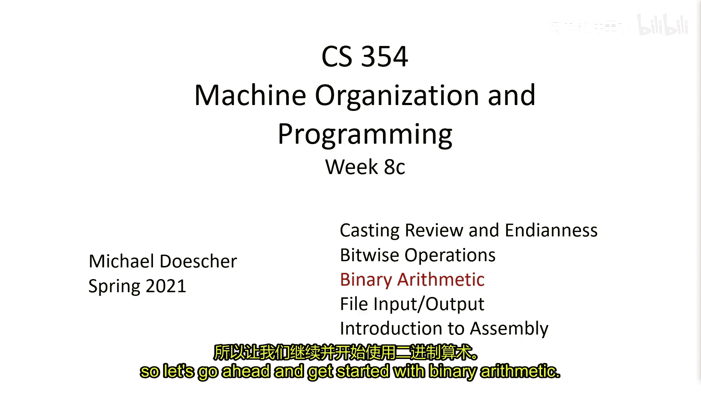
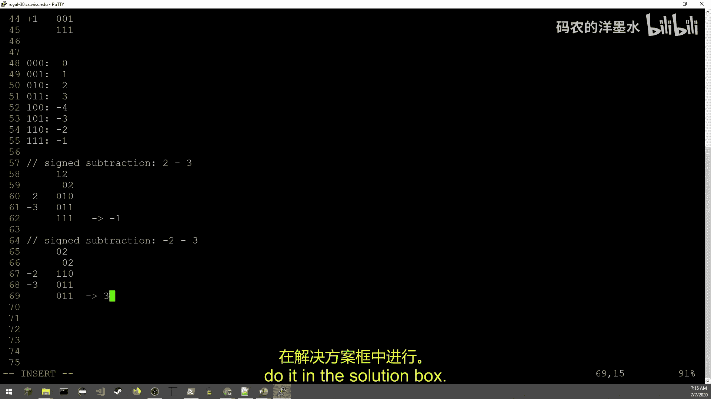

# 【全集】威斯康星大学 C语言编程与计算机底层原理 中英字幕 1080P p08 Lecture 8 - 二进制算术 -BV1BViQBwEiS_p8-

Hello， everyone， welcomel back to machine organization and programming。

 This is part3 of this week's lecture material。 Today we're going to be talking about binary arithmetic。

 This is from section 2。3 of the computer systems textbook。

 just to heads up we're not going to be doing the floating point version in 2。4。

 I don't really feel like you learn obviously you're going to learn more if you read that section。

 I found it fascinating。 but what we'll see is that the patterns are going to be the same。

 We're representing numbers in binary。 we're going to talk about all the integers to represent a floating point number and binary。

 we need to choose some of the bits to be the sign。

 some to represent the manissa and some to represent the exponent。

 And then we've got to do a bunch of manipulations to do math with them。 So anyway。

 read that section if you're interested。 we're going to focus on just the integer decimal values for this course。

😊，And in particular， this section has some really great practice problems at the end。

 I highly recommend that after you're done going through this lecture， then read the textbook。

 And again， this is one of those examples where the textbook has lots of math formulas and to be honest。

 those formulas are all great。 But in my opinion， they overly complicate something that's just not really all that hard。

 So I hope my introduction here helps make this make a lot of sense。

 And when you get to those formulas， you can say， oh。

 this is just doing some actually pretty simple process。

 even though it's a complicated looking formula。 But when you get done with that section。

 definitely take a look at problem 29。 make sure you can do at least that one。

 But but look at all of them， don't don't just top at 29。 All right。

 So let's go ahead and get started with binary arithmetic。😊。

Alright， guys。 So the first topic for today is addition and subtraction and binary or arithmetic in general。

 So I just came back over here to a。This is just a text file opened up in Vim。

 I thought this might be。The easiest way to do this because I can like walk through the process and point that specific things with my bold green cursor。

 rather than just making a bunch of PowerPoint slides and using the mouse to circle what I'm talking about can actually do this live。

 I hope this is useful。 Let me know if you prefer this to PowerPoint we can。

Put together the best possible presentation for next year。 Okay。

 so I'm considering a  three bit machine just to keep this as simple as possible。

 This is going to be using two complement representation for negative integers。

 But the first thing that I want to do is talk about addition of unsigned numbers。

 So I'm looking at 3 plus  one。Okay， in binary。 So this is binary arithmetic。

 So  three is going to be 0，1，1 on a  three bit machine。 So one plus two equals3 and one whoops。

That is the problem doing live is going to be 001。So。When I go through and do my addition here。

 the first thing I'm going to do is。Should fill this in the spaces。 so I can use 0 keys。

 So the B0 position 1 plus1 is 2， right， except the binary doesn't have a 2。

 So what I'm going to do instead is just like I would do with decimal addition。

 I'm going put in a carry。 So 2 is going become 10 in binary。

 So I'm going to stick at 0 there and then up here in this row in the B1 position。

I'm going to carry a one。You I've got the same thing here。

 I've got one plus one plus0 is going to be a。Two， so that's going to be represented as 10。

I'm going to come back up here。2 is going to be 10。 So I'm going to carry a one into that position。

 And then when I come down here。Place that with a one oops， of oops。 let me make this look good。

Failing with the typing。 Okay， there we go。1，0，0。 So 100 is actually equivalent to 4 when we convert it back to decimal。

 which is exactly what we would get with the3 plus1。

 So the whole point of this problem was to demonstrate carrying just like we'd see in decimal。

 but in binary。Alright， so my next example here，5 plus3 is going to be a demonstration of what happens。

 It's it's called overflow。 When we create a number that's too big。 So please remember in three bits。

 when I'm using unsigned numbers， I'm allowed to represent 0 through 7。

 That the7 is the largest number， I'm going to be able to represent binary1，1，1。

 So what happens when I get a number that's too big。 So 5 plus 3 is 8。

 And let me just write this over here 5。No five。プす。3。And in binaryerary 5 is going to be4 plus。

 no two is plus1， and three is going to be just like I head up above 0，1，1。

 So when I do this edition。Here you go。I know the answer is going to be8。Let' see here。

 So let me just walk through this One plus one is two， which is going to be0。Okay you the one。

And then one plus here，1 is going also be 2。 So I get 0。Carry the one。

OnLike you could type all right， one plus one again is going to be zero。Here's the one。

And then I'm just going to carry this down。 The problem is that I only get three bits to represent this。

 And so what happens is that I keep the smallest3， the least3 least significant bits。

 So when I store this in memory。 This is going to become just 0，0，0。

 which is going to be 0 instead of 8。 So here， check this out。

I just real quick filled in all the possible numbers for unsigned。Integers with 3 B。

 And what I'm seeing here is I started with 5。 I added 3 to it。 So 1，2，3。

 What happens is it wraps around。 So if I were to do any of these。

 it's sort of like taking the modulus of the answer。Based on how many digits I get。

And because I have overflowed how many bits I get at the end to represent my final answer。

 this sort of。I want to call it a mistake， but this is just how it's going work is known as overflow。

 This is actually pretty common to see on machines。

 if you're doing like if I'm using an integer or a small to represent a number that's just straight up not big enough to hold the result of my computation。

 Like if I'm looking at the Fibonacci sequence or a factorial type problem where the results get very big after just a few iterations of those algorithms。

 this overflow problem is quite big。All right， and a great way to test to see if overflow has occurred is to just take a look at your two numbers。

 So in this case I've got five and three and your're answered。

 If I add any two numbers together and the answer is smaller then the larger of those two numbers。

 then overflow has occurred and I'd no longer have the correct answer because I've lost some of the more significant bits。

All right， so quick way to test for overflow。Alright。

 so subtraction is going to work the same way whether we're using signed or unsigned numbers。 So。

 but I wanted to just real quick to an example with something I' would work with either。

 So sign subtraction。 So in this case， I'm looking at two。Take away one。

And two in binary with three bits is going to be 010。And take away  one。 is's gonna to be 00 1。

 So the first thing I'm going to do is just like in decimal。 I'm going to go ahead and say， okay，0。

 take away 1。 I can't do that。So what I'm going to do is I'm going to borrow from this。

 the next disimal place over。 So in this case， this is going to become 0。Here。

 let me actually leave the number there and just right up at the top。

 this is going to become a zeros。Right there， a zero， and this will become a two。

Now I can think about it like that while I'm doing the math。

 So now I can say two takeaway one is just going to be one。And then I'm going to make zero。

 takeaway zero is going to be0 and zero takeaway zero is going to be0。Make the numbers all line up。

 So hopefully that makes sense。 I'm borrowing from the twos position here。

And turning this zero into a tube for the subtraction so that I've got something to actually subtract from because I need to be able to take from a larger digit。

In order to get a meaningful answer right here。 So hopefully this subtraction work。

 this would be an example that work for either signed or unsigned numbers here。

So the next example I want to do， I'm going to look at signed edition a little bit differently。

 This is technically a subtraction problem。 What I've done here is taken my subtract one and turns it into a addition of negative one。

 So here check this out。 This is going be how this works。 So let's see here I've got。To。Again。

 minus1。 we'll just write it like that。 So this is going to be2， it's still going to be 0，1，0。

I need to fix my VMRC so it stops auto filling that in and out letting me just keep typing。

I haven't done that yet of my own machine。 Okay， so take away -1。

 Let me just make a note real quick here that -1。I'm going to do this in a couple of steps。

If it were positive would be 0，0，1。 And chooses complement to switch from。Positive to negative。

 I'm going to first take the one's complement。 So00， whoops the0 turns into one。

 the0 turns into one and the one turns into a0。 So that's how one's complement works。

Make note right here。Ones。Complement， and then I'm going to add one。So。嗯。Plus， one is going be 0，0，1。

And the result of that。 So I'm looking at the second line here，0 plus one is going to be one。

1 plus 0 is going to be 1， and1 plus0 is one。All right。

 so negative one in chooses complement representation 111。He once I， let me write out all of these。

 and I'll just have the whole chart available for。Reference。Alright。

 so just for a quick reference the。Very first digget bit here is going to represent the sign。

 but it's a little more complicated than that。 But anyway， if it's 0。

 we're just going to get the normal positive numbers that we'd see for sine magnitude for unsigned magnitude。

 Okay， if this bit is a1， the formula we use would be to take the negative of the 2 to whatever power this is。

 in this case， 0，1，2。 So negative。Two squared。Cause it's the B2 position。

 So I'm raised to the two power。 So it's going to be -4。

 Take away-4 plus 0 times 2 to the first times 0 times 2 to the 0 power。 So I just give you -4。

 And this is going to result in a pattern where the very bottom number。 The 1，1，1。

 all one's position is going to be -1。 And then it just counts down from there， -2-3-4。Okay。

 so easy way to remember this if we're looking at。Small numbers， at least for larger numbers。

 go ahead just grab that formula to do the conversion if you need to go from binary to decimal。

Allright， otherwise， two's complement representation means just we take the once complement and then add one to it。

 Those are the two steps we need。 Allright， so now back to signed addition here。

 So I'm taking two plus negative 1。 So I've got two here is 0，10。 negative 1 in twos complement is 1。

1，1。 So now I'm just gonna finish this problem up when I add these numbers together。

Z plus one is going to be one。And then one plus one is going to be2。

 So I need to do that carry thing。 So I'm going to get a0 here。And one here。1 plus  one is2。

 So I'm going to also see the carrying issue，0， and then one。

Right there in when I take 1 plus 0 plus 0。 essentially， I'm going to get a one right there。

 And now I only get 3 B。 this is actually going to be stored as 0，0，1。

So we see that this same problem 2 plus negative one also is going to give us the exact same answer。

 So0 one， just like we'd expect to take away one is one。 But it did this by overflowing the。

That fourth position there。 So that's not available for us to store our number in。

 So subtraction with signed integer still works just the same， whether I'm like。

Just doing sp subion or I convert to a positive convert to a negative number and then add them together。

They work the same。All right， one more slightly more complicated example。

Is going to be a problem where I am subtracting and end up with a negative number。

 So let's take a look at how this is going to work。 Alright， so I'm gonna take2。Takeaway。Insert mode。

 takeaway three。So in binary，2 is going to be let's see 010。And -3。

 I'm just gonna look at my chart right here since I already did all the work。 is's going to be。

How let's do it with regular， regular 3，0，1，1。And we'll just do some subtraction here。

So as I go through this， I'm going to need a line for carrying and borrowing or let's see whatever it's called。

I'm taking0 takeaway1。 What I'm going to get here is I need to I'm borrowing。 So my 1。

0 is going to turn into a 0 and a2。 Okay， And when I do that to take away1 is going to be one。

 No problem。All right， now I run into a problem here because I've technically got zero takeaway one again。

And I would just normally borrow from this position right here， But there isn't anything。 So instead。

 what I'm going to do is jump over here to this imaginary fourth position。 There's nothing there。

 technicalnly， it be zeros all the way out for two。 But instead。

 what I'm to do is I'm going to borrow from this imaginary missing bit right here。

 And just pretend that it works。 So this is going to become a two right here。

 And I'm going to borrow from that position。So maybe one more line up here。 This is the。

 this represents my first level of borrowing。 And then up here， what I'm going to end up with is。

A one and a2。Let me think do I do that right because I'm borrowing from this position so that becomes a two。

 and then I'm borrowing from that position， so that becomes a one and this becomes a two。Alright。

 and then yep， to take away that one right there from the minus-3 line is going to be one。

And then one takeaway 0 is going to be a one。And。Ohoop， os， messing up here。1，1，1 in binary is。-1。

For negative twos complement representation， which is exactly what we'd expect if we take two。

 takeaway 3。 So the trick here was that I needed to borrow from this imaginary。嗯。We are。

I'm hesitant to do this， but if I stick in a。Could be could be0 could be when I'm borrowing from this this piece right here that's not actually there。

 I'm going to take out my question mark in just a second to leave it so that when I post this on canvas。

 it looks normal。So it's not confusing for people who are looking at this document first。

Take that out。 Okay， but anyway， so the the trick here was I had to borrow from this imaginary fourth bit position that doesn't exist。

All right， one more example， and then I'm going to wrap up a。Alright。

 so the next problem I'm going to be looking at is negative 2 takeaway 3 answer here is going to be -5。

 But here's the the problem。 And the challenge。 the reason I chose this particular problem is we don't actually have a -5 that we can represent。

 So just what happens here。 This is a problem known as underflow。 And here's the idea。 Okay。

 so I've got negative 2， I'm going to be subtracting  three from it。So I go over here negative2。

 I'm just going to grab this for my chart， it's 110。1，1，0。

 and then I'm going to be subtracting three。 So I'm going to go ahead with the positive 3，0，1，1。

 release some subtraction。Come on， insert mode。No。Insert mode。 Okay，1，1。Oops，0，1，1。 Okay。

 so doing some subtraction here。 So what I've got is I'm going to be borrowing。For this first piece。

 because 0 takeaway 1， I can't do that。 I need to borrow。 So I need to turn this into。Inswered mode。

 come on， Mike。So you're up in the bar from that， that'll be a two。And I got to fix the MRRC。

 Make this easier to type。 Okay，2 takeaway 1 is gonna be one。 There we go。 Alright。

 then same problem here。 I've got 0 takeaway 1 is going to be。Yep， I need to borrow again。

 Let me add another line here。And I'm going to borrow from this position。 So that'll become a 0。

 This will become a 2。 And I'm going to take two takeaway one here。 and that's equal to one。

And now I've got zero takeaway0， so that's going to be0。And now， in the end， I do not get。Here's 0。

11。 the first bit 0 tells me it's going to be positive number。 and in fact。

 it's going to be positive3。 I can either look at my chart up here。 I can just say one plus two is 3。

um。And negative 2， take with 3 is negative 5。 It is not3。 But here's what happened。

 I've underflowed this。 So there is no negative 5。 So basically， I started with。

 I started with -2 right here。 I'm subtracting 3。 So that's basically like counting up 3 positions 123。

 I end with a positive number， even though my answer should be negative。

 I just don't have enough bits to represent that negative number。 So negative 5。

 I would require 4 bits。All right， so that's going to wrap up arithmetic if you guys have any questions。

 post them on piazza if you want to see another example or something。

 I can propose that and I'll go ahead and do it in the solution box。

