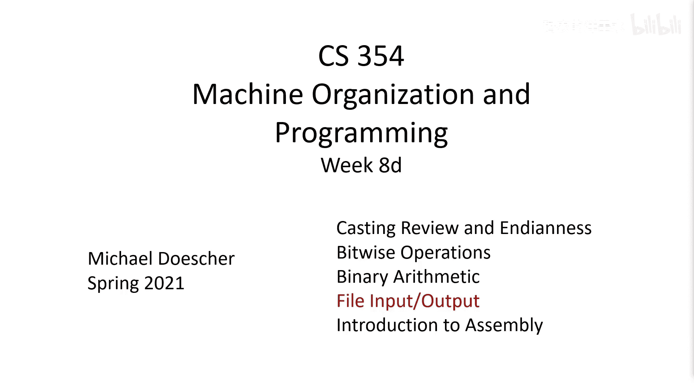
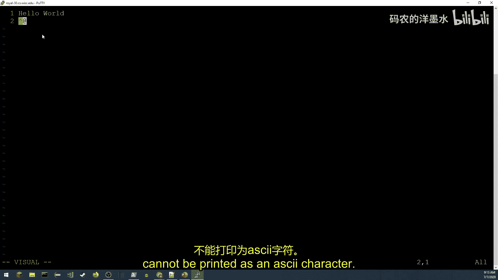

# 【全集】威斯康星大学 C语言编程与计算机底层原理 中英字幕 1080P p09 Lecture 9 - 文件输入和输出 -BV1BViQBwEiS_p9-

Alright， welcome back to machine organization and programming。

 This is our fourth lecture for week8 here we're going to be wrapping up the rest of C。

 at least I think it is with file input and output All right。

 this is the last topic its something we need for the next homework assignment so I want to make sure that I get this out before the homework assignment comes up All right。

 this is also from the C programming textbook the C version of file input and output is in section 7。

5 to 7。7。And we can also use Linux system calls to do file input and output。 and that's in section 8。

1 to 8。3。 need to be a little careful there， so pay attention to the warnings。嗯。

And so most of what I'm doing here is footage that I recorded over the summer that I。

 I thought was pretty good。 I didn't go back and redo it。 If I were to go back and redo it。

 the one thing I would do is include more information from the manual pages。

 Man pages for all of the different functions that I introduce。

 So my advice is to just pause the video as you go through。

 And every time I talk about any one of these lines of code。

 pull up the man page and follow along with that。 And those functions in particular， F open， F read。

 F， write， F gets。 And then for the Linux system calls open and write。 definitely pause the video。

 pull those up。😊，And we'll be getting some practice with this file input output with the next programming assignment。

 Alright， so let me go ahead and jump into file input and output。

All right guys， so the next thing I want to talk about is reading and writing to files。

So looking at what we've got right here， this is my file 1 do C。

 I've got three examples for us today。 This is just an example of opening a file and reading from it。

 So if we go through here， I'm defining max， this is a great way to just。😊。

Create a constant that I'll be using for the size of everything because C does not dynamically allocate things。

 for example， right here I'm creating a character array to hold all of the data that's being read from the file and above。

And let's see here。 I'm also creating a file pointer variable。

 So check this out the start here tells me it's the pointer。 This is a file pointer。

 So this is just going to be a stream of characters that we can read in from。To use that。

 I'm going to y assign that file pointer from the function F open and the file I'm reading。

 so here are the options， the file I'm reading is going to be this gates quote Txt file that should be available in the code download section of on canvasva and we're going to be opening this in read mode。

Once sec， I'll pull up the man page for F open， we can see all of the different options。Okay。

 and then what we'll do with it is we're going to just go through。 We're gonna use F gets。

 This is gonna just read a string of of bytes from the。Whatever the file pointer is pointing to。

 And it's going to read at most this number of bytes。 So this is why I'm putting this in here。

 If I didn't have this maximum value。To decide how big my character array is。

 I could easily overrun this buffer and fill it with more characters that will actually fit in memory。

So this is why I'm using this numerical constant for。The size of things。

way better than hard coding because I only have to change it in one spot if I'm suddenly going to be reading a bigger file。

 I'm doing this in a while loop right here， F getss is going to read until it runs into an end line or an end of file。

Marker and it returns that either the character it reads or if it reaches the end of the file。

 it returns the EOF， which is going to'll evaluate it to false in a wall loop。 Again。

 I'll pull up that man page in just a second and pilot these。

 And all I'm going to do is print out that buffer as a string。 And then at the very end。

 I need to close my file pointer。With F close， this is important because you can only have so many files open at a time when this program ends。

 the operating system will take care of closing all those files for me if I forget in my third example。

 I'm going to talk about something that doesn't do that it's just very good practice to make sure that even if we only have one file open that we remember to close it when we're done。

AndThis is a。It's talking to the operating system because there's a communication there between the disk and your program in C。

Al right， let me go run this。 We'll show you that it works。

 You can read the awesome quote and then I'll pull up those man pages。All right， guys。

 so I just compiled it successfully and I'm going to run it in3，2。2 and a half one。 Okay。

 so there you go， the computer was born to solve problems that did not exist before by Bill Gates。

 one of my favorites。 and we can see that it's working if I go to that file。Let's see what theyload。

Kates， yep， I can just see there's the only thing in this file is that quote。

 you guys can download that yourself。Just get out here。

 And now I was going to pull up the man page for F open。And take a look at that。

 I wanted to highlight a couple of things。Let's see here yep。So it requires a path name in this case。

 I can either give it a character pointer， so a pointer to basically a string and see or I could what I did was I just hard quoted the file name as a inside quotes as a string literal。

And then also requires that character for the mode。This is again， going to be a character buffer。

 so if I'm putting this in a character pointer， so if I can have more than one character here。

Let's see here。 I wanted to highlight。Let me scroll down a little bit。

 all the different modes that are available to us。 So I was using R。

 So this is just going to open the file for reading if the file doesn't exist。

 it's going to return null。 So I'm going to go back in a second and add a check for that because I didn't do that that that first program doesn't have great programming style practice。

Our plus will open it for both reading and writing。嗯。It's the same thing more or less as W+。

I believe this one will fail if the file is not open it over return null and this one will create a new file if it does not exist。

 so that's the difference between the W and the R plus version。And if we just open a file with W。

 even if there's a file there， it's going to delete the contents of the file and prepare it for writing。

 so we're going to nuke whatever is in the file A is sort of theend version of that it's going to keep whatever is at the file and put the position where it's going to write at the end of the file。

And a plus is just going to create the file if it doesn't exist。If from。

I'm reading if it allows me to read from it and upend to the end。

 So if I just go ahead and start writing add text to this， it'll just put it at the end。 Okay。

 we can also add the character B if I'm writing to write the text in binary。

 so WB would write in binary。There we go right there。And where's the return stuff？

You have to return value upon successful completion， returns a file pointer， which is a non null。

Pointer to the location in memory it's treated just like reading for memory。

 otherwise a novel is returned。Air number is set。 so you can read that from the。

The a command line later。Okay， yep， so that's what I want to do here。 And then I also want to open。

Man page for F。Gets。Allright， there's a bunch of different versions of getting data。

 This is just another way to read from an input stream like the keyboard or from a file。

 So the version I'm using right now is this F getss。

 I gave it a character buffer to fill in I told it how many bytes I want to read。

 and then I gave it a source。 And this was my file pointer。

So basically F gets with a C is going to get a character， F gets without that is just going to read。

However many characters I tell it to and the return value， this is the part I wanted to focus on。

 is the character that's read cast to an integer or EOF and EOF is going to return evaluate to false if I use that as a condition。

Al right， let me move on to the next example。 Al， I wasn't quite ready to move on to the next example。

 I wanted to show that I did not do great programming practice here。

 I'm using F open without ever testing to see if this file really existed。

 So here's what I'm going to do instead instead。 I'm gonna to just add our conditional。 if F P。

It's equal to null， that means this is failed。So instead， what I want to do is just。Oops。

Return one and the one there would be a signal that this is an error did not return normally。

could also use exit。1， that's a system called。 It's gonna just crash the program immediately5。

 I would prefer that one if I were using this inside of a function， because that will end。

 no matter where I am。 return inside a function will just。renheses， right I don't need them。

 We'll just exit the function， okay。Let me make sure this still works。I didn't mess up。There it is。

 so no problem。Next example。All right guys， so in this example。

 I'm going to be writing to a file and then reading it back just to make sure that it really worked。

 And again， all of this input output stuff is just in standard Io and again to use this。

 I'm going to open a file so I'm creating a file pointer So this is gonna to be a location and memory where I'm going to be interacting with my file through the operating system F open returns that location as a pointer and I'm using WB is my option here。

 So I'm going be writing this as a binary file as opposed to an ASI file you guys can experiment by taking that B off and just see the difference。

Alright， and I'm calling the file bar up in。 So bar are typically used when we don't know what to do for a file name。

 So I'm going with bar this time。 and B is sort of the abbreviation for a binary file I writing this as an ASI text file。

 I would have gone with T XT。And here's what I'm。 I'm just going to write down this number。

 headeimmal 1 through 8。Allright， now， because I'm opening in right mode。

 I'm going to use F right as the C command to write to a function。

 That takes four options in this case。 I need to tell it what I'm writing。

 And this is gonna be more or less a pointer or a sign to a pointer inside。

 So I need the address of something。 If it's just a variable。 It's already a pointer。

 I can just leave this as。Without the address of， and this is gonna to write a number of bytes。

 but it's going to do it in。It takes two options to get there。

 so it's going to ask for the size of whatever writing。 So if it's an integer， if it's an object。

 if it's a character， I'm just going to give it however many bytes are in my integer character or short or whatever system dependent maintained in the future and then how many of those things I'm writing So it's assuming that I'm giving it an array And if I have a string I want to make sure this is big enough to include the entire string And then where to write。

 And again， this is this file pointer is how I'm interacting with the operating system to make sure this gets put on the disk。

And as always， close your files， we only get to a certain number of them open。 and again。

 this version where I'm using F open is going to return the file as soon as the program is going to close the file for me when I get to the end of my program at this return line。

 operating system will take care of that for me。But it's good practice。Okay， now in part two of this。

 what I'm going to do is I'm just going to go ahead and open my file again。

 I'm going to reuse that same file pointer， so this will just be assigned a new memory location where I'm interacting with the operating system to open that file。

 and I'm going to be opening it in read and again， binary mode because this is a binary file。

Nclare a variable so I can read the number into it。

 I don't want to use this same one because that already has the number。

 and I want to show you guys for real that I'm doing this correctly。 So Ill be reading that number。

 And again， Fri takes a location in memory where I'm going to be storing something。

 This is not a pointer it It's just a regular variable。 So I need the address of that。And again。

 EE requires。What I'm the size of whatever I'm running， how many bytes。

 there's another option here for if I'm giving the size of number more bytes and how many integers I'm reading or how many things I'm reading。

 And then the pointer where this goes to。 So this is the four option version of that。All right。

 and then。Yep， I'm just gonna print this out to the screen as a hex number so I can see that it works。

 And again， I'm closing my file pointer。 Alright， let me go ahead and run this and here I'll cut the video so that you guys see the results and don't need to watch me type。

I't go， so I compiled it， there were no errors。I'm running it and what I can see is that the number that I read in is indeed 1。

2，3，4，5，6，7，8， so looks like it's working。All right， and just one more thing before I move on。

 I list the contents of my directory， I can see I've got bar dot bin right here。

And if you remember from like lecture  three or something。We have this he dumpump command。

 I may have used doctoral dump back then， but anyway， next dumpump。Dash X。There we go dashX。

 and then。Partta event， I can read the contents of this file。

 So this first number here is the position number。 This is the memory location， essentially。

 where the file begins。In bytes。 And then it's， I've got the number here，1，2，3，4，5，6，7，8。

 But we can see is they， they chose to write the bytes in what I would consider an interesting order。

 So at position 0， we've got 56， and then at byte 1， we've got 78 and then。At position three。

 we've got 12 and then 34 wrapping it up。And then nothing。

 this would be the end of the file here by 4。 So there we go。 It's what it looks like。All right。

 guys， I just want to show you one more way of writing to files。

 I'm using open here instead of F open。And I'm using right instead of F right and close instead of F closes。

 These three are actually Linux system calls。 And C will let us do that。

 So this is not regular C programming。 It's calling a Linux program。

 So I don't believe this works on Windows or on a Mac。

 it might and it may be have differently one of the major differences is that if I'm using a system called to open a file。

 It's not automatically closed when this C program ends because it's not a C function。

 And the operating system will leave it open for us。

 So this one's a little more dangerous in my opinion， I have to remember to close your file。

So the way this open works， it just requires the name of the text file。

 the name of the file we'll be writing to。 And then it has all of these different options。

 We're using the or here。 So this is actually creating a bit field。

 So all of these would correspond to one bit in an integer that gets passed in。

 So O stands for option。 I'm going to be creating a new file。 I'm going to be writing only。

 So I won't be reading。 and I'm going to be writing at the end of whatever is already there。

 This create doesn't like nuke whatever is there。 if it just creates it if it doesn't exist。

I don't remember what this one does， I copied this code from someone else。Alright， and then this F D。

 the value that it returns is sort of the operating system control number for that file。

 You can print it out and see what it is。 It's assigned a negative integer。 If this open fails。

 So that's what we're gonna test for to see if there's an error。

 And you guys can go open the man page and read exactly the return type of this。

 just to refresh your memory if you're ever using it。That here's the idea。 Oh。

 I also wanted to highlight that I'm using F print F a little differently。

 So we've been using print F up through now。 that's printing a format string。

F here in the front says we're going to be printing to a file just like F open， F close F right。

 F print is printing to a file， and it takes as an argument， whatever file I want to print to。嗯。

By default， the print F without the F is going to go to standard out STD OUT， that is the screen。

Standard error by default also goes to the screen。 This F just means I get to tell it where I want to write。

 and I can use the name of file right here or a pointer to a file。 sorry， pointer to a file。

To decide where this goes。 Something this I'm just going to be writing to the screen。

 a lot of times you'll redirect this standard error to like a log file or something or an error file so that if your program crashes。

 for example， in the future when you guys are working on real production code at your job。

 you'll probably have something like this that should your customers find out to the program crashes。

 you want them to send you an error logs， you can fix the bug。

Rather than just trying to guess what they were doing， this is how you'll do that。Allright。

 and then we're let's see down here， we're using right instead of F right。 again。

 this is a Linux system call。 It takes that which file I'm writing to。

 and they're given like an ID number。 And then the next argument is what I'm printing in this case。

 hello world。 and this is how many bytes I'm going to be printing。

And this needs to be at least equal to Harvard money bytes right here。 So 1，2，3，4，5，6，7，8，9，10，11，12。

 So I've got one extra for the end of file。And then close this， definitely close it。 All right。

 let's go make sure this works。Alright， so。Let me see here。 I'll go ahead and do the。Grab that。

 this is file three。3， and then let's run this。File three。

Now I should see that I have created test file dot text。And it wrote it out as a binary file。

 so this program actually believes that this is executable。 let's take a look at it。

And just verify that。It is written in ASCI code。So we can actually see Vim will translate anything that's in ASII to this。

Characters we can read， and then this stuff at the end is garbage because I printed one extra character that cannot be printed as an ASI character。

