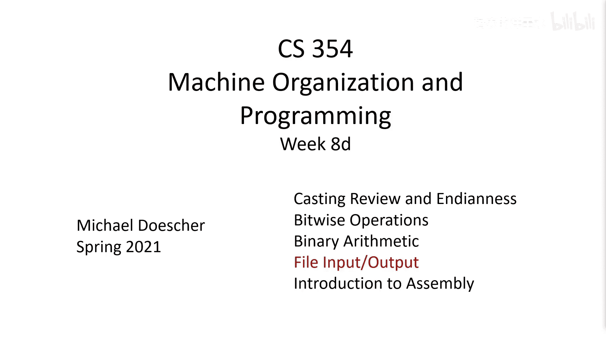
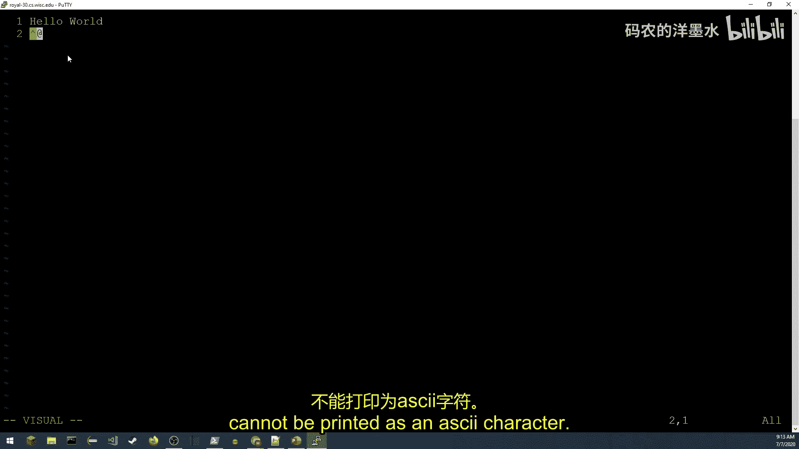

# C语言编程与计算机底层原理：09：文件输入与输出 📂



在本节课中，我们将学习C语言中文件输入与输出的基本操作。文件操作是程序与外部数据交互的重要方式，无论是读取配置文件、处理日志还是保存用户数据，都离不开它。我们将从简单的文件读取开始，逐步介绍如何写入文件，并对比C标准库函数与Linux系统调用的不同用法。

## 打开与读取文件 📖

上一节我们介绍了程序的基本结构，本节中我们来看看如何打开一个文件并读取其中的内容。在C语言中，我们使用 `FILE` 指针来代表一个文件流，并通过标准库函数来操作它。

以下是使用 `fopen` 打开文件并读取的基本步骤：

1.  **定义缓冲区大小**：使用常量定义缓冲区大小，避免硬编码，便于后续调整。
    ```c
    #define MAX 1024
    ```
2.  **声明文件指针与缓冲区**：声明一个 `FILE` 指针和一个字符数组作为数据缓冲区。
    ```c
    FILE *fp;
    char buffer[MAX];
    ```
3.  **打开文件**：使用 `fopen` 函数，指定文件名和模式（如 `"r"` 表示只读）。
    ```c
    fp = fopen("gates_quote.txt", "r");
    ```
4.  **检查打开是否成功**：如果 `fopen` 返回 `NULL`，则表示文件打开失败。
    ```c
    if (fp == NULL) {
        exit(1); // 或 return 1;
    }
    ```
5.  **循环读取文件内容**：使用 `fgets` 函数逐行读取文件内容，直到文件结束。
    ```c
    while (fgets(buffer, MAX, fp)) {
        printf("%s", buffer);
    }
    ```
6.  **关闭文件**：使用 `fclose` 函数关闭文件指针，释放系统资源。
    ```c
    fclose(fp);
    ```

> **注意**：始终检查 `fopen` 的返回值并记得关闭文件是良好的编程习惯。即使程序结束时会自动关闭，显式关闭也能避免资源泄漏。

## 写入与读取二进制文件 💾

上一节我们学会了读取文本文件，本节中我们来看看如何写入数据到文件，然后再将其读回，特别是针对二进制数据的操作。

以下是写入并读取二进制数据的示例步骤：

1.  **以写入模式打开文件**：使用 `"wb"` 模式打开文件以进行二进制写入。
    ```c
    fp = fopen("bar.bin", "wb");
    ```
2.  **准备并写入数据**：定义一个变量（如整数），使用 `fwrite` 将其写入文件。`fwrite` 需要数据的地址、每个元素的大小、元素数量以及文件指针。
    ```c
    int num_to_write = 0x12345678;
    fwrite(&num_to_write, sizeof(int), 1, fp);
    fclose(fp); // 写入后关闭
    ```
3.  **以读取模式重新打开文件**：使用 `"rb"` 模式打开同一个文件进行二进制读取。
    ```c
    fp = fopen("bar.bin", "rb");
    ```
4.  **读取数据**：使用 `fread` 函数将数据从文件读入另一个变量。`fread` 的参数与 `fwrite` 类似。
    ```c
    int num_to_read;
    fread(&num_to_read, sizeof(int), 1, fp);
    printf("Read: 0x%x\n", num_to_read);
    fclose(fp);
    ```

> **提示**：使用 `hexdump -C bar.bin` 命令可以在终端查看二进制文件的实际字节内容，验证写入是否正确。

## 使用Linux系统调用进行文件操作 🐧

除了C标准库，我们还可以直接使用Linux系统调用来操作文件。这种方式更底层，但需要注意它可能不具备跨平台性，且不会在程序结束时自动关闭文件。

以下是使用系统调用 `open`、`write`、`close` 的示例：

1.  **打开文件**：使用 `open` 系统调用，它返回一个文件描述符（一个整数），而不是 `FILE` 指针。参数包括文件名和一系列标志（如 `O_CREAT | O_WRONLY | O_APPEND`）。
    ```c
    int fd = open("testfile.txt", O_CREAT | O_WRONLY | O_APPEND, 0644);
    if (fd < 0) {
        // 处理错误
    }
    ```
2.  **写入数据**：使用 `write` 系统调用，需要文件描述符、要写入的数据地址和字节数。
    ```c
    char *str = "Hello, World!";
    write(fd, str, strlen(str)); // 注意计算长度时不包括字符串结尾的 '\0'
    ```
3.  **关闭文件**：使用 `close` 系统调用关闭文件描述符，这一步至关重要。
    ```c
    close(fd);
    ```

> **重要区别**：`fprintf` 是C标准库函数，用于格式化输出到文件流。`write` 是系统调用，直接向文件描述符写入原始字节。系统调用打开的文件在程序异常终止时可能不会自动关闭，因此需要格外小心。

## 总结 📝



本节课中我们一起学习了C语言文件输入输出的核心知识。我们掌握了使用C标准库函数（`fopen`、`fgets`/`fread`、`fputs`/`fwrite`、`fclose`）安全地读写文本与二进制文件。同时，我们也了解了更底层的Linux系统调用（`open`、`read`/`write`、`close`）的基本用法及其注意事项。记住，无论使用哪种方式，检查操作是否成功以及及时关闭文件都是编写健壮程序的关键。在接下来的编程作业中，你将有机会实践这些概念。