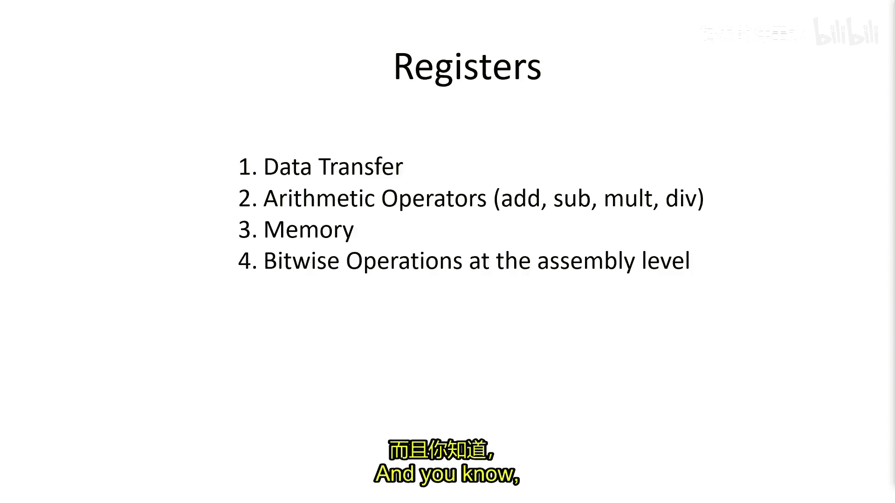
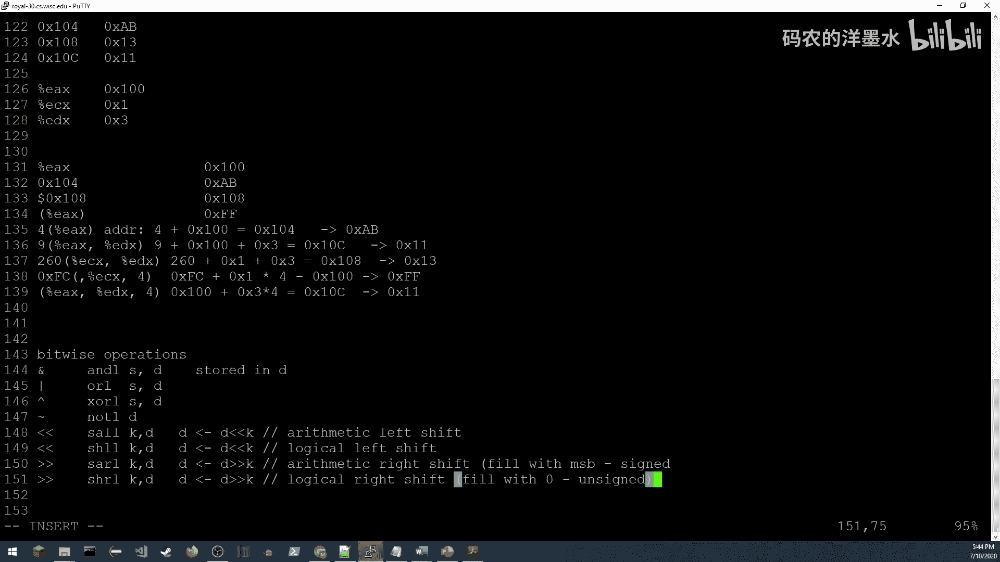

# 【全集】威斯康星大学 C语言编程与计算机底层原理 中英字幕 1080P p10 Lecture 10 - 汇编语言入门 -BV1BViQBwEiS_p10-

Welcome back to machine organization and programming。 This is the final lecture from week 8。

 We're in the middle third of the course here where we're talking about assembly language So the first third was about C。

 Then we're looking at one level lower with assembly and how it's going to connect to the machine hardware and the final third of the class is special topics。

 here So in this week， we took a look at some of the bit operations， how data is stored in memory。

 how to do binary arithmetic we finished up the C section with file。

 And now we're going to be diving into assembly language instructions this is found in section 31 to 3。

5 of the computer systems book。 And again， this is one of those places where the book goes very deep。

 and what I want to do is provide an introduction that makes the book easy to read。

 So you can go oh yeah， this is complicated but Mike talked about in lecture I do understand it。

 That's my goal here。 And again。Excellent practice problems for all of these topics at the end of each section I highly recommend you take a look at those they provide the answers they're excellent I'm going to be basing my quiz questions and my exam questions from those questions so those are the best possible practice you can get for this section。

All right， so without further ado， let's go ahead and just dive into this assembly lecture。All right。

 so the next like third of the course， the middle third is going to be about assembly language programming。

 So I just want to back up a little bit and quick review。

 This is some of this content from the very first lecture。

 I tweak these slides with a little more detail。 But the very first lecture。 I was asking。

 what happens when we run a program。 And the first step is we compile that。

 We've got our source code over here on the left in the green。 where we're writing in C。

That goes to the compiler we're using GCC for this course and that produces a binary executable。嗯。

And then when we actually run the program on disk， I've got my source code stored here in a text file。

 plain text， and I've got the binary file with thumb。

All of the ones and zeros that the machine needs to run。Now。

 the source code here definitely human readable。 we actually write that ourselves。

 When we run this code， we're going to be loading the binary from the disk into memory。

 and this is going to have four different sections when we get to the memory。

 And we'll talk about this in a lot more detail coming up。 We'll have the code section。

 This is going to be。 So I wrote some C code here when， in fact， these would all be ones and zeros。

 And these are just instructions that the processor over here is going to use to decide how to execute each of the commands。

 There's a data section。 This is going to be our global variables。嗯。

So we saw a lot of that available in the project2， where all of the strings were global variables。

 so they would all be stached in data。The heap is going to be our dynamically allocated memory。

 anything we use Malc for is going to appear on the heap。

 and then they'll run time stack and here I've drawn main with A B and so I cut off execution right there after A and B。

 so we don't know what C is yet， I left that blank。All right。

 so a little bit more about how the CPU is going to operate。

First thing it's going to do is fetch each of these binary instructions。

 That's going to have a number of pieces to it in the instruction。

 It's going to be a command that tells it what to do like like over here。

 this third line down is an addition command。 So it's going to say， okay， this one's addition。

 I'm going to be adding two things together。 What am I adding。 So those will be the next two pieces。

 And then where does that go， So anyway， the fetching the instruction。

 just grabs it and brings it into memory。 Then there's a decoding step that says， this is adding。

 here's all the pieces。 When I break down the instruction into all the components。

 And then it's going to execute that instruction。Alright， And then this just repeats。

 It goes back and gets to the very next。 So one of the challenges we run into when looking at designing a computer architecture and how this actually works on the inside with the hardware is that CPU is extremely fast。

 It can operate at something like a billion operations per second。

 That's one nanosecond operation for those you guys who love math。

And one of the problems is to bring memory， like， if I want to grab this a value here。

 move it to the processor to be added happens at about 100 times more slowly。

 So the CPU can do 100 operations in the time it takes to just grab one value。 So the secret。

 the way we like。😊，Mtigate the fact that the memory is so much slower is we're actually going to put memory on board the processor。

 Now， there's not very much。There we go。 We just have a couple of registers available to us。

They name they've got weird names。 They start with the percent EA X， E B X， Ex。

 these are the general purpose registers。 This is where we're going to move the values over here before we do the math with them。

 we also have an instruction pointer or program counter I or PC。 I just use I for this abbreviation。

 And this is going be just a pointer to the next instruction that it's about to operate on。

 So over here， I've got my C code。 Now C code is going to get broken down into a number of steps to perform all of these operations。

So this would actually now be pointed to C code it's born into some binary。

 and it's going to be the first step in what happens to compute this sum。

And I've got just a quick demo here。 This line right here is actually going to get translated into four separate pieces。

 First， it's going to move some location in memory like this one right here at address 100 into one of the registers。

 So present E A X right here is one of the registers。 It'll copy that value over here。

 And then it's going to move the other opera end， the B from that edition we're doing in step 2。

 It's going to copy that into a different register。

 And then it's going to add the way this is read as it's going to take the contents of that register。

 Add it to Eab B。 that register， and then it's going to store the result in that second register。

 So this is the source de source register destination register for all of these instructions。

And then we'll see that we just need to move that back into memory。

 so it's going to copy the result of the computation after we've done the addition back into C over here。

So like I was saying， each one of these move instructions is very slow。

And we don't have very many of these general purpose registers。

 But if we're doing something like iting through a loop and just incrementing a value by one every single time through the loop。

 if we can keep those values in the processors registers。

 those operations are going to happen at one nanosecond each a billion per second。

 So it's going to be very quick to go through all of those things。

 If we have to go back and forth in memory like we're doing here in this operations and much slower。

All right， now if we go back and just real quick review the build process when I have my source code and it goes through the compilation process。

 there's four steps that happen。 The first one is the preprocessor is just going to take all of the compiler directives and go ahead and you know for like an include statement just copy and paste that file and for a define。

 It's going to create a compiler variable variable and copy and paste that in throughout the code。

 So those sorts of things。 that's going to give us this preprocess source file。

 The compiler proper is the one that's going to produce the assembly code。

 And this is the complicated really hard part。 We teach an entire class about this。

 it's called compilers。Anyway， this is the one that's going to take our C code。

 break it down into all of those individual steps to produce the assembly code file。

 So the source code over here definitely human readable。 We wrote that ourselves assembly files。

 assembly code is I'm going to go with barely human readable。

 People actually used to write this by hand for very specialized applications where performance is critical。

 you'll still see people writing this by hand。 But by and large。

 the reason we're studying this is because we want to be able to look into our code and see what's happening here。

Before we get to the the executable over here。 and maybe we can write slightly more efficient code if we understand what happens under the hood as these assembly instructions are created。

So that's the idea we're looking at improving performance by understanding what's going on inside。

And for the most part， most of these compiler， I'm sorry。

 C code are C code instructions are translated into many lines of assembly code。

 And then the assembly code is basically translated one line into one binary instruction。

 So this is very close to the machine level code。 It's just a lookup table that figures out how to translate the assembly instructions into machine code。

 For the most part。 All right， just like there's lots of different kinds of programming languages out there that all end up giving you the power to write code that does stuff。

 Theres several different kinds of assembly languages out there。

 We're going to be focused on Intel's X 86。 But there's a number of other assembly that have been designed for other architectures like arm and Sp and actually lots of others。

嗯。Just advance here。 Yeah， so the Intel X 86 assembly language was designed for this series of processors developed by Intel。

 the 8086， the 8186， the 8286， the pentium。 So if you look， they all end in 86。

 and the rest of these are all sort of just a prefix。

 So they're going to abbreviate that prefix with X。

 the pentium came about as the fifth generation of the 8186，286， there's 386，486。

 My very first computer back in like 1993， I believe， was。Penttium。

 so I did have one of these there been around for a long time， okay。嗯。

We also find that there's actually two different versions of X86 out there。

 one developed by AT& T for use with the Unix system and the other one developed by Intel used with MSDs and Windows。

 these are very similar。 one of the major differences is whether the source comes first and then the destination or the destination first and then the source。

 and we're going to be focusing on this one right here， the AT&T version I look for UniX。Al right。

 If we zoom in a little more deeply and take a look at the actual registers in the CPU。

 what we're going to find is we have six general purpose registers。 these first6 right here。

 they all begin with a percent E， all the registers too the E stands for extended percent tells us it's a register。

 All right。 And now if you take a look at these carefully。

 we have the A register the C register and the D register for the first three just and then then B。

These are divided into like three parts。 So we have the they're all 32 Bs， number from 0 to 31。

 The a register here was 16 bits。 They're the lower 16 bits of the E A X。

 and I can address each of these individually。 This as much in the box right here is just the percent A X。

Okay。The if I want to get the whole thing， I need the extended version， the E A X。

 which is what we'll almost always use。 And for backward compatibility。

 they also included the ability to address the。Lower。

8 bit and the higher 8 B of the bottom half of this， so。All right。Big picture。 EA X is all 32。

Ax is the bottom 16。 if I just want half of that。And I can invite this into two parts also。

 and I can address the A H and the AL H for high L for low， and that's true for all of these。

 the first four， the ABC and D。Then E SI and EDI are just another two registers。

 we'll use them we'll talk about the specific uses for those。

 but in general you can think of them as general purpose registers for most things。

 There are certain assembly instructions that require very specific registers to be used Division is an example that will'll talk about that in a little bit。

嗯。And then there are two very special registers that should be that should only be used in a very particular way。

 and they're available for managing the stack。 So this would be the stack pointer。

 This is going to tell us where on the stack we're currently looking at memory and the frame pointer。

 This is going to be when you add a new function call， it adds a new frame to the stack。

 this is going to point to that。So we'll talk about those。

 My advice right now is don't mess with those。Alright。For doing regular computations and stuff。

So during the rest of today's lecture， I'm going to be talking about four very specific topics。

 The first one transferring data to a register。 and then we'll be talking about how to do arithmetic operations with those just addition subtraction。

 multiplication and division。 just the basic ones。 And then we'll look at how to connect the registers on the CPU to the memory and actually bring things in and move the data into the memory so we can access it and use it for computations。

 And then we'll take a look at bidwise operations at the assembly level。

 So I'm going to jump over into a text editor。 Actually。

 I'm just gonna go use themm and that I can walk through and develop each of these assembly instructions one at a time and not just blast you guys with PowerPoint slide after PowerPoint slide。

 All right， I thought I could do just a slightly better job explaining what's going on with these registers。

 So back like mid70s。

What we found is that。The 80，80 Intel processor。Had 8，1，1 by。 or 8 bid registers。

 And so they named the first one， A， the second one B。 So if we just took a look at the A register。

 this is what we'd see in the 8080 processor。 Then when we moved up to the 80，86。

 that 86 family processors start up， we found that these were 16 B machines。 So I had。The hate。

我 do最块吧。More pieces to them。 So this is now the。The AX register。Get my language right。

 and it's divided into two pieces。 This is the high order bits。 So A H。

 and then the let me do it with brackets。 So it makes a little more sense。The lower order bits， A。

 And I can address either one of these， even on the modern processors。

 So if this a was retained for backward compatibility。

 This would have been the equivalent of the let's like kind of like that。

 The low order bits from the 80，80 processor。 Okay， and then as technology advanced。

 we're now looking at 32 B registers。 So that's why we've been compiling with this M 32 option。

 All of the assembly we're looking at is for x 86 32 B。 So they've extended it。

 So now we have E X registers。 And this added an extra 16 B at the front。So there we go。

 there's 16 more。 And then we've got the。A， H， which is 0，5，6，7，8， and which is。

The A L section of it。 So this is。The extended version。

 So and I don't have the power to address these by themselves without some tricks。

 but the AA H and the AL and the entire thing， EAX are all available to me。

Once like I just probably put some percents in。 let me go back and add those。There we go。

 all the names of registers begin with the percent， so wanted to add those to be clear。Alright。

 so my first topic from that list that I was putting out there a moment ago is data transfer。

 This is going to be how do we move data into registers， And the command for that。

 the syntax is just M O V。 And then I'm going to have my source of the data。And the destination。

 So the destination is going to re registerister if I moving data to the processor。Okay。

 so as an example， if I want to store the number 27。In the EX register。

It's just going to look like this。 I'm just going to say。Rove because it's an immediate opera end。

 I'm just using a literal number。 I'm going prefix that with the dollar sign。 Okay。

 so all of the immediate numbers are going be they start with the dollar sign。

 anytime I want to use number。 and that can be in decimal or hexadeadeciimal。

 So I'll give you an example of that in a second move。 and all the registers。Yeah， yep。

 I'll begin with that percent。 So EA X if I want to move 27， and I can do this with x values 2。

 so an immediate a immediate0 x 100， store that in EBx。Another register。 Okay。

 so one of the little tricks that can be a little confusing is that assembly can accept either decimal values or hex decimal and will frequently use both sometimes even in the same expression。

Typo there， Okay， got it。Alright， now there's a number of variants。

 We'll almost never see the M O V without one of these suffixes。 So the variance。

Are going to be things like MO VL， and that's going to be for like a move long。

Which is gonna be all of the， yeah， it's stands for long word， which is all， let's see，1，2，2，4，5，6。

Four bytes of the register length， all 32 bits。So example we can move number 30 into register EBx。

我s stableple。This is going to be El stands for a long word。Which is four buts。There you go。 Alright。

 If feel' good about that。 that makes sense。 Okay， we have move W。

 which is and we have to take it number 30 in。In this case， it's only two bytes long， so percent Bx。

Now， this doesn't make a lot of sense because when we're talking about a 32 B machine。

 we would talk about a word size being the size of an integer， the most common size。

 we would expect this to be 32 B。 But remember those original 8086 machines were 16 bit machines。

 And so sort of the wording the labeling on all these assembly commands stuck with that 16 bit machine label。

 So when I move a word， W here is going to stand for word。And this is only going to be two bytes。

When referring to assembly instructions， even though that doesn't make sense because modern machines are now 32 B or 64 bit for or like really modern ones。

32 for the class。 Okay， so that's move W。 And then we also have。Move B。

 And that's going to stick number。The number 30 in。Just the lower part， I've got my percent。

And this is just going to be moving one by。So hope this makes sense。

 M Moelle is the one we'll almost always see。 these are be under special circumstances if you're doing something special。

But yeah， alright。 Just a quick note。 If I do something like move L， and I wna stick。

All ones in the bottom， This will be 8 bits。 This actually sets the rest of those bits to 0。

 sets upper， let's see，32-8 is 24 bits to 0。Bottom 8 to 1。 Okay。

 so it is going to clear out the rest of those。 But something like this where I'm moving just  one bit。

 the 30 into the bottom8 Bs does not change the rest of those。 It just leaves them alone。

 It doesn't do any more work than it needs to， so。Most of these。

 the other instructions were just retained for backward compatibility with things that had already been written long。

 long ago。Alright， next up I want to talk about the arithmetic instructions， addition。

 subtraction and integer multiplication all follow the almost the exact same syntax。 So for example。

 addition I have add， it's going to have one of these suffixes L W or B。

 so add L in this case guys I'm going to use the full register for everything I do from now on with few exceptions。

 So add L and this is just going to be source and destination。Okay。

 so basically this is going to be destination。I where we store the result。A plus S。

Punctuation right there。Subtraction works the same way， commanded SUB， and then L for the long word。

So。Destination and again， destinations where the result goes。And we're just。Subtracting， subtract。

 subtract。Yep， so it's the destination。 Take away the source is going to be what stored。 So for。

 it didn't matter which order these were for subtraction。 This is important。

 It's the destination where we're taking away from。Okay， and then for multiplication。

 we have integer multiplication。 So I'm all。 and then for long words and again。Source。

Destination and D。Times x。 So looks just like that。 Alright。

 I'll do some examples of these in just a second。 But I want to talk about division first。All right。

 first up， just a little bit of vocabulary。 as we start taking a look at division。

 If I'm looking at a problem like 7 divided by 2，7 is going to be known as the dividend。

 it's the number we're dividing and 2 is the divisor。 So 7 will be in the numerator。

 That's the dividend2 is the denominator。 So the divisor。 Now， X 86 permits us to do 64 B dividends。

 And they do that by letting us put the dividend into two registers。 So they're going to use。EDX。And。

E A X， I'm just double checking my notes。 the make sure I don't screw up。

 So this is going to be where I put the number that I want on the numerator， the dividend。

 And so this is going to be full 8 by。In this order。

 so EDX will be the high order4 bytes and EIX will be the low order4 bytes。So。For the。Ddend。

And then when we do the integer division， we'll put the。Number of the divisor somewhere else。So。

 for example， div vior。Was want。Somewhere else。And then when the results are stored。

 it's going to compute both the quotient and the remainder。 And when it does that。

 So we'll have the quotient。Um beinging delivered to don't screw up mic。E A X， and the remainder。

It's going to be stored in the EDx。So when I do the division， I'm going to put my data into those。

8 bytes up here， and then the result of the division overritedes them。

So this is going to look something like this。um。Where's my notes。Allright， found it。

 This is going look something like this。 I'm going have I。Inte your division。With long words。

 And then all I need to dis specify is where I'm storing my。Tmeter， what one divisor。So easy X。

All right， guys， at this point， I think it's probably best to just get some practice to diveer in and try and write some of these little commands yourself。

 just to like get the feel for this。 So there's a works sheet available on canvas。

 Go ahead and download that。 It was developed by Remsay when he first taught this call aspect。

 I believe in。2012， I got the 2017 version of this worksheet。 I really love it。

 It's got a great summary of everything we're going to be talking about at the beginning and then go ahead and just pause the video and try and do questions1。

2 and three just invest a little time figure you know a little like a puzzle。

 see if you can figure it out and then come back and I'll show you the answer。 All right。😊，Alright。

 so question one asks us to move one into。quick note right there into the register EAX。

 and then we're going to add 10 to that and put the result back into EAX。 So to start off with。

Move more to move L。 I'm going to put the immediate value 1。Into the destination， EAX。Now。

 if I want to add a number to it， that number has to be in a register。 so I need to。Move。

 let's see in this case， I want a 10。 So the dollar sign 10。

And I need to put it somewhere other than EA X。 So in that case， I'm going to go with。In BX。

There we go。And then I need to do the addition。 So add again， these are all long words。

 So I wantan to add E， B， X。To the destination， E A X。So all right， very good。

 let me format this a little better and pull the next one。All right。

 the next question asks us to evaluate this mathematical expression 3 plus6 times 2。

 and order of operations will matter here。 we'll need to take care of that ourselves。

 But in using only one register。 I know I implied up here in one of my previous example I needed to use EBx to store the 10。

 That's not true。 I can take immediate values and just operate with them the same way I can。

 So we'll demo that real quick。 We're going do this in exactly three instructions。

 So the first thing we need to do is。We'll be using the E X registrar。

 So I need to get started by putting a number in there。 So in this case， I'm going to use the6。

 So move a 6。Let's see here immediate6。Into。Yeah。So the next thing we're going to do is multiply that by the two so the order of operations are preserved。

 so that's integer multiplication for long words， and I need an immediate two。

 and I want this to go into that destination EAX so the destination is always registered。Yeah。

 so that'll take the six times two。And the next thing I need to do is add the， let's see。

 what was it 3， Add 3 to it。 So we'll do add L， immediate 3。Yeah。E X again。 Okay， there we go。

 Allright， let me type in the problem for problem 3， and then we'll go through it step by step。

Alright， guys， I got this typed in， so I'm looking at problem 3。

 it's just a bunch of assembly instructions and the question is asking me what computation is this actually performing。

 So let's take a look at this As I start at the top I see I've got a bunch of move data into registers and then I'm going to be dividing。

By whatever is in E， B X。 So let's take a look at this。 If you remember how。Division works。

 We've got two registers that are going to represent the numerator。 We've got Ex。

And let me do it this way。And then。Yeah。And this is going to give us a full 64 Bs of information that we can use for the numerator。

 So in this case， we've moved 0 into E D X。 So I'm just going to make a note that that's 0。

And we moved7 into EAX。 So this is going to represent 32 bits of zeros and then lots of zeros and then some ones。

Okay， and then we're going to put three into E B X。 So I'm just going to keep track of these others。

 I'm going to use。 we've got a bunch of divisions。 So I'm going to use E D X and EA X up here in my code just as notes。

 and I'm going to keep track of E B X down here contains three at present。

So what we're doing is we're taking。Essentially seven divided by three。Right there。

 And if you remember， that's going to store the remainder and the quotient in these two things up here。

 so。AX gets the remainder。And let's see seven divided by three remainder is one。

And they other register。EAX。Gets the quotient。Which in this case， un by three， three goes in twice。

let's put the word quotient in here too。So there we go。 partway done。 After that。

 we move some more data around。 So it looks like we're going to copy E A X。Which is right up here。

 it's got two in it and the ECX。So。ECX now contains two。All right， following that。

 we've got some more moving and then another division。 So we're going to move 0 back into EDx。

To cancel right now it's got a one in there， if we were to fail to do that。

 we'd be dividing by some really ginormous number。With the one in the 32nd debate position。

And then we're going to put a9 in the EA X， the lower 32 bit。

 So let me just make a copy of this piece right here。 Let's see after we do all that moving。

It's going to look like this。 So we put a0 here。 We put a 9 right here。And we're going to like that。

 We go to two into E B X this time。 So that's where we're putting our denominator or the divisor。

Then we do this division。 So this is essentially， let's see，9 divided vita by 2。And that's。Equal to。

Well， just this way， I've got my。Remainder and quotient pieces。That was not copy command？

Paste that in。 Okay， so when I take 9 divided by2， the remainder is still one。

 that's stored in an EDx register and9 divided by 2 looks like that's going to give me a quotient of4。

There we go。From there， we're going to take EDX， that's the remainder。And store that in E A X。

 All right， from here on， I've done with my division。 So I'm just going to have。E acts down here。

Remainder was one。And from there， we're going to add E X。

 which was the result of my first computation to EAx。So， EX is going to become。3。And in the end。

 the computation that I did was 7。Interdivision by3 plus。Let's see nine modulus2。

doubleub check my notes。 make sure I said that correctly and not backwards。7 divided by 3。

9 modulus 2。 Yep， he looks good to me。All right， next section。Alright。

 so next topic is accessing memory。 We've got five major ways that we be able to access different parts of memory very useful for things like if I just want direct access to a memory spot or if I want to look at particular index in an array or if I've got astruct。

 So that's why we've got all these different modes。 The first one is known as absolute addressing。

And this is just where I'm going to just go to a memory address and read what's there。

 So I've got some sample memory there in my example。 And if I want to go read the value。

 that's at memory address 1000， all I need to do， it will move it into a register。

Is give it that address。 no dollar sign。 just a straight number means go get that stuff from memory that use that memory address。

 and then we'll store it in Ga X。Just to complete the command。I need to highlight real quick。

That if I leave off the0 x， and move that into EX。I'm no longer addressing in hexadeadeimmal。

 it's going to automatically convert this to hex for me。You go。And actually， it reads。スイズ？

L memory location。I just figured this out。 Let me check my notes，2 x38 E。3 E。8， there we go。

 That's correct。All right。 So instead of the 1000 I thought I was getting where I've got my 74 store。

 This is going go read somewhere else that I had not intended。

 So it's important to be careful here and make sure that when you put in the number。All right。

 so two things， use hex。And no dollar sign to get memory。 if you want an just a regular number。

 you need the dollar sign to indicate that it's a literal number。Okay。

 the next mode is called In indirect。Addressing。Indirect。Addressing。

 and this is where we're going to be using the register。To hold the memory address。

That we want to go retrieve。 So in this case， let's move。A literal。Address so in this case。

1000 into a register。Put in EAx， and then。If I want to go to that memory address。

 we'll go to 1000 and grab the 74。 I need to put the。Register in parentheses。

 So that's just the clue that says this is a pointer。 It's got an address in there。

 Go de referenceence it。Grab the 74 and store that in， I don't know， EBX。All right。

 so also pretty straightforward， use the parentheses to represent like a dereence pointer。

So this is indirect。 It's not going to actually take the value that's in EA X。

 It's going to go to that memory location and do it。 So parentheses mean indirect。Okay。

 so next up number 3 is the base plus。Plus。Displacement。Recomd。Addressing。I can spell。 I really can。

 There we go。 typing in all caps with the caps locks key pretty good at， but I'm not perfect。 Okay。

 so here's the idea。 Let me just start with an example for this one。If I'm moving。

 this is going to have eight times percent。Yeah X。Let' store that in。In the X。

 So what this is going to do is it's just going to take the memory address。

 So it's going to use the 1000。 Every time I see parentheses， this means it's indirect。

 So this is still an indirect address， but it's going to incremented by this number here。

 So it's going to go grab this base value， Incremented by 8。So we'll have OX。1000。

 because that's what I just stored up here in EAX。And then we're going to add to it eight。

And I'm going to switch this to hex right away because when we do addition。

 they' all be in the same and 8 in hex is the same as8 in decimal。 So that's going to work just fine。

 This is gonna give us O X 1，0，0，8。And this will store。The 42 in。Register EBX。

So I think this is also pretty straightforward。 You can think of this as a way to index into。

Excuse me。 index into an array。 So if I know that my base value， the very， you know，0 address。

Of the arrays there。 And I want element like two integers down。 I just need to go 8 addresses。

Down further in memory， So add 8 to it to get to the。Well，4 would be the index 1。

 a would be index 2 if they were4 byte integers in an array。All right。

 This next mode is called indexed addressing。 And I was trying to think of a good example that would demonstrate why we ever want something that complicated。

 For example， let's take a look at this struct here。 I've got astruct point。

 It's got two pieces of data。 The first is an integer。

 and then a character array that I'm using to label it with。

 why's probably not the best label because you think it points at X and Y。 just go with it。嗯。Oh。

 good， Lord。 Look what I did here。 I switched those。 Al， Are we gotta fix this。And Carol。

 let's Jack could change this。 We can fix that right now。OkayCar。

And we's just go ahead and add another point。 Why。 There we go。 Now it's a point。

 It's got a name looks much better。 Okay， now if we want to access the well。

 third character of the name。I want to get to right there。 We can use this indexed addressing mode。

 Basically， we're going assume that the base of the address is stored in well the first upright right there。

 E X。 and we're going to assume that index 2 is stored in E B X。

 So what I need to do is recognize when I store a point like this。

 It's going to reserve 4 bys for the X。 So that this will be where the very first base address points to is that X。

 Another four by for the y right here。 And then beyond that， I've got 42 Btes reserved for this name。

Okay， so。Time out let me fix this too。 No， no， help， fix， fix。嗯。And Lord， I cannot type today。

 There we go。 So the way this works is it's just going to take the sum of these three things。

 So this is going to take well here the base address。Plus。The index。So this base address is my EAX。

 It's the first thing right there。 The EBX is my index， and that's going to be the two in this case。

 So I would need to move two into EBx to make this work。 and then this is going to be the offset。

Let's see。 well they've got a better name for it。 Oh， they call it an immediate value。

So I'm actually gonna， we'll put this first。 So we'll go with。Immediate in this case。

So that8 would represent these the eight bytes for the4fa x and 4fa wide to shift us down to get to the start of this array。

So base address is where the point is stored。 Immediate is going to get us shifted to the start of the character array。

 And then the index would have a two to get us to that second character。All right。

 so I know this is getting complicated。 just wanted to like go through an example if you need to pause a video。

Go play that back again， and then。Rejoin me， right here。All right。 Last one， guys。

 This is known as scaled index address。 And it's the most general。 And in fact。

 all the rest of these are just sort of special cases of what we have going on right here。

 The way this works is I've got four parameters。 I'm going to put in to get to a particular address。

 There's an immediate value。 That's just added to the base。

 And then there's an index times a scale factor。 So this is frequently used to address access into arrays。

 So I'll have an index。 And then if it's an array of integers， my scale before。

 If it's an array of characters， this will be  one。 If it's an array of shorts， that'll be a 2。

 My choices， I can only use the values 1，2，4， and 8 for this scaling factor。😊。

To represent the values of the sizes of different primitives。 So， for example。

 if I go back to thisstruct example and I've got my character array to do the same thing here。

 I would be moving 8 to get past the。X and Y to jump to the character array。

 And then my base here would be。A register， The index also must be a register。So E B X here。

 in this case， this would be my index value。 So I would have2 to get to the 0，1，2。

 And then I'd have a scaling factor。 And here the scale must be an integer 1，2，4。

8 to represent the size of this array。 So this is a much more common。

 You'll see this sort of I mode used to index into integer arrays more commonly than this you'd use the special shortcut version without the one。

 if it's just a character array。 No reason you couldn't do it this way。 very common。 And in fact。

 you can leave out any of these pieces and I'll just be assume to be 0。 For example。

 if my the base of my array is actually at。Zero for some reason， which I'm not allowed to access。あ。

I can write this like this and just put the comment leave out that value。And it's good to go。

 I don't。 basically I can leave out any one of these pieces。 and it's still gonna be just fine。

 And that's where I get these like shortcuts is by leaving out the extra data that's here in the scaled index addressing。

All right， so next up， we're going to jump back over to that worksheet。

 There's a whole bunch of examples to give us some practice with addressing。

Let's go ahead and do that now， so just pause the video。

 go see if you can figure those out and then come back and I'll go through all of the solutions to talk about how we get there and if you made any mistakes you can sort of learn from them。

Alright guys， I got problem 4 copied in here， ready to go。 So we're looking at a bunch of addresses。

 memory。 I've got four of them here， 100 to 10 and some values stored in there。

 And then I've got three registers I'll be using for these examples。

 and these are the values currently stored in those registers。

 And then I just want to figure out what number do I get when I use each of these different addressing modes。

うんうん。Okay， so if we start off with percent EAX， that just says just go grab the value that's in EAX。

So I'm going to go get 0100。No， excuse me。I have voices。Really scratchy today。Alright， I'm better。

 grab to drink。 Things are good to go。 Okay， so next step， if I'm looking at O X 104 with no prefix。

 this just means go get whatever is in address 10，4。 So in that case， I look up here。1。

04 has 0 x A B。Alx A B， there we go。 The dollar sign here means this is an immediate value。

 So the value it's going to use is exactly like it says，1，0，8。O。When I see parentheses。

 any time I see parentheses in anything， that means this is like indirect addressing。 So like。

 I can treat E X as is over a pointer。 So I'm going to go to EA X。

 find out that that contains the address where I really want to go look stuff up。

 And I can see that gets me to the FF。嗯。There we go。 Alright， Next up。 This is gonna be， again。

 indexed addressing or indirect addressing， because I've got the parentheses。

 So I'm gonna go and figure out the address where I need to go look something up。 This is gonna be。

Insert。No。That。So the address is going to be4 plus whatever is in EA X。 and that's。Px 100。

 So I convert 4 to hackx。 I add them together， and the address I get is。Oax 104。So in the end。

 the value I'm going to put in there is the A B。Yeah。Yep。Okay。

 so then looking at a slightly more complicated version， this is going to be my immediate value。

 the base and the index。 So when I figure out what this is。Insert。I'm going to be looking at 9 plus。

Whatever is in the A X， And that is。100 plus， and then whatever is an E D X， which is 3。

So when I add all of those together，9 plus 3 is going to be C。 So it's 9，10，11，12， ABC， yep， and 10。

 C， so。When I see。When I go there， I see that I have。11。All right。

Sorry to get a little more complicated now。 Okay， but this is another example。

 This is exactly the same thing， except that I've got to do a little more math now。 So I take 2。

60 plus。O， X， let's see。 E， X contains01。AlX1 and EDx contains3。

So that's going to be four in he plus whatever 260 is。 So let's see here，6，2，60 divided by 16。Is。Now。

 guys， it couldn't la the day for me。2，16 hecs is 10，4。Alright， so we've got 104 here plus 1 plus 3。

 So this is going to give me 108。So demand the value that I'm going to get is the 0 x 13。There we go。

Alright， and then。This is a。Oh， this is oh finally， we're getting into the scaled stuff。Alright。

 so this is gonna be O X。 So I need the address， O X， F C。

This is gonna be plus this base value is not here。 So that'll just be 0。 We'll just leave it out。

 And then I've got whatever is in E X right there，01。O， X， we'll just do it that way。

 This is gonna be times 4。 So alright， let's see here。 that's gonna be4 total。 O X。

 F C is going to be， Oh， except C， D， E， F 0。 So that's gonna be。100。And when I go and grab 100。

 that contains。FF。Alright， looking good。Finally。Last one here。

 So this is another one of those scaled index addressing。

 except now I don't have the immediate value。 so that I'll just be left off。

And we're going to go with EAX。 let's see EX is 100。We're going to add Ex。Which is。Three times4。

Alright， so that's 12，12 is C。 So we've got O X 10 C。Which means I'm going to be grabbing the value。

O X 11。Allright， let me see。Yeah， there is a ton of really great practice problems in our textbook。

 They did an excellent job of just supplying example after example of。😊，Problems like these。

 So I highly encourage you guys as you read those sections from the textbook to go through and do all of these kinds of examples。

 they also make great inspiration for exam questions。So I've got one more topic left for today。

 I'm going to go prepare some material， and I'll be right back。All right。

 I feel like this video is getting be quite long。 I've been sitting here for several hours now recording little pieces of this at a time。

 So I want to just wrap this up real quick and then I'll do the editing。

 and then we'll find out just how long it really is。But on the last topic is the Biwise operations。

Okay， here's the idea。 And see， we had a bunch of different bit wise operations。 There was and。

 We had or。 There was the exclusive or， the not。We had。Left shift。And right shift。

I love the way Vim actually like assumes that I'm making brackets when I'm just， you know。

Dyping some text in。 Alright， So the commands that we're going to use to do these operations for and。

 it's just the word and。 I'm going put that suffix on to indicate what kind of data I'm working with。

 So along here。Long words， and then source and destination。This is going to be stored in D。Okay。

 pretty straightforward， I think the ore operator。Keyword or。

 And then the suffix for whatever kind of data I'm working with， source and destination again。

Exclusive or， this is just going to be x or。Kind of data I'm working with。Source and destination。

All right， the knot is a unary operator。Keyword is just not followed by what kind of data I'm working with。

 and then this is just going to be the destination it's just stored right in the exact same position。

Al right， now， these are these are the ones that always confuse me。 the shifting operators。

 So I'm going to spend a little more time and maybe talk a little more slowly。

 So they we've got two different kinds of shifting。 We've got arithmetic shifting。

 and we have logical shifting。So the first one here， if I'm doing the left shift。

 so that's going be shift。Arithmetic。Left。Shift arithmetic left。 And then the kind of data。

 So S A L L is going to shift by K bits。And store in the destination D。So it's going to be D。Gets。

D K， something like that。 If I would write it in C。And this one is going to be the arithmetic。

Left shift。 Okay， And remember， left shifting， it doesn't really matter。

 We just always push zeros in， but they do include the。Loical left shift。 So shift logical。Left。

And health for the type of data， so。Shift， logical shift， left type of data。 Okay， and again。

 this is just going to be K D。Okay， come comedy。 And this is going to store。Yep， just like that。

 it's going to store the value of D shifted by D in the same memory location。Okay， and again。

 that that's just gonna to be when we do lap shift， we're just going to be shifting in0。

 So those two are equivalent。 Okay， next up， we have the shift。Arithmetic， bright。For long data。O。

Same deal for the parameters this takes， the opera。 this is going to do D。Destination gets。啊，啲。

Rightice shifted by K。Okay。For completeness。Yeahre right， here。Mic。Right。行。Spll carefully， Mike。

 okay， and this is the one that's going to fill with the most significant bit。

This is the one we would see for signed data。In in sea。Okay。And then let's see here。

And actually shorten this up a little bit so that it all fits on one line and looks good for you guys。

So next up， or last one， we have a shift。Logical。Right。For whatever type of data， in this case。

 long words Kd。Just fill this in to complete。Table here。

Logical right shift and the logical one is the one that's going to just fill in with zeros。For。

Uns data。A dash right there， okay。That's all I want to do is just introduce those。

 go check out the textbook， take a look at their examples， get some practice there using these。

 we'll see these in the future。And I think that I'm going to just wrap it up right here。

 go do some video editing and then see if I can get this released。Pretty quickly。 All right。

 Have a great day， everybody。

