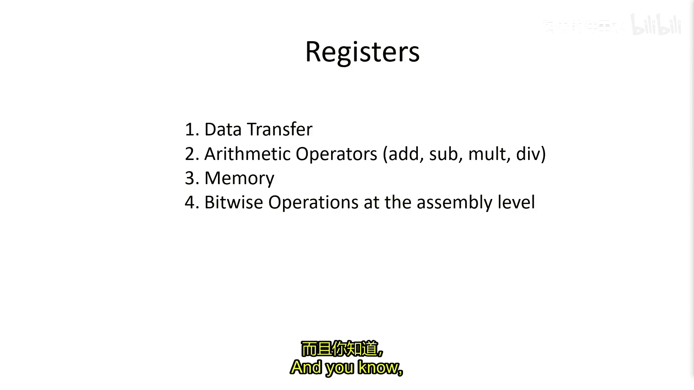
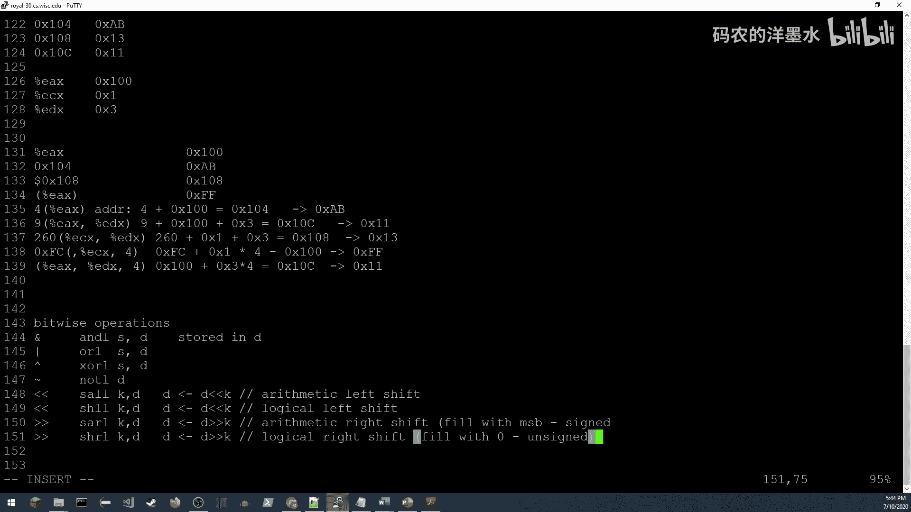

# C语言编程与计算机底层原理：10：汇编语言入门 🖥️

在本节课中，我们将要学习汇编语言的基础知识。我们将了解程序如何从C语言源代码编译成机器可执行的二进制文件，并深入探讨CPU如何执行指令。通过学习汇编语言，我们可以更好地理解计算机底层的工作原理，并可能编写出更高效的代码。

## 概述

在课程的第一部分，我们学习了C语言。现在，我们进入中间部分，将目光投向更低一层的汇编语言，了解它如何与机器硬件连接。课程的最后部分将探讨一些专题。本周，我们已经了解了位操作、数据在内存中的存储方式、二进制算术，并以C语言的文件操作作为结尾。现在，我们将深入探讨汇编语言指令。

## 程序的运行过程

首先，让我们快速回顾一下程序运行的过程。当我们编写C语言源代码（绿色部分）后，会使用GCC编译器将其编译成一个二进制可执行文件。

源代码以纯文本形式存储在磁盘上，而二进制文件则包含机器运行所需的所有0和1。

当我们运行程序时，二进制文件会从磁盘加载到内存中。内存通常分为四个部分：
*   **代码段**：存放编译后的机器指令（0和1），处理器将根据这些指令执行命令。
*   **数据段**：存放全局变量。例如，在项目2中，所有的字符串都是全局变量，它们就存储在数据段。
*   **堆**：存放动态分配的内存，任何使用`malloc`分配的内存都会出现在堆上。
*   **运行时栈**：用于函数调用。图中展示了`main`函数以及其中的变量`A`和`B`，而`C`尚未定义。

## CPU如何工作

CPU执行指令的过程可以分为三个步骤：
1.  **取指**：从内存中获取二进制指令。
2.  **译码**：将指令分解成各个组成部分，例如识别出这是一条加法指令，并确定要相加的两个操作数以及结果的存放位置。
3.  **执行**：执行该指令。

这个过程会不断重复，获取下一条指令。

然而，设计计算机架构时面临一个挑战：CPU速度极快（每秒可执行约十亿次操作，即每次操作一纳秒），而从内存中读取一个值到处理器（例如，将变量`A`的值移入处理器进行加法运算）的速度大约要慢100倍。为了解决内存速度慢的问题，我们会在处理器内部放置少量但速度极快的存储器，称为**寄存器**。

寄存器有特定的名称，如`%eax`， `%ebx`， `%ecx`等，它们被称为通用寄存器。在进行数学运算之前，我们会先将内存中的值移动到这些寄存器中。此外，还有一个**指令指针**（或程序计数器），它指向即将执行的下一条指令。

## 从C代码到汇编指令

上一节我们介绍了CPU的基本工作流程和寄存器。本节中我们来看看C代码是如何被翻译成汇编指令的。

以C代码`C = A + B;`为例，这条语句实际上会被翻译成多条汇编指令：
1.  将内存中地址为100（假设是变量`A`的位置）的值移动到寄存器`%eax`中。
2.  将内存中变量`B`的值移动到另一个寄存器，例如`%ebx`中。
3.  执行加法指令`addl %ebx， %eax`。这条指令的含义是：将源寄存器`%ebx`的值加到目标寄存器`%eax`上，并将结果存储在目标寄存器`%eax`中。
4.  最后，将寄存器`%eax`中的结果（即和）移回内存中变量`C`的位置。



每个`mov`（移动）指令都相对较慢，而且通用寄存器的数量有限。但是，如果在循环中反复操作某些值（例如每次循环将值加1），并且能将这些值保留在处理器的寄存器中，那么这些操作将以纳秒级的速度执行，非常快。如果需要像上面例子那样频繁地在内存和寄存器之间来回移动数据，速度就会慢得多。

## 编译过程详解

现在，让我们更详细地回顾一下编译过程。从源代码到可执行文件，主要经历四个步骤：
1.  **预处理**：处理所有编译器指令。例如，对于`#include`语句，会直接复制粘贴被包含文件的内容；对于`#define`，会创建编译器变量并在代码中替换。
2.  **编译**：这是最复杂的部分，编译器会将C代码分解成许多独立的步骤，生成**汇编代码文件**。汇编代码可读性较低，但在对性能要求极高的特殊应用中，人们仍会手动编写汇编代码。我们学习汇编的主要目的是能够查看代码底层发生了什么，从而可能编写出更高效的C代码。
3.  **汇编**：汇编器将汇编代码几乎逐行翻译成机器码（二进制指令）。
4.  **链接**：将多个目标文件及库文件链接成一个完整的可执行文件。

## 汇编语言与X86架构

就像有多种高级编程语言一样，也存在多种汇编语言，它们针对不同的处理器架构设计。本课程将专注于**Intel的X86汇编语言**，它最初为Intel 8086系列处理器设计，并一直沿用至今。

X86汇编主要有两种语法格式：一种由AT&T开发，用于Unix系统；另一种由Intel开发，用于MS-DOS和Windows。它们非常相似，一个主要区别是操作数的顺序（源操作数和目标操作数的先后顺序）。本课程将使用**AT&T格式**的语法。

## X86 CPU寄存器

如果我们更深入地观察CPU中的寄存器，会发现有六个主要的通用寄存器。它们的名称都以`%e`开头（`e`代表“扩展”），表示这是一个32位的寄存器。

以下是主要的寄存器及其部分：
*   `%eax`， `%ebx`， `%ecx`， `%edx`： 这是四个主要的通用寄存器。
    *   每个都可以作为完整的32位寄存器（`%eax`）使用。
    *   也可以只访问其低16位（`%ax`）。
    *   对于`%ax`，还可以进一步分为高8位（`%ah`）和低8位（`%al`）。`%ebx`， `%ecx`， `%edx`同理。
*   `%esi`， `%edi`： 另外两个通用寄存器，有特定用途（例如用于字符串操作），但通常也可用于一般计算。
*   `%esp` （栈指针）， `%ebp` （帧指针）： 两个特殊的寄存器，专门用于管理函数调用栈。目前建议不要随意操作它们。

## 本讲核心主题

在接下来的讲解中，我们将聚焦于四个核心主题：
1.  **数据传送**：如何将数据移入寄存器。
2.  **算术运算**：如何用寄存器进行加、减、乘、除等基本运算。
3.  **内存访问**：如何连接CPU寄存器和内存，从内存中读取数据或将数据写回内存。
4.  **位操作**：在汇编级别进行位运算。

## 数据传送指令

首先，我们来看如何将数据移动到寄存器中。使用的指令是`mov`，其基本语法是 `mov 源操作数， 目标操作数`。目标操作数通常是一个寄存器。

例如，要将数字27存入`%eax`寄存器，可以这样写：
```assembly
movl $27， %eax
```
这里，`$`符号表示这是一个**立即数**（即字面量数值）。数值可以用十进制或十六进制表示。例如，将十六进制数0x100存入`%ebx`寄存器：
```assembly
movl $0x100， %ebx
```

`mov`指令通常带有后缀，表示操作的数据大小：
*   `movl`： 移动“长字”，即4字节（32位）。例如：`movl $30， %ebx`
*   `movw`： 移动“字”，即2字节（16位）。例如：`movw $30， %bx`
*   `movb`： 移动“字节”，即1字节（8位）。例如：`movb $30， %bl`

需要注意的是，由于历史原因（源于16位的8086处理器），在汇编语境中“字”（word）通常指16位，尽管现代机器是32位或64位的。

**重要提示**：当使用`movl`将一个8位立即数（如`$0xFF`）移入寄存器时，它会将寄存器的高24位清零，低8位设为该值。而使用`movb`只操作低8位时，不会影响其他位。

## 算术运算指令

接下来，我们学习基本的算术运算指令：加法、减法、乘法和除法。加法、减法和整数乘法的语法非常相似。

**加法**使用`add`指令：
```assembly
addl 源操作数， 目标操作数
```
执行的操作是：`目标操作数 = 目标操作数 + 源操作数`。

**减法**使用`sub`指令：
```assembly
subl 源操作数， 目标操作数
```
执行的操作是：`目标操作数 = 目标操作数 - 源操作数`。注意顺序，是从目标操作数中减去源操作数。

**整数乘法**使用`imull`指令：
```assembly
imull 源操作数， 目标操作数
```
执行的操作是：`目标操作数 = 目标操作数 * 源操作数`。

**整数除法**稍微复杂一些。首先了解术语：被除数（dividend）是我们要除的数（分子），除数（divisor）是我们要除以的数（分母）。X86允许进行64位的除法，这是通过将64位的被除数存放在两个32位寄存器`%edx`（高32位）和`%eax`（低32位）中来实现的。

除法指令`idivl`只需要指定**除数**（可以是一个寄存器或内存地址）：
```assembly
idivl 除数
```
执行除法后：
*   **商**（quotient）存储在 `%eax` 寄存器中。
*   **余数**（remainder）存储在 `%edx` 寄存器中。

**重要**：在执行除法前，必须正确设置`%edx`和`%eax`。如果被除数是32位数，通常需要将`%edx`清零（使用`movl $0， %edx`），然后将被除数放入`%eax`。

## 内存寻址模式

上一节我们介绍了如何在寄存器间进行运算。本节中我们来看看如何访问内存中的数据。X86汇编提供了多种内存寻址模式，这对于访问变量、数组元素或结构体成员非常有用。

以下是五种主要的寻址模式：

1.  **绝对寻址**：直接使用内存地址。
    ```assembly
    movl 0x1000， %eax  # 将内存地址0x1000处的值读入%eax
    ```
    **注意**：这里没有`$`符号。有`$`表示立即数（值本身），没有`$`表示内存地址。

2.  **间接寻址**：使用寄存器中存储的地址。
    ```assembly
    movl $0x1000， %eax  # 将地址0x1000存入%eax
    movl (%eax)， %ebx   # 将%eax所指向的内存地址（即0x1000）处的值读入%ebx
    ```
    括号`()`表示“间接”，即取寄存器中的值作为地址。

3.  **基址+偏移量寻址**：一个基地址加上一个固定的偏移量。
    ```assembly
    movl 8(%eax)， %ebx  # 有效地址 = %eax中的值 + 8。将该地址处的值读入%ebx
    ```
    这常用于访问数组元素。例如，如果`%eax`指向一个整数数组的首地址，那么`8(%eax)`就访问索引为2的元素（假设每个整数占4字节，8 = 2 * 4）。

4.  **变址寻址**：基地址 + 变址寄存器值 + 立即数偏移。
    ```assembly
    movl 8(%eax， %ebx)， %ecx  # 有效地址 = %eax + %ebx + 8
    ```
    这适用于访问结构体内部的数组等复杂情况。例如，一个`Point`结构体可能有`x`， `y`（各4字节）和一个`name`字符数组。`8(%eax， %ebx)`可以解释为：`%eax`是结构体基址，`8`跳过`x`和`y`到达`name`数组起始处，`%ebx`是数组内的索引。

5.  **比例变址寻址**：最通用的形式 `立即数偏移(基址寄存器， 变址寄存器， 比例因子)`。
    ```assembly
    movl (， %ebx， 4)， %eax  # 有效地址 = %ebx * 4
    movl 8(%eax， %ebx， 1)， %ecx # 有效地址 = %eax + %ebx*1 + 8
    ```
    **比例因子**只能是1、2、4或8，对应不同数据类型的大小（char， short， int， long/double）。这种模式非常适合数组访问，变址寄存器`%ebx`作为数组下标，乘以元素大小（比例因子）后得到正确的字节偏移。上述其他寻址模式都可以看作是这种模式的特殊情况（某些部分为0）。

## 位操作指令

最后，我们简要介绍汇编级别的位操作指令。在C语言中我们见过的位操作，在汇编中都有对应的指令。

*   **与**：`andl 源操作数， 目标操作数` （`目标 = 目标 & 源`）
*   **或**：`orl 源操作数， 目标操作数` （`目标 = 目标 | 源`）
*   **异或**：`xorl 源操作数， 目标操作数` （`目标 = 目标 ^ 源`）
*   **非**：`notl 目标操作数` （`目标 = ~目标`），这是一元操作。
*   **移位**：
    *   算术左移/逻辑左移：`sall k， 目标操作数` 或 `shll k， 目标操作数` （`目标 = 目标 << k`）。左移两者都是补0。
    *   算术右移：`sarl k， 目标操作数` （`目标 = 目标 >> k`）。对于有符号数，用最高位（符号位）填充空位。
    *   逻辑右移：`shrl k， 目标操作数` （`目标 = 目标 >> k`）。对于无符号数，总是用0填充空位。

## 总结



本节课中我们一起学习了汇编语言的基础入门知识。我们回顾了程序从编译到运行的过程，了解了CPU执行指令的步骤以及寄存器的重要作用。我们重点讲解了X86汇编语言的数据传送指令（`mov`）、基本算术运算指令（`add`， `sub`， `imul`， `idiv`）、多种内存寻址模式以及位操作指令。理解这些底层概念，有助于我们写出更高效的C代码，并为后续学习计算机体系结构打下坚实基础。建议结合教材中的大量练习题进行巩固，这些练习对掌握本章内容至关重要。