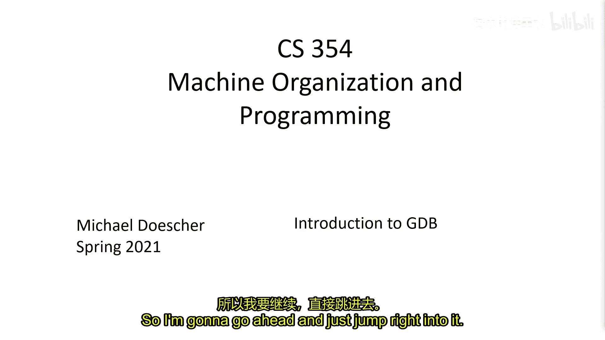
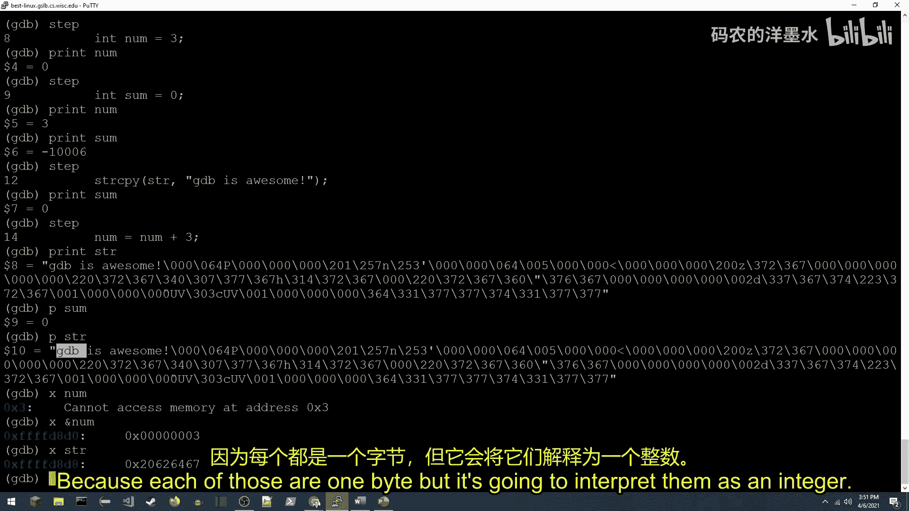
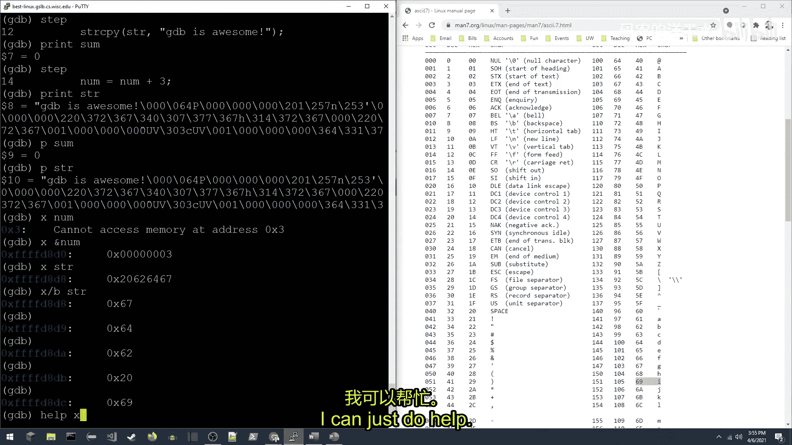
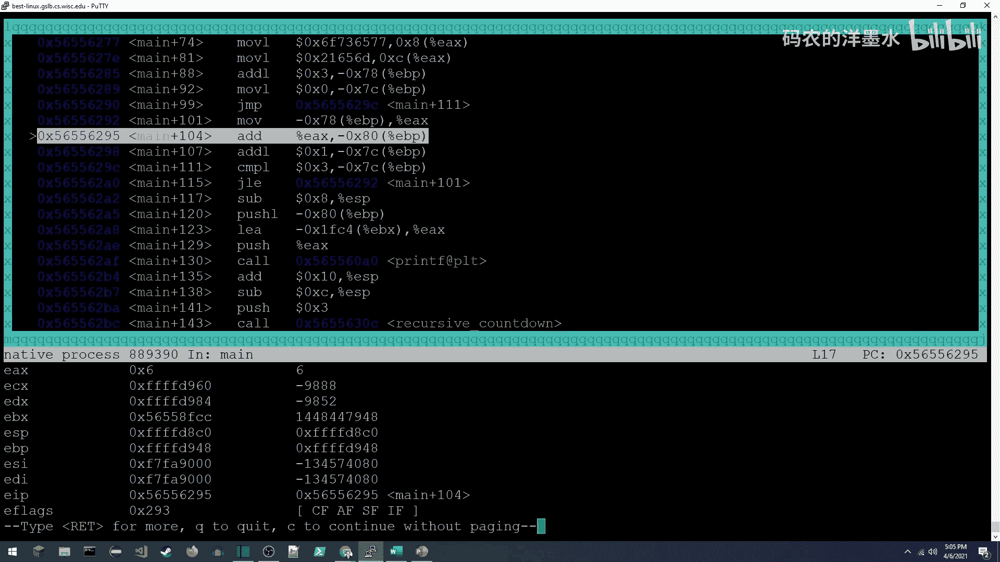

# 【全集】威斯康星大学 C语言编程与计算机底层原理 中英字幕 1080P p11 Lecture 11 - gdb 教程 -BV1BViQBwEiS_p11-

Hello， everyone。 Welcome to the long， anticipated introduction to G D B video。

 I wish I'd had this one put together weeks ago。 I apologize for the delay。

 A lot of my health problems got in the way of getting this completed。 All right。

 I've got a pretty streamlined plan for what I want to do here。

 So hopefully it won't be a very long video。 So I'm going to go ahead and just jump right into it。

Alright， so GB stands for the Gnu debugger。 So on canvas。 you can go。

 you can find a copy of this code here。 I'm just going to use G to sort of walk through this code and explore all the features of G in both regular C programming language。

 It's also great for C plus plus and a number of other languages。

 I'm also gonna take a look at some of the assembly functions that we'll need for the next project。

 Allright， so let's take a look at this code。 it's a labeled G tutorial。

 download it from canvas We can see I'm including some libraries。 I've got one function here。

 it's recursive function so we can actually put a bunch of stuff on the stack and explore that。

 And mean I'm declaring some variables。 some and string copying some text into the string。

 We'll just go ahead and explore getting numbers out of these variables。

 I've got a loop here so we can watch the loop go through loop couple times。

 come my recursive function。 It's just gonna like count down3210。😊，In fact。

 let's take a look at that now。 if n is equal to 0， it's going to print blast off print t minus。

 So rocket countdown。 It's recursive if here's it。Here's the base case。 Here's the recursive call。

 We're all done we return。 All right， I do have a couple places where there are going to be issues that come up frequently where we would use GB to debug them。

 this is going to be a big one。 A failure of malck is going to result in a segmentation fault。

 There are very few things that I can think of that guarantee a segmentation fault。

 A lot of things just result in undefined behavior or things that are undesirable。

 This is one of them。 So as you can see， I'm allocating a lot more memory than I have available。

 So we should actually， they should give a warning， too。Alright， so let me go ahead。Get out of this。

 We'll compile this code， one sec。Alright， so when we compile in order to use GDP。

 we need to include the debugging features。 This is going to keep track of all the variables。

 the names of functions， actually， the names of functions are already kept track of and the original source code Without that。

 the compiler is can optimize all that stuff away to reduce the size of the executable dash G will include all of those debugging tools。

 So make sure you add this option to use GDP。Let's see。

 I've also got the M32 for 32 B machine and all the warnings。 All right， When I compile this。

 I can see instantly that that mallic line is going to be a problem。

 which is the whole reason we're using the debugger。

 although the warning would probably take care of this for us。

 We're converting this giant number into a long long and that's going to give us。This size。

At maximum。 And that exceeds the maximum size right here that Malick can accept。

 There's just not enough memory available reserved on the heap。 So this line's going to fail。

 It's going to give us a segmentation fault。 All right， now let's go ahead and run this。

We can see that it computes the sum in that loop， counts down 3，21 blast off。

 and then does indeed give us a segmentation fault。Alright。

 so the command to get into the G is very simple。 It's just G。

 and then the name of the file we want to examine。 And in this case， tutorial。

 So one of the things we can see right away， there's some like version information。

 but reading symbols from tutorial。 This is going be reading in the variable names and all of the code。

 So this is telling us that it's there that dash G option was enabled。

 if we compile without the dash G option， then it tells us that the symbols are missing。Alright。

 now probably the most important command。 I'll start with this one is how to get out of GDP when we're done。

 command is just quit。 just like that。 Allright， obviously。

 there's way more that I actually want to talk about before we quit。 So let me jump back into GDP。

Alright， so this tutorial is going to have about three sections to it。

 The first section is going to be just how to step through the code。

 We've got lots of options there to make this as easy as possible。

 Second section is about how to get information out of GDP about our variables。

 how to set the variables and the third section will be specifically dealing with what we can do with the assembly part of this。

So to start actually going through our code and executing each line and watching what happens。

 We've got two options to get started。 The first one is actually called start。 The other one is run。

 But start if we don't take any command line parameters， all I need to do is type start。

 If we do have command line parameters， this is where I would enter them。

rightHere we can see that when we type start， it's going to advance to the very first line of main。

 and it's going to stop there。 temporaryemporary break point is set。

 This is the next line that's about to execute line 7 of the code here。 In fact。

 we can get a listing of the code right here by just typing list This is going to give us approximately 10 lines centered around the。

The line that's about to execute。Here， to get help about any particular command。

 we can just type help， for example， help list。This is going to say here with no arguments。

 list 10 more lines around or after the previous listing or the current line that it's about to execute with one argument。

 I can give it a line and it's going give me 10 lines around that with two arguments。

 I can give it a starting and ending line。 So let just demonstrate one of those。

 So if I start at line 7 in the beginning of main and go to line 22。

 it's going to print out the code for lines 7322。 Allright。

 if I just want general help I can just type help and it's going give me like lists of chapters。

 And so then I can go help， for example， breakpoints and it's going give me more information about breakpoint。

Alright， where was that。 So I just started。Let's see。If I type start。

 it's going to ask me if I want to start from the beginning again。

 Now this is going to stop at the very beginning of main。

 and from here I can use the step commands or next commands to walk through that。

I'll do that in a second。 Before I do that， though。

 there's a second way to get started in GDP and to execute the code run is just going to advance through the code。

 It's not going to stop for us until it hits a break point that we have to set a watch point that we would have to set the code finishes and returns at the end or it crashes So if I run this。

 I'm starting over。 So yes， And this is going to advance through all the code at some point it prints out sum equals 24。

 it goes through that recursive function t-321 blast off。 And then it crashes here at this line。

 very useful to figure out where your program crashes if you were trying to debug by just putting in a bunch of print statements to figure out exactly what went wrong。

 this is much， much faster。Alright， next up， just stepping through your code。

 I'm going to start it over at the very beginning。 I can see that line 7 is about to be the next one that's executed。

 I've got two options here。 The first one step will advance through the code 1 line at a time。

 I don't have to type step over and over and over again。 if I just push enter。

 It'll execute the previous command， which was step。 So I can see right here， I'm on line 8。

 or I'm about to execute line 8 into nu equals 3。 If I push it again， it does step again。

 The next line of code wasn't sum equals 0。 Here's the code。 So nu is 3， sum is 0。 After that。

 I can do step again。 Now I can use the up arrow key。 My previous command was list。

 if I type it twice。 up arrow twice， I get back to step。

 So I can navigate through the history with the arrow keys。And again， I can just keep going。

 look at the code it's going to do it's about to do the string copy command。

 Then it's going to do nu equals nu plus3。 So at this point， nu should equal 6。Alright。

 the other way that I have to， oh here， let me， let me keep going。

 I'm just gonna push a step a bunch of times。 It goes through my for loop。

And then it's going to hit this printf statement。 and it's going to dive into the code for print app。

 So it's a step into。 All right， Now it's going to give me this message because printf was from a pre compilelied library。

 It wasn't actually part of our source code。 I can do this。 It's going go through the very， you know。

 the lines in printf。 And it's going to do that。 It's going to dive into this next like function that printf calls。

V F print F internal。 Now， I don't actually want to do this。

 I in order to just advance through a function and get to the end。The commanders finished。

And I can see that it's now finished print F。 It's telling me the value returned。 It is 10。

 That's not the actual sum。 The sum was 24。 So it's not printing out what it actually prints。

 So is just giving me the the return value of that function， which is a number。 In this case。

 Allright， So next up here， Let me list the code again。 We can see oh we're still in printf。

Finish to get through that one。 I' return is 10。 Now， am I in the right place。 Yep， okay。

 so the next line X cube will be with this recursive countdown function。 So I can do step。

 It's gonna go into recursive countdown。 It tells me this is where I just jumped in。

 The next line is this top line of recursive countdown and go through。

Do my recursive check or my base case check。Skip that。 I can see now that I print something out。 And。

 I'm again in print app。 so I'm gonna。Finish this。Step。

 here's the n equals n minus1 recursive countdown again。So here we are at the top of that。

 it's going to do the check。 Now， if I want to continue without jumping into all of these functions。

 if I want to skip over print up。The command is next。 So that will。

 that's like a step over functions。 whereas step is a step into。

 it always executes the very next line。 But next we'll skip all function calls。 So in this case。

 here's the print statement。 We skip over that。 The next line is actually this recursive countdown。

 So this will skip that and do the rest of the recursion and just finish here with the return。

All right， there we go list。We are back here still in the function。

 The next line execute will be return。 So we'll step through that。L， we're still。 Oh， that's right。

 We were two levels deep。 So I'm just gonna finish。The function。

 rental exit from the incursive countdown。Listing。Still in there， I guess I was three levels deep。

Next line， execute recursive count done with n equals 3。Finish that Oh， I am in the outermost frame。

So here yeah， I just finished that。 I'm back in Maine。 now if I do step。I can。

Reserve some memory that's going to fail， and then we get the segmentation fault。

So that was step next， enter and then run and start so far。

 Next thing I want to do is talk about how to get basic information out。

 reading the values of variables， things like that。 So I'm going to start over。

Start at the beginning。 Yes， let's take a list of the code 7 through 22。 Here we go。

 So I can see as I step through first thing I'm going to be doing is jumping into that main function。

 The next line to execute is nu equals 3 to print the value of a variable at any time I can just type print and then the name of the variable that I want。

 Now right now this line has not yet executed。 So there's just going to be garbage and memory。

 In this case I can see that it's actually been set to0。 random block that it happens to be a 0。

 that's not default initialized in C。This dollar sign 4 is an internal GDPB variable where they keep track of everything we've ever printed out。

 You can ignore that。 Alright， so I'm going to step again。That's going to do the n equals 3 line。

 The next line to execute is in sum equals 0。 So now I can print no again。

I can see that it has now been set to3。Alright， if I do print some， that one's not yet been set。

 Here we go。 See， we've got garbage in there， negative 10000。Alright。

 But if I do step now some will be set to 0 and。I can print out some。Alright， so if I just continue。

 let's see。 I can see up the top， the next thing we'll do is we'll initialize an array of characters and then copy some text into it。

 So let me go ahead and step through that。 next line to， oh， next line to execute was that。Nope。

 I'm tricking myself。 That was the string copy。 This is the next line execute。 Ita remember that。

 Mike。Alright， so now that I've actually copied some text into that string， I can print string。

And I see here that I've reserved 100 characters for my string， and I only copied in G is awesome。😊。

That's going to be automatically followed by that null terminal character。

 And then the rest of this stuff is just garbage that was already in memory and not being used as part of my string。

Alright， I should also mention that print can be abbreviated。 In fact。

 most commands can be abbreviated to the minimum， minimum number of letters for GB to uniquely identify which command it is。

 Some of them have even further shortcut。 So to print。 I can shortcut this is just P。

 I can print sum。 And now it's telling me that sum is actually equal to 9， same as before。

 We you've never changed it。 I can P string， and it's going to give me the same thing again。

The other really great way to get information about our variables is with the examine。

 So this is going to examine memory。 The default， all I need to do is push X。

 and then I can give it the address and memory I want to go look at。

 So if I just do like examine numb， this should fail because nu is a variable， not an address。

 and it happens to be I just requested information about address 3， that's not available。

 So what I need to do is use the ampersand to go you know， the address up symbol。

 And now I can go examine the address。😊，By default。

 this is going to assume that I want to treat it as a 4 byte integer and take advantage of the fact that it knows that this is a little inian machine。

 and it's going to go ahead and sort out all of the hex digits put them in the right order as an integer。

 In this case， it knows it's the number3， even though the 03 is stored in the lowest order bits So it's going to be in the backwards order。

 It's already taken care of that for me。 All right， interestingly， if I do examine string。

 I don't need the ampersand because this is already an array。

 arrays and pointers are more or less equivalent in C。

This is going to go ahead and give me the first four bytes of my string， GB space。

Because each of those are one byte， but it's going to interpret them as an integer。 One second。

 I'm going to go pull up the ASI table。

Beear it back。All right， I've pulled up the ASI table here as I take a look at this。

 this first byte the number 20 in hex over here， when I look at the table， I can see I need。

 I need the hex column that this is actually the space。 So as it's interpreting this。

 even though the space right here is the fourth character。

It's manipulated this to turn it into an integer。 So this is actually printing it backwards because of the assumption it's an integer。

 And I'll demonstrate that a little further in a second。 Well， let me just continue here。

 The 62 and the 64 are the next two characters。 So I need the hexcom，62 is the B。64 is the D， and 67。

Right， here is the G。 So these are backwards。 I did space， B， D G。Alright。

 so G E B actually gives us a number of different modes to examine memory。

 The default was that integer version。 All I need to do is put a slash followed by the mode that I want。

 B will give me an individual byte。 This is actually going change the default mode that it's set to to bytes。

 So I won't need this again in the future。But here I go。

 I want to examine the very first bite of string。And what I find out is this is actually the 67。

 which was the last bite here， because this one was interpreted as a little Indian integer。

 All right， so now I can see that the first bitete at this actual memory address。Is， in fact。

67 the G。 If I push the enter again， it's going to repeat that。 But with the next by。

 it's going to advance through the memory one by at a time。And give me all of the letters，67 is G。

64 is D，62 is B，20 is the space。 I 69。Let's see right there is yep。So it looks good。

If I want more information about all the options for。

The different modes I can interpret memory and I can just do help X， let me make this bigger。

 let me do it again。

So that I can actually read things， this is where it's going to tell me that I've got all these options。

 format letters include ocal， hees with an X， D red decimal， unsigned care strings。

 so I've got all kinds of options。嗯。And I can also change the size of the data that I want to be looking at。

Right there。 Alright， I think that's good enough for now。

 You've got enough information to go back and。Switch around the different options。

 One more thing I do want to mention。 I can do more than one by at a time。

 if I just put in the number of bytes。 So 10 bytes we'll begin at the letter string。

 And now it's going print out all of the by or 10 bytes beginning at here's D 8 with the 67， G， D， B。

 space， I S， space 20。 And then awesome rest of the word。Alright。

 so next thing I want to do is talk about setting watch points and breakpoint breakrepoints are very useful if I don't want to have to type step or next over and over。

 especially as my code gets longer， I'm just put a point where I can say run to that break point and then stop。

 So let me go ahead and we'll start over listop。Yes， let me get the code up list7 to 22。 There we go。

 There's some code。 Now， if I want to set a break point and stop， for example， on line 14。

All I need to do is break 14。 Allright， And now so I'm already。

 I've started the code to advance to that break point。 If I type run。

 it'll start over and go to that break point。Or I can continue I， There we go。

 to breakpoint addline 14。 All right， It's numbered it as break point 6。

 If I want to get a listing of all my break points。 the command is info。 and actually。

 info has a number of different things that we can go look up。 It'll do help info in just a second。

 anyway， info break will give me information about all of the break points。 I can see right now。

 I've only got one of them set a line 6， I've already stopped there。

 I've got some options for actually like hiding it or enabling it。

 the address and code where it's going stop。Alright， if I add a second break point。

 let's go ahead and go after the print statement right here。 We'll set a break point for line 20。

Break。20。And then， I can continue。To that line， there we go。

 line 20 is the next thing we're doing by step， it's going to go into the recursive function。

There we go， I don't want to do that。AP function。 So let's go ahead。 I'm going start over。

 I'm want to talk about watch points。 So if I start， that's going go back to the beginning。

I can see that my break points are preserved when I did start， if I do run， that I'll start over it。

 go to the first break point， breakpoint are again preserved。Alright。

 but I want to talk about watch points。 So check this out。 I can watch。Let's see， where。

 Where was it， Which line of code was this。I'm about to execute line 14。 It looks like， yep。

 so I should have， if I print out nu should be three after I execute it， none will be 6。Yeah， okay。

 now I know where I am。 So what I want to do is I'm going to set a watch point。Asome。

So tell me how about watchpoint。 Now I'm going to continue。Now。

 my next break point was set down before that recursive function。 If I have a watch point set。

Anytime I get to。The variable sum and either read it or write it。 So if I'm using it， if I change it。

 it's going to stop at that line and print out the old value and the new value。 So sum equals sum。

 which was 0 plus nu， which was 6。 So after we do this， the new value is going to be 6。

 If I continue again。不s。spellll it correctly。 That's going to advance through the loop and add another6 to it。

 Alright， continue again， I can just type up arrow。 There we go。 Now it's 18。

 enter we'll do that again。 Now it's 24。There we go， then I printed it out。

 and then I hit my other break point。Now， check this out。 This one's kind of important， too。

 if I start over again。Start the beginning。 Yes， and then I do info。Breakpoint。

 I can see that the watch point was removed。 So watch points are not retained when I start over。

 can be very useful So you don't have to go back and clear them。 Oh， in fact， info。Watch points。

 no watch points， so break points include watch points。 Watch points are just watch points。Alright。

 there's another kind of watch point also。 So regular just ordinary watch will keep track of any time of variables written or read。

 But I can also do a read watch point。Rewatch， Let's set that to。No。And now let me。

 let me print the code。 So right now it's red hit the hardware watchpoint， line 11。I take that back。

 it's not  line 11。 This is， they've numbered the watch points。 This is number 11。

 So when I do continue。It's going to advance to， here we go， line 14。

So it skipped over the place where it was set to 3 and advanced to the place where I've read it。

 So right there， I'm reading it。I should stop again here where I'm reading it again。

 so let me continue。又不是。Continue。And now it's going to stop at。Let's see。Yet。

 tell me the value is 6 at。Line 17， there it is。Right there。All right， excellent。Al right。

 just some other really useful things I can do with break points and watch points。Info break。Alright。

 so when I do info break， that's going to be printing out all kinds of information about the breakpoints。

 It tells me what they've numbered them。 This is an internal GDP number that I'm going to use to delete them or enable them or disable them。

 I can see that the different types。 I've got a break point， a break point and a read watch point。

Let's skip both of those。The DISP is tells us what happens after we hit the break point。

 It's either going to be。 we'll keep it。 And it'll hit it。 you know。

 if we go back through a loop and hit this again， we'll keep it if we just want to stop after we get at once。

 this will be deleted after we hit the break point。 So those are the two options there。

 We can see that these are enabled， we can either enable them or disable them And what address in the code they are and where they are in the C code。

Al right， so I've got some options here。 I can delete break points。With delete here。

 let's get rid of break 。6 and then。Info break， I can see I've only got two left。 I can disable。

Break points。 Ill do disable 7。 and then up here twice。

 I can see now it is not enabled and will not stop here as I continue through。

 So I can turn them on and off， delete。Without a number， will'll delete all of my break points。

 and it asks for confirmation first。All right。And there we are no break points or watch points。

 This does delete the watch points， too。Alright， so that was break points and watch points。

 Next thing I want to do is talk about the the call stack。 So here I have gone ahead。

 started over a list of the code and set a break point at line 20。

 The beginning of my recursive countdown function。 This is gonna execute 3，2，1， blast off。

 So  four times。 So I'm going to continue。To get to that function。

 now I'm just going to run step a bunch of times， And I can see that I call the function here I called the。

都不是。Get out of print。Finish， there we go。 There we go。 Now I'm in recursive countdown。 Let's do。Step。

 there we go。 n equals n -1。 step again， recurs of countdown in the next version。

 the next level of depth of recursion and equals 0 print。 I want to skip over print。

stepep through this。 All right， that's probably good。 Let's see here。

In order to get information about the call stack， I can use the back trace command。

And I can see that I'm actually at level 0。 This is the second level of depth of my recursive call。

 If I go。 So I started in main。 I called the function once right here with n is equal to。

I call it with n equals 3。 This one is going to be called with n equal 2。And then。

This is called with n equal 1。 So that's where I am in the stack frame。 if I do print。

And I can see that at this level of depth， the recurs call is n is equal to one here。All right。

These are all individual frames。 So if I want information about variables in this frame。

 where I can see that n is actually equal to 2， I can switch frames so I can go to frame。

 My frames are all numbered right here， so I can go to frame 1 to get information about variables。

 So I'll print out n。In this frame。If I try and go get some data about like a variable in main。

 so if I print out some， there is no sum in this function， it's a local variable to main。Alright。

 when I do back trace again， I can see that I'm still in frame 1 right here。

 even though there's not really a visual clue for me， because when I print out n。

 I can see that n is still equal to 2。 So I had to check it。 If I go back to frame。2。

 that will be main。 Now I should be ablell print out some。 There we go。

 I've got some as a valid variable in the frame main。

 I can switch back to any of these I want frame 0。 That's the always the top of the stack。

 the current frame that's being executed。 and don n， we see n equals 1。All right。

 so this is extremely useful。If I have like a， if I've failed at。

Putting a base case into my recursive function。 I will see that the back trace is just huge if I keep going。

 you know， and I can actually watch the variables and see that they， you know， if I forget here。

If I forget my base case， I's see here。 I didn't quite print off enough。Here，7，2，25。嗯。

Still not quite enough。 All right， list。啊。32，100。That should be enough。 Yeah。

 here's my recursive function。 If I forget to put in the base case。

 which is a pretty common thing to do。 The mistake I make all the time。

 I get excited about the recursive part。 Anyway， the back trace will tell show me that I've got lots and lots of frames。

 Eventually， I'll get a stack overflow。😊，Alright， I want to wrap up this section before I dive into assembly with just sort of a grab bag of other commands that I find really useful。

First one is kill so I'm in the middle of executing my code right now Ki will stop it。嗯。

And then I can start over again。Start。There we go。 So it didn't actually ask me if I wanted to start that time。

 control C will also stop execution。Alright， the next one。I've got a function recursive countdown。

 I can actually just call that function directly with call， and then。The name of the function。

And we's give it a different parameter this time。 We'll give it 5。I spell it right。Nope。All right。

 let me let me type that again， pause。Allright hopefully that version' is correct。

 And now I call the function。 I can see that it's run again with。

The new variables instead of 321 blast alpha started at 5。

 So also very useful to call functions with like usually much simpler parameters to see if maybe something went wrong there。

Oh， another good one。 info locals。I think it just， yep， let me actually。Rrist 7 to 22， willll set up。

Breakpoint。At the line 16。我不。Advanced there and now I've got some information stored in some local variables。

In full。Locals will give me a whole bunch of information about all the local variables。

 So at that point， it's reserved some space for I， but in that for loop， it has not yet set I to 0。

 So there's garbage。 N is equal to 6 right there。 I added 3 plus 3。 Some is still set to 0。

 We haven't done this loop。 And I've got my string。

 So it just gives me information about all the local variables present。

If I had command line arguments。I can do info ags。 However。

 there weren't any for this particular program。 I can do a temporary break point That's only going to stop once here。

 Let me do that。 We'll do that at line 20。 So T break。We'll stop at line 20。

Temporary brake points set， if I do in break， I can see now that this keep versus display keep means that that's every time I hit that line。

 for example， in a loop， it's going stop。As soon as I hit this break point， it'll be deleted。

 so I'm only over going to stop at it once。All right， I think that'll do。

 let me jump into the assembly part。All right， so to take a look at the code in assembly here。

 I've just listed the code， the C version。The to switch all of this to assembly。

 the command is just disassembled。Alright， and then it's gonna print all of the assembly commands。

 I can see some， some really interesting things here that I just thought I'd put out first。

 all of the call functions。 I've got some nice color coding right here。 I believe this one is the。😊。

A string copy。 totally blanking on that name for a second。 If I go down here again。

 I can see I've got some jump commands。 I've got all of the addresses in blue here。

 So that's very convenient。 This is that for loop。 And again。

 remember that the C compiler is a huge fan of turning everything into a do while loop。

 So the very first thing we do is we jump down to address 56，55，6，2，9 C。😊，Right here。

 which is the condition。 So it's going to do a comparison and decide whether it's going to execute the loop or not。

 This is I less than or equal to 4， I believe。And then if we do want to jump， if that comparison。

Says do the loop one more time。 It's going to jump back up to and here。

 Another way to look at this is main plus 101。 All of these。

 So this column is memory addresses like absolute memory address。

 This is the offset from the beginning of the function， which is the very beginning of the net loop。

Allright， let's see here down here， I'm going to push return for more and talk about some more of the other interesting things we can see。

 It actually tells us right here we're calling printf。

 This can be a little confusing if you're using like only OBJ dump to just try and figure out your assembly code because this will be some weird different formatted。

 It doesn't tell you it's printf。啊。OBJ will tell you the names of functions that are in your actual code yourself that you wrote that you wrote yourself。

 So I can see here I'm calling the recursive countdown。Malik， again， printf。

And then the the end right here， all the way to return。All right。

 I'm going to do one more little thing here。 Let me quit this。Quit， yep， here we go。

 Were back at the command line。 I'm gonna to recompile this GC。I'm going to weave out。

The dash G command， just to talk a little bit about what you can do if it has not been compiled with the debugging symbols with just the assembly that's there。

 All right。🎼troil dot C， and then M32。All the warnings to tell me that I never bothered to change that malicaire。

Al right， and then we'll do GB tutorial。 Allright， now check this out。 reading symbols。

 no debugging symbols found because I left out that dash G option， but it still openeds up G B。

 and I can still list。嗯。Can't still list。 Hol on what's it called。Al right， I looked it up。

 Sorry about that。 It's examined instructions， and we'll do like 50 instructions。

 how many fit on the page。 Let's do 20 instructions。Beginning x 20， I， beginning at main。

Does that work。 There we go。 Okay， sweet。 So I got confused there for a second。 Allright， now。

 these are the actual instructions in memory。 I can see that I've got this。

 the string copy command again。 It's exactly the same as before。 Let me do a little bit more。

 We'll do that again to get the next 20 instructions。 This still tells me its's printf。

 still recursive， still Malik。 Allright。😊，So that's looking good。

 I can get information about the instructions。 Again， that command was X。

However many instructions I want in the beginning address。And you can do help X to like。

 get more information about how to do that。 Alright。

 So next thing I want to do is actually switch this over to assembly mode layout。

Layout ASM for assembly。 Now this is going to break this into a G like command option right here。

 and all of the assembly commands are going to be up here at the top。Alright， I've done。

 I've resized my screen so that it's actually bigger for the recording and that's going to mess up some of this border at some point as I'm stepping through unless I don't go far enough。

 if you're using the native version where you haven't changed the screen size and you still get all 80 characters should be just fine for you guys。

Alright， but the recording might mess up。 Alright， so if I want to step through。

The code step doesn't work。 single step， which says no line information。

 It doesn't know where the next code is。 It's jumped all the way down there。 Let me start again。

So there' at the very beginning。 What I really want to do is step through the instructions， step I。

 that's going to go through the instructions one at a time。 So there have main plus 4， main plus 8。

 main plus 11。 Check this out right here。 I can see that all of the commands。

 They're not all four bytes。 This one was only three。That one is 3 here。

 This next one is only one B long。嗯。呃。O BJ Dple actually give me the assembly version or the oh'm sorry。

 the M the hex code， the machine version of these。啊。Now， Ju B does not give me that。

So let's see I can also do next I same way。 step I， it's going to step through。

 but it will skip over things like this string copy call。

 which can be useful if you don't want to dive into all of the layers of string copy。um。

And then I can also set break points。Let's see here。 So in this case。

 I'm going to set a break point to let's do just advance to that address。So right there，0， x 5，6，5，5。

6，2，5，9。 I made a mistake。 How do I type that in。Alright， I had to go look it up。 I forgot the star。

 This is actually not。 I was almost right。 So instead， break star 0 x。

 And now I can type in an address， like 56，55。6，2，6，0。Now I've got a breakpoint set right there。

 I see the B plus when I do continue。It'll。Excuse all of these assembly instructions all the way down to my break point。

 and there I am。All right， I think that's going to do it for the assembly part of this。

Have a great day， everybody。All right， guys， I was just editing the video。

 Go all the way to the end and realized that I never talked about that segmentation fault。

 which is a really common error。 And GDB is a great way to deal with those。

 So let me just take one minute。 I recompiled it with the dash G option。

 So that list will actually give me the commands。 They're all there。 I'm just gonna run this。

 It's gonna go all the way to that segmentation fault。 and it's still in command mode。 So right here。

 I can still do print sum。 I've got all my variables。😊，Now。

 this is the line that gave me the segmentation fault。

 So the most logical thing to do would be to print out the value of text。It's already a pointer。

 And what I see here is that it's actually address0。 So remember the code when I did Malic。

Right here， if Malik fails， it returns no， which is the value 0。

 So I can see instantly that Malck has failed。 That's the reason that I have the segmentation fault。

 And I'm trying to write to a reserved memory address。 Allright， That's all I wanted to say。

 Thanks for letting me put this little extra bit at the end。 Have a great day。😊，All right， guys。 W。

 I'm not having a great day here with remembering everything I want to say。

 I completely forgot info registers。Let me start and then。Lay out assembly。 Alright。

 So what I'm doing here is I'm looking for well here， let me just。啊。

Info registers will tell me the contents of every single register。 In this case。

 it's just garbage from the start I haven't actually done anything with my program yet。

 So I'm going to push Q to not list the rest of the registers。

 What I going do is I'm going to just do next。 and I'm going to scroll down until I'm find a place where I'm moving。

Something into。All register。Yeah， here we go。 Min 101。 This is perfect。So right here。

 this is my loop where I was doing the add 6 every single time to sum。 So 6 plus 6 plus 6 right here。

 this line， I moved some value。 This is the value from nome。Which was 6 in two register Eac。

 So let's see here，-78 from EBP。Right here， I added the three。 This is nu equals nu plus 3。Again。

 this is numb somewhere up above。 I moved three into this memory location。All right，'m。

Does let me scroll up。 Doesn't let me scroll up。 Al right， trust me on that one。

 So if I do info registers right now。I just moved the value6 into EA X。

 So I should be able to do this and find out that EA X。HContains number 6。 Time out， Mike。

 would you do wrong。I see what I did okay。Remember that everything that the compiler and C does。

 it loves to turn all of our loops into do wild loops。 So I had just done the jump down to here。

 It never actually executed this line yet。 So let me do a couple more steps。Step I， go there。

 Now we just moved it。 Well， we're about to move it。 Now we've moved it。Info right。Yep。

 info registers。 I forgot the S， but it's enough that it figured it out。 Now。

 I can see that register EA X。Actually contains the number 6。

 Remember remember in homework 3 or project 3， at some point。

 all of the answers will appear in a register。 So you can kind of just go through。

 find the right spot， keep track of where the answers are going to be and identify them。

 It's really not that bad。 I can't believe I forgot this command。 Sorry about that， guys。

 That's too so far。 Hopefully， if I think of anything else， I'll just add them to the end。 Otherwise。

 have a great day。

