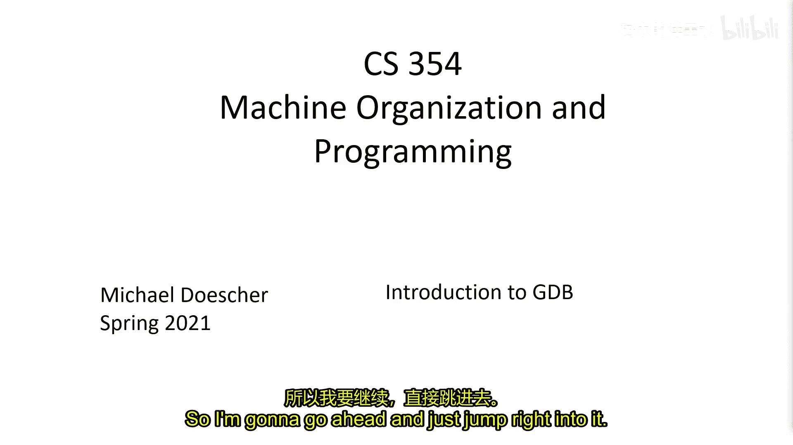
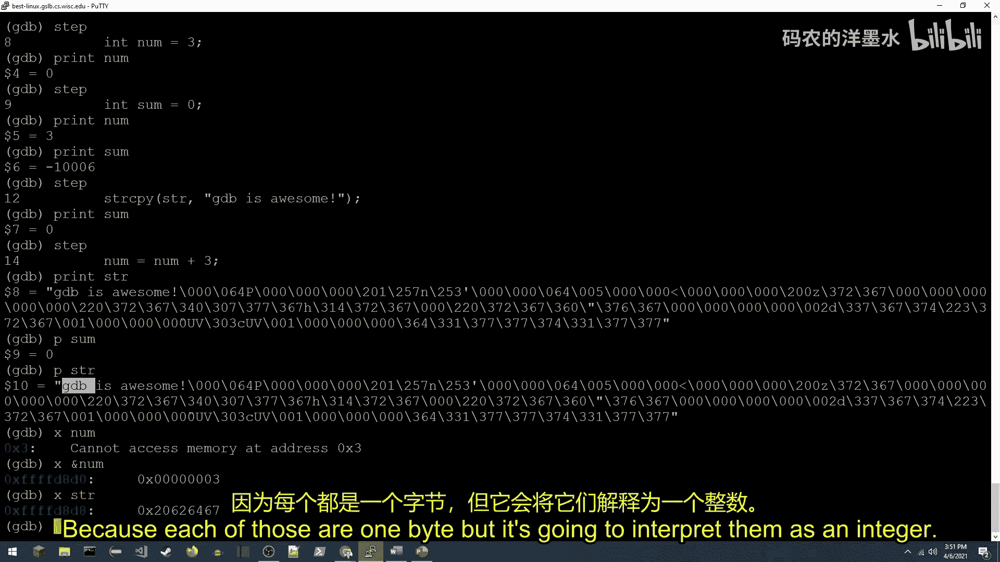
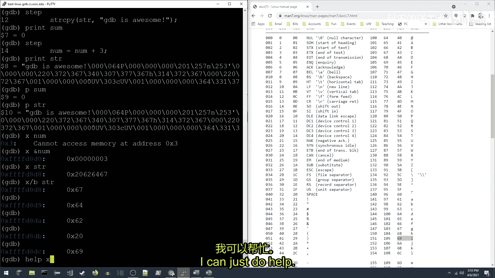
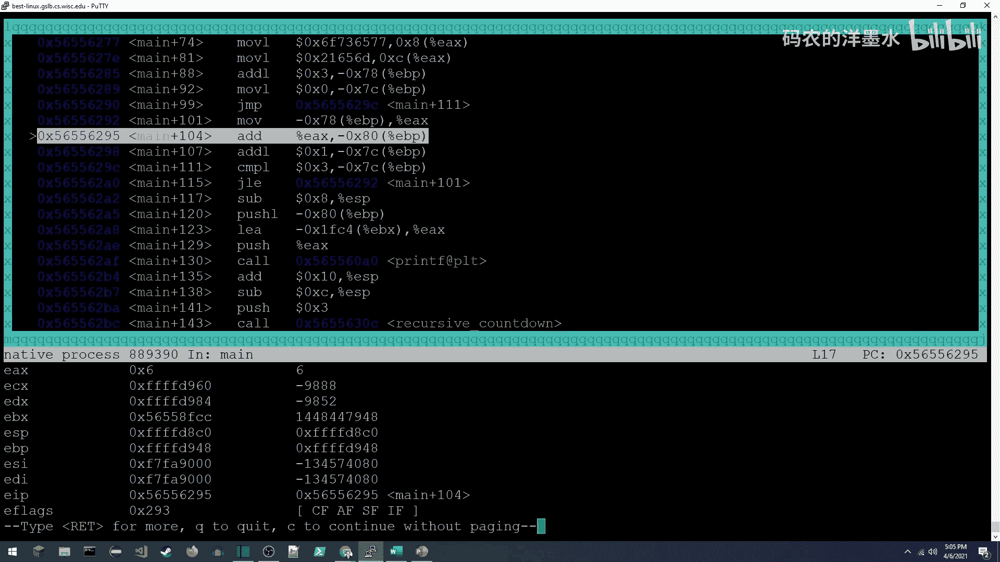

# C语言编程与计算机底层原理：11：GDB调试器教程 🐛



在本节课中，我们将学习如何使用GNU调试器（GDB）来调试C语言程序。我们将涵盖启动调试器、逐步执行代码、检查变量、设置断点、查看调用栈以及分析汇编代码等核心功能。掌握这些技能将帮助你高效地定位和修复程序中的错误。

---

## 启动与退出GDB

要使用GDB调试程序，必须在编译时添加 `-g` 选项，以便在可执行文件中包含调试信息。

```bash
gcc -g -m32 -Wall tutorial.c -o tutorial
```

编译完成后，使用以下命令启动GDB并加载你的程序：

```bash
gdb tutorial
```

进入GDB后，界面会显示版本信息并确认已读取调试符号。要退出GDB，只需输入 `quit` 命令。

---

## 执行控制：运行与逐步执行

上一节我们介绍了如何启动GDB。本节中，我们来看看如何控制程序的执行流程。

GDB提供了两种开始执行程序的主要方式：
*   **`start`**： 程序会在 `main` 函数的第一行暂停，等待你的下一步指令。
*   **`run`**： 程序会一直运行，直到遇到断点、程序结束或发生崩溃（如段错误）。

在程序暂停后，你可以使用以下命令逐步执行：
*   **`step`**： 执行下一行代码。如果下一行是函数调用，则会“步入”该函数内部。
*   **`next`**： 执行下一行代码。与 `step` 不同，如果下一行是函数调用，则会“步过”整个函数，直接得到其返回值。
*   **`finish`**： 继续执行，直到当前函数返回。

你可以按 `Enter` 键来重复执行上一个命令，这在进行多次单步调试时非常方便。

---

## 检查数据：变量与内存

在逐步执行的过程中，查看程序状态是调试的核心。GDB提供了强大的工具来检查变量和内存内容。



以下是获取变量信息的常用命令：
*   **`print <变量名>`** 或 **`p <变量名>`**： 打印变量的当前值。
*   **`info locals`**： 打印当前函数中所有局部变量的值。

要检查原始内存内容，可以使用 `examine` 命令：
*   **`x/<格式> <地址>`**： 从指定地址开始检查内存。
    *   格式由两部分组成：`<数量><格式字母><大小字母>`。
    *   例如，`x/10cb &string` 会以字符形式显示 `string` 地址开始的10个字节。



**核心概念公式**： `x/[数量][格式][大小] [地址或表达式]`

---

## 设置断点与监视点

手动逐步执行整个程序非常低效。通过设置断点，你可以让程序在特定位置自动暂停。

以下是管理断点的命令：
*   **`break <行号或函数名>`**： 在指定行或函数入口处设置断点。
*   **`info break`**： 列出所有已设置的断点和监视点。
*   **`delete <断点编号>`**： 删除指定断点。不带编号则删除所有断点。
*   **`disable/enable <断点编号>`**： 临时禁用或重新启用一个断点。

除了在代码位置暂停，你还可以监视变量的变化：
*   **`watch <变量名>`**： 当变量的值被**写入**（改变）时，程序暂停。
*   **`rwatch <变量名>`**： 当变量的值被**读取**时，程序暂停。

监视点在程序重新运行（`run`）后会被清除，而断点则会保留。

---

## 分析调用栈与切换帧

当程序因错误或断点而停止在某个函数深处时，了解它是如何调用到这里的至关重要。

以下是分析函数调用链的命令：
*   **`backtrace`** 或 **`bt`**： 显示当前的调用栈，即从 `main` 函数到当前停止位置的所有函数调用序列。
*   **`frame <帧编号>`**： 切换到调用栈中的指定帧。这允许你查看该帧（即该次函数调用）中的局部变量。
*   **`info args`**： 打印当前函数的参数值。

调用栈顶部的帧（编号为0）是当前正在执行的函数。通过切换帧，你可以像调试不同函数一样检查各自作用域内的变量。

---

## 汇编级调试

GDB不仅能调试高级C代码，还能深入到汇编指令级别，这对于理解程序底层行为和学习计算机体系结构非常有帮助。

以下是在GDB中处理汇编代码的命令：
*   **`disas`** 或 **`disassemble`**： 反汇编当前函数，显示其汇编指令。
*   **`layout asm`**： 切换到汇编代码布局视图，方便查看。
*   **`stepi`** 或 **`si`**： 执行一条汇编指令（相当于汇编级的 `step`）。
*   **`nexti`** 或 **`ni`**： 执行一条汇编指令，但会跳过函数调用（相当于汇编级的 `next`）。
*   **`info registers`**： 打印所有CPU寄存器的当前内容。在完成某些底层操作（如项目3）后，答案通常就存放在某个寄存器中。

你同样可以为汇编地址设置断点：`break *0x地址`。

---

## 处理崩溃与段错误

程序崩溃（如出现“Segmentation fault”）时，GDB不会退出，而是停留在崩溃发生的那一刻，这是调查原因的最佳时机。

当程序因段错误而停止在GDB中时，你应该：
1.  使用 `backtrace` 查看崩溃时的调用栈。
2.  定位到崩溃行（通常是最后一条你自己的代码）。
3.  使用 `print` 检查相关变量的值。例如，如果崩溃是因为对 `malloc` 返回的指针进行操作，打印该指针可能会发现其值为 `0`（`NULL`），这表明内存分配失败了。

这种方法能让你直接看到错误发生时的程序状态，远比添加 `printf` 语句猜测要高效得多。

---

## 其他实用命令

最后，我们介绍一些其他有用的GDB命令，它们能在特定场景下提供帮助：
*   **`kill`**： 终止当前正在调试的程序，但不退出GDB。
*   **`call <函数(参数)>`**： 在当前位置调用一个函数。可用于测试函数在不同参数下的行为。
*   **`help <命令>`**： 查看任何GDB命令的详细帮助文档。

---



本节课中我们一起学习了GDB调试器的核心用法。我们从启动调试器和基本执行控制开始，逐步深入到检查变量、设置断点、分析调用栈以及进行汇编级调试。最后，我们还探讨了如何利用GDB诊断程序崩溃。熟练运用这些工具将极大提升你解决编程问题的效率和深度。