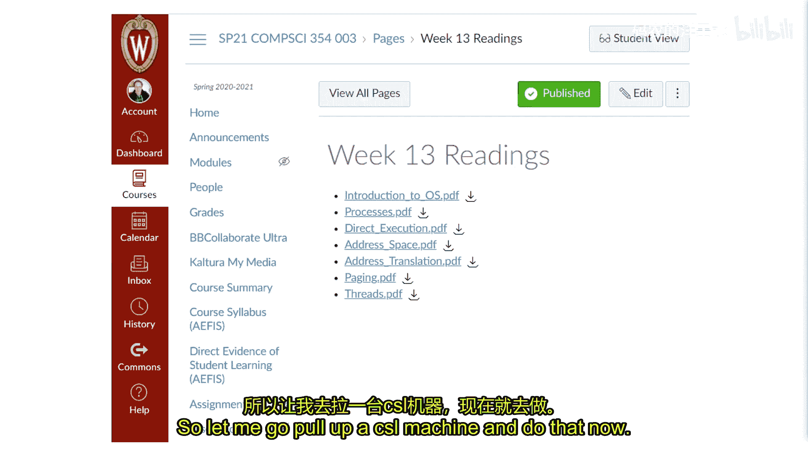
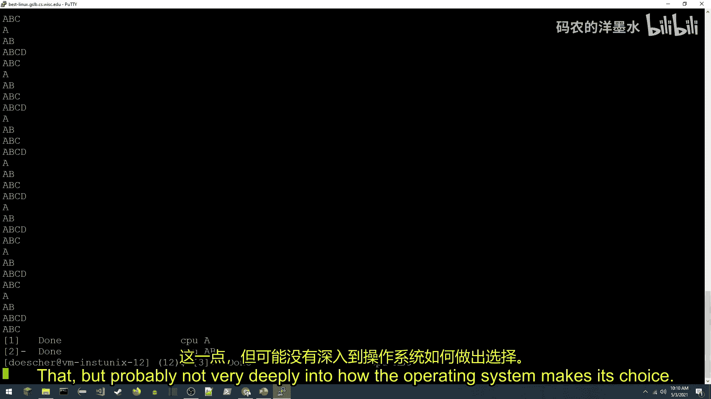
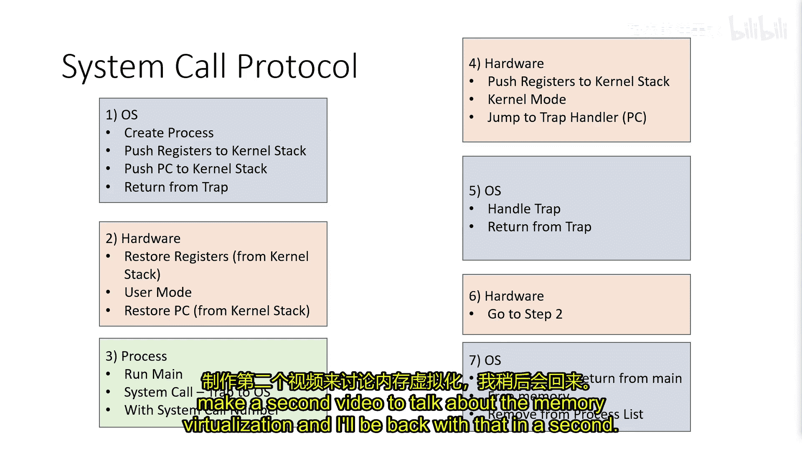

# 【全集】威斯康星大学 C语言编程与计算机底层原理 中英字幕 1080P p12 Lecture 12 - CPU虚拟化 -BV1BViQBwEiS_p12-

Hello everyone， welcome back to Computer Science 354 Machine Orization and programming I got a short series of videos to wrap up the entire course we're just going to talk a little bit more about introduction to operating systems。

We're going to be begin today with CPU virtualization。

 Then the other two are memory virtualization and then threading and concurrency。

 Everything I'm doing in this video comes from the readings from last week。

 So if you've already done the readings， this should all be just a a。review。 All right。

 so just to kind of break this down。 last week's lecture came from the introduction to O reading。

 Just all of these are maybe 12 to 14 pages。 I think the shortest one is actually9。

 They go by really fast。 I found it very relaxing to read the pretty lightweight They're just these are just the introductory chapters to an operating systems book that Remsey wrote。

 All right， here's the idea。 the first two the first video here is that introduction from last week。

 The next two go together。 So processes introduces the idea of processes。

 and how we're gonna virtualize the CPU。 And then the next chapter direct execution。

 we talk about some mechanisms by which the hardware assists with that。 All the next three。😊。

The address space is an introduction to memory virtualization。

 and then some mechanisms by which we can do that。 So address translation。

 how to map the virtual address space to the actual know memory address on RamM and then paging and segmentation are we like techniques that we'll use And we'll talk about the hardware that sort of helps assist with those。

 and then multithreaded applications。 These are a little bit different from just running more than one process。

 These are essentially running multiple copies of the same process。

 So let'll talk about some of the challenges with that。 All right， for each of these three topics。

 that introduction to OS chapter had like an example demo code that demonstrates the issue or the problem or something。

 I'm going to start each of these videos with that just running that demo code from the reading that you guys have already done。

 I was curious and wanted to see it myself。 So let me go pull up a CSL machine and do that now。

Alright， so the first piece of code we'll be looking at。 it's the found in the code directory。

 It's called CPU dot C to just demonstrate CPU virtualization。

 We're gonna be just creating multiple processes that I'll do pretty much the same thing。

 We can see here we're gonna use this by calling the CPU program。

 and then a string that it'll print out。 We'll start a string with this pointer here。

 It's gonna be an argument once a command line parameter。

 Then let's go through loop and 30 times we'll print out。 This spin functions found in common dot H。

 just causes it to wait for one second between printing out all the letters。 Okay。

 so let me get out of here， compile this and then demo it。😊，Alright。

 so just a quick demo here using just the word test。 So this is calling CPU。

 It's going to print out test over and over and over with a delay of one second between each of these。

Printtings。Alright， that's a basic overview。 Now what I really want to do is run multiple instances of this。

 So the first one is going to get CPU， the word A， then we'll run another process， CPU getting A B。

 and then ABC and ABC D。 Allright， So let me go ahead and run this。And there we go。

 We can see right away that it's not coming out in the order I put them in。

 We're getting A B is the first one。And then I'm just going to give this 30 seconds to finish。

Be right back when it's done。Alright， it's finished。

 So let's take a look at the last four right here。 We can see that it's printing A first。 then A B。

 And if you look back at the very first set of four。

 it actually started with A B instead of a somewhere in the middle here。

 I noticed that it switched to A A B， ABC， ABC D。 So it's not in the order that we see here。

 it's sort of a more or less random order。 And the result of this is that time sharing principle。

 the processor is or the operating system is choosing to give each of these processes。 you know。

 the one that prints A and the one that prints A B a little bit of time。

 And then it switches to another one。 And the choice that it makes about which to switch has some like。

 well， some randomness in it from little looks of things。 Yeah。

 the operating system is making that decision based on the previous。

 like and its analysis of how the process was running。😊，All right。

 we'll go a little bit more into that， but probably not very deeply into how the operating system makes its choice。

All right， So what we were just seeing is an example where we were running multiple processes at the same time。

 And the process is sort of the fundamental abstraction of a running program。

 not one that's air on desk， but actually running。 And the question of the primary question we want to focus on here is。

 how is it possible that we can run 1000 processes at a time。 Oh， or 10000 as I have a typo there。

10000， No problem。 if we only have one CPU。 The idea here is that the operating system is going to do what's known as virtualizing the CPU to emulate many CPUus。

 even though we may only have one or a very small number。

It's essentially going to create an illusion of an endless supply。

 And we do this by time sharing where the operating system is going to switch back and forth between multiple different processes。

 give them each a little bit of CPU time。 All right， now， nowhere in our code Did we ever say， okay。

 let's pause here and lets someone else run for a while。

 There is nothing in our code that's indicating that this time sharing is ever going on。

 So the operating system needs to take care of this。

 And maintain that illusion that every program has like full control over the CPU。 And to do that。

 it requires I guess， two sources of two resources。

 something in hardware that lets us do this context switching。 and。

 and we talked a little bit about that intro lecture。

 It's the timer interrupt and the kernel bit and。Then the we also need the operating system to make a decision about scheduling。

 So the hardware mechanisms are really answering the question about how does this happen and the operating resources that we're using is answering like which program do we switch to next that's going to be based on policies。

Alright。So as we make these switches， we need to keep track of a number of things。

 and I had a list last time in my previous lecture。 I shorten this up。

 we've got three things in essence that we need to keep track of the entire memory that being used by process that's all of the instructions。

 the data， heap and stack I've drawn a picture of that many times。

 since essentially the entire address space that's being used。

We need to keep track of the values in the registers so we can put everything back when we switch from one to another and then IO devices and that's going to be a bunch of things open files。

 standard in， that'd be the keyboard standard out， just putting text on the screen， the errorstream。

 any sort of network connections， any other kind of like I devices， I don't know， printers， mice。

 whatever else is being used。All right， and in order for the operating system to be working with processes。

 it needs to have a number of system calls available to it to like work with processes。

We need to be able to create them。 That's the next slide。 When we're all done with them。

 we need to be able to destroy them。 That is， if they don't just end on their own when they reach that。

 you know， return 0 line at the end of main。 We need to be able to wait。

 And this is waiting for the process to actually stop on its own for whatever reason for I O。

 because it ends。 We need to be able to control what's going on at which process is running。

 So this is the suspension of a process。 starting another one or switching to another one。

 and then stopping that one and then resuming execution of the first process。

And in order to make the decisions about which process is going to be run next。

 it needs to be able to get some information back about the resources used by process。

 We know whether it's waiting for I O， how much CPU time it's using。

 how much memory access it's using。 And it's going to use all of those things to make a decision。

 We're not going to be talking about any of the policies here in this lecture。

 this is just a brief introduction。All right， when we create a new process。

This is probably the most complicated part。 We've got to do a number of things。 First。

 the operating system keeps track of all running processes。

 It needs to know whether they're busy or running or blocked。 anyway。

 it has a process list that keeps track of all of the processes。 once it adds an entry。

 then it's going to copy the code and data section， those would be like string literals。

 anything any hard coded strings， any global variables that have been initialized。

 although those get copied into memory。 Then we're gonna to allocate memory for the stack and maybe the heap。

 We push the command line parameters on the stack set up the rest of the stack to begin running main。

 It also needs to set up all of the standard in and standard out error streams at a minimum。

 Then we clear all the registers。 We don't want to actually Social security wise。

 We don't want to let our program have access to any of the previous memory that was used by another process or another user。

 So typically we'll see。The stack is set to zero， the heap will be set to zero the first time it's run just for security。

clear the register same reason， and then we're going to transfer control to the first instruction domain Ma。

Alright， so as the operating system begins execution of a new process， as it's setting up everything。

 all of the data about the state those are stored in a process and that process list。

 the data is actually known as the process control block and just astruct that keeps track of all that information that's what gets added。

 it can think of as an array of process control blocks。

 one entry for each process so it be in the starting their embryo phase here。

 and then that's gonna get moved actually into the ready list and when operating decisions to switch from one process to another it may get moved over to the running stage。

 if I have two process that I care about just as an example just walking through the first one may be running for a while。

 Second one is ready。If that first process suddenly needs input from the keyboard or file。

 it'll move to block and let the I O begin。 wait for it until it's finished。

 We'll move the second process up here and run that for a while。

 If the operating if I O completes that block process will then move over to the ready state at that time。

 the operating system can make a decision about do we want to bring that first process back up。

 or do we want to keep running this process。 And that's a decision made by the operating system based on some policy。

All right， when we complete a program， when it's completely finished。

 we get to the end of the program return0， and it's going to be moved into a finished also known as zombie state。

 and it's not deleted immediately。 And the the reason for that is there may be some return value。

 You know， we ran that process for a reason。 We wanted to do some computation or something like that。

 we wanted the program to do something。 and there may be a return value that the process that called that one。

Just like a function call is going to return a value。

 the function that called it needs to deal with that return value。

 same deal here when a process finishes， we may want to deal with the return value in another process。

Alright， so the first model of process execution we'll talk about is just direct execution。

 We'll see there's some problems here。 in a moment we'll move into limited direct execution。

 But the idea here is that we're just going give the CPU or give the process to the CPU and just let it run without restrictions。

 It's going to run directly on the CPU。 We transfer the first instruction over to the program counter and just let it go。

 So the process here here， operating systems going to create the process just like I talked about in the creation slide。

Create the process control block added to the list。 Then we'll transfer control to the process。

 You know， run main， wait for it to get to the end where it returns 0。

 then we'll destroy the process。 This is pretty simple。

 It involves just freeing the process memory and removing it from the process list。 Now。

 some of the issues that we're going run into is because there are really no limitations。

 we're just forced to wait until it gets to the variant end of the program or or potentially hits a yield instruction if the program put in。

 What happens if we get to an infinite loop。 The answer here is you push the power button and reboot your machine。

Pretty simple， but undesirable。 And then the other one is， what about security。

 things that really should be restricted like working with input output。

 So we really don't want any program that we run to mess with another file on our system or to allocate。

 you know， more memory to kill another process。Start another process without assistance from the operating system。

 So that's what I'm thinking about right here。Alright。

 so I've gone ahead and added the word limited to my direct execution slide。

 This is gonna add a couple details and let us have a lot more control and deal with those issues we talked about in the previous slide。

 So first， we're gonna be able to use time sharing to switch from one process to the other。

 we talked about this in the previous lecture。 But the way we're going do this is to have a one bit on the CPU that switches between user mode and kernel mode for all of that protection。

 If it's in kernel mode， then only the system calls that are part of the kernel know the limited set of them。

 create a new process， give more memory to。😊，A process， things like that。 kill a process。

 All of those things are gonna to be kernel mode functions。

 So in kernel mode and setting the timer for the time sharing that kind of stuff I feel like I went into that last lecture I'm gonna to move on in the actual program that we are running our process。

 we're gonna to have things known as trap instructions and these are going to be hey operating system。

 I want you to take care of this IO for me or I need more memory。

 can you give it for me So a trap instruction is going to turn control over to the operating system with some sort of request and then the operating system will deal with that and then it will execute a return from trap've got a diagram on the next slide。

 but here's the idea when we execute a trap instruction at boot time。

 the operating system will set up a trap table and trap then generally refers to things that a programmer might want to。

Like IO from the keyboard or print something on the screen and interrupt tables。

 Those are gonna to be hardware interrupts where something goes like the timer interrupt to indicate we consider switching process or like a divide by0。

 some sort of math error not even like the really powerful CPU can divide by zero。

 So something like that an error condition There are tables and it's just those tables just contain know each entry is the first instruction of the code that deals with whatever just went wrong or whatever request came from the user。

 So it's just a table they've got like one address each And when the trap instruction happens。

 it jumps to that。 looks up where the first address is of the code and jumps to that piece。

 This is set up at boot time。 So it lets us change the operating system can add more system calls。

 and there is a system call handler that stored in one of the registers and that's。up at boot time。

 And again， a lot of this may be from security because we don't want the user to know where any of this code is stored。

 So it's a little bit different from a function call。

 if I'm calling a function I know exactly where those instructions are I need to because I'm just going to change the program counter to go point to the instructions for the function In this case。

 the user doesn't know where the system calls are， they're part of the operating system in operating system address space So what's going to happen here is it's going to use some sort of like a trap number and then turn control over to the operating system who will go look up the address of the table in that register and then use the instruction number to figure out which instruction we want and then jump to the first instruction of that system call。

I felt like that was a really long run on sense。 Hopefully it made sense。Al right。

 I just want to finish up here with a picture version。

 I guess of what's going on during the system call。 So at the very beginning of the program。

 we see that the operating system is going to create the process。

 All the stuff I talked about on the creation slide。 And then before we begin a couple extra steps。

 we're going so the operating system has its own stack known as the kernel stack。

 it's going to push the registers， In this case， when we begin。

 we're just going to push zeros for everything for all the registers。😊。

We're going to push the timeout up。Allright， that's better。

 We're going to push the program counter to the kernelel stack。 I left up two letters there。

 and then we're going to execute a return from trap function call。

That's going to switch over to the hardware， which is going So this really feels weird that we push the registers。

 but it lets us use this return from trap instruction and we'll see in a second why this is important and gives us one function to do everything。

 We'll restore the registers from the kernel stack so the program can take over。

 We switch back to user mode to create a process， we need to be in kernel mode。

 So we just set that bit。 And then we restore the program counter。

 which is pushed onto the kernel stack and then the program can take over。 when we begin。

 we running main。And whenever we get to any sort of system call。

 you know I'll open a file request more memory， we will trap to the operating system with a system call number。

 It doesn't actually know the address where those are stored so just a call number and the instructions for those are stored in that trap table or interrupt table if their hardware interrupts right After that we have the system call that's going to move to back to the hardware。

 It's going to save the registers on the kernel stack， save the program counter， all that stuff。

 switch it to kernel mode and then jump to the trap handler that's going to look up where the trap table is and jump to the instruction for that trapops forgive me then step 5。

 the operating system runs the code that'll handle the trap whatever it is。

 and then we'll execute this return from trap instruction which is basically step two over here。

 we restore the registers， switch back to user mode and run the user programs more really the only difference。

Between a function call inside of the program and a system call to the operating system。

 We switch to kernel mode to do restricted operations， and we don't know where the address is。

 We let the hardware take care of that that code is set up at boot time。

 and we just keep this cycle so。The handle the drip， run the process。

Per caused some sort of system call again。 saveve all the registers。 handle the trap。

 go back to step 2。 Now， I've got a little note here。 I've got a step 7。

 even though that has a loop that'll never exit。 should the trap be exit or returned from main。

 Then the operating system will deal with that in the the step 5 handle trap by freeing the memory and removing the process from the list。

All right， I talked about a little bit last time。 This is if the user is calling a trap the operating system。

 there are other ways that the system control may return to the operating system。

 Number one is with the time sharing mechanism we have a timer when the timer goes off。

 essentially something very similar to this and I addressed it in my last lecture。

 So I'm not going to make another slide a timer goes off it immediately jumps to operating system code for the interrupt that handles that and the operating system is going to make a decision about whether we want to switch to another process or not。

 So essentially， instead of the system call right here with a trap the OS。

 this would be done by the programmer a timer interrupts going to go off and do essentially the same thing。

Right there。All right， that's going to do it for this part of the lecture。

 I'm going to go back my second video to talk about the memory virtualization。

 and I'll be back with that in a second。

