# 【全集】威斯康星大学 C语言编程与计算机底层原理 中英字幕 1080P p13 Lecture 13 - 内存虚拟化 -BV1BViQBwEiS_p13-

All right， welcome back to machine organization and programming。

 We're going a little bit into operating systems today。

 and we've got the second topic up memory virtualization。 All right， here's the idea。😊。

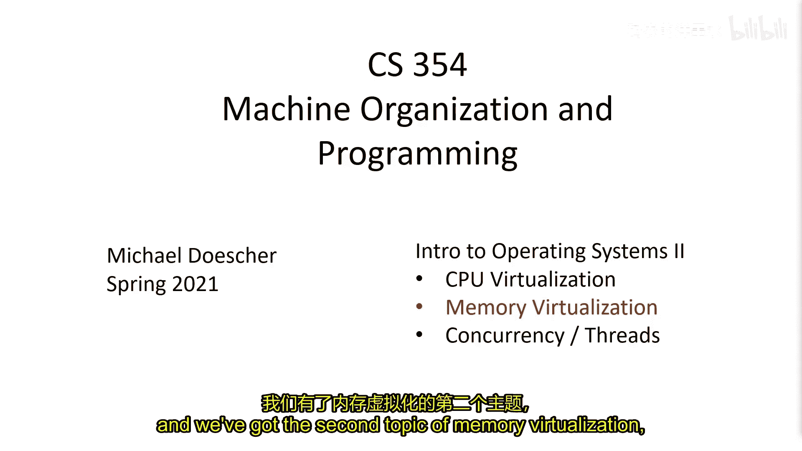

We have different models we've used throughout history for the address space。

 looking over here on the left， we've got a really old school version where I've got the entire physical memory。

 however much I have back in the day it wasn't very much。

 I'm going to load the operating system into the very top， maybe 512 kilobys， something like that。

 I want to keep that very small because I don't have very much memory back in the 70s or 80s。

Then I'm going to load the entire process all the memory。

 and I'm just going to give the entire process all the memory。All the remaining memory。

 I'll keep the operating system up here。Process down below that the process will know that theres some reserve memory up at the top。

 and then when the process finishes， the operatinging system will load the entire next process。

Al right。 this doesn't allow for any context switching， no time sharing。

 We're running one program at a time。 And I'm pretty sure that my very first computer actually worked like this。

All right， so we can do better。The second version here that I have a little bit more advanced is still going to load the entire operating system right there into physical memory。

Then we'll load the process in。 This one will allow for process switching or time sharing。

 What we're going to do is every time we switch， we'll save everything to the disk。

 and then we'll load in process  one。If you don't have very much memory。

 it doesn't take that long to do this， but still saving something to the hard drive very slow。

 but it still does allow for time sharing。 So multiple people can run their process at the same time on the computer。

Or you can run multiple programs at the same time， but generally。

 we want to avoid that save at the hard drive。Alright， another version。

 the one used in modern computers is to divide up the memory somehow for each process。

 And I've got two different models I'll talk about in a second。

 We'll still put the operating system somewhere in physical memory。 Then we'll have process  one。

 somewhere in physical memory process 0， somewhere in physical memory and so on。

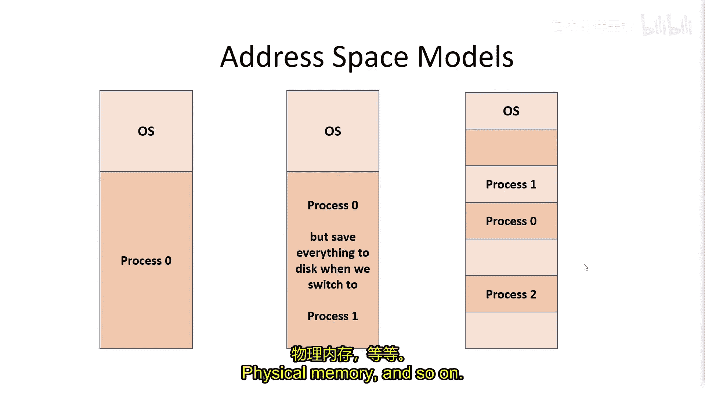

All right， so here's the idea。 We've been writing programs all semester long。

 and we've basically been able to make the assumption that whatever program I'm writing。

 this is my work， I get the entire address space。 You know， Adder  zeros reserved。

 I've got my code up here at the top。 I've got my data section for all of the like string literals and global variables that have been initialized。

 My heap。 Then way down at the bottom。 I've got the stack。 I get all the addresses on a 32 B machine。

 That's2 to the 32 memory addresses that I can write to。😊，All right。

 But I don't have that much physical memory in my computer。 And， in fact。

 what we're going to do is find out that the operating system and the computer hardware work together to map this entire virtual address space。

 All 32 to the 302 addresses，2 locations in memory on the hard drive。 No， I'm sorry。 Lo in Ram。

 And if there's not enough， some of them may go to the hard drive。 All right。

 and each of the processes just gets mapped to a different region in physical memory。

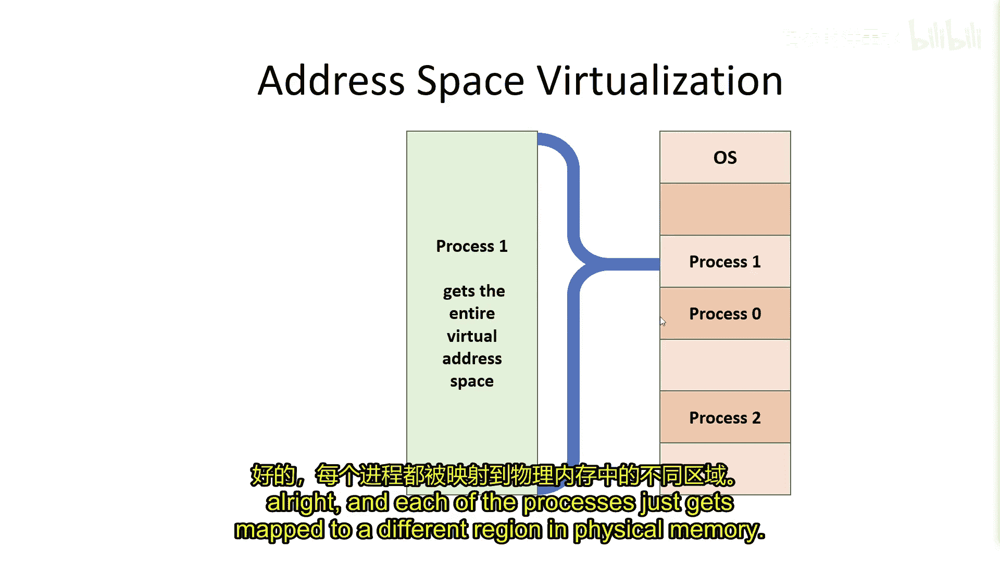

All right， the goals， we want to hide all the details。

 we want all of our programs to think they have all two to the 32 addresses available to them。

We want to be able to do that translation to go from the programmer address。

 the virtual addresses to the real physical addresses on Ram。 need that to be fast。

 We also want to be able to protect the memory used by one process from all the rest of the processes。

 You know， I don't want to be able to read the memory from some other user who happens to be using the same machine at the same time I am。

Allright， and then some of the other goals we'll find the operating system takes care of deciding what happens when I don't have enough memory and some program we need more memory。

 I mean， we're going to write something to the hard drive and load it back in later when we need it again。

 but the operating system will take care of the where do we allocate memory for different programs。

 We won't go into this in this class。 This is my advertisement for you guys to go take operating systems next semester。

believe this is a prerequisite for that。 And that's the general path that most people take。 Al right。

 and advertisement。 Okay， we also want it to be as easy as possible to program and that goes right along with hiding all the details。

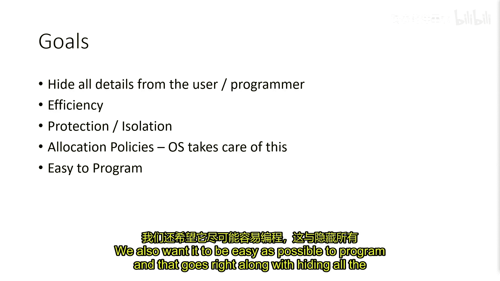

Alright， so the idea here is address based virtualization。So for example。

 if I have a process and somewhere in my assembly， I've got an instruction that says move some memory address。

 so I need to go to memory to get this and shove it in EAX。

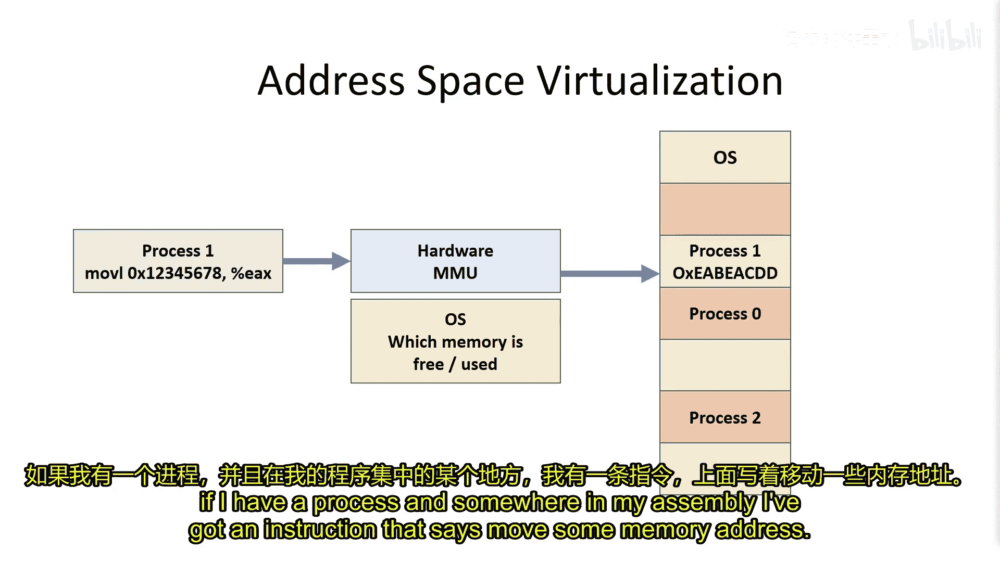

This probably would have been better example'ca my arrows go the other way。 but here's the idea。

There is some hardware in there。 The memory management union unit that's going to take this physical virtual address and translate it and just figure out how it maps to some address in the process in the physical memory。

 So this address right here that I see as a programmer is almost certainly not the same address where is really stored。

 And there's just， you know， some， you can imagine this is just a table that it looks up。

 This address maps to this one。It's a little more complicated than that。

 We'll talk about that in the next few slides。 And then the operating system is working along with this to keep track of。

 you know， which memory is being used。 Yeah， here's some for process 1， here's some for0。

 and which is free。 Here's a black that's free in between here。

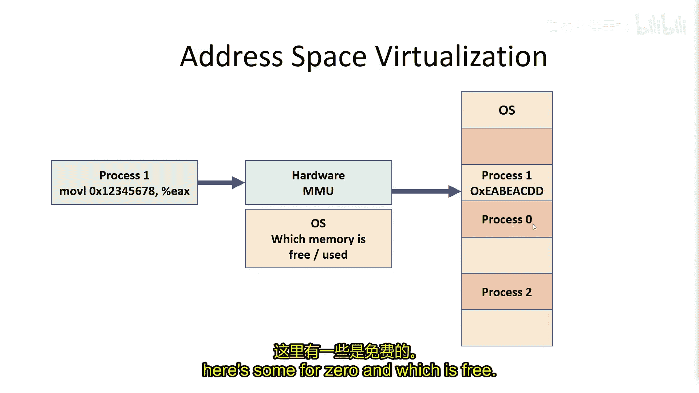

All right。 I've got two different models for how low this mapping can happen。

 The first one is known as segmentation。 And essentially what this is going to do。

 it looks just like the picture。 I'm going to give every process a chunk of memory。

 So here process 1 has that memory。 I'm going to keep track of the starting address。

 where process 1 begins。😊，And the ending address where process one you know， ends。

 Sometimes this is done as an offset from the base。 Sometimes it's just given the exact address。

 where it ends。嗯。In order for this model to work， the address base in physical memory that I'm using needs to be like a contiguous block。

 All of it at once。 I'm not going to split up the memory for process  one into more than one place。

 I've only got one base， one bound register。 So everything for process  one goes all in one chunk in a row。

That makes figuring out where the physical address is very simple。 I take my process address。

And I just add the base to it。 It also means that I， I'm gonna attempt to use very small addresses。

 So I， where I put the stack， you know， before I would have said it's at the very bottom of the space。

 I at the like the lowest down thing。 But I'm gonna actually move it up and keep it relatively close so that I have a very small。

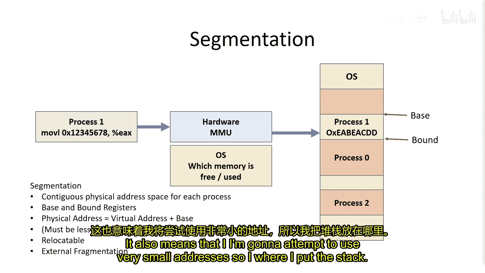

differenceifference between the base and the bound or how much space I'm using。

And if I need more space， I will go ahead and reserve that ahead of time by changing the size of the stack。

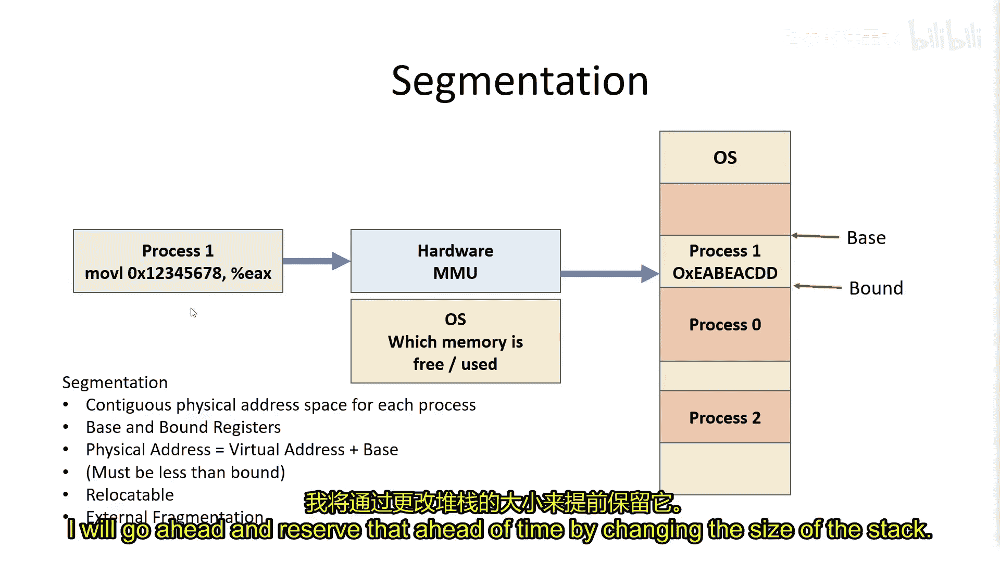

All right， so physical address is just the virtual address over here plus the base。

 and that's going to go get me wherever this is in memory。All right。

 one of the cool things about this is because the physical memory is all managed by the operating system is that it's relocatable。

 So it's not something we can do as a programmer。 but suppose I have a request for more memory for process 1。

 I'm going expand this address space。 And I want to make the heap bigger or something like that。

 So one of the things I can do here is I've only reserved this much between the base and the bound。

 And there isn't more space。 process  zero is in memory right next to that。

 So I've got a couple of options。 I could take everything from this process。

 and just copy it down somewhere else， maybe down here at the bottom。 there's enough space。

 Maybe I'll make that box a little bigger next time。 So it looks like there's enough space。😊。

And then all I need to do after I copy it to a different base in physical Ram is change my base and bound。

 and all of a sudden I've completely relocated it and。I have more space available for process one。

All right， the downside to this segmentation model。 Well， that's slow， obviously。

 to move things relatively。 but it leads to external fragmentation。

 So this is a unusable space between blocks。 that I need to go back and move things around to get rid of。

 So this space right here might not be enough room to expand process 1。

 And so this is wasted space an external fragment that is unusable until I move things around。 I can。

 you know， move process 2 up。 get rid of that。 Then there's definitely gonna me enough room for process  one down below。

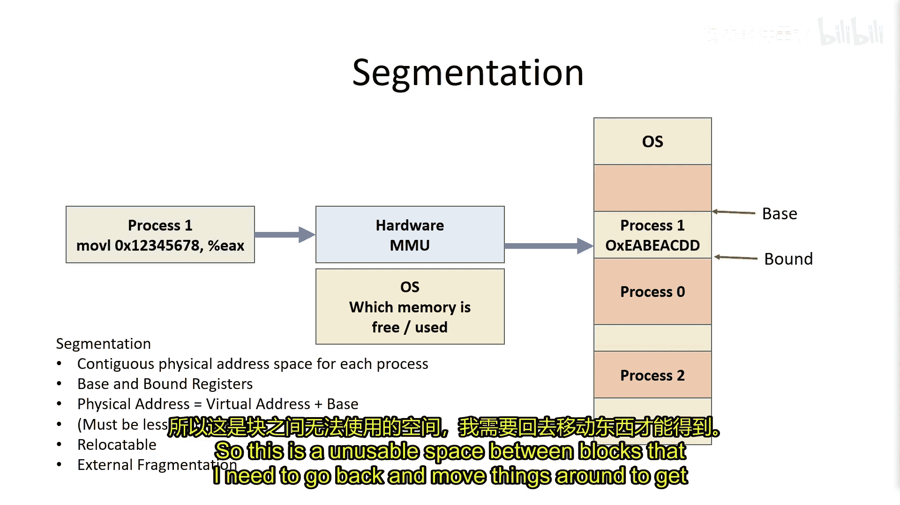

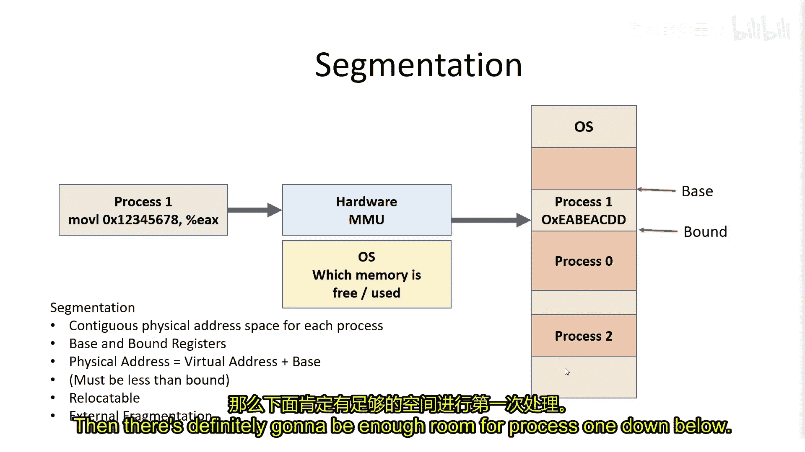

All right， that's all there is to segmentation。Alright， so the next idea is known as paging。

 So here's the idea here。 What I'm going to do is break all of my physical memory and my virtual memory into identical size pages。

 just like pages on a book。 I've got a certain number of characters I can type onto a page In my example。

 I'm going to use 4 kilobyte pages。 It's pretty typical size for a 32 B machine。

I've got my entire virtual memory address space up here。

 So all the way from address 0 to address 2 to the 32nd at the bottom。

 I've got my code laid out my data heap stacked just like all semester long。 And each of these pages。

 you know， this is 4 k worth of code right here。 I'm going to keep track of in a page table。

 where this maps2 in physical memory。😊，This block of code isn't necessarily right next to this one。

 It could be any of these available pages in physical memory， so maybe that one。This code， you know。

 may way down here。 So that's all there is to it。 This page table is each of these entries is just 4 bys。

 All it needs to do is keep track of where it maps to。 just the starting address of a physical page。

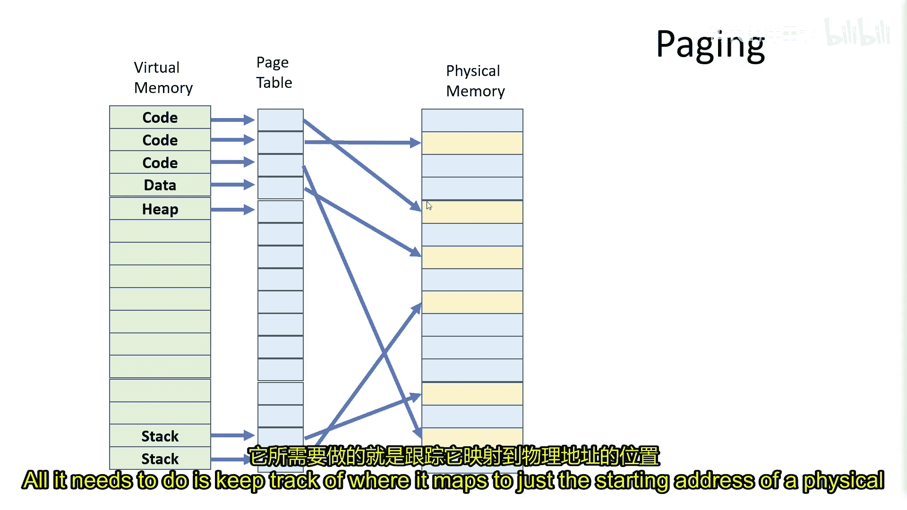

Alright， also note that each process gets its。Oh， I've got a take time on。Okay， got that fixed。

 Allright。 What I want to point out here is that each process gets its own page table。

 So here's program 1 or process 1。 Here's the page table for process 1。 It shows all of the mappings。

 There is one entry for every single possible page。 Allright， I got some math on the next slide。

 We'll talk about that in a second。 But for process 2， I've got code data heap in my stack。

 These are mapping to different physical pages。Physical memory。

 but I still have all possible pages address 0 to address 2 to the 30 secondnd。

My page table here still has one entry，4 bytes for every single page over here。Allright。

 and they map two different spots in physical memory。

The operating system takes care of all the complicated details like what if I run on a memory。

 what if I need to exchange something。And I'm not going to go into that here。

 The reading does a little bit。 but， you know， just a high level overview。

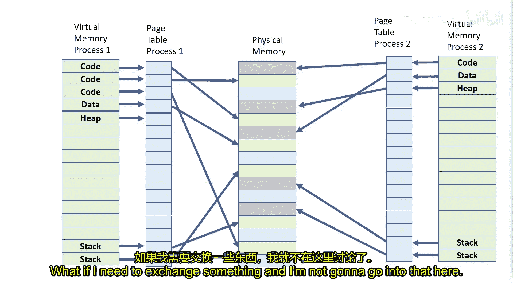

Alright， real quick。 I want to do a little bit of math here。 Please remember。

 the memory is divided into fixed size blocks。 We're calling them pages。

Pretty typical size for a 32 B machine is 4 kilobytes or 4096 bytes。 that's2 to the 12th。

Which means that I can use the last 12 B。Of bits，12 bits of an address to represent the offset into memory。

So for example， if I have address， 1，2，3，4，56，7，8， each hex digit represents4 bytes。

 so I will need three bytes。 I'm going to use the last 12 bits to indicate how far from the starting address of a page my address is。

Okay， so if I'm looking at， you know， address， 1，2，3，4，5，6，7，8 is right here in this block of code。

All right， that means that the it will be address 6，7，8 away from the start of the block of code。

 And if this maps to， let's see here this physical memory address down here。

 I'm going to find this at address what 6，7，8 away from the start of this。Okay。

And that means that I can use the other five hex digits or 20 bits to indicate which page I'm looking at。

 So that means that this page table has two to the 20th entries。All right， that's a lot。

2 to the 20th。Alright， so I'm going to divide the address into two parts。

 my page index and the offset into my 4 kilo page zone。All right。 And remember。

 each process gets its own page table。 This is a huge table， and every process gets one。Alright。

 so the page table entries， this is only 4 B。 This is 4 k。 These are 4 k。 but this is only 4 B。

 But still， it's got two to the 20th entries。 So2 to the 20th。 Let me think here。

2 to the 10th is 1 k，2 to the 20th is about 1 MB。 They're 4 B each。

 That means that the entire page table for 32 B machine is going to be 4 MB。

And every process gets its own。 So that means if I have 100 processes。

 this page table is going to be 400 MBby。 and the operating system going to keep track of that on its stack。

Al right， there's a number of ways we can minimize that or reduce it and make it more efficient to look things up。

 Now， I'm not going to go into that。 This is the end of the lecture。

 This is all I want us to do for this virtual memory。 is introduce the idea of paging。

 In that there is there is a challenge here that we need to think about Yet again in advertisement。

 go take operating systems。All right， have a good day。 I'll be right back with the last video。

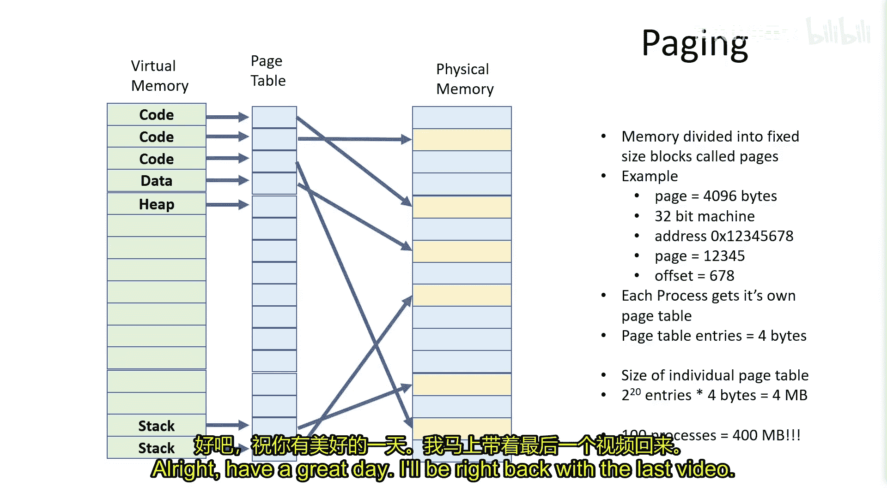