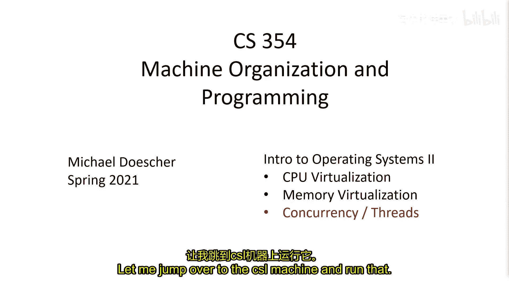
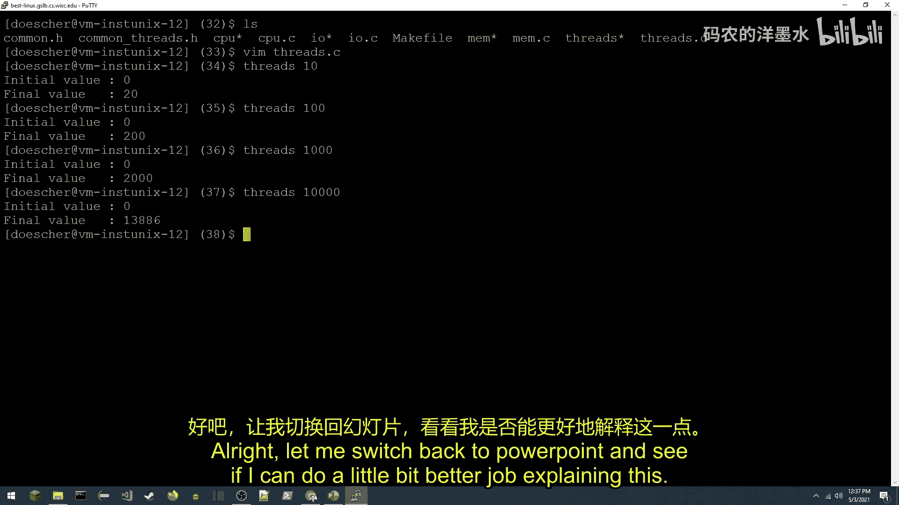
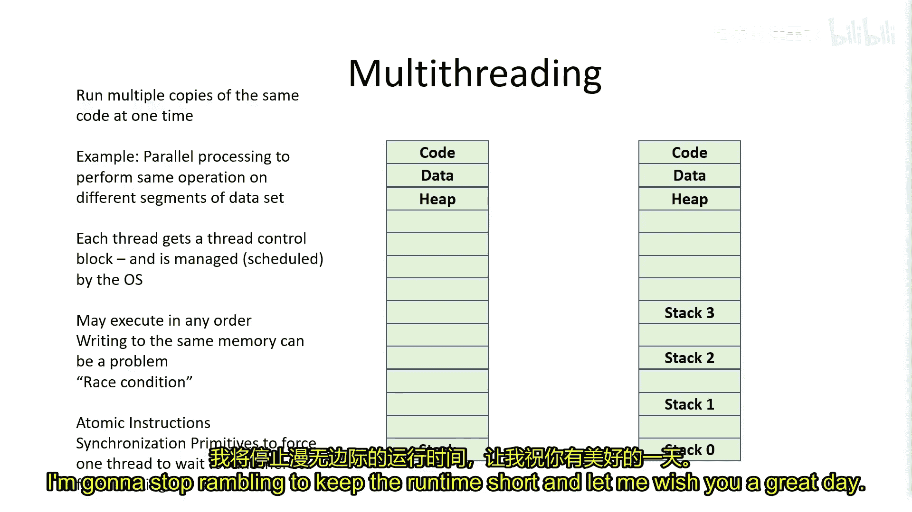

# 【全集】威斯康星大学 C语言编程与计算机底层原理 中英字幕 1080P p14 Lecture 14 - 线程与并发 -BV1BViQBwEiS_p14-

Hello， everyone。 Welcome back to machine organization and programming for the third and final video for today。

 We're continuing our introduction to operating system with concurrency and threads。

 This is the idea that I want to be able to run multiple copies of the same code。

 perhaps to break up a large data set and process individual pieces of it and take advantage of the fact that my computer may。

 in fact， have multiple processors， multiple CPUus and those processors may have multiple core。

 All right， first， I'm going to start off with an example。

 Let me jump over to the CSL machine and run that。😊。

Alright， so this is the threads。 C file you can find it in the code on canvas page All right first what we're doing is we're creating a variable counter。

 This is a global variable it's defined outside of any of these functions assigning an initial value of 0 a volatile is a keyword that indicates that this variable may be changed from anywhere else in the code and then the number of loops we'll be working with also a global variable。

We're defining a function here， this is it's going to return a Vo pointer， we've named it worker。

 pretty typical for just a thread that's used to process some data。And all this is going to do。

Spacing now right。 There we go。 is go through the power many times and increment this counter right there。

Allright， and then down here， the usage of this。All on。

 let me get that fixed is we're just going to put in how many times we want to go through the loop。

And then down here， we can see that we're going to turn that into an integer stored in loops。

 We're going to be creating two threads。 All right， they're both going to run at the same time。

 It's going to print out some information about them。 We're going to run the threads， both of them。

 and then print out the final value of the counter。All right。So let me go ahead and just run this。

Remember， I need to put in the number of times this is going to run。

 So if each thread increments the counter 10 times in a loop， final value should be 20。

 That makes a lot of sense as I continue to。Add how many times we're iterating through the loop。

Let's see here。There's 1000。 We get 200010000。 There we go，1000。 We get 13886。

 That just doesn't seem right to me。 But what's going on here is the CPU is doing some time sharing。

 And what's happened is the first thread has read the value of the counter。Moved that to a register。

Incremented it。 But then the time sharing says， okay， switch to the other process。

 And that other process is going to run for a while。 maybe 7 or 6000 times or something like that。

 And then when it finishes， we switch back to the first process。

And it's stored the number it's going to write。 The other process is incremented the counter 6000 times。

 But I've got a value here read before that happened that I'm about to write。

 So it goes ahead and writes over that much bigger number with small number。

 And that's why this value is too small。Alright， so we're going to see we'll get as an answer。

 we'll get anything。 it's got to count up at least to 10000。

We may get anything between 10000 and 20000， maybe 20000。 We'll never see anything less than 10000。

 We'll never see anything greater than 20000。That's kind of the idea of this。

 like the trouble we're gonna run into。 it's known as a race condition where I have multiple threads trying to write to the same data。

 Alright， let me switch back to PowerPoint and see if I can。

Do a little bit better job explaining this。All right， So quick review of what I just said。

 What we're want to do is run multiple copies of the same code all at once。

 This is parallel processing。 I'm going to take advantage of multiple cores in my CPU。 an example。

 I might have like a really large data set that I want to break into pieces。

 do some sort of operation on each of these parts and just take advantage of my like multiple cores to get through that faster。

All right， so in order to do that， I'm going to spawn multiple threads here。

 And here I've got four threads。 Now， I just want to highlight that we're sharing the code。

 That means we don't need to load a new process。 We don't need to copy the code to memory。

 We're just gonna like use this same code segment。 Each of my processes running on their own CPU gets its own program counter。

 They'll be using。😊，This code， just like normal， the data section。

 that's the strings that have been hard coded and those global variables that have been initialized。

 This is where my counter and my my counter variable is going to go。 All right。

 then we'll have a heap。 I didn't use that for this program。

 But then we'll have multiple threads in each thread gets their own stack。

 that way they can keep track of their own local variables， their own parameters。

 So we'll just duplicate this。 I want to point out。

 too that we may run into problems because the stacks grow stack from thread 0 may grow into the stack for thread 1。

 So there's an issue there。 I'm not going to talk about how we deal with it。 advertisement。

 go take operating systems。 So this is essentially the idea， code datad heap are all shared。

Each thread gets its own stack。Al right， let me see here。Y。

 so the idea is each thread also when we had multiple processes。When we had multiple process。

 each process got their own process control block。 They kept track of all the information about the process。

 so we could switch back and forth。 This is going to work more or less the same way with the exception that we're going to call them thread control blocks。

 to keep track of the slightly different data that we need to switch back and forth。

 the operating system is going to run these threads just like it would run processes It's going to schedule them switch to a context switch to。

Move the whatever you know， the the state into the machine and then turn over the program counter to the wherever and the code we left off and run it。

The problem we saw in the example is that if multiple threads。

 like all of these threads here are trying to write the exact same piece of data。

This one may read it。 figure out what it's about to write。

And then switch the operating system will switch it out and run thread 2。 Instead。

 thread2 may write whatever it wants to the data up here。And then when it's finished。

 it switches back to stack to thread 3。 and that it'll overwrite whatever change stack2 made。

 thread 2， which gets its own stack。 This is known as a race condition。

Because two different threads are racing right to the data and if they're interrupted during their right step。

 we are problems。Alright， I'm not going to go into a lot of detail about how this is fixed。

 one of the。Easier solutions to understand as the idea of atomic instructions。

 So this is atomic is in like from chemistry， the atom， atoms are indivisible。

 That means this instruction， we're not going to break it down into multiple steps。

So you can imagine like if we have you know I plus plus in C code。

 that may get broken down into read I， increment I， and then write it back， you know。

 three instructions。 What we're going to do is instead provide extra and assembly instructions that do all of that all in one step。

That way， when you know the。Operating system will not interrupt a thread in the middle of an instruction happens between them。

 So every instruction， you know， once we start it finishes。You know， we read it。

 we decode it or fetch it， decode， execute it。Those all happen。 So as long as we're not interrupting。

 you know， the read， increment and write。 If it all happens at once， then we are good。

 So that's one way to solve this problem is to just make sure that any change we make。

 the right is included all in the same instruction。

In order to do that for every single possible situation where I might want to write is totally unfeasable。

 They need to be very simple things。 So that's not a like universal solution。

 that universal solution that solves all of our problems。 Instead。

 we'll see And this is another advertisement to go take operating system。

 is that we will have a number of synchronization primitives that we can use as a programmer to just let the operating system know that there's an issue here and don't switch until。

We finish writing。 Don't let anything else write to the same memory that I am trying to write to。

Until I'm done。 So I'm not going to talk about how these work with basically a way to force one thread to wait for the other one to finish writing。

All right， that's going to do it for this video。 This is the last video for the entire course。

 I hope you guys enjoyed it。 I'm going to stop rambling to keep the runtime short and let me wish you a great day。

😊。

