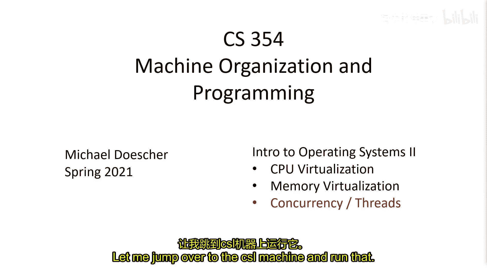
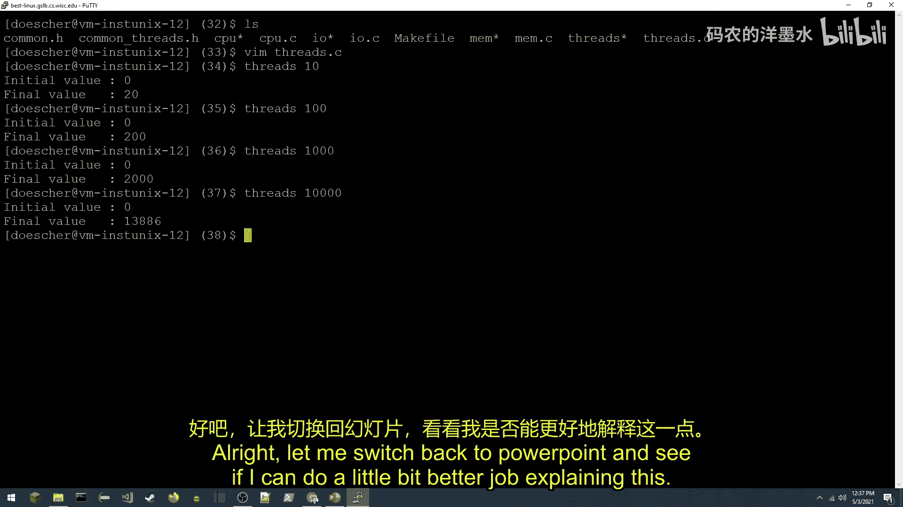
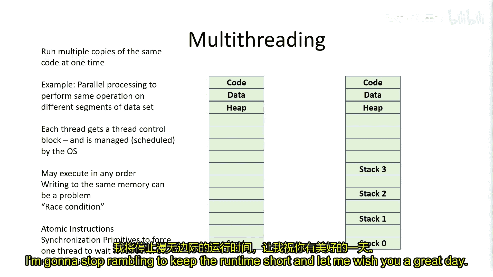

# C语言编程与计算机底层原理：14：线程与并发 🧵

在本节课中，我们将学习操作系统中的并发与线程概念。我们将了解如何让程序同时运行多个任务，以及在这个过程中可能遇到的问题和解决方案。



## 概述

我们将从线程的基本概念开始，通过一个具体的代码示例来展示并发编程。接着，我们会分析示例中出现的“竞态条件”问题，并探讨其背后的原因。最后，我们将简要介绍解决这类问题的两种思路：原子指令和同步原语。

## 线程的基本概念

上一节我们介绍了进程，本节中我们来看看线程。线程允许我们在同一个程序中运行多个代码副本。这被称为并行处理，可以充分利用计算机可能拥有的多个处理器或多核CPU。

线程与进程的关键区别在于资源共享。以下是线程模型的核心组成部分：

*   **代码段**：所有线程共享同一份代码。无需为每个线程重新加载或复制代码。
*   **数据段**：所有线程共享全局变量和硬编码的字符串等数据。
*   **堆**：所有线程共享动态分配的内存区域。
*   **栈**：每个线程拥有自己独立的栈，用于存储局部变量和函数调用信息。

每个线程也有自己的**线程控制块**，类似于进程控制块，用于保存线程的状态信息，以便操作系统进行调度和上下文切换。

## 一个并发示例与竞态条件

让我们通过一个具体的C语言程序来理解并发。以下代码创建了两个线程，每个线程都循环递增一个全局计数器。

```c
#include <stdio.h>
#include <pthread.h>



volatile int counter = 0; // 全局计数器
int loops; // 循环次数

void *worker(void *arg) {
    for (int i = 0; i < loops; i++) {
        counter++; // 递增计数器
    }
    return NULL;
}
```

在主函数中，我们创建并运行两个线程，然后打印最终的计数器值。

```c
int main(int argc, char *argv[]) {
    loops = atoi(argv[1]); // 从命令行参数获取循环次数
    pthread_t p1, p2;

    printf("初始值: %d\n", counter);

    // 创建两个线程
    pthread_create(&p1, NULL, worker, NULL);
    pthread_create(&p2, NULL, worker, NULL);

    // 等待两个线程结束
    pthread_join(p1, NULL);
    pthread_join(p2, NULL);

    printf("最终值: %d\n", counter);
    return 0;
}
```

理论上，如果每个线程循环 `N` 次，最终结果应为 `2N`。然而，实际运行结果往往小于 `2N`，例如循环1000次，结果可能只有1386。这就是**竞态条件**。

**问题根源**：`counter++` 这个操作在底层并非原子操作。它可能被分解为三个步骤：
1.  从内存读取 `counter` 的值到寄存器。
2.  在寄存器中将其值加一。
3.  将新值写回 `counter` 所在的内存。

如果线程A在执行完步骤1和2后，被操作系统切换出去，此时线程B开始执行并完整地完成了多次 `counter++` 操作。当线程A再次被调度执行时，它会将从旧值计算出的结果（步骤3）写回内存，从而覆盖了线程B所做的所有更新。

## 解决竞态条件

竞态条件发生在多个线程同时读写共享数据时。要解决这个问题，我们需要确保对共享数据的访问是同步的。

### 方法一：原子指令

一种思路是使用**原子指令**。“原子”意味着该操作不可分割，在执行过程中不会被中断。如果 `counter++` 是一个原子操作，那么读取、递增、写入将作为一个整体一次性完成，从而避免被其他线程打断。

然而，为所有可能的复杂操作设计原子指令是不现实的，原子指令通常只适用于非常简单的操作。

### 方法二：同步原语

更通用的解决方案是使用**同步原语**，例如互斥锁。这需要程序员在代码中明确标出可能产生冲突的“临界区”。

基本思想是：当一个线程进入临界区（例如准备修改 `counter`）时，它会先“锁住”相关的共享资源。在此锁被释放前，其他试图访问同一资源的线程必须等待。这样就强制线程们排队访问共享数据，避免了竞态条件。

```c
pthread_mutex_t lock; // 声明一个互斥锁

void *worker(void *arg) {
    for (int i = 0; i < loops; i++) {
        pthread_mutex_lock(&lock); // 进入临界区前加锁
        counter++;
        pthread_mutex_unlock(&lock); // 离开临界区后解锁
    }
    return NULL;
}
```

## 总结



本节课中我们一起学习了线程与并发。我们了解到线程是共享代码和数据，但拥有独立栈的执行流，能够实现并行处理以提高效率。我们通过一个计数器程序演示了多线程编程中常见的**竞态条件**问题，其根源在于对共享数据的非原子化操作可能被线程切换打断。最后，我们探讨了解决此问题的两种途径：使用**原子指令**（适用于简单操作）或更通用的**同步原语**（如互斥锁），后者通过在代码中定义临界区来强制线程顺序访问共享资源。深入理解这些同步机制是编写正确、高效并发程序的关键。