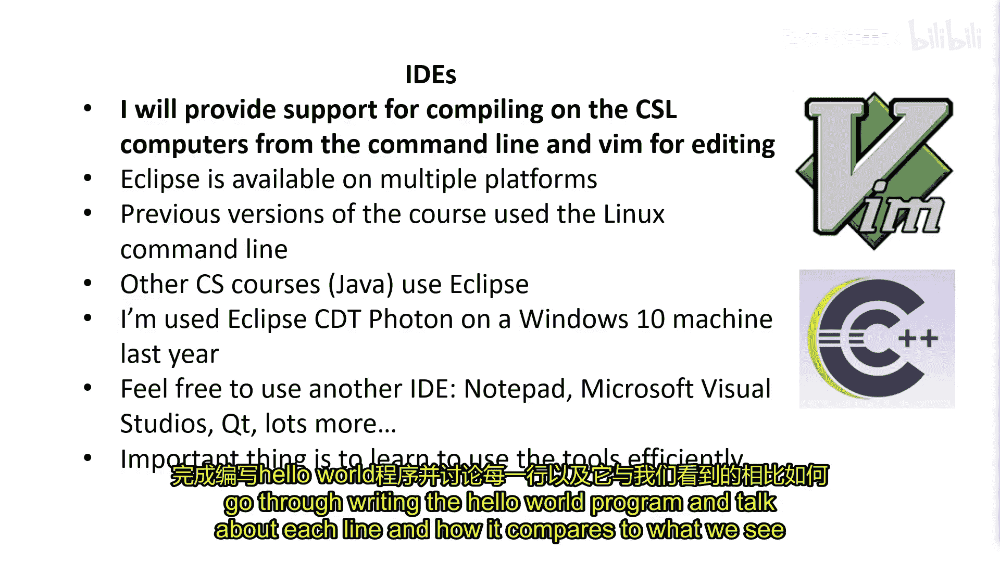
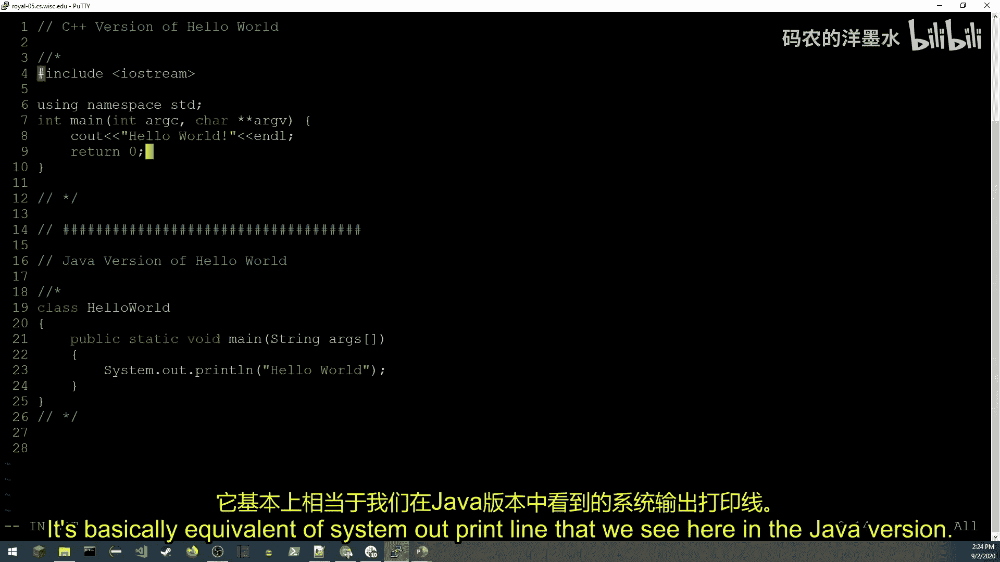
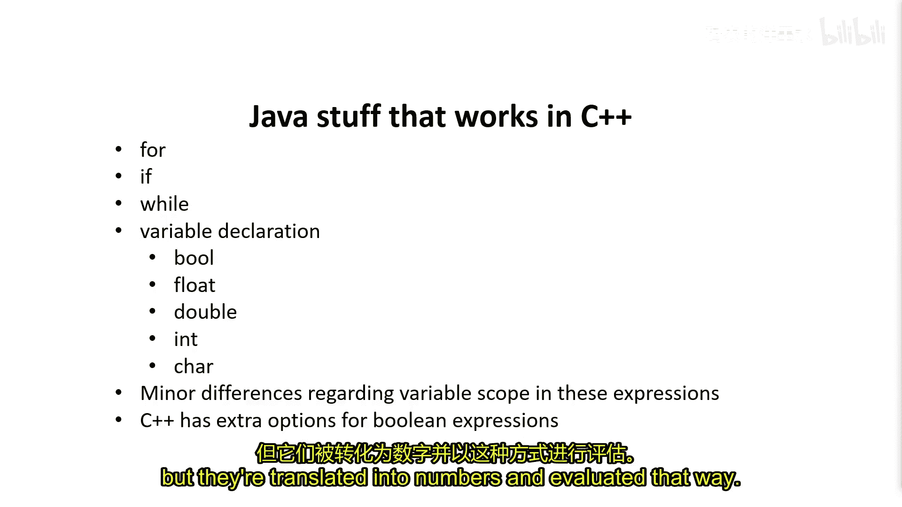
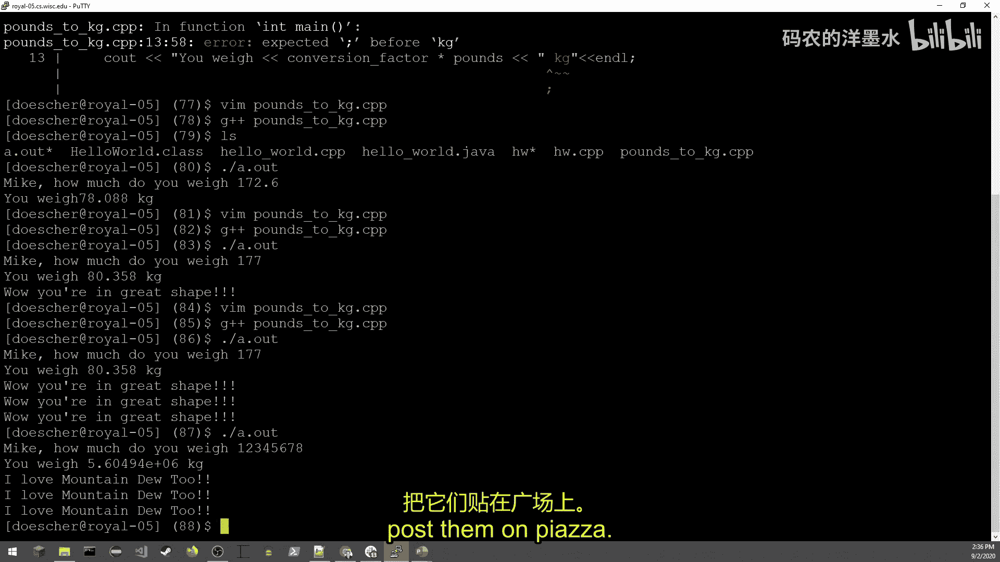

# 001：第1讲 - 课程概述

## 概述

在本节课中，我们将学习CS368C++课程的整体介绍，包括课程目标、教学方式、评分标准以及如何成功完成这门课程。我们还将编写并运行第一个C++程序“Hello World”，并将其与Java版本进行比较，以直观地展示两种语言的基本差异。

## 课程介绍

大家好，这里是威斯康星大学麦迪逊分校2020年秋季学期面向Java程序员的CS368C++课程。

如果你是从其他地方观看此视频，欢迎加入我们。对于选课的同学，请注意我们的Canvas网站上提供了大量资源，我今天将介绍其中一部分。我们将从课程介绍开始。

## 今日大纲

今天的课程大纲如下：首先是总体课程概述，然后浏览教学大纲，讨论如何通过这门课程。接着，我们将查看一个示例程序“Hello World”——这是大多数人学习编程时编写的第一个程序。最后，我们将这个程序与Java版本进行比较。

这是本周课程内容的第一部分。

## 关于讲师

我的名字是Mike Douchher，请叫我Mike。如果你打开了这些幻灯片的PowerPoint版本，可以点击链接给我发邮件。

我最初是一名化学家，成为计算机科学家大约只有10年时间。我在南卡罗来纳大学获得了化学学位。之后，我在海军研究实验室担任了三年的独立承包商，这是一个支持海军和海军陆战队的军事实验室。合同结束后，我在本尼迪克特学院教了八年化学。后来，出于对计算机科学的好奇，我开始在线学习课程，积累了丰富的学生经验。当我学到足够的知识进入研究生项目后，我来到麦迪逊大学获得了硕士学位，并在S Art软件公司担任了三年的软件工程师。期间，我还在晚上教授C++和Matlab课程。最近，我接受了麦迪逊大学的全职教职工作。

## 课程详情

如果你访问Canvas网站并打开教学大纲，最重要的信息将是课程安排表，那里会发布所有内容的链接。

我们将使用Piazza进行课程交流，这是一个供学生提问和获取答案的平台。你还需要激活你的CS账户以访问CSL机器。

所有视频讲座将发布在YouTube上，链接会放在课程安排表中。作业将通过Canvas发布，并附有说明视频。

关于办公时间，我们将使用预约队列系统。在办公时间开始前，你可以通过填写调查问卷来预约，我会按顺序与学生见面。

## 教学大纲要点

这门课程是关于C++的，特别是针对已经了解Java的人。我们将涵盖一系列主题。课程没有指定教材，所有阅读材料将在线提供。

课程评分基于几次作业，没有考试。你需要获得70%或以上的总分才能通过。迟交政策相对宽松：在我们开始评分之前提交都不算迟交，一周内迟交可获得最高50%的分数。

**严禁作弊**。我们将使用名为Moss的软件相似性检测工具来识别抄袭行为，任何作弊行为都将被严肃处理。

## 课程目标与受众

本课程专为至少上过一门编程课（最好是Java或类似C的语言）的学生设计。课程内容将与CS200（可能还有CS300）中学习的结构相对应，并涵盖C++特有的功能。

根据注册信息，班级中有不同年级的学生。本课程主要针对大二水平的学生，即已经上过一门编程课的同学。请高级学生在评价课程时，考虑课程是否有效地达到了针对初学者的教学目标。

## 如何通过课程

这是一门“通过/不通过”的课程，没有字母等级。我们将有大约7次作业。要**通过课程**，你必须在所有作业中获得**70%或以上的总分**，并且必须尝试完成所有作业。

## 开发环境与工具

我将提供关于如何使用CSL机器、命令行和Vim文本编辑器进行编译的支持。虽然你可以使用任何喜欢的IDE（如Eclipse CDT、Visual Studio、Qt等），但本课程将重点讲解在命令行中使用Vim和G++编译器。掌握这些工具对于提高编程效率非常有帮助。

上一节我们介绍了课程的基本信息和规则，本节中我们来看看如何开始编写第一个C++程序。

## 第一个C++程序：Hello World

现在，我将跳转到CSL机器上，演示如何编写一个“Hello World”程序，并逐行讲解其含义以及与Java版本的比较。

以下是编写和运行C++ “Hello World”程序的步骤：



1.  使用Vim创建一个新文件，例如 `hw.cpp`。
2.  输入以下代码：
    ```cpp
    #include <iostream>
    using namespace std;

    int main(int argc, char* argv[]) {
        cout << "Hello, world!" << endl;
        return 0;
    }
    ```
3.  保存并退出Vim。
4.  在终端中使用 `g++` 编译器进行编译：
    ```bash
    g++ hw.cpp -o hw
    ```
5.  运行编译后的程序：
    ```bash
    ./hw
    ```

程序将输出 `Hello, world!`。

## 与Java的Hello World比较

让我们将C++版本与Java的“Hello World”进行逐行比较。

```java
public class HelloWorld {
    public static void main(String[] args) {
        System.out.println("Hello, world!");
    }
}
```

以下是核心概念的对比分析：

*   **主函数**：两者都有一个 `main` 函数作为程序入口。在C++中，`main` 位于全局作用域，且每个程序只能有一个。其返回类型是 `int`，返回0表示程序成功执行。在Java中，`main` 必须包含在一个类中。
*   **命令行参数**：C++中使用 `int argc`（参数计数）和 `char* argv[]`（参数字符串数组）。Java中使用 `String[] args`。C++的 `char* argv[]` 是一个指向字符指针的指针，代表字符串数组。
*   **包含头文件**：C++使用 `#include <iostream>` 预处理指令将输入输出库的内容包含进来。尖括号 `< >` 表示系统库文件。这类似于Java中的 `import` 语句，但机制不同。
*   **命名空间**：`using namespace std;` 类似于Java的 `import`，它允许我们直接使用 `std` 命名空间中的名称（如 `cout`），而无需前缀。
*   **输出语句**：C++中使用 `cout << "Hello, world!" << endl;` 进行控制台输出。`cout` 代表控制台输出流，`<<` 是流插入运算符，`endl` 表示换行并刷新缓冲区。这相当于Java中的 `System.out.println("Hello, world!");`。

## C++与Java的语法共性

许多在Java中使用的语法结构在C++中同样有效，这为Java程序员提供了便利。以下是一些例子：

*   **控制结构**：`for` 循环、`if` 语句、`while` 循环的语法基本相同。
*   **变量声明**：基本数据类型（如 `int`, `double`, `bool`）的声明方式类似。
*   **布尔表达式**：C++中的布尔表达式可以计算为数值（0表示false，非0表示true），这提供了额外的灵活性。



为了演示用户输入和一些通用语法，让我们看一个简单的“磅转换为千克”的程序示例：



```cpp
#include <iostream>
using namespace std;

int main() {
    cout << "Mike, how much do you weigh? ";
    double pounds;
    cin >> pounds; // 从键盘获取输入

    double kilograms = pounds * 0.454;
    cout << "You weigh " << kilograms << " kilograms." << endl;

    bool greatShape = (pounds < 1000); // 布尔表达式赋值
    if (greatShape) {
        cout << "Wow, you're in great shape!" << endl;
    }

    // for循环示例
    for (int i = 0; i < 3; i++) {
        cout << "Have a great day!" << endl;
    }

    // while循环示例
    int j = 0;
    while (j < 3) {
        cout << "Loop with while: " << j << endl;
        j++;
    }

    return 0;
}
```

这个程序演示了：
1.  使用 `cin` 进行用户输入。
2.  基本的算术运算和变量赋值。
3.  布尔表达式的使用和 `if` 条件判断。
4.  `for` 循环和 `while` 循环，其语法与Java一致。

## 总结

本节课中我们一起学习了CS368C++课程的概述。我们了解了课程的目标、评分方式以及重要的学术诚信规定。我们动手编写并运行了第一个C++程序“Hello World”，并通过与Java版本的详细对比，理解了C++在程序结构、输入输出和基本语法上的特点。我们还看到，许多Java的控制流和变量操作语法在C++中可以直接使用，这为学习过渡提供了便利。



请记得填写Canvas上的调查问卷，并关注即将发布的第一份作业。如果有任何问题，请在Piazza上提问。祝大家学习愉快！