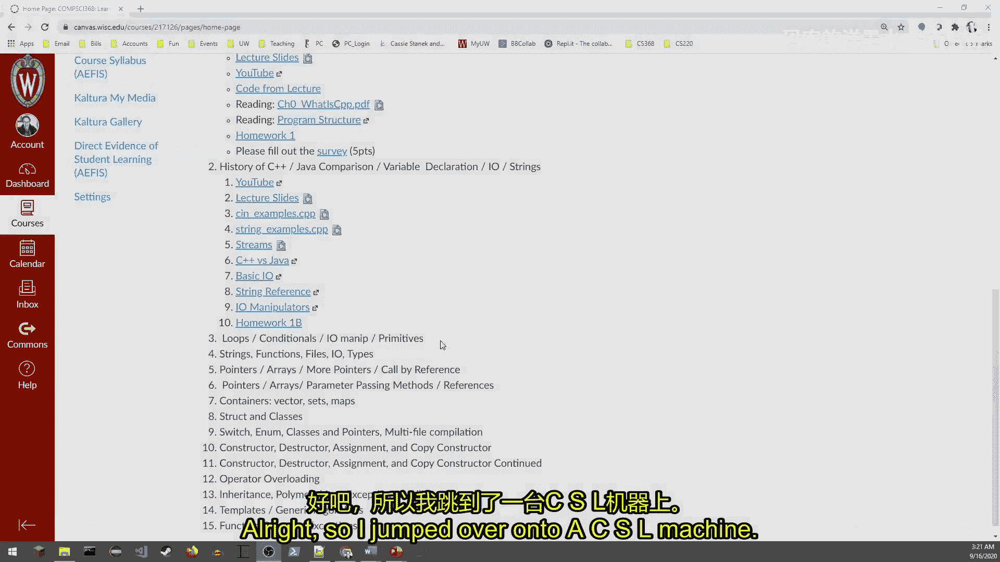
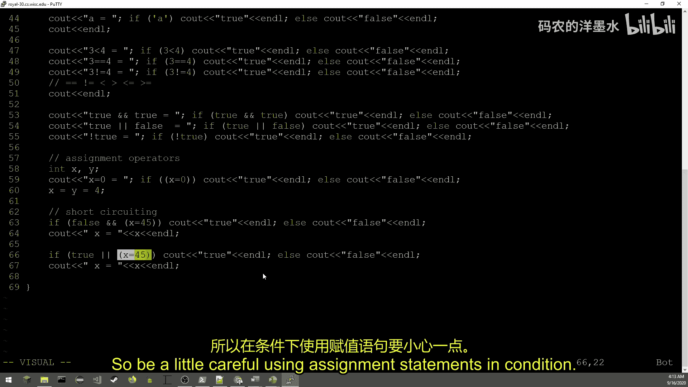
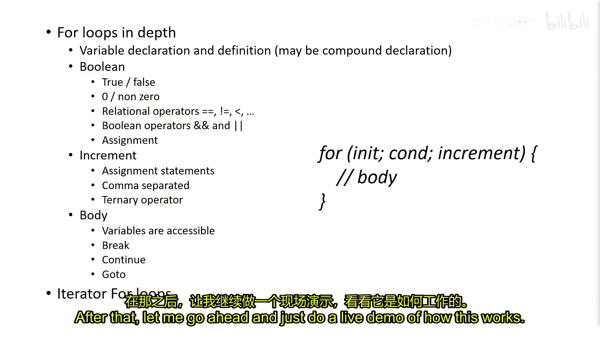
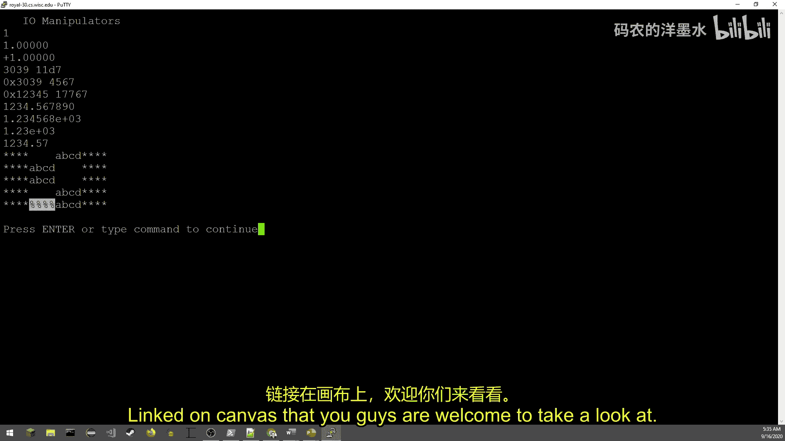
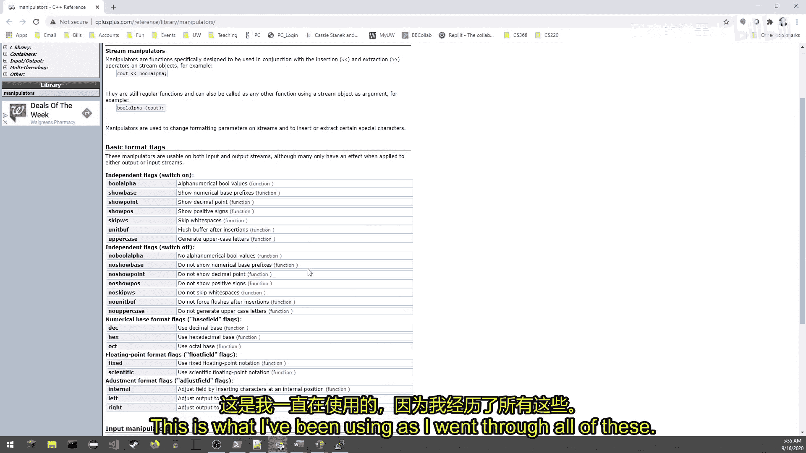
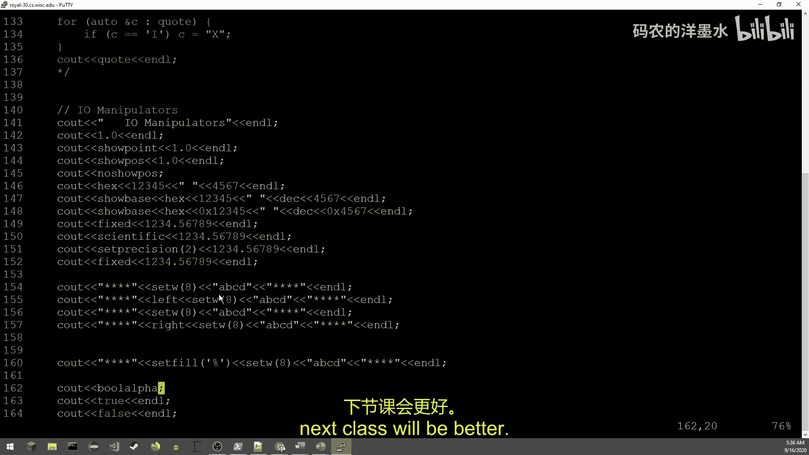
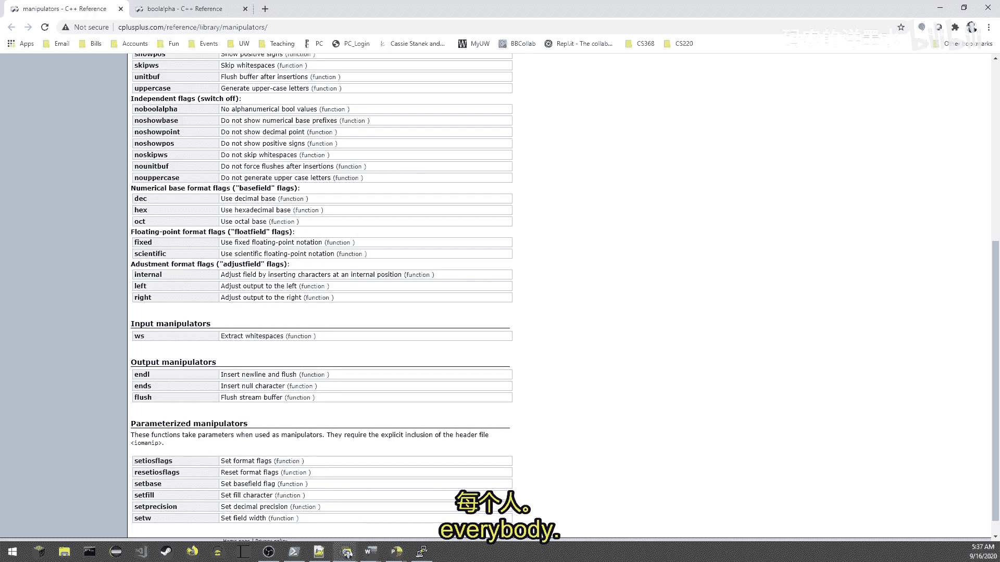

# 003：迭代、条件句与IO操作 🚀



在本节课中，我们将学习C++编程的基础知识，重点探讨变量声明、布尔逻辑、循环控制以及输入输出格式化操作。这些内容是理解C++与Java差异并编写高效代码的关键。

## 变量声明与初始化

上一节我们介绍了课程概述，本节中我们来看看C++中变量声明的基础。与Java不同，C++中的变量在声明时不会自动初始化。

```cpp
int x; // 声明变量x，其值未定义
cout << "No default initialization. X is equal to " << x << endl;
```

上述代码中，变量`x`的值是未定义的，可能是0，也可能是内存中的任意值。为了安全，我们应始终初始化变量。

以下是初始化变量的几种方式：
*   **声明后赋值**：`int x; x = 5;`
*   **声明时初始化**：`int y = 4;`
*   **同一行声明多个变量**：`int a, b, c;` 或 `int d = 1, e = 2, f, g = 6;`

## 布尔值与条件语句

理解了变量声明后，我们来看看C++如何处理布尔逻辑。C++将布尔值`true`和`false`内部存储为整数1和0。

```cpp
bool b = true;
cout << "Boolean statements. True is equal to " << true << " and false is equal to " << false << endl;
```

在条件语句（如`if`、`while`、`for`）中，C++会将表达式简化为布尔值。任何非零值被视为`true`，零值被视为`false`。

以下是C++中可被视为布尔条件的示例：
*   **布尔变量**：`if (b)`
*   **布尔字面量**：`if (true)`， `if (false)`
*   **整数**：`if (1)`（真）， `if (0)`（假）， `if (42)`（真）， `if (-1)`（真）
*   **字符**：`if ('a')`（真，因为‘a’的ASCII码97非零）
*   **关系运算符**：`if (3 < 4)`， `if (3 == 4)`， `if (3 != 4)`
*   **逻辑运算符**：`if (true && true)`， `if (true || false)`， `if (!true)`



**注意**：在条件中使用赋值运算符（`=`）是允许的，但容易造成混淆，通常是不良实践。赋值表达式会返回所赋的值，该值随后被用作条件。

```cpp
if ((x = 5)) { // 将5赋值给x，然后判断5（非零，为真）
    cout << "true" << endl;
}
```



逻辑运算符`&&`（与）和`||`（或）支持**短路求值**。对于`&&`，如果左侧为假，则右侧不再计算；对于`||`，如果左侧为真，则右侧不再计算。

## 循环控制

掌握了条件判断，接下来我们深入探讨C++中的循环结构。`for`循环非常灵活，其三个部分（初始化、条件、递增）都可以包含多个语句或留空。

```cpp
for (int i = 0, square = 0; i < 10; i++, square = i * i) {
    cout << setw(3) << i << setw(6) << square << endl;
}
```

以下是循环控制的关键字：
*   **`break`**：立即终止整个循环，跳出循环体。
*   **`continue`**：跳过当前循环迭代的剩余代码，直接进入下一次循环的条件判断。
*   **`goto`**：跳转到程序中指定的标签处。虽然可用，但应谨慎使用，以免破坏代码结构。

C++11引入了基于范围的`for`循环，非常适合遍历容器（如字符串、向量）。

```cpp
string quote = "It's hardware that makes a machine fast. "
               "It's software that makes a fast machine slow.";
// 遍历副本，不修改原字符串
for (char c : quote) {
    cout << c << endl;
}
// 使用引用遍历并修改原字符串
for (char &c : quote) {
    if (c == 'I') c = 'X';
}
// 使用auto关键字自动推断类型
for (auto c : quote) {
    cout << c;
}
```

## 输入输出格式化（I/O Manipulators）

最后，我们学习如何精确控制输出的格式。I/O操纵器是发送给`cout`的特殊指令，用于修改数字或文本的显示方式。

以下是一些常用的I/O操纵器：
*   **`showpoint` / `noshowpoint`**：显示或隐藏浮点数末尾的零和小数点。
*   **`showpos` / `noshowpos`**：为非负数显示`+`号。
*   **`hex` / `dec` / `oct`**：以十六进制、十进制或八进制格式输出整数。
*   **`showbase` / `noshowbase`**：显示（如`0x`表示十六进制）或隐藏数字进制的前缀。
*   **`fixed` / `scientific`**：以定点计数法或科学计数法显示浮点数。
*   **`setprecision(n)`**：设置浮点数输出的小数位数（在`fixed`模式下）或总有效数字位数（在默认模式下）。
*   **`setw(n)`**：设置下一个输出字段的宽度。
*   **`left` / `right`**：在字段内左对齐或右对齐文本。
*   **`setfill(ch)`**：用指定字符`ch`填充字段的空白部分。
*   **`boolalpha` / `noboolalpha`**：将布尔值`true`/`false`输出为字符串形式，而非1/0。

```cpp
cout << showpos << 1.0 << endl; // 输出: +1
cout << hex << showbase << 4567 << endl; // 输出: 0x11d7
cout << fixed << setprecision(2) << 123.456789 << endl; // 输出: 123.46
cout << setw(8) << setfill('*') << "ABCD" << endl; // 输出: ****ABCD
cout << boolalpha << true << endl; // 输出: true
```

**重要提示**：大多数操纵器（如`showpos`， `hex`）的状态是持久的，一旦设置，会影响后续所有相关输出，直到被显式更改（如使用`noshowpos`， `dec`）。





---





本节课中我们一起学习了C++编程的核心基础：变量声明的规则、布尔逻辑的求值方式、各种循环结构及其控制语句，以及强大的I/O格式化工具。理解这些概念是编写正确、高效且输出美观的C++程序的第一步。