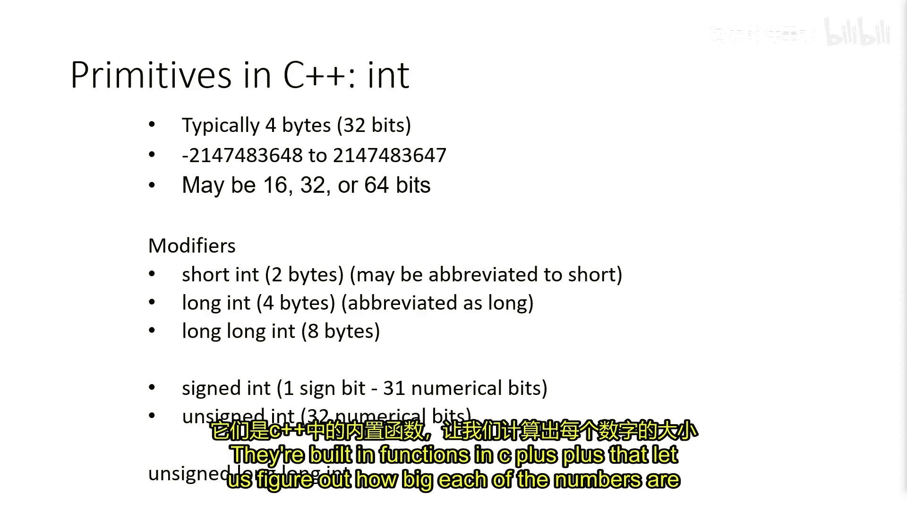
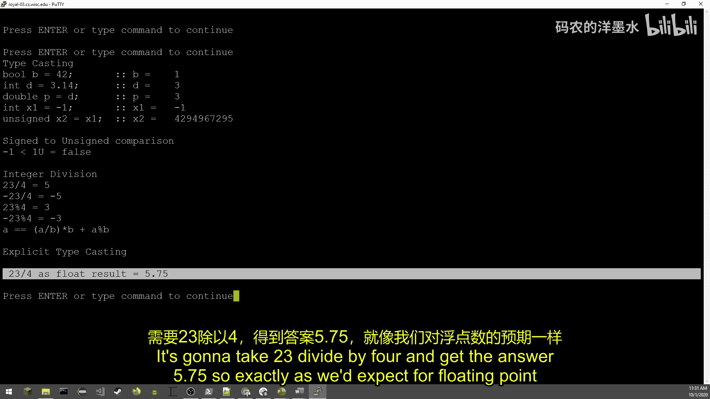
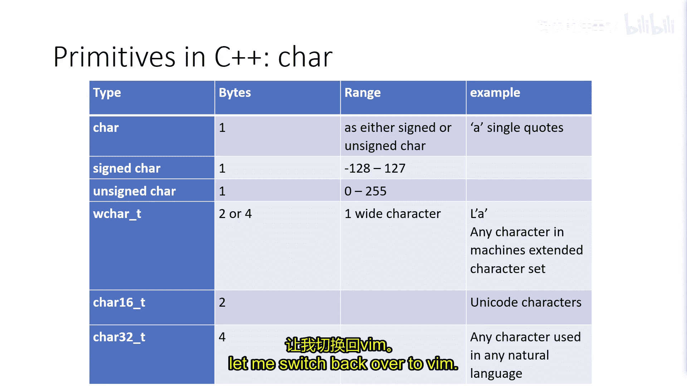
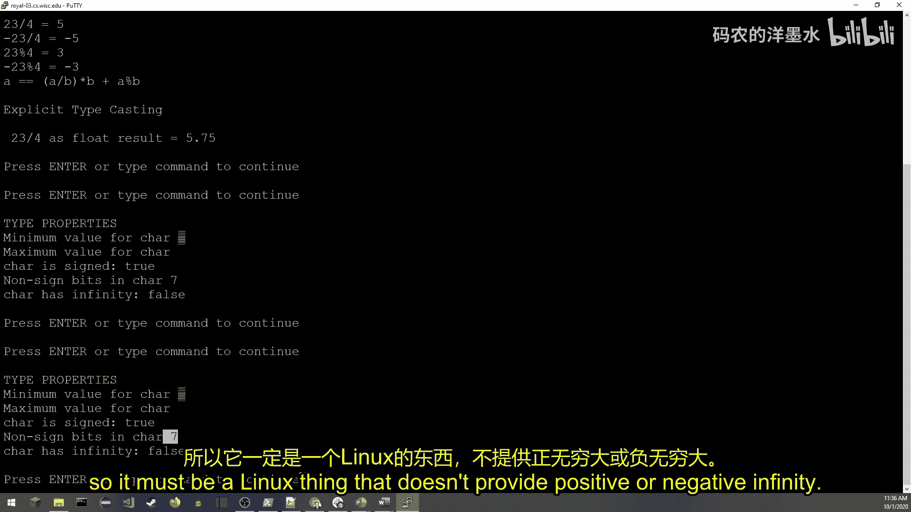
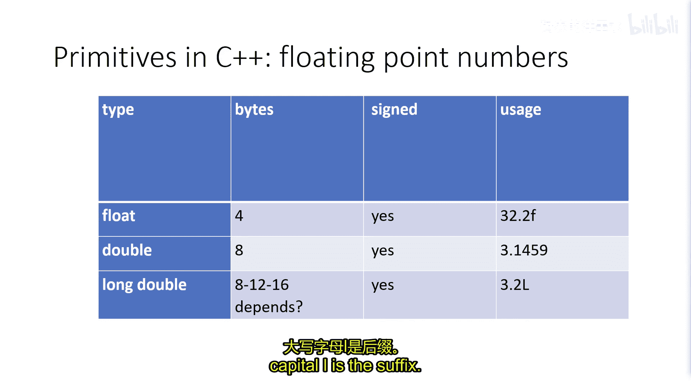
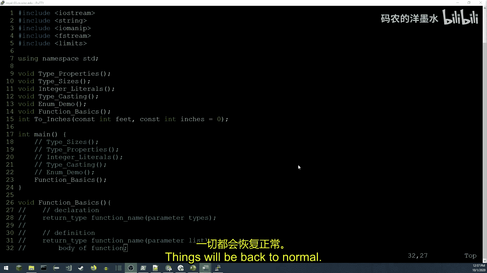

# 004：基本类型、枚举、开关语句、函数基础 🧱

在本节课中，我们将要学习C++中的基本数据类型、枚举类型、switch语句以及函数的基础知识。这些是构建C++程序的核心组件，理解它们对于从Java过渡到C++至关重要。

## 概述

上一节我们介绍了C++的基本结构和输入输出。本节中，我们来看看C++中更基础的元素：原始数据类型、如何定义和使用枚举、控制流中的switch语句，以及如何声明和定义函数。

## 基本数据类型

C++提供了多种基本数据类型，它们的大小通常是平台相关的，这与Java中固定大小的类型不同。

### 整数类型

C++的整数类型包括 `int`、`short`、`long` 和 `long long`。它们可以通过 `signed` 或 `unsigned` 修饰符来改变表示范围。

*   `short`：至少2字节。
*   `int`：通常4字节，但大小系统相关。
*   `long`：至少和 `int` 一样大。
*   `long long`：至少8字节，提供更大的整数范围。

使用 `unsigned` 修饰符可以表示非负数，从而扩大正数范围。例如，`unsigned int` 的范围是 0 到约 40 亿。

### 获取类型大小



可以使用 `sizeof` 操作符来获取特定类型在您系统上的字节大小。它返回一个 `size_t` 类型的值。

```cpp
#include <iostream>
int main() {
    std::cout << "Size of int: " << sizeof(int) << " bytes\n";
    std::cout << "Size of long long: " << sizeof(long long) << " bytes\n";
    return 0;
}
```

### 字符类型

字符类型用于存储单个字符，在内部以数字形式存储（如ASCII码）。

*   `char`：默认1字节，可表示ASCII字符。
*   `wchar_t`：宽字符，用于表示更大字符集（如Unicode）。
*   `char16_t` / `char32_t`：用于明确表示UTF-16和UTF-32编码的字符。

### 浮点类型

浮点类型用于表示小数。

*   `float`：通常4字节，提供约6-7位十进制精度。
*   `double`：通常8字节，提供约15位十进制精度。
*   `long double`：扩展精度浮点数，大小和精度因系统而异。

## 字面量

字面量是直接在代码中硬编码的值。

### 整数字面量

可以以不同进制表示整数：

*   十进制：`42`
*   八进制（以0开头）：`052` （注意：`09` 是无效的，因为八进制没有数字9）
*   十六进制（以0x开头）：`0x2A`
*   二进制（C++14起，以0b开头）：`0b101010`

可以使用后缀指定类型：
*   `U` 或 `u`：无符号 (`unsigned`)，例如 `42U`
*   `L` 或 `l`：长整型 (`long`)，**建议使用大写 `L`**，因为小写 `l` 容易与数字 `1` 混淆，例如 `42L`
*   `LL` 或 `ll`：长长整型 (`long long`)，例如 `42LL`

### 浮点数字面量

默认是 `double` 类型。可以使用后缀：
*   `F` 或 `f`：单精度 (`float`)，例如 `3.14f`
*   `L` 或 `l`：扩展精度 (`long double`)，例如 `3.14L`

## 类型转换与运算

### 隐式类型转换

C++会在许多情况下自动进行类型转换，例如在赋值或算术运算中。

```cpp
bool b = 5; // 非零值转换为 true，b 存储为 1
int i = 3.14; // 浮点数转换为整数，小数部分被截断，i 为 3
double d = i; // 整数转换为浮点数，d 为 3.0，但丢失了原来的 .14
unsigned int u = -1; // 负数转换为无符号数，u 变为一个很大的正数
```

### 整数除法

当两个整数相除时，C++执行**整数除法**，结果会被截断为整数。

```cpp
int result = 23 / 4; // 结果是 5，不是 5.75
int remainder = 23 % 4; // 取余运算，结果是 3
```

要让除法产生浮点数结果，至少需要一个操作数是浮点类型。

```cpp
double result = 23.0 / 4; // 结果是 5.75
// 或者使用类型转换
double result2 = static_cast<double>(23) / 4; // 结果也是 5.75
```

### 显式类型转换

C++提供了几种显式类型转换的方法：

1.  **C风格转换**：`(目标类型)表达式`，例如 `(unsigned int) x`
2.  **函数风格转换**：`目标类型(表达式)`，例如 `unsigned int(x)`
3.  **`static_cast`**：`static_cast<目标类型>(表达式)`，这是**推荐使用**的方式，更安全且易于在代码中搜索。

```cpp
int x = 42;
unsigned int u1 = (unsigned int)x; // C风格
unsigned int u2 = unsigned int(x); // 函数风格
unsigned int u3 = static_cast<unsigned int>(x); // 推荐：static_cast
```

`static_cast` 在编译时进行类型检查，适用于大多数明确的类型转换场景。

## 枚举类型



枚举（`enum`）允许我们创建一种新的数据类型，其值被限制为一组命名的整数常量。

### 定义和使用枚举



```cpp
// 定义一个名为 Color 的枚举类型
enum Color { RED, ORANGE, YELLOW, GREEN, BLUE, INDIGO, VIOLET };





int main() {
    Color myColor = RED; // 声明一个 Color 类型的变量并赋值
    // myColor = 5; // 错误：不能直接用整数赋值
    // myColor = PURPLE; // 错误：PURPLE 不在枚举列表中

    std::cout << "myColor value: " << myColor << std::endl; // 输出 0 (RED)
    return 0;
}
```

默认情况下，枚举值从0开始依次递增（RED=0, ORANGE=1, ...）。也可以显式指定值：

```cpp
enum Transportation { CAR = 0, PLANE = 13, BOAT = 3, BIKE }; // BIKE 会从 BOAT 递增，值为 4
```

枚举常量（如 `RED`）在定义后即进入作用域，不能在其他地方重定义。

## Switch 语句

`switch` 语句提供了一种基于整数或枚举表达式值进行多路分支的清晰方式。它通常与枚举类型一起使用。

### 基本语法

```cpp
switch (表达式) { // 表达式必须能求值为整型或枚举类型
    case 常量表达式1:
        // 语句...
        break; // 跳出 switch
    case 常量表达式2:
        // 语句...
        // 注意：如果没有 break，会“贯穿”到下一个 case
        break;
    // ... 更多 case
    default:
        // 如果所有 case 都不匹配，则执行此处的语句
        break;
}
```

### 示例：与枚举结合

```cpp
Transportation t = PLANE;
switch (t) {
    case CAR:
        std::cout << "You selected car.\n";
        break;
    case PLANE:
        std::cout << "You selected plane.\n";
        // 这里故意没有 break，会贯穿到下一个 case
    case BOAT:
        std::cout << "You might have selected plane or boat (no break after plane).\n";
        break;
    default:
        std::cout << "You selected something else.\n";
        break;
}
// 当 t 为 PLANE 时，输出：
// You selected plane.
// You might have selected plane or boat (no break after plane).
```

**重要**：`case` 标签后的 `break` 语句用于防止“贯穿”执行下一个 `case`。如果省略 `break`，程序会继续执行后续 `case` 中的语句，直到遇到 `break` 或 `switch` 结束。

## 函数基础

在C++中，函数可以定义在全局作用域，而不必像Java那样必须属于某个类。

### 函数声明与定义

*   **函数声明（原型）**：告诉编译器函数的存在、返回值类型、名称和参数类型。参数名可选，但建议加上以提高可读性。
*   **函数定义**：提供函数的具体实现，包括函数体。

```cpp
// 函数声明（通常在头文件或文件顶部）
int toInches(int feet, int inches = 0); // inches 有默认值 0

int main() {
    int heightInInches = toInches(6, 1); // 调用函数
    std::cout << "Height: " << heightInInches << " inches\n";
    return 0;
}

// 函数定义
int toInches(int feet, int inches) {
    return feet * 12 + inches;
}
```

**关键点**：
1.  函数需要在使用前被声明（或定义）。
2.  声明中的默认参数值（如 `inches = 0`）应放在**函数声明**中，而不是定义中（除非声明和定义是同一个）。
3.  默认参数必须从**参数列表的最右边**开始连续设置。

### 参数传递与作用域

在上面的例子中，参数 `feet` 和 `inches` 通过**值传递**。这意味着调用函数时，实参（如 `6` 和 `1`）的值被复制到形参（函数内部的 `feet` 和 `inches`）中。函数内部对形参的修改不会影响外部的实参。

函数内部定义的变量（包括形参）具有**局部作用域**，它们只在函数执行期间存在，函数返回后即被销毁。

## 总结



本节课我们一起学习了C++编程的几项基础内容。我们了解了C++丰富且平台相关的基本数据类型，学会了如何使用枚举来创建有意义的常量集合，掌握了用switch语句处理多分支选择，并初步认识了如何声明和定义全局函数。这些知识是编写结构化C++程序的基石。下一节，我们将探讨数组和指针，它们是C++中管理内存和数据的强大工具。