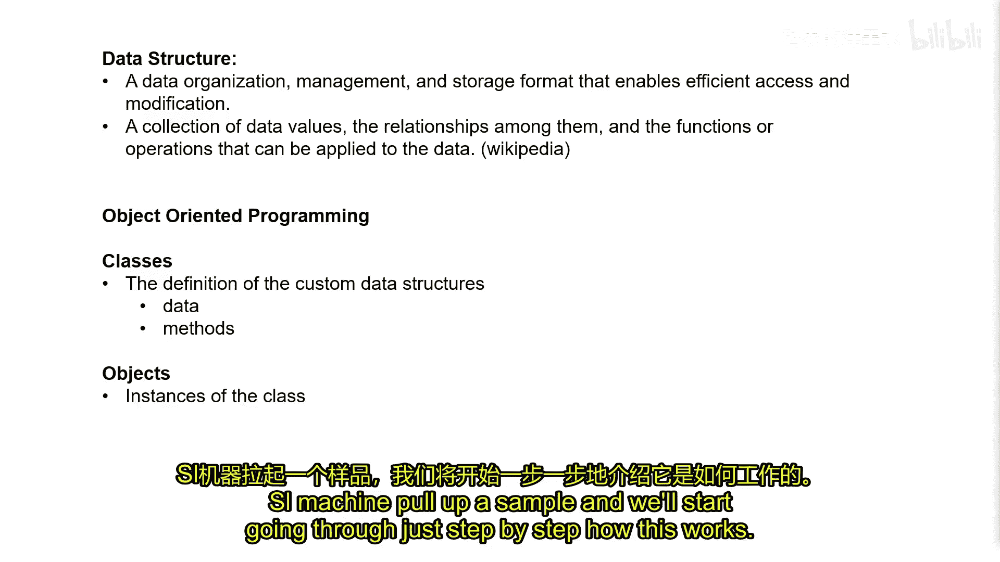
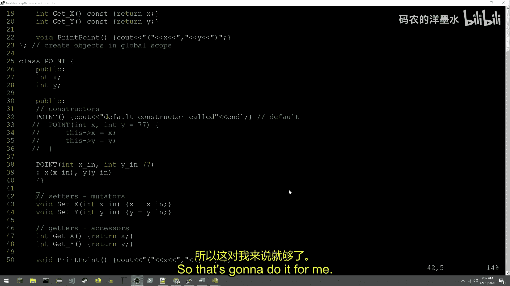

# 009：类与面向对象编程入门 🏗️

在本节课中，我们将学习C++中类的基础知识，这是面向对象编程的核心。我们将了解如何定义类、创建对象、管理数据成员的访问权限，以及编写成员函数。通过本课，你将能够创建自己的自定义数据类型。



---

## 类的定义与对象创建

在C++中，使用 `class` 关键字来定义一个类。类是一种自定义的数据结构，它封装了数据（成员变量）和操作这些数据的方法（成员函数）。

**代码示例：定义一个简单的 `Point` 类**
```cpp
class Point {
public:
    int x;
    int y;
};
```

定义好类之后，我们可以像使用内置类型一样创建该类的对象（也称为实例）。

**代码示例：创建 `Point` 对象并访问其成员**
```cpp
Point p; // 创建一个Point对象
p.x = 3; // 使用点运算符访问公共成员变量
p.y = 6;
```

上一节我们介绍了类的基本定义，本节中我们来看看如何控制类成员的访问权限。

---

## 访问控制：Public 与 Private

C++使用访问说明符来控制类成员的可见性。这有助于封装数据，保护其不被意外修改。
*   **`public`**：在 `public` 部分声明的成员，可以在类的外部被直接访问。
*   **`private`**：在 `private` 部分声明的成员，只能在类的成员函数内部访问。

默认情况下，**类（`class`）的成员是 `private` 的**，而**结构体（`struct`）的成员是 `public` 的**。结构体在C++中基本与类相同，通常用于表示纯数据容器。

**代码示例：使用 Public 和 Private**
```cpp
class Point {
private:
    int x; // 私有成员，外部无法直接访问
    int y;
public:
    // 公共成员函数，可以访问私有成员
    void setX(int newX) { x = newX; }
    int getX() const { return x; } // const 表示此函数不修改对象
};
```

---

## 成员函数

成员函数是定义在类内部的函数，用于操作类的数据成员。它们可以直接访问类的所有成员（包括 `private` 成员）。

**代码示例：为 `Point` 类添加打印功能**
```cpp
class Point {
public:
    int x;
    int y;
    void printPoint() {
        std::cout << "(" << x << ", " << y << ")" << std::endl;
    }
};
```

每个类的实例都拥有自己独立的一套数据成员，但它们共享相同的成员函数代码。

---

## 类的嵌套与组合

一个类的数据成员可以是另一个类的对象。这允许我们构建更复杂的数据结构。

**代码示例：使用 `Point` 类构建 `Box` 类**
```cpp
class Box {
public:
    Point minCorner;
    Point maxCorner;
    void printBox() {
        minCorner.printPoint();
        maxCorner.printPoint();
    }
};
```

通过点运算符可以链式访问嵌套对象的成员：`myBox.minCorner.x = 10;`

---

## 成员函数的声明与定义分离

为了提高代码的可读性和可维护性，通常将成员函数的声明放在类定义内部，而将具体的函数定义（实现）放在类的外部。这时需要使用**作用域解析运算符 `::`** 来指明该函数属于哪个类。

**代码示例：在类外定义成员函数**
```cpp
// 在类内部声明
class Box {
public:
    std::pair<int, int> edgeLengths() const; // 声明
};

// 在类外部定义
std::pair<int, int> Box::edgeLengths() const {
    return {maxCorner.x - minCorner.x, maxCorner.y - minCorner.y};
}
```

在类内部直接定义的短小函数，编译器可能会将其视为**内联函数**，这可以避免函数调用的开销。

---

## Getter 与 Setter（访问器与修改器）

为了保持数据的封装性，最佳实践是将数据成员设为 `private`，然后提供公共的成员函数来读取（Getter）和修改（Setter）它们。这允许你在修改数据时加入验证逻辑。

以下是实现 Getter 和 Setter 的方法：
*   **Getter**：通常以 `get` 开头，返回数据成员的值。对于不修改对象的 Getter，应使用 `const` 关键字修饰。
*   **Setter**：通常以 `set` 开头，接受一个参数来设置数据成员的值。

**代码示例：为私有成员提供 Getter 和 Setter**
```cpp
class PrivatePoint {
private:
    int x;
    int y;
public:
    // Setter
    void setX(int xIn) { x = xIn; }
    void setY(int yIn) { y = yIn; }
    // Const Getter
    int getX() const { return x; }
    int getY() const { return y; }
};
```

**`const` 成员函数的重要性**：当你在一个承诺不修改对象的上下文（例如，函数接受 `const` 对象引用）中调用成员函数时，只能调用被标记为 `const` 的成员函数。这确保了数据的完整性。

---

## 构造函数

构造函数是一种特殊的成员函数，在创建类的新对象时自动调用。它的名称与类名相同，没有返回类型。

**代码示例：定义构造函数**
```cpp
class Point {
public:
    int x;
    int y;
    // 默认构造函数
    Point() {
        std::cout << "默认构造函数被调用" << std::endl;
    }
    // 带参数的构造函数
    Point(int xIn, int yIn) {
        x = xIn;
        y = yIn;
    }
};
```

C++会为类提供一个什么都不做的默认构造函数。但一旦你定义了任何构造函数，编译器就不再提供默认版本。你可以通过参数默认值来创建灵活的构造函数。

---

## 初始化列表

在构造函数中，更高效的方式是使用**初始化列表**来初始化成员变量，而不是在构造函数体内进行赋值。这对于类类型的成员尤其重要，因为它直接调用拷贝构造函数，而不是先调用默认构造函数再赋值。

**代码示例：使用初始化列表的构造函数**
```cpp
class Point {
public:
    int x;
    int y;
    // 使用初始化列表
    Point(int xIn, int yIn = 77) : x(xIn), y(yIn) {
        // 构造函数体可以为空，或用于其他初始化逻辑
    }
};
```

**公式/概念：初始化列表语法**
```
ClassName(parameters) : member1(value1), member2(value2), ... {
    // 构造函数体
}
```

---

## `this` 指针

在类的成员函数内部，`this` 是一个指向当前对象实例的指针。当函数参数名与成员变量名相同时，可以使用 `this->` 来明确指代成员变量。

**代码示例：使用 `this` 指针**
```cpp
class Point {
public:
    int x;
    Point(int x) {
        this->x = x; // 使用this区分参数x和成员变量x
    }
};
```

---



本节课中我们一起学习了C++中类的基础知识，包括如何定义类、控制访问权限、编写成员函数、使用构造函数初始化对象，以及通过 Getter/Setter 实现封装。理解这些概念是掌握C++面向对象编程的第一步。下一讲我们将深入探讨构造函数的更多细节，以及析构函数、拷贝构造函数和赋值运算符。