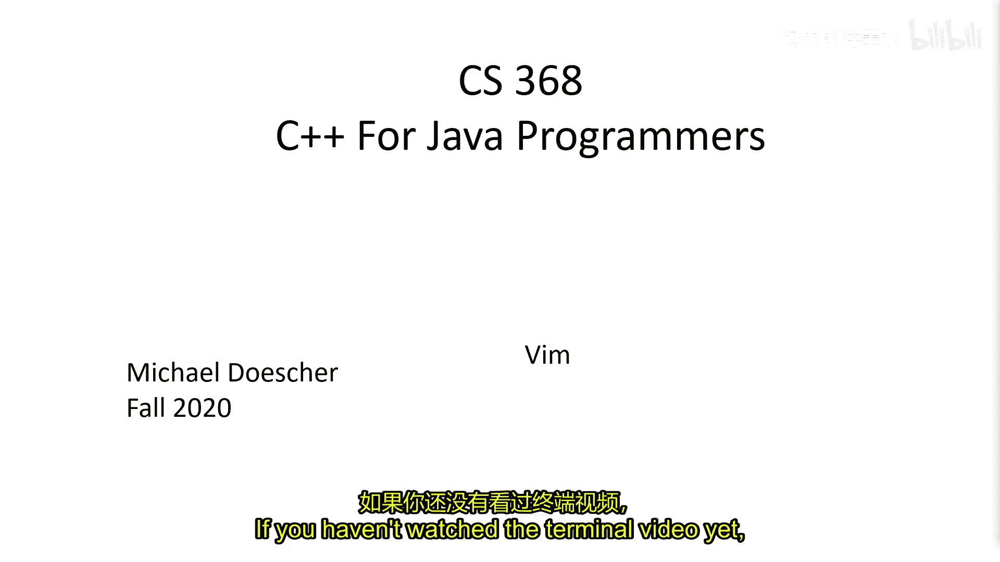
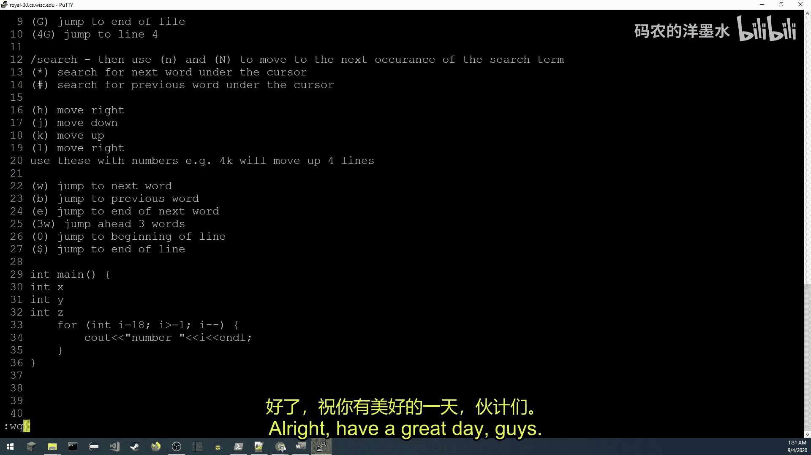

# 011：Vim 基础入门 🚀

在本节课中，我们将学习 Vim 文本编辑器的基本使用方法。Vim 是一个基于模式的编辑器，掌握其核心模式与操作能极大提升文本编辑效率。我们将从进入 Vim、切换模式、基础导航开始，逐步介绍编辑、搜索、复制粘贴以及保存退出等关键操作。

---

## Vim 教程：1.1：Vim 的三种核心模式

Vim 的核心在于其不同的操作模式。上一节我们概述了课程内容，本节中我们来看看 Vim 的三种基本模式。

Vim 主要包含三种模式：
1.  **命令模式**：也称为导航模式。在此模式下，键盘输入被视为命令，用于移动光标、删除、复制等操作。
2.  **插入模式**：在此模式下，键盘输入会作为文本内容插入到文件中，就像普通的文本编辑器一样。
3.  **可视模式**：在此模式下，可以选择文本块进行操作。它又分为字符可视模式、行可视模式和块可视模式。

要进入插入模式，请在命令模式下按下 `i` 键。
要退出插入模式并返回命令模式，请按下 `Esc` 键。

---

## Vim 教程：1.2：基础导航

在命令模式下，你可以高效地移动光标而无需使用鼠标。以下是基础的导航键位。

将手指放在键盘的“Home Row”上，使用 `H`、`J`、`K`、`L` 这四个键进行移动：
*   `H`：向左移动光标。
*   `J`：向下移动光标。
*   `K`：向上移动光标。
*   `L`：向右移动光标。

你可以在这些命令前加上数字，以实现多单位移动。例如：
*   `5j`：向下移动5行。
*   `10l`：向右移动10个字符。

---

## Vim 教程：1.3：进入插入模式的不同方式

除了使用 `i` 键在光标前进入插入模式，Vim 还提供了其他几种方式，以适应不同的编辑场景。

以下是进入插入模式的几种方法：
*   `i`：在光标当前位置之前进入插入模式。
*   `a`：在光标当前位置之后进入插入模式。
*   `o`：在当前行的下方新建一行，并进入插入模式。
*   `O`：在当前行的上方新建一行，并进入插入模式。

---

## Vim 教程：1.4：高级导航技巧

掌握了基础移动后，我们来看看如何更快地在文件内和行内跳转。

**文件内跳转**
*   `gg`：跳转到文件第一行。
*   `G`：跳转到文件最后一行。
*   `5G`：跳转到第5行。

**行内跳转**
*   `0`：跳转到当前行的行首。
*   `$`：跳转到当前行的行尾。

**按单词跳转**
*   `w`：跳转到下一个单词的词首。
*   `b`：跳转到上一个单词的词首。
*   `e`：跳转到当前或下一个单词的词尾。

同样，可以结合数字使用，例如 `3w` 表示向后移动3个单词。

---

## Vim 教程：1.5：搜索文本

在 Vim 中搜索文本非常高效。上一节我们学习了如何跳转，本节中我们来看看如何查找特定内容。

1.  在命令模式下，按下 `/` 键。
2.  输入要搜索的词汇，例如 `mode`。
3.  按下 `Enter` 键。所有匹配项会被高亮，光标跳至第一个匹配处。
4.  使用 `n` 键跳转到下一个匹配项。
5.  使用 `N` 键跳转到上一个匹配项。

若光标已在一个单词上，可以使用 `#` 键向上搜索该单词，使用 `*` 键向下搜索该单词。

要清除搜索高亮，可以搜索一个不存在的字符串，例如 `/asdfghjkl`。

---

## Vim 教程：1.6：编辑与修改文本

现在我们已经知道如何移动和查找，接下来学习如何编辑文本。

**删除字符**
*   `x`：删除光标下的字符。

**删除更多内容**
`d` 命令结合移动命令可以删除文本。
*   `dw`：删除一个单词（从光标处到词尾）。
*   `d$` 或 `D`：删除从光标到行尾的内容。
*   `dd`：删除整行。
*   `d5j`：删除光标及向下的5行。

**替换字符**
*   `r`：然后输入一个新字符，将替换光标下的字符。例如 `r8` 会将当前字符替换为 `8`。

**撤销与重做**
*   `u`：撤销上一次操作。
*   `Ctrl + r`：重做被撤销的操作。

---

## Vim 教程：1.7：复制、剪切与粘贴

Vim 中的复制操作称为“yank”，剪切操作即“delete”，因为它们会将内容存入寄存器。

**复制**
*   `yw`：复制一个单词。
*   `yy` 或 `Y`：复制整行。

**剪切**
`d` 命令在删除的同时也执行了剪切。例如 `dd` 剪切整行。

**粘贴**
*   `p`：在光标后粘贴内容。
*   `P`：在光标前粘贴内容。

---

## Vim 教程：1.8：可视模式操作

可视模式允许你选择文本块，然后对其进行操作。这是进行批量编辑的强大工具。

有三种进入可视模式的方式：
1.  `v`：进入字符可视模式，按字符选择文本。
2.  `V`：进入行可视模式，按整行选择文本。
3.  `Ctrl + v`：进入块可视模式，按矩形块选择文本，非常适合对齐的代码列。

进入可视模式并选择文本后，你可以使用 `y` 复制、`d` 删除或 `x` 剪切所选内容。

在块可视模式下，选择一列后，按 `Shift + i` 进入插入模式，输入文本后按 `Esc`，该文本会被插入到所选块的每一行前，非常适用于同时为多行代码添加注释或类型声明。

---

## Vim 教程：1.9：保存与退出

编辑完成后，你需要保存文件并退出 Vim。这是最关键的操作之一。

所有保存和退出操作都需要在命令模式下输入（以冒号 `:` 开头）：
*   `:w`：保存文件。
*   `:q`：退出 Vim。如果文件有未保存的修改，Vim 会阻止退出。
*   `:q!`：强制退出，不保存任何修改。
*   `:wq` 或 `:x`：保存文件并退出。

---

## Vim 教程：1.10：总结与配置建议

本节课中我们一起学习了 Vim 编辑器的核心概念和基本操作。

我们涵盖了：
1.  Vim 的三种核心模式：命令模式、插入模式和可视模式。
2.  使用 `h`、`j`、`k`、`l` 及 `w`、`b`、`gg`、`G` 等进行高效导航。
3.  使用 `i`、`a`、`o`、`O` 进入插入模式进行编辑。
4.  使用 `/` 和 `n` 进行文本搜索。
5.  使用 `d`、`x`、`r` 进行删除与替换，以及 `u` 和 `Ctrl + r` 进行撤销重做。
6.  使用 `y`、`d`、`p` 进行复制、剪切和粘贴。
7.  利用 `v`、`V`、`Ctrl + v` 进入可视模式进行块操作。
8.  使用 `:w`、`:q`、`:wq` 保存和退出。

**个性化配置**：Vim 可以通过 `~/.vimrc` 配置文件进行高度定制，例如开启语法高亮、显示行号、设置缩进等。建议初学者在熟悉基本操作后，逐步探索和配置自己的 `.vimrc` 文件。

熟练掌握 Vim 需要练习，但一旦习惯，其键盘驱动的编辑方式将带来极高的效率。请选择适合你的工具并坚持练习。