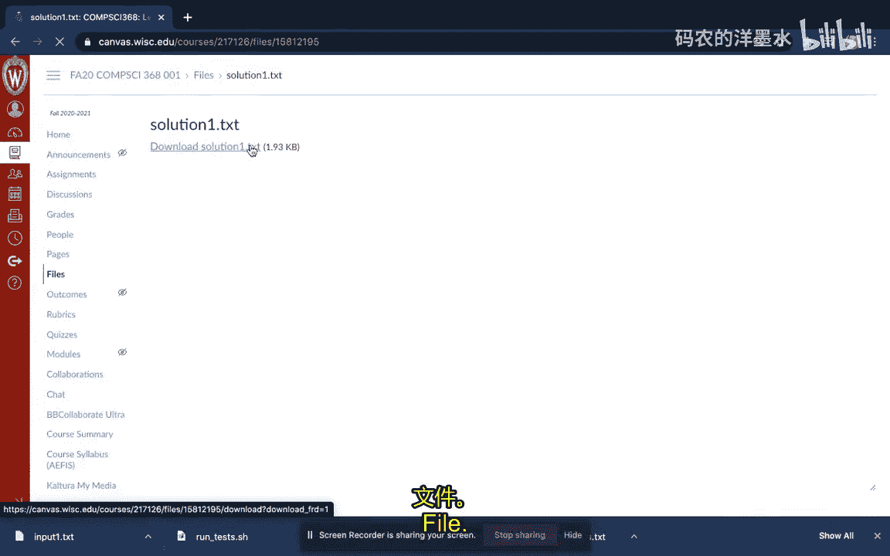
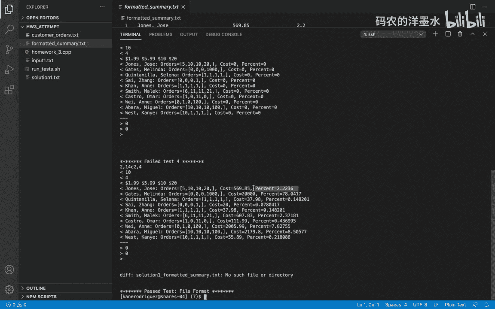

# 013：运行测试指南 🧪

在本教程中，我们将学习如何为作业4下载资源、上传至CSL机器，以及如何运行测试脚本以获取程序开发过程中的反馈。

## 概述 📋

上一节我们介绍了作业的基本要求。本节中，我们来看看如何获取测试资源并运行自动化测试。这个过程能帮助你在开发过程中验证代码的正确性。

## 下载资源 💾

首先，需要从Canvas下载作业4所需的所有资源文件。

以下是需要下载的文件列表：
*   模板文件
*   包含待分析客户元数据的文件
*   格式化摘要文件（即程序应生成的最终输出格式）
*   测试脚本
*   输入文件及其对应的解决方案文件



下载完成后，所有文件将保存在本地机器的下载文件夹中。

## 上传至CSL机器 ⬆️

现在，我将把这些资源上传到CSL机器。

首先，在本地创建一个专用文件夹（例如 `homework3`），并将所有下载的文件移入其中。接着，通过SSH连接到CSL机器，并切换到目标目录。最后，使用文件传输工具（如 `scp`）将整个文件夹上传。

操作完成后，可以在CSL机器的相应目录下看到所有已上传的资源文件。

## 运行测试脚本 ▶️

成功上传文件后，就可以运行测试脚本了。

在运行脚本之前，需要先为其添加可执行权限。使用以下命令：
```bash
chmod +x run_tests.sh
```
权限设置完成后，即可执行测试脚本：
```bash
./run_tests.sh
```
脚本运行后，会输出一系列测试结果。

## 理解测试输出 📊

测试脚本会按顺序检查作业的各个部分。

最初的测试仅验证程序能否成功编译。随着你逐步实现更多功能，后续测试会检查更具体的内容。

例如，测试可能依次验证：
*   数据是否正确读入
*   客户姓名格式是否正确
*   是否为每位客户计算了成本和百分比

测试输出会明确指示每个环节是通过还是失败，帮助你定位需要修改的代码部分。

## 总结 🎯



本节课中，我们一起学习了为C++作业配置测试环境的完整流程：从Canvas下载资源文件，将其上传到CSL机器，为测试脚本添加执行权限并运行它，最后解读测试输出以指导后续开发。定期运行测试是确保代码符合要求的高效方法。