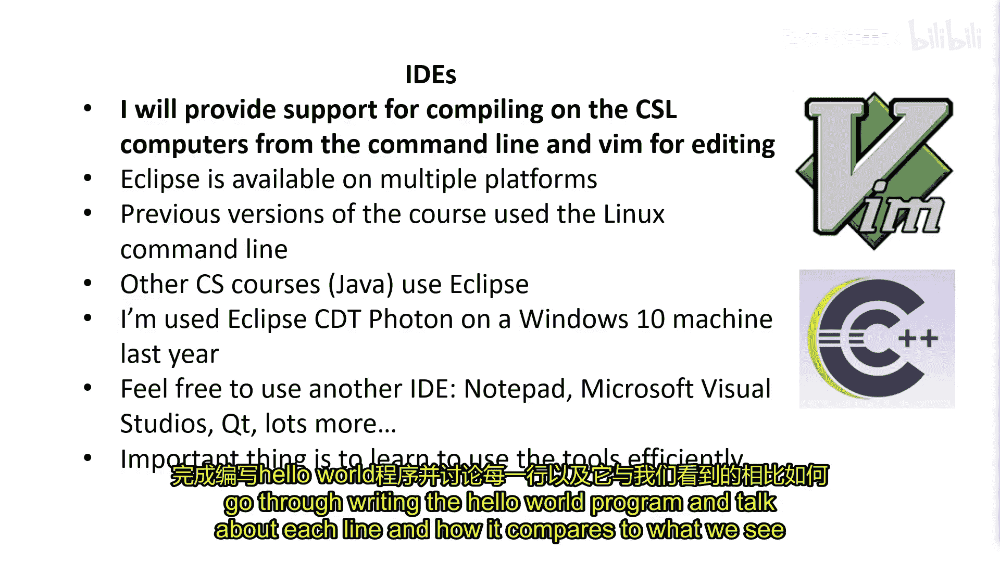
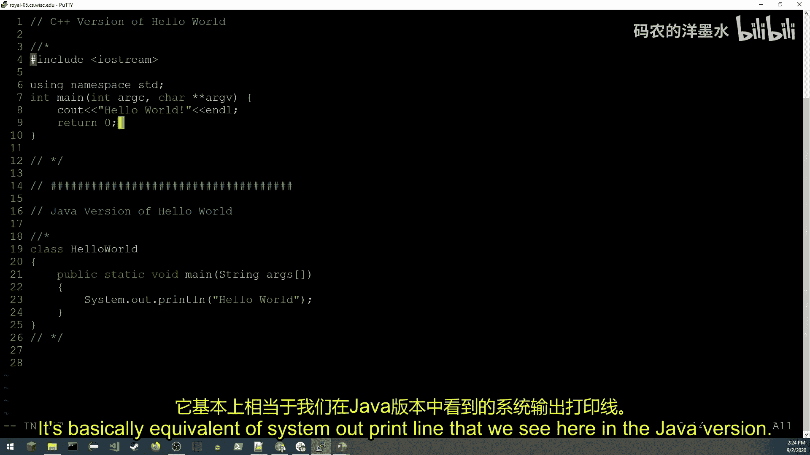
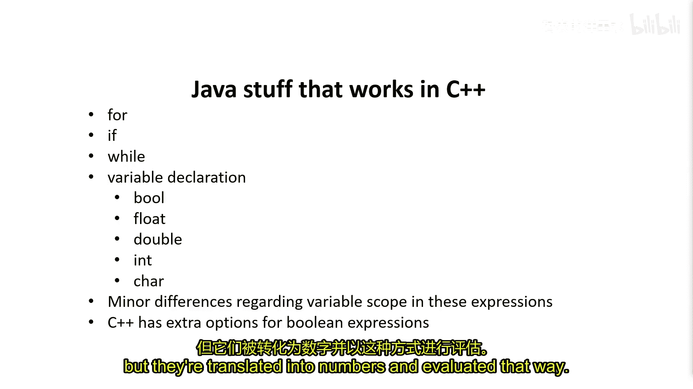
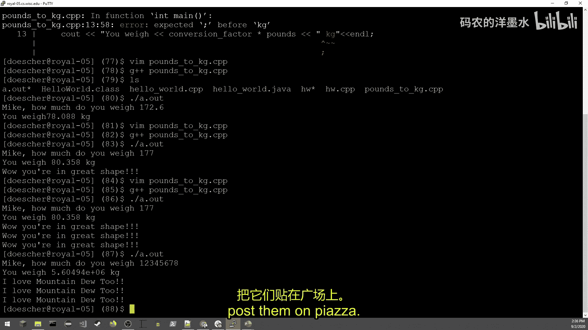

# 【全集】威斯康星大学 聚焦系统级编程 面向Java程序员的C++ CS368C 中英字幕 1080P p01 Lecture 1 - 课程概述 -BV1o72QBREfu_p1-

Hello everyone， this is Comp Science 368 C+ plus for Java programmers for the fall semester 2020 at the University of Wisconsin。

 Madison， if you've arrived from somewhere else and are'm just enjoying the video。

 feel free to join us for those guys taking the class。

 please note there's a ton of resources available on our Can website and I'm going be walkinging through some of those today。

 and we're going to get started with an introduction。 So first up。Outline for today。

 just general course overview。 we'll go through the syllabus。 we'll talk about how to pass the class。

 We'll take a look at a sample program Hello world。

 it's the first program most people write when they learn programming we'll take a look at that and then we'll compare that to the Java version。

All right， this is going to be the first half of this week's material。

I that's my my son in the background， sneezing Patrickrick。Sa hi， everybody？Yeah。

 so I'm a single dad and Patrick will be joining us for most of these video lectures。

 He's going to be homeschooled part of Madison's plan。

 so he'll be sitting right there today he's playing。

So I'm inappropriate game for 12 year old that I'm too busy to stop him。 Alright， anyway， tomorrow。

 I'm going to be going through a number of important like just。How to do things for our course。

 We'll be taking a look at homework 1。 We're gonna do this on the CSL computers。

 So if you're new to Madison or you've never used one of those machines before。

 I'm gonna walk through how to connect remotely to the CSL computers。

 just an introduction to the terminal so we can like navigate very。

The terminal and access the compiler and the text editor I'm a huge fan of Vim as my text editor。

 so I'm going to provide support for that。 I'll do a tutorial on how to use VIm If you have a different text editor or different ID you wish to use you are welcome to do so that's not the important part of this class。

All right， so who am I？Allright， so I got the camera shut off so that I'm not blocking the pictures Next up Who am I My name is Mike Douchher please call me Mike if you opened up the PowerPoint version of these slides I guess it'll be a P version online you can just click the link there to email me So I actually started out my career as a chemist I've only been a computer scientist for about 10 years but I got my degree in chemistry from the University of South Carolina After that I worked at the naval research laboratory for three years as an independent contractor that is a military lab in support of the Navy and Marine Corps I did top of good stuff。

 can't tell you about it。After my contract ran out。

 I took a job teaching chemistry at Benedictine College。

 I was there for eight years and taught like about half the classes that they offered。

 it's a small school in Kansas。After that， well。Basically， I got curious。

 I wanted to know more about computer science， just how does this work。

 I used computers in my job every single day and just didn't know that much about it。

 So I started taking online classes。 So just like you guys are doing now。

 I took a ton of online classes so I've got a lot of experience on the student end of things。

And when I learned enough to get into the graduate program， I actually came here to Madison and。

Got my master's degree。 I hadn't quite finished all of the courses that I wanted to take。

 so I did take a number of undergraduate courses here。

 so I've got a lot of experience being an undergraduate student right here in Madison at the university。

All right I got my master's degree and took a job as a software engineer at S Art software。

 I did that for three years and while I was doing that I just taught an evening class that was generally C++ we met one day a week I also taught Matlab。

For those three years， just one class at a time。And then I recently accepted a full time job at the University of Madison as a faculty associate。

 So right now I've got。C++， and I'm also teaching data programming one in between the two classes。

 we're looking at somewhere around 900 students。 so I'm a little worried about that。

 but we'll see how it goes。All right， just a little bit more about me。

 The picture in the upper right here is actually G E Grabcat bracket。

 the software company I worked for made software that engineers use。

 So an engineer would design a part like that bracket。 And then our software would go in and。

ToShow them how to remove material。 It would do a topology optimization。

 I suspect a lot of you guys out there are mechanical engineers。

 So this might be right up your alley。 that worked with Sureresh over in mechanical engineering。

 It's his company。But anyways， it shows the user how to。

 they're the engineer where they can room material， so it's still strong enough。

 but the light is possible。This entire codeb was written in C plus plus。

 I've got lot of experience working with C plus plus The five years that I was here studying for my master's degree。

 all the research I did was in C+ plus。 So I just thought Id throw that out there。

 I got my picture of some flasks and beakers filled with colorful food colored water。

 got a bun and burner going in the background。 Now， that's an oil lamp going in the background。

 just represent chemistry background。 I also really enjoy obstacle course races。

 I did four tough Mus Now。 They were canceled for this season。

 As far as I know everything is canceled。 I also enjoy sports where people try and hit me。

 So I've done a lot of kickboxing Tekwondo。 that kind of stuff。😊，Allright。 So that's enough about me。

 Let's take a look at the course a little bit more。

 So if you go to the canvas site and pull up the syllabus。

 the most important piece of information there is gonna be the schedule。

 That's where all the links to all the content will be posted。 And In fact。

 I'm gonna to just pause the video， pull that up and just sort of walk through what's there。

 I'm going talk about how to get a piazza， how to get your CS account activated。

 because you'll need that to use the CSL machines。 And then some other important details that may come up。

 Once I going pull that up。All right， so I've got the homepage from Canva pulled up。

 This first homepage has the schedule right here down at the bottom of this。

 Just some quick announcements at the top。 welcomelcome everybody， I'm glad you're here。

 the link to the syllabus， the link to sign up for piazza Piazza if you haven't used it if' new to Wisconsin is a form used by most classes where you can go and post questions and get answers on things。

 I'll pull up that link in moment too to activate your CS account。

 This will give you access to the CSL machines。 I just click the link and the instructions are like way up the top to activate things。

Yeah， we're going to do all video lectures as described on the you know when you registered for the class。

 I'm going to put them on YouTube and I'll post the links。

 I'm recording this video right now there's no link。

 but it will be right here on the schedule when it's available and Cura Media is over here on the left side you can just click here Cura I believe for students it's a gallery it might be I think this is just my version when I upload stuff myself so you can see those there。

Yeah， lectures are gonna be released every Wednesday by 4，35。 Today， I'm kind of a little close。

 Hopefully I'll be like a day early for most of these。 That's my goal， but。I'm to be honest。

It's going to be the last minute。 I'm pretty sure of it。 We'll see。 We'll see if I do well。

 you guys can put that in my evaluation。Alright， yeah。

 the first homework assignment is going to be released tomorrow with a number of extra videos about how to do it。

How to use the terminal， how to use VM。Okay， right， this is important to access office hours。

 we put out a survey， the link to the survey is right there， fill it out。

 it asks us you know basically where are you in the world we're finding about 10% of students are not in the United States right now based on what I've seen just some quick pulls of the other classes。

So what we're going to do for office hours is I'd like to be available lots of different times。

But for a class， it's only one credit that pass fail。 I find that I schedule lots of office hours。

 But then you guys rarely need them。 So what we're going to do instead is use a ticket queue。

 It's basically like signing up for an appointment。 So sometime before office hours begins。

 you'll go， you'll fill out the little survey that asks you for your name。

 your I D your question and that puts your name in a queue at the to be determined at times。

 and I'll get that filled out as soon as I get some survey responses with when you guys want office hours。

Just make sure you've put your name in the you filled out the ticket queue and you're in the queue then if there's a lot of students。

 I'll send you an email with your position number it takes about 10 minutes to me with each student if there's no tickets in the queue then office hours are canceled when I finish meeting with everybody when the queue is completely empty office hours are over I'll stick around for a couple minutes if you're like running behind a little bit。

 but if there's one student office hours are probably only last 10 minutes if nobody comes they're canceled if there's 25 people there。

 I'll stick around and meet with as many people as I can So we'll just see how that goes if it's not working well。

 we'll upgrade to something better。Alright， and then here's the schedule。

 All the topics we'll be covering。 I believe we have 15 weeks in the semester。

 I got to double check that。Anyway， in the first lecture here we are today。

Let me just take you through the syllabus real quick next。There we go。

 So there's a bunch of required stuff to be accredited。 so I got that。I got this information。

 That's all required。 the official statement， all that stuff is required。 Here we go。 good stuff。

 So this course is about C plus plus， particularly for people who already know Java And here's the topics we'll be covering。

 If you guys have any requests for things that you would love to see covered。

 there's be a we'll put out a survey about halfway through the course that asks you what else do you want to see what special topics are not on the third。

If you know right now， a special top look that you'd like to see covered。

 to go ahead and send me an email and we can work it in。All right。See this one's important。

 no required textbook， all the readings will be supplied online。

 I do have some recommendations in back when we get to the PowerPoint slides that I'll give you guys if you were like really excited about C++ and want you know the best resources out there。

If you have a visa from the McBney Center， go ahead and send me that if you think there's something I can do to make your experience in this course better。

 there aren't any exams it's all just going to be a couple of homework assignments。

 so let me know what I can do for you。Let's see， yep。

 here's the link to activate your CS account again and just click there。I got that in several places。

And then here's how lectures will be done。 I'm just gonna do。Actually。

 this is I got a mistake right there，50 minute lecture。 So when I do my video lectures， I am。

I like to make them sort of guided learning experiences。

 so I'll do an example and then I'll say pause the video， do this problem on your own。

 then come back and I'll show you how I did it。 lots of stuff like that， you know。

 follow along guided experiences。Um so。Yeah， that's what I like to do for my videos。

 And I'm gonna shoot for what you would get in a class that's 50 minutes long。 ignorere the 75。

 I'll fix that。 But the video length may be more or less than 75 or more or less than 50。

 depending on how much， you know， I get pause video and do this。 or I do tend to ramble a little bit。

 I may do a couple of extra demonstrations， just because I can't really predict what kind of questions people are gonna think about while you're watching the video。

 And so if I do a couple of extra things they may answer questions that pop up in your mind。

 So I may go over a little bit for that reason。Al right， again， no required textbook。

 Here's a list of resources that are really great。 The C+ plus primer is one of my favorites。

 That's a giant book， really professional， well done。

 If you get a job where you are a C+ plus programmer， then you want to buy that book。😊，It's great。

 let's see another one。 Stag Overflow is a great place to get questions answered。

 Here's the style guide we'll be using for the course。

 I'll put a link to that and highlight the pieces that I really care about in the first homework project description。

Let's see here， communication Piazza， we're definitely gonna wait， I skip Can。

 Everything you need will be right here on canvas。 All of the links will be in that schedule。

Pazza is where a great place to ask questions if it's outside of office hours。

 Just a quick note here。 Please do not post code from your homework。

 That's more than five lines long。 I'd prefer you didn't post any code and ask general questions if you need to make them private posts。

嗯。And also with regard to Piazza， in fact， let me pull that up right now for a quick sec。Alright。

 so please， before you post on piazza， take a look at the basic how to make piazza good for everybody。

 If people post the same question over and over again that's known as piazza bloat。

 it can be hard to find useful information。 So as you write your post， you know。

If you're talking about homework one and a particular function go ahead put the name of that function。

 I'll often like specify the function names I want you guys to use。

 put them in the title of the Piazza post I've got folders for different homework assignments up at the top choose the right one and if you guys could help me out is you see people produce you know questions that have already been answered instead of answering them again use the。

Yeah， the a symbol followed by the number of questions。

 that will in that question number is right here at the top in the status bar。 there's the URL bar。

 that will link them to the to the answer that's already there。 And besides。

 it is really satisfying to like search out， find duplicate questions。 And， you know。

 just be a little passive aggressive with that a link and encourage everybody to help reduce Piazza bloat。

 We don't want to see hundreds of questions on the same topic。 Okay， back to the syllabus。 Yeah。

 email， I'm going to use this fall20 computer science 368 group。To send announcements。

 I'll send one every time I release a video and every time homework is due you'll probably get about two emails a week from that list。

哦。And definitely send me an email if it's a question that's not appropriate for Piazza。

Let's see here。 goals。 This is required by the university grading。 Oh， here's how you pass。

 I've got a slide on this with some clip arts。 So we'll do that。

 Please let me know if you have any sort of accommodations。 Oh， the late policy。

 So we're doing homework assignments。 My late policy。

 I like to think is more generous than a lot of other faculty members。 Basically。

 it's not late until we start grading。😊，It's really no extra work for me to include one more assignment when I run my automatic grading script。

 takes an extra few milliseconds。 So as long as we get it in there before we run that automatic grading script。

 we're gonna consider it on time。 Project that I'll do at 1159。 I don't stay up late to grade。

 but I do sometimes get up early。 And I want to make sure that everybody who has a problem。 you know。

 if your code doesn't compile for some reason that I can get back to you right away and let you know that you know。

 I need you to fix something。 I'm not gonna to fix your code， I'm not gonna to change anything。

 but if something minor went wrong， I don't know how many times I've like forgotten to put my name on assignment。

 And then the last second I type my name。 And that's the line that causes it to not compile and I get a zero。

 something done like that。 we're gonna help you guys fix those to make sure that you get credit for the work you do。

 And so I will run that grading script early。In you know。

 the next day to let you know that something needs to be resubmitted。

 I think something is just generally late。 We will accept work up to one week late for half credit except for the very last project。

 we're not we're not able to accept work after the last day of lecture。

 So and you can see the course schedule for this deadline。 actually I don't think I put it there yet。

 I'll get it up there。And because we use a lot of automatic grading tools for class this size。

 if you think that we have made a mistake or we overlook something or automatic greater。

 mark something wrong because of the way that you interpreted the question。

 we'll definitely look at that as a regrade， just send me an email。

 send the TA who graded your work email and we'll look at that resolved。

And some things that we help you with any sort of configuration issue。

 we're going to grade all of the homework on the CSL machines so you need to make it work there if you do something that only works on a Windows machine。

 we're going to let you fix it and then we'll regrade it。

Some bugs are just straight up caused by random weird things that happen that don't happen all the time if one of those pops up。

 we'll go ahead we'll let you fix that and regrade that。Cheing。

 I'm get a whole section now on'm cheating， but obviously if you cheated， you've got big problems。

Faking is another thing that we'll see sometimes not so much in this class， but it could happen。

 This is where you know that the code needs to pass a specific test。

 And so you write it in a way that it only passes that test， but doesn't work in the general case。

 Like if you write a function that computes the area of a square。 you know， the two sides。

 sides length of the side times the length of the other side。Then but you know。

 we're going to test it with a side length of 10。s all you need to do is produce the number 100。

 and you'll pass that test， but it won't work for a square of any other side length。And then right。

 I already mentioned code that doesn't compile， but also I generally provide a blank template to be filled in。

 If you turn in the original template that happens to like two people a week。

 I want to be able to let you know immediately that this was a problem and let you make sure you resubmit your real answer。

You can resubmit files as many times as you want。 so as it gets close to that deadline， go ahead。

 send in whatever you've got done and then keep working， send in the next version。

 we will grade the most recent on time version and yeahep。Project grading is results oriented it。

 it really doesn't matter how much you worked or how much you had to learn to get there。

 it just means your code needs to run and complete the project。嗯。Alright。

 so I do want to talk a little bit about cheating。 I caught 10 people last semester over the summer cheating out of 82 students。

 It's more than 10%。 And I think there's a。A real temptation online to think。

 while other people are going to the Internet， I need to do at least as well as I I need to outcompete people。

 I need to like be better at cheating than other students in order to do well。 this course is。

 is great it's not curved。 It's just based on the homework that you do。

 So I'd like to encourage you to do your own work。 I mean。

 this course meets no requirements whatsoever。 nothing。

 You're here because you want to learn C plus plus。

 So the only way you're going to do that is to do your own work。

But some things I just want to sort of go over what's acceptable and what's not You can talk about the code with people from the class you can post comments about code without directly posting code to piazza。

 you can talk about pseudocode or even like post diagrams， flow charts of how their code should work。

 you can help people out by pointing them to resources like other Piazza posts or stack Overflow is a great resource you can actually copy code from the internet if you cite it。

If the project solution happens to be leaked online。

 do not use that and try and keep what you're citing short， concise specific。

 not large blocks of code that are， you choose the pieces that actually do what you need them to。

What is not acceptable is looking at anyone else's project code， copying and pasting it directly。

 emailing your code， giving to someone else that's also against my rules。

 taking pictures of the solution。Because there are a lot of people when we use automatic grading for most of what we do that it's really hard for us to catch similar projects。

 you know， but it' just looking at them。 So we use a similarity detection software called Moss。

 This is an excellent package。 It actually looks at program structure。

 rather than like like an essay would compare like。Common string length。嗯。And so this。

 because it's looking at structure， it doesn't care what you've named your variables。

 it doesn't declare care what order you declare them in。 And if you move pieces around。

 it doesn't you know care where your functions are located。 it doesn't care where your comments are。

It just knows that your code has the same structure as someone else in flags that。

 and then I can go take a look at it。 This is a serious offense。

 I report all instances to the Office of Student Conduct。There's one more letter in there。

 I'm missing a part of the name。 I'll look it up。Don anyway， do not eat。AllA couple other things。

 with regard to recommendation letters， I get a lot of requests for recommendation letters for people who take the class like this。

 unfortunately， if you guys are trying to get into graduate school。

 do be straight up honest with you。 passing a onecred pass fail class is not going to let me write a great letter for you。

 In fact， letters like that are called did well in class and commonly abbreviated。

 And these are ignored。 it basically tells the school you're applying to that you don't have someone better to write a letter for you。

 So if you do need a letter of recommendation for me。

 you need to do something interesting that I have something to write about do another project and show it to me out of class。

 something that demonstrates。I need to be able to answer the question。

 Will you do well in graduate school， And so anything that stresses that you're curious。

 you're highly motivated， you have the ability to perform research is what I'm looking for。

 That's what I need to be able to， to see before I can write a good letter。Al right。

 the rest of the stuff， I believe is just things I'm required to put in to be accredited for the university。

 So credit hour course values。 Oh yeah， you guys have the power to value in me。

 I take this very seriously。 I want to know how I'm doing and what I can do to make the class better。

嗯。Yeah， don't cheat。Yeah， very important。 if you have some sort of disability that I can work with you to make your experience better。

 I want to do that。 so， but I don't know what to do unless you tell me。

And then diversity and inclusion is very important in the university and I embrace that also so if you see any instance of the university in any way not being an inviting a place for you。

 please let me know。Alright， Now we're back over in PowerPoint I finished what I wanted to do with the syllabus。

 Just a couple of notes。 This course is designed for students who have had at least one programming class in the past。

 preferably Java or something very similar like C would be great。

 There is going to be some overlap with C。😊，But most of what I'm going to do is compare the C plus plus code I'm writing to Java。

 So if you are familiar with another programming language like， you know。

 like Python or something that is a little different from Java， you'll probably still be okay。

But a lot of the examples will focus on Java comparisons Basically we're going to learn to implement all the structures you learned in CS200。

 potentially 300， as well as a bunch of features that are unique to C++ just I took a look at the my UW breakdown of the class roster and we've got five freshmen 15 sophomores 30 juniors。

 35 seniors and five graduate students Okay so I want to highlight that the course is taring this sophomore level。

 students who have had one previous program in class during the fall semester when off during this spring you know freshmen who have had one previous program in class。

 they're my target audience so I'm assuming that if you are one of these like 35 senior graduate or graduate students who have taken like tons and tons of computer science classes hopefully you'll find this to be not that difficult it's just you know doing something you already know how to do in a different language but。

So when you go and come to evaluate me， this is actually this course has this like curse associated with it for evaluations。

 because there are so many different ability levels in the class。 So some people say， wow。

 this course is impossible， you know， I barely know Java。 and this was really hard。

 And for you guys down here at the senior end， graduate students， like this was a waste of my time。

 I already knew everything。 everything was so easy。 it hardly took me any time。 So bear with me。

 when you evaluate me， if you are at this bottom end down here， the advanced students。

Think about the courses targeting sophomores。 How did I do at reaching a sophomore level。

 You guys were just there two years ago， That's what I really want to know。

 I want to hit that target audience， but I can see that we are weighted a little heavier toward this end of things。

All right。 How to pass the class。 I got my po val there。 This is the bar right there。

 You have to meet。 It's a credit， no credit class。 There is no option to get a letter grade in this class。

 We're going have approximately 7 homework assignments。 And a lot of those have two parts。

 So it's going to be a little bit of work every week is my goal for those 15 weeks。

You must achieve a 70% or better on the homework assignments at the end of the day and you actually have to attempt all of the homework assignments and by attempt I'm thinking that's about a 50%。

 you know the bar is about 50%， but that's going to depend on the particular homework assignment。

Where that it's exactly fitting。Okay， I think I said this was all on the syllabus。

 It's not late till we start grading up to 50% credit if up to one week late。

 submit as often as you want， We work with a lot of different kinds of errors and let you improve things。

Automatic grading regrade request。 Oh yeah。 I don't think I said this。

 If you need help with a regrade， it must be submitted within one week of our grades being released。

 You'll get an email when grades are released。I believe it's automatic through canvasva as soon as we push that button that says。

it's something like， don't hide the grades anymore。That it sends an email to everybody。

 That starts the timer for the one week。 So this means during the last week of the semester。

 if you realize you just fell short of 70 per cent。

 you can't go back and ask for a regrade on homework 1。 It's too late。 We need to keep up。

 I don't have time for that during the final week。All right， absolutely do not cheat。 Yeah。

 I just went over the syllabus。 if you care， just one more little oops。

 detail moss is that measure of software similarity that we use for like catching cheaters。

If you just look this up， this is absolutely fascinating how they do it。

 And someone out there did like their senior project on how to get around Moss。

 If you guys want to try it， I think you will actually learn more about programming in C plus plus by trying to take some code and actually defeat Moss。

 And to be honest， I was kind of thinking that might be a cool homework assignment to try some day。😊。

But I don't want to encourage cheating， and I don't want people to be able to get around it。

 I want to catch the people who are cheating。All right， so let's see here。

Now please fill out the survey on canvasva， This is going to help me decide what to do for office hours when you guys want to see me gauge the experience level for a class on that quiz。

 I just want to point out to you the Cans autograder will give you a zero is's worth five points there's no need to send me an email I get 40 emails a day about normal stuff but I'll fix this when I tabulate the results and go through this sometime next week I'll make sure everyone gets full credit who fills out the survey。

Homework 1 is released tomorrow due the following week。

 and this is going to include a video about using the CSL computers， the terminal and Vm。Oh yeah。

 here's those resources that I， I was talking about the C plus plus primer。

 I've got a link here in the。In PDFf。That's available online。 that's this book right here。

 This is the one I would recommend buying if you ever get a job where you're going to be programming and C+ plus。

I'm using C++ for Java programmers for the table of contents and that's it。

 I'm going to just go through this book in order， it's from 2003 and a lot of it is very much out of date and in fact。

 if I say something about Java that's out of date， I got it from this book。

 you guys can send me a comment in the YouTube comment time comment section and just let me know where I need to update something。

My C++ is mostly coming out of this book， so it should be up to date。All right。Yeah。

 and then the web resources will have links on campus on canvasva。So here we are。

 that was the course overview。I'm going to be providing support for how to compile using the CSL machines using command line and using Vim for editing。

 That's enough。 I think for an online course where I can't actually like guide people through installation of an IDE because it can be a little challenging setting up the tools can be one of the hardest parts of this course That's what I'm to do this semester。

 Last semester I used the clips。 It's available for Windows for Linux for Mac。 It'ss decent。

 the claim to fame here is that you can use it on any platform。

 and that's why I chose it but it's beastly to install and get it to work because you need to install not only the IDE but also a separate compiler merge them together and it was a real challenge for a lot of students And while I was there in classroom。

 I could hang out after class and help people walk through that。

 I don't really have that opportunity now， And so I feel like this is not something that's gonna be achievable for this online version。

And the previous version of the course I've all used the Linux command then I think I'm the only one never taught this class to use eclipse。

 but you're welcome to do so。 Last year I used eclipse CDt is the C and C plus plus that's what the C stands for development something and I'm use a Windows machine If you need help with a Mac。

 I'm decent。 I don't actually own a Mac。 so it might be the little difficult for me to help troubleshootet。

 but definitely ask questions put them on Piazza。 Hopefully someone will know the answer。

 There's a lot of great IDs out there。 You're welcome to use pretty much anything。

 I've used visual studio in the past。 I've used Qt those are great for Windows if you use a Mac。

 just go do a quick search for best ID for C++。The most important thing is that you learn to use these tools efficiently。

 people who are get good using Vm can program faster than anything else。

 don't they never have to take their fingers off the keyboard。

 So I think it's a great tool to invest some time learning。

 particularly at this level if you're going to become a programmer or software engineer as your profession。

 Now this is really great， something to learn。So the next thing I want to do is just jump over to a CSL machine and go through writing a Hello World program and talk about each line and how it compares to what we see in Java。

One sec。Al right， so I'm over here on the CSL machine。Like that move the focus。 All right。

 And what I'm going to do now is just use Vim to create hello world all C plus plus programs。

 And then with the extension CP。 And I'm just going to call it H W short for hello world。

 So open up Vm。 I'm going push I to get into insert mode。 And now I can start typing。

 So the first thing I'm going to do is all programs in C need a main function。 So main。

 they take parameters。 and they return。😊，Type int。Okay。

 I need curly braces to indicate the scope of the function， there we go。

When I have program arguments， I'm going to have two things I need to insert here。

 So if I'm getting arguments from the command line， I will have an int A。C for argument， count。

And a character array。Kstar star Arg。Values， AirGV。 Okay。

 so that's what's gonna look like Very similar to Wigi T for a main function for Java。

 some significant differences， I suppose。Okay， next thing I want to do。

 because I'm doing Hello world。 All I'm going to have this program do is print out Hello world。

 So the command to print something is see out。This is a stream operator。

 so I need the double less than brackets。Hello， world。

And then I'm going to put an end line on the end。Finally。

 every main function and every function needs to end with a return statement。

And main returns an integer。 and 0 is going to be what I'm returning to indicate that there's no error。

All right， a couple other things I'm going to need this sea out right here。And the end line。

 basically， the stuff to print are all found in an file that I need to include。啊。I missed。

Some many used a preprocessor directive include。Iio stream。And this is gonna be in angle brackets。

 Alright， the other thing I'm going do is because actually， for right now。

 I want you to just treat the as magic， treat this as magic and just include it in everything。

 I'm gonna to include using。😊，Namespace， SD。 All right。

 the idea here is that C out belongs to this namespace。 It's like a package in Java。Standard。

 And so I either can use， include the names based standard， or I can use names like。

I can just say that this C out is in package standard or the library standard。

I guess nameay is the right word。 Okay， so there we go。

I'm going to do colon or escape to get back to。The menu mode， command mode， command mode。

 and then W to right， Q to quit。Andmag take me back over here。Now， to compile this， the command is C。

G plus plus All right， I was about to type GCC。 Gcc is the C compiler。 Gnu U C compiler。

 We want C plus plus， So that's G plus plus for GN U C plus plus compiler。

 And then if I could just do HW do CP。 This is where it tells me all the mistakes I made。

 And I've all right， I rarely get things right on the first try。

 I find that there's a lot of value in live coding and making mistakes because some of the error messages are just downright cryptic。

All right， when I do this， you can see that it's created this A dot out file。

 It's because I didn't tell it what I wanted it named。

 And this hello world was from when I was practicing the lecture。 It's still here。

 I'll show you that in a second。嗯。Yes， so to run the code。

 I just need dot slash to say use the current directory。

 My account here is filled with a out out all over the place because I use that without renaming things all the time。

 So I need dot a dot slash to say use the one in the current directory，8 out out。

 And it should just print hellello world。 So it looks like this is working。If I want to rename it。

 I'm going to use uparrow to get back over here。 I'm going to use dash O to give it an output file name。

 and we'll call this just straight up H W。Now I can see that there's an HW with a star as anable executable。

 so I can use dot slash HW to get the one in this directory and I've got two versions that actually do the same thing。

Alright， real quick。 I've got the Java version of the Hello world project here。

 I just wanted to go through and run this。 And then I'm going to come back and compare the two versions line by line and talk about the similarities and the differences。

 So I've got the Java version here。 Let me go ahead and。Put the focus over here。

 We'll get out of this。 So I've called this hello world dot Javava。 So let's see。Tvis C。

Hello world dot Java。That should create hello worldorl dot class。 And now I can just。

Run that with Java Hello world。 And it also prints hellello world。

 So it looks like that's working also perfect。 Just like to make sure before I start comparing line by line。

 because last year， I messed it up and the students were like all over me for making mistakes in Java。

😊，All right。So we'll just we' take a look at this version right here。

 I'm going to activate this part of the code again。So first up， if you've never seen this before。

 to write comments in C plus plus， you've got a oops。Fai a bunch of choices。

 The double slash will block anything that's after it。 I can still put legitimate code。

At the beginning of the line， so just like in Java。

I'm going to delete that I can also comment out large blocks of code with the slash star and at the other end。

The star slash。Okay， and that's just going to comment out this block of code right here。

And this structure right here on line 3 and line 12 is known as a comment switch。

 So check this out if I。Remove the slash。 It comments out everything between these two guys。

 If I put it back in， then。This is all back。Ready to be used。Allright。

 it's basically here's the slash star from the block comment。

 Here's the star slash for the end of that。 All I'm doing is turning this into a double slash。

 So the star is ignored and that closes off the block comment and this double slash over here comments out this part of the block comment structure。

 Anyway， if you've never seen that before I use it all the time when I'm teaching to like activate certain pieces of code in a larger file。

Okay， next up， let's go through this line by line and just talk about the similarities and some of the differences。

 So first， both of these programs have a main function。

 I've got main right there and main right here。 they've got different prototypes。But in both cases。

 the parentheses tells you that it's a function in C++， this is in global scope。

 it doesn't need to be part of a class and we're only allowed one main function per program in Java you can have one main function per class。

 but only one per project in C++。The return type is an integer。 in this case。

0 indicates that there is no error。 Let's just go demo how to actually read that。 So I'm gonna。

Ss folks back。Get out of here。Now I should have， yep， H W is still here。

 This was my C plus plus version。 When I run this， it prints Helloor and then returns that basically error code to the operating system to print that out。

 I can do echo in the dollar sign question mark is the command that gives me the error code。

And there is zero。All right， so we're back over here in Vm and the last thing I want to point out is the command line arguments are here is the function parameters we have the number of arguments and we're also Rv is the values of those arguments This is Carstar star this is a pointer to a pointer is is what this means pointers aren't lecture4 I'll explain in gray detail we'll devote the entire lecture to it basically this is an array of strings and a string is an array of characters so it's an array of arrays of characters。

Just like we see， we have an array of strings for the Java version。Okay， next up。

 I want to talk about this include line， the pound sign here is because I'm looking at the Java version and Vim is trying to help me out saying that this is incorrect。

So but the include command in C++ is a preprocesor directive so as the compiler runs the first thing it does is it goes through and finds all these preprocesor directives and the include one just says go grab the contents of this file I stream this is a library file stored somewhere on the system。

It's a system dependent location， depending on whether your Windows Linux。

 wherever your compiler is stored。 and the brackets mean use the system version。

 It's just going copy that entire file right here into the。The program is it's。And to end the file。

 as it's being compiled。If we've got a user defined header or an include that we want to get copied in。

 this will be in just regular quotes。I like。Regular quotes my。啥呀。Something like that。

 so I would use regular quotes for that。All right， next up。Yeah。

 and I O streamam is the basically package that includes the。Functions for C out and endline。Alright。

 next up， this using directive。 I do want to say a little bit more about that。

 It's a lot like the import directive in Java， like you might import Java dot L in Java。

 all of the classes。In the package Java L are automatically known and we don't require the full name for everything。

 C++ is not like that。 This the full name of C out is STD， colon and colon and C out。

 but I can leave off that you know essentially Java version of the package name if I include using namespace to just say that look in STD for all these functions that you've never heard of before。

All right。Then for output， this command right here， C out， I believe stands for console out。

 I've heard some other versions of the like translation of this。

 but this is just going to print stuff to the console in of the screen in this case。

 This is a string literal。 and that's what's going to be printed， followed by printing the end line。

 E and DL is not only just a return， but it flushes the print buffer so that it all gets printed immediately as soon as we hit that end line。

It's a basically equivalent of system that out dot print line that we see here in the Java version。

All right， back over in PowerPoint， I just want to do one more quick demonstration。

 and basically I want to go through stuff from Java that works exactly the same in C++ or maybe a better way to say that if it works in Java。

 it also works in C++。And so basically， if you write a Java version of a for loop or an if statement or a while statement or a variable declaration using any of these types。

 it will work using the Java version C plus plus may have minor differences that let you do some extra things。

 particularly with regard to variable scope。In addition。

 I'd like to point out that C++ has a bunch of extra options for Boolean expressions also。

They're not just two false， but they're translated into numbers。

Evaluated that way。Al right， at this point， I'm just gonna do one more demonstration。

 If you guys feel good about this， you can go download the code from Can。

 take a look at it if it all makes sense。 if you're good with Java。

 these are I'm demonstrating things that work the same way。 If you're a Python programmer。

 these may be a little different。 So an example of the syntax might be good。

 If you just enjoy hearing things you already know， feel free to stick around。

 I'm going to write a program。 Oh the other thing that it might be worth sticking around through the beginning because I'm going to talk about getting user input from the from the keyboard。

 So let me just go ahead， will'll do something simple pound。😊，Two kilograms。

And I need that do cP to make it a C plus plus file right。So we'll start off with。A main function。

 I don't actually require any command line input， so I'm just going to leave that out。

And then the first thing I'm going to do is go ahead and say。Mike。How much do you weigh？

We'll go ahead， we'll just end that right there without the end line。

AndThen we'll just declare a variable。We'll get this in pounds。 Let's see。 Then we'll do C in。

I've going the wrong way。 I seean。 it's that one to stream insertion operator。Extraction。

 stream extraction。 I got to look that up。 use the right words， Mike。We'll go ahead and。

Grab pounds and storee in this variable。 So this is all there is to grabbing input from the user。

ToCl variable， you see in to grab one piece of data from the keyboard。

And then because I'm doing poundss to kilograms， we'll。Need the conversion factor。One second。

 I'm going go look that up。0。454 pounds per kilogram。So I can just do， let's print down my weight。

See out。You。Wei。Roing vector while can that type of day。10 pounds。

Kilgrams probably lot of space there。And line， okay， return0， let's go see what mistakes I made。 Oh。

 I can see one already。Include。Ill stream because I'm using both C in and C out and endline。

 I want to do that， and I did not type that full name for C out。 So I also want to use。Using。

Namespace standard。All right， that looks pretty good。 Let's go see what mistakes are left。So。

G plus plus。Pounds to kilograms。All right， missing a quotation mark。Other it is。Right。After kilogram。

No breather。All right， so I missed a quotation mark。

 and that error message was missing terminating character。 I' try this again。

 see what other mistakes are there。Nope looking good。 So I did not give it a name。

 So this should be in the default dot slash a dot out。Let's make sure that's there。So first thing。

 it's gonna to pro me， Mike， how much do you weigh， I weigh 172。6。And， oh， I forgot a space there。

 That would look better with a space。 We'll go back and put one in in second。

 That sounds about right。's about 2 kg per pound。 So I think I said that forwards。 Yeah， about 78。

 That's about right。Our next thing I want to do is just real quick。Yep this one。

 just go ahead and add one other little， you know。Let's go ahead and compliment myself a bunch of times。

就啊。We'll make a Boolean variable。And then roll sign a value to it。Great。Shape equals， let's see here。

Pounds less。 let's see if I weigh less than 1000 pounds that this will evaluate to true。

 and then I will be in great shape。 So I can do this。

 I can just use a numerical expression and assign it to boolean value。

 Anything that's false is going to be 0。 So 0 will be treated as false。

 Anything other than 0 is treated as true。So and this pounds less than 1，000 is true。If I。

 as long as I put in a number less than 1000， and then let's sum。给有。

I can use those Boolean values in if statements。If I'm in great shape， if that's true。

Creates some scope block for my if statement。 Let's just print out。Wow。

You're in great shape with put spelling though。There we go。Maybe some exclamation marks。All right。

 let me just wrap this up real quick。 My son wants to use the microphone and make all kinds of noise。

All right， anyway， I put end line right there。And then。Colon semicolon in that line。Else。

Something like that， I don't know。Just having some fun。All right， let's see if this works。So first。

 we will compile it。And then。Run it。 How much do I weigh，1，77 this time。Yep。

 so it tells me my weight in kilograms。 while you're in great shape。 So it looks like it's working。

 It didn't give me any comp compilation errors。 So one nice thing。

 I wantna quick demo loops real quick。 Let's just print this line three times if I'm in great shape。

 So 4。New and I equals0。I less than three i plus plus。Just like in Java。

End of the scope block for the for loop to have that over so it looks good。

So that'll print while you're in great shape three times。 Let's do this too over here。

' uses the wild loop this time。 So we'll have a counter variableable in I equals 0。

We'll do a while loop， while eyes less than three。Scope block。Pnt out。owTys gohar day，1，2，3，4。

 looks all right。 I plus plus。 So this is a typical structure for a while loop in Java。

 It also is going to work in C plus plus。 I'll talk a little bit about the history and why they made that decision when they wrote the language。

 when they wrote Java。Let me real quick， see what errors I made。Ooh， no errors。 That looks good。

 Okay， so let's make sure this works。 dot slash 8 dot out。 How much are away 1，77。 Yep， three times。

 Let's do it one more time。 What if I way a lot more than that。There we go。

 lots of kilograms out of Mountain Dew also。Al right。

 so I'm gonna just go ahead stop their recording。 My son wants the microphone。

 If you have any questions， post them on Piazza， all this stuff will be available on the canvas website shortly。

 Have a great day， everybody。😊。

