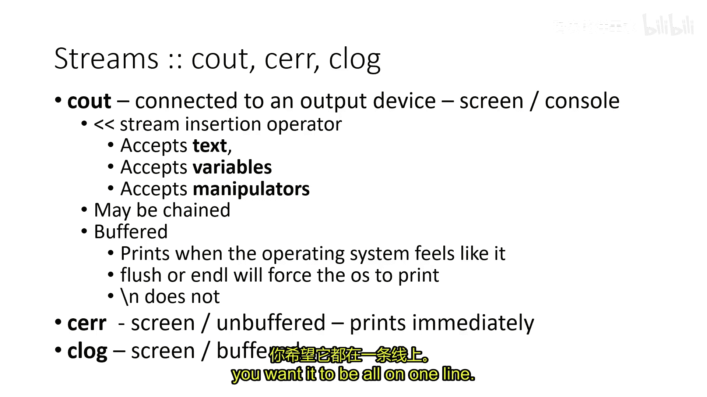
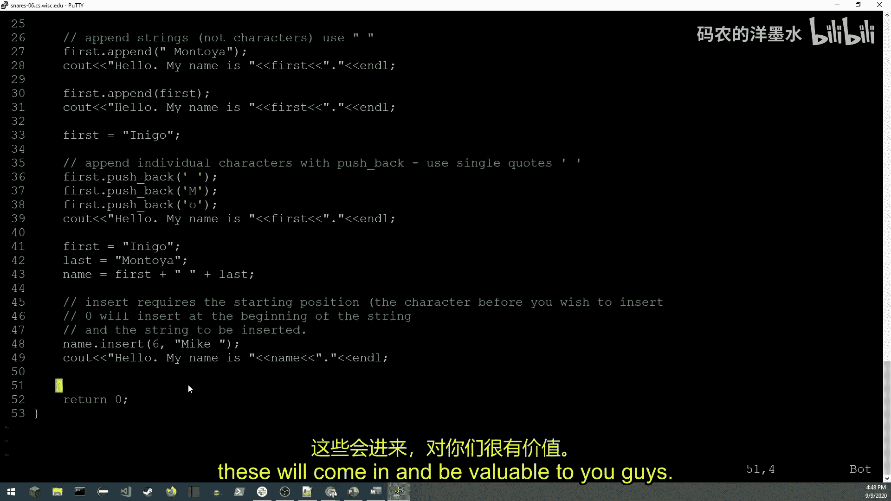

# 【全集】威斯康星大学 聚焦系统级编程 面向Java程序员的C++ CS368C 中英字幕 1080P p02 Lecture 2 - 文件IO、字符串 -BV1o72QBREfu_p2-

All right， hello， everyone。 welcomelcom back to week two of C plus plus for Java programmers。

 We've got a couple of things nailed down regarding just course logistics。

 First office hours After looking at the results of the survey。

 I'm going to be having office hours kind of in the midafter，2 PM Monday through Friday。

 There'll be a couple of Fridays while I'll be gone。

 but I'll give you guys a heads up when that's gonna be coming up R T Kane Rodriguez we'll be having office hours bright and early at 8 AM。

 and at 430 Monday through Thursday。 I know we've listed start times。

 but there's not an end time to this。 What we're gonna do is just we'll show up。

 I'll be there at 2 pm。 if there's anybody waiting in our office hour ticket queue。

 Let me pull that up for a second。 just walk you through this。😊，So。Put it on the right screen。

 There we go。 Here is our canvas course for the page right here under office hours。

 If you want to come visit us at office hours and get some help。

 just click on the ticket queue link right here。 Let me open that up。ask to a few questions。

 your email address， your name， send us a meeting link， your login ID。

 what kind of question you have， what question do you have Quetion types are just like conceptual debugging course logistics that's going to help us prioritize who we want to meet with。

In what order？But in general， we'll just meet with people in the order they arrive if there's no one waiting so our goal is to have office hours like lots of times during the day and then we'll meet with whoever's there And if there's no one there。

 we will hang out for a few minutes you know， but if no one needs help at 8 AM on Thursday。

 we're just gonna cancel office hours if no one's there at 8 AM on Friday we'll go ahead and cancel them。

 but as things get busier， we want to have the opportunity for you guys to like realize you need help and you can go look and see oh。

 the next office hours or just in a few hours。So that's kind of the idea if no one comes。

 then they're canceled so we're not going to wait around for a full hour。

 we're going to just schedule more office hours more times when we'll check in and see if there's anybody who's basically scheduled one of these appointments with us。

All right， next up。that's office hours。 Please sign up for Piazza if you've not already done so。

 we've got about 90% of the class already in there， so that's excellent。With regard to the survey。

 most people have taken the survey also， please note that the auto grader is going to give you zero or it won't display the grade at all I'm not sure if you guys can see it or not and we've had some people who recently added the class and people dropped new people have come we're going to give them some time to take the survey do the first project and we'll grade all of the survey when we do homeworkmark one and just do it all at once。

Speaking of homework 1 that is due tomorrow night。 Today is Wednesday。 that's Thursday evening。

Let's see September 10。 please make sure you go ahead and get that turned in on time。

 This homework I'd like to， I really hope was very easy for you guys。

Or for those people who it's not easy， it is probably the most difficult homework if you can't get the compiler to work。

 that can be one of the most frustrating things we'll deal with all semester。嗯。Homework 1 B。

 part part B of this will be released tomorrow by the end of day。

 It's going to be due the following Thursday， September 17。

 This is just do I really belong in this class。 It's going to be taking advantage of some basic programming skills you've learned from another class。

 The ability to write a loop to go through a string。

 I'm going to be talking about strings and input and output。

 see in and see out how to get user for input from from the user and write to the console in today's lecture。

 but if this is a challenge for you guys， then maybe this isn't the right class for you because it's going to get much more difficult from here。

 So that's kind of what I was looking for with my second like part of homework 1 is just a way for you guys to judge the difficulty。

 am I going to be in way over my head if I don't have enough experience。Allright。

 and then with regard to Piazza， as you guys run into trouble。

 if you're having trouble getting the compiler to work or you come up with some sort of cryptic weird error message。

 go ahead and post a screenshot of that message on Piazza and we can walk you through what it means There are some weird ones out there that pop up quite frequently If you need to post code that goes along with it we'll either ask you to send you us an email and as the piazza response or you can go ahead and post that privately。

All right。 So for today's lecture， I've got a couple of topics I want to delve into。 First。

 I want to go into some history， compareare C plus plus to Java and just talk about the development and the design philosophies behind these two languages。

 And a lot of that will answer a number of questions about why do they do it that way。

 Why is this so different。 And they almost all boil down to performance。And。

How easy it is to make mistakes。 And then I want to talk about strings and input output with stream operators。

 So that's the plan for today。 It's a little bit weird order to do these topics in I'm moving some things that I would like to do like conceptually first because we need them for this homework assignment So maybe it's not such a weird order。

Allright， so I want to just jump in and talk a little bit about the history and just compare C++ to Java。

 So for a long time， and maybe I like to think of it as not so long ago。

 but I'm old C++ was the language of choice for computer science courses。

It's an object oriented programming that lets us use classes to create objects。

 It's seen widespread industry adoption。 There is a lot of software out there。

 a lot of software companies that are hiring C plus plus programmers。

 It's the only thing I've ever used as a software engineer。

 The entire code base for our software was written in C plus plus。

 And even before that as a graduate student， All of my work and physics based simulation was done with C plus plus。

 And the number one reason for that language choice was performance。

 There's some aspect of our code that we wanted to go incredibly fast。 And therefore。

 C plus plus was。😊，The number one choice。It's a very efficient programming language。

 On the other hand， it is also one of the most complex programming languages out there。

 There's a lot of little syntax and technical details that we need to get exactly right。

 or we're going to run in trouble。Alright， a little bit about Java。

 Just my personal background with Java。 It's been almost nine years since I learned Java and the stuff that I've learned maybe a little bit out of date or maybe remembering it incorrectly。

 the textbook that I'm using as my sort of guide for the busy I'm taking the table of contents。

 but it's got some good stuff in there。 But that was written in 2004。

 So it's now 16 years out of date。 and Java has seen some major updates。

 and I'm gonna to get some things wrong duringing this semester。

 when I say something that's incorrect or that they've upgraded。

 please let me know in the comments and I will make a correction。 I gonna do my best for it guys。

 though， All right so Java is actually very similar to a lot of C plus plus structure。

 We've got very similar basic expressions like conditionals loops。 Those are almost identical。

 It's also an object oriented programming language。 But in general， the syntax is much easier。

 And for every construct that we see。In Java， C++ almost certainly has a corresponding construct that does almost the same thing。

 so it's possible to translate from Java to C++ pretty easily That said。

 C++ tends to have more options and not all of them directly translate into Java。

 So Java is like taking a subset of the really useful stuff from C++ and incorporated it。

 but it didn't get everything。Java is seeing really widespread use in introductory computer science courses。

 it's a great language to learn， and it does really help you a lot with debugging and preventing you from making horrendous mistakes where C++ doesn't stop you。

And with that in mind I just want to take a little bit of the history so to do that we're going to delve back and start with the C programming language It was developed in 1972 at Bellrabs by Dennis Richty。

 he was working on developing the UniX operating system previously operating systems were all written in assembly just because the compilers that they had back then did not generate efficient enough code。

 so he was working on the C programming language as a way to create operating systems using this programming language。

With that in mind， he needed the compiler to generate efficient code。

 and so he wanted the programmers to have access to as many low level details as possible so they could write the best quality C code。

To be turned into efficient assembly code。So if things like pointers and pointer arithmetic were available direct memory access。

 we can just say hey give me a chunk of memory right here and the system says okay here we go you can use it for whatever you want。

 We've got increment operators bitwise operators so we can use direct math within hexadeimmal or direct math and binary The hexadecimal constants and this allowed the programmers of the day to generate efficient enough code to generate operating system Uni。

Back then compiling was extremely slow， we're talking maybe three to four lines per second and many users would share the same machine all connected with those dumb terminals I addressed this in my terminal video along with homework 1A。

 so if you check that out in general， programmers needed to be experts。

In order to write the away a second。back up， my compiling was extremely slow。

 We're talking four lines per second。 The code base for the startup company that I worked on。

 we made software that engineers would use to help design parts。Was about 120000 lines long。

 That means every time I type a few lines of code and wanted to compile it and just check and see if it worked。

 took almost 50 minutes on a machine from that era。In addition。

 I would have to wait for the transfer time to transfer my code to the mainframe and then transfer it back。

 And that might be 10 characters per second， something incredibly slow。

 So we're talking several hours to compile our code base every time I made a little change。

UmOn the local machine I had it at work， well it was 36 seconds to compile the entire thing。

So we've seen dramatic improvements in speed。All right。When you're working in C。

 the programmers really did need to be experts that needed to write the most efficient possible code。

I've got an example of that right here on the next slide there it is Okay so take a look at this see if you can figure out what this one line of code does These stars are actually pointer D references if you're not familiar with pointers just fast forward to the explanation if you've seen a pointer in the class some more or give this a little pause the video see if you can figure out what this is doing and I'll be right back with an explanation。

All right， If you guessed string copy， you are correct。 So check it out， there's a lot going on here。

 First， we have a while loop。 but the while loop has an empty body。

 It's just got a single semicolon there indicating that the body is empty。

 So all of the action is actually taking place inside the conditional。

 the condition statement of the while loop。 So as we look here。

 we're seeing that we're also using an assignment statement inside the condition Now， in C。

 an assignment statement actually returns the value that's assigned。 So as long as it's not0。

 because C and C plus plus will treat 0 is false and everything else is true。

 So as long as we have not assigned the value 0， it's going to continue to go through this loop and evaluate this statement over and over and over again。

😊，So what we're doing here， if I look over here on the Q side， I've got an array， Q， or in this case。

 a string of characters and array of characters。 I'm dereencing that with the star to get the value of the very first character。

 I take that value， and then I'm going to assign it to the other string。The de referenceenced。

Sting P or character array。 And then once I've made that assignment， I see if it's 0。

 which is the null terminating character of a string。 If it's0， I'm done。

 I've copied the entire string。 If it's a letter， then I'm not finished copying my string。

 and I need to increment both pointers so that they point to the very next。

Element of the string next character。 And we'll copy that one。

 So there's a lot going on here in this one line of code。

 we're seeing an assignment in a conditional。 the increment operators were dereencing pointers。

We're getting a character data that we have an empty body of a wall loop。

 This makes some assumptions， too， two big ones。 First。

 it assumes that our string Q is actually terminated with 0 to indicate the end of the string。

And it also assumes that the arrayP has enough space to hold the entire string queue。

So those are some big assumptions there too。This is part of the reason that programmers really did need to be experts。

 All error checking was the responsibility of the programmer， not the compiler。

So just making sure that there's enough space in an array。

 C and C plus+ will not tell you that you've run out of space。

 that you're overriding the array of boundaries。 They will not check to see if your variables have been initialized correctly。

 It will not check to see if you've put in a string that's null terminated in Q。

 It could just be if you've never actually use that。 Remember before you just declared some space。

 It may not have a null terminal character in the immediate vicinity could copy millions of characters before you get to one of them。

Um， so it's u tricky to get correct， there's no checking， it doesn't help you。

'Find those common mistakes。All right。Yeah。Yeah， in fact， as far as efficiency goes。

 programmers could even suggest the use of particular registers on the CPGs。

I thought that was just fascinating。 Allright， so I'm going to move on and following the development of C。

 B a straw soup。Strassro。Not sure。 I think that's close。 developed C beginning in 1979。

 It's based on C。 I it developed C plus plus based on C。

 It was first standardized almost 20 years after that in 1998。

 And we've seen several other standardized versions come out where they've added new features。

 He was working at Bellll Labs and was looking for an object oriented version of C。

 designed to be upward compatible。 So he wanted to be able to take C code and have it run in C plus plus。

So with that goal， a lot of what we see as regular C will work in C++ there's a couple of exceptions because C++ is object oriented。

 we've added some reserved words like class。So any original C code that happened to use the word class anywhere。

 like for a variable name or something， is going to cause that C++ compiler to crash because it's expecting the word class to be reserved and used for creating classes and objects。

So as much as possible， we've seen that C+ plus。Tries to make C code work C is very fast probably the most efficient language out there。

 far as high level languages go。O。So with that goal in mind that we want to we want C code to work。

 they have reserved very few extra reserved keywords。 Now， so minimal extra reserve keywords。

 and the C plus plus community has been reluctant to reserve even more words。

 So instead what we're going to do as they add features to see plus plus is to continue to use reserved keywords like con and static and throw。

 they'll just use constant in like six different ways。 And depending on the context。

 it needs something different。 So that way， at least I'm not adding a new reserved keyword。

 So we'll see some little things that look a little weird。Because of that design philosophy。

 and hopefully when you recognize that they've used this again because they didn't want to add a new keyword。

 it explains why。Allright。The second goal was to write a programming language that goes as fast as C and can do exactly the same thing。

 goes as fast as C programs do when doing the exact same thing。Basically。

 why would you want to learn a language that's slower than C？The you wouldn't。

 So we need our language to go as fast as C can。 So with that in mind， we。

 we adapt some of the same things that C does to make it go fast。

 There's no runtime bounds checking on arrays。 Theres no garbage collection。

 That's where if I've reserved some memory with a new。 It doesn't take it back。 doesn't delete it。

 So a new would be in Java。If we've used Malik to reserve some memory in C++。

 we have to be the ones to free it。嗯。So no garbage collection。 There's no dynamic dispatch。

 That's where if we have a series of items， objects that are inherited from a。Drive class。

 and we've assigned them to variables in the drive class。

 It's not going to check to see what kind it is and find the right function。

 So basically it's the selection of polymorphic operation at runtime。If that didn't make sense。

 that's going to be like lecture 11， we'll go into great detail about how that works and C++ how you can get around this and make it happen with the virtual keyword。

Um，Otherwise， just just be aware that。They've done some stuff to make it go fast。Allright。

 And there are also some things that are not specified in the language and just sort of depend on what hardware the computer is running on and what the compiler made a choice about。

 So the description of the language， for example， doesn't describe what to do with the bit shift。

So if I do a bit shift to the right， is it going to shift in a0 or does it shift the s bit。

 and that happens to be hardware dependent。The rounding of negative numbers is also dependent on the system。

 does it round a negative number towards 0 or toward negative infinity。

Check out this one so in this code right here I've got two increment operators。

 the description of C++ the language specification doesn't tell me which one of these happens first in this particular loop。

 it doesn't matter that's not important。But in other cases， it might be。

And the final thing isn't the final one。 Yep the final one is that the size of an int is not specified either It's just guaranteed to be larger than or equal to a short and we'll find out for modern compilers and modern computers。

 an in is almost always of size 4 bytes。Alright， so just some little things that they're not specified and rely on the hardware to make them go fast。

All right， now into Java， James Gosling developed Java beginning in 1995 while working at Sun Microsystems。

His goal was to create a language。With simpler syntax。

He wanted it to be possible to do the same programs that could be written in C plus plus。So。

As an example， C plus+ might have many ways to deal a particular task when he designed Java。

 he took the most common version of the program and constructs from C plus and put them into Java。

 So not all C plus plus features have been added to Java just the ones that you use all the time。

 He also made it more difficult to write incorrect code。

 The compiler is going to go ahead and attack lots of different kinds of errors at compile time。

 Like if a variable has not been declared initialized。

 Or if you're accessing something out of bounds of an array。

 And the virtual machine will throw exceptions when bad things happen at runtime。

 So we've got compile time detection errors。 And the ability to fix things at runtime。

 I got to admit that when I did write Java code， I abused that horribly。

 And I did not have the greatest of style， but I really enjoyed having that power available to me。😊。

Allright， so now just some high level differences。 My list here is not in the same order。

 but I found this awesome slide that has like all of them in one spot。

 and I stole it from data flair。 So thank you， data flair。😊，嗯。But anyway， in no particular order。

 the high level difference is the big one。 C plus plus is designed for correct code to run as fast as possible。

And it's an extension of C that adds objects。Java is designed to allow to not allow incorrect programs to run and speed is a secondary goal。

 just they wanted to make it easier to write correct programs。

 I think those are the two major differences if I'm just like trying to describe why I would choose one over the other。

All right， see platform dependence， C++ depends exactly on where we run it。 Java。

 not so much on part of that is the compiled versus interpreted point here。

C++ is going to generate native machine code， this is going to let it run as fast as possible on the machine that it's compiled for and。

Downside is it will generally not be transferable to any other platform。 In fact。

 when Java was released， the compiled code generated by C plus plus was 50 times faster。Today。

 Java speed has significantly improved and reasonable code runs exactly the same speed as reasonable C++ code。

 highly optimized C++ code， but will still blow Java out of the water and a lot of that is because there are no runtime checks for correctness。

Java， on the other hand， the compile will actually compile it to Java bytecode。

 which runs on the virtual machine。And then that Java virtual machine is an interpreter that at run time will take the Java by code。

 interpret it and run it line by line。 This makes it in theory， more portable， so that。

Java code can be run on more or less any machine。Allright， so as far as security and robustness goes。

 there's a couple of things here that refer to security。 When we look at the memory。

 it's possible to access memory and C plus plus that's been returned to the heap you know。

 if I've used new and delete that I've reserved a pointer to something I've deleted。

 I can still go right to that memory that's known as a stale pointer So that's an easy mistake to make and a potential security violation。

 there's no automatic garbage collection。 So it's up to the programmer to remember to return the memory with a delete or free and programmers and when I say programmers。

 I'm almost always talking about myself。 programmers are surprisingly bad at memory management。

 it's incredibly difficult to keep track of everything and return all the memory to the system。

There is absolutely no array index checking。 And this is a favorite tool of hackers。

 They can look for code that reads in a string， like maybe your username and password。

 And all they need to do is put in a longer string than we use reserve space for。

 And then this will let us overwrite other variables。 This is known as a buffer overflow attack。

Maybe we'll do an example of this in the future lecture。I know if you take computer security。

 they definitely do this as a homework assignment。It was a lot of fun。Alright。

 so let's see typecasting can go horribly wrong， too。 I can reserve some memory。

 Store some integers there and then change it to characters and read it back as characters If I want。

 There's a lot of reasons I might want to do that。 I can use the smaller character data type know1 B or 2 Bs。

 depending on which character version I'm looking at to do math with smaller numbers and I don't waste as much memory if I'm working on a machine like an embedded CPU on a car or something that doesn't have like the gigabytes of memory。

 my home computer does。 that might be an advantage。 So it's permitted。

 but it can one of those things that can go wrong。If you're not careful。Let's see。

 defaultult initialization。 defaultult arguments。 Absolly not。 C plus plus doesn't have that。

 If I just create index and then print it out， I'm going to get whatever garbage was stored in that memory location。

 if I haven't initialized it。 I think a lot of times is this is deceptive and tricky because I think the operating system will frequently when it gives you know memory to computer to use will  zero out everything just so that you can't read what the previous program had been doing with that memory。

 And so you may have a lot of memory that starts out all zeros。 but as the program runs。

 it may be used。 And so as you declare new variables。

 you may be reusing memory that you've just written to。

 and it will not be default initialized to 0 or the empty string。嗯。

Then finally you have the memory model。Oh there's another page。 This is not finally sorry。

 memory model C++ is going to permit us to use pointers and we can have structures and unions。

 a union is sort of a composite data type where I can say sometimes it's going to be three integers。

 sometimes it's going to be three floats。And lets us use that reserved space of memory in more than one way。

嗯。C++ permits call by reference， but not in Java。嗯。C plus plus supports the go to statement。

 whereas Java doesn't。 I'm a big fan of the go to statement。

 I want to teach you guys how to use it correctly in this class。

 So many classes I've taken have said， don't ever write state go to statements。I don't know。

 I remember seeing that all the way through my undergraduate education， don't write go to statements。

 but if you use it right， it's a powerful tool。All right。

 let's see here multiple inheritance where a class can inherit from more than one parent class。

 C++ permits that will' go into great detail about how this works and the problems it generates。

And Java permits this also， but you have to achieve this through using interfaces。A。

Operator overloading is another feature。 of C plus plus that's going to allow us to take the new classes that we've generated。

 It is object oriented and then use the operators。 just simple operators like plus， you know。

 I can take one plus2 that's going to be addition if I'm using integers and it can I can rewrite what the plus will do for new types that I write so that as I write code。

 I can use these new operators to act on them。 That's going to be a full lecture in the second half of the course。

Finally， the preprocessor allows for conditional compilation。

 We saw an example of the preprocesor when we included using the pound sign include。Right。

 when we included IOstream， I want to delve into a little bit into mirror variable names because when we get user input。

 I want to be able to store it somewhere。 So this is the briefest drive through version of variable names。

 and then we'll jump into the new content。 So first。

 variable names in C plus plus can be composed of letters， digits and underscores。 and that's it。

 Nothing else。 They cannot start with the digit so they must start with either an underscore or letter。

 And a lot of times we'll see that variables that start with underscores are reserved for special purposes like compiler variables。

There's no limit on length I can have any number of characters。

 and it's important I believe to follow a convention so that you have a pattern and you can just look at a variable and say。

 oh， that's a variable or that's a function and the one that I really enjoy using is to put all of my variable names in lowercase I'll put the function names so that each letter is capitalized。

And I will put my class definitions in all capital letters。

I also really enjoy using the underscores between the words and names as opposed to Caml case。

 When I write Java code， I do use Caml case because that I'm not even sure why it just feels natural when I'm writing code for Java and underscores when I'm writing C++ maybe that's just just me。

 But for my course， it's totally fine if you guys want to use Caml case if you're familiar with that。

 just be consistent so that it's a pattern that you recognize and will make you more efficient at writing code Someday when you have a real job。

 your boss will insist on one or the other。 And 5050。

 maybe you'll get lucky and it'll be when you're good with or you might have to switch。😊。

At choosingoo variable names that are meaningful is very important。

 And that's one of the things as we go through and look at the style of your code。

 we're going to offer suggestions on if you choose poorly。

 So your goal as a student is to communicate to me that you understand what's going on。

 And you can do that by choosing appropriate variable names。 So， for example。

 if I am computing the area of a rectangle。 I need to take the length times the width。 So L times W。

 length times width x times Y。 I can easily use H for height。

All of those would make great variable names and A for area that can use Lord area。Can use size。

 All of those are great variable names， the worst I have ever seen。

 and I'm not going to tell you the name of the student。Choose T T for the length。T， T T。

 for the width。And when you multiply T T times T TT， you get T T T TT。

That made it incredibly hard to follow。 I had no idea what he was doing。

 I stared at that for the longest time and then finally figured out what was going on。 So please。

 please， please。 don't do that to me。I know there's one smart as out there who's going to come back and say。

 aha， check this out。I know I've already passed， I can't possibly take off that many points。

Please don't do that Timmy well。Cain's going to be gring for me。 You're doing it to him。

 He's a great guy。 Don't do it to him either。Allright， I'm going to pause for a sec。

 I get a office hours， and I'll be back to record the rest of this in a moment。Allright， guys。

 I'm back。 took little longer than I thought little further behind than I want to be right now。

 This part's being rereed after my microphone difficulties。 So sorry about that。 little delay。

All right so next up I want to talk about streams streamams are how we're going to connect to input and output devices。

 whether it's a keyboard or the monitor or a network files。

 the monitor this is how we're going to be connecting。

 So basically you can think of a stream as a physical source destination of data I use the word characters here when I was writing this slide。

 but it's data bytes of whatever could be translated into characters。

 That's what we'll be doing for the horse homework assignment and the examples today。Now。

 some characteristics of streams or there's no defined length。

 It's just gonna to be a source where characters are just gonna come in。 They'll be in a buffer。

 can read them out of the buffer into my C plus plus code。 Think about streaming video as an example。

 When you open up Netflix。 your computer starts receiving data from the Internet。

 and it's gonna play a video， and that keeps getting more and more and more data。

 and plays the video。 when it's done with it， it discards it。

 But you can think of it as like just an endless stream。 You can watch Netflix for days。

 It's just gonna keep on coming。 There's little buffer there， It's gonna store some data。

 you can extract it。 if it's a keyboard buffer。 whatever file buffer。And to do that。

 to take advantage of C+ plus streaming toolbox。 I like the word toolbox here。

 I don't think anyone else uses it that， but I like it。

 we're going to include three different header files。 The first one is Ios streamream。

 This is gonna to be the basic header file。 This is where C in and C outer stored。

 So if we want to use those functions we'll need to include them。

Appstreamre includes a bunch of options for files。 We'll get into those coming up very soon。

 but of a future lecture。And then for all of the IO manipulators， input output manipulators。

 if I want to format my output a certain way， all of those formatting things are going to be found in IO Manip。

Just as we walk through these， for us to get input from the keyboard。

 the stream that we're going to be using is called C。 It's connected to the keyboard。

 And just an example you there if I declare a variable and integer in this case X。

 and then you see in this is the stream extraction operator that double angle bracket to the right。

 that's going to grab data from my toolbox here。 So I type something in the keyboard， I push enter。

 it goes into the C。 it's like an object that's going to store that。 It's like a buffer。

 I'm going to extract the data from that。 And if it's an integer x so C plus plus knows all the types of everything。

 It's a strongly type language。 So if I'm importing something into an integer。

 it's going to grab one integer from the keyboard and stick it into X。We may change these。

 I'll do an example of this when I do my demonstrations。

 And basically that all that means is I can have C N， double angle bracket X。

 doublele angle bracket Y， double angle bracket Z。 And I can read in three things all with one command。

This will return the value of whatever is input。嗯。And it will return false if we see the end of line character。

 So if you're using testing this on a Mac or your home computer。

 that's either going to be control Z or control D。 It's control D for Mac and Linux。 It's control Z。

Followed by enter， control Z， followed by enter on Windows。Alright。

 the three output streams that we have。 to you ask all three of these go to the screen or console。

 See out is the standard one we'll be using。 That's the one I'm to use all the time。

 There are two others。 the arrow and the log。 they go to the。To screen also。

 unless you redirect them， which is pretty common for larger software projects。

 we probably won't even be using those during this course。

 but I want you guys to be aware that there's options。Alright。

 so C out is going to be used with the stream insertion operator。

 We're going to be taking data from a variable using that double left angle bracket and putting into C out。

 And from there， the operating system knows and all the like machinery inside the C out toolbox knows to stick it on the screen。

It accepts variables， text and manipulators so those。

Manipulators are going to be something that tells it to format， you know， if we have a number。

 maybe format with a certain number of decimal places， a certain precision。 If it's text。

 we could say give it a certain width box and stick it on the right side of that。Character box。

These may also be chain。 this is I use this all the time so we can。

Attach C out with a double angle bracket and then give it some text tell a worldl。

 and then we can give it the double angle bracket， followed by an end line。

 And each one time we use the double angle bracket。

 it's going to add another piece of whatever we're going to be outputing。couple of notes。

 this is buffered。 I mean， sea out is just going to remember what it should print later。

 and it's not going to print until the operating system is good and ready。

We can force that to happen by sticking a flush， which forces it to be printed to the screen without doing anything else or an end line E N DL that's going to force it to print and it'll put a new line at the end of the line。

And back slash n， the escaped new line character does not force it to print to the screen。

So a lot of times if you have a problem when you're coding。

 there's an error or someone you're trying to identify where it is。

 I highly recommend doing what's called scaffolding。

 that's going to be putting in a whole lot of print statements and you'll just look for the last one that printed。

 the error happened after that when you're one that have one that doesn't print the error was before that so you can like bracket where your mistake is。

The problem is that if it crashes。But the text that you have sent to see out to be printed is not yet printed because the outing system is waiting。

 It's not， you're not going to see it。 So definitely put an end line at the end of every scaffolding statement or a flush。

 If you do want it to be all on one line。 All right， guys， I just hopped over under a C SL machine。

 And I've got a bit of code here。 I just want to walk you through this very first example。

 And then I'm going to do， I guess， three more examples using C in。

So first up， do you see and I needed to include IOStream？

For all of the code that I write throughout the semester。

 I'm going to be just including this magic line using Naspace STD。All of these toolboxes。

 stream manipacy out C in end line over here。 they all belong to the namespace standard STD。

 which would be just like a package in Java。 So in order to tell C++ where to look。

 we're going to add using namespace so it'll search not only on the default locations。

 but it'll also search STD standard for these things when it's looking for where do I get the code that does this。

Alright， so here's the idea。 In my main function， I'm going to declare a variable X。

 I'm going to prompt the user with the C out。 This is the stream insertion operator。

 I'm sending this text into C out。 And when the operating system is good and ready。

 it's going to print that to the screen。😊，Next thing I'm going to do is use C and the stream extraction operator。

 C is basically the keyboard。 So I type something I push enter。

 and it's waiting right here in C for me to go grab it。 So as soon as I push enter。

 it's going to get whatever integer I type from the keyboard and stick it in X。

 It's only going to grab one integer。 if I put a bunch of stuff， it's going to get the first one。

 put that in X。 and then all it's going to do is print out you enter it and then whatever number I put in。

So this here is an example of operator chaining。 The first thing it's going to do is execute this much code。

 So it'll take you entered and stick it in the stream of characters that are eventually going to be put onto the screen。

Then this is essentially the same as。Just throwing some parentheses around here If I were to do math like this。

It would give me this much。That's going to stick you entered on this on the screen。

 The next thing that's going to happen is this C out angle angle bracket you entered essentially becomes。

A new sea out。 And we get the rest of this phrase， X。Andline。All right。

 So this much in parentheses returns a new sea out， which gets dumped right here。

 which is ready lined up to go with the next stream insertion operator。

 So this double angle bracket always requires a stream on the left。

And something to be put into this stream on the right。 So two operas when I got typo here。

 didn't mean that。There we go。All right， so when we run this code。This mod right here。

 let me highlight this。Means it's going to take X。 The stream operator knows that x is an integer。

 C plus+ is strongly typed。 It knows that this is going to be a number。

 and it's going to use C out to print out that number and C out knows how to print numbers on the screen。

Okay， after that， this that much code。Returns a new sea out。And then what's left？Is just this much。

 And that's going to print the end line and flush the buffer so that it gets printed right then immediately。

So this sort of， I'm going to call it simplification。

 If I were doing algebra and just adding some numbers together 2 plus 3 plus 4 plus 5。

 C+ plus is going to simplify this left right。 It's going to take 2 plus 3。And give me back 5。

And then the rest of this is plus4 or plus 5。Next thing it's going to do is take the5 plus 4 and simplify this opera end。

 It's going to do one opera end at a time， and that's going to give me 9 plus 5。And finally。

 it's going to do the last opera。 It's just simplifying them。 So that's all chaining is。 Alright。

 so let me go ahead and clean this up a little bit。

 So it's actually going to compile and run take out all of the little notes that I was making。

 as I explained。And hope I got it。 Ill put back。 So next。

 I'm going to compile this G plus plus C an examples dot com。 that'll compile it。

 and it'll store it in this default location。 A dot out to run that dot slash a dot out。And run it。

Perfect working。 Okay， inter integer。 My favorite number is。Oh32 today。So I type that。

 and then it prints out you entered 32。 That's exactly what we expected to happen。 All right。

 I'm going to pause the video。 If you like， definitely follow along。

 try this out on you and do some experiments。And I'm going to do a couple more versions of this example。

 just minor changes， so I' go make those changes， and I'll show you what I did。Alright， I'm back。

 I just did a quick manipulation of this。 I made a copy of these four lines right here down below and added some comment switches around them。

 If you guys don't remember how to use these。 So just this much right here。

 the slash star is a block comment。 It's ended by the star slash over here。😊。

To activate this again with the switch， I can change this to slash slash。

 And now C plus plus is going to ignore the rest of the line。 so it ignores that star down here。

 the slash slash。Means it ignores the rest of the line。 so it ignores that star slash。Now。

 because I've declaring X twice， I've got index here。And didn't x here。

 I'm going to keep only one of these active at a time。

And both of my blocks of code are surrounded by comment switches。All right， check this out。

 I can also use the comma operator when I'm declaring variables of the same types。

 So in this case I'm declaring X and y。I'm going to have a similar prompt enter two integers this time。

 and then I'm going to use C in a change manner to first read X from the keyboard and then read Y。

 And remember this is going to go left to right。 and this C grab X essentially returns a new C and that C will then grab Y。

And then I'm just printing out both of these。 And again， using the stream chaining。

I've got printing X here， printing Y， that's the only difference for this one。Allright。

 I'm going to save and quit。 Let me just show you。We'll compile that。

 make sure I didn't make any mistakes。And then run this code。So enter two integers。

 if you' can actually see on the screen I was testing this just a moment ago。 I can enter 5， space 6。

 and then I get5 and6。 If I run it again， I can type spacespace space4， Spacespace space 6。

 and it's going to ignore all those white spaces See as good about that。 run this again。

 I can even add a bunch of returns。And it's going to ignore all of those as well。

 It's just going to keep going until I've given it two integers。All right。

 I'm going to add a little bit more， and I'll be right back with a new version。All right。 I'm back。

 I've got a very simple example here。 It's almost identical to the first one。

 except instead of asking for an integer， I'm asking for a string。 So string name。

 declaring a variable to hold that， prompting the user。 What is your name。

 Then I'm going to grab the name， whatever they type from the keyboard。 sort it in the variable name。

 and then print out your name is， just to make sure that it worked。 So I'm going。

Switch focus back from here。네。And you can see I was testing this right there。

 but let me just walk through this， so compile again， make sure to make any typos。And then。

 we'll run the code。Your name Mike， Okay， awesome， your name is Mike。

So check this out if I do this again。And now I want Mike Doher。

It's only going to grab the very first thing and put it in a string。

 So I want to go back and make a little modification to this。And switch this up a little bit。

 So right now I'm asking for the name。Instead of using CN， in fact。

 I'm going to keep this block right here for you guys。I'm going to copy those six lines。

 paste them down here。We'll make this look good。Instead of using C。

 I'm going to use a different built in function called getline。Getline takes two parameters。 In fact。

 when I popped that up， it's actually giving me some information about the basic usage。

 It takes a stream。 In that case， I'm going to use C。 And it's where am I going to get this from。

 could be a file， could be stream of any type， including a keyboard， could be the internet。

And now I'm gonna to grab name。 This isn't gonna grab everything up until a。He finds a return。

So let me。Save and quit， make sure you make any mistakes pile that。Run it。

So it still works if I just use mic。And now it works if I have any number of characters。All right。

 I'm going to put together one more example， and I will be right back with this one。

 Suppose I'm reading a bunch of numbers in， and I don't want to use get line。

 I there might be a couple numbers per line。 I might have multiple lines。

 So instead of what I'm going to do is I'm going to declare a variable sum。

 I'm going to start this out at 0。 So I'm initializing this to 0。

 I'm also declaring an integer number to read the number in。

 and I'm not going to initialize that one。 We'll get that in the loop。

Andter some numbers end of line to end and then just a quick note end of line is control D on a Mac and Linux and control Z followed by enter on Windows。

 and then I've got a loop here， I can use CN inside of a loop it's going to return true if I've given it the correct type and it's going to ignore whitespace including endline including spaces and tabs so just keep going all the way to the end of a file。

So in this case， it's just going to read in a number。 if it actually reads in a number。

 it's going to return true。 if it reads in anything else， it's going to return false and should exit。

Then we'll just keep going， It's going to just add up those numbers and then print out the sum。U。

Focus， let's make sure I didn't mess this up， so we'll compile it。应该木认。That slash 8 out out。 Okay。

 so and's some numbers，1，2，3，4，5 type enter。 It doesn't do anything。

 I need to enter that end of line。 I can put in more numbers actually。 And then finally。

 it's control D。 So I'm piping control D。 and it prints out this sum。So if I run this again。

 and then I type some numbers，1，2，3， and then something that's not a number。

 It's also going to exit as soon as it hits something that's not a number。 So in this case。

And type to the letter A， I'm not sure this is real useful for people。 probably is， actually。

 knowing that I can get around bad input like this。

One other thing that I want to show you guys is input redirection。 So if you remember。

From the terminal video， I can use echocho。To stick some numbers。Into a file。

 So this is the input redirection operator echo goes was just going to type this。Output redirection。

 I believe sorry， output redirection because the output of echo is just those numbers 1，2，3。

I'm going to put this in numbers。t text。Then I can run my same code。The executable ADOt out。

 and I can use input redirection。To give it numbers without text。Okay it's going to print this out。

 it doesn't actually print out numbers， essentially this is replacing the keyboard with this file。

 so CN is actually getting the numbers from a file when I do it like this and still printing the sum is 6。

 but it doesn't actually print out the numbers as they go through。Okay， next up。

 I can also add addition here， let me just do this cat。Numbers。 text， we can see them。

Can you upload this up in Vim， there's my numbers。I can add more numbers to this， by echoing。4 or 5。

6。 If I just do it。Like this。Like that。It's going to say I can't overwrite an existing file。

 I need to delete it。 But what I can do if I want to just append is add the double angle brackets。

 This is output redirection with aend。 and now。I can just print this out。

And see that I've got two rows of numbers with an end line in there。Okay。

 that's automatically added by the echo function。And then， I can do。Import redirection。

Numbers that text it's going to take all of those numbers，1，2，3，4，5，6。

 add those up in the sum of those numbers is 21。 So it doesn't matter that there's a new line in there。

 It waits until it gets to end of file。I like， how did I say end of line the whole time？End of file。

 end of file。 end of file。 Sorry， but guys， I'll go get that change in the code。

 And when I upload it to canvasva and you guys look at what I'm doing， you can laugh at my mistake。

 End of file is what I meant。Oh w， all right， next example。

 I want to talk about using strings a little bit。Allright， final thing for today。

 I just want to go over a couple of quick examples using strings。

 things that you'll need for the next homework assignment So up at the top I've still got Iiostreamam because I want to be printing things out with C out I own and NP because I may want to change the appearance of things Not sure I'll get to that for this I feel like this is going kind of along and on string so I can use all the string functions。

First up， in mainine， I'm just declaring a string。 I'm going to name it first and stick some letters in there an e。

 And then I'm going create another string Last6 more letters in there。 Montoo。

 And then I'm going to use a string concatenation and add the first and last name together。

 and then just print this out。 Hello， my name is， and then the name。😊。

So let's just go make sure I to make any mistakes before I start manipulating this。 So G plus plus。

String example。 that's going to store it in dot slash a dot out。 So let's just run that。

And see what it says。Hello， my name is Indigo Montoya。 Oh looks like I could use a space there。

You guys can fill in the rest of that line， It's great fun。I'm going go back here。

 We'll manipulate this。 So I've got first plus last。

 I'm going to go ahead and just use string concatenation one more time。And add in that blank space。

Let's try this。RightAgain there we go， that looks good to me okay。Back up here。 Now。

 I want to just go over some some of the string functions。 So first up is length。

 So I can declare an integer。And say that's equal。 let's go at length。Equals。

And then we'll just go to full my name， dot length。By just taking a variable。

 that's a string and using the dot length function on it。

 that should return how many characters are in the string。Let's go ahead and try that Ozo hold。

Well on， let's print that out first。催眠？Well， I'm having trouble typing today。really want to说 okay。

Yeah， I took my pre workout this morning。 It's loaded with caffeine。

 And then I never got a chance to my workout。And I'm feeling a little bit jittery。 Okay， hello。

 My name is Nigomantoya。 My name is 13 characters。 Let's go ahead and take a look at this，1，2，3，4，5。

6，7，8，9，10111213。 Okay， that's perfect。 It's telling me exactly how many characters it has。

 Please remember that all strings in C plus plus are terminated by that back slash 0。

 null termininate character。 We'll go more into that much later when we talk about primitive arrays of characters and how they're used as strings。

 But for now， all you need to know is that the length function actually returns the exact number of characters in the name。

 And you can， of course， test this on your own if you're ever uncertain。😊，I'm going to go back。

And just change this a little bit。 instead of the length function。

 there's an alternative version that's used with the arrays and vectors。That's the size function。

So compile， they'll run that。 They work exactly the same way for strings。

 Strings just have both of them available。To be honest。

 I feel like length makes a little more sense for strings。おで。Alright。

 the next thing I want to do is talk about。You， I should probably leave that here。H on。

 we'll just comment it out。That way， when you guys are looking at this at home。sizeize。There we go。

 That looks good。 Hey you'll have like a little reminder that they both work。Alright， next up。

 how to change individual characters for a string， I can use the。Let's go with。First。Character 0。

I'm going to make that equal to。 And in a character， I need to use the single quotes。

 We'll just make that an E。And then we'll print out the first name。二一八。Go that line。Paて。

And instead of name here， I want to print it just the first name because that's the only one I changed。

First， there we go。 Let's see if that actually does what I think it should。

It've been a little while since I've done this。Yep， okay。 so right here is where I'm looking。

 It did change the very first character。From an eye to an E。Okay。

Let's take another look at that code。 So remember that strings and arrays in C plus plus are 0 based。

 So the very first character is going to be 0。 if I want to change one more。Grab two lines with2 Y Y。

 Peter pasts them。What do you guys think， How about I and I。We'll do character 4。

 We'll change that to。Qi。We'll run that again。 Yep， so0，1，2，3，4。Perfect。

 it's looking like it's working exactly like I want。All right， next up。Rronong one， there we go M。

 So in this case， I'm gonna do the append。Whoops。Open up help， all right， quit the help。

And just say let some go with。We'll just keep the first dot ofend。 I can give a pen another string。

To be appended， so this should work。And then we can print this out and I chose first because I wanted to be able to copy and paste that line。

We'll run this again compile。And run。So in this case。

 Alpen just takes another string and adds it to the end of this string。

 This actually is implemented very differently from Java。 It's very efficient in C plus plus。

 whereas Java reserves whole new memory block for the complete string and copies the whole thing every single time。

 correct me if that's been updated since I last learned Java。Okay， so that was a pen。

 A pen requires a string。 So I'm using the double quotes here for a string。

 I'm giving it a bunch of text。 and， in fact。We can use variables here as well。

 We just get another copy of this。And instead， we'll just use。

There first is a string I've already got available。Compile that， run it。

 and now I've really butchered this guy's name。I need Montoya。

 And then I've already got first dashed right here。 I'm adding another copy with the pen。

Using the variable name。So。Looks like that's working。 All right，Next up。

 if I want to just add individual characters to the back of a string。

 Now I'm going to do this real quick。 Im and grab this code。Paste it here。

Just so that the name is not butchered。 We'll just start with that。

 Next thing I'm going to do is I'm going to add some characters to it。 So first。打 pushush。Back。

 this is gonna to add an individual character。 So I need an individual character。

 So I'm going to use single quotes on this one。 We'll add the space。Then， we'll add the M。Oh。

Allright， you guys get the idea。 I could add all the rest of the characters for Montoya。 Let's。

Vify that this works。I I then print it out。My bad。So I just need to grab this line。

Paste it right there。 Save that。And run it。 So it's added the oops。Print the first name。

 and it's added the MO to that。Let me pull up them real quick I。

Personally believe I typed that way too fast if you were trying to follow along。

 So I just wanted to have the code here on the screen。

 you guys will be able to download this code and watch what's going on follow along with all the code will be here available on canvas。

 So you'll have seen all of this already if you downloaded that and if you're trying to follow along as I'm doing the lecture here go this is what it looked like I'm using the pushback command add single characters。

I'm going to go ahead and throw some comments in here to kind of explain what I'm what I'm doing。Oh。

 wait。 There's one more。 There's one more。 Hol on。 Let me go ahead and grab。

These first three lines right here， When you use control V to go to block mode。

 I'm going to copy these lines right here with y。And that it'll give me a fresh and Ne montoya。

I need some tabs in there。There we go。Now， I've got the full name there and you go Mon Toya。

 So the next thing I want to do is take that name and use insert。Insert requires two things。

 it requires where I want to start inserting from。And。The string I'm going to be inserting。

 So if I want to stick it in the like right after Nego， that's。Position 0，1，2，3，4。

5 will be right in front of the space。 position 6， I believe， will be right after the space。

 Then I can add。My own string。And I'll print this out again。Let's see。Right up here。

 I've got the line thats printing name。 I'm going to copy that with Y y。Paste that with P。

 get rid of the blank line with DD。Ctrol rate， quit。And we'll run this C。I walk a power first。

G plus plus。Demo。Run it。 And now that last name， I should have inserted Mike right in the middle of his name。

 And you go Mike Montorya， which I don't think sounds very Spanish， but。Who knows？

 Maybe that is his real middle name。Alright， so let's insert。 I'm going to go back real quick。Ctl R。

 then tab， good。And add some comments about what each of these lines are doing。 I'll be right back。

Let show you after I'm finished。 All right just to wrap up， I put some comments in。

 So as you guys read the code， first create some strings。 we download length and size functions。

 We addressed individual characters using the bracket notation。

 This is the same way you would access an array in Java。

We appended strings using the append function， and this is strings。

 and Im less stress that you have to use the single the double quotes here to add a string or you could use a variable that contains a string。

Again， using a pen with the variable。And then over here we can append individual characters to do characters instead strings we need to use pushback。

 This is a function that's available to pretty much all vectors and arrays。Factors。

 my bad not a raise。As well as the other kinds of lists。

 almost I have a pushback to add something to the end of it。 And then the insert requires a number。

 the position where we're going to be inserting in front of easy way to remember this is that0 will insert the beginning of this string。

 And since it inserts in front of the0 position。 So in this case。

 I was inserting mic before the sixth position to get the。Position right after the right before the。

 the last name。 All right， That's going do it for this episode of。C plus plus for Java programmers。

 So hopefully when you get to the next homework assignment。

 these will come in and be valuable to you guys。 Have a great day。

