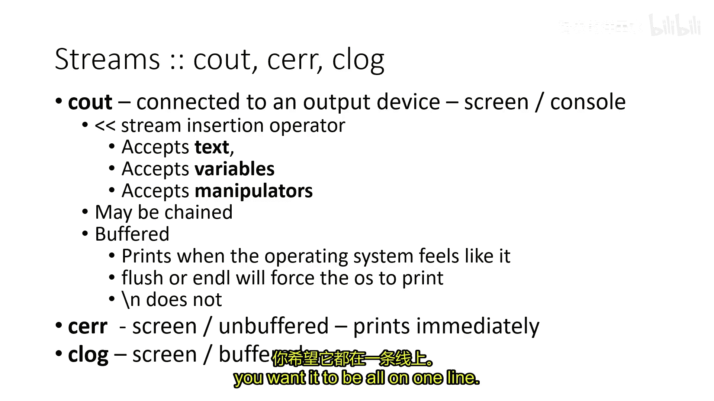
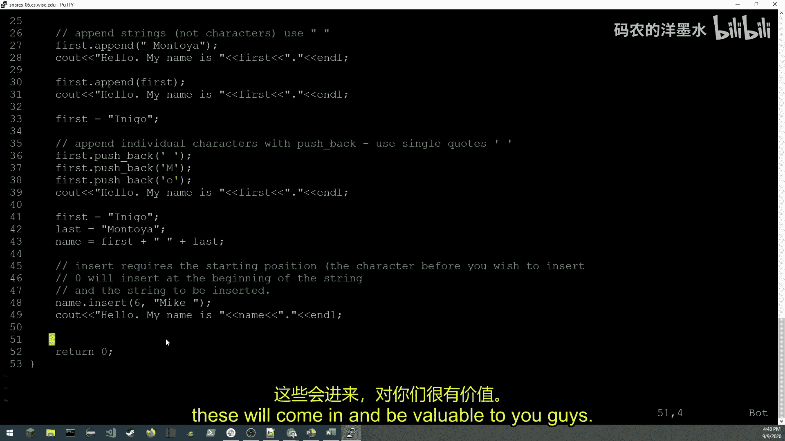

# C++面向Java程序员：第2讲：文件I/O与字符串 📚

在本节课中，我们将学习C++中的输入/输出（I/O）操作和字符串处理。我们将从课程安排和作业提醒开始，然后深入探讨C++与Java的历史背景和设计哲学差异，最后通过实际代码示例学习如何使用流（streams）进行I/O操作以及如何操作字符串。

---

## 课程安排与作业提醒 📅

上一节我们介绍了课程的基本信息，本节中我们来看看本周的具体安排和作业。

*   **办公时间**：根据调查结果，我的办公时间定在周一到周五的下午2点。助教R.T. Kane Rodriguez的办公时间是周一至周四的早上8点和下午4:30。请通过Canvas课程页面上的“票务队列”链接预约。
*   **Piazza**：请尚未加入的同学尽快注册。大约90%的同学已经加入，这是一个很好的交流平台。
*   **作业1**：第一部分（Homework 1A）将于明天（周四）晚上截止。第二部分（Homework 1B）将于明天发布，并于9月17日（下周四）截止。Homework 1B旨在评估你是否适合本课程，涉及基本的编程技能，如循环和字符串处理。

---

## C++与Java：历史与设计哲学对比 ⚖️

在深入学习具体语法之前，了解C++和Java的设计目标差异至关重要。这有助于理解为什么C++的某些特性看起来更复杂或更底层。

C++脱胎于C语言，其核心目标是**性能**和**对硬件的直接控制**。它被设计为C语言的面向对象扩展，旨在生成与C语言一样高效的机器码。因此，C++将许多控制权（和相应的责任）交给了程序员，例如手动内存管理、缺乏数组边界检查等。这带来了极高的运行效率，但也增加了编写正确代码的难度。

Java的设计哲学则侧重于**安全**和**易用性**。它从C++中选取了最常用、最不易出错的特性，并加入了自动垃圾回收、严格的运行时检查等机制，以防止程序员犯常见错误。其代价是牺牲了一些底层控制能力和绝对的性能峰值。

以下是两种语言的一些关键区别：

*   **目标**：C++追求极致的运行速度；Java追求代码的安全性与可移植性。
*   **编译与运行**：C++编译为本地机器码；Java编译为字节码，在虚拟机（JVM）上运行。
*   **内存管理**：C++需要手动管理（`new`/`delete`）；Java有自动垃圾回收。
*   **错误检查**：C++在编译和运行时检查较少；Java在编译和运行时都有严格的检查。
*   **指针与引用**：C++支持指针和引用；Java只有引用（且不支持指针运算）。
*   **多重继承**：C++支持；Java通过接口实现类似功能。
*   **运算符重载**：C++支持；Java不支持。

理解了这些根本差异，我们就能更好地接受C++中那些看似“繁琐”或“危险”的特性，它们正是其高性能的源泉。

---

## 变量命名规范 📝

在开始编码前，我们先快速回顾一下C++的变量命名规则，这对于写出清晰可读的代码非常重要。

变量名可以由字母、数字和下划线（`_`）组成，且不能以数字开头。长度没有限制。虽然编译器没有强制要求，但遵循一致的命名约定是良好的编程习惯。例如：
*   变量名使用小写字母，单词间用下划线分隔（如 `student_name`）。
*   函数名使用“驼峰式”（如 `getStudentName`）或“帕斯卡式”（每个单词首字母大写）。
*   类名使用大写字母开头（如 `StudentRecord`）。

**选择有意义的变量名**至关重要。好的变量名可以让代码自文档化，让他人（包括未来的你）更容易理解。避免使用像 `tt`、`ttt` 这样含义模糊的缩写。

---

## 流（Streams）：C++的I/O工具箱 🛠️

现在，让我们进入今天的核心内容：如何使用C++进行输入和输出。C++使用**流**的概念来处理I/O操作。你可以将流想象成一个数据的管道或序列，数据从源头（如键盘、文件）流向目的地（如屏幕、文件）。



要使用C++的I/O功能，需要包含相应的头文件：
*   `#include <iostream>`：用于标准输入输出（`cin`, `cout`）。
*   `#include <fstream>`：用于文件操作。
*   `#include <iomanip>`：用于格式化输出（如设置精度、宽度）。

为了简化代码，我们通常还会加上 `using namespace std;`，这样就不必在每个流对象前写 `std::` 前缀。

### 标准输入与输出

*   **输入流 `cin`**：连接到键盘。使用流提取运算符 `>>` 从 `cin` 读取数据到变量。
    ```cpp
    int x;
    cin >> x; // 从键盘读取一个整数到变量x
    ```
*   **输出流 `cout`**：连接到屏幕。使用流插入运算符 `<<` 将数据发送到 `cout`。
    ```cpp
    cout << "You entered: " << x << endl;
    ```

**运算符链**：`<<` 和 `>>` 运算符可以连续使用，因为它们每次操作后都返回流对象本身。
```cpp
int x, y;
cin >> x >> y; // 连续读取两个整数
cout << "x=" << x << ", y=" << y << endl; // 连续输出
```

**注意**：`cout` 的输出是缓冲的，意味着数据可能不会立即显示在屏幕上。使用 `endl`（换行并刷新缓冲区）或 `flush`（仅刷新缓冲区）可以强制立即输出。这在调试时非常有用。

---

## 字符串操作 📄

C++标准库提供了 `string` 类，使得字符串处理比C风格的字符数组方便得多。需要包含头文件 `#include <string>`。

以下是字符串的一些基本操作：

*   **声明与初始化**：
    ```cpp
    string first_name = "Indigo";
    string last_name = "Montoya";
    ```
*   **拼接**：使用 `+` 运算符或 `append()` 方法。
    ```cpp
    string full_name = first_name + " " + last_name;
    first_name.append(" Mike"); // 将" Mike"附加到first_name末尾
    ```
*   **获取长度**：使用 `length()` 或 `size()` 方法。
    ```cpp
    int name_length = full_name.length();
    ```
*   **访问与修改字符**：使用下标运算符 `[]`（从0开始）。
    ```cpp
    char first_char = full_name[0]; // 获取第一个字符
    full_name[0] = 'E'; // 将第一个字符改为'E'
    ```
*   **添加字符**：使用 `push_back()` 方法。
    ```cpp
    full_name.push_back('!'); // 在字符串末尾添加'!'
    ```
*   **插入字符串**：使用 `insert()` 方法。
    ```cpp
    // 在位置6（第7个字符前）插入字符串
    full_name.insert(6, " the Great");
    ```
*   **读取整行**：使用 `getline()` 函数读取包含空格的整行输入。
    ```cpp
    string user_input;
    getline(cin, user_input); // 读取一整行，包括空格
    ```

---

## 总结 🎯

本节课中我们一起学习了：
1.  **C++与Java的核心差异**：理解了C++追求性能与控制、Java追求安全与易用的设计哲学。
2.  **C++的I/O系统**：学会了使用 `cin` 和 `cout` 流对象以及 `<<`、`>>` 运算符进行基本的输入输出，并了解了运算符链和缓冲区刷新的概念。
3.  **字符串处理**：掌握了C++ `string` 类的基本操作，包括声明、拼接、获取长度、访问字符以及使用 `getline()` 读取整行输入。



这些知识是进行后续C++编程的基础，特别是对于完成即将到来的作业至关重要。请务必动手实践示例代码，加深理解。