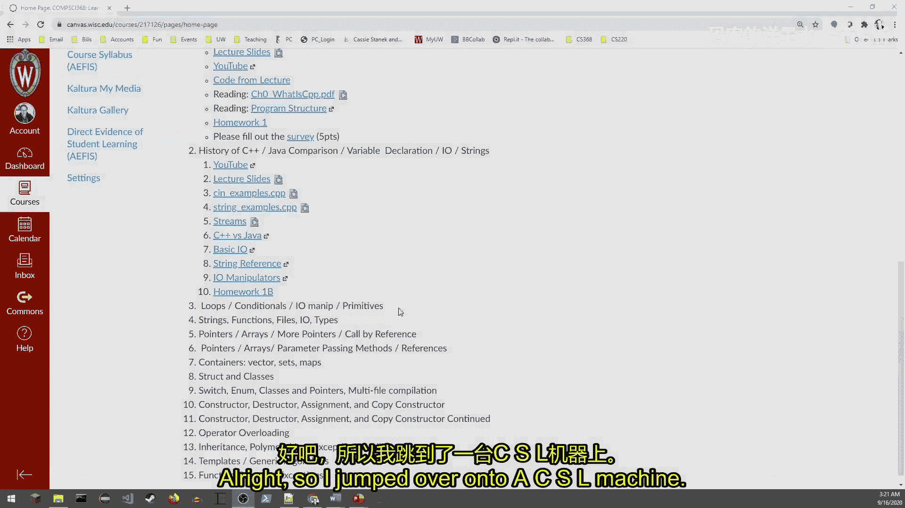
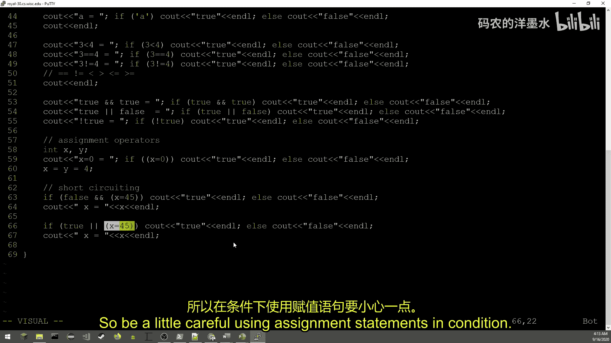
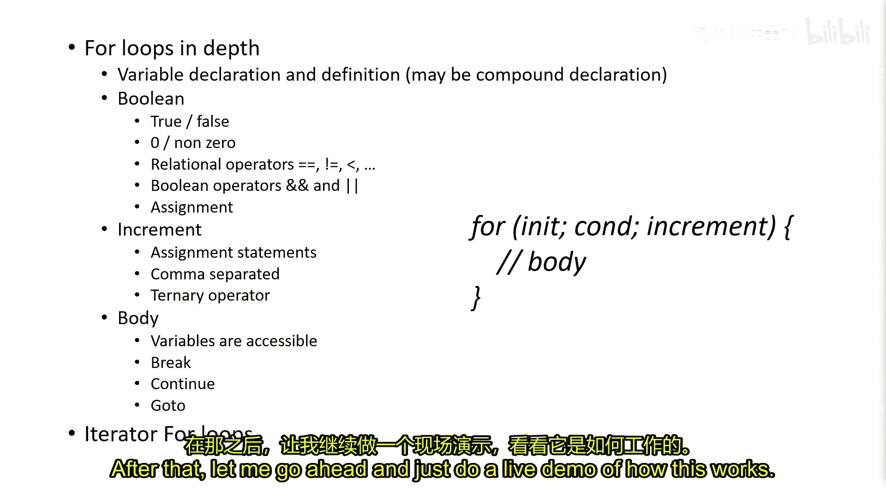
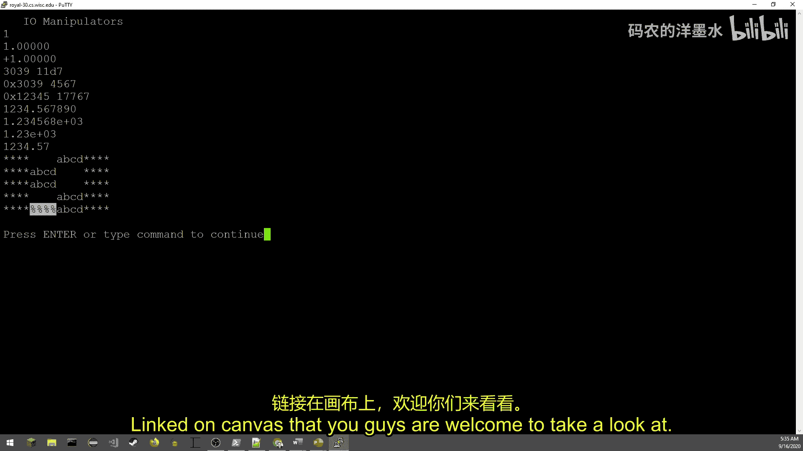
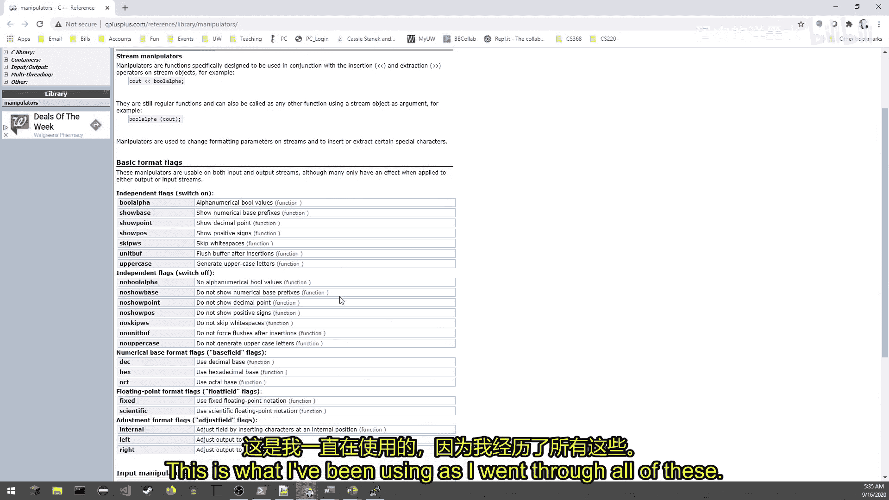
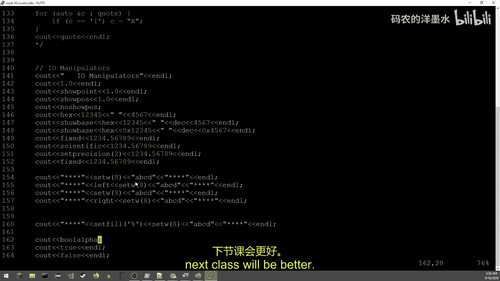
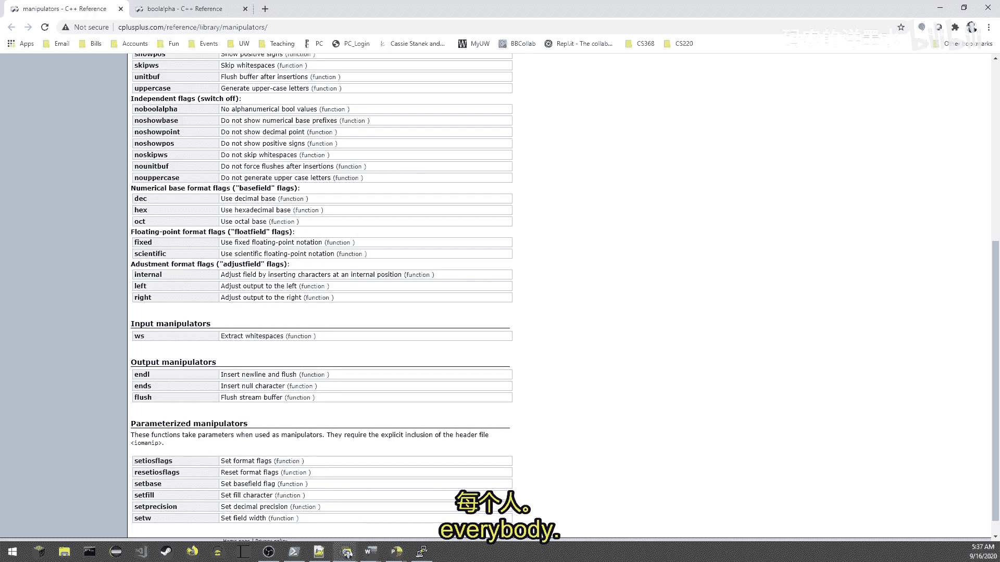

# 【全集】威斯康星大学 聚焦系统级编程 面向Java程序员的C++ CS368C 中英字幕 1080P p03 Lecture 3 - 迭代、条件句、IO 操作 -BV1o72QBREfu_p3-

Al right， everybody， welcome back to C plus plus for Java programmers。

 A couple of announcements as we get started。 First。

 I'm gonna be live streaming the video for this class on Wednesdays at 3，30 PM。

 You are welcome to come and join us。 It's a chance to watch the video。

 you can ask questions in chat。 the class meets once a week。

 If you're having trouble with like putting it off and procrastinating。 I was totally there。

 This might be just what you need to keep on track and make sure you keep up with watching the video and then doing the homework after that。

 The homework will typically come up one to two days after our lecture videos Thursday or Friday。

 My goal is Thursday。😊，Office hours， I need to move my office hours to 1 pm。 sorry about that。

 but it was a conflicting with my son's video game time and he needed the microphone and it was just a disaster trying to like have office hours while he was talking in the background his friends so。

He gets done with school at two we're moving that earlier。 I'm available at two。

 if you guys need to make an appointment， just let me know and I can be there。

 but there will be noise。All right， if you've not already signed up for Piazza。

 there's like maybe 30 people out of the class who haven't done that yet。

 please go ahead and do so it's a great resource to ask questions。

 get some help heads up homework 1 A and 1 B are both due tomorrow night there was a one week extension on 1 A because I forgot to put the link up I apologize for that。

And homework two will be released sometime Friday morning。

I'm writing a brand new assignment for this class， it's based on one we did last in the data programming class I taught。

 we're going to be making a Pokemon battle simulator。So anyway。

 that's going to take me a little bit more time than normal。

 so I'm thinking Friday morning for the release date next week， I'm gone Thursday and Friday。

 so the homework will not be due until well after that， sometime the following week。All right。

 And I took a look at the news。 If you are like anywhere outside of Madison。

 you either getting swamped with rain like 2 feet in Alabama or the world is burning up around you。

 So hope everyone out there is being safe and staying somewhere safe。😊，So as we get started today。

 I'm going to be doing a lot of live demonstrations where I'm writing code and then running it over here on our canvas page we scroll down to today's lecture。

 we're going to be talking about some of the basics and what makes C++ actually different from Java the little details that we can take advantage of to make our code more efficient to write run faster at those kinds of things and then we'll be taking a look at omanipulators how do we make C+ plus display the text that we want exactly as we want it and then if I do a good job I won't have time for primitives if I rush and might get started on those。

We'll see。 but anyway， as I develop the code， I'm going to go ahead and generate a template as I go along。

 that will be listed on the list of resources， you know。

 along with the readings and the YouTube link that'll be here as soon as I get all of this stuff finished。

All right。 So I jumped over onto a CS S L machine。 I've got vim open。

 and I've started filling out my template。 So I've got Iio stream， Iommanip and string all included。

 I've got my using namespace standard。 that magic line。 we will put in every program。

 and I've got main here。 The first topic I'm going to start going through is just variable declaration。

 And I want to do some some neat ideas here。 So first up， if I just declare variable。

 I have to give it the type followed by the name of the variable。

 We talked a little bit about naming variables last time。😊，In this case。

 I just want to highlight the reason I'm doing this is that there is no。Default。I know。Hold on I IT。

No default ination x equals。And that I'm going to print out X。And line。Alright。

 so we'll find out is that there is a value here。 It's likely to be 0， but not guaranteed。

 And we're gonna find out if it's not 0。 I want to show you that I。

 I'll come up with a better example to demo this。 Alright， next thing I want to do。

 I'm gonna to hit escape a couple times。 I just want to show you how to compile。

From the commandments， I'm colon。Not the command light from Vim。

 So this gives me the ability to execute a shell system command， a shell command。

 So I can just type the compiler command here。 So let's just call an exclamation mark。

 and then I can give this a name dash O。 Let's call this lecture3。

And then I need to give it the name of the file， let's see I named it lecturer 03。cppP。

 and it'll turn on all the warnings。Al right， so if I run this。

 it's going to hop over to the command， the shell， run this and then type enter or command to continue。

 I'm going to hit enter。I forgot to write the file。 That's what it was telling me。

 So let's try that again。 Now I can go back， compile it。X is use uninitialized cool。

 It did give me a warning。 That's what I want to demonstrate。 So the next thing I'm going do。

 Im to actually run this。 So colon exclamation mark。 And then I named it lecture 3。Lecture 03。

Should run。And here it is。 It says no default initialization。 X is equal to 0。 Okay。

 that's likely because when the system started up when I， when I logged into the machine。

 it had cleared all the memory to 0。Because it doesn't want me to have access to whoever was using the computer before me and this is a CSL machine。

 so I'm not surprised that that's turned on。 I'm going to go come up with an example where I can demonstrate that this in fact does not always give me zero。

Alright， so I got an example that this is going to work for。 So here's the idea。

 I'm declaring a string S It says this string is going to influence the value of x after it goes out of scope。

 I've got the braces right here。 These two braces are going define a scope block where the string S is only going to be fined within this within these braces as soon as this closing braces reached C plus plus recognizes that it no longer needs this string。

 It goes out of scope and it reclaims that memory off the stack。Then when I declare the variable X。

 it's going to use that same memory location and whatever values with。You know。

 the numerical codes for ASII values for this string they're going to still be in memory。

And so what we're going to get is approximately four characters worth mashed together to come up with an integer。

 and then it's going to print that out。 So here I'm ready to compile。 down there。

 I'm going to push enter。 should go back here。 It's still giving me me that warning that I'm using it uninitialized。

 and then I'm going to go back and run that。Right there。

 and now I can see that there is no default initialization。 In fact。

 I've got 21865 before I've initialized it。Al right， let me go back over here。

 What I really need to do。 and I've got some choices here is give this a value。

 So I can just say x equals 5 and then。We can。Print this line out again。Let's go ahead and write。

After。Initialization x of equal equal to that。Now I can write。I can。Compile。And we can run it。Yep。

 there we go。 After initialization， x is now equal to5。

And it is telling me the warning still may be used uninitialized， and I'm still using it unitialized。

 I left that piece there。Alright， I can also combine variable declaration and initialization in the same line。

 So you can have y is equal to know4。 So here I'm declaring the variable。And why。

 And here I'm giving it a value So that's initialization all at the same time。

 So and then we can just print this out to verify that this works。

I'm going to keep this a little shorter。Y equals。Why。In line。Alright this。We will。Compile。And。

Well runun it。 There we go。 Y is equal to 4。 I'll clean this up a little bit before I pass it the final version on canvas。

So it looks good， but for now I'm just going to keep going。

Something else that C plus plus will let me do is declare multiple variables of the same type in the same line。

 so I can say int AB， C and declare three variables there still needs to end with the semicolon。

 I can also give some of these values so I can say int D equals 1 E equals 2 F equal。

 I can just leave this one undefined G equals 6。And with semicolon， all right。

 let me write some coded print these out， and I'll show you what it looks like。Al right。

 just so you can see what's going on。 I've written some code here。

 it's going to print out A equals and then A B equals and then B。

 and just go through and do all of them。 So I've already compiled it。

When I change the focus back and run this， I can see it gave me a whole bunch of warnings for all of the uninitialized variables when I compiled it。

 And then when I ran this， I've got a is equal to some uninitialized number here。 something huge。

 B is equal to another uninitialized number。 C is uninitialized。 So just a random number。

 And then I've got the 1，2 and the 6 for D， E and G。 So I did initialize。 Allright， so。

Iitializing more than one variable all in one line totally works。Alright， next up。

 I want to spend a little bit of time talking about how C plus plus works with Boolean values true and false。

 as well as Boolean statements。 So over here， I put a common switch around this because I want to use the variable B to stand for Boolean true false values in a little bit and this will mess it up。

 So I'm just gonna have one block at a time active。 So as you guys go through the code。

 I will leave the first one active on the when when you can download the final version of this on the website。

 and the rest will be inactive。 But you'll probably get compiler errors if you have more than one active at a time。

 All right， So what I want to do now is just see out and print to the screen true。

Equals and then we'll give this a true。And an end line。 and we'll do the same thing for falls。

I'm going to write this。 And then I made a little upgrade。

 So I'm going to hit colon exclamation mark and then the up arrow。

 So what I've done is just merged all of these statements into one line。

 So I'm going to clear the screen。Then the double m percent here says this is a shell command。

 It says if the first command is successful， then go ahead and execute the next one。 Otherwise。

 it'll print that error message。 So then it'll run the compiler。 And if that is successful。

 then it will actually run the code lecture 3。 So this is all going to happen in one line Now。

 you need to pause the video， copy that down， really useful。😊，And I'm just gonna to run it。

 So it cleared the screen。 It compiled without any errors whatsoever。 And now it's printing the code。

 So I can see here I've got Boolean statements。 Tru is equal to 1 and false is equal to 0。

 So this is how C plus plus is going to deal with all boolean values。

 Anytime I declare a variable as either true or false as a boolean。

 It's going just take that value and store it as one or 0 on the inside。

 What I want to do next is go through and actually use a boolean value in a conditional statement。

 So we'll just start out here with thumb。Creating a boo in variable B we'll just set it equals to true。

And we'll change that in a sec。 And then we'll just print this out in a boolean statement。

 So if statements require a boolean condition， So do while statements and the middle statement in a for loop。

 So if B， then we will print out true。With an end line after that。 and else， we will print out。False。

With line right there like that。 Alright， so this is very bad programming practice。

 I've got a whole bunch of stuff all in one line。 It really。

 I'll go ahead and tweet this a little bit。He looks better like this。Right。

 but I'm going to have a lot of these statements that all have this exact same structure。

 So I'm going to put them all in one line so we can see the changes。

 Let me just do it like this for right now。 So we right now， we'll write this then。

We'll go ahead and compile this， run it， and just see what's printed out。 it should print true。Oh。

 am I not printing the right thing， hold on one sec， hold on one sec？I forgot the quotes。

 forgot the quotes。 I was going to print out the words true。All right， time on， let me fix this。

There， that's what I really wanted， all right。Write this。run， there we go。 Now it's printing true。

 Okay， I want to go ahead and run this up with a whole bunch of different things in the condition statement。

 C plus plus accepts lots of different things， lots of different kinds of data。

 and we'll evaluate them as either true or false。 So it's gonna to simplify an expression in here。

 It knows it needs to get to true or false。 And it takes lots of different kinds of things。

 So let me just pause the video for a second。 And write this up so it looks good at where we can like try lots of examples。

All right， so I've got my Boolean value， I'm just going to print out what it is to clean this up a little bit。

I'm going to put all of these things on the same lines So if B， it does this statement else。

It does this statement right here。 And then I'm just going to copy this line。

 paste it a bunch of times。 and we'll try some different things in here。

 So we will try if so the B is true here。 that's my boolean variable。 We will stick in a true。

And then over here， this will become true。That should definitely work。

 shouldnn't be surprised to anyone。False， this is just way to make sure I don't have typos elsewhere。

We stick in false。All right， we're also going to find that。I can use one。Has the condition。

 So I can just put in the number one right there。 I can put in the number 0 because C plus plus will treat 0 and one as false and true。

Let me just go ahead and run this much right here， make sure I before I get too far I don't have any typos。

 right？Clear pile and run。 So yeah， So B is my booleing variable。 I set it to true。 So true。

 true is true。 F is false。 One is true。0 is false， but we can do a bunch of other things， too。So。

 for example。Let's go ahead and we've got  zero right there。 We'll go ahead and stick in 42。

Much larger number， let's try a negative number。-1。Mophone right there。

 And how do you guys feel about the letter A？Now， let's give that a try。So I'm going to write that。

 So now for all of these， if this condition is evaluates to true， it'll print true， Otherwise。

 it'll print false。 So if a evaluates to true， it'll print true。

 I'm kind of excited to see what happens。So write this， and then we will clear， compile and run。

 So in this case here， one was true。0 is false。 That's sort of the standard，42 is true。 And， in fact。

 everything that is not 0 will evaluate to true。 So -1 here evaluates to true。 A evaluates to true。

 When we use a character like this， it's going to take the ASI code。

 And ASI code for lowercase A is something like。Gosh， I don't remember hold on。Ananual ASI。

Here you go요。Lower case a。え。97， it's right here， 97， okay。So when we put a 97 right in here。

 it's not zero， it evaluates to true。All right， now back here。 And of course， just for completeness。

 I feel like I need to put in at least a couple of these。The relational operators all work。

 So if I have three less than four。And then over here， I can put it in three less than4。

 This should print true because three is less than4。 Let's do。

We'll just do a couple of these if three。Exactly equals4。Then。Should print out false。

Let's see about9 equals。Not equals。3 not equals 4，3， not equals4。 All right， that should be know。

 the other relational operators just for clarity are less than greater than。Here， let's do。

Exactly equal to， not equal to。Less than greater than， less than equal and greater than or equal to。

 So those are our choices。All right， cool。 let me just run this and。Save that。And then， we will。

Clear， compile and run。So folks back。And we see that3 lesson 4 is true，3， exactly equal to4 is false。

3 unit equal 4 is true。 Okay， I didn't expect any surprises there。 The last thing I want to demo。

 though is the logical operators， the Boolean operators。So let me go ahead and write up some stuff。

 I'll type this up and then continue。All right， just a quick demonstration of the three logical operators that we have in C+ plus true and true。

 So in this case。highlight that。 The double am percent is our and operator。

 So true and true should print true。 true or false。 So the double vertical pipe。

 it's above the backslash， shift back slash on my keyboard is the or operator So if something。

 if either the left hand side or the righthand side are true， it'll be true。

 Only false when both of these are false。 I suppose for the and operator， I wasn't very clear。

 they both must be true。 Both sides of the and operator must be true for that operator to generate a true result。

 And then the not operator is， the exclamation mark。 So if something is not true。

 It just switches it。 If it's true， it switches to false。 If it's false， not false is equal to true。

 So I'm going to go ahead and write this。And run this。Okay， so it clears， compiles。

 and then it's adding all of these new statements， so true and true comes out to be true。

True or false is going to be true because this side is true。 and not true is equal to false。

 All I'm going to come back。 These are all short circuited。 and I'm going to talk about a little bit。

 And I'm going to use the assignment to demonstrate this。

 Let me talk about the assignment operator inside a Boolean statement。 So one of the things I can do。

Is I'll just create a variable real quick。Inside of a Boolean statement。

 I can say something like H x equals 5。That's going to assign the value of5。X。Equals5， there we go。

That's going to equal。 And then I've got an extra character。 that looks pretty good。

Let me just see if that。Compileles and runs。 All right， nope， I've got， oh。

 I've got an extra I in there。 I C out right there。Okay。Where did that pop in。Right there。Right that。

Viol right， okay。No， I have another mistake。Os I got lost the word here。All right。

Now as it look good， See out that stuff If x equals 5。 So this is assignment， C how out true。Yeah。

 okay。Now it's working。 Okay， cool， check this out。 It actually gives me a warning。

 And they're gonna to suggest the use of parentheses around an assignment statement in a booleyan statement。

 a bulloleyan condition。 So right there， I'll go back ahead I will go back and put those in。

 I just wanted to show you that warning。 This is generally not great practice because it's deceptive。

 This is a really common mistake to just put in  one equals when I really meant 2。

 But what it does when I have an assignment x equals 5。 It's going to take this much of it。

 And this is going to return the value 5 every time there's an assignment。 And5 is a positive。

 That's a nonzero number。 So it's going to evaluate to true。

 So let me go ahead and show you what I mean。 In order to use this and signal other programmers that I'm using assignment inside a boolean statement。

 I'm going to use the double parentheses。😊，All right and。This assignment operator。

 if I have two variables into x。And why。I can use chaining。 I can say x equals y equals。

 I don't know64 I missed4。 What that's going to do is it's going to say y is equal to 4。

 and this much will return4 so it's going to simplify the right hand side of this。

 and then it'll say x equals 4。So remember， all programs do is it's going to take the right hand side and simplify。

 simplify， simplify until I can get to something that I can store in a variable。

Let me run this one more time。 The only way I can make this ever turn out to be false is if I put in0 here。

 x is equal to 0。So place that with。Now that I want replace with zero， and we'll write this。

And run it again， and now x equals 0， that statement will be false。All right， so next up。

 I want to do a quick demonstration of short circuiting。 So I'm over here。

 I'm going to just say that I'm going to use the variables X and Y that I have right there。

In this line， I'm assigning them both the value of4。And what I'm going to do is。Here。And we'll do。

False。And。Then we'll use an assignment operator X equals。45。Then， we will。Okay。

 we'll just copy this line for now。That was the wrong button。And put that here。

 But then what I want to do is also print out。X equal oops， quote X。Equals。We print the value of x。

 and we'll just see if x is reassigned。 So it starts out4。And if this is executed。

 this will change the value of x to 45。 So I' write this。And run it。Oops， I'm missing the。Prenheses。

Okay， there we go。 Now what's working。 So it evaluates to false。

 Maybe I'll put a new line in so that and maybe like a header or something to indicate this section。

 what's going on here。 And then I've got x equals 4。 So it did not change the value。

 And what happened is I have an and operator。 And every time C plus plus season and operator。

 It starts with the left side tries to evaluate this。 If it's false。

 it knows that it cannot possibly be a true statement and it never has to do this side of things。

 This is a great way to do something known as guarding。

 If I need to do something like divide by 0 or something like that。

 I can put that check in right here。And then put my dangerous divide by zero statement on the other side。

All right。I'm going to just copy these two lines。Pate them again。And set this up with the。

The orar version。So， if true。偶尔。X equals 45， then it'll print out 2 or false。

 and then I can print out x again。So， write this。Run the code。 So in this case， my。

Or statement evaluates the true because it's true or something。

 But it never goes back and evaluates second bar。 This is still equal to 4。

 Let's go take a look at that code again。 So if true or whatever， it doesn't matter what this is。

 it already knows that it's true。 So C plus plus us does not do any extra work whatsoever。

 This is how it becomes as fast as possible。 Short circuits this and never executes this code right here。

 So be a little careful using assignment statements in condition。

Conditional statements， whether it's an if a4 or a wall loop。All right， next up。

 I want to talk a little bit about four loops。I think everyone in the class is familiar with for loops from either Python or Java。

 But T post+ has a little a couple nuances， things we can take advantage of to do some really powerful things。

 So I just want to go over all of the little details that make them different。 So first up。

My standard， like syntax for for loop。 I need the keyword 4。

 I have three pieces inside the parentheses， and then the body of the loop here。

 I've got it enclosed in curly braces。 This initialization here is going to be where I'm going to declare a variable or more than one variable。

 I only get one statement here。 So it needs to be like， if I want to declare more than one variable。

 a compound statement and all those variables need to be of the same type。Then I have a condition。

 Whatever is here that gets is exactly one statement that must evaluate to something that C plus plus considers to either be true or false。

 And there's a lot of things it considers to be true or false。

 So we can use actual words true or false。 I've got a typo here。 The T needs to be lowercase。

My other class is Python where true and false are capitalized and I'm going to make this mistake a bunch。

 sorry about that。 I'll get it fixed。 It can take either zero or nonzero numbers for false or true。

 We can use any of the relational operators， the boolean operators that I just demo and even an assignment statement we can use text in here because text evaluates to a number and that's either zero or non0ro。

All right。 Now in the increment here， this piece right here can take many statements。

 There' are just going to be comma separated list of statements。 Normally。

 our statements end with semicolonons。 This is the one condition that I know of where we can use as comma separated list of statements。

 and including the turnernary operator So I can actually put more or less an if statement that assigns something to a variable inside the increment block here。

 inside the body of the loop。 All of the variables I have initialized here and declared are accessible in this scope。

 When we reach this end of the curly brace we're outside of the loop。

 Those variables are no longer in scope。 They're not accessible and they will go away。

I'll come back and do a demonstration I'll break continue and go to in a moment and then an iterator for loop after that。

 let me go ahead and just do a live demo of how this works。

Alright， so I'm back in the CSL machine。 I'm just gonna go with。A little bit of code here。

 Let me type this up， and then we'll walk through it。 It's just going to be a simple countdown。

Functioning like a rocket blasting off。 So one sec。Allright， I didn't want to go too crazy。

 I can do a lot of things with this structure， though。 So in this case。

 I'm just going to be printing out basically a square chart。

 I'm going to go over these io manipulators in the very next section。 But right now。

 it's just going to create a block of a text  three characters wide。 I'm going to write a line it。

 and I'm going to stick the letter N in that block。 createate another block 6 characters wide。

 P this text into that。😊，And then new line。 And then in my loop here。 So I've got a four loop。

 I'm declaring a variable I setting it equal to0， using the comma operator there to declare another integer。

 and this must be an integer， and we'll set that one equal to0 also I don't have to initialize these。

 That's optional。 and then while I is less than 10。 it's going to continue to do this loop。

 and then during this increment stage。'll increment I using I plus plus this is the post increment operator。

 habit dictates that I type it like this。 The plus plus I operator is a little faster。

 There's the piazza post on that if you're interested。 And then also in this block。

 we're going to do the computation of the squares。 we'll just upgrade the square to I times I and then we'll print this out。

 again， we're creating fields with certain widths will print out I and then another field and we'll print out the square of it。

 So let me go ahead and write this and run it。So I still my countdown， but starting here。

 I've got the field with width3 and then all of the I values and then my field width6 with n squared and 0。

1，4，9。 So it looks like it's working。 It's just I'm trying to demonstrate the power of these four loops where I can have many things。

 I can do almost everything in the same statement。And， in fact， these guys are all optional， too。

 So if I want to， I can type 4， I can leave this blank。 I do have to put the semicolon in。

 And that's my initialization。 I don't need to initialize anything。

 I don't even need to have a condition。 So I can just put in another semicolon right there。

 That would be that semicolon is the second one。Leave that blank。

 And then I don't need a increment step either。 That's optional。 So any of those can be left out。

 And then I can have。Any number of statements inside the body of this loop。

 This will give me an infinite loop。 It will never stop。 It doesn't initialize anything。

 There's no condition to check。 It just always evaluates true。

So let me go ahead and save this and run it。And before I run it， I add more detail。

 It's just gonna print out the word Ha a bunch of time。 So we'll write this。run this。And there it is。

 hopefully that's not making you feel dizzy。 I'm going to push control C to kill this。And then numb。

Pushing control C a second time would kill Vim。 and I want to do that。 I just interrupted it。

 I just want to push enter to go back to Vm。So control C on a CSL machine stands for kill， not copy。

Alright， next up， I want to just talk about to break。 continue and go to。

 These are used to escape out of loops。 So for my example。

 I'm going to go ahead and just take a look at this square table。 I'm gonna copy that。

 We'll paste it right here。 Suppose I don't need to print out all of the really big squares。

 What if I want to just say if square。 It's greater than。Let's see this one up to like 81。

 Let's just do the the first 50。Ay is greater than 50。

Then we're going to go ahead and just type break。So what this will do is we'll completely exit out of the loop and just move on。

 it's going to jump all the way down to the end of this loop。's delete that。

And not run any of the rest of the code。Completely quitting all right so。Call in up compile run。

So you can just look at the bottom loop， I should have put some spaces in。

So it's only done the first seven up to 49。The original one had 64 and 81 also。

 so it stopped the execution of the loop right there and has not gone back。So next thing up。

 this is just gonna jump out of a loop completely ending。 We're done。 doesn't execute the rest of it。

 I'm going to go ahead and do the same thing。But use continue instead。 let's just。

 let's suppose we only wanted the even numbered squares。Squarees of even numbers。So in that case。

 ifs square。Md 2。嗯。Let's see。 squaremon 2。 This will give me either a 0 or a  one。

 If it's an even number will' give me a 0 that will evaluate to false。 Yeah， it's good。

 Let's do that。 Instead， we'll continue then。So this is if it's one， it should be good。

 That'll very juice。 It'll do1，2 will be bad because it's going2 mod 2 will be 0。

 So it's going to skip this one。 If it's 3， that will evaluate to1， So it should continue。

 So we should get 1，3，5，7， and 9 when we do this。So write that。ll run this。 All right。

 so this bottom one。Why did I get that wrong？Now， guys， I'm just being dumb。

 It is 4 43 in the morning。 So forgive me， just a little tired。 Here's what's really going on。

 I think I just said it wrong the first time and then got it in my brain what it should be printing and it didn't match。

 So if square mod 2， if we have， for example， a one。Then when I take modules 2， that'll be true。

 And then we're going to continue。 So we're going to skip if it's odd。

 So that's why it's printing the even numbers。 If it's an even number like 2。

 So I'll take square mod 2。 that'll be a 0。 That'll be false。 We do not continue。

 and we execute this line instead。I maybe would have been a little better at like not tricking myself if I had done something like this if。

Maybe throw the else in there。I don't know。 The other thing that I tricked myself with was I wasn't actually using I。

 I was using square。Alright， so let's try this again like this。And just make sure that it's actually。

 now it's yep。 So this would have generated false。 So it did not continue。

 And that's why it's printing。 Sos 0，2，4，6，8。 All right， that makes sense to me now。All right。

 for the next example， I want to go back and grab my。Countdown。 and blast off。

So grab that up here push it under here。 So we're going to be looking at the go to statement now go to a lot of people don't like it personally。

 I really don't have a problem with it。 So here's the idea。 here's what we're going to do。

 So inside this loop here we're printing out all the eyes。And then，6，5，4，3，2。

 we're going to go with if I exactly equals three， then we'll go to a boardt。

And I like all caps for my。Labels， so this is just going to jump to this label。

 So we need to put the label in when we use a label。We just typed a name and give it a colon。

 and that makes this a label。So go to a board is going to jump down to here。

And then I can do it over I want。I can type。Punch。Aborted。throw some exclamation marks。

 that's a big deal。And then that so what this is going to do now。

 it's going to go through and it gets to three， it's going to go to a board。

Golles here and then print out launchboard。 It'll never reach blast off。

 shouldnn't print out two or one。 So let's test it just like this。So， right。Clear， compile and run65。

4，3， launch aboarded。Allright。So that's kind of the idea here if I wanted to。

Suppose this were some other condition， like-3。So that there was a chance that it would pass this and never reach the abort。

 Then it's gonna to print a blast off。 Well， I don't want to print blast off followed by launch aborted。

 Instead， what I want to do is go to somewhere around that。 So blow it。

 So we'll just throw in another go to。After。Abort。That a semico， and then we'll need another line。

Another label。After the abort with a colon。And just a clue there that。For viewers at home。

 that this actually works。Alright， so pull and run this。 So it's gonna clear， compile and run。

 And in this case， because I have this， if I is equal to -3， we should get all the way to 0。

 reach the end of the loop print blast off and then never see that launch aborted。

 It should go straight to this line as after the abort。There we go。 So 6，5，4，3 2，1，0， blast off。

 This line is after the aort。All right， guys， There's one more type of loop that I want to talk about。

 I've commented out all the stuff about just the generic for loop and as powerful as it is。

 But I want to go into iterator based for loops。 So here， I just have a string。

 It's one of my favorite quotes from It seems appropriate for a lot of the things we want to do in this class。

 It's hardware that makes a machine fast。 It's software that makes a fast machine slow。

 It's by Craig Bruce。 And I'm just going to print this out。 In case you haven't seen this before。

 If you have a really long string。 C plus plus will automatically concatenate adjacent strings。

 even if they're on different lines。 And it doesn't matter how much white spaces between them。

 So this is all one statement beginning with the word string ending in the semi colonlon。😊。

So that's a really great way to do this。 Let me just。Demo that this works。So we'll go up here。

 we'll run it。 so there's my quote。All in one line。

 it just concatenateates things together if they're adjacent pieces of text。And next。

 what I want to do is go back and use the iterator base for loop。 So for in this case。

 it still needs parentheses， but I'm going to use。I'm going to declare a variable of the type that composes this sequence。

 in this case it's a string of characters， so I need a care。I'm just going to label this C。From。

 and then I need the name of wherever this is coming from。

 So we'll see the same iterator style loop for a lot of the built in C plus plus structures like vectors and arrays。

Maps and。Ces and stacks， things like that lists。 they will all have this sort of structure available to iterate through。

And do whatever we want with。So in this case， let's just print out。The character。

Eachach on its own line。There we go。 That should be pretty straightforward。

 Let me make sure I to make any typos。 So we'll write it。And then run this。 There we go。

 So now it's printed out all of the text， one character on its own line。Now。

 something to note real quick。 I'm just going to make a copy of this copy。And paste。There we go。

This version。It's a copy of the character。From the strings。 And that means once we made a copy。

 we can't change the original string doing something like this。 If I want to change the string。

 then I need to add an ampersand right here missed right there。

 So this will actually refer to the exact memory address。

 So it's going to go through this C will now be that eye in the string。 And then it will be that T。

 So let's go ahead and instead of printing out this string right here。 let's go ahead and say。

If C is exactly equal to about capital I。Then what we'll do is say that C is equal to。

How about capital X？I don't think that should be too dangerous。And we'll see what happens。 And then。

 after doing all that work， we will。Print out the string again。 this line right to here。

That was the wrong button。Here we go。Just that much。We run this。Oops， have a bit of a typo here。

 So this is a string。 I think what I really need is the character version with the single quotes。

It's kind of a cryptic message if that's literally what I messed up。Yep， there we go。 So that was it。

 I'm gonna go back， put that back and take a look at that error message for you guys。 So anyway。

 it's now replaced all the capital eyes with X's。 There's one right there。

 and there's one right there。 Both in the word。 It's。 it's hardware that makes a machine fast。

And just to show you that without this am percent right there， if I take that out。Write this。

And run it again。That didn't do anything。 It's because it now made a copy， and we changed the copy。

 not the original string。 So this one。Makes the copy。This one。Actually changes the string。 It's。

 it's referring to the letters in this string。 And one thing while I'm here。

 if you're using C plus plus 11 or greater。You can use the keyword auto and then you don't even need to know what the type of these pieces of data are。

 All I know is quote hass a data that I can iterate through it's a list or an array or something like that。

 Auto will automatically figure out what kind of data is making this up and automatically assign the correct type to this。

So I'm going to write this。And then we'll run it on the CSL machines。

 The compiler here is already set up to use the C plus plus 11 standard。If you run into any trouble。

 if you get a compiler error from this， one of the things you can do。

Is you just need to tell C plus plus that you're using this C plus plus 11 standard with a new feature like auto。

 So to do that， man SD equals C plus plus 11。 So you just need to add to this。

Compilr flag right after the warnings anywhere anywhere in here。 actually。

 it'll recognize this dash telling it it's setting a compiler flag。

 So if you see any of those problems with that， go ahead and add that in。Alright。

 and I do want to want to see that warning message one more time， so。Quote。What did I type wrong？Oh。

 lower Casey， good thing you told me that let me go fix that。Alright。

 here's that cryptic error message。 Again。 In conversion from Con care star。

 This is another word for string。 We'll be learning about pointers coming up in one or two lectures。

 I think lecture 5。 Yeah， that's two from now。 So a pointer to a character is basically an array。

 And it's trying to assign a single character。 So that's why this string。

 the constanttca star did not work。Allright。Allright， guys， I can't tell how much time I've got left。

 I'm going to just take like four or five minutes and go over some of the really common I manipulators that you may want to use for the next two homework assignments。

So an I O manipulator is something that we give to see out。

 So see out is a like think of it as like a machine that takes in text and spits it out to the screen。

 It can also take in what are known as manipulators and use those to change how the numbers or letters look。

 how the text looks。 So just for it as an example， suppose I'm just printing out 1。0。

I'm just going to write this。Run this。 I get one。 It actually takes away the decimal point in 0 if it rounds to the nearest integer。

 So if I want to bring that back。I can type。嗯。Show point。

 and this is an id manipulator that's going to just。here， let me just show you。

Goes ahead and puts an in decimal place and shows it as a floating point number。So in this case。

 it's giving us 12，345 of significant figures or five zeros past the decimal place in a moment I'll show you how to manipulate that。

Yeah， while I'm here talking about floating point numbers， let's also take a look at。0。Show pause。

 this will add the plus sign for positive numbers so I can say 1。0。And line。

And now that will put in the plus right there。Enter to continue。

If I have numbers in hexadeadecimal that I wish to print。Or if I wish to convert a number to hex。

 I can type in Hex， and then I can give it some numbers。嗯。Just like that。Thats right。Or in print。

 it's going to take those and convert those into hexademal。So啊。122456 is 3039。Opes 2345 is 3039。

 I've got another option here too。Because it doesn't actually put in the0 x to indicate that these are hexadeadeimmal numbers。

I can go ahead and add in the。Show face。And then， that will。Change the way these numbers look。

And it'll actually go back and add in the 0 x in front of both of those。

If I wish to switch back to decimal， suppose we want to do that right here。It's just DEC。And now。

 the first number will be。And hex in the second number of 4567 will be intimal。Also。

 C plus plus will let me put in numbers in hexadeimal。 So in this case， I'm using the X 12，3，4，5。

 I'm going to print it out as hex， and I'm also sticking another hex number here。

 and I will print it out as a decimal number。 So 4，5，6，7。Let's just go ahead and run this。

 So we do get the 1，2，3，4，5 in。 and then that 4，5，6，7 has been converted to decimal here。So next up。

 I want to point out that a lot of these things work like switches。

 Once I have sent them in to sea out， they remain turned on。

 So like here I turned on the Cho pause right there to get the plus one。

 and from then on every decimal number， I'm getting that plus sign。

There's also a turn it off button for all these things。

 I'm just going to go ahead and add that right here。So I'm going to send a no show pause。

Right into see how and all of these， the switch ones either have a no or they're just like show pause。

Show point， there's a no show point， for example， show base。

 there's a no show base to turn that back off。 So once I do this， when I put the no show pause in。

J it out。 The plus sign went away in front of all of these decimal numbers。 the 4，5，6，7 and the 1，7。

7，6，7 in those bottom two lines。 It's gone。Alright。

 another tool we have at our disposal is the ability to switch between fixed numbers and scientific numbers。

 so I can give this。Fixed。And then I can type in  one，23，4。56789。And line。

 and I'm going to go ahead and just do the scientific notation 1 right here，2。

Believe it's scientific， I might have that spelled around。Run this。

And then the fixed notation will just print out exactly like this with the decimal place。

 and scientific notation will convert it into scientific notation。Alright， next up。

 how to create fields of a certain width。 So right now， this number takes up like 10。Positions。So。C。

 O U T， the command here is set precision。And this could take a number of decimal places since this。

 let's give it 2。 And then we will do。1，3，4，5，6，7，8，9。Right。

And run And now we can see that it's printing out it with exactly two decimal places。Allright。

 I'm going to go ahead and。Run this same thing again。But I'm going to grab the fixed line。

So we switch back to fixed and it's still giving me two decimal places， so that precision。

 set precision tells me how many dust digits after the decimal place am I to print。

Then there are a number of useful functions or I manipulators for creating things like。

Specific width boxes， which are great for making tables。 So as an example of this。

 I'm just going throw in some stars。Something else。And some stars。

 So these stars will be my little brackets around my box that I'm creating to create a little box with a certain width。

 It's set W。 And then I can give this box like 8 characters of width。

And then right now it's going to print three dots in it。

 I'm going to just take those out for right now。We'll put something back there in a second。

I just want to show that this does create that little box。When you don't screw it up。都。

Missing a quotation mark。Right here。Right， run。 there we go。 So it's now reserved 8 spaces， the 4，5。

6，7，8 between those stars。 Alright， so next， I'm gonna go ahead and put in。

Something in this little box right here。 Let's go with ABC。D oh that good。

 That should fill up half the box。So write that。We'll run this。 we can see that we've observedd。嗯。

And it's got four spaces there， it's written four things in the box。

I believe somewhere earlier in my code， I have a right。I just have a feeling I was using that。

When I was creating my multiplication table， but we have a right and a left。

So we can also put in the， let's see that was printing on the right side so we can change it to left。

And then we'll just。Verify for ourselves， that it does remain。On the left。Even on the next line down。

 then we'll switch this to。Right。So， right。So here's what it's going do。

 It's going to print out ABCD。 It started on the right side。 Last time I ran this。

 It's probably going be on the right side。 We'll switch it to left in that same box with8 width。

 Left should be retained。 See I should remember that。

 So when I print it again in a box with a width of8 it should be on the left side。

 I've got that in there twice for some reason。 We'll just do it once。

 and then we'll do it and switch it back to the right hand side。Alright， soll。See that。 There we go。

 So right hand side， where it starts the left hand side， left hand side back to the right hand side。

 Okay， so right and left will' move it around。All right， the last one I want to talk about。

Is the set fill？Actually， I'm just going to copy this line right here。Pnt that out right now。

 this is going to be using the right mode。 So it's going print ABCD on the right。

 I'm going to add one more little detail right here。 that's。Set fill。

 And now I this will take a character， and I can put in。 Let's do the percent。And then， yeah。

 overwrote the letters there。 So when I do this， it'll take instead of filling in spaces。

During that little box where I had four spaces left over。It will put in。I got to typo somewhere。

 Oh now let me see what I did wrong。Oops， I'm missing parenthesy。So right here。Meed one of those。

There we go。 So now those four blank spaces right here have been fill in with the percent。

 So the set fill lets me go ahead and replace the spaces with whatever I choose。There's a bunch more。

 There's an reading on the。Linked on canvas that you guys are welcome to take a look at。

 It's just a short summary。 In fact， let me just grab this。

 This is the what I've been using as I went through all of these。 Oh， I want to do that one。

 Let me do that one first。 Hold on。 Time up。 Not ready。

I like this one， So at the very beginning of this lecture。

One of the things I did was print out true and false。So， true。And then。Thoughts。

Let me do this just one more time。There we see， we've got a1 and a0 because internally。

 C plus plus represents all of these as。Numbers。They're just bits in the。Memory， okay。

 so what I can do now。Is going to take Boolean values and print them out using their alpha， you know。

 be characters。 So I'll just turn this mode on。You write that。 We can run it。

 And now it's actually gonna print true and false。 I really enjoy this 1。 I use it a lot。

 I should have introduced this to the very beginning。 Alright， next year。 next。

 next piece class will be better。😊。

Alright， anyway， so anyway， the io manipulators has just， it's just a list of all of them。

 you guys can click on them， open up in a new window， see an example of how they're used。

 All of these are the switches。 So there's a nobu alpha。 You can turn that back off。

 All of them are here。 I skipped over printing an octal。 I rarely use that。Actually。

 I don't think I've ever used that。Deceptive one here， the uppercase。

 I believe is actually for the hexadeimal， the0 x。And then the ABC D EF that are in hexademal characters。

 it doesn't actually change text to upperer space if it's a string or something like that。

Now when I talked about some of these， the output manipulators last time。

 End line inserts the new line and flushes the buffer。

 flush will just flush the buffer that causes it to be printed immediately and not wait until the operating system is good and ready to take care of that for us。

嗯。So I think that's about going to do it for me today。 Let me go see how long this video is。

 And if I'm completely wrong and it's short， I'll put some more stuff in。If not， have a great day。

 everybody。

