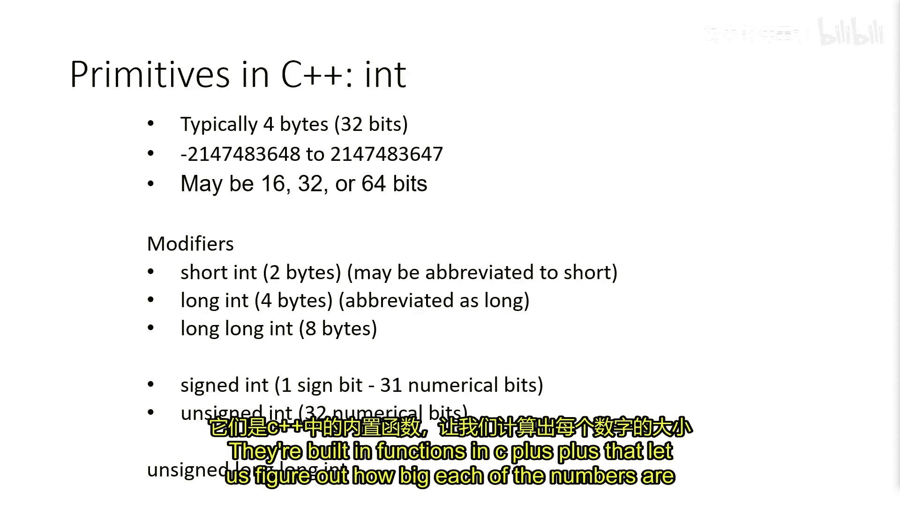
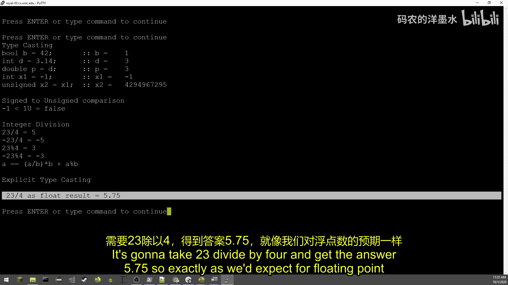
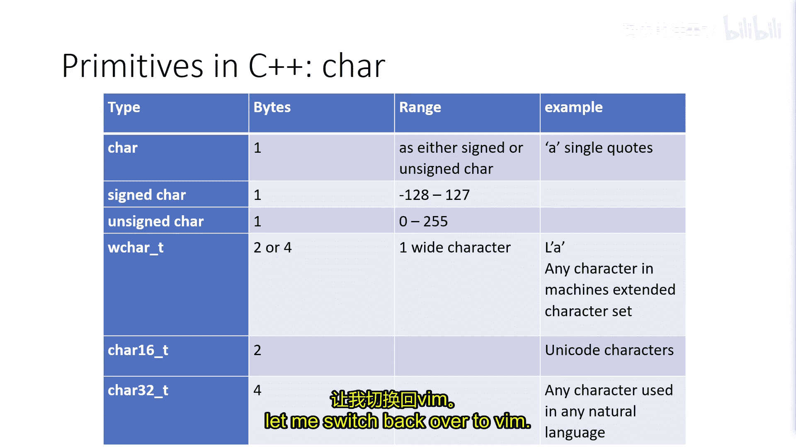
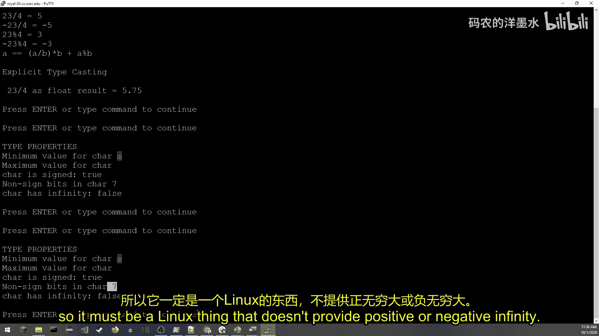
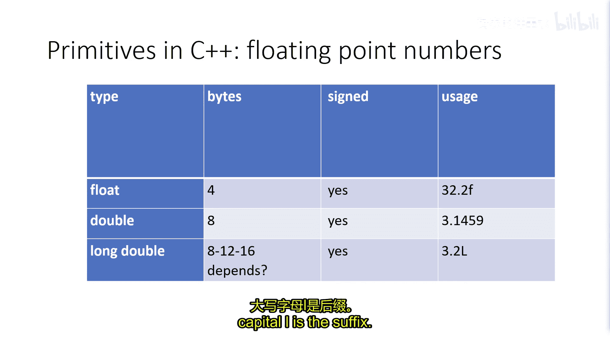
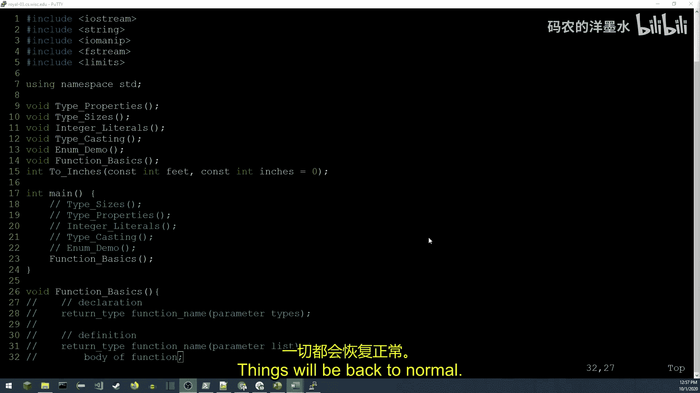

# 【全集】威斯康星大学 聚焦系统级编程 面向Java程序员的C++ CS368C 中英字幕 1080P p04 Lecture 4 -  基本类型、枚举、开关语句、函数基础 -BV1o72QBREfu_p4-

Hello everyone。 Welcome back to C plus plus for Java programmers。 This is the week four lecture。

 as we get started， if you guys could go to canvasva and download the template and the code for today if you'll have that available。

 well I go through the rest of the announcements first。

 I want to just say thank you to everybody for all the messages when I was。

Oh basically out of commission last week I really appreciate it。 me start with Mike's health。

 That's probably the most interesting one。 So we could go Sunday。

 I was driving back from a wedding and started experiencing chest pain As I approached Dubuque I kept thinking if this gets worse I'm gonna stop if it gets worse。

 I'm going stop After I got through Dubuque， I started thinking I wish I'd stopped I wish I'd stopped and then。

When it got worse， I called 9，1，1。 They helped me get to Platville。

 and I spent Sunday night in the hospital in Platteville。 I made it all the way to the hospital。

 And then when I walked into the lobby， as they were as the security nurse was taking my temperature。

 I collapsed。I woke up in a wheelchair as they were trying to put me into the emergency room hospital bed。

My heart had slowed down to about 40 beats per minute。

 which was what not enough to keep me enough blood going to my brain to keep me conscious。

so basically， while I was there， they gave me aropine， that got my heart going， saved my life。

It ruled out heart attack。 It was not heart attack。 It was not a blood clot。

 Those are the two most common reasons that men go to have chest pain and go to the emergency room。

 the the really life threatening ones anyway。 and then。COVID they ruled out COVId。

 so I don't have any of those in the morning I was starting to feel better。 they sent me home。

 they said probably not in any danger of dying， low risk。IMe with my primary care physician。

 I've had a lot of tests done， and so far they've been unable to rule out It's not my heart。啊。

Which is， I guess， reassuring， they only test for the really big， bad things。

 The fact that they couldn't find what was wrong is a little worrying。

 but I guess very reassuring at the same time because they've tested for all the things that go horribly wrong。

 I'm supposed to minimize stress in my life。 try and get enough sleep。

 That's the major reason for this delay as I missed last week。

 and I'm still trying to catch up with everything。 So I just want to say thank you。

 I apologize for how long it's taken for me to get to this lecture。 I got to admit。 I prioritized 2。

20 over 368。 So you guys got the short end of the stick here。

 I'm going to try and make sure that it's not an undue burden on you guys as we get caught up。

 I'm not going to like， dump a whole lot of work on you all at once。

 So just rest assured We'll still get through the entire content for the course。

 But it'll spread out。 we' catch up as a little bit each week。 All right。

 So that's kind of where I'm at healthwise。ACouple of other things。

 office hour schedule is still the same。 I'm back doing regular office hours。

 haven't had a lot of visitors because of course was basically on hold， but that should be Zoom。

 homework2， I'm gonna write that immediately after I finish this lecture。 That's almost finished。

 I'm almost ready。 It's just not perfect yet。 I was starting on that before I started having health problems。

 So shouldn't be too much longer。 And if you do run any any questions or problems a weird error message that's really common as you're learning C plus plus go ahead just post a screenshot of that on Piazza。

 or if it's got some of your code that I would rather you not share your code。

 Go ahead just send an email or make your piazza post private。😊，All right， let's get started。

So the plan for the next two lectures is to go over the rest of the topics for the first third of the course。

 the first five weeks。 And what we're missing so far is a discussion of primitives and literals。

 we'll start with primitives today。 This is a great place to include enome and the switch statement。

 which almost always go together not necessarily but frequently I want to introduce basic functions C plus plus allows us to put functions in global scope with Java everything is required to be associated with class。

 So we'll see how this works here。 very similar to what Java does。

 And then a raises in pointer will wrap up the first five weeks。

 Now primitives go I'm sorry arrays are very closely tied to what we do with primitives and we'll see they're also very closely tied with pointers So right after I get done with basic functions。

 I'm going to go edit the video and see how long it is。

 depends on how long I rable on about some of these things。

 and then we'll either include arrays with we'll start today。

 or maybe we'll push that to the next lecture。 I'm not sure。😊，Po？All right。

 so let's dive in with some primitives。Al right in Java， we have exactly 1，2，3，4，5，6，7。

8 types of primitives。 and that's all you get。 These are not considered to be objects。

 nor are they N C plus plus so we don't get a lot of the cool object oriented programming features with these。

 These are just the basics close to the hardware which means that they'll go pretty fast when we do things。

All right， a couple of things to note in Java。All of these get a default value。

 And when we flip over to the next slide， we'll see that the default value column is blank。

So they're basically all initialized to0 or null in C++ that is not going to be true。 In fact。

 I demonstrated last time that when we declare a variable in C++ we declare an in， for example。

 it's going to reserve some space in memory for us to whatever we want our number。However。

 it's not going to initialize to 0。 we're going to get whatever garbage was in that memory location from the last time we used it。

Alright， the other thing to note is that the size of all of these primitives in Java。

 These are actual real numbers， very well defined。 And integer is going to be 4 B。

 We're going to get something from about negative 2 billion up to positive 2 billion。 Here it is in。

Base 2。Representation， yeah， so let's start taking a look at the primitives in C plus plus。All right。

 here we go。We have lots of different types。 This slide is probably too small for you guys to read。

 You can download the P Df for the slides and make this bigger。 A couple things to note here。

 we've got lots more types。 I didn't even have a default value column。 I took that out。

 there aren't any。 We see that this is now up here。 This says typical size There's not an absolute。

 And in fact， most of these are listed as greater than or equal to something else。

 They're just guaranteed to be some minimum size， which frequently is based on some other minimum size for a different variable type。

Am。Couple of other things I want to just point out while I'm on this slide are we don't have the byte。

 So up here in Java， we had a single byte primitive。 We don't have that N C plus plus。

 And frequently， if programmers want to use a byte， they'll use a character。

 So all of the different character types are just numbers on the inside。 and we can use them as。

Integers。Alright， this table is really too tiny。 I want ahead and make some other slides so we can talk about these things in a little more detail。

 I know it's not the colorful table， but this will get the job done a little better。

 I think Allright， so I'm going to start out and talk about the integer data types。

 if we declare an int and you guys have been doing this for the first three weeks of the class without I mean。

 it works the same way as in Java typicallyp these are going to be 4 bytes。

 but we may it's gonna to be system dependent。 We may see that it's either 1632 or 64 bytes。

 I think all the machines I've over used have used 32 B integer types。

 So that gives us about negative 2 billion up to positive 2 billion。

TheC++ also includes a number of modifiers that we can add to describe how many bytes we want to use for our integers。

 and again， these are not guaranteed。 So for example， we can use the modifier short。

 and that's going to give us at least two bytes and we can also abbreviate this。

 We don't need to say short int and then you know width or whatever we're naming the variable we can just use the shortcut short。

Same deal with long。 So in Java， short and long are going to be their own data types。

 They don't require the word int。 They're going to be separate primitives。 But in C++。

 these are considered modifiers。 So the same deal here with long。

 This is going to guarantee us at least as big as an int。

 and typically on all the machines I've seen long is exactly the same size as int 4 Btes。

When we abbreviate this long， it will give us the integer type theres because these are considered modifiers。

 there's also a long double， but if you just type long， it's going to give you the integer。

 it's not going to shortcut to the long double。 you need to write out the whole long double to get that And finally。

 we have a long， long integer and on all the machines I've used this is going to be8 bytes typically。

 but all it is is guaranteed to be greater than or equal to the long in。 And in fact。

 all five of it wait。Short int， long， long， all four of these could be exactly the same size。

 depending on the hardware you're working with。All right。

 And then the other modifier that we'll find is that we have either signed or unsigned numbers。

man typo time。 All got the typo fixed。 Okay， so we can have either signed or unsigned numbers。

 This is gonna reserve one of the bits as we represent the number to indicate that either it's positive or negative。

 So the default is signed values。 So just a regular int will be will permit negative numbers。

 So what is gonna mean is that the sign bit will go。 if we。

 if we choose to create an unsigned number， we will get all 32 Bs to be reserved for numbers。

 And so we see the range of numbers。's it's the exact same number of digits we have the exact same number of numbers we can represent。

 So they'll go from 0 to 4 billion instead of -2 billion to positive 2 billion。 something like that。

 And we can use， we can combine these modifiers。 In fact， we can have an unsigned， long， long inger。

 This will give us the maximum possible biggest integer we can actually have in C plus plus。😊。

And I'm going to because all of these things are machine dependent。

 they're built in functions in C++ that let us figure out how big each of the numbers are。

 and I'll go demo that in just a second。

Alright， actually， right now seemed like a good time to just jump over and demonstrate how to get the size of all the different data types。

 So the size of all the data types is the function there is called size of That's right here in all of these lines of code。

 It's found in the header limits。 So you only need to include that in order to get any of these。

 It'll tell you an error。 And I believe it even suggests where to go look for it。Again。

 typical C plus plus code we be using namesay standard。 Just think of that as magic。

 I've got my function prototypes here because my functions are defined after I use them。

 And then man the only thing I'm doing is calling the function type sizes。 let's take a look at that。

 It's going to put it out type sizes and then create a very nice list of all the different sizes。

 So size of bo it's just going to call the function size of this takes a type bo here in this case。

 And these are all going to be released in bytes。 And let me just go ahead and run this because the output's easier to read than the code。

😊，So， let quick， we。Compile this， and then we'll run it。All right。

 so here we go we'll see that on this machine， this is a CSL machine we're looking at Royal03 right now。

 and this will probably be different on your home computer。

 particularly if you're using a Mac or Windows machine， may not be the same And in fact。

 when I do this lecture live and students are following along。

 someone raises their hand and said I got a different number for whatever。So what'll find is that。

So the size of bo。 start with that one。 that's either going to be 1 B or1 byte。

 depending on the machine。 I've never actually seen it be1 B。

 but I know that is permitted as a possibility。 So C plus plus is either going to use whenever it does math with a byte and I'm sorry a boolean。

 It's going to either assign the value 0 or1。 and if we do arithmetic because all of these things are just numbers on the inside。

 It doesn't worry about it。 itll automatically switch it over and it will convert it to an int whatever that is with the value。

 either1 or0， anytime we do math。 So it's going to switch it to a4 byte theta type that's either assign the value0 or1。

 and we can do the same thing in reverse， we can use most of these data types as booleions where it's going to say if it's0。

 that's going to be false if it's nonze， then it'll be true。 So they're basically interchangeable。

 on this machine will see that the size of a character is1 byte。 And Javava。

 they're going to be2 in C plus plus we're going to see that almost。

All characters are encoded as ASI it's just a chart that says。

 you know a particular letter is going to be assigned to value of a number because inside inside the computer everything is stored as a number and they'll be using that ASI encoding so like a is the number like lowercase A is the number 97 for example。

And this machine enters4 bys。 The only thing guaranteed is that it's bigger than the short， bigger。

 greater than or equal to。 We'll see that short is used in2 bytes。The long end。

Who it's 8 points on this machine， I believe it's4 on my home computer。

Long line is exactly the same as the long end here at 8 Bs。This one's interesting size T。

 There are a number of questions on piazza。 as you guys started working with strings on the last homework assignment。

 And that's because the size of function for a string。

 string dot length or string dot size returns a data type of size T。

 This is actually an alias for an unsigned long。 So when I give you that warning thing we're trying to compare an int to basically an unsigned long or size T。

嗯。It was giving a warning there because there's some challenges every time you compare signeded numbers to unsigned numbers。

 I believe it converts the unsigned numbers， I'm sorry， the signed numbers into unsigned。

 which can take like a minus3 and turns it into just an extraordinarily large number for the comparison because it turns that sign bit which is a one。

 if it's a negative number， and treats it as a real digit。

 basically the most significant digit in binary。We'll come back in just a second。

 talk about floats and doubles， but there's not really much more I'm going to say than floats reserve4 bytes to represent how many digits。

 Basically it gives us like five or six decimal places。 So 3。14159 and we're done。

 That's all you get。 double gives us approximately well double the number of precision there we get 8 bytes。

 So something between 12 and 15 decimal places。Allright。

 I think that's go ahead do some experiments with this if I missed any of the types。

 remember there was a giant chart with all kinds of things in it。

 you can go pull that up and experiment and see the size of anything else。

And the one place that this is going to be really important if you're using old school style memory management from C。

 we're using Malck to just grab a block of data， a block of memory to do whatever you want with。

 If you want that level of control。 It is still available in C plus plus we teach that stuff in C S 354 machine organization and programming。

 I'm not going to go into it during this course。 You want to learn more。

 I'm happy to talk about it ask questions on piazza。

 I just got done teaching that course over the summer。 It's still fresh in my brain。

 but I'm not going to do that low level programming here。😊，Alright。

 so before I begin talking about the literals as we assign them to integer data types。

 I just wanted to mention a couple things about type properties。

 I believe this is also found in limits。 So you'll need to include limits before you can use these。

Libraries， in fact， right here， it's I see I've got。

With this back so I can highlight it standard numeric limits。

 I don't need the STD because I am using namespace STD。 This is how it would work。

 And I just copied and pasted this code from the Internet。 So it's already there。Alright。

 so here's the idea。 I'm going to be looking at type properties。 And as I read this code。

 I've done one thing to make it easy to switch back and forth between other data types。

 So it's going to print out minimum。Value for， and then whatever type is。

 And I'm using type as the name of a variable， and I'm giving an int。

 So it's just going print out ant right here。 It's just a string。

Then it's going to call standard numeric limits。 And this is going to take a parameter。

 And that parameter is going to be a type。 So this is how C plus bus does generics。

 It lets me switch between one data type and another。 It's called tempemplating。And C plus plus。

 but I have just created a new type， or maybe a better word would be an alias for a type so that I can use int in all five of these statements right there。

 So I'm just reassigning the type int， and I'm calling it T。

So here I'm going to be using T as the int， and it'll print out all of the data for int。

 So let me just show you how this works。 So I'm going to go。Grab my command。

 this will compile it with G+ plus from the command window in Va I can use the exclamation point to execute shell commands。

So the compiler would be a shell command。 So percent just means the current file。

 So let me in later in the course， when I have multiple files open， it'll just。

 I can switch between windows until use the same command and it'll just compile the current。File。

 and then the vertical pipe means execute the next gel command after this one finishes aF finishes successfully。

 When this compiles， it'll create the default file name dot a slash dot a dot out dot slash a dot out。

 And then I'm just calling that function。 I'm creating executable file。 and this will just call it。

 So let me go ahead and push enter show you what happens。So here's the idea。

 It's going to print out the minimum value for a type integer。 This is like negative 2 billion。

 The maximum value for type n is about 2 billion。 Is it signed。 Yes， it is。

 How many non sign bits are available。 Does it have an infinity。Oh yeah。 Okay。

 So this is going to depend on the machine you're working on in Java。

 There are three sort of numbers。 There's a not a number。

 There's a positive infinity and a negative infinity。 C plus plus those are not guaranteed to exist。

 It depends on whether you're on a Windows machine， a Linux machine， a Mac。

 the platform you're working on。 So just you can get that information about the machine you're working with from these type properties。

 All right， I'm going to push enter to continue。 Now， here's what I mean。

 if I go back and use the unsign version。So， I'm just going。

Add the word unsigned right there in two places， so this will change the text that it prints out。

 and this will change the type that we're sending to numeric limits and we'll get data about the minimum for the unsigned version。

So I'm going to go ahead， write this。Then we will just compile and run this again。And now， we have。

The same thing Time off。 Let me see what is wrong。Okay， got it。

 doesn't accept that percent shortcut for the current file name If I'm chaining commands together。

 Alright， so let me just run this with the real file name。

 It's going to create dot slash8 do out and we'll run that。And here we go。

 So when we switch this to unsigned integer。 So this one changed the text， that was my type data。

 and I can see now that the minimum value for something that can't be negative is 0 and we get approximately 4 billion。

 So approximately twice as many integers。 it's because it's using that signed bit for a 4 byte data type to give us more。

 it basically becomes the most significant bit for the most significant digit。

And we get bigger range of numbers。Again， it's not signed， so since false。

 the number of bits available to store real data 32。

 and again there is no infinity available for this data type。Allright。

 so I'm going to leave it here you guys can try any of those other things and just sort of do it some exploring on your own。

 I'm not going to go through very many of these in a live lecture。

 I would take suggestions from the audience but do it on your own。Allright。

 this seemed like a good time to dive into integer literals a little bit。

 Littles are just numbers like straight up numbers that we are telling C plus plus to use。

 We're hard coding the numbers。 So up here， I've got。

 I just wrote some code to sort of demonstrate some things that totally work。 We are。😊。

Allowed to enter integer litals as just decimal numbers。

 those are the numbers we work with every day based on we're also permitted to enter them as optical numbers。

 Op numbers all begin with the number 0 and Vim is highlighting that for me that this is an optimal number turning that into purple。

 The only place I have ever run into trouble using optimal numbers in the past is September。

So if you're going through putting in the months， January， frequently， the last for two digits。

 you know，0，1， February is 0，2。 You get all the way up to September， which is 0，9。

 And all of a sudden it it treats all these numbers as octal。 So 0。

1 is actually one in decimal and ocal。 Absutely no problem over here is going to convert it to binary and store as an integer。

A binary integer。 They all work great up until you get to September， which is 0，9。

 Otal uses the digits 0 through 8。 There is no 9 available in octal， and it will crash your code。

 And chances are by the time it's October 1 right now， this will happen 11 months from now。

 So this is an error that's going to pop up way in the future。 when someone enters 0。

9 into your date。 heads up。 I would recommend avoiding ocal numbers for dates as that can be a problem。

😊，And we're also permitted to use hexadeimmal numbers in this course I'm not going to use anything but decimal。

 but in when you get to the low level machine programming in like machinechi programming organization programming。

 some of the other operating system courses， we'll find that we use hexadeimmal for pointer addresses take it back we'll be doing this next week where I talk about pointer addresses I'll show you how to get them and why we would ever care。

All right， and then a couple other things， if you want to declare a particular number to be of type long。

 you can add the suffix L Now C plus+ will take either uppercase or lowercase and it doesn't care。

 it can tell the difference， but check this out。If I use the lowercase L。

 that looks like the number 201 very deceptive for other programmers， never do that。

 Use the capital version so they can tell what's going on。

To make something a specifically an unsigned integer， you can use the suffix capital U。 again。

 lowercase works just fine， too。 But for consistency with the capital L。

 I don't think I've ever seen anyone use the lowercase U。When you declare long， long data types。

 this number here is approximately 1 trillion。 It's bigger than we'll fit in an integer。

 Just wanted to show you guys that this also works。

 It's not going to give me any errors or any warnings。When I declare short。

 I don't need to add any special suffix whatsoever。 just give it a decimal number。 Alright。

 let me just go ahead， write this。 We will compile it。Wops， G plus plus forgot。

 I can't do that lecture0。For。There we go。Plus。I think that does work。 I forgot the yep。

 totally the word， I just forgot the exclamation point。Andm well run this。What do I do wrong there？

Dot slash 8 out out。 That should totally work。 Why did not run。 Oh， it did run。

 I didn't print anything。 Okay， so it it ran。 It didn't give me any compiling errors。

 I didn't actually print anything out。 let me go ahead and print some stuff out。

 That's this section right here。So'll get rid of the comments。

 So I just want to talk a little bit about initialization here。

 There's four different ways that we can initialize primitives。

 The way we've been doing in all of my examples so far。

 just using the assignment operator equals I can give variable a number。

 I can also use the function style initialization where I'm just giving x2 a parameter。

 This also works。 Neither one of these will'll check the size to make sure that the number actually fits。

 So just as a demonstration of that。 I've got x3。 And this is a number greater than 2 billion。

So it should not fit。 And we'll just print that out and see what happens。 So let me write this。

 Im me to change。 We will compile it。And it does give me warnings here。

 so integer constant is too large for its type。However， it doesn't stop me。

 so I can still print this out。 So we'll just go ahead and run this。Oops， exclamation。

And we see that when I printed it out， I'm not getting that gigantic 1。

234 times 10 to the 40th or something。 Instead it is converting this。

 it's using the digit that would have been in the sign bit and it just happens to be a one when I convert this giant number to binary and chop off the most significant digits。

 So in this case this happens to be a negative dope number。

So anytime you are assigning a number that's too big to fit in the data。

 you're just going get something， although it's been truncated and it'll treat this as an unsigned number and so and then convert it to a signed number so you're going to get basically random garbage if it's too big be careful of that That's up to you as the programmer to make sure you don't screw up C++ doesn't check it。

 This is the compiler actually doing the checking and giving you a warning。All right。

 now in order to do size checking， me just。I' comment this next little piece here。

 C++ provides two different options for initialization。

 and these are newer options they've been added well， probably two decades ago。

 but for the first two decades of C++， they weren't really available。Maybe even longer ago than that。

 Maybe I don't remember。 They weren't originally there。 but this is known as list initialization。

 In this case， I'm using the curly braces to put in the value here that I want to go into my data。

 This curly brace that list initialization came about when we started using this to initialize vectors or arrays。

So that's why it's known one has listed to initialization。

 even though an integer can only be one value。That's origin of the name。

 You can also call it curly brace initialization。 But this one will check the size。

 So here I'm just giving it a 0。 We can also use the function call style where I skip putting the equals in。

This works just fine。 I'm going to just go ahead and compile this。I still get those two warnings。

 Let me go ahead and remove this。 So this is a warning from x 3。But no warnings from X 4 and X 5。

 So let me just。Comment that out。Comment data will read it。 We will。Capile again。

 see no errors this time。And then if I do want to assign。A number2 x 6。 This will actually give me。

Rightイトです。Pile and error。 this will crash that the compiler stops me dead in my track。

 and the compiler will not let me do this。 It's going try and take the giant number from the int 128。

 So that's 8 B worth of。Data turned into an int。Sorry。

 I misspoke 16 bytes trying to turn that into an integer。

So I'm just going to go ahead and comment this out。 That one will cause the compiler to crash。

 And then the next topic is losing data when we switch from something that's too big。To too small。

Alright， hold on。2。Failing at using them today。 control V。Down， down， down over delete。 Okay， Go it。

 So what I'm doing here is I'm gonna be taking V6。 I'll print it out。

 But that was this number up here。 This is much too big to fit into an int or short。

I'm declaring a short right here。 V7。 it's got the value for。

 I'm going to overwrite that with the giant number here。

And just demonstrate that C plus plus does not stop me from doing this。 And， in fact。

 I'm losing data。 It's going to keep the least significant bits。

 So it's going to start over here and keep however many will fit。And because these aren't binary and。

We get weird behavior as the sign bit gets overwritten by this。All right， let just write this。

 We will compile。For outt the exclamation。Oh， I forgot to comment that out。在吗。Mangling this today。

 sorry about this guys。Compile。No air is good。Running。There we go。

 So here's the B6 was this giant number。And when it gets converted to a short。

 there's not enough space in the short to store all this。

 So we keep the last couple of digits in binary。 we can see that it's truncated it。

 We're not getting 0，12，3。 We're getting11227 as we lose data。

 So be really careful about converting different data types when you're going downgrading。

 There's no problem upgrading from a short to anything that's big enough to hold it。

 There are no problems there。 It just copies over and will extend the s bit So that negative numbers will stay negative。

 positive numbers will stay positive there're no trouble with that。All right。

 I just put together another function to talk about type casting。 For the most part。

 typecasting and C plus plus will happen automatically。

 don't need to explicitly say that I need to change from one type of data to another type of data or from one size of integer to another size of integer。

 It just happens automatically。 So here's my example。 focus on these five lines right here First。

 the rest of this stuff is just。Printing things out， formatting it。

 So it looks really good on the screen。 But here's the idea。

 I'm going to create a boolean and assign it a number that's not 0 or 1。 That's not true or false。

 I'm going to give it a number。 We'll see what happens when we print it out。

The next thing I'm going to do here is I'm going to take a floating point number 3。

14 and assign it to an integer。 So floating point number assigned to an integer give you hint it's going to turn it into an inteverger automatically。

Then I'm just switch it back。 I'm going to take that same integer and assign it to a double。

 And what we'll see is that it doesn't retain any of the extra information It's just lost right here when we do that conversion。

Then I'm going to talk about unsigned to signed conversions。

 So if we take a signed number like negative1 right here。

 stored in x1 and we assign that to an unsigned number， this is going to happen automatically。

 but this is the one that gives us some really weird behavior。 So let me go ahead。

And put the focus back on the vim instead of recording software。 And we'll just。

 I already compiled this。Allright， so when I run this。

 I can see here that if I assign a value that's not 01 to booleing value。

 nonze numbers are going to be treated as true and the balloon will store that as the number one0 as treated as false and will still be stored as 0。

Here we got the inter。When I take a float and cast it to an integer。

 we lose all of the extra information about the decimal。 the 0。14。

 When we switch it back to a double， that information is lost。

 We still see that p is now just going to be 3， even though P is a double and we originally gave the integer D3。

14。 that information was lost Here I'm just creating variable x1 that's negative。

 so that I have something， a negative number to turn into an unsigned number。

 So x2 here actually changes into the largest possible number available to an unsigned。

 because it takes that s bit， which is a1， and converts it into the most significant binary digit。

 So again， anytime we're looking at negative numbers being converted to unsigned numbers。

 we see weird behavior。Positive versions work just fine。Al right。

 now I'm going to activate the next part of this code。Take those out。Those out。

 So this is just that signed to unsigned comparison。

 So here I'm just going to be comparing -1 is less than1 U that U is going to turn this into an unsigned number。

 And what we'll see when we do comparison is that the signed numbers are automatically con to unsigned numbers。

 No warning from the compiler。 And then B alpha just means that this will print out true or false。

 And then I'm going to print out the result of this operation。 should be true or false。

 because it's a relational operator。 So I'm going to write this。You compileile it， no problems。

And then， we'll run it。Alright， here we go。 So let's added signed to unsigned comparison section。

 We see the negative one is less than one。 when it's unsigned， that should be true。

 Ne1 is less than one。 But when we do this comparison。

 it converts the -1 to this super large number right here。 That number is not less than one。

 So we get false。All right。Let me activate the next section here。So this。

 I'm going to focus on integer division here。 I've got all of the commands。Here。

 they're just going to print out what I'm doing。 And then I do the same thing。

 So let me go ahead and。We'll just look at this in the output mode。

 You guys can come back and stare at the。Code on your own， or push pause。Once see here。

 I need to compile。No problems and run。 Okay， so let's added this integer division section down here at the bottom。

 So when I do 23 divided by 4， if they're both integer numbers。

 C plus plus is going to default to integer division。

 It's not going to automatically convert to floating point numbers。

 So 23 divided by 4 is going to be 5 remainder 3。 So here we see that we get 5。

 When we do the modulus， the remainder here is going to be 3。That works great。

The problem we run into is thatte integer division with negative numbers will either round towards 0 or away from 0。

 and it depends on the hardware。 It's paired with what happens with the remainder。

So in this case on the CSL machine， we see that-23 divided by 4 actually gives us the negative5。

 so it is rounding towards0。 that is the default version that Java uses。

 but it depends on the hardware。 C++ is going to let the hardware take care of this because using hardware is faster than forcing it to be a particular result using software。

The only caveat here is that the integer division， that one。

Is paired with the modulus so that this must be true。So if I take in this case。23 divided by4。

 this is going to give me five。If I multiply that by 4， I should get 20。 when I add in the remainder。

 which was 3， it needs to get the negative 23 back。

 So I can't round towards 0 and then have the modulus not match up those who are paired and hardware is designed that way also。

All right， let me push enter。Go back。 I've got one more little topic here under typecasting。

And so for all my examples have been with integers， we'll see that this works for many other things。

 we can treat characters as numbers and frequently programmers will do that if they have like very small numbers or very limited memory。

 they'll use character and then just use do all the math they need to with a character type because it's only one byte。

Alright， But here explicit type casting。 the way this works， I'm going to just grab an integer。

 and I'm going to turn that integer into an unsigned number。 we've got three ways to do that。

 I've got all three demonstrated right here。 This is the like original old school version first。

 where you take the type that you're casting to and put it in parentheses。

 followed by whatever it is I'm doing。😊，The variable that I want to change。

 this is the function call style where I'm treating unsigned as like the name of a function when in fact。

 it's the name of a primitive and giving this as an argument to that。

 this is the preferred way to do things。So most programmers will recognize this and read it more quickly than reading this version。

 It just makes more sense to people If you're doing this in the middle of a code。

 if you want to be able to find all of the conversions very quickly because this does look like I'm creating a variable like initializing something creating wait what' word declaring a variable if I'm type casting frequently programmers will use this much longer version static cast and also this version is only allowed to be one word so we must use the shortcut so if you're casting something to like a long。

 long you will need the static cast so that we can have more than one word inside the type specification here this is a templated function that I need to put the type inside the angle brackets name is static cast it's easy to search for in your code and the static means that it's going to happen at compile time So the compiler will take care of all of the type conversions for us and the code is's going。

un quickly， there is another version of dynamic casting。

 and we will talk about that when we discuss polymorphism and inheritance。

Coming up during the last five weeks of the semester。

 that's going to let us choose which kind of data we want while the program is actually running。

 So the compiler doesn't know yet at runtime， it'll let us switch and do the casting that way much slower。

 but sometimes you need that。All right， just thought of one more thing before I move away from typecasting。

 and that's if I want to treat。Something。 So this would be。There we go。

 Get the focus right integer division。 If I want to do this as a floating point division。

 I just need to convert one of these numbers to a float。

 and it can be the numerator or the denominator。 In this case， my example here。

 I'm converting the 23 to a float。 So it's going to turn into 23。0。

 And as soon as either operaand to the division is a floating point number。

 it's going to use floating point division。 So let me just run this and demonstrate that this totally works。

 even if we're using literals。 If we use variables， it doesn't matter。 So colon。Get out out。

 There we go。 So right here， this is the new result。

 It's going to take 23 divided by 4 and get the answer of 5。75。

 So exactly as we'd expect for floating point division。

All right， moving on to the character data type， we'll see that by default。

 the character data type is one byte。 This is an absolute one， not a one or a greater。

Depending on the compiler， this can be either signed or unsigned。

 And we'll just use single quotes to indicate a care。 I'm not going to go demo that。

 We also have the signed version and unsigned version。 And like I said earlier frequently。

 if you're working on a machine with very limited memory like an embedded processor or on an engine or something。

You may want to use math that preserves a lot of memory。

 and so programmers will choose signed characters or unsigned characters。

To do math with numbers of these very limited sizes。C++ also provides wide characters。

 typically two or four bytes， and the idea is that we can either represent unicode numbers or if you have four bytes any character。

In any written language in the world， so basically。TheThe default。

 the way that C plus plus language specification says the goal is to be able to represent any character in the extended character side of the machine。

And to get a wide character。We need to use the prefix capital L here to indicate that。

 and then the character is again just in quotes。I've run into this a number of places in my career as a programmer where we're trying to make the software universal。

 worldwide available in any language。 so this is not that uncommon during this course。

 I'm only going to be using ASCI characters， so we'll never see this again。And then。

CB Post also provides Care 16 T and care 32T， and these again are absolute designed to represent Uniiccode characters。

 which is the default in Java so two bytes and four bytes for any character used in any natural language。

All right， a real quick demo of just one thing。Let me switch back over to。

Vm， what I've done here is I've gone and modified my type properties and just used we're gonna to be using care as the what we're printing out all of this stuff。

 So let me go ahead and just write this。Compile this， good it compiled in。Running right here we go。

 When we're looking at minimum value for care and maximum value， the type properties function。

 the numeric limits doesn't have care， maximum minimum values disorder in it。

But we can see from here that it is signed and that depends on the architecture。

 so we're getting the minus 128 through positive 127 as the potential values。

 and we see that we only get seven bits。For the character so and there's no infinity again。

So it must be a Linux thing that doesn't provide positive or negative infinity。

Alright， next up， floating point numbers。 I want to do very little here。

 other than mention that the size of floating point numbers typically 4 bys， typically 8 bys。

 The long double is also available。Typically 8，12 or 16 bytes。 This gives us more precision。

 The more bys we use。 They are all signed。 There's not an unsigned version to get a floating point number。

 We can write 32 with the lowercase F as the suffix to force this to be a floating point as we do。

 you know， when we use it as a literal。 The double doesn't require any sort of suffix。

 And to something be a long double and use that extra memory。 capital L is the suffix。 All right。

 it's all I need here。

Al right， I want to move on now and start talking about the enum data type。

 So here I've got an enum demo。 I'll put that in main， commented out everything else。

 So this is all we're getting。Basically， an enum is a little different from Java and C plus plus it's going to be just creating an integer data type that has named constants。

 Okay， so in this case， I've got creating an enum。 I'm naming this new data type color。

 and I'm giving it these very specific values。 these are the only values that anything of theta type color is going to be allowed to take on。

 and this is exactly the same thing。 this is going to be assigned to value 0， the one， this is a2。

 So they're just going to be in order red will be 0 orange 1， yellow2， whatever as I keep going 3，4。

5。 and essentially on the inside， this is what it's doing。

 It's creating a constant int red is equal to0。 Now I'm using capital letters here。

 that's a convention that's commonly followed by programmers。 you can use any variable name you want。

 But named constants are frequently capitalized。 If I run it like this。

 I will see that this actually creating a name constant red and this will be。

Violation because I'm red dececlaring red。 let me just go ahead and do that， write this。

 we will compile it。We compileil it and see that we get a whole bunch of errors Con red redelared as a different kind of entity。

 So I've already got a red。Right here。 So in order to make this work， I need to。

Comment those back out。Okay， so the next thing I'm doing， how do I use this。

I'm creating a variable of this brand new data type color。 I'm going to name the variable my color。

 So this is just like creating an int X。 instead， I'm creating a color， my color。

And I'm giving it the value red。 Okay， I'm only allowed to give it values from this list of things。

 So and I can use number 0，1 or2， or I can just use the name constant。 That's the whole point。

 We're naming the constant。 So I don't have to remember what number I assign to the color red or whatever it is I'm doing。

And if I just print this out， I can see that on the inside。

 my color is actually just stored as the number0 in this case。 So write this。Compil it， no problems。

Run it。 And here I can see my color equals red。Alright。

 I mentioned before that we're not allowed to use rat anymore as a variable。

 It's already been declared。 Can't use orange either。 I cannot use it in another enum either。

 Even if I'm using it as the same number。 So if this were0， this were one， this were two。

 if I had orange equal to。Equal to one。 I can't do this。

 It's going to say redeclaration of orange as a different data type。 This will fail。So， write this。

Prepare for a giant compiler error， again， orange conflicts， I've already declared it。Oh， and this。

Let me let me hold on。 let me get another example ready。 Allright， So as I create an emum data type。

 I am allowed to assign at whatever numerical constant I want。 So in this case。

 I'm creating transportation。 and I've got several different kinds of transportation here。

 So the default value is gonna be 0，12。 But here I'm replacing the plane would normally be 1。

 I'm going give it the value 13 instead。 and it doesn't have to be an order。

 any kind of number of work， I can say boat is equal to 3。

 and then bike will just increment from there。 So it'll be four。

 And if I have like another dozen things。 I'm totally allowed to reuse the number 13 for another named constant。

 Again， it's just doing this up here。But when I create the variables。

 they must take on one of these values。So here in continuing that， I'm just creating。

T 1 is equal to car。 T 2 is playing。 They're just these things。

 And this is just me demonstrating that I get these numbers， as I just said，0，13，3。

 And this should be a 4。 So let'm me go ahead and run this。There we go。 here's my testing of it。

 It worked， and I see that I get 0， 13，3， and that's just increments to4。

One other detail using enM data types， I'm actually not allowed to use the numbers。

 I'm only allowed to use these words as the assignment for transportation I can compare to integers when I print them out their integers。

 so it's a little deceptive but when I'm creating a new data type transportation T5 if I just try and assign it to car I can't use the zero if I try and assign a number that's not an option。

 both of these will give me errors， let me go ahead and。Write this and compile。think get right here。

 and I see that I get errors。 So the error invalid conversion from int。

 which is my0 here to this type transportation， not allowed。 I need to use the actual words。

 So only things from that list are permitted。All right。

 I just want to introduce the switch expression right here。

Normally't I would have put this when I talked about the for loop I loop if statements。

 but it really goes very well with enum。 So I delayed until I talked about primitives。

 introduced enum。And this is where I almost always use Eum data types。Alright。

 so the basic syntax for a switch statement begins with the keyword switch followed by an expression and an expression in C plus+ is going to be。

 for this case， anything that evaluates to an integer。We could use a variable。

 we could use one of these enum variables like car for example so and then we'll have a number of different cases。

 The switch expression is going to examine the first case。

 This constant expression here is just going to be another expression that's something that evaluates to an integer and it needs to be constant and all that means is that the compiler needs to know when it compiles what number to use。

 It can't have variables that accept user input or that it can't figure out。

When it compiles the code， it needs to replace this with a number。Alright and then for each case。

 we'll have a number of statements。 When I write these， I always put them in brackets。

 Those are not required and then followed by an optional break。

 The brake will get out of the switch statement and just continue on after the closing bracket of the switch now paired with that one。

If we use brake， it jumps down。If we look at this。Example here， let me take out。This break。

Let' leave that out。If this constant expression happens to be equal to the switch case。

 the switch expression， then it'll choose this option。 It'll do these statements。

 And then it's going to fall through and continue with these statements Also。

 It's just going to keep running until it hits the break。All right， and then finally。

 if none of these are true， there's an optional default， which it's going to take this path。

And I'll execute these statements。There's not a break required because this is the one that needs to come last。

All right， I'm going to just。Faaiil to type the right thing。You go。Comment this out。

 This is my how to use switch， the syntax。 And I've got an example here。 So with my。

There we go with my transportation example， all of these things need to evaluate to an inger。

 So all I'm going to do is put them in a loop。 I was going to go from 0 to 14。

 Some of those will not be valid numbers。 So here's my choices0。1。Wait， wait。

 I'm looking the wrong line there，0，13，3 and 4 are the ones that I'll give me things。

 I've got default here that I'll catch all of the rest of them。 I'm just using a for loop。

 We're gonna to try a bunch of numbers and print some stuff out。

 My switch here is gonna be based on that。 I。 Now I could stick the word car in here。

 I could be an enno variable that evaluates to a constant like transportationation T2 is equal to plane。

 I could use T 2 here。In the case of the car， just prints out you have selected car with a brake in case of plane。

 you have selected plane， no brake， so it's also going to print out no break after plane。

 you' have selected plane or boat， so I'll be getting three lines of text if I choose plane。

And quick reminder， plane was 13。 so that'll be near the bottom of this list。In fact。

 it's going to stop before it should be the very bottom most one。 If I select boat。

 it's going to remind me that there's no B after plane， and I have either selected plane or boat。

And finally， if I choose some of the other numbers that don't have values here， for example。

 bike at T 4， that it can be number 4 or any of the numbers that are not listed here。

 Like we have 0 1 and 2 are not available。5，6，7 up to 12 are not available。

 So we should get a lot of you have not selected car planer boat。 let me just。Oh。

 and I don't think I mentioned that enome is short for enumeration。

 and that's because I'm assigning numerical values to all these things。

That popped in my head while I was eating launched a moment ago and remembered， oh。

 I need to say that。 Alright， we'll write this。 We will。Compile it。And then me a clear screen。

And then we'll run it。 All right here we go。 So as we go through the list。

 this is what was printed before。 its just a great reminder of what numbers are things。

 And when I is equal to 0， it's going to say you have selected car。

Two and three are not valid choices。When I get to three， that's going to be the boat selection。

 It's going to remind me that there was no break after plane， so I could have selected plane or boat。

 either one of them。 and then 4 through 12 are not valid choices。

 So it's going to go to the default version。And then finally， when I select 13 for the plane。

That's the one that didn't have the break。 So I knows absolutely that I selected 13 for the plane。

 but then it also knows there's no break after the plane。

 So I could have selected boat because it's going to fall through and do that next case。Al right。

 I think I'm going to wrap up here for today with just one last topic about functions。

 I want you guys to be able to start writing global functions for your homework。

 It makes things a lot easier to cap and encapsulate the pieces of code you want to reuse。

 So I feel like I need to go over the basics。And then we'll talk more about functions next time as we begin different parameter passing modes。

Allright， but for the basics， here I have two pieces in my function basics。

 I'm going to comment these out in a second， but these are sort of the basic syntax that it's required for a function。

 So C plus plus needs to find the function declaration。Before it is ever used。

And it really only needs to know a couple things， it needs to know the return type of the function so it can decide its getting if it needs to do any casting or to assign it to the whatever variable type we returning。

 it needs to know the name of the function。And then it needs to know the types of the parameters。

 And optionally here， we can name those parameters in the function declaration。 Now。

 when I've been writing all of my code， I have my function declarations up at the top。

 as is pretty standard way to organize your code， because then C plus plus knows all of the function declarations。

 It knows the return type， the parameter list and the names。 That's all it needs to compile the code。

 It doesn't need the definitions until later。And then here I'm calling the functions， whoops。

 I renamed this。Function basics。 Okay， so this declaration is begun needs to be found before I ever call the function。

 Then the definition is where I have all the statements。

 There's absolutely no reason I can't use the function definition up here instead of a declaration。

 I can substitute the。The version that has the statements， if I wish。

 and then leave out the declaration。Totally possible note that all of these functions are in the global scope。

 which means they're accessible from anywhere。I'm not required to put functions inside a class like I am in Java。

 apologize my phone's going a little crazy there， I don't know if the microphone picked that up or not。

All right， so。When I have the definition of the function。

 this is going to be the one with all the statements that tells us the function what to do when it's called。

 still need the return type， still need the name of the function。

 And now the parameter list needs to include the names of all of the variables that well be using in the body of the function。

 that are going to be passed in as arguments from outside。 misspoke。

 We don't actually need to use them here。 But we need to pass them in。

 The body of the function is going to be the list of statements。

 And then we'll either just have a return without a return type。

 or we will return something that has the same type as listed right here as the return type。

All right， so as an example。And go ahead， I'm going to comment this out。Not like that， though。

 like this。Ctrol V to give me block mode。好难好难很 true。Sscape to get to command mode。

 t V to get to block mode。 Sc down with J， shift I and to get to insert and two slashes。There we go。

 Okay， so those aren't valid code。 that's just me needing somewhere so I can talk about it。Al right。

 so now I've got a function that I'm going to be using as my example， two inches。

 it's going to take someone's height and feet and inches and just turn it into inches。

So here's my data I'm going to be using when I pass it in。

 I'm six feet tall and about a half inch will' round up to six feet1 inches。

That will let me use integers。 And then it's just gonna convert the。

 Som I'm reusing the variable inches here。 starts out at1，6 feet 1 inches。

 So 6 times 12 is 72 plus one more。 should be 73。I'm just going to reuse this variable and override it。

 And then it's going to print out Mike， you R should be 73 inches tall unless I've screwed up。

Alright， so here's my function。 I need to know that I'm going to be using this2 inches function before I ever get to this line of code。

So as it goes through the compiler needs to find it and the compiler it really goes through four stages when we do the compilation first thing it does is it goes up and takes all these include statements and copies them in Also in that pass。

 it's going to do all of the pre preprocesor directives。

 we'll talk more about those as time goes on when I come up with a good example but we can use variables and give the compiler commands to control how it's going to compile things。

It also is going to remove all of the comments at that time and just leave the code。

The next phase is actually it's going to make one pass through and convert all of this code to assembly。

 Next pass will turn that into the machine code， but all of this is just a one pass kind of system。

 So C plus plus needs to know ahead of time about all the functions that I will be using。

 It's just like declaring a variable before we use it。Alright。

 so let's take into a little deeper look here。 I've included the optional names of variables。

 I do this all the time because as a reminder to me， I think it's good practice。

 but they are not required。 In fact， I can delete these。And this will be perfectly valid syntax。

 This is the minimum that C plus plus needs to know。

 I'll go back and put those in before I send this to you guys。If I remember。And then down below this。

 I have my function definition。 This is the one with the curly braces that have all the statements。

 Now， I picked converting feet and inches to inches because it's pretty simple。

 There's not a lot going on here。But I wanted to do this to demonstrate a couple of other concepts。

 The return type for this function is int。 So I need a return statement。 If I leave this off。

 C plus plus will complain。The formula for converting feet inches is just 12 inches per foot。

 so times the number of feet plus inches。 but I've got my parameter list here needs to have the number of all the parameters I'm going to be going to be using。

 Now I'm not changing anything。So this is a good idea to put construct right there to indicate that I'm not changing。

If these are cons variables up the top in my declaration， I will also need to include the con。

And a quick reminder， I don't actually， I don't think I've said it yet。

 Any you can stick the word costs will make your code go faster。Anywhere you can put it in。

 C++ can choose better options when it compiles if it knows it's not a variable that will change and it will go faster。

All right。Let see here。 then。 So I've got my feet inches。

 I also have a default parameter specified here。 So if you're familiar with Java。

 this should not be new。 beginning on the rightmost parameter， I can declare。

This as a default parameter。 And then I can work my way to the right。

 I can't have a variable without a default parameter after one that does have a default parameter。

 C plus plus will complain。 But what this is going to let me do。

 It's a form of polymorphism where I can have more than one way to call the function。

 I can either call it with feet and inches， or I can call it with just feet。

I'll demo that in a second， but let me go ahead and just make sure this compiles and runs。

So we'll save it。 I made some changes。So that way， we'll compile it and problems and then we'll run this。

Wlipops missed。All right， so yep， tells me Mike， you are 73 inches tall。Perfect。

 that's exactly what I wanted。 All right， So next up， I'm going to add one more little detail。

 I'm going to take out these inches right here and just pass in feet。

 So now when this function is called， it should choose to use the default value of 0。

And tell me I'm only 72 inches tall。We run there right this。Compile it。I have a table here。 Time on。

 What I do wrong。All right， figured it out。 But this is valuable。 So remember。

 I told you that C plus plus needs to know all of the parameters before I get there。 So up here。

 I had my2 inches。 It looked just like this。 C plus plus at this point knew that I needed to be giving it two parameters。

 So when I got down here and called it like this with only one。I got the error message。

 too few parameters。 So up here where I declare it。

 it needs to know that there is a default value of 0 inches for this。 And while I'm right here。

 I'm going to go ahead and pull my variable names back in。I have a strong preference for。

Having these available in my function declarations， they are optional， I don't need them。

But I strongly prefer that。 Okay， and this only needs to be in one place。 So down here in my2 inches。

 I took out the equals 0 from the definition， so。系い。Mike。

 you need to remember that it goes in the declaration， not the definition。

 I'm probably gonna screw that up again， but it'll be educational。 So， all right。

 let me make sure this works now。 write this。We will compile it。And。Click screen and。We run it。

Allright， so now it's working。 It chose to use the default value of zero inches instead of the inches down here from one。

All right， quick note on scope。As I declare variables。

 these variables are only available inside the function body here to use global variables。

 I need to declare them up here outside of main， outside of any function， but it's totally allowed。

 Global variables are I prefer to minimize my use of global variables。

 It just gets very confusing very quickly to have a lot of variables that are in scope at any given time。

So these variables are not declared as global。 These are going to be parameters。

 So the argument here that's passed in feet is going to be assigned to this variable feet。

 and they could be different variable names， and I'm allowed to reuse the variable names。

 So this fe is only in scope in this block。 This fe is only in scope inside the function。

 It's just taking the value here and copying it into feet。Same do with inches。

 when I had the inches version， it was copying the one， it's not calling it with that。 Instead。

 it's going up here， grabbing this0 as the default value and copying it into the parameter inches inside the function definition。

And then it's just using those values。 the moment I hit this return statement。

 it's going to evaluate this。Copy it somewhere special in memory。 nuke all of these variables。

 They are gone。 The only thing I saved is this one number， and it saved somewhere else。

 And then I return that number so that the function call。😊，Right here is where I called it。

Goes and grabs the number that this function stash somewhere special。 So at this point。

 all of the variables， all the information used to compute it is gone。

 It's just copied back here in inches。 And then I'm printed it up。All right， to this point， guys。

 I feel like I've rambled on for at least an hour。 Let me go edit the video。

 put it together and see how long it is， but I doubt't I'll be coming back to record more about a race。

 We'll just do that in the next lecture Allright。Gosh。

 I think this is probably the best I have felt in the last like two weeks today just feels good。

 And once again， I apologize for how late this stuff is coming out。

 My plan is to get the rest of a homework 2 finished up this afternoon。

 followed by lecture 5 tomorrow morning。 at that point。ll be all caught up。

 Things will be back to normal。 Allright， have a great day。😊。

