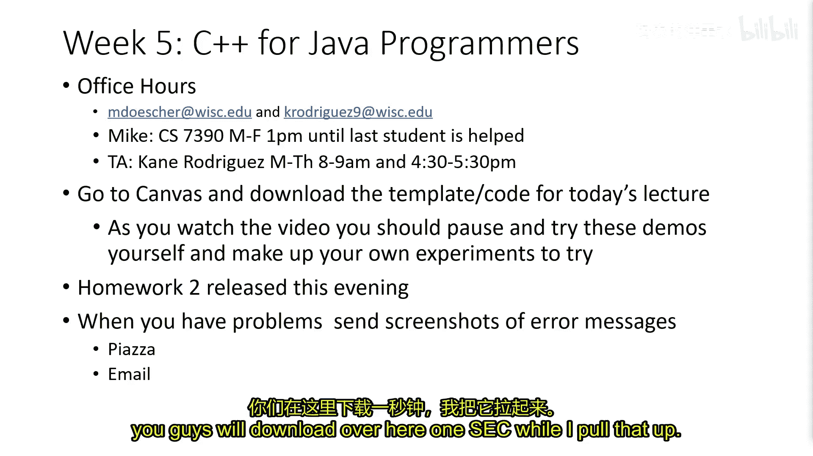
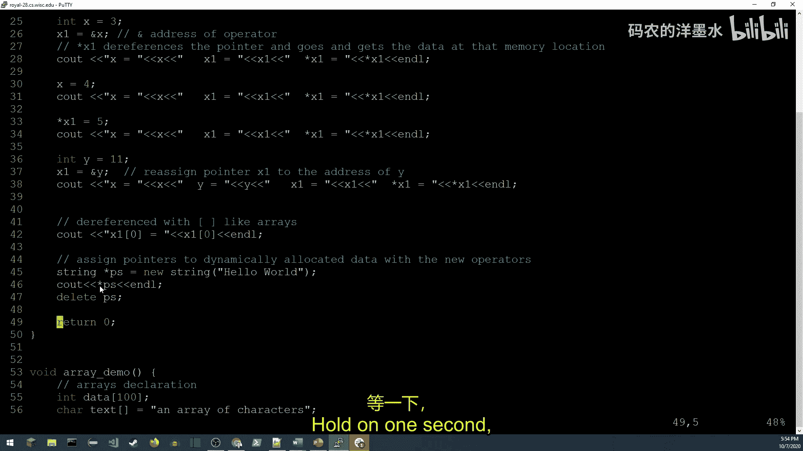
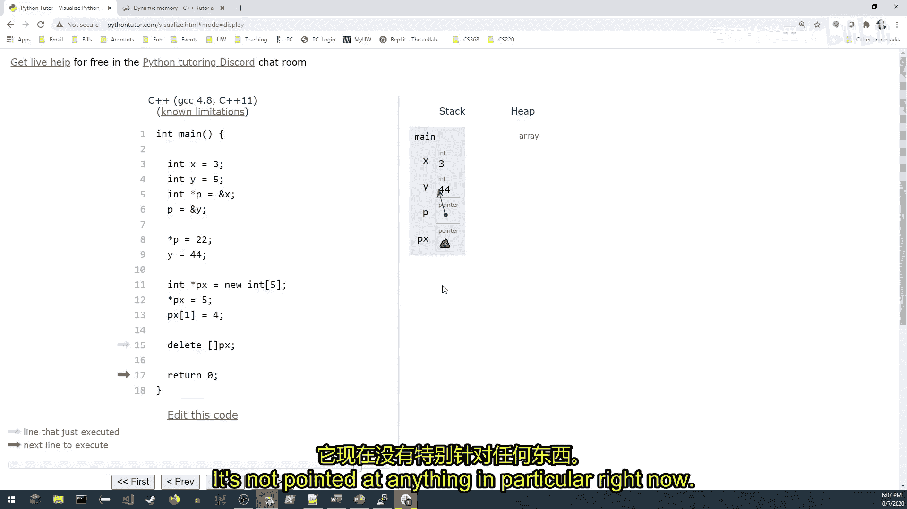
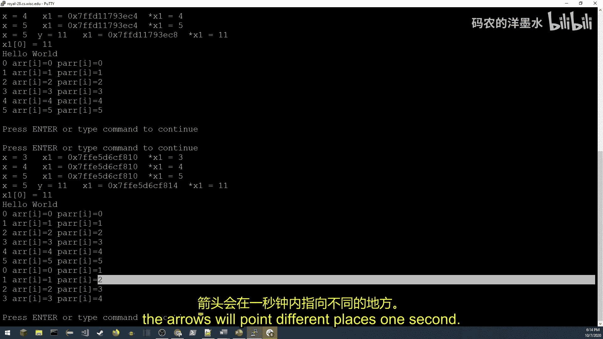
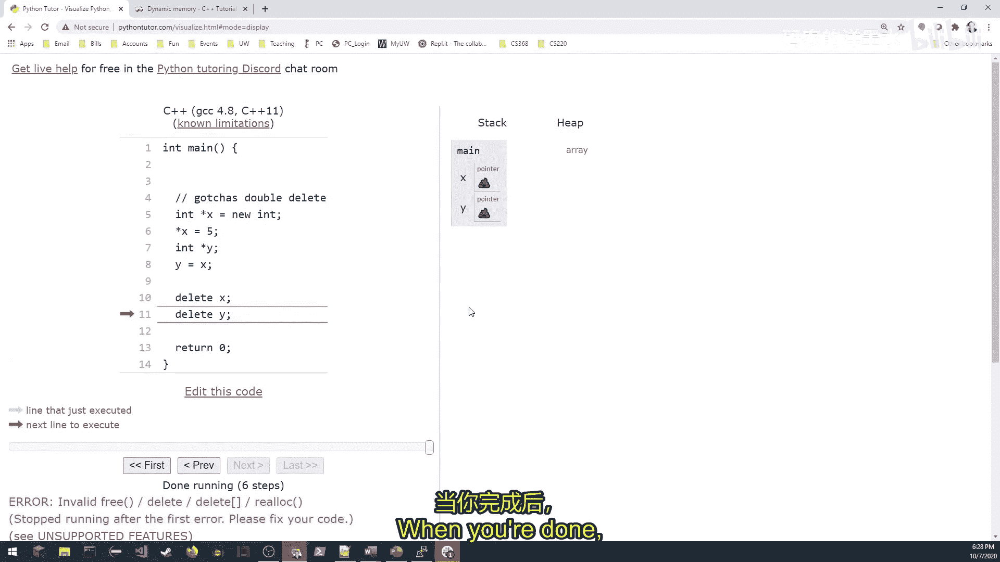
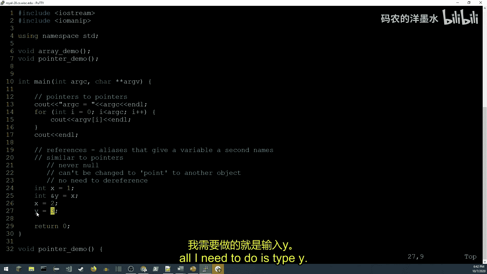
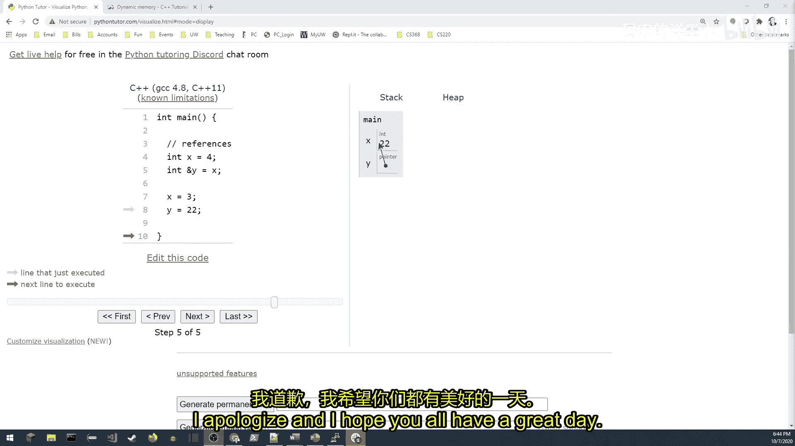

# 【全集】威斯康星大学 聚焦系统级编程 面向Java程序员的C++ CS368C 中英字幕 1080P p05 Lecture 5 - 数组与指针 -BV1o72QBREfu_p5-

Alright， hello everyone。 Welcome to C++ for Java programmers。

 This is lecture 5 couple reminders Got office hours Monday through Friday at1 PM。

 Kane has office hours Monday through Thursday，8 to 9 and 4，30。

 I'm gonna hang out until the last student has helped if theres no one that arrives within about 15 minutes of 1 PM。

 I'm gonna just call close to office hours And if you arrive later， I'll send you an email。

 I've had a couple of students who just put a ticket in the queue at weird times。

 that's a great clue to me that I need to reach out and talk to you guys。 so go ahead and do that。

 even if it's not office hours。 We can set up an appointment。Alright。

 so there's a the code that I'm going to develop today should be on canvas by the time you guys are watching this。

 I would encourage you to just open up a blank document and follow along。

 But if you would prefer to look at the entirety of the code that I'm going develop and just sort of follow along that way。

 You're welcome to programming is one of those things that you really do learn by doing though。

 So I would encourage you guys to just follow along， make up your own experiments and。😊，Yeah。

 just explore。All right， homework 2。 I've been really struggling to get this one finished。

 My doctors want me to reduce stress， get plenty of sleep。

 I am way more stressed by not having this done than I am by not sleeping。

 So I'm just gonna to load up on caffeine。 I am getting this done tonight。

 It will be out there By the time you guys wake up tomorrow morning。

Or I'll probably be back in the hospital point two and then when you have problems or anything。

 go ahead to grab a screenshot of the error message。

 you can either email that to us or you can post on Piazza if there's code there like more than five lines of code go ahead and make that a private post。

Alright， I'm going to go ahead and jump over to CSL machine and start developing the code that you guys will download over here Once I。

 I pulled that up。

All right， so I've jumped over onto a CSL machine， and I have my sort of standard template as I begin to record lectures。

 including ILstreamam today so that I can print stuff out using namesspace standards。

 that magic line that lets me not have to write STD Col Col for all of the C out and end line statements。

Got my main function。 It's just got a test statement。 and I'm returning 0。

 This lets me just compile it and make sure that I haven't made any typos before I begin the lecture。

 Alright， so I'm gonna get started。 today， we're gonna to be talking about as。

 And these are gonna to be the primitive arrays。Or I just so last time I went over the various types of primitives we have end long。

 short unsigned those things care。So as we get started to make an array of those data types。

 I just need the name of the type。 I'm going to use in for my example to get started。

 I need the name of the variable。 I'll call this one data。

 and I need square brackets to tell C plus plus that this is an array。

I also need to know the size of the array when I declare this Now there's a caveat here。

 C99 not C++ did include variable length arrays or VLs if the compiler supports variable length arrays that you're using then you do not need to give it the size at compile time it can take it at runtime so I can get like user input and create an array of that size using this sort of notation if I want to do it in C++ without that there's some tricks and we'll go over that in the future。

But and if anybody out there in the comments knows the answer。

 has this been included in the latest version of C plus plus， I couldn't find it。

 I did some searching。 let me know why。If it's there and where you found it。Okay。

 just another example here。If C plus plus can figure out the length of the array from an initialization like。

This example so we can count the number of characters for us and figure out how many characters to reserve space for。

 It'll fill this in for us。 So it's actually pretty smart。

 It doesn't need me to count the characters and actually put the number in right there。

 You can take care of that。And same with list initialization。 So if I have another。Aray。

 we'll call this one limits。 I can give it the empty brackets。

 and then I can use list initialization10。12， 14， 17， 20， something like that。So， that。

C++ can count these one， two， three，4，5 and knows that it needs to reserve space for five integers。

Al right， so I've just got four notes here about creating primitives arrays。

 First note that the brackets go after the name of the variable， not after the type like in Java。

 So if you're a Java programmer， it's going be easy for you to grab the put those in the wrong spot。

 Allright， second arrays are not objects。 They don't have any associated methods with them。

 Me with them。 It's just data。 really， the only thing we can do is use the brackets to access index into them。

Third， they do not know how big there。 There's no method to get the size。

 It C plus plus does not keep track of this number for us。 So this is an array of 100。

 This is an array of 5。 It's up to us to remember how many elements there are。 And fourth。

 there is absolutely no bounds checking。 It's totally valid to access things that are outside of the array。

Let me go ahead and do some examples of array access。 And I'm just going to print some stuff out。

 So we'll see out。 And in this case， I'm going to just use limits because that's actually been initialized limits of。

 we'll describe grab the first one。一こ？When it's。0。And print that out。

 So this is the part right here where I'm accessing the array to index entry an array。

 I just need the square brackets， and I need the the index。

 Let me go ahead and compile this and run it。So to do that within Vm。

 I just go back to command mode by pushing escape， I push the colon to get the the command menu。

 the exclamation mark， lets me run shell commands and。对。Save it first。

Then exclamation mark G plus plus I named this lecture 5。 So we do that。

 it compiles enter to continue。 Then I can run this exclamation mark for a shell command again。

It's automatically named 8 out out for me。 When I run this， here we go。 limit 0 equals 10。

 That's the only thing I've got a printing right now En to go back。

 I'm going to print out a couple more things。 So I'm going to grab this line。Twice more。

 And let's just print out element。-1， and we'll go ahead and print out element 10。

So I need a minus1 here。Looks like I missed。Go and element10。Right that。CompPil it。No errors。

And run this。 Okay， so we can see that it didn't stop me。 There was no error。

 It let me print out element -1 and element 10， like I said， absolutely no balance checking。Alright。

 list initialization is also one of the very rare circumstances under which C plus plus will default initialize something for us。

 So， for example， Im grab another。We'll do an array of doubles。'll call it cost。

 We'll give it five pieces of data。 But then I'm going to use list initialization to put in a bunch of data。

 So I have 2。31 and 5 point。35。3。84。Got an extra character there。 Alright。

 then I'm just gonna to go and print these out。 So for。Equals0， i less than 5。I plus plus。The cost。

U I equals。Ask a quote。Cost by。H。O， made a mistake there， quick typo fix。Go。And when you run this。

 we can see that。HWe can see that I had one more table。 I didn't write 3。84。 I wrote 3 comma 84。

 I bet I'll fix that in a second， but it did initialize the last value to0。 All right。

 let me go ahead then get that fixed。All right， I just came back in I put the dot there instead of a comma。

 I also use the variable I so it's not printing out cost of I， it's going to print the numbers。

Hopefully I didn't make any mistakes。Run this， compiled just fine。And come on exclamation mononic。

Out。There we go。 So now 2。315。353。8。 It's got my numbers in here。

 and it has initialized the rest of the array members to 0。One more example real quick。

 I'm going to pause a video and type this in。Allright。

 so I've just added an example with some string。 I've got names with this is a primitive array of nine strings。

 I'm giving it the first two Iron Man and Thor。 the rest will be initialized to the empty string。

 those dis regularg quotes， something like，Just like that。I'm going to leave this for now。

 It's going to go through and print out all of the names， and we'll see that they are all in oops。

How do you。All initialized to the empty string。I already compiled it， so well just run this。

And we see， we've got Ironment though and a whole bunch of blank lines here。Let me just go ahead。

And make one real quick adjustment。I'm going insert right here and indexing。 I'm going to take names。

 So the variable has 9 entries in it。 So that's gonna to be indice C 0，1，2，3，4，5，6，7，8。

 There is no index 9。 I'm just gonna ahead and set this one to。

 let me think who's your favorite avenger。 Go with。Captain America。All right。There do we go。

 So now we can see that we've got all the blank lines。 They've all been initialized to0。

 and the last element in the array it is now Captain America。All right。

 last topic on primitive arrays before we move on to pointers。啊。

Is that we cannot copy or assign them directly。 So just here's what I mean by this。

 right up there here， I've got an int array limits。 I'm just going to create a new array。

 int limits 2。 I'm going to give it， let's see，12345，5 elements。

And I'm going to say that's equal to limits。Okay， so here's what I'm trying to do is create a new array。

 make it the same size and。Assigned this stuff right here。Alright。

 so let me just show you what happens on the right that。 I'm going to。Compile。

And it's going to give me an error。 So array must be initialized with brace initial a closed initializer。

 So I can't just give it though an existing array。 I have to use those curly braces and actually assign the values that way。

 So this does not work。There's also no copying。So this is me trying to create a new array。

Use the the copy operator。Allright， I'm going to just comment this out。 That does not work。

 can't do that。 I also can't do this and。Limits 2 because of the right size。 We'll create this。

 This is totally fine。 But then I can't do assignment limits equal。And limitss two equals limits。

 this is also going to fail。So this would be the assignment version write that。

I'll compileile this and we see that so this error message is invalid array assignment。

 I can't do this。All right， and finally， I want to talk a little bit about relational operators with。

Aase， so I'm going to include。Our manipulation。And then I'm just going to print out。 Let's see。

 I've got an array limits to here。 I've got an array limits。 They should be different。

But I should be able to。 almost's just。B alpha， that I'll either print two or false When I do this relational operator does limits to exactly equal limits。

There we go。 here rid that。Right that。Compilile it。 that compiled good， and now。Not out。

 So it's printing all that stuff。 And we see false here。 So relational operators do work with arrays。

 Now， what they're doing is actually comparing the address in memory where those two arrays have reserved space。

 So it's a great way to see if they're actually the identical array or。😊，If not。

 the rest of the relational operators are really kind of meaningless if one array is less than another。

 that just means it's stored at a lower memory address and depending on where the compiler puts things can be completely arbitrary。

All right guys， I just reviewed some of the recording I did。 and I got to tell you。

 I feel like when I try and type and talk at the same time。

 That's what I would do in a live lecture hall。 But here it's just not coming out very smooth for me。

 So I think I'm going just try a little experiment。

 I'm going just do all my typing while the recording is paused and then come back and talk about it It'll probably make the video go by a little faster because it's a video though you guys have the power to pause type in your own do your own experiments。

 and I'm going encourage you to do that programming is just one of those things you learn best by doing。

 So the next thing I'm going do is I'm gonna grab all of the text that I just wrote right here。

 and I'm going move it to a function。 So it's not in main anymore and gets it out of my way。

 I'm done with as that'll leave me with an array function all nicely encapsulated and I'm going go on and do the same thing for pointers。

 I'm just gonna develop pointers in main and then we'll move them into a function as we move into the next topic。

😊，Once second， we are back。Alright， so I just moved that function or all of that code into a function I called it a array demo。

 I've got this at the bottom of the file so that it's going be out of the way and not mess up so it looks good I've cleaned up main。

 all that code's been moved and I need a function prototype up here because I need to declare the variable so the C+ list knows where to go find it。

Before I can。Call call that in the in the main function。

 So good programming practice style is to do this。All right。

 I'm going to go ahead and write some stuff about a quick introduction to pointers here for you guys。

 and I'll be right back to explain what I've done。Allright， so I've got my next example set up。

 I'm going to be talking about pointers here and pointers are they're just variables that hold the address of other variables。

 and then I can dereference the pointers to go get the values in those other variables where the address is。

 to be honest， when I first learned about pointers。

 I really didn't understand that this is I found this to be one of the more difficult topics。

And a lot of students find the same thing。 So what I'm planning to do is just sort of break this down into a lot of little steps that you guys can come back and review hopefully it'll make it easy to take notes。

嗯。That's the goal。 Let me know how I do。 So first， let me start off with declaration。

 So if I'm declaring a variable to be a pointer， all I need to do is add the star。

 The top line here into star x1。 This is my preferred way to do this。

 I like the star to go right next to the variable。😊，But I don't have to。

 I can put a space after the type and a space before the variable。 So the second one is also valid。

 And I do know that a lot of people prefer the star to be next to the int or up next to the type。

 The reason I prefer the first one。Is that using the comma operator。

 I'm allowed to declare more than one variable on the same line。

And if I want both of them to be pointers， the star needs to be， you know。

 they each need their own star。 and it doesn't matter if I'm doing。Space star X from map 26。Star x 7。

 those are now both pointers。 if I leave this out。What I've done here is I've created a pointer to an integer called it x6。

 and I've created an integer x7。 So this star does not distribute over the comma operator。

 I need one each。 And I just， I find this version right here to be confusing。 not just to me。

 but a lot of people do。 It looks like the star goes with the int。

 and that all of these variables that we pointers。 That's not true。

 the star goes with the x6 variable and x 7 here will be。And just a regular integer。 All right。

 before I like。When I pause the video again， I'll make a little comment right here about what's going on。

嗯。All right， so these are just creating pointers。 it's going to go I'll put these on the stack if I'm doing it the way。

 and we'll talk more about the stack and the heap and memory management in a future lecture。

But for now， just know， it's going to just。Put this somewhere in memory。

 and this will be assigned the value， whatever memory was used for before。

 it'll have a value in there。 So basically garbage。

 So it's pointing to basically a random address somewhere in memory。

I'm perfectly able to write to that， C++ is not going to stop me。So frequently。

 what we'll do is we will initialize the variable to null， and we've got three ways to do that here。

These all mean the same thing。 I can assign it to value 0 No is just another macro definedfined term for0 and C+ plus the new version prefers a null pointer to indicate that a little more descriptive。

 but it's essentially the same thing it's going to assign the value 0。

 and the reason we might care to do this is if I want a test to see if a pointer has actually been assigned to a valid memory location I can just use an if statement and give it the pointer and if it's been assigned to a valid memory location。

 it will not be 0。And it'll pass the test true， and I can do whatever I want。 dereference it。

 get the data。 If it has not yet been assigned， if I initialize it to 0， and I always follow this。

 that will evaluate the false。 and I will be able to deal with the situation where I haven't yet initialized the pointer。

Just a quick note， the address0， the memory address 0 is not accessible。

 It's a reserved special location。 So doing this is perfectly safe。 I can't write to that。

 It will give me an error if I tried to a runtime error。Alright。

 so some of the reasons that I may wish to use pointers first， the size of a pointer is always known。

 it's just enough data to hold the memory address depends on how many bits your machine is。

 So 64 B machine needs 64 B memory address。For example。So I know the size。

 it means I can initialize them on the stack， we'll be talking about the stack and the heap in a future lecture when we talk about memory management。

So we're going to see pointers in three places where they're extremely valuable。 The first one is as。

 and I'm going to talk about the array pointer connection in a little bit in this lecture。

 We can also see that。We'll have pointers that point to dynamically allocated data on the heap。

 so if I need an array， I don't know how big it is， I can create that array on the heap。

 a special reserve placement memory and just have a pointer to that。

And we'll talk about that a little more in the future。

And it also is going to let me reference different kinds of data if I don't know what kind of data I'm going to be processing until runtime when the user decides。

 you know what they want to do， I can use a pointer to switch between like different sets of data。

And it helps us enable things like polymorphism。Alright。

 so let's talk a little bit about actually assigning a pointer to point to a like a useful memory location。

 So here if I have， let's see， let's call it int X。We'll give it the value 3。

 so I'm just declaring an integer and then if I have a pointer to an integer here。

 I'm going to use this one in X1， this is a pointer to an integer。

 I can say x1 is equal to and I need the address of operator here。So the M% just means address of。

And that's going to grab the the address of that memory location where x is stored and assign it to x1。

 And then if I want to use that。let me actually pause the recording， type some stuff up so I。

Make this a little smoother。Alright， so I've put some code together here using my pointer X1 that I've declared up here。

 I'm just going declare an integer Call it x or the value 3 in it。

 So this is how I'm going to assign that。The address of x to the pointer。

 So pointers store addresses。 The ampersent is the address of operator。

 So when I go ahead and do this， I'm going to print out x equals。 and then the value of x。

 this should give me3。 When I print out the value of the pointer directly。 Remember。

 this is going to store a memory address。 So it's going to print the memory address where x is stored。

 And then the star x1 here， this is going to dereference the pointer X1。

 And this is going to just follow that address and go get the data that's actually stored at that memory location。

So here I'm printing out x1， and then I'm going to do a couple things。 I've got this same print line。

 but I'm going to change x to 4。And then I'm going to use the dereencing operator once again to change that same memory location。

 so it's got a five。Allright， one quick detail here。

 So C plus plus uses this star operator in several different ways。 If it follows a type。

 So if this is the name of a type， and then I have a star， this is creating a pointer。

If there's no type and there's the star here in front of a variable。

 that means I'm going to be dereferencing that that means to take the address that's stored in the pointer。

 go get the value stored in that address。And we're also going to use this star for multiplication。

probablybably a couple of other things that I can't think of right now。

So let me go ahead and I do have one more example here。 So a moment ago。

 I mentioned that one of the things that makes pointers useful is that I can like at runtime。

 switch which data set I'm looking at maybe based on user input and then use the same code with the same variable。

 So here I have an example。 Supp the user would rather have data set Y analyzed。

 And right now that's just an integer with the number 11。

 I can take that same pointer give it the address of Y。Instead of X。

 and now all of the math I do will refer to the Y variable。 All right。

 I'm going to go ahead and just run this real quick。I already compiled it。

I forgot the exclamation mark。There we go。 And now here's what we have。

 I've initially assigned the value of x to 3。This is going to be the memory address on the stack where X1 is stored。

 Allright，7 FF E blah blah， blah 60。Alright， and then when I dereference x1。

 this means go to this memory address。And look up what's stored there and what we've stored at that memory location is the number three。

OkayThe next thing I did was I used assignment to change the value of x change it to 4 x1 is still pointing to that same memory location。

 that's the same number。 And now I see when I dereence when I go to that memory location。

 it's now the number4。And the third example， I was using this notation。

 star x1 and said that equals5。 so that's changing the same memory location dereencing。

 you can think about it like an alias or just another name for this variable right here x。

Let's change to both x。And the D referenceence version， these are both the same number。Allright。

 And then the last thing I did was I set it to Y。 So check this out。 I'm printing out X still。

 It's still 5。 I printed out Y。 that's 11。This number here， the new address is actually different。

 The only changes that last digit is a4。 It had been a 0。

 So these guys are actually really close to each other in memory。 Integers are 4 bys。

 and this is 4 bys greater。 So directly next to each other。 And now when I de referenceence x。

 I can see that I'm telling I've told C plus plus to use the y memory location。

 and I'm working with an entirely different piece of data using the same variable name。😊。

And that can be adjusted at runtime based on user input。All right。

 I've gone ahead and added a little bit more code to this for my next example。

 so this is the new piece right here。I just want to mention that pointers are really highly connected to arrays。

 and in fact I can dereference pointers using the same syntax as I would accessing an array。

Right now， this pointer， so I' forgot the one there。X1 pointer x1 is pointed to the variable Y。

 which stores 11。 Y as an integer。 It's not an actual array。

 So that means there's we can think of it like an array with only one element。

 and that's going to be a position0。 So I can also dereference using these bracket notation。

 And when we start having pointers that point to arrays。

 Well we can use the bracket notation just like we can with the array indexing。All right。

 any other example I've got right here。I'll run this in a second and demonstrate that it actually prints out 11。

嗯。But the other example I've got right here is I'm creating a pointer that points to some dynamically allocated memory。

 In this case， I'm using the new operator that's going to go reserve some space on the heap for a string that's going to contain the letters of hellello world。

And then when I print this out， check this out。 this star follows the name of a type。

 so it's creating a pointer。This star does not follow the name of the type。 There's no string there。

 no int， whatever it's just on its own， is means that we will be dereencing that data right there。

 And any time I use the new operator， I also need to use the delete operator。

And we will delete that pointer。 So C plus plus uses memory management。

Library and that keeps track of how much space has been reserved。

 it returns a pointer to that location and that's what I've got right here。

And then it also knows how much space has been reserved。 And when I delete it。

 it keeps track of which pieces of memory have been allocated and which ones are free。

 So deleting it returns that memory to the available pool， and it keeps track of how much is there。

 It knows exactly how much it's reserved for this hello world string。

And that can lead to some interesting challenges。 Oh， let me。

 let me just run this first and verify that it everything is working。 So first， I'm gonna write this。

 then we'll。Compile。Looks good then。Cl screens then。Run it。 Okay， so we can see that x 1 racket 0。

 This still is accessing the variable Y。 It's got the number 11 in it。 So that part worked。

 And we printed out the string。 I needed to de referenceence the string， the P variable。

Right here is a pointer so that contains a memory address。 If I print the memory address。

 it's going to print it directly， so to actually follow that and go to the data。

 I need the dereencing operator。Hold on one second。 I'm going to go get a picture one second。

Alright， this is a pretty cool tool。 this is actually Python Tutor designed to help people learn Python。

 but it does have a C++ mode that supports quite a few features of C++， but there are limitations。

But I think for this purpose， it's going to be great。

 So this red arrow indicates the next land execute。

 And I'm just going to step through these five lines of code。

 So the first thing it's going to do it's reserved space already on the stack for X， Y NP P。

 That's the first thing that happens when this is compiled。

 It reserve space and knows where things are。😊，嗯。So I've assigned the value 3 to x。

 it's going to assign the value 5 to y。Now it's going to create this pointer and give it the address of X。

 So the way see plus plus in Python Tutor indicates this is it just draws an arrow to this box right here。

 That's the memory location where X is stored。 Next thing I'm going to do is I'm going to reassign P and give it the address of Y。

And now I can see it's now pointed to this Y。 If I dereence it， let me go ahead and edit this。

 I'll be right back。 I just added some code that actually makes some changes。 right now。

 P is pointing to the address of y。 And when I dereence that。

 it's going to go and change what's in this box right here。 So I'm going to click next。

 It's going to upgrade y to 22， I can also use y to change the same data。 Now Y is 44。

I hope this kind of picture helps you guys make a little more sense of this。

 I'm gonna go ahead and create some dynamically allocated space on the heap and show you what that looks like。

Alright， so I put together just one more example of allocating some memory on the heap。

 This is going to create a pointer to an integer。 And in this case。

 it's going to be the very first element of an array of integers。

 So I'm creating an array of integers right here。 It'll be on the heap created with the new operator。

 This is another way to give an address to a pointer。 In this case。

 let me justs down a little bit so I can click next。 It's going to create pointer X px。

 that's going to point to the very first element of this array。 And then I'm here， I'm just indexing。

 I can use star to dereence Px。 It points to the first element。 So if I run this line。😊。

There we go next， it's going to change that to a5。 I can also use the bracket style indexing。

 like with an array， they're very connected and that'll change this to a4。Al right。

 when I'm done with an array， the heap is dynamically allocated。 It's up to the programmer。

 That's us to manage that and not like continuously use more and more memory。

 So when I'm done with something， I need to delete it。 So I'm going to click next。And。Oh。

 I'm deleted oh， on one second。Alright， so I forgot that when I'm deleting a pointer to an array。

 I need the brackets here。 If it's a pointer to just a single object or a primitive。

 I don't need the brackets。 So that was a typo on my part。 So when I do this。

 I's going to return this memory back to the library that's managing the memory on the heap and I love the way that the Python tutor has now indicated that this is no longer a good pointer。

 I still have the data， I could point it somewhere else。

 it's not pointed at anything in particular right now。

嗯。Yeah， I think that looks good。Alright， so before I go into some of the gotchas with pointers and things that make it a little tricky。

 I want to talk a little bit more about the connection to arrays。

 So here I'm declaring an array of integers and just giving it some values，0 through 5。 So 6 values。

 And then I'm creating a pointer to an array。 And just this is a pointer to an integer。 actually。

 And it's going to point to the very first element in that array。

 just like I had in the the C plus plus tutor part of Python tutor package a moment ago。😊，Alright。

 and then I'm just going to print both of these out。

 So here I'm printing out each element of the array。

 and here I'm printing out each element using the pointer with that bracket notation。

 All Let me just go ahead。 I've already compiled this。Runes。

You can actually see where I was testing this。 So this is the new stuff right here。

 I'm printing out I rather than putting it here。 So this is just element。0， and I can see I've got 0。

1，2，3，4，5。All right， let me just go ahead and continue Now we can do basically when I have an array of primitives。

 this is essentially creating a pointer to this memory。 So an array is a pointer。

 but it's a constant pointer， so that means I can't change where it's pointed。Regular pointers。

 I can reassign。 In fact， I had。A pointer connected to X up here。

 and then I reassigned it to Y right here。And I can do the same thing with a array。 So right now。

 let me just real quick demo this。 I can take PR R。My pointer to an array。And I can add。1 to it。

 And then it's going to move to point to the second element of the array。

 So this should give me a one。 Let me just copy this line again。Paste this。

I'm not going to go all the way to6 this time。 I'm going to replace that with5 4 because I don't want to run off the end of the array and I've relocated P array to be started element 1。

Reless。Compil this， and。runun it。 so check this out。 Here's the new stuff。Right here。

So I still have  zero1，2，3 for the index。A R R is still 0，1，2，3。 I can't change this。

 but I've now upgraded P array。 So it's now pointing at the first element。

 And instead of the element 0。Let me I'm going to pull this up in CL+ Tutor and show you because the arrows will point different places one sec。

All right， I love this。 Check this out， guys。 This makes this so much easier to understand your first time through。

Okay， so as I walk through this my first line of code。

 I'm creating that array with six numbers in it，0 through 5。

 Then I'm going to create a pointer and assign that to the array。

 So it's going to point to the very first element of the array when I do that。

And then I have the power to do what's known as pointer arithmetic and move the location of the pointer in the array。

 So if I do pi equals pi plus1， it's just going to move over and point to the first element。

 I've got all kinds of options I can do plus equals1。

 that's going to move it if I then dereference this pointer and change the value。

 It's going to change the two to a6。 It's not pointed to the very first element anymore。

And now I've got two different ways that I could access this。 I could use array with the brackets 2。

 or I could de referenceence P array， or I could use P array of 0。 In fact。

 I've got an example of that in a second。Oh， yeah。 other ways to increment things pi array plus plus that's going to move that over pure array of1。

 So now pi array of0 would be this element right here in position 3 of the array。So， pi array 1。

It's gonna be the next one over。 It's going to change that 42， and 9。There we go。

 plus plus also works。 It's going to move it over。 now points to the9。All right。

 I hope this was useful。 It took a few minutes for me to set this up。Alright， so the next section。

 I'm just going to call gotchas things that are a little weird。

 little tricks that make pointers a little more complicated。 and just some things to note。

 The first one is going to be the fact that this dereencing operator。

 the star has extremely low precedence。This is just how they set up C++。Anyway。

 I've got the very similar example。 I've got an array with six numbers，0 through5。

 I'm declaring a pointer to an integer array and letting it sit right there。And now this line。

 what I think this should do is dereference the array and then add one to the value in this box right here。

 So that should take 0 and turn it into one。It looks like this should do the same thing。

 except the de referencing is really low on precedence。

 So what's going to happen instead is it's going to take the P A and increment it。

 And that's going to actually move the arrow over to point to the next box。 Then it D references。

 It gets the one and does nothing with it。 It's just ignored。Following that， yeah， hold on。

 let me do that。Demonstrate that that really low precedence makes this deceptive and doesn't do what。

 I think it should。Because it's got really low precedentnce。

 If I want to increment this using this sort of plus plus notation， the post increment。

 I need to put the。Prenheses around this to increase the。 so this happens first。

And then it will increase that one， change it to a two。Just like that。Alright。

 the second gotcha is known as a double delete error with pointers。 So check this out。

 And this example， let me just walk through the code and then we'll talk about what's happening。

 I'm creating a pointer to an integer， and I'm going to create a new integer。

 So this is gonna the new operator is going to reserve enough space for an integer on the heap。

 So I'm going to click next。So here I'm in mainine。 I've got my two pointers that I declare。

 This one reserves space on the heap for an integer。 When I dereence that pointer。

 it lets me actually write in the yellow box right here。 So I'm going to put a five there。Okay。

 next thing I'm going to do。 I've declared another pointer here。 And why I'm going to give Y。

 and y it's a pointer。 so it needs an address。 X is a pointer。 It already contains an address。

 It just happens to be the address of this memory location right here。 When I click next。

 I now have a pointer pointing to that。 Now， it's important when I declare variables on the heap。

 I'm in charge of managing that memory。 So if I declare a reserve space on the heap。

 I need to free it when I'm done。 and the command to delete sort to free up the memory and return it to the system。

 So it can be reallocated， is just delete。 If it's just a symbol。

single primitive like an int or a single object of a class。 That's just delete as the command。

 If it's an array， then I do need those brackets。 like I screwed up a moment ago。 But check this out。

 So I have two pointers that point to the very same place。 Now， when I delete it， It's gone。

 these are now pointers that don't point to anything valuable。

 This is reserve space that's no longer reserved。 It's likely still going to have the five in that location。

So these pointers are now known as stale。 They don't point to memory that are completely under their control if I in fact。

 reserve more memory。The library that manages the heat memory may choose to realcate that same memory containing the five to another pointer。

 which may write over it。The double delete error is going to be when I try and delete why。

 So y is a pointer， I know it points to something on the heap。 If I try and do this。

 it's going to give me an error。 actually potentially could give me an error。

 could free up memory on the heap that's allocated to something else。 It might do nothing。

But here this is going to give me a message saying it's an invalid free or delete or delete of the array。

And it's going to stop running， please fix your coat。 I love that。All right。

 I'll just be wary of that。 you're in charge of memory management。

 you've got to delete it when you're done。 Make sure you only delete it once。

Okay， the third thing， it's not really a gotcha， but just something to note is that we can also have pointers to pointers。

 The number one place that I have seen this before is actually when we pass command line arguments to the function or to our program。

 In that case， there's going to be two command line arguments。

 They go in the parameter space for main。 The first one is argument count or arg C is the most common abbreviation。

 I'm allowed to name in anything I want。And that'll just be an integer of how many variables are how many how many strings have been input as command line parameters。

 The second one is a pointer to a pointer to characters。 and these are the values of those。

Command line parameters。 So Arg V V stands for values in this case。

 So I've got an extra character there。 All right， And here all I'm doing is I'm going to print out Arg Z should be an integer。

And then I'm going to go all the way up from 0 to R C。And print out Arg V。

 So what I want you guys to remember is that I can treat pointers as though they are arrays。

 And so this is going to be indexing。The first item in that array。

So basically think about it as deleting a star。And that'll be like the first， in this case。

 pointer to another array。 See it's like a two dimensional array of characters。

Or another way to think about this is an array of strings。All right。

 that history goes way back to see where they didn't actually have strings。

 They just used arrays of characters。 So that's kind of where this comes from。Alright。

 let me go ahead and demo this。 I'm going to just quit out of this。W and quit。We'll compileile。

 let's see here G plus plus， there we go。 and now we'll run this。

And now I see I get exactly one argument。 The first argument is always the name of the function I wrote。

Or whatever I compiled it to。 So let me run this again and now let's give it some other arguments。

SDF query。Just some random log garbage。Al right， here we go。 And these are all strings。

 So as it goes through， it's going to find out that I have four arguments。

 The first one is going to be the name of the program always。

 And then I've got three legit real command line arguments。 ASDF， Qty， JK L。If I want。

 I can put these in quotation marks。And then have spaces in there。runun this again。

 And I see that it's now still got just four arguments， but it's now merged these together into one。

All right， I feel like this is probably about the right length for a lecture。

 I didn't get to everything I wanted。 It's taking me all afternoon to put these examples together。

 It really is very time consuming， but I don't feel like in wrapable lecture about pointers without talking about references。

Also known as aliases。All right， so and the reason for that is because it uses the ampersand operator again。

 but in a different way。 and this is a major source of confusion for people。

 So when I was talking about pointers， I was using the Ampersand as the address of operator。

And I was saying a pointer is equal to， and then I was giving the address of some variable。

 In this case， this works just like pointer declaration compared to pointer D referencing。

If I'm creating an alias， it will always follow some type。 In this case， it's a primitive like int。

 but it could be any type。And so when I use Amperscent。

 this is just going to create another name for this same variable。 Alright。

 so they're very similar to pointers。 It's just a way to give a second variable， a name。

 another name to a variable。 Yeah， that's exactly what I want to say。

So in this case I'm taking the variable X， I'm assigning some data to it。

 then I'm going to create another name for that same memory location insideside of C++ these are usually implemented as pointers I'm not necessarily the compiler may optimize that and do something different。

 but it gives me just another way to change the value of that memory location。It can never be null。

 I have to initialize to something。 So any time I create a reference。

 it must be part of an assignment operator or an initialization， I can't just declare a reference。

 I can never change it。 So I can't go and say y is equal to Z or some other variable。

 It can only point to X or can only reference X。 And there's also no need to d reference。

 it's going to be treated as just another variable。

 not as a pointer as far as like when I write code inside。

 it's going to use pointer most likely to implement this。So if I want to change that variable。

All I need to do is type Y。

And actually hold on one second。I think it might be easiest to see this with this C plus plus tutor tool because it's got the picture of what's going on in memory over here。

 So as I go through first， I'm going to declare variable X and store the value for in it。

 then will create an alias or a reference。 and give that X。

 And inside what's going on is it's creating a pointer to that location。 Now。

 x lets me change this and I'll change that to3。 And then I don't need to dereference it。

 it's a reference。 not a real pointer， even though that's what's going on inside。

 So this bar right here is the inside the machine on the right code on the left。

 so I don't need the star。 And in fact， putting a star here would be an error。

 But it lets me still change this same value。 both X and y。Are the same memory location。 essentially。

 iss one way to think about that。All right， guys， I'm going to wrap things up right now。

 it's actually after 630， which is my goal for have all of this edited and rendered。

 looking at 643oo。Anyway， I'm going to go ahead next time we'll be talking about parameter passing So we'll passing arrays to functions we'll be passing references to functions。

 we'll be getting references back。 So we'll talk about all the different parameter passing and return kinds of things with functions。

 particularly arrays， we'll be talking about multidimensional arrays。

 and we'll be looking at specifically character arrays， also。Alright， But anyway。

 I'm gonna put that together on Friday。 Hopefully it'll be ready to go this weekend and then we'll be all caught up。

 I'm very excited about getting to that point。 I find it very stressful to feel like I'm behind。😊。

Anyway， I hope it hasn't been too much of an inconvenience for you guys。 I apologize。

 and I hope you all have a great day。

