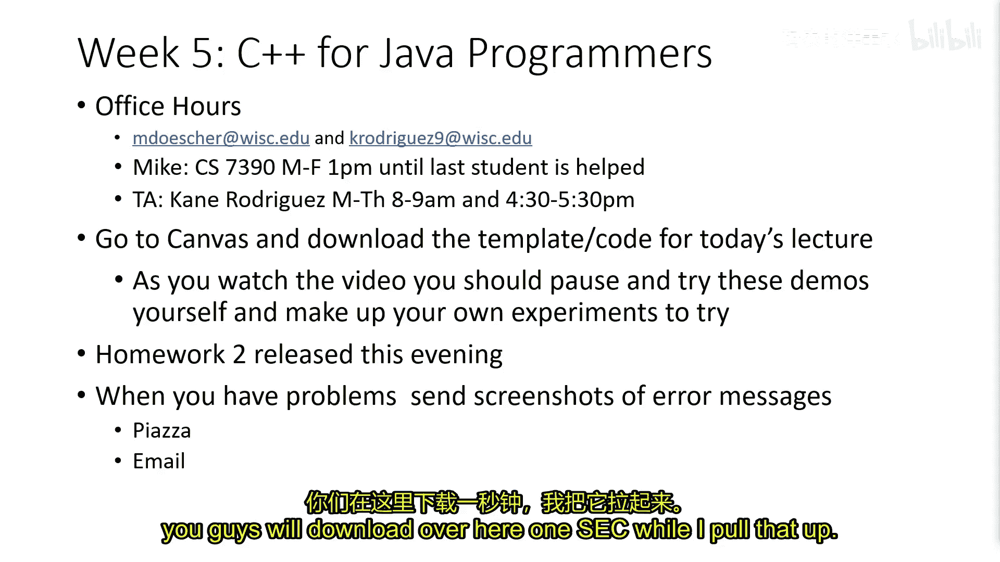
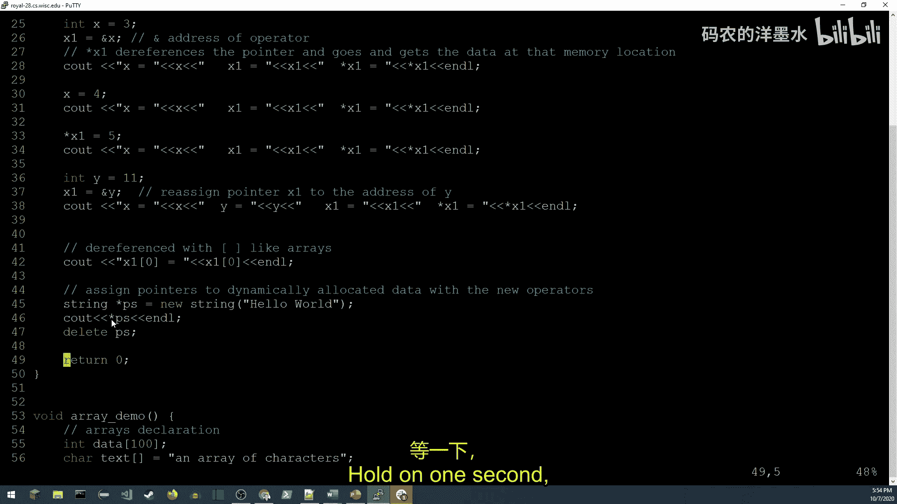
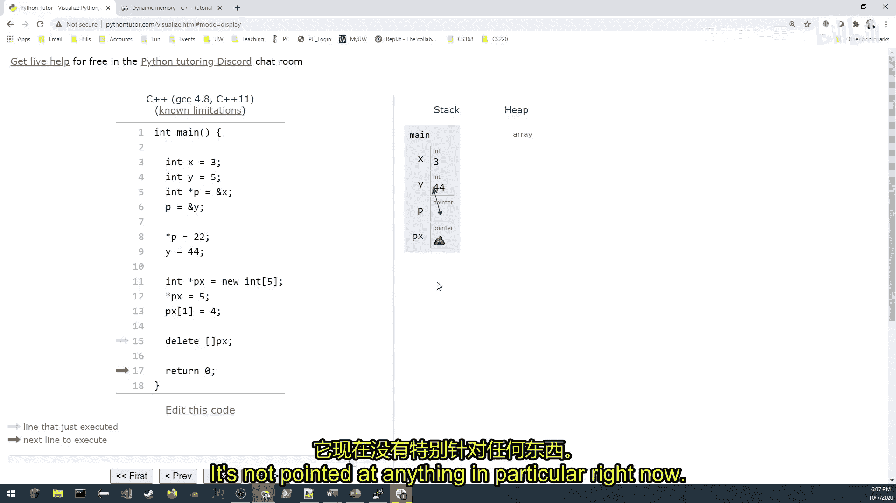
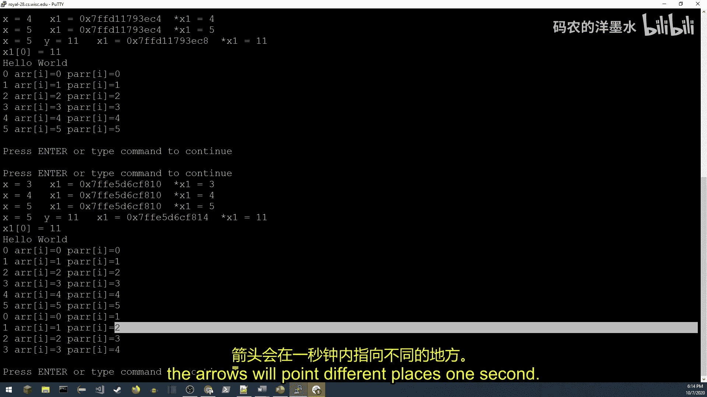
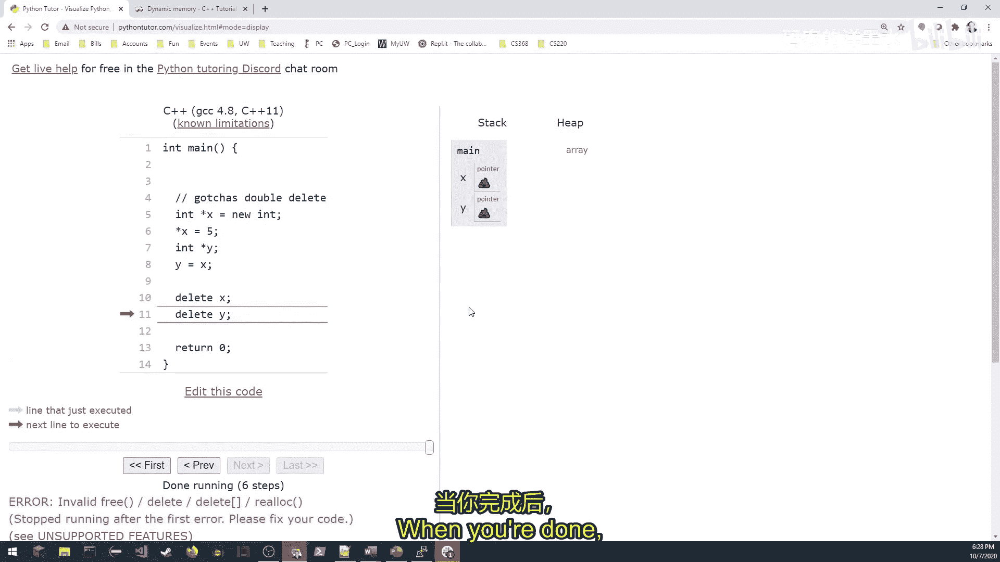
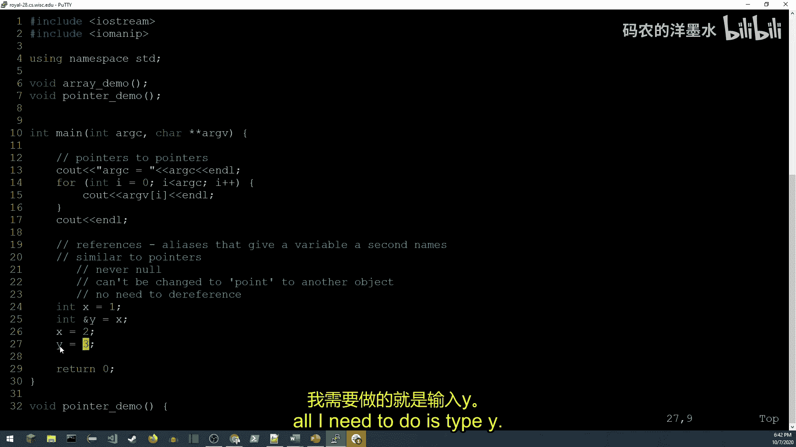
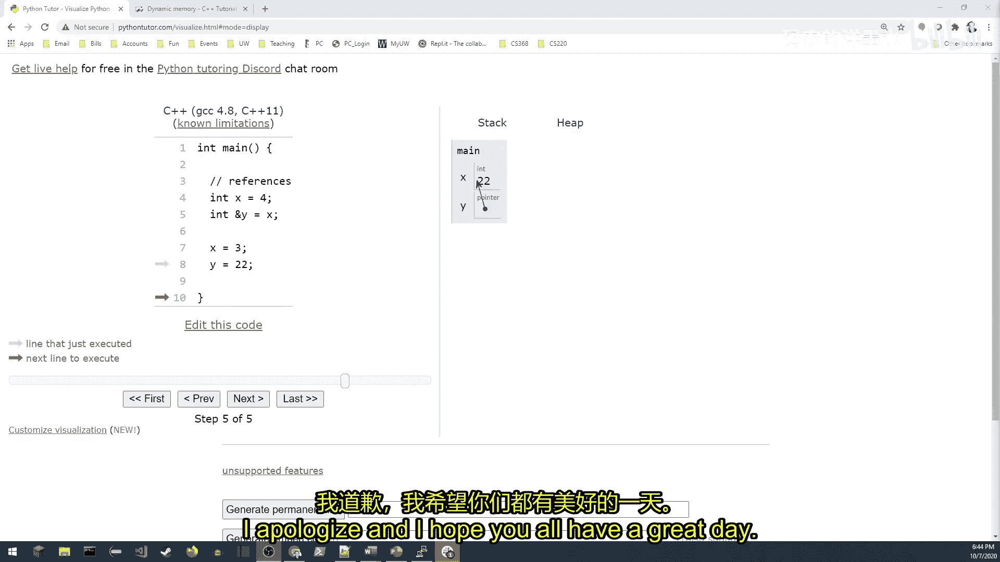

# C++ for Java Programmers： 5： 数组与指针 🧠

在本节课中，我们将要学习C++中的数组和指针。数组是存储相同类型数据的集合，而指针则是存储内存地址的变量。理解这两者及其关系是掌握C++系统级编程的关键。我们将从基础概念开始，逐步深入到它们的使用方法和注意事项。

---



## 数组基础

上一节我们介绍了基本数据类型，本节中我们来看看如何创建和使用数组。

### 数组的声明与初始化

以下是声明和初始化数组的几种方式：

*   **指定大小声明**：`int data[100];` 声明一个包含100个整数的数组。
*   **自动推断大小**：`char message[] = "Hello";` 编译器会根据字符串长度自动确定数组大小。
*   **列表初始化**：`int limits[] = {10, 12, 14, 17, 20};` 编译器会计算元素数量并分配空间。

### 数组的重要特性

以下是关于数组的几个核心特性：

1.  **语法差异**：在C++中，方括号 `[]` 放在变量名之后，而不是像Java那样放在类型之后。
2.  **非对象**：数组不是对象，没有关联的方法，本质上只是一块连续的内存区域。
3.  **无大小信息**：数组自身不存储其大小，程序员必须自己记住元素数量。
4.  **无边界检查**：访问数组边界之外的元素是合法的（但危险），编译器不会报错。

### 数组访问示例

我们可以通过索引来访问和修改数组元素。索引从0开始。

```cpp
int limits[] = {10, 12, 14, 17, 20};
cout << limits[0] << endl; // 输出 10
limits[4] = 25; // 修改最后一个元素
// 危险：访问越界，行为未定义
cout << limits[-1] << endl;
cout << limits[10] << endl;
```

### 数组的局限性

数组有一些重要的限制需要注意：

*   **不能直接复制或赋值**：不能用一个数组直接初始化另一个数组，也不能将一个数组赋值给另一个数组。
    ```cpp
    int a[5] = {1,2,3,4,5};
    int b[5] = a; // 错误：必须使用大括号初始化器
    int c[5];
    c = a; // 错误：无效的数组赋值
    ```
*   **关系运算符比较的是地址**：对数组使用 `==`, `<` 等运算符，比较的是它们在内存中的起始地址，而非内容。
    ```cpp
    int arr1[5] = {1,2,3,4,5};
    int arr2[5] = {1,2,3,4,5};
    cout << (arr1 == arr2) << endl; // 输出 0 (false)，因为地址不同
    ```

---

## 指针入门 🎯

上一节我们了解了数组，本节中我们来看看指针。指针是C++中强大但也容易令人困惑的特性，它存储的是另一个变量的内存地址。

### 指针的声明

声明指针变量需要在类型或变量名旁加上星号 `*`。

```cpp
int* x1; // 方式一：星号靠近类型（常见）
int *x2; // 方式二：星号靠近变量名
int *x6, x7; // x6是指针，x7是普通整数。星号不作用于逗号后的变量。
```

### 指针的初始化

创建指针后，最好立即将其初始化为 `nullptr`（C++11推荐）或 `NULL` 或 `0`，表示它不指向任何有效内存。

```cpp
int* ptr1 = nullptr;
int* ptr2 = NULL;
int* ptr3 = 0;
// 判断指针是否有效
if (ptr1) {
    // ptr1 非空，可以安全使用
}
```

### 为什么使用指针？

以下是使用指针的几个主要原因：

*   **固定大小**：指针的大小是固定的（例如，64位系统上是8字节），便于在栈上分配。
*   **动态内存管理**：通过 `new` 运算符在堆上分配内存，指针用于访问这块内存。
*   **实现多态**：通过基类指针指向派生类对象，实现运行时多态。
*   **操作数组**：数组名在很多情况下可以退化为指向其首元素的指针。

### 指针的基本操作

让我们通过一个例子来理解指针的赋值和解引用。

```cpp
int x = 3;
int* x1 = &x; // & 是取地址运算符，将x的地址赋给指针x1

cout << “x = ” << x << endl; // 输出：x = 3
cout << “x1 = ” << x1 << endl; // 输出：x1 = 0x7ffe... (一个内存地址)
cout << “*x1 = ” << *x1 << endl; // * 是解引用运算符，输出：*x1 = 3

x = 4; // 直接修改变量x
cout << “*x1 = ” << *x1 << endl; // 输出：*x1 = 4，因为x1指向x

*x1 = 5; // 通过指针间接修改变量x
cout << “x = ” << x << endl; // 输出：x = 5

int y = 11;
x1 = &y; // 指针可以重新指向另一个变量
cout << “*x1 = ” << *x1 << endl; // 输出：*x1 = 11
```

### 指针与动态内存

使用 `new` 在堆上分配内存，并使用 `delete` 释放。

```cpp
// 分配一个字符串
string* p = new string(“Hello World”);
cout << *p << endl; // 解引用以获取字符串内容
delete p; // 释放内存

// 分配一个整数数组
int* px = new int[6]; // 分配6个整数的空间
px[0] = 5; // 使用数组下标语法访问
*(px + 1) = 4; // 使用指针算术访问
delete[] px; // 释放数组内存，注意使用 delete[]
```

---



## 数组与指针的紧密联系 🔗

数组名在大多数表达式中会**退化**为指向其第一个元素的指针。这使得指针和数组的用法可以互通。

```cpp
int arr[] = {0, 1, 2, 3, 4, 5};
int* pArr = arr; // arr 退化为 &arr[0]

cout << arr[2] << endl; // 输出 2
cout << pArr[2] << endl; // 输出 2，指针可以像数组一样使用下标
cout << *(arr + 3) << endl; // 输出 3，数组名可以像指针一样进行算术运算

// 指针算术：移动指针
pArr = pArr + 1; // 现在 pArr 指向 arr[1]
cout << *pArr << endl; // 输出 1
cout << pArr[0] << endl; // 输出 1，pArr[0] 现在等价于原来的 arr[1]
```



**关键区别**：数组名是一个**常量指针**，其值（指向的地址）不能改变。而普通指针变量可以被重新赋值。

---

## 指针的注意事项与陷阱 ⚠️

理解了基本操作后，我们来看看一些常见的陷阱。



### 1. 运算符优先级

解引用运算符 `*` 的优先级非常低。`*p++` 意味着 `*(p++)`，即先移动指针，再解引用移动前的地址。如果想增加指针指向的值，需要使用 `(*p)++`。

```cpp
int arr[] = {0, 1, 2};
int* p = arr;
(*p)++; // 将 arr[0] 从 0 增加到 1
// *p++; // 这会将指针p移动到arr[1]，可能不是你想要的效果
```

### 2. 双重释放错误

如果两个指针指向同一块堆内存，对其中一个使用 `delete` 后，该内存已被释放。再对另一个指针使用 `delete` 会导致未定义行为（通常程序崩溃）。

```cpp
int* x = new int(5);
int* y = x; // y 和 x 指向同一地址

delete x; // 正确：释放内存
// delete y; // 危险！双重释放错误，y现在是一个“悬空指针”
x = nullptr; // 良好实践：delete后置为空指针
y = nullptr;
```

### 3. 指向指针的指针

指针可以指向另一个指针。一个常见的应用是处理命令行参数。



```cpp
int main(int argc, char** argv) {
    // argc: 参数计数，包括程序名本身
    // argv: 指针数组，每个元素是一个C风格字符串（char*）
    for (int i = 0; i < argc; ++i) {
        cout << “Argument ” << i << “: ” << argv[i] << endl;
    }
    return 0;
}
```

---

## 引用：指针的“安全马甲” 📝

引用是另一个变量的别名。它使用 `&` 符号声明，但此处的 `&` 是引用声明符，而非取地址符。

```cpp
int x = 4;
int& y = x; // y 是 x 的引用（别名）

y = 3; // 通过引用修改 x 的值
cout << x << endl; // 输出 3

// int& z; // 错误！引用必须在声明时初始化。
// y = &someOtherVar; // 错误！引用一旦绑定，不能更改其指向。
```



**引用 vs 指针**：
*   **必须初始化**：引用在创建时必须绑定到一个变量。
*   **不能为空**：不存在“空引用”。
*   **不能重绑定**：引用在其生命周期内始终指向初始化的变量。
*   **无需解引用**：使用引用就像使用原始变量一样。

引用通常用于函数参数传递，以避免拷贝大型对象，我们将在下一讲中详细讨论。

---



本节课中我们一起学习了C++中数组和指针的核心概念。数组是固定大小的同类型元素集合，而指针则是存储地址的变量，它们之间有着紧密的联系。我们还探讨了指针算术、动态内存管理以及常见的陷阱。最后，我们介绍了引用作为指针的一种更安全、更直观的替代品。理解这些概念是进行高效C++编程和内存管理的基础。下一讲，我们将学习如何将这些知识应用于函数参数传递。