# 【全集】威斯康星大学 聚焦系统级编程 面向Java程序员的C++ CS368C 中英字幕 1080P p06 Lecture 6 - 内存模型、多维数组、参数传递 -BV1o72QBREfu_p6-

Alright， guys， welcome back to C plus plus for Java programmers。

 This is gonna be this sixth lecture in the course。 I am still a little bit behind。

 And with some luck to this is the week。 we'll be getting caught up。

 So I know thank you guys for being so patient with me as I've been going through my recovery。

 I really appreciate that。 and I really appreciate all the messages。 it's meant a great deal to me。

 All right， So as we get started today。 a couple of reminders。 I haven't done yet。

 I'm going to build this template as I go through and record the lecture。

 but there will be a template available that you can download and follow along with today's work。

 There's also gonna to be a PowerPoint for the slides。 I've got a couple of slides。

 Most of what I'm going to do with the slides is actually develop them as I go through and type on them and modify them。

 So the slides aren't going look exactly like what's going on during the lecture because I'm actually going be using them as a live material。

😊，All right， homework War three will be coming soon， I'll just send an email when it's ready。

And if you have any problems， go ahead and please continue to send me screenshots of weird error messages。

 feel free to ask any question you guys have about the format of the homework。

 things that are going on with class if you get something that you've tried out and experiment on your own and you don't understand just go ahead put that on Piazza or send me an email I'm happy to answer those。

Allright， guys， this is Mike。 After recording the entire lecture coming back just so that you guys are aware the video is 80 minutes long。

 It's about 30 minutes longer than a regular class。

 I could not find a good reading assignment to go along with some of the pieces of this。

 So I just sort of catch talking。 Don't think of this as an 80 minute lecture， break it up。

 watch it in some smaller pieces， but and then think about that extra content as replacing the reading that you would do to go along with the class。

 also as you go through there's a template now that I've finished。

 I can tell you there really is a template， or Id encourage you guys to pause the video and type the code yourself。

 That way， there's no way you'll get it right every single time if you're at least you typed like I do。

 you'll get some error messages that you'll likely learn from。

 So I'd encourage you guys to not just go stare at the final version or even just like watch the video passively。

 but actually sit down and go through this and try and type the code and do your own experiments。

 See， does this work or wow if that failed。 when you get weird error messages。😊，Go ahead screen。

 shout them， put them up on piazza and we'll talk about them together as a group。All right。

 have a great day。All right， as we get started today， the plan。

 we're going to talk a little bit about the C plus plus memory model。

 So what's going on inside of memory。 And I'm really hoping this will help you guys understand pointers better。

 Pointers is probably one of the more difficult topics that at least when I first learned it。

 I had to read that stuff a couple times before I understood。

 a quick review of references because Refences are extremely useful for passing things to functions。

And。Yeah， they're very similar to pointers and people often confuse them。

 So I just want to make sure the distinction is clear。 They're like easy pointers。Allright。

 And then we'll talk about arrays in the context of the memory model and the pointer array connection。

 I've done pretty much what I want to do there， but I'm in review with the diagrams。

 I needd need to say a little bit about character strengths or arrays of characters。

 because they're terminated by on null character that's sort of hidden from the user。

 We'll finish up with multidimensional arrays and how to pass all of this stuff to functions。

 All right。Alright， so we're going to get started with a look under the hood and compile the code。

 First up， on the left here， I've got some sample code。 This is just coming out of some dots E P P。

 It's got。Declaring and defining a variable A， B， adding it together， Whatever it doesn't matter。

 This is just my fake arbitrary code that I wanted to have some code here to talk about。 All right。

 when we push compile， the compiler is going to go through a number of stages。

 The first one is the preprocessor。 That's going to go ahead and take all of your includes and just copy and paste everything from those files in that spot。

 It's going to take all of your comments and remove them。

Then the next phase is going to go through and turn all of the code into assembly code as sort of an intermediate step from there。

 that assembly code gets translated into machine code。

 So here I've got an example of some assembly code we'll be moving one of the variables into a register。

 move another variable into a register， add them together So this kind of matches what we might have going on over here。

 check it out。 we're no longer using the A and the B coming up with C。

 which will end up right here in the same register。 we're not doing any of that。

 the machine on the inside is only going to be looking at memory addresses。

I just want to point out too that inside the compiler。

 it does need to know which variable matches with which memory address。

 So it's going to maintain this symbol table。 And as we go through and talk about pointers and arrays Some of those things are locations in memory where like a pointer is a location to memory where I'm storing the address of something else。

 And I can change that to a different address and have a point to like a different array if I need to。

 And some of the things are just constant arrays。 like if I declare an array with the square brackets。

 that's going to be a constant， I can't redefine that point， technically， it's a pointer。

 But I can't redefine that pointer to point somewhere else。

 And so the symbol table is going to treat this differently。

 It's not going to be you know an array is a pointer to a memory address。

 it's just going to point to the very first address。

 So they're treated a little differently on the inside。 And as I've gone through。

 I did a bunch of research and looked at what a lot of people put out there from memory models and some。

People do list the array as a specific pointer that points to a memory address。

 You can actually print out the memory address of a pointer and you can print out the memory address of the first element of an array。

 they're going to be the same for almost everything。

 I've never seen the compiler do anything other than that。

So just a heads up that there are some pictures out there that show things differently。

 so there may be more than one option that compilers choose。Allright。

 and then after the compiler is done turning all of the assembly code into machine code。

 it's just gonna to be ones and zeros that correspond to things like memory addresses and codes for these different commands。

 All right， when we start looking at the memory So every process that were run every public program that we write has basically access to an entire virtual memory space equal to the size of the well in a 64 bit computer2 to the 64th memory addresses Now you might not have that much physical memory。

 your computer is sharing the memory with lots of other programs。

 so there's a translation unit that actually maps this entire like memory space。

 all the addresses that this program is using to some physical memory and that's all behind the scenes we don't need to worry about that take operating systems。

But as we go through and we look at their code， the very first memory address address 0 is reserved。

 We're not allowed to write to that， which means that if we have a pointer and we declare to be a null pointer。

 we just assign it memory address 0。 And if we do try to write to it， it's going to cause an error。

 So the very first like0 memory address is reserved。

Then all of the code is placed in the next block of memory。 So this is address 0 as we move down。

We're going to see increasing memory addresses， so the code here is just the compiled code。

 that machine code that I had on the previous slide。

 all the ones and zeros that describe the commands and the addresses of pointers and things like that。

 where it needs to go to look up data。Al right， the next section is the data section。

 These are going to be。Osserved for global variables。And static local variables。

 which I probably won't talk too much about。Or just things that are going to be resonant permanently in the code and available from anywhere。

Following that， we've got the main memory used by the code for variables and data。

 I'm going to start with the stack here。 So the stack are just going to be the normal variables that we define in the process of running our programs。

 You know like if I say int A or int B， it's going to reserve some space on the stack。

 And as I continue to use more and more variables， it's going to grow from high memory addresses to lower memory addresses。

 So be filling in the bottom ones first and then working our way up。As we call functions。

 those functions will have local variables。 Those are going to go on the stack as well。

 So we'll just have you know some local variables for main。

 Then there'll be some local variables for the first function。 If that function calls something。

 there'll be some local variables for that function。When the function ends。

We delete all those technically， it doesn't do anything。

 It just moves a pointer indicating where the top of the stack is down to the previous function。

 and those local variables are no longer available to us。All right。

 if we need to reserve some memory and we don't know how much size we need。

 that dynamically allocated memory is all stored in a section of the memory called the heap that's going to immediately follow the data as we reserve more and more that it's going to grow toward the stack so it's growinging toward higher numbers。

And these are things that we reserved with Malik or a new or we create one of the dynamic built in container types like a vector or a set or a map。

 Those things， those are all going to be stored in the memory location called the Heap。

 If we do use the new operator。 It's our job to remember to delete this， we use Malik。

 It's our job to remember to free the memory， otherwise we have a memory leak。

 And if your code runs long enough eventually you will run out of memory。Alright。

 let me pull up some actual code。 We'll do a quick review of pointers and we'll talk about how this fits in over here on the stack。

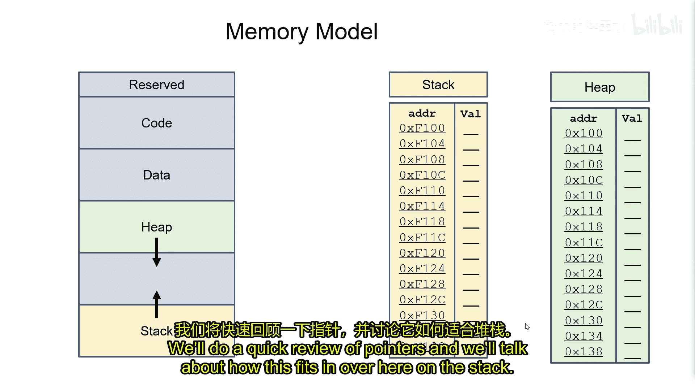

And heap。Alright， so I put together some code to just go over a quick review of pointers and show the connection to that memory model I just introduced。

 So first up， all this code does so far is just declare some primitives。 I've got integers X and Y。

Then I'm going to declare a pointer right here in line 15。 and I'm going to give it the address of x。

 So this much right here inch star says I'm declaring a pointer。 And again， remember。

 I could put the star。Next to the int， if that helps me remember that this is a pointer。

 or I can put it next to the P。 If I've got more than one variable。

 I'll do that If I have a comma separated list and some of them are pointers and some of them aren't。

 I like the star next to my pointer。 So I remind myself that this is a pointer。

 and these are integers。then I'm just going to print out a bunch of stuff。

 and I think it's pretty clear printing out the value of x。

 the address of x right there with that command。And again， when I declare a pointer。

 I need to give it the address of a variable so that it knows what to point to。 I'm printing out y。

 although I haven't done anything with y yet in a moment， I will。

 And then I'm printing out a whole bunch of information about the pointer。 So P itself。

 This is the value of the pointer。 And I've just given it the address of X。

 I'm printing out the dereferenced version。 So if I want to use a pointer。 Remember。

 I need to use the star to say， go get that the information at that the pointer points to。

 So is printing it out just like that。 And then I'm printing out the address of the pointer as well so that I know where to draw it in my memory model When I flip back to the slides in a second。

 Okay， let me go ahead and run this， I just compiled， tested it。 made sure it was working。

So here's what we're looking at。This is my declaring variable section。 I've got x is3。

 exactly like we would expect。 the address of x。 all right it's going to be this long hexadeimmal number。

 I'm going to ignore the first digits that are all the same。

 and this is stored to at basically address08。This might change every time I run the program。

 so on my memory model slide on the next page， I'm going to just change these numbers myself and make this。

Whole thing， a whole lot simpler。 So forgive me。 it's not going exactly match the demonstration。

 Allright， I've got why check this out。 integers are exactly 4 B。

So this is ending beginning on address 08， blah， bh， blah 08， four addresses later will be 9， ABC。

So four bytes later will be OC。The pointer is going to be。Located， so this is the value it points to。

 sorry， the value that it points to。 this is the data actually stored in the pointer is 08。

 So it's storing the address of x right there。The de referenceence version of the pointer is the value。

 So trace the arrow back and get the value of x。 And the address of the pointer is stored at is。

 let's see， A F1，0。That's going to be the four addresses after this one。

 So they're just stored in order the80 C and 1，0。 So let me go ahead and put those in my memory model on the diagram once sec while I add those。

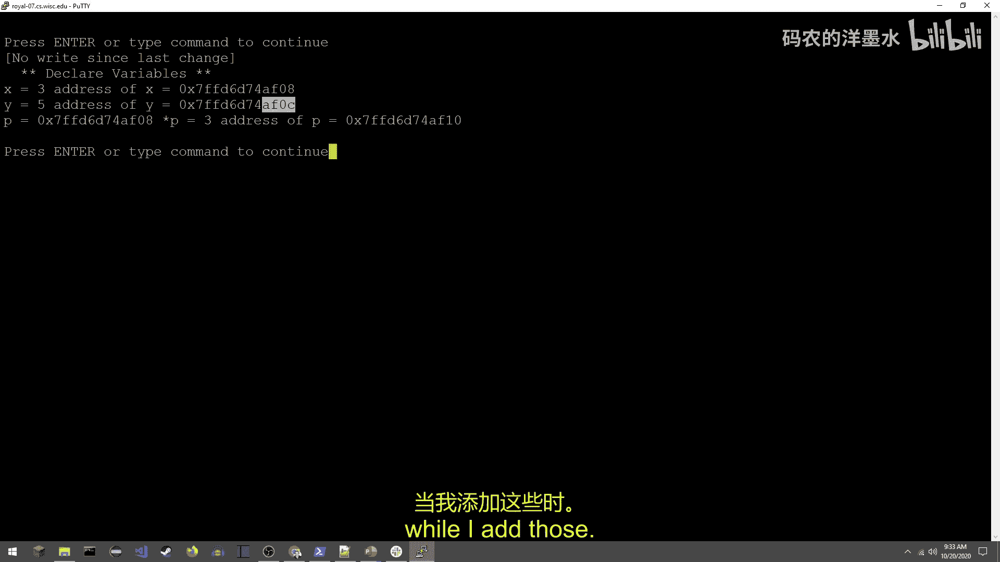

Alright， I've gone ahead and added that code and the results to this memory model picture over here on the left。

 I have the variable names。 Now， these variable names are only going to live in my code。

And the compiler needs to know what variable names match up with which memory addresses。

 so it's going to store those in its symbol table when it's done compiling。

 it no longer needs the symbol table and this machine code over here will not require those and so those will be removed unless we turn on debugging symbols and then it'll store that for us。

Tucked about how to do that in a future lecture Next up。 So I've got the variable X here。

 It's stored at this memory location。 Now， the Mier is going to reserve memory from high memory addresses to low memory addresses。

 So I started filling this in at the bottom。 It's going to reserve all the space for all the local variables for a particular function at once。

 when I call a function， itll reserve this next block of variables。

 So what we've seen is that X is stored at and again。

 I've chosen different numbers than the demonstration I just did because those are not guaranteed to come out the same every time I run my code。

😊，So I've just pick some arbitrary numbers。 Indeed， an integer is 4 byte。 so the next variable。

 the y is going to be stored4 byte after that。 y is 4 bytes。

 so the pointer will be 4 bytes after that。 And here I've got the value。

 So3 is stored in x at that memory location 5 is stored in y at that memory location。

 and the pointer P actually stores a memory address in this case， F130。

 which is the value the memory address of x。 So we can say that this pointer points to x。

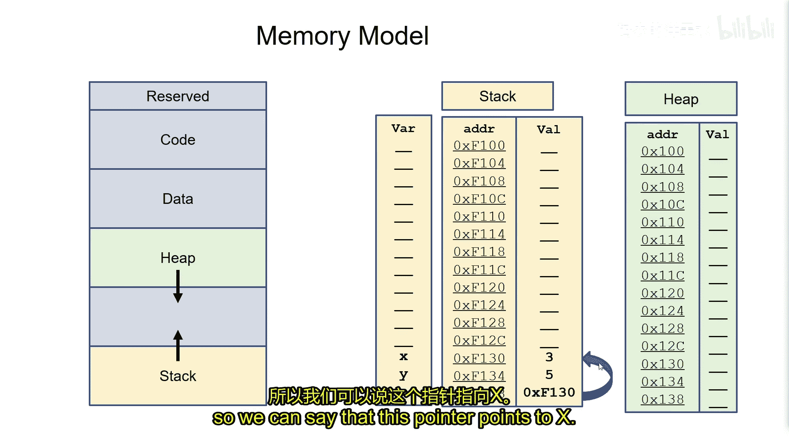

All right， just to demonstrate a little bit more clearly how pointers are working。

 I'm going to do two little experiments。First， I'm going to modify x by just x plus equals 4 so that should change it from 3 to 7。

 Then we'll modify x using the de referenceence pointer。

 and we'll go look at what happens when we print out all of these memory addresses。

 So I'm going to add another two to that same memory location using the dereencing operator for P right here。

Alright， so let me go ahead， compile。Look at this， this doesn't seem to be the same memoryat I'd have to flip back into my recordings and check for sure。

 but I think this did change。Alright， so this is the very first block we had before。

 We can see we still have x' is 3。 It' stored a location，4 bytes after that。 We have Y。

 four bytes after that we have the pointer and the pointer still points to the same addresses x。

 So this is all looking good。 When we modify x。 really the only change we'll see right is right here or x' is now become 7。

 and the D reference pointer right there also changed。

 So both of those are a way to get access to that same memory location And again。

 all these addresses are the same。😊，Then we can modify x using the pointer。

 So this was that star P plus equals 2。 and I see again。

 it's changed to both x and the de reference pointer。 that's the same memory location。

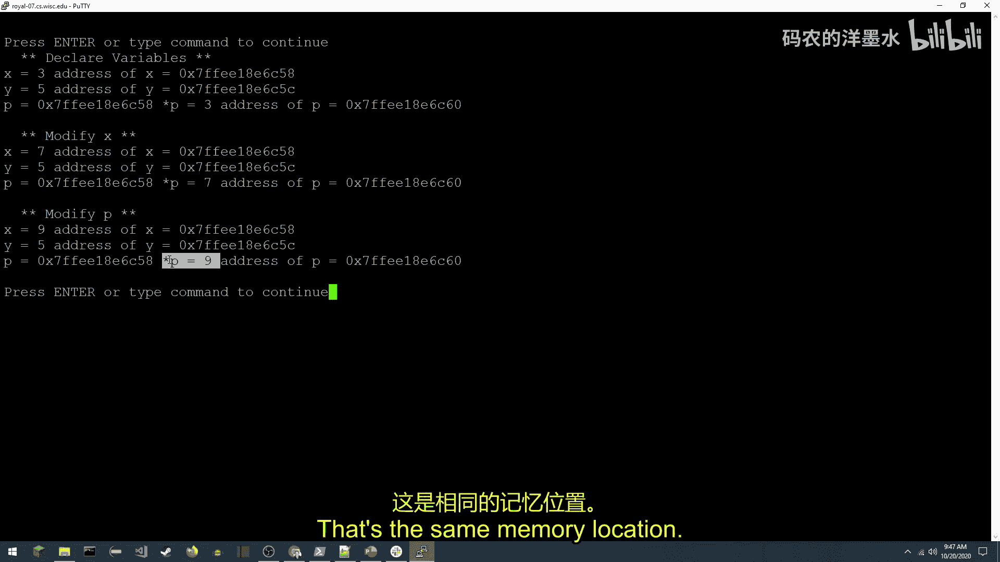

Al right， back over here to the memory model picture。

 I can see that I've got this is the original state of things。When I added four to the x variable。

 that's going to change that three to a7， just like that。

I love being able to edit PowerPoint and have the display up and record all at the same time is amazing。

 But that also changed where P。 No， it didn't change P at all。

 P is still pointing to the same memory address。 But the value of that change。

 So I've got two different ways to get to that number 7 there。 When I changed the pointer。

 the de referenceence pointer。 I added two more to it。 That 7 became a 9。 And again。

 we accessed that same memory location using two different techniques。😊。

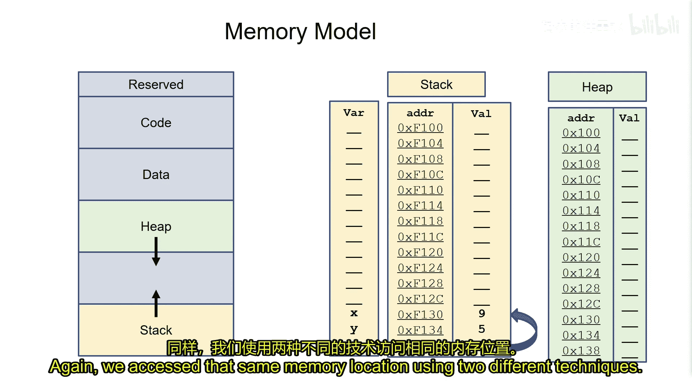

Al right， I've added one more piece to this。 Well， two sections。

 So here this was the last thing we did。 we modified X through P。 The new sections are right。Here。

 so' all I'm doing in this piece is reassigning the pointer to point to a new variable。

 If it's not constant， I can have it point to pretty much any integer I want。

 and I can move it around， which is extremely useful to do that。

 I'm just going to look at line 36 right here。 P is equal to address of y。 It reassigns the pointer。

 So we'll go verify that it's changed and now points up a Y in a moment。

 And then I'm going to modify。That data， So not X。 this' used to point X。 Now it's pointing to Y。

 I'm going to go ahead and change that to 6。 In this case， we'll print out that same stuff again。

 Allright， running the program。Al right， so this is all before we declared the variables we modified at X。

 we modified P。 Here we are right here in this section。So we're going to reassign P to 0 to y。

 This is just p is equal to address of y。 And now I can see that P。

 this is the value stored in P right here。Is exactly equal to the address of what。嗯。

The D referenceence version should now match the value at y。 And this is its current address。

 which is the same location it hasn't changed。 So P is still stored in the same memory location。

Then when we modified P using the star P is equal to 6， I can see I've changed y to now equal 6。

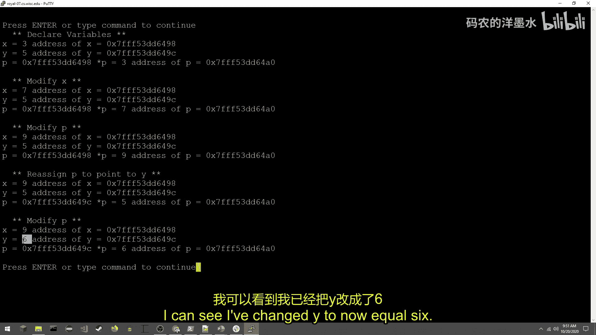

And the dereence pointer also equals 6。Alright， so as I was going through this。

 the first thing I did was I went and I changed P so that it points at y。

 So this is what it looked like originally。 I've got the address stored in P as the F130。

 That's the address of x。 I'm just going to make a quick change。 I'm going to lead that 0。

I'll try that again， I' going delete0， and I'm going to upgrade that。 so it now points to4。

That's going to change my arrow a little bit。 So we'll shrink that down。Just like that。

 And now the second thing I did was I went ahead and changed the values that in address F 1，34 by。

Just reassigning it to the number6 using the D reference pointer。 that's also， as we saw， changes Y。

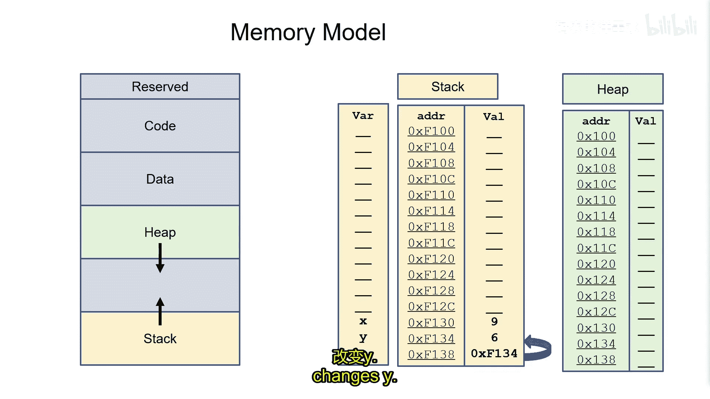

Alright， just a quick review of references。 and I want to introduce how they fit into that memory model picture I've been drawing。

 So I've added this section here about references beingient line 49。 This is the key line right here。

 I'm creating a reference to an integer X on again， if I wanted， I can put the ampersand。

Over here next to the int to remind myself that this is a reference。

We overload that Ampers we use it lots of different ways we're using it as the address of operator up here in this case。

 if it follows a type， I'm creating an alias or creating a reference so in this case I leave it like that for right now。

I'm assigning that to X， and then I'm just going to print out x。

 I'm going to print out the address of x。 I'm going to print out my reference and the address of the reference。

Let me go ahead and just run this real quick。I compiled a moment ago， Test it out。

 So here's all that stuff I was printing before。 The new stuff is down at the bottom under references。

 So I want to highlight right here that x is equal to 9。 That's where we left off address of x。

Is at B0 this time and reference R is the same thing， and in fact， it has the exact same address。

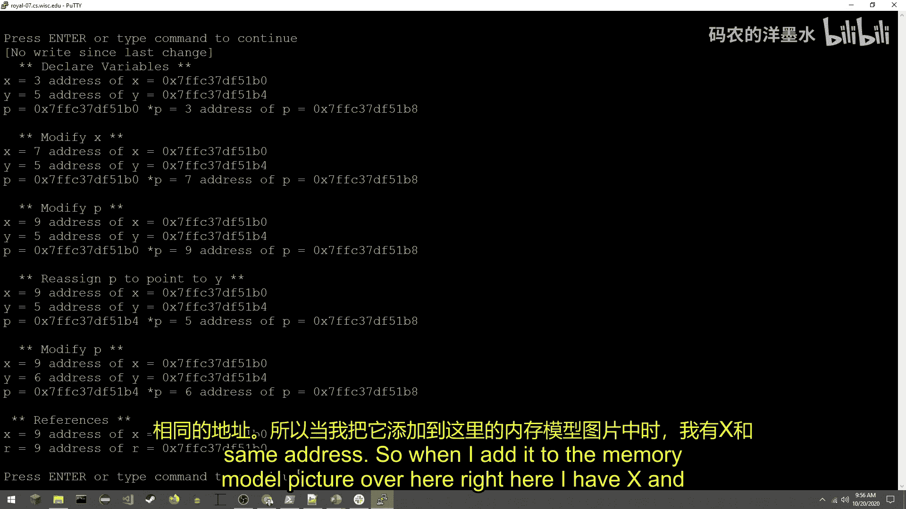

So when I add it to the memory model picture over here。Right here， I have X and R。

 Both of those variables are the same thing。 So the symbol table is just going to track them like this。

 Now， the compiler has more or less two choices as it's going through。

 It can just keep track of R directly as a memory address。

 That's what it's generally going to do for primitives or it could use a pointer mechanism and just let us use it exactly as though it were a pointer without having to deal with remembering to put the star in in the address of operator to So it takes out the complexity。

 And inside the machine。 It's， it really could do either version。

But that really doesn't matter for any of the work that we're going to be doing with references。

Alright， in a little bit， at the end of the lecture。

 I'm going to talk about parameter passing methods and call by reference is a very common technique。

 and that's the main place where I use references in my code。 So I'll introduce that for you guys。

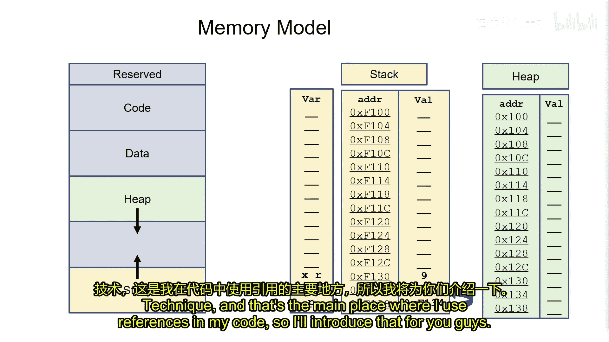

All right， to wrap this up， my notes say， don't forget to mention that references must be initialized when they're created and they can't be changed。

 So they're constant。 It also means that we won't ever be able to create a arrays of references。

 So just to heads up there。 Al right， Next up， I do want to go in and review rays and put those into my memory model。

 Let me go ahead and put together some code to demonstrate that。Al right， next。

 I just want to take a minute and talk about how primitive arrays fit into the memory model that we've been looking at。

 So here the important stuff that I've added， I'm declaring a primitive array of integers with just 0 through 4。

 So it's got 5 elements。 Those will each be 4 Bs。 So we should take up about 20 B in memory。

 And I'll go draw that in the picture in a second。 I'm also declaring a pointer that points to that very same array。

And part of the reason I want to do this is I want to emphasize that arrays are just pointers。

 constant pointers。But there's a little catch there。

 And that's that the compiler already knows their pointers in their constant。

 So it's going to just treat these a little differently。

 This doesn't get its own memory address that points to the0。

 It just has the address of that first element of the array。 And I'll show you that in a second。

 Allright， I've got all of this stuff here， those first four lines。

 or so that I know how to draw this in the memory model。 new stuff is right here。

 So here I'm printing out some information about a。 The value of a itself。

 The dereferenced value of a。 and the address of a。Allright。

 then I'm printing out just the first two elements of that array。 their addresses。

 I want to know which way to line them up in my memory model and then some information about that pointer。

 So in this case， the value stored in the pointer itself， the de referenceenced value。

 hopefully that matches what we've got in the dereence value of a。 And then finally。

 the address of the pointer。Let me go ahead and run this， I've already compiled。Alright。

 so the new stuff is done at the bottom。 These lines right here are just to help me remember to go put everything in the right spot。

 So we've got excet value 800 at 804。 we've got Y。 The pointer is at 808。Al right， check this out。

 The next thing we declared was the array。 that's going to be at 820， beginning at 820。

Part of the reason for the。Big jump is that it' it's actually storing the pointer first。

 So this was the last why is it 08。The points， I'm sorry。 pointer is at 08。

 The pointer is going to be 8 B and a 64 B machine because all of the addresses are 64 B。

 So 8 B after the pointer here。Is going to be 8，10。 And then we have the array after that。

 beginning at 820。So I believe the this is， this is actually 16 B after this point。

 And part of that is probably to align the memory in a certain way for the array。 All right。

 let me go ahead and put these in the memory mount。 Oh， I'm not done yet。 Hol on， Mike。 All right。

 check this out。 The address stored in a or the value stored in a is actually a memory address。

 and it's the memory address of the very first element。 So this is at a 20。

 The value stored in a is a20。 So technically， a is a pointer。 and the。Let me pull this up。

 The symbol table is going to remember that。 So grab Powerpoint。

 flip back to here in my symbol table。 I've got a， this is going to be a pointer for the array。

 but it doesn't need to remember that because it's constant。

 So the symbol table will just store the memory address of that。

 And any time I use the de referencing。

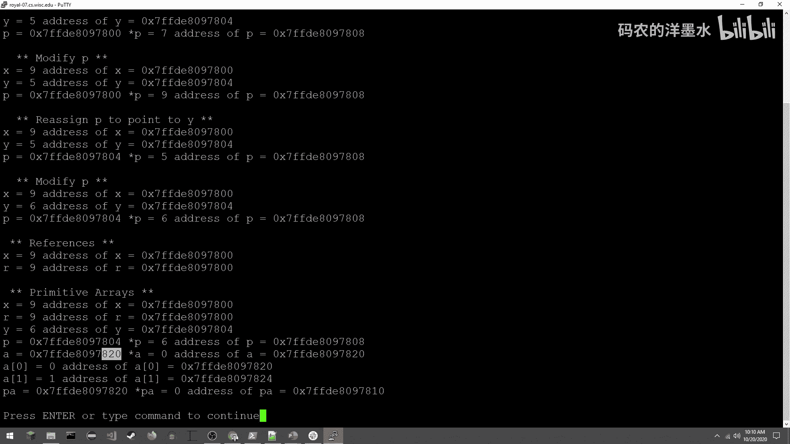

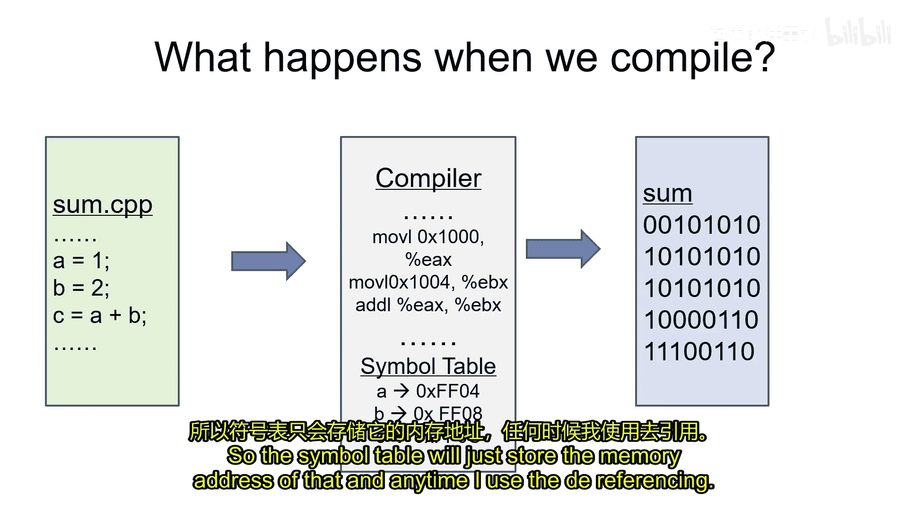

As in when I use these brackets， this brackets is essentially the same as star a plus。0。

ItStia plus 0， and then it's going to go get。Yeah， I'm sorry。 this one， star a plus0。

 I'll write that in the notes in just a second。 It's going to go get 0。

 get the value stored at that address。All right， but。

Because the compiler already knows that it's going to take care of all those details for us when we use the pointer version。

 if I declare PA， it's going to point to the same memory location A20。

 and when I do de referencing I still get that same thing。

 but this pointer is going to be stored at a different memory location。Allright。

 let me go put all of this stuff into my PowerPoint memory model slide and then it'll like。

Make a lot more sense than staring at hexs decimal numbers。 Trust me， Give me a second。

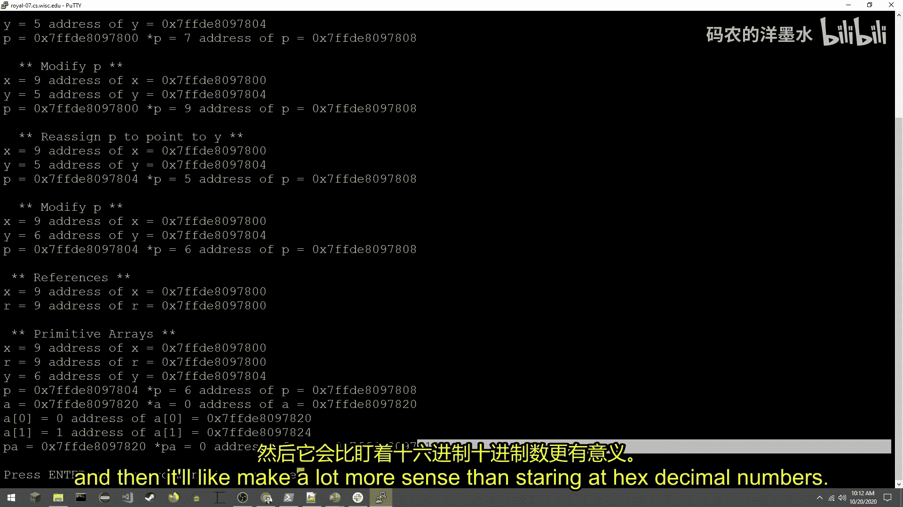

All right， I've gone ahead and added everything to this memory model picture。

 I went ahead and move some things around。 and I actually lined the addresses up just to make sure I didn't make any mistakes。

 So there was a lot of hex digits。 they were all the same up until the 7800。

 So I've just cut the last four digits here。 But these exactly match what we just printed out。

 So again， we have all this stuff from the early demo R and x are the same Y is here。

 P is a pointer to Y。 that's where left off。 And then all the new stuff。 I've declared an array。

 array A， It told us that the value of a was the 78，20 address。The address of element a 0， also 78。

20。 So inside the machine， the compiler is just going。

 it's not going to use a separate memory address to store a。

 It just is going to do all the translating。In the compiler。

 And then the machine code will go faster if it doesn't need to do that extra step of de referencing a pointer。

 All right， again， the value 0，1，2，3，4。 there are e 4 bys。

 It took some special effort to align the array at address 0。

 That's for performance reasons because the modern machine architectures have vectorized commands that work well if things are aligned。

 So it did waste them space。 It's got some empty space in here。 again， the pointers are 8 bytes。

 So they actually take up all of this space。 O F 104 takes up this space and this space。

 This pointer takes up two rows。 It just needs that much space to store it。

And the pointer here is actually pointed F120。Oops， I forgot to update those。 A apologizelog。

 hope that didn't confuse anyone。 I didn't go back and change the addresses to match exactly until after I'd done all this work。

 forgot to update those。 So again， pointer P A pointer to the array points to the same address。

7820 as the first element of the array。 But to use it using pointer notation。

 the compilers can have to go and actually do the translation to figure out and follow that arrow。

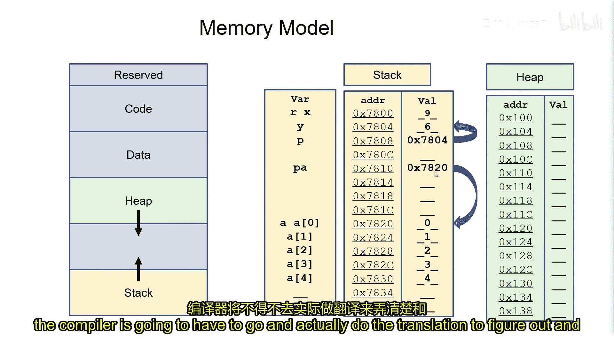

Alright， just one more quick thing here。 down at the bottom。 I've added two lines this。Aray indexing。

 So here I'm grabbing element one of the array inside the machine。 If you read the assembly code。

 what it's really doing is taking that value A， which is a pointer。

 It's going to incremented add one to it like this。 And then de referenceence that。

 So go get the value。 So I'm printing that out right here。 Now， like I said， this command。

 square brackets mean， go get the address。And add one to it。

 So it's just going to add those two things together。 in a as a memory address。

 It's stored in the symbol table。 but the machine code just is going to have that hard coded in as a memory address。

 So it's going add those two things together in de referenceence。

 which means that this also works because we can do addition in any order we want。

 We can take  two plus a or a plus1。 Those are gonna be the same thing。

 We can actually write it like this。 I know this is confusing。

 I've never actually seen anybody write array indexing like this。 Don't do it。

 You'll confuse other programmers。 But it does happen to work。

 And that's going to be translated to this。 And in a second。

 I'll just go ahead and run this and show you that it actually gives you the second value of the array。

 All right， Here we go。So check this out a indexing1 does this inside and gives us the value one。

 and the array has1 or0，1，2，3，4，5。I think I stopped it four， but this also works。

 I can write two index of a， it's just going to add those values together， this is an address。

 this is an offset to that address to go to the next memory location down and it's going to grab that too。

So when we do something like this。What it's really doing on the inside。That's the rule run。

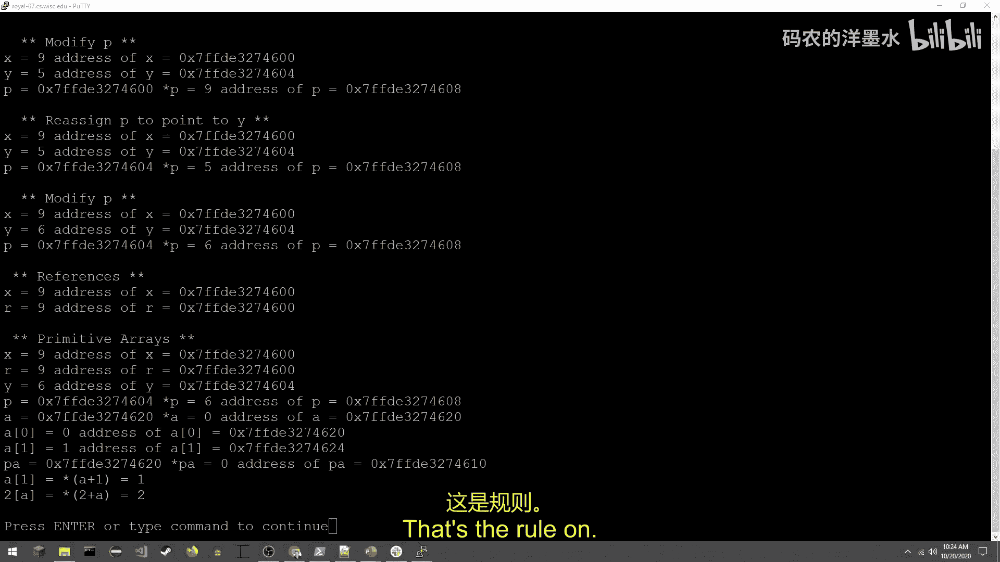

Is saying so array2 is right here， it's taking this address。Adding two to it。

2 integers is actually8 by。 It does that translation on the inside without us having to worry about how big things are and is going to go grab this value right here。

 So compute this address gets that value。 And it doesn't matter whether I'm adding two to the address right here or the address to two。

 Those are the same。

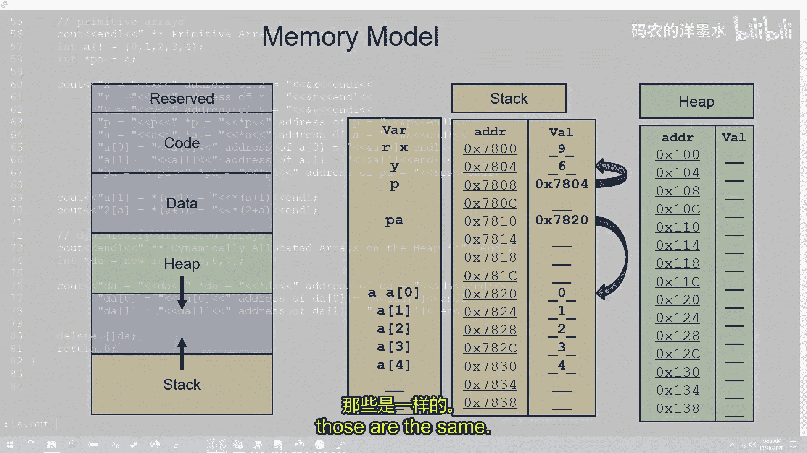

Al right， I just want to talk a little bit about creating dynamically allocated primitive arrays。

 We can do this a couple different ways。 I'm only going to introduce the C plus plus version of things。

 See would use Malck could take 354， I believe， for that。All right。

 I just wanted to introduce the idea of dynamically allocated arrays and talk about how they are connected to this memory model。

 because dynamically allocated arrays are going to appear on the heap。

 which is a different section of the memory。Allright， so here in line 74， I'm creating one。 Now。

 remember that if I use this style array declaration up here on 57 with the brackets。

 that's going to be constant。 And so I need to be able to give it the values right now。

 I need to know exactly what size it is。 This is a constant pointer。

 This new operator is actually going do some internal library functions built into C plus plus to go to the memory manager and get some memory。

 So we're not actually going to be able to use this constant style bracket notation to create this。

 So it must be a pointer。 So to create dynamically allocated arrays， we need pointers。

 the new command is going tell that memory module to go grab some space。 In this case。

 I'm going to grab enough space for three integers。 And I'm going to store the numbers 5，6 and 7。

 This initializer list is optional。 I could just create the empty array。

 This is just one way to fill it up easily to give me some demonstration numbers。😊，Allright。

 after that， I'm going to just print out a bunch of information about the array。

 And I think it's the same kind of stuff I've been doing up here。

 I'm just going to run this code and then we'll walk through where everything is。

 and then I'll put it in my memory model picture。Alright， now， finally。

 anytime I use the new operator， I need to free that memory。 This is just good practice。

 This will happen automatically when I hit this return in main and the program ends。

 leaving this out is not good。 If I'mve got a pointer to an array。

 I need to tell it it's a pointer to an array。 Otherwise。

 I can just give it the name of a pointer to a primitive or whatever type it is。

 if it's not an array。All right， one sec while I run this code。Alright。

 so I left everything in there so we can see how things fit into the memory model。 So I still got X。

 All of these addresses are at the 7 FF E E 0，9，0 kind of range of numbers。 Okay。

 that's gonna to be on the stack。 I can see here。Where I'm got。The address of D A。

 let's go with address of D A right here is also on the stack 7 FF E E 0，9，0。

 And this actually happens to be 0，40。 This is greater than everything else。

 So it's going to be down at the very bottom。 So all of these addresses 0，30。0，50。哈，O。Alright。

 in a moment， a moment ago， I was doing my testing of this and C plus plus this decided to rearrange it and then put this pointer at a different location than when I was practicing。

 Check that out。 This is actually gonna be between this pointer and the other array。 Allright。

 Allright， I'll get in the right spot when I put it in the model。Anyway。

 then I can see that the address that's actually stored is significantly different。

 This is going to be on the heap， a different location and memory。

 So I'll go ahead and draw that in the picture and show you guys。 And then D 0 When I dereence it。

 Remember anytime I use pointers， I can use the brackets to go get the same value rather than using that star。

 it's got five because that's what I put in there。 And again。

 that address of this variable is over on the heap。

 let me go draw this into my memory model picture and show what it looks like。😊。

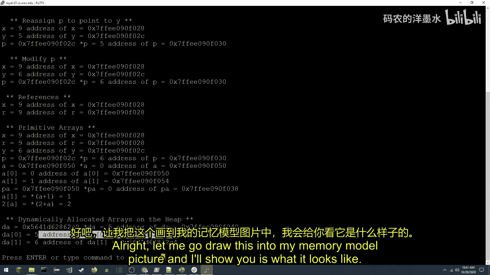

All right， I've gone ahead and added this new array to my memory model。

 so that my dynamically allocated array is a pointer that's stored on the stack so that I can reference the array。

 I know where it is。 And the value stored in that is actually the value of a memory location over on the heap。

 I'm with this like I put a whole bunch of extra digits into just kind of emphasize that this is not on the stack。

 It's somewhere else in memory。 And over here in this address blah， blah， blah 1，1，0。 I've got my 5。

6，7。 So it's going to start lined up on a nice， even number like 0。 something that ends in 0。

 And this is where the array is going be located。 I can access that just like any other array with those bracket notations It's going to take care of all that work for me。

Just want to point out one little thing that some information that the memory manager。

 the memory manager needs to delete the array， like basically how big it is。

 How many elements do I free up， are stored in the address， usually right before the array。

 So when I go and called delete。 It's get this， it gets this memory address。

 It's going to go back one。 and then free up this memory。

 So if you ever have an out of bound error where you're off by one。 So this would be element 0。

 This would be element negative 1 or negative 2。 depending on what size machine it is。

 you may be overr how much memory is used for this array。And if you put in a really big number。

 it might free up lots of memory， including lots of other arrays that you've stored on the heap。

 So just be careful， don't have any out of bound errors when you're using arrays because C++ will not stop you。

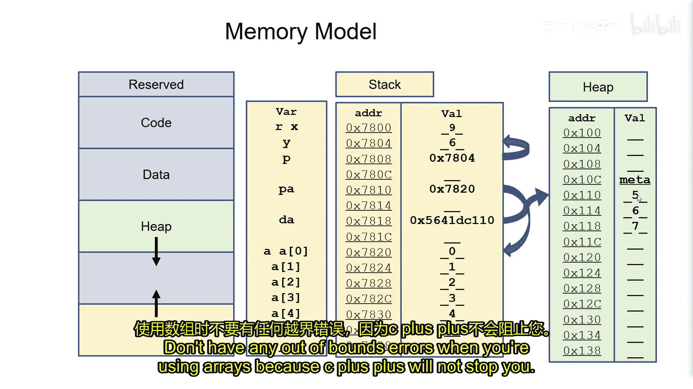

All right， Before I move into multidimensional arrays。

 I just need to mention that character arrays are special。

 All arrays of characters are terminated by this null character back slash 0。

 This is because a lot of the string libraries， particularly going back to see working with character arrays。

 depend on this terminating character。 in order to figure out how long the array is。

 So example I've got some examples here。 First， if we look at this top line character C 1。

 So C plus plus is going to automatically determine that I've got 1，2，3，4。😊。

For five characters in this string。 and so it'll create a character array of five characters if I do it like this。

 I have not included that null terminal character。 So this is going to lead to problems when I start doing manipulations with strings based on these character arrays。

Ca it doesn't have that null terminal character。 And I'll demonstrate that actually right here when we print it out。

 there's already going to be an issue。 This is the correct way to do it。

 I need to actually include that null terminal character。

 So this C2 array is going to have six characters in it because it needs to include space for that。

 If I declare an array automatically with the string notation。

 It will automatically include that null terminal character。 C3 will have a length of 6。 No problem。

 It's already going to be taken care of。If I specifically state that this array has a length of 5。

 the compiler knows that this string has a length of6。

 It's too big to fit in there and will actually give me an error。

Let me go ahead and demo this real quick。 So write that。ブーツ？G plus plus。File name。 So here we go。

 This is the here。 Iizer strength for an array of characters is too long。

 So this actually has six characters in it because it needs to include that null terminal。

 I've only reserved space for five。All right， so let me go ahead and fix this first。

That line will never work。It doesn't fit， I can't print it out if I never declare that variable。

I semi call there right there。G plus plus file name。 Here we go。 Now let's compiled successfully。

 Now， I told you there's going to be a problem because I didn't put that null terminal character in there。

 I'm expecting to get CS S 368。Right here when I print that out。

 Then the next line down should also say CS S 368。 That's what I'm expecting。

 Let me show you what really happens。I think I just compiled this， but。I don't remember。Yeah， I did。

All right， we'll run this code。 And here's what I really get。 Here's the first C S 368。

 But because I didn't have that null terminal character。 Remember， there's two ways。

 it's our job to remember how long the arrays are C plus plus does not take care of that for us。

 And there's a couple ways people do that。 You can actually specifically state the length。

 Keep it in a variable and just keep track of it that way。YouCould hard code it。 not the best plant。

 Or you can use a sentinel terminated or a marker terminated array where you put a special character at the end that you can detect。

 It doesn't work great with integers because all characters are valid， but all integers are valid。

 but it works pretty well with strings because the null terminal is technically not a valid character。

 And we can detect that。Because this is missing， it goes on and just continues to print whatever happens to be in memory next。

 which is actually the next string down C S 368。 I'll go ahead and change that in a second。

 and we can see that it actually chooses the next set of letters。 And This is that third string。

 The one declared with the quotation marks。 All right。 Give mean， once I， let go change that。

All right， I just went ahead， I made a copy of this so I can leave it in the template for you guys。

 Then I've added just some dollar signs to replace these。 I just made a copy of this line。

 And then when print this out。 we'll see what is going on。So here we go printing it out。

I can see I've got my CS368 without that terminating marker character， the backslash0。

 and then it prints out the rest of this string until it gets to that marker character backslash0。

 which is present in the second string， try replace with dollar signs。

And then this is from the string with the quotation marks。Al right。

 let me pull up the memory model and show you what it looks like。

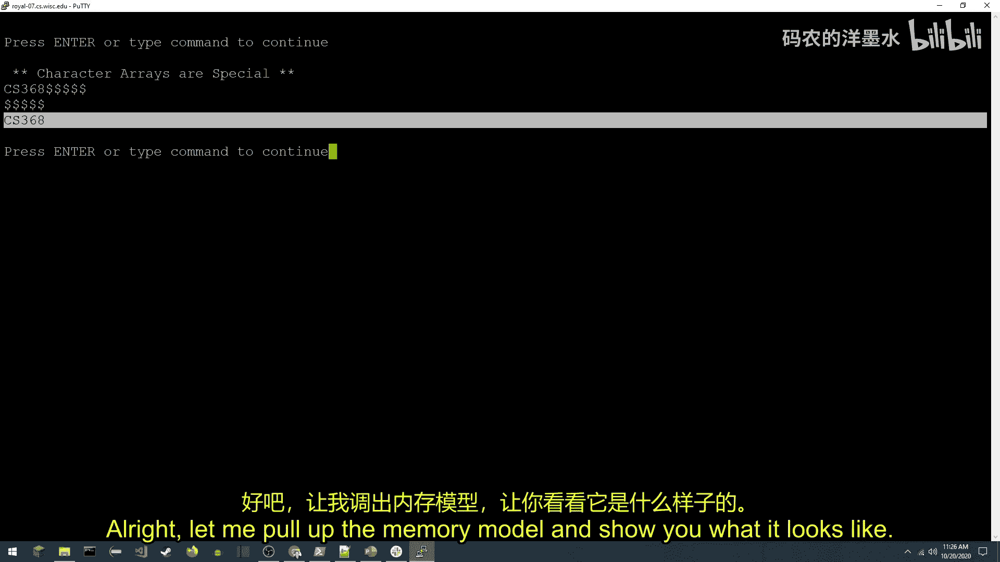

Allright， so I've got a conceptual picture here to explain what's going on。 Now。

 it doesn't exactly look like this where all the addresses are lined up。

 So if you took another class that explained how this really works， please don't give me a hard time。

 I'm just trying to explain why we get that error or semantic error， I guess。 Allright。

 so I've got my variable C1。 This was the C S 368 without a null terminal character。

It's the memory addresses that don't line up exactly right in the real world。

 but this is just for demonstration purposes， they're one by each， so I renumbered them。

Then I have the variable C 2， which was an array terminated by that back slash 0。

 It just happens to be in memory right next to this。 So the fact that when I print out C1。

 it prints out until it gets to the null terminal character。

 This was just a fluke that I happened to declare another variable that had a null terminal character right after it。

So essentially I just got lucky and then when I printed out C3 this again was the S368 with a null terminal character。

 so I hope this kind of explains what we saw there。

 if you ever get a weird error like that my advice of course is to don't use primitive character race for strings in C++ there's a string library use that instead。

 the only place that you're going to be forced to use it that I can think of off the top of my head there's probably more。

 but legacy code and command line arguments are going to be in。Primitive arrays of strings。All right。

 one other little cool thing I want to talk about for a second since it seems to fit right here。

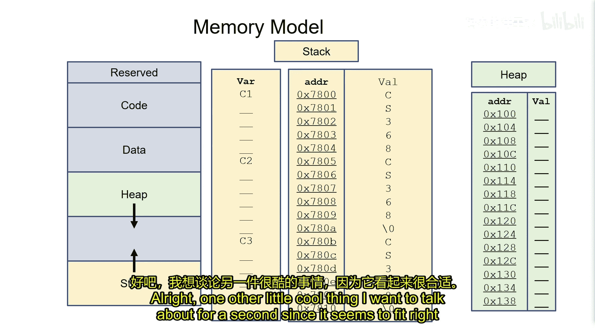

Is that string copy function I had at the very beginning of the class， overly complicated， very。

 very short condensed version。 just want to go over this and talk about it now that we understand pointers and how strings are null terminated this is where it really fits in the course。

Alright， so what I've done here is I'm going to be just copying one string to another using pointers。

 So I've got character array C2 here。 This is a valid one with a null terminal character。

 I'm going to go ahead and put this back。Real quick。So that I can actually copy the CS368。Alright。

 next thing， I'm going to create a new character array over on the heap。

 and I want this pointer to point to the beginning。 I don't ever want to change that pointer。

 I want a special pointer to that I'm going to increment as I copy。

 So I'm going to create a new pointer and just give it the address of that string。 In fact。

 I was just doing some testing。 That's overly complicated。 This is exactly what I need。😊，Alright。

 then this string company。 So S stands for source D for destination。

 I'm going to go through The first thing that happens is this D。Equals S。 So this is an assignment。

 I'm going to go grab whatever character is at S。I'm going to dereence it and put it into the dereenced D。

Allright。 then the post increment operator happens after everything else。

 And C plus plus is not specific about whether D is incremented first or S is incremented first。

 In this example， it doesn't matter。 It's going to increment one， then the other。

 So now those two pointers will point to the second character in the array。

So S will be pointed right here and D will be pointed at the next spot over in this character array on the heap。

 then it'll do this assignment， it'll copy exactly one character over。

 so I'm dereencing both of them to get the value。Then after that operation is complete。

 it's going to do it again。Now this whole while loop， it's an empty while loop。

 I've just got an semicolon here indicating that it's empty。

And the assignment operator returns whatever the value is of the character。

 So a first thing I do is I copy a capital letter C。 that's going to be some ASI code。

 It's just in number， and it's not0。 That's the only thing I care about。

 because anything that's not0 is going to evaluate to true in a while loop。 If you're curious。

 you can go look up the man ASI page and see the exact value for these characters。

But as long as it's not zero， then I'm good and I'll keep copying as soon as I get to this null terminal character。

What we'll see is that the。First thing that happens is it's going to copy the nu terminal character。

Then it's going to increment both of the pointers。 Then it's going to take a look at that return value from the assignment。

 which is the null terminal character。 that's going to evaluate。 It's basically 0 in ASI。

 it's going to evaluate to false and that's going to end this string copy。

 So let me go ahead and recompile this。 We'll run this code。

 And we'll see that it actually prints out the right thing。 Here we go。

 So now it's changed the value of C 5。 That's that new character array on the heap that I created。

 and store the value C S368 in that。Go back and take a look at the code again。

 I was using pointers S and D because those are going to be incremented as I move along and then C5 is the one that actually points to the data I character care about It's totally possible to reassign this it's not a constant pointer but I don't want to do that because when I'm all done with it I want to delete pointer to an array C5 because I created that on heap。

 left that out。 good practice。 let me go ahead and just remind myself anytime I use new I want to use delete。

All right， I just have a few array declarations here that can be a little more complicated than you might normally run into。

 And I just want to sort of walk through how to read these。

 So when you run across these in someone else's code or in code that I'm giving you for an assignment。

 they make sense。Alright， so first up， the very simple one。

 this is the one I've been using the whole time。 This is just declaring an array of 10 integers。

Ray 10 integers。 This second one here。 This is gonna be an array of 10 pointers to integers。 In fact。

 this might actually be better if I were to write it like this。

 So I'm going to read this inside out pointers first。 It's an array of 10 things。

 And those 10 things are pointers to integers。 This array of pointers is really common notation when we have larger objects that I。

 I just want to keep a pointer to。 So I I can leave those objects on the heap。

 I don't ever want to make copies of them。 I can save memory。So， this is。Aay。1。Pointers to。Integers。

 okay， this next one will completely fail Every time I'm creating a reference。 And again。

 this might think about trying this。More like this， reading inside out。

 I'm trying to create an array of 10 references。 This will not work。

 Refferences must be assigned or determined at the time they're created。 So this。Well， completely。F要。

Compilr error。Okay。All at this next one， again， I'm going to read it inside out。 So this much first。

 inside the parentheses， the star is telling me that it is a pointer。 Okay， so this is a pointer。

To an array。Of integers。 So every time I'm declaring an array， I need to give it an address。

 What I'm going to give it is the address of a an array of 10 integers。

 So let me go ahead and type this。P back。 All right， There's my comment。

 I could have also written this is just create a pointer given an array。

 Both the array is already a pointer。 This will create a pointer。 This is doing the same thing。

 It's giving me a little more information as a programmer。

 I can tell it that I've actually got 10 things in my array。

 So that might be useful as a way to communicate with other people or even yourself in the future reading your code。

All this next one is creating a reference。 So read the inside first。

 So this month it's creating a reference。To an array of 10 integers。

So this complicated notation is essentially doing the same thing as this one up here。

 except we're going to be able to get around using the pointer notation。

 Refences are going to be constant。 I can't change it。

 It's just giving me a way to come up with an alias， A second name to use for array。 So right here。

 this。And this ArR and this ArR ref are going to be used exactly the same way。

So a way to just create an aliaius rename something。And finally， the most complicated one。 All right。

 What I've got here。 again， reading inside out。 I'm creating a reference。

 I've got the little ampersand right there。 This reference is to。An array。 So I see。

 I've got my brackets there， an array of pointers to integers。 So again， I'm creating a reference。

To an array。Of 10 integers， pointers， pointers integers。Let me put that in a comment。

 I think I blurred though speaking too much third ago。

 arrayray is a reference to an array of 10 pointers to integers。

Probably could have chosen a better name than just array at that point。

Go and just comment and add Ray。Alias， we'll name it that。

Just to be a little more clear for you guys。All right。

 it's been about three hours since that I recorded that last clip。

 I'm pretty sure I'm up to multidimensional arrays。

 and then I didn't start this yet at meetings and office hours and then more office hours。Anyway。

 I'm back。 Okay， so multidimensional arrays are going to be declared in C plus plus with just a second subscript。

 So in this case， I've got three rows。 So the first one will be how many rows in the array and four columns。

 And there's no limit to how many of these I can have。 at least I don't think there is if there is。

 it's big。 I can also do multidimensional array 2，3。For and actually give this an initializer list。

 So this is going to be essentially a lists of lists。Thinking Python already。

So I need an initializer list with three rows。へ。I some commas here。

And then I'm just going to put some values in here。 So this is。Row 1， column 1， row 1， column 2。

 row1， column 3， row1， column 4。And then row 2， column 1 to 2。2，3，2，4。And three， one， three， two。

 three， three， three， four。So this totally works Also， I'll show that this compiles in just a second。

 Now in the memory， and I'll go ahead and draw a memory model picture in just a second。 Also。

 there's no need to put in all of these extra curly braces。

 This because of the way C plus plus is going to store this。

 It's going to put just all the memory is a continuous linear block。 It's going to put 1。

1 in the first spot，1，2，1，3，1，4， then 1，2，1，22。 they're just all going to be straight in a row。

So I can create。Der 3。For。Equals。And then just put all these things in and just one list。 So1，1，1，2。

1，3，1，4，2，1，2，2。Hopefully， I did something cool with editing to make that smooth。

We'll find out no later。 Anyway， this is the equivalent， but it's not quite as useful。

 not quite as descriptive for another programme or for you in the future as to what you're really creating right here。

All right， let me compile this， make sure it's actually running and I didn't make any typos。

All right。I actually made a note here。 This is going will completely fail。

 I was going to compile this and show you guys in array references， we cannot have。

An array of references。So let me go ahead， completely fail， comment this up， try again， right？

Pile time on， what I do wrong here， Oh， that's dumb。 I spotted it。

 I've got a semicolon right there in front of the equals。Because I have no idea。

 I just spent like six minutes staring at this。 All right， easy to fix also。做一 that。There we go。

 No mistakes。 Allright。 In a little bit。 I'm gonna be writing some functions that print out those arrays I just made。

 so I will be printing them， demoing that they worked。 They've got the right values。 But right now。

 I'm going to jump over and talk about that memory model。 one sec。

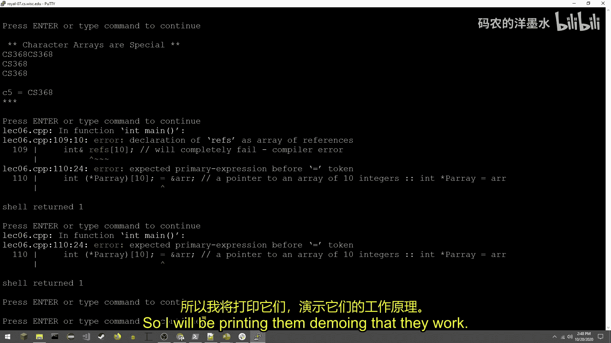

Alright， so I hope this is pretty straightforward。 When I'm put in a two dimensional array。

 I've got my four entries in the first row。 And just right after that， straight in memory。

 four entries from the second row， four entries from the third row。

 they're just all unwound into a linear array of numbers。All right， MD over here，0。

0 is going to be that first element。0，1 will be the second element here at 1，2。

 The next row begins right here at 10。 I'll talk about subsscripting those and grabbing just a row in a moment。

Again， row two starts right here。When I do it this， this way with just one。Subscript。

 this is going to be a pointer to the beginning of that row。

 So let me pull that up and show just demo some examples of grabbing data and grabbing rows from two dimensional array。

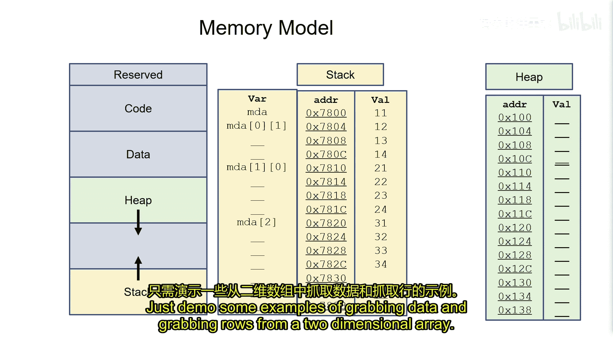

Alright， just a few quick examples of grabbing data from a two dimensional array。

 I've got all my code here and what it prints out。 So it might be easier to read this。In output mode。

 just though I wanted to show you guys that they match。Al， so as we go through when I run this。

 I've got that multidimensional array with 1，1，1，2，1，3，1，4 is the first row。

 I can just use the double brackets index into a multidimensional array。

 just like a lot of other programming languages。So entry 11 would be row， the second row down。

 second entry over， which was 22。This next thing， not an exhaustive list of all the ways we can interact with two dimensional matrices。

 two dimensional rays。 just wanted to point out some things that。

C plus+ is going to treat this as an array of arrays。

 So that second version where I was using all the brackets is really probably the most clear。

But if I add stars to this， I can dereence an array。

So this will give me a pointer to the first row remember all arrays are just pointers to the first element。

 so I can dereference that to get the first element and because it's an array of an array to actually get to that element 00 which is well I put11 in that spot so when I printed it out it's going to look good in a few minutes。

Yeah， that's this will just get me to the first one。

 just wanted to point out the use of the double star right here。

I can also use a lot of those other array indexing techniques。 So in this case。

 I'm grabbing a pointer to the very first row。 and again， this will be a pointer。嗯。

And then I'm going to index add position 3， and that gives me the fourth entry over because 0，1，2。

3 is the fourth entry or 1，4。And even more complicated。

 I get a lot of parentheses here because of the really low precedence of the star operator。

 But if we read this from inside out， MD 3 is a pointer to a pointer of integers。

 When I add one to that， it knows that there are exactly four items in the first row。

 So that plus one is going to jump down to the second row。 It's going to move from。

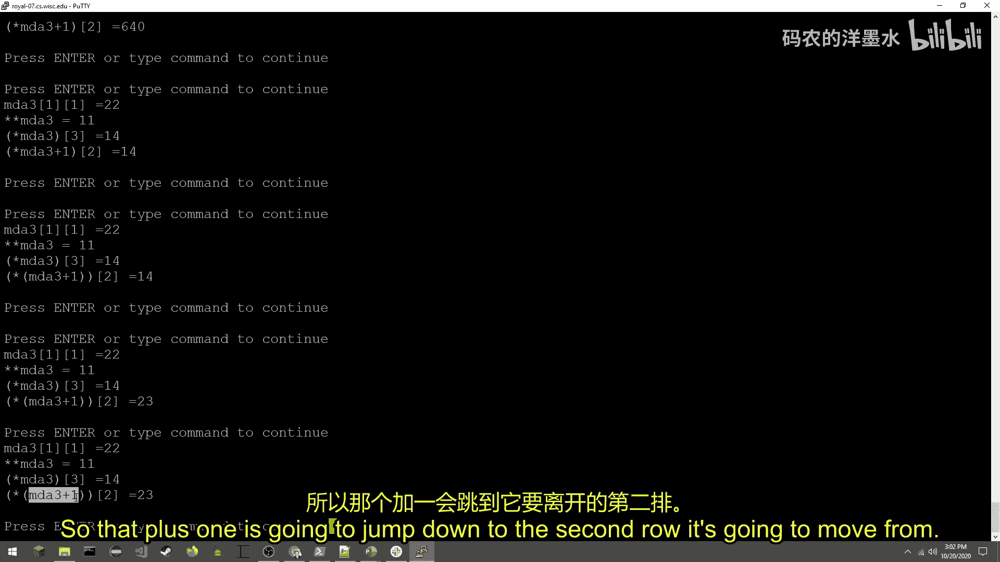

Yeah， so it knows there are four integers in this first row。

 so it's going to jump down and point to the beginning of the first row second。

Beginning of this row right here， row at index 1。

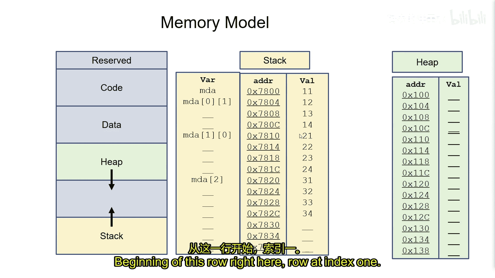

All right， that's this highlighted part right here。 then we'll dereence that。And then， take the。Yes。

 so this part does the math to compute the address。 This part says， okay， trace that。

 So we're going to the pointer to that first element。 and then we're going to grab the second index。

 So 0，1，2 is going to be the value 3。Alright， yeah， that's。

 I don't think I did the greatest job explaining that。 I apologize。

 Listen do it twice if you need to。All right， let me talk a little bit more about making pointers to individual rows once while I made some code。

right， in this example， what I'm looking at is just grabbing a variable and assigning it to one of the rows of my multidimensional array。

 The code is right here。Coode is right here what I'm doing， if I read this from inside out。

 I'm creating an alias or a reference with the ampersant that alias is going to be to an array。

With four elements。Of integers。And the array that I'm looking at is actually from MDA。2。

 that's this data structure up here。 And I'm grabbing row 1。So this is row 0。 This will be row 1。

 So that's going to point to these four numbers right here。 And then in my next piece here。

 I'm just going to go ahead and。Right here。Extract out row 1。

 So row is a pointer to these four pieces of data and index in and grab item 1。 So this would be 0。

 That's one should print out 2，2。If I didn't make any mistakes。Let's give that a go。Yep， here we go。

 And I just copied that code。 So you can see again what I'm grabbing reading from inside out。

 create a reference。 I'm naming it row。 It's a reference to an array。Of integers。

 which is exactly what we had when we declared MD2。 and then just grabbing item 1。 So 0。

1 is that number 2，2。Alright， give you one example of how to do that。 Hope that was clear。 I just。

 that's why I spent a little bit of time doing all these complicated examples with the how to read these from inside out so you guys can actually create。

Variables to bind a particular row。All right， just want to talk a little bit about looping over multimenional arrays if you guys have made it this far。

 if you've already taken Java， I'm sure you're familiar with using a double loop to go over an array with you know4 I equals0 to length of the row。

 4 j equals 0 to length of that row。In that index， you know， matrix Ij to do stuff with。

 I'm not covering that right here。 I do want to focus on one of the new features available since C plus plus 11。

 That's going be the range based for loop。 So for something using the colon to say in this data structure auto is going be a new type that's just going to automatically determine the type from whatever I've given it here。

 So MD needs to be something that's got elements in it。

 This is going to be the type of those elements。 whatever it is。 In this case， it happens to be。

An array of integers。 So row here is going to be the first row of those integers。

 So it's going to be this row the first time through the loop。 Then this row。

 the second time through the loop。Allright， the next thing I'm going to do because I've got an array here。

This type is going to be an array of integers， which I missed row is going to be a array of integers。

 I can do the same thing and iterate over that row of integers。 So in this case。

 each of these will be a reference to an integer。In row。

 And then I'm just going to print out the entry in the matrix space。 After I finish that row。

 I'm going to print out a end line。 And this will print out the matrix。 All right。

 I want to highlight too here that I need to create references to those rows。

 so that it knows that actually， the data type is right here。

 Here's the type of what we're looking at。 Oops， I missed that much。

 So reference to an array of four integers。 That's what I really mean when I said， auto。

 I'm not sure I got all the words in there every time。 but that's the type right there。嗯。Yes。

 and then this is just gonna print it out。 They need to be references so that it C plus plus knows how many elements are in there。

 This is new to C plus plus 11 It's gonna to be able to go back and know that this has。This size。

What it means is that it won't work when we start passing a to functions because that size information is not passed when we create the types of the parameters。

 they are just translated into pointers and I'll demo that on the last part of this when I get to parameter passing。

 which is coming up next。Alright， let me just real quick go ahead and write this。Compilile it。And。

Great screen。Run it。And just demonstrate that it is printing out the matrix。

 So this does work with C plus plus。 You do need the C plus plus 11 standard installed。

 So if you're working on a Mac using some sort of other IdeE。

 you may need to engage that compiler flag for C plus plus 11。

 There's a post on piazza with exact instructions how to do that。

And I think there's a comment in on canvas， like the important information on the top of our home page。

If not， I'll go double check and make sure there's instructions right there。Alright， next up。

 I just want to go over all the little details with passing parameters to functions。 by default。

 if I don't do anything special， parameters are going to be passed by value。

 That means I'm going to be making copies。 There we go。

 So here I I'm creating variable X during value 3 in it。 I'm calling my function。 I named it。

 Don't change X。 because I'm calling by value。 It's going to be making a copy。

 down here is the function definition， I see that I've got a parameter X。

 Even though I'm using the same name。 this is going to be a different variable。

 So it's going to get a brand new stack frame。 It's going to get brand new memory allocated for all the local variables。

 First thing that happens is it's going to copy the value of whatever is in this x 3。

 into the other x。 So two variables with the same name。

 just like a lot of other programming languages， including Java。 I'm changing that。

 This is going change the local variable X to be 5。😊，It's void。 I'm not cheering up。 Excus me。

 Now returning anything。 And then I'm just going to be printing out X。 When this function ends。

 the local variables are all removed from the stack。 technicalnly。

 it doesn't take you anything that the memory just moves the stack pointer。

 So that memory is still filled with whatever garbage was left behind by the function。

 But when it prints out X here。 It's going be printing out this X， which was3。 It was never changed。

 So let me run this。 And then I'll pull up a picture of the memory model to like have a PowerPoin to point2。

 Okay， so。I already compiled it， we run this code and we see that x equals oh， timeout。

I forgot to actually print X。 I just printed the x equals part。 So I just added that in。 Allright。

 we'll go ahead and run this。 Now we're getting x is equal to 3。 It was never changed to 5。

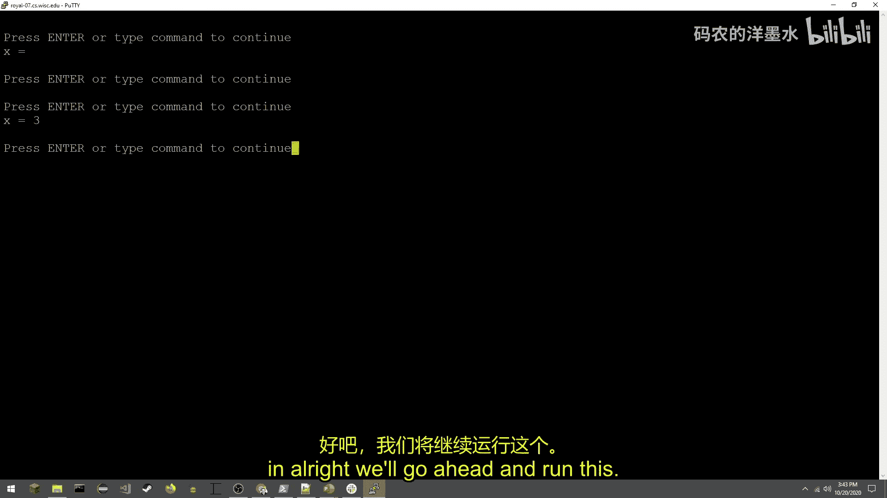

Okay， all right， so here's what's going on in the bottom red circle here。

 I've got a stack frame for main somewhere in there， I've got a variable x。

 and it's stirring the value 3。 When I call that function that don't change x function。

 It's going to store some meta information that the C plus post is going to need to remove this from the stack after I'm done with the function  essentially。

 the location of the it is the base pointer that points to the bottom of the next frame And then we're going to create a second local variable x as the function executes。

 it's going to copy this value 3 into that x and then change it to5 when it runs the code as soon as it's done with that。

 it's going to pop this frame off remove all of this information and x is still three in our main function。

😊。

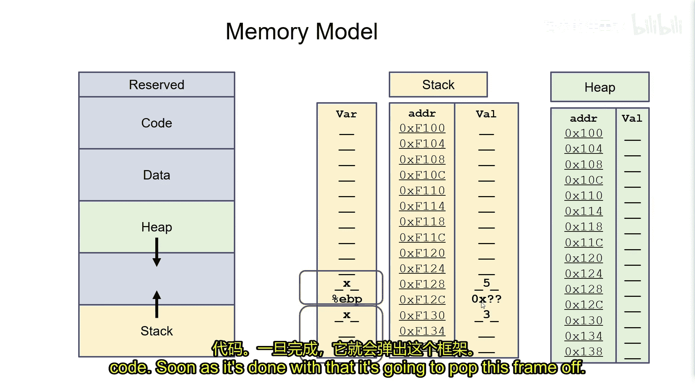

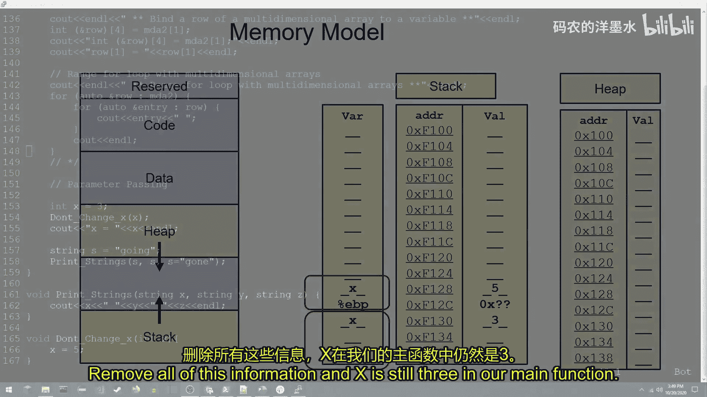

Alright， another feature of just basic parameter passing。 as I passing parameters。 In this case。

 I'm looking at my going， going gone example。 I'm calling a function called print strings that's going to be given this string S。

So I initialize S to going。 Then I'm going to print S S。

 And then here I'm going to print S equals gone。 Now。

 C plus plus is going to go ahead and evaluate all of these parameters and pass them to variables in the function。

 So print strings takes a string X string Y and a string Z。 Now， as of C plus plus 11。

 the order of operations for evaluating the parameters is not specified。 And on the C S L machines。

 this is going to happen right to left。 So the very first thing that's going to happen is it' going to evaluate this expression right here。

 reassign S to be the string gone。😊，And then。S is going to be gone， and S will be gone。

 So it's actually going to print gone， gone， gone。Let me just demo this real quick。 I just tested it。

 I ran it and you bring up the shell again。 Here it is。 I can see up the top， gone， gone， gone。

One more little quick experiment I can do。 Let me go ahead and add。One more detail。

 Let's make this the middle string。This probably would have been a better demo。

 but then that you lose the going， go and gone expression。Anyway。

 so what I've done here is I've just switched the order。 I'm going to print S first。

 This is going to be evaluated first。 It's going to be the word going。 Then this is evaluated next。

 It's going to change as to gone and send gone to the function。 So that'll be mapped to Y。

 And then S has now been changed to gone。 It'll be over here。 and gone will be sent here。

 So we'll have gone gone going when we're on this， All right。Let me go back to the shell。

 And right here is that gone， gone going。 So just a heads up。

 depending on the system and the version of C plus plus you're using。

 you may run into issues where the order of operations of things being evaluated in parameter lists are backwards from what you'd expect。

 so。Heads up and be aware that that can happen and you can prepare for that。Alright， next up。

 I want to introduce the idea of call by reference。

 I'm just gonna quick make a copy of the don't change X function。 Instead of calling， don't change X。

 we're gonna be calling function call by。Reference， all right。

 I'm going to make a copy down here of this function， bring it up。 So they're next to each other。

 It's been renamed， called by reference。And the only thing I'm going to do differently is I'm going to add an ampersand right here。

See is it an insert mode？There we go。I need to go ahead and add the prototype to the tops of this works。

So let me add this right here。Yeah。That needs to be replaced with a semicolon。 Okay， so again。

 I'm now when when I call a function， essentially， all of these lines are like。

 here's the variable declaration in y equals。 and then whatever is in the parameter string X equals whatever is in that parameter list。

 int reference to X equals whatever is in that parameter list。 And remember。

 the reference version is just creating another name for that same variable。

 So this will actually let me use the value。 The data in that variable。Right here， X， when I do it。

 And so this function， call by reference。Will， in fact， change X to 5。 And when I printed out here。

 if I haven't made any typos。We'll see that it's changed。 Alright， so let me write this。

We will compile。And。We will run this。And we can see that initially x was 3。

 That never changed when we ran it again after the call by reference， X changed to 5。 Okay。

 there's a couple of very good reasons to use call by reference。 It's essentially on the inside。

 just creating another。嗯。Name that points to the same data。

 and that can either be done to the pointers， which I think is what's going on when we use passing thanks to functions。

 if it's all in the same function， it's just going to the symbol table and the compiler will take care of that without any overhead whatsoever。

But it avoids the overhead of copying and lets us do。

 I guess what's known as centralized updates where I'm changing one variable based on。Another one。

 updating piece of data， using a reference to it。Okay， yet another version of this。 I'm going， again。

 just do some live coding。 I'm going to make a copy of this one。 instead of call by reference。

 I'm going to call by pointer。Okay， and we'll change。We'll give it here's an overview you。

You may to grab these three lines。Paste those again and change the name。Come my pointer。 Now。

 instead of giving a reference to X。X is now going to be a pointer。

 and I'm going to need to dereference that right here。 So now when I call like this a pointer。

 if I'm declaring a pointer。You know int star X equals。

 I need to give it the address of something address of what， whatever， something like that。

 something else that's an integer。 So when I call this function。

I need to do the same thing because this is gonna be create a pointer。 I need an address。

 So in this case。I need to put the address of symbol right there in order to make this work。

 I'm going to change x to。Place that with a 7 this time。There we go。

 So D reference X is now going to be equal to 7。My space pack that looks good。

 And now let's see here。Let me go back up to the top。Paste in this。不会的。Yeah。F looks's good。Not quite。

 I' pasted the wrong line。 What am I doing into star P。Alright， and getting in function prototypes。

 the name doesn't matter。 I just typed P because I was thinking pointer。

 but this will completely run。 In fact， when C plus+ goes through and looks at all the prototypes。

 it doesn't remember the names。 All it needs is that this is a pointer to an integer。

They're almost always there。 There's no disadvantage to including them。

 It's useful for other programmers。 And me next to you。

 and I come back and give this lecture again to know that I had。Pointter。All right， next up。

 let me just go ahead and save this。We will compile it and run it once I。

 I'll just go ahead and do that off camera。 Okay， when I compiled it， I ran it。

 And the result is that x is now， in fact， indeed changed to 7。

 I didn't print it out inside the function。 I did that way down here。After the function was called。

So just one more version where I can call something and change it。 Now。

 where might I choose these things。 this is the way that I would almost always do things a cu by reference。

 if I want to just avoid the overhead of copying data， if I'm not going to change it。

 this is my preferred version。 And in fact， if I know I'm not intending to change it。

I'll add the keyword construct right here。 I'm changing in this function right here。

 So this would be a bad choice， a bad example。But this is my go to if I'm just needing to avoid the overhead of copying data。

 If I want to be clear if I'm writing a function that someone else will be using。

 I'm going to come back and I'm going to use my call by pointer version because they're going to have access to the。

All of the prototypes。 And they'll know that this function is taking a pointer。

 They may not have the actual definition if I'm working for a software company and providing an API for someone else to use。

 but they'll have access to how do I call all of the functions。

 And when they see that this is called by pointer。Then they know that they will need to give it the address of variable。

 And there is a strong chance that this variable will be changed。

 So this is a clue to your user that， you know there may be a side effect。 I might be changing X。

 And if I don't want X to change。 I need to make my own copy and give it to you。

 Just a quick note on functions that return pointers。 This is very common to return a pointer。

 but we have to be very careful with this right here。

 I'm creating a string H is just the with a space after it。 I'm going create a new string。

 This is a pointer to a string nical。 I'm going call my function duplicate X times。

 I'm going give it that string。 And how many times I'd like to duplicate this string。

And then I'm just going to print it out。 So I'm dereencing here here I'm creating the pointer。

Excuse me。 So my function is going to be returning a pointer。

 So the return value goes in front of the name。 I've got a return value right here。 function name。

 I'm giving it this string。 And again， I don't want to deal with the overhead of making a copy of a string when I can just use that directly。

 I have no intention of changing my string H over here。 So I'm going to make it a constant。

Here we go， Cons。And reference。 So I can just use that data directly without worrying about my function changing it on the inside。

 If I'm giving this prototype to someone else to use my code。

 they can seeize the prototype and very easily know that this function will not change their data because it's constant。

I'm also going to give it the number of times to duplicate that string。

 And just we're doing on the inside， I'm creating a new result string and the assign it initially did the value H。

 create a little loop that's going to go through x times and just say s is equal to x plus S plus s。

And then I'm going to return the address of that pointer。Because it returns a pointer。

 So whatever the return value， the variable that I store it in needs to be a pointer。

 So I need to give it the value S。 Allright， this looks like it should be good。

 but there's a problem。 And in fact， the compiler is going to give me a warning right away。

 Let me pull that up。All right， here it is right up here， warning。Right there。

Add of local variable S is returned。 So what I've done is I've created a local variable in the stack frame for that function。

 The moment that function returns， that variable is no longer available。

 There might be some useful stuff still in there。 But the moment I call another function or create another variable。

 it's going to be overwritten。So it might work， it might not work， this is very bad practice。

All right， in fact， when I tried to run this， it gave me the error message command terminated here。

 printed out all that stuff。It got to the line where I was printing out the string and failed。

Alright， so to fix this， I've got a couple of different solutions I can use。

 and none of them are great。 But the best one is to instead of just making string us a local variable and copying it。

 instead， what we're going to do is。😊，Create a new pointer to a new string on the stack。

 So I've kept all of this code as it was。 But here before I return this。

 what I'm going to do is create a pointer to a string。Create a new string。

 So this string will be available on the heap。 It's not going to be lost when the stack or when the when the function ends in that stack frame is deleted。

 I'm going initialize it with the string that I just created here， my local string。

 So this is making a new copy of that。 This is extra work。 There's probably better way to do this。

 But I thought this one made stents from like an instructional point of view。

 I need to create a string on the stack。 I didn't want to mess with my code too much。

 And that's what I'm going to be returning。 So before I had Ampersand S here。

 because I was returning the address of this local string， here。

 I'm just straight up returning the pointer。嗯。So let me just show that this works。

So go back to the shell where I compiled it and then ran the code and printing out hah 32 times。

 so we're laughing maniacally ha ha ha ha ha。All right， I had fun with that。

But the the downside to this is I'm using the new operator here inside of a function。

 It's going to be up to the call to go back when they are all done with this and delete。This string。

 in this case， I called it maniacal。When we're all done with it。And they need to be warned。

 so if I'm writing an API for another user or something。

 I need to put in the comments that they need to call this function deletete when they're done。

Exactly once。 And that can be tricky to do。 Mem management is one of the most difficult things that C plus plus programmers run into。

 It's the root of almost all the really bad errors out there。Allright。

 so some other solutions would be to use a global variable or to use a static local variable that we can then return。

 And those both have their own problems too。 if some other function changes the global variable while I'm not paying attention or if I call the function again with a static local variable it'll change both my maniacal plus wherever else I've called that function。

 if I gave it another variable， they all get changed because there's only one copy I'm not going go into more details about static local variable。

 that's kind of。Getting away from my。Talking about parameter passing， one last thing。Alright。

 so we just talked about returning by pointer。 Now I want to talk about returning something by reference。

 So here's my example right here， beginning with this string。 It's a quote from the R Strotroop。

 the inventor of C plus plus。If you think it's simple， then you have misunderstood the problem。

 I one of my favorites。 So here's what we're going to be doing。

 We're going to find the alphabetically last letter of that quote。 Allright。

 and just put it into a character C。 Now the primary reason I would ever want to return something by reference is to avoid the overhead of copying here。

 I'm actually making a copy because I've just got care C is equal to this is going to return a reference to something。

 So in order to avoid that overhead of copying， what I would really like to do is put in。

ComThere we go。 it finally let me do it， put in an empersent right there。

This has been a real problem all afternoon。 this morning， it was working great。

 Now my connection to the CSL machines is so poor。 It's missing characters I'm typing。 have me crazy。

Alright， we want to return a reference and store it like that。

 They will both work without the ampers。 It's going to make a copy。 Now， here's the idea。

 I've got a find alphabetically last letter wrong。Version right here。 This is not going to work。

 It'll give us an error。 But the idea here， it kind of makes a lot of sense to people。

 and it's a really common mistake。 So I want to just show you the wrong version and then how to fix it。

 So here's the idea。 I'm giving it a string that I have no intention of changing constant reference to a string。

 I'm going assign the max care equal to the very first one in the string。

 So it'll be that I right there。Then I'm just going to go through and use my range for loop and just iterate through the data。

 so all of the characters in the string。 so the first time through it' will be an I。

 second time through C will be an F。 If that character is bigger than the maximum1 I found so far and I just made a copy here of the first character。

Then I'm going to upgrade that。 So the max here will now be a copy of whatever the biggest when it finds it。

 The alphabetically last character in this string is actually the wide right there in you。

 That's the one it's going to find。 So this is going to return that max character。Now。

 what it's doing is actually returning a local variable。

 This is a reference to a local variable on the stack。

 which will be deleted as soon as this function ends， might be deleted。 Maybe not。

 mightight still be there， but eventually， the program will overwride it。Allright， so this is。

 in fact， to give this a warning when we compile this。

 let me go ahead and bring that up and show you what it says。There we go。

 warning reference to local variable max scare return。 So that's not a good plan。 Now then go back。

 scroll down a little bit where I've got a better version here。So find alphabetically last letter。

 I took out the construct here in case you wanted to change it。 this is how you do it。

 If you want it to be a con and never change the string， that's not a bad idea。

Throw a constructsite there， you'll have to also return a constant reference to the character。

 Otherwise it's going to be the error message is discard qualifiers。 constant is the qualifier。

 So if you ever see that error message。 So we'll need a constructstrainite here。

And then we'll also need to be able to， So this will。At one moment。

 Let me just walk through how this works， so。When instead。

 what I'm doing is I'm going to look at the index， I'm going to be returning something that has a lifetime that exceeds the duration of this function。

 So basically， I'm going to be returning a reference to one of my parameters。

 That's almost always what I return as reference to a parameter。

 It's gonna avoid the overhead of copying。 I've got huge parameter。

 These are big could be a gigantic string。 I don't want to copy it could be like a collection of different DNA strains from animals。

 Gen sequences。 Something big。 is where I would use this。 And I want to be efficient。

 So I'm going to send in a constant reference。 And then I'm going get a constant reference back。

 So I don't have to copy something back out of the function。

So but the strategy here is I'm going to be looking for the index of something in this。 Obviously。

 a character in a string is only one， but not a big deal as far as size goes。

 but I just wanted something that illustrates the strategy。

So I'm going to go through all of the different indices using different style loop here。

 Check it out to see if that value is bigger。 And I'm going to track the maximum index。

And then what I really want to return at the end is a reference to one of the pieces of data in my string S。

 So in this case， it's just a part， just one of the characters。

 the one at the max index of the string。 And that's going to be returned as a constant care。嗯。

A reference。 So I made a couple changes as I was going through this code。 Let me go and。

Haved this up here to find alphabetically that， I changed this to cont。

So that it's I can use a constraining。 This is probably。

The most likely scenario you will encounter this， if you do want to be able to change your string using the。

 you know， find the maximum character and then。Go back and change it。Llieeave out those cons。

 Alright， And then next up。When I called the function。I believe I。Yes， right here。

 I just put this in a character。I'll need to make that con also so that it doesn't discard that qualifier。

All right， let me write this。We going compile and run it。

And we can see that the alphabetically last letter is indeed why， just like we expected。Alright。

 again， a little bit with the cont because that can be confusing if I do something。

 so constant reference could I need the con if I'm returning a con。Reference， so I don't lose that。

 If I'm just making a copy of it。 Then I will leave out the reference。 It no longer needs to be cont。

 This is gonna find a copy of that。 Make a copy of the result。

 So this piece right here It beginning to be a constant reference。

 But when I sign it to the new variable。 this is going into a completely new memory location that's not been designated as const。

 Let me show you that this works。 All right， So I compiled it。

 I still have that old function there with the warnings。 ran it。 And I can still see that this works。

 this is the one that I can change now。 but it's not connected to that string。

 It's no longer a reference to a piece of this string。

Once I just made a new variable and assigned it to see。 Allright， so next up， I want to。

 I need to talk a little bit about passing of rays and multidisional arrays to functions。

 And we'll call this good from right there。All right。 I just went back and wrote some more code。

 I hope this is working well where I pause the video。

 write the code and then come back and just talk about it。

 I know it probably makes it hard to keep up if you're trying to type all this at the same time and follow along。

 I apologize for that， but I think it's a lot smoother when I type first and then talk about it。

 So here's what I'm doing。 I'm creating an integer array with the numbers 1，2，3，4。

 And then I'm just going a function printing array。 And to pass an array to a function。

 if it's just a simple array， I can just give it the name like this。 Well。

 as a parameter I just give it the name。 let's get a look at print array real quick。

 That's found right here。So print a array， when I put the parameter in， run around'm getting int。

Aray equals something。 And what this is going to be equal to is this array variable。

 So I need to tell C plus plus that it's an array。 And that's what these brackets do。 Also。

 C plus plus is going to discard any of the size information as an array is passed into it。

 In a second， I'll write another equivalent version of this and show you what that looks like。

 because C plus plus is going to discard the size of all primitive arrays， I also need to pass that。

 If I need anything related to the size。 Like if I want to iterate through the entire array。

Or if I want to do any bounds checking to make sure that it's not going to break something。

 In this case， all I'm doing is iterating from I equals 0 to the size that I gave it。

 And it's just going to print that out。Allright， I've got a couple functions here。

 I've got increment array。 Also。 remember that arrays are pointers。

 And so when I pass by an array to a function， it's still pass by value， but it's passing a pointer。

 just like when so it's making a copy of that address。

 which means that I can use that copy of the address to go ahead and change the array。 In this case。

 I'm just using a loop for I equals 0 to size。 And I'm going to increment that。 And then right here。

 we printed it out again to show that it's been incremented。Alright。

 so let me let demo that this works。 right， we will save it。And right， give me a second I。 Okay。

 I got it compiled And it。 So here's all the other stuff from boot earlier。

 Here's a copy of that array，1，2，3，4。 I've incremented it， and I get 2，3，4，5。

 So it does indeed change the values in the array。All right。

 there are two other equivalent ways to write this function prototype。

SoI'm gonna go ahead and make copies of this。 The first one is this one right here into array with the brackets。

 I'll keep that。 The second way is to remember that this is just a pointer。

 so I can insert the star here。 get rid of those brackets。 This is equivalent。

 This is gonna work exactly the same way。 I'm just creating a new parameter that points to that array in the。

Main spectrum frame。Alright and the third way to do this is to go ahead and put in an actual number here to tell it how many prim there are。

Te how many elements are in the array。 This is completely ignored by C plus plus。

 It doesn't care what you put there for us a single dimension array。

 When we have a multidimensal array。 I'm going to do that in a second。 It does matter。

 We'll have to put in numbers for every element。Or every dimension except the first one。

 first one doesn't matter。All right。Actually， let me go ahead and I'm just。

Comment out these two guys。And we'll leave that first one。

 You have these for reference when you download the code at the end of lecture。Alright。

 let me just wrap up by talking about passing multidimensional matrices。

 primitive matrices to functions。 So here I'm declaring a multidimensional array or our matrix。

 Again， this is just copied from above。 it's the same1 I was using in my earlier demonstrations and then I'm going to call function print 3 by four matrix and a lot of the same rules that I just went over for primitive arrays apply here。

For multidimensional， the exception is， I' am absolutely required to put in dimensions for all of the indices。

 except the first one。 So this is sort of the default version of what's going on。

 C plus plus needs to know how many pieces are in each of the rows。

 But it doesn't actually care how many rows there are in the matrix。

 So I'm required to put in everything but the first right here。 This code just goes through。

 It's got the double loop for I goes from 0 to 3 for J goes from 0 to 4 for a 3 by 4 matrix。

 I hard coded that rather than passing sizes in。And then it's going to just print out the the matrix。

 Let me go ahead and run this。 and then I'm going to talk about two different versions of how to declare the matrix up here。

All right， so I just compiled， I did run it， here it is。All the garbage from earlier in the lecture。

 and here's the matrix that it prints out， so it's working just fine。

I'm going to make one little change right here I'm just going to。

Put a typo in the name of my function right here。 So let me insert。Let me insert keyword completion。

 Why， why， why， no。Alright， time out。 Let me make I fix this。All right。

 so I've made a typo in the name of the function。 Go that fixed。

 I just added a bunch of garbage to the name。 And what I wanted to show you guys was the error message that pops up with this function is Tesno prototype。

嗯。So let me go ahead and run this。 What it's telling me is there's an undefined reference to the function that I'm calling because I just took that out and what it's looking for is this as the type of the input。

 So what this is telling me is that I need the name of my variable and I have the type here。

 So when I call print matrix， it's got to have this type int。

 and it's telling me that the first when I read inside out， the name。

 the name goes right there between the star and the parenthees。

 What this is telling me is that it's a pointer to and again a with four elements of integers。

 read this from the inside out。 But the error message will tell me exactly what I'm screwing up。

So another way to write this would be to go back over here， let me put the name back。There we go。

 And instead of a matrix like this， what I can also write is star matrix。

 I need to give the name right there。And then。Again， so this is a pointer。To an array。Of integers。

 And again， it doesn't care how many rows。 So essentially， this is a row of the matrix。

 It doesn't care how many there are for the function。 Alright， so this is another way to do this。

 Let me compile this and just verify that it still works。 And that I didn't make any mistakes。 Yep。

 looks like it's still working。 Let me go ahead and。Run this。And see。

 yep still printing the exact same thing。 So this syntax also works right there where I'm using the pointer version。

 The other thing I can do is I can actually。嗯。Give it both dimensions。

 There's nothing wrong with putting in。Mattrix 3，4。

 and just letting C plus plus know that there's a three there。

 It's going to completely ignore that it will not retain this information。

 It's just going to translate it into a pointer to。Rose arrays with four integers。Alright。

 I'm gonna wrap this up here。 Let me go put the video through editing and then get it put up on YouTube。

 I'll send you all an email when it's ready。 And until then， have a great day。😊。

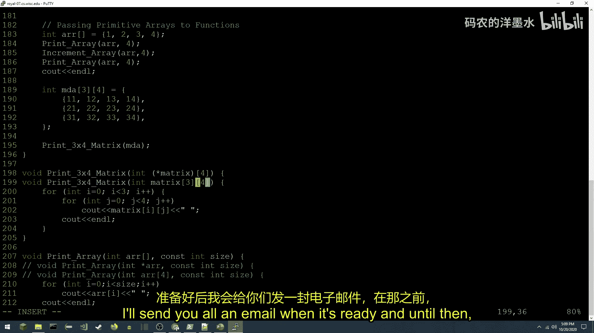