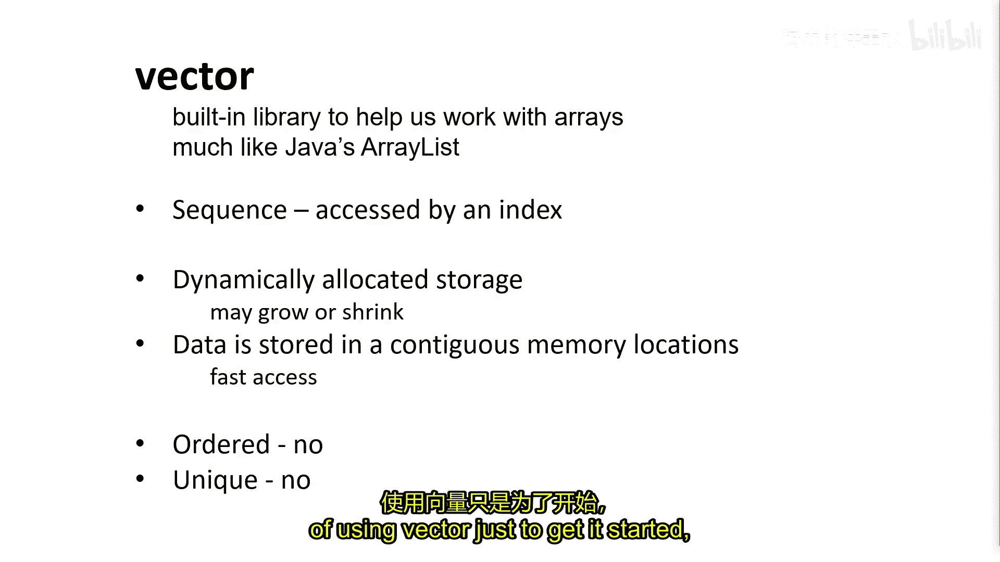
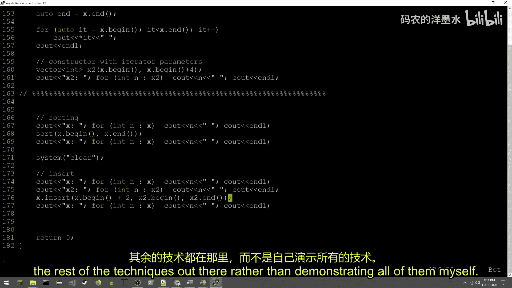
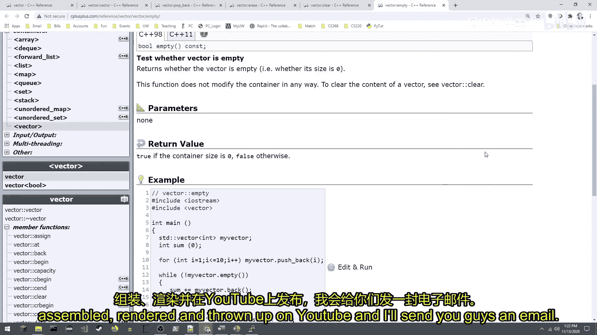

# 【全集】威斯康星大学 聚焦系统级编程 面向Java程序员的C++ CS368C 中英字幕 1080P p07 Lecture 7 - 向量 -BV1o72QBREfu_p7-

Al right， everybody。 welcomelcome back to C++ for Java programmers。

 The last two weeks have indeed been quite rough for me。

 Thank you all for the messages and your patience。 I can see my test results from Tuesday online。

 but I'm still waiting to hear back from my doctor to interpret them。

 It looks like low potassium is the only thing that came up again。 So I don't know。

 I'm guessing genetics。 but anyway I'll hear back from her pretty soon。 All right。

 so the plan for today。 go ahead download the template and the code it's on online for today's lecture you can follow along as you go through and actually try out all the demonstrations。

 But today we're going to be talking about the standard template library starting with containers。

 These are just going to be built in data structures。

 we're gonna focus specifically in this lecture on the vector。

 That's a library to help us work with arrays and we'll go through all the features of that。

 And then next lecture we'll talk about all the rest of them all in one lecture。😊。

Following that introduction， we're going to be looking at iterators。

 a lot of the standard template library is built around this idea that I'm going to have pointers to elements in a data structure the algorithms library is about 50 or 60 different functions designed to work on ranges of data like a piece of a vector or the whole vector and we'll be giving those algorithms like for example。

 sorting the beginning and ending part of the vector and it will'll just use those pointers to iterate through code the data while it's sorting them。

All right， to get started， I just grabbed some definitions off the Internet。

 First ones from Wikipedia for data structure。 Now， as we write code。

 we're going to need to make decisions about how to best organize our data。

 and we'll have specific goals for working with that data。

 We're going to want something that meets those goals。 And we have lots of choices。

 So data structures are really going to give us storage of the data and the functions and operations that we can apply to that data to change it or modify it or sort it or whatever we wish to do。

Built into C++ is the standard template library where we have containers or their definitelyinite a version of data structures。

 they're just going to be holders that store a collection of objects or those objects could be primitives or objects like strings。

Are classes that we write ourselves。 These are all implemented。

 at least all the ones I'm going to talk about are implemented as templates。

 And a template in C plus plus is like a generic in Java。

 It just means that I can give it pretty much any type。

 I just need to tell that this is an array of integers or an array of strings。

 Or so I need to give it a type。 And that's what this templated idea is。

All right we've got lots of built in choices do to mimic like really common programming structures so for a dynamic array that's going to be this E++ vector Q is actually named Q stack is named stack we want to heap that one's known as a priority queue。

 the list is the classic linked list， Any of the trees。

 three data structures are going to be sets or if it's an associative array then a map。

And right along with all of these data structures and the containers。

 we're going to see that we have a collection of functions that are designed to go along with these templated data structures。

 The algorithms library is a collection of like 50 or 60 functions。 and this is where sort is。

 there's like just a lot of them。 Well so it's the only one I'm going to work with today。

 but I'll bring out some of the others as we go through the remainder of the course and I highlight how to use them particularly in the very last lecture when we talk about function objects。

 but I'm getting aside of myself。So it's just a collection of functions that are going to operate on range of elements。

 So if I have a vector， I've got a whole bunch of elements all in a sequence there。

 and these functions are designed to work on that kind of data。

 anything that can be accessed with these iterators or pointers。Al right。

 just to show you a little bit about how these things break down， I've got them sorted here。

 This is actually just a screenshot from the C plus plus dot com dividing them up into the sequence containers。

 These are going to be things that store all of the data in like a adjacent memory locations。

 So it's going to give us really fast access。 if we have like an index。

 We've also got the sosociative containers down here。 set multiet map and multimap。

 These are going to be containers that are accessed by some sort of key。

And then we've got container adapters are。More specific。

 they're sort of like limited versions of these things， or they might add one extra feature。

 But like， for example， the Q is actually based on the double ended Q。

 also known as deck and just limits what they do with the deck right here。

 So these adapters provide very specific focused functionality based on these things。

And then for the associative containers， we've also got unordered versions of all of those also。

 So that's just a matter of how they sort the data internally and can affect performance。

 And we'll talk about that in the next lecture。 Also。

 so I've already just gone through and talked about whether containers are sequence or so asciative that's the sequences we're talking about vector today。

 It's second one down right there。 So sequence versus associative。

 There's a great reading available linked on the webpage。 and go check that out。

 But so here's how I'm gonna to be classifying all of these containers and talking about the performance trade offs。

 So whether it's sequence or associative。 These are going to be accessed by an index or a key。

 Those are their choices。 Now some of them are going to be dynamically allocated。

 and some of them will have very fixed size。 In fact。

 that's the primary difference between the array and the vector。

 the arrays of fixed size and the vector is dynamic。They're pretty much all going to be templated。

 What this means is I'll need to tell C plus plus when I'm creating a vector that this is going to be a vector of integers。

 So， and this is and then finally， whether they are whether the values are ordered or unique。 So。

 and for now， I'm for the rest of this lecture， I'm just going to focus on vector。

This is a builtin library that's that's designed to help us work with arrays So during the last lecture during the last homework we struggled using all the different arrays and accessing them with pointers。

 This is designed to make all of that stuff a lot easier it's a lot like Java's a array list So if you're familiar with that this should look familiar and you should expect there to be a lot of certain things available to us。

 It's just might be a matter of looking up how do I do this thing from Java in C++ and I' we going through a lot of examples for the remainder of the lecture。

But so the vector is a sequence container。 So we're going to be accessing it by an index。

 and the bracket version of indexing， just like we saw with the primitive arrays。

 works just fine here。 They've done their best to mimic that。

 It is dynamically allocated so we can grow or shrink it without having to do any extra work。

 It's all we're going to be taken care of internally for us。 So no more creating a brand new。

 bigger array and copying everything over。Now the data is also going to be stored in contiguous memory locations。

 so I'm just going to get a block of memory and every element is going to be stored。 you know。

 the next one is then the next couple memory pieces down。So access is fast。 It's also not ordered。

 It's just the order that we decide to put them in。 It's up to us。

 it's not going to be sorted or anything。 And it we're not requiring the elements to be unique。

 We can have multiple copies of the same thing。 So if I create I guess what I mean here if I create an array of numbers。

 I can put in 1，1，1，2，2， So I've got multiple versions。 They're not unique。

 And then I could also say they don't need to be ordered。 I could put in 9，6，7。

And it's not going to sort them for me。 It's going to be in the order that I request。So next up。

 I'm going to pull up the CSL machine and just go through a bunch of examples of using vectorctor just to get us started。

 show everybody how it works。 Alright， so here's what I'm starting with。

 I've just got my basic empty template。 I've included Iiostream and Iom andip so I can print things out look good and using namespace standard。

 And then I've got an empty main right now。 The template online。

 I'm gonna be developing my lecture code， and then I'll go remove pieces of that。

 So the template will have a lot more of like the subheadings show you guys and it'll just be a matter of going through and filling them in and I'll probably leave this。

 But the very first thing I'm going to need to do。😊。

Is include vector。It is a library that will need to bring in every time we want to use it。All right。

 and then let's see here。Let's get started by just how to create a vector。

Let me just go ahead type this， I'm going to create a vector called colorsors。

And it's going to be a vector of strength。 And then I'm just going to give it some basic colors， so。

Go ahead put three in。Let's see here。Put in red。Bream。I study computer graphics。

 those are good colors。Alright， so this is all we need to do。 So I need the keyword vector。

 And that's just like if I are creating an integer。 If I had indexax here。

 this is the type indextax this， the type of this。variableable is vector string。 Okay。

 and all of these are templated。 So I need to use the angle brackets to say what kind of something it is。

 Some of the things will actually have more than one piece inside the template。

 like a map maps a key to a value。 We need to give the types of both the keys and the values there。

 So， but in this case， I'm just creating a vector of strings。 And so that's all I need to do。Alright。

 let me go ahead and I don't need that。 but let's go ahead and print these out and just verify that things are working so。

There we go， let's go with see out。And then。Hey， let me type this real quick and I'll be right back。

Now， so finish typing that。 All it's gonna do is print out the first color is。

 And then to access any of the pieces of data， I can use the brackets to give it an index number。

 just go ahead and look up。 So this one should say the first color is red。 And again。

 the vector starts at 0。So C plus plus is a zero based indexing system。

 Let me go ahead and just run this。I already compiled it。Just to make sure I didn't have any typos。

 Yeah， so the first color is red。 I's list that right there。So this technique here。

 this creation method is known as list initialization because I'm just giving the vector directly a list of values。

 I just want to point out， too， I can copy and paste this and。There's another version of this。

 I can just say colors2， and I don't need to put the equals in。 so this will also work。

Let me just compile this。And show you that it does not give a compilation here。

 but I don't think I'll do more than that。There go， no compile error。Perfect， so this also works。

 like I've got a little shortcut here。 I think this might be C plus plus 11 and above feature。

 So if you're not using C plus plus 11 and above， that might not work。

 let me put some headers in So of to break this up into some categories One sec while I organize my work。

Alright， there we go。 So I've got a section for initialization， sectioned about accessing。

 one thing I want to point out to really common mistake。 Let me go ahead and create colors3 here。

Colors3 is to use the wrong kind of bracket。Whoops， Hong。Place three， replace parent C。

Re the parenthes， this does not work。Chaangnge my comment。This is a really common mistake。

 here let me just go ahead and run this。And show you guys the g enormousous error that we expect or that we get。

 Let me scroll up here。 The very first error message is the most important one。

 It's going to tell us there's no matching function call， and。Oh， my first thought is what。

 What does that mean， Let me go back to that line。 It's It's looking for a function call。

So it's basically trying to use the constructor for colors 3 for a vector of strings and there isn't a structure available that takes three strings as a parameter and so that's why the function call is available it's trying to call the constructor is that function that we're trying to call to create this data structure the vector and there are versions available I'll talk about some of those in a moment that do take parameters but this is not one of them。

 So this is a common mistake that I make when I screw up and put in the wrong kind of braces。

And that error message was horrendous。 It took up like two full screens of stuff just to like。

 tell me that I've used the wrong kind of braces。Alright， next up。

 we can also change the data with this element access。 So if I go ahead and say colors。

And then we'll go ahead。0 is equal to。Orange。Then I'll go ahead and change the first color so。

The first color is。Now that， okay， let's go ahead and compile and run this。Wops。

 I made a mistake here。 Hold on。 tell， I didn't comment at that other line out， did I。This one fails。

Right。好好。And run。 Okay， yeah， the first color is red。 I changed it。 The first color is now orange。

 looking right there on that part of the screen。Alright。

 some other really common things that we're going to want to do。

 So this first section is just going to be just the basics is get the size of a vector。

Colors not size。Okay， yeah， so there's just a method available for the data structure。

 for the vector that's got size and tells me exactly how many elements there are so。

round that three colors in the vector。 Let's go ahead and print all of them out。

So one way to do that， I could obviously just write a for loop。

 Let me go ahead and do that real quick。So this version is just going to use a standard for loop for our I equals 0。

 I is less than colors that size。 I plus plus。 We're going to be accessing colors right there。

 actually。Try to make a spaced out a little better。 So it looks good。 Yep， print it out。

 add a space after it， And then we'll put a new line after're all done。

 Let's just see what typos I made。Yeahep啊。Too many of those。Run this。 And here we go。 orange。

 green and blue。 Alright， there's another option for writing this loop。

 This one took me three lines to write for I could also use。For string S in colors。See out。

Let's print out that string。Flowed by a space， that's the end of that line。

 So that's going to be the entire contents of the loop。

And then when I'm done running that one line loop， I'm just going to go and print on it on a new line。

Right there。So in one line， I'm about to do the same thing I just did in three。So right that。

They'll figure out what typos I made， no typo sweet。And we'll run that and exactly the same thing。

Orange green blue。So this version is going to go ahead and grab each of the items of the data one at a time from colors it's an iterator version that to be honest。

 a C++ is just going to take care of all of that coming up with the iterator。

 getting the pointers to the object， dereencing them， doing all of that for us。

 so I didn't have to worry about any of that weird stuff right there。Alright， allright， next up。

 let's go ahead and add more data to this vector。 So to do that。嗯。

The function that I want to call or the method that I want to call from the vector library is known as pushback you can think about this as kind of like as though I were thinking about a stack。

So pushback， I can give it a new element to put in。Let's put in black。And then I can do here。

Let's just copy and paste some of these lines。I can check the size again。

And then let's go ahead print out everything using that version because it's one line to copy and paste。

 Allright， right。Compile。No typos and run。 Okay， here we go。

 So here were the two versions of printing orange green blue。 I added black。

 So now there are four colors。 So the size increased。 Like I said， vectors I've dynamically sized。

 If I add more stuff to them， it's going to go ahead internally and take care of all of the arrangements to make sure there's enough size。

 and then I've got four colors， orange green blue black。

It's really bothering me that the orange is capitalized and the others aren't。

 I'm going to fix that right now。Allright， got that fixed。

 And I went ahead and put in a whole bunch of extra comments to sort of divide this up into some sections。

 So we've got a section about iterating through。 I've got two different kinds of loops。

 Here's a section about adding data。 There's size。 And I added a comment here about the templating。

Alright， so the next thing I want to do。Go ahead and add in like a page break here。

So we'll do 10% this time。So the next sort of big topic is。

 let's talk about more ways to initialize vectors。 This was the list initialization。 This is great。

 If I know what data I want to put in。😊，And it's great for like classroom demos。

 but I don't think I've， I think I've rarely used that。 Instead。

 what I'll most frequently do is actually initialize an empty vector and then fill it in。

 So to do that，'s see。And let's switch up to numbers this time。So we'll create a vector。Of integers。

Let's call it numbers。And。That's all there is to it。So just like I would do index。

That doesn't take any parentheses， there's nothing special about it。Just like that。

That's all there is to it。Really common mistake。 And I catch myself doing this all the time is I feel like I need to call。

Like a function， a constructor to construct an empty vector。So I find myself writing this。

Numbers 2 with， hey， I want it to be empty。 I'll put in empty parentheses here。

 This is completely wrong。 This is going to fail。 And I'll show you in a second what the air message says。

 But this is exactly what。And you。Wow， horrible spelling jape。

This is exactly how you would declare a function。 So right here I've got main。

 If I were putting in some function prototypes up here， I would have a return type， you know。

 int or in this case， vector of int。That's my return type， my function name， numbers 2。

 And then it doesn't take any parameters there。 This is me telling C plus plus that I am gonna be defining a function later like down below main where it's called numbers 2。

 It doesn't take any parameters。 Re a vector of integers。 That's what this line does。

 And C plus plus will confuse that line。 Let me get rid of it with this one。

 And so this is not the correct way to declare。An empty vector。I don't believe it fails here。

 it doesn't actually fail until we try and use numbers too。 Let me go ahead and compile this part。

See it compiled just fine。 I can run this。 It ran just fine。 There was no error there。

 But nowll check this out。 if we do。Number is just the first one， the one that should work。

 we'll put some data in it。Push back。 Let's put in0。And then。Push back， we'll give it a two wait。

And then， in。Numbers 2， let's put in -2。I'm failing at typing today。Insert two， there we go， okay。

us99。Let's see here。 Alright， And then we need to print this out。 So let me。Alright。

 so I've got some code that's going to write these things out， See out numbers。

 And then it's just going to go for n in numbers。 that's going to grab the first number and then see out n at a space。

 Then it's going to send second number at a space。 This is the only statement in the loop。

And then this is going to put an end line。 Alright， I know。

 I know it's bad practice to put like everything on one line。

 but I kind of feel like it goes well here because。It's all just printing something out。

 And as far as like lecture go， I want as much stuff to fit on the screen as possible。So I'm。

 I'm making my style really condensed。 apologize if that's confusing to anybody。

 As you're going through the template， feel free to take everywhere you see a semi colonlon and go ahead and add and enter and spread it out。

 So if it fits on your screen。Alright， let me go write this。 Then I'm going compile this。

 And this is going to fail。 And it's not going to fail until we get to。

Where's the first error message。 Yep， error request remember， push back。In numbers 2。

 it thinks numbers 2 is a function。 It says it's non class。 So it thinks it's a function。

 It's not a class。 It's here's the return type。 returns of vector。Oops， that much。

Starting right there that much is the return type， and it's a function。So that does not work。

 So I by。Let me see here， go back to the code。This is one of those like gotchaous situations where you can make a mistake。

 like up here and not notice it until you get to down here。 So heads up。

 and it gives you the error message right here。 And there's nothing technically wrong with this line。

 The only thing wrong was up here， I had two extra parentheses。 If I take those out。

 this will work just fine now。Or at least you' tell me where my next type is。Yeah。

 it works just fine， let me go ahead and print that out。By actually running it。There we go。

 So numbers 0 and 2， N 2， honest 299， it working great now。

I'm going to go ahead and leave it in with the。Pieces that fail so that you guys are going through。

 you can like uncomment it and watch that happen yourself。Alright， next up。

 the next way to construct a vector。 Let's see here。 C Post has does have a parameterized。

Im sure I to spell that right。Vor construction and to do that， I will be giving it parameters。

 and so I'm going to have let's make another vector of int。Afterctor end。Let's say up to numbers。

 We'll go with 3。 I'm gonna to give it some parameters here。

 and the parameters I'm gonna give it willll give it 10 and -2。 And then we'll go ahead and。

We'll just print this out， let's see here。Copy and paste this line of code right here and we can see what this does as a little experiment。

 and then I'll go ahead and explain。So in this case， we've got numbers  three for ending numbers 3。

 So the first time three， it will go through the list。Grab the first number from the list。

 printed it out， so here we go a compile。Done and running the code。

So what it's done is it's created 10。A vector of size 10， and it's assigned every single value。

 negative2。Alright， so we've created 10 positions。 They' are all negative too。

 So let me just put in some comments here about exactly what's going on so I can like have something to point you with my mouse pointer。

Okay， so when I'm calling this constructor to create a vector， I do need to give it a type。

 I need to have a name。 But then the two parameters here are size。 And in this case。

 I was using 10 and the default value， which is going to be automatically set to 0。

 if I don't give it。 So it's actually the。Variable default value has a default value。

 Let me just do one more example， grab two lines，'ll paste those。 We'll have numbers。

4 and we'll just create a vector of let's do size4。 such should give me four zeros。Next up。

 we need to replace。That's three with four and that's three with four。

So this is using the default version。So when I run this， I should get four zeros in my vector。

If I want to， I can go ahead and add in another number。We'll just do numbers 4。

Push back and we'll add an8 to the end of that。And now we've got four zeros and the8。

 the8's going to go on the back of it。 These are four real data values。

 it's not going to replace any of them I'm not going to like fill in the first one。

 It just gets added to the end and I'll have five values。All right， another little gotcha。

 You let me go ahead and grab。These two lines， again。pastse them again。 Let's see。

 And then we'll change this from number 3。25。 I'm going to replace this with the curly brackets。

 Go back to a slightly different version。Plas down with curly brackets。

 and then I want to print out number 5。So。A  five and。A 5， okay。

 I don't want to go buy this too fast。 So take a look at what this is doing。

Make a guess as to what you think this is going to print out。

Then I would encourage you to actually try it yourself。

 and I'm going to go ahead and demo it right now。How that。And run this code。

 It's actually printing out the numbers 10 and-2。 It didn't go ahead and create 10-2s like we had up here。

And the reason for this is this is that list initialization version。

Like we talked about at the very beginning， where I was doing。That thing。Basically。

 I'm creating list。 I'm giving it to colors here。 I don't eat the equals。

 I can just call it like that。 So it kind of looks like a function。Like I'm calling a function。

 but it's not。 this is the list initialization version。 So this。Its very different from this。

 This has 10， size 10。 This says size 2 here they're all -2。 This one is 10 and -2。

 So I'm just going to put a comment right here。Very different。Version with。Apprenheses。All right。

 so far， we've talked about constructing from a list。Constructing an empty vector。

Constructing the parameterized version where I'm giving it how many I want in my default value。

 Next up， we've got。Okay， copy constructor。So if I have a vector of event， I'm going to call this V1。

 and I'm just going to give it some values。I go， there's some values。I can say that vector。Ent V2。

Just like that。Is going to get the contents of V1 just like that。

 I think if I print both of those out。'll copy and paste some code。 Give me a sec。Alright。

 so added my print statements。 It's just going go print out V1 for number in V1。

 print it out for number in V2， print it out。 Let's go ahead and me write this。Compile。And run it。

Yeah， right down here at the bottom， I can see that I've got V1 with numbers 1 through，9。

 V2 has the numbers 1 through 9。 right， Next thing I want to demonstrate is that it's actually。

 it's making a copy of the elements。 It's not actually。

Just and pointer the points to the same object like you get with Python or something。 So here。

 let me just change one of them。 So we'll take V2。 We'll get element 4， which is the。0，1，2， three。

 four， it's actually number five。We'll just replace that with a big number。 So it'll jump out at us。

 And then I'm going to copy and paste。Those two lines again， and print it out。봐요。And run。

 And now I can see that here's V1。 It is not changed when I changed an element of V2 there independent。

And I think every year when I've taught this live， someone is asked is this shallow copy or deep copy and it depends because it's going to be calling the copy constructor for all of the elements one at a time for whatever type this is。

 in this case， it's an integer so it's just going to make a copy。

And there's not like any depth to do it， but for like more complicated data structures。

 it calls the copy constructor for whatever that is and that could do either。

 So got got to be a little careful。And we'll talk about how to do that when we talk about。

Operator overloading in about three lectures。All right。

 there's also another version that I can write to do basically the same thing。And vector of int。

V3 equals， in this case， V1。 this is going actually do the very same thing。 He， let me just。

Copy and paste this line。Do。I placed with three。And place with。I it close with three。

And we'll put another copy of that。Here。And then we'll also try and change。V 3。

Let's do element 5 this time is equal to888。 and I want change V 12， just to like。

Al the2 is equal to 77，7。Right。Just to be like very thorough。Alright， so in this case。

 I've got three copies。 Here's my。Originals。And then I've changed element1。vector 1。

 and it did not change any of these others。Vector 2 I changed one of the elements。

 it didn't change the others， and vector 3 I changed one it didn't change any of the others。

These two lines。Do the exact same thing when compiled。Alright。

 so I've got this section labeled copy constructor， something oops。

Very similar we can do is assignment。In this case， I'm going to create an empty vector。Itsよ。Of in。

We'll call this one V4 because I'm just going to continue along。 All right。

 right now that's an empty vector。But I'm going to do V4。Equals， and we'll go ahead do V1。

 This is the assignment operator right here。This one here。

Is actually gets turned into this one by the compiler as it's being created。

 So this is the copy constructor version。 And the the only difference is that I'm declaring the variable here on the same line as this one I'm declaring at first。

And then I'm going to be doing some assignment。So let's go ahead and see what happens when we do this。

I've got that， let me just print out。V4。And place with four and。And place the four。Right。Comp。

And run it。 So V4 here。Is now an exact copy of that modified version of V1。 All right。

 Let me go ahead。 Let me change both of those and just show you that we're actually making copies。

 So this assignment element by element copies things over。Let me just grab。Now fine， paste that one。

 It needs to be。V4 element let's to 7。Replace with the7。 There we go and'll do 5，5，5。有不这样。Whoop。

 so cow。Finally got that fixed， changing one of the elements in V4 to 555。

 another element in V1 to 222， and then I'm just going to print them both out again using that same code。

We should see that they are different。There we go。 Run this。

So I'm looking at these bottom two lines here。 Those are the last ones I've changed。

 so I changed one of the elements in V1。 I did not affect V4。 I changed one of the elements in V4。

 did not affect V1。So they're actually all independent copies， that's the default version for things。

We're not actually creating pointers and new things if I wanted that。

 I have to specifically say I want a pointer to this thing。All right， next up。

 I want to talk about the range iterator a little bit。

This is the four loop that goes through all of the values in something。And。References here。

 let me write some code and I can come back and point to it with the mouse。Okay。

 so I've went ahead and wrote some code， I want to point out too that I've added a system call here。

 This is the system just goes to the command line and types in whatever is here and executes that。

 So this case， I'm just going to clear the screen using that。 This is a system dependent。

 This is the version of the orxon Linux。Let's see here So for the range iterators and references。

 I'm creating a new vector V， it's got 1，2，3，4 in it。 And I'm going to try and double it。

 So the first thing I do is I'm just gonna print out the original so we can see what it looks like。

 Then I'm going use this range iterator style loop。

 I'm going to use auto here because I'm starting to feel lazy and I didn't info have actually been shorter。

 But auto is just sort of natural for me。 So I just type auto。

 That's going say that it's gonna go look up what type of thing V is。

 It knows that it's a vector of integers。 And so it's gonna grab that piece right there and replace auto。

 This is a c plus plus 11 feature where I don't need to remember types anymore。

 I can it'll help me out。😊，So you'll only need c plus plus 11 features turned on for that。

 So it's going to grab n。 It's going to say n times equals 2。 It's going to double it。 Normally。

 that would be like n equals n times 2。So I'm assigning the N right here。 N is now actually bigger。

 here let's sum。Do this a little differently， see how。Space。We got that good。Then， after the loop。

We'll do ski out。Oops。Just that much。And then I'm going to need some parentheses'cause this is all in the same loop。

And space。There we go， I like that。So then I'm going to print out the loop the on vector V and see is has it really doubled。

 have I really mess affected anything at all， I me write this。Compile right there。

And then we'll run this。 So it clears the screen。 Here's my original vector，1，2，3，4。 I doubled n。

 I'm printing it out to show you that they actually double n is now 2，4，6，8 as we go through。

 but it never went back and updated the original values in the vector。 Those are still 1，2，3，4。

It's very easy to make that change， though。I'm just going copy and paste this code one sec。

So I grab six lines， I'm going to paste those six lines right here。So now I should have two copies。

 Here's my for auto N and V for auto N in V。 I'm going to make one little change。

 And that's to say this is now a reference。Are there one that'll change。 So in reference。To。

The values in V。 And now when I do this， this isn't actually referring to a brand new copy like we were making up here。

 Now， we're actually doubling things。 And so when I print out V again。In。对。

This bottom line right there that one， we should see that it's actually changed to be all right。

 so let me compile this。I'm really kind of excited about that system called clear。

 I like the way it leaves the screen like clean and fresh every single time I run this。Okay。

 yep here we go check this out of work here's the original。

 here's the version that did not have the amperscent， here's the version with the amperscent。

 it's a tiny subtle change if you leave it out you'll get behavior you don't expect and those are the worst kinds of bugs where it doesn't just crash and tell you what's wrong。

The ones that just give you the wrong answer， those are the worst。Alright， so next up。

 I was trying to come， I did some some formatting。 So I've got some more line breaks in there。

 I move my clear down。 The next section I want to talk about more ways to access elements， some。

 some functions that are kind of nice to have。 I don't know if the advanced is the right word for this。

 It's just more， I guess。😊，The first one we talked about already was just using the square brackets to access pieces of the vector。

 This works great。We've also got a couple other versions。Where we can do something like。

Grab the first element。 That's the front of the vector。So colors dot。Front。

 it's a function like that。 We can all。 There's also back。So let me quick replace that。

With's back and we'll do back here。And then， there's another version of。

Something very similar to the with the bracket notation， the at function。Dot at。

I'll grab the piece at 0。But。0， so this is essentially the same as the bracket， but the the at。

We'll actually check to make sure that things are inbounds。 So it's safer。

 but a little bit slower because it's got to verify that the number is positive or 0 and less than the size。

If you know your inbounds， you could just go ahead and get away with this if you wanted to crash your code if anything goes wrong。

 a little safer， go ahead with this one。 Let me demo this。Right。Let me find all my typos， no typos。

And we'll run this。 Okay， so here's my list of colors， orange， green， blue， black colors at element1。

 That's the first way we talked about accessing the data。

 Front is just going to get the very first color back is going to get the very last color。

 and the at will grab whatever number it is， but it'll crash the code if it's out of bounds。

So let me go ahead and put in colors at。How about。Minus。Inser mode minus20520， Yeah， that one。M-2，0。

4，0，So that should not even compile。I mean， run。Yep。

 so here does it's thrown an exception out of range。

 we can handle that using try and accept if we wish。 in this case。

 I'm just gonna put that all right back。 So Hdo。 there we go。 and we'll keep that。

I'll put a note here， real quick。There we go。 No bounds checking and throw exceptions if it's out of bounds。

Something else that I think a lot of people find really weird is that colors dot front。

 that front function actually returns a reference。 So I can use that on the left hand side of an assignment statement。

 So when C plus plus evaluates this。 It's going to say， okay。

 this just points to some memory in that vector。 And I'm gonna to be changing it。 Let's see。

 what's another great color。I'll go with can this time。

 So I can use something like colors front to change the very first one。 I'm going grab。

My printed outline。That's not right。Oh on I'm typing all over the point。 Okay。

 there we go got all the typos fixed。 I'm just gonna print out the entire list of colors。

After I use this front to change one of them。There we go。

 Now we have canne as the very first color upgraded with that colors dot front。 Yeah。

 a lot of people who haven't seen this before feel it looks really weird。

 This is just that return by reference mechanism that we saw in the previous lecture。2 lectures ago。

 it was the really long one。Alright， so just in this section。

 the like everything we can do without needing iterators section。 I got two more things。 First。

 creating a vector of vectors。This is going to be something like a matrix where I've got a bunch of rows and each row is a vector itself。

Okay， let's actually， it's just like this。Vectctor of int。 This is going to be my row。

So I do something like that， but if I want a full matrix。I need a vector of。Rose。To create a matrix。

 Now， the gotcha here is that I can't put both of the greater than angle brackets next to each other。

 I absolutely must have a space， because this。Brackett bracket is the stream insertion。

 extreme extraction operator。 This is the one I use with C N。And C++ says this as high priority。

 It looks at this first and says， okay， we're doing a stream。

Insertion into the very the stream into the variable matrix from wait a second。

 this much is not a stream。 And it's going to crash to make this work。

 all I need to do is make sure they're not next to each other and in surface space。

 And we're going to find that we have lots of opportunities for nested containers inside of other containers。

 And in every single case， we have a container inside another container。

 We're going to end up with these brackets。 And The temptation is to just squish them together。

 I am a huge fan of really condensed code。 So this was a problem for me for a long time。

I'm just going to leave this right here， we'll come back to this when we start talking about maps and sets and things like that。

Alright， last thing。 Oh， I went ahead and add a comment here。 Just another gotcha add of space。

C+ might think you want this stream extraction operator。

 something that's going to take something from the console and put it in a variable if you don't have that extra space right there。

 Okay， last thing， relational operators。Key here is they operate element wise。

So it's going to take the first， you know， the P set element 0 and the P set element0 and the other thing we're comparing it to。

 if I comparing it to element， let me get a demonstration。Okay， so here's what I really mean。

 I've created four vectors here。 I've got some numbers。 So n1 has 1，2，3。 N2 also has1，2，3。

 Those are the same。So my first test is going to be to ask， are they equal to each other。

 This works element wise， So it's going to compare the one to the one。

 the two to the two and the three to the three and say true。

The next thing I'm doing is declaring another vector with 2，3 and 4。 and then I'm going to ask。

 is that equal to 1， So it's going to compare the one to the two and get false。

 and then it's just going to be done。 It's going to compare two to3，3 to4。

 it already knows it's false。 It's going to skip the rest of those。嗯。

And then so this should return false。 So we'll get a true or false。

 The next thing we're going do is the less than。 This is going to take n1 and compare it to n 2。

 So is  one less than 2 true is 2 less than 3 true is3 less than 4 true。 This one will return true。

 Allright。 And again， it's element wise。 they all have to be true。

 all comparisons before it does anything。 So if I do something like 0，5。

2 and say is that is n 1 less than that。 So 1 less than 0。 Nope， it's not it's done。

 It's going return false right there。Alright， I've got my bo alpha。

 so it's going to actually print out true and false instead of the0 and 1。

 Let me just go ahead and run this。And we could see we had true， false， true false。

 exactly like we expected。Alright， I'm gonna let you guys experiment with the rest of those。

 All the relational operators work the same。 One got you that I'm gonna to go ahead and do a little experiment here。

 I don't remember exactly how it works。 But what if。I have a vector。 That's longer。

I'm just going to add an extra piece and see what happens。So I need to compile this。And then run it。

H， false。Let's add another one here and try it again。1，3，4。Pyle。かないと？Okay， so now and 1 and N 2。

 they had been returning true。 they had had 1，2，3 and 1，2，3， but now it's 1，2，3 and 1，2，3，4。

 So they no longer have the same length so they are not equal。 That makes sense。Um。

 and this was was asking N1 and N3 that that's I changed N too。That's the only place I use N2 here。

 okay。Alright， I'm gonna。 it didn't crash。 It didn't give me any errors。 It just returned false。

 I'm going to let you guys do a more experimenting on that if you so desire。

 and I'm going to move on。To iterators。Alright， I just looked at the timing。

 This lecture is gonna to be longer than I thought it would be。

 So I'm gonna move most of iterators to the next lecture。 Right now。

 we are just doing the minimum basics to continue on and talk about the rest of the vector functions。

 So an iterator is a pointer。 It's， it's almost like a pointer。 for vectors。

 there's really very little difference。 It's。So the way vectors are like libraries that help us work with primitive arrays。

 iterators is a library that helps us work with pointers。Basically。

 so there's there's a lot of similarities there in the same way to declare one。

 every single container， so in this case a vector Vens has its own iterator。

And it's going to have this type when I create it。Here I'm creating a variable called IT。

This is the type of it。And shema， we will almost always be creating。An iterator using the a vector。

 So in this case， I'm just going to go ahead and use vector N1 right here。

I might change that in a second and1 dot begin。So we had front and back。

 those actually gave me the data from the first and last。嗯。Pieces of the vector begin and end。

 give me pointers to the first element， and then end will give me a pointer to the element after the last one。

 so I can use less than on that in loops and see that I'm not yet done iterating through the loop。

 All right， Let me demonstrate that real quick。 Let me change this a little bit。

 So I have a good demonstration。Okay， here we go。 My example is going to be sorting。

 So I went ahead and created a new vector with some just small numbers that are all mixed up。

 They're not sorted yet。 Here we go。 This is how we create an iterator that points to the very beginning of。

That other element。 So this is a pointer to that element 4。Like I said。

 this is kind of a lot to remember to type the vector int iterator。

 Every single container has its own。 But Otto will go ahead and say， oh。

 you're calling this function。 And I need to know what type that is。

 And it will go figure out what type it should be。 And then I don't have to worry about remembering you type all of this。

 I'm going to try and do it for the class just so I can point out that， hey。

 I'm really creating an iterator。 That's what began is getting me。 But this is so much easier。

 And I am probably going be lazy。All right， so the next thing。To use this。

 let me just bring this back up。As an example of how this could be used， I'm creating。

 an I already did it。 So I was going。 I just told you I was going to put iterator。 So you remember。

 but I forgot I'm already back in autopilot mode here So I'm just doing a for loop。

 I'm going to create an iterator or basically pointer that points to the very first element of this list。

 So I T points to4 star I T actually will get me 4。😊。

Which is what I'm going to be doing right here in a moment。 I'm just going to print them all out。

After that， I'm going to say while it's not less than or I'm sorry。

 while it's less than a pointer to something past the last element。

 So when I points to this last element， this will still be true。 The moment we increment it。

 And again， pointer is just when we increment， it's going to point to the next thing。

 Then this will no longer be true and it'll end the loop。So here we go。 This is how this works。

 Let me go ahead and just run this piece of it。 So right。Compile。And。Run it。

 And it's going to go through the list and just print out all of those numbers。

Okay there's actually a whole lot of functions that accept pointers or iterators to things that a constructor that takes an iterator。

 let me demo that real quick。So I have vector x2， It's of type int， and I can just give that。

 It's a parameterized function。 I give it the pointer or an iterator x dot begin。

And then I need the beginning and ending。 So let's go with x dot begin and then pointer。

 so I can use regular pointer arithmetic begin plus 4。

That will go ahead and copy all of these elements into x2。Let me compile that。No typos。 Oh。

 it's not gonna to do anything。 Let me， let me add a line that prints that out。Okay， here we go。

 I've gone ahead and added a line that's just going to print out x2。 It should copied from begin。

 which is the first element here for。 and then we'll grab four things， 4，3，6，2。

 And as soon as it gets to this one x plus 4， that's is one's inclusive。

 that once's exclusive should stop。 So we'll get4，3，62， the very first four elements of that。

Yet another way to construct a vector。Alright， next up sorting。 So I've got some code written here。

 This is just going to print out X。 This was that vector right up here with the numbers all mixed up。

 It's going to call sort。 this is a function built into the algorithms library。

 There's a lot of great functions。 And almost all of them are based on giving it a pointer to something and a pointer to one past the end。

 So an inclusive pointer and an exclusive pointer。 And it's going to do something on that range of data。

 So in this case， I'm going to be sorting from the beginning of my vector to the end of my vector。

 And then this line just print it back out again。 Okay， I'm gonna go ahead compile this。😊，Right。爬啊。

Wop was that。봐요。Sot not to O。Right， it's in a library called algorithmriths with all these great functions。

 Let's go back up to the top， and。Include that great library。Algorithms， who I wonder if it's plural。

 let's find out。Well， let me， let me double check how to spell that。 Okay，'ve got it。

 It's just algorithm。 It's not algorithms。 So now， alright。UIt compiled the last time I tested it。

 so if I just do it out out。Here's my original list of unsorted numbers。

 and here is these sorted numbers internally， I believe。The C plus last time I looked。

 which was several years ago， The C plus plus sort library used quick sort。

 I could be dead wrong on that one， and I didn't go back and double check for you guys。All right。

 maybe just a couple more examples， I really have no idea hauling mistakes because I pause I write code。

 I've been working on it for almost six hours now。And I I don't know how much footage theyve collected。

 I have no idea。 But anyway， So just a couple examples here。

 I just want to demonstrate at least a couple more where I'm using these iterators。 in this case。

 insert。 So I'm going be taking the numbers from x 2 and putting them into the vector X。

 just inserting them in the middle。 And the command for this is just the name of the vector They're getting inserted into insert。

 So this takes three things。 It takes the starting location。 And This will like。

Shove everything from that position on down to make room。 So if I give it this x begin。

 that's going to be starting at element 0。 it's going to shove everything down。 In this case。

 I'm going to leave the first two elements。And I'm going to put in x2 from the beginning of that vector to the end of that vector。

 so should grab all four numbers and print that out。All right， let me， I didn't actually test this。

 let's see if it compiles。Okay， good。Let's see if it works。Okay， here we go。 Here's my X。

 When we left off， it had been sorted。 I'm going to take and leave the first two alone。

 This is the begin plus 2 position right there。 It's going to shove that over。

 And I'm going to stick the 4，3，6，2 in beginning right there。 So I keep the two。 I keep the three。

 Then I put 4，3，6，2 in the middle。 And then the rest of this，3，4，5，6，7 get stuck on the end。

So let's take one more look at that。 insert takes three things where in the vector I want to start inserting things and then the beginning and ending positions of what I want to insert。

 And again， so many of the things in the vector or containers and so many things in algorithms just take a starting position and an ending position。

 theyre inclusive， exclusive。And operate on those things。 So this is a really powerful technique。

 something to get good at。 Let me actually pull up the web page and maybe finish up by talking about how to get information about the rest of the techniques out there rather than demonstrating all of them myself。

Allright， so here I am。 I'm looking at the C plus plus dot com website navigated to reference。

 and then vector。 here's some great information， summarizing how vectors work over here。

 I've got the list of all the containers。 So if you're ever uncertain exactly which ones。

 which do I want the unordered versus the ordered do I want the multiversion， multimap， multiet。

 whatever there are linked right there。 This is a great place to just have open for the next many homework assignments。

😊，All right， tells you a little bit more about how they work。

I'm going to skip down past member types to member functions and just take a look at some of these things。

 So they're broken down。 I've got the constructors here， I've got the iterator versions。

 So I've only talked about begin and end。I've got a bunch of stuff related to capacity。 So here。

 all I've done is like read the size。 But I can also say things like go ahead， resize it。 you know。

 if I want to shrink it down and eliminate some stuff from the end。

 I can say what is the maximum size。 I can say reserve a bunch of extra space。

 All of these are as a programmer。 I know that I want things to be optimized a certain way。

 If I know I'm gonna be adding a ton of stuff to my vector。

 I can tell it how big it's gonna be at the end。 And then C plusbo won't go through， add something。

 and then move it to a different location and memory to make， know space for the next thing。

 I can just find the right block of memory for the whole thing right away。

 Here's all of the element access that I've talked about。 the modifiers。

 the only 1 I really did here was was push back。😊，And insert。Deown on those。

 But here's why I I want to go to this page to show you guys how to look up the rest of the things that can be done here。

 Al right， let me just take a look at the constructor page。 Let me open this in a new tab。

 We'll pull this up。And talk about how to read this because it can be confusing。

 Start right here with the So these four things corresponds to these four things up here。

So like this first one， construct an empty container， default constructor。

 empty container with the elements。 That's what we did with just。Vectctor and give it the name。

 and no parentheses。Allright， then some of these other things like the fill constructor。

 this is the one where you have to give it two pieces of data， the number and the default value。

 And I guess this is actually really confusing to try and read is it not So size type that's going to be the size。

 this constant value iss the value it's going to be inserting into everything。

This is just telling me that it's going to， if it's an object。

 it's going to call a default constructor given the value。Let's see what else do right here。

 the range constructor， this is going to be the version that's getting the iterators。

 So I gave when I created that x2 variable a moment ago。

 I gave it an iterator to the very first thing I wanted to create and an iterator to the very last thing like like an exclusive version。

And it copied all those into this new one。 And then this last one is just the copy constructor。

 I did this one Also in the middle of the lecture。 It's just going to copy all of the elements in X in order into the new vector。

 Okay， so this can be kind of hard to read。 But they've got a description of how it works here and。

Typically， they have some examples down at the bottom。 and then some like。Analysis， so let's go back。

 Let's take a look at some of these other things that we can do。How about？Pop back。

So if I take a look at P Act， this is just going to delete the last element and。

This particular version doesn't return anything， so。If I want that element。

 I need to go ahead and grab it using back before I pop back。 So good to know。

 I was about to tell you that it returns the， the last element。 Nope， it just erases it。😊。

Returned value  none。 ha Dele the last element。This destroys it。 Okay， good to know。 Good to know。

 I was about to get that wrong。Yeah， I found something that's going to be a great example。

 I should probably really demo this， but I'm running out of time。

 So erase is actually going to require an iterator。To say which 1 I want to be removed。

 So I can't just go and say erase element for， it's going to have to be ase。

 And then I'm going to need to do x dot begin plus 4 to get to that fourth position to erase。

 This will also erase multiple elements。 It just needed to give it a nedrrator the first and the last。

 And it'll go ahead and create a new array。 a new vector with， without those elements。 And again。

 that's inclusive and exclusive。And there's some demonstration of that right here。

 I'm going to let you guys do the demo。 I'm out of time。 I'm not going to have a chance to do this。

Clear is another one that I want to talk about。 This is just going to remove all the elements for vector。

 They're destroyed。 container size is then 0。Basically。

 it's swapping out the vector for an imaginary brand new vector。Without anything in it。

 so there's a demonstration of how it works right here。

I'll let you guys take a look at that one yourself。 and then finally， empty。

 just returns true or false。 whether the size is 0。

 So this is a great way to test if the vector is empty。 you can also do x dot size equal equals 0。

 and that'll give you the exact same thing。All right， I'm out of time。

 This is gonna do it for me today。 I'm going to go ahead get this edited， assembled。

 rendered and thrown up on YouTube， and I'll send you guys an email。 Have a great day。😊。

