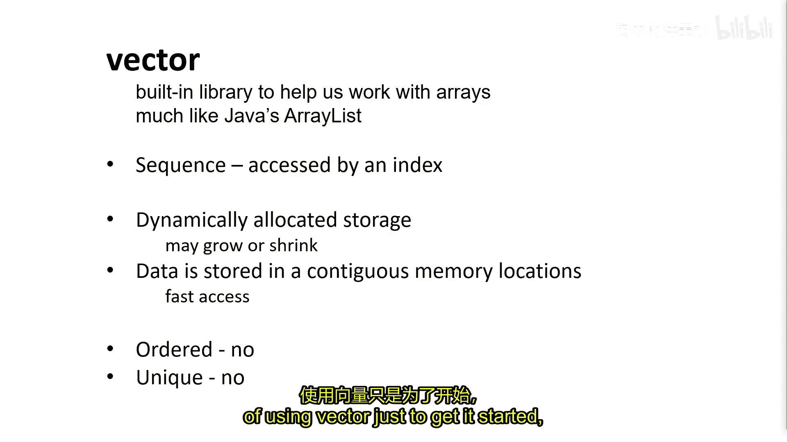
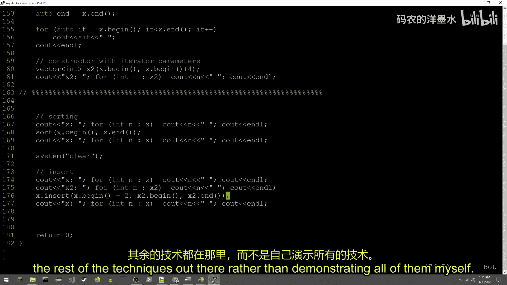
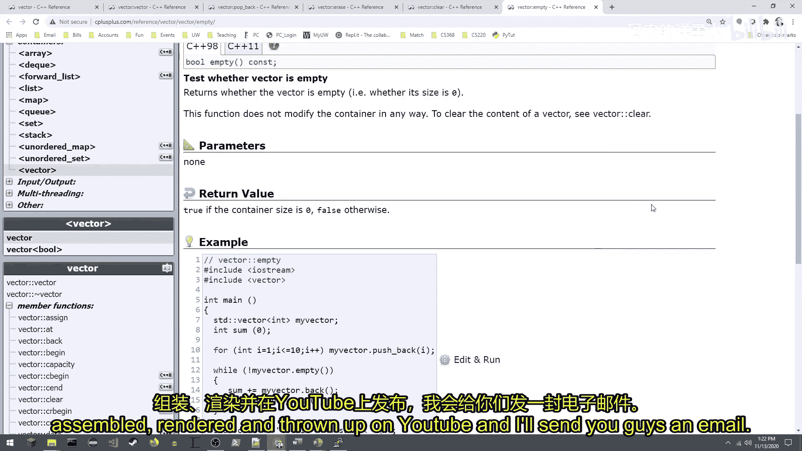

# C++ for Java Programmers: Lecture 7: Vector 🧮

在本节课中，我们将要学习C++标准模板库中的容器，并重点介绍`vector`。`vector`是一个动态数组，类似于Java中的`ArrayList`，它极大地简化了数组操作。我们将学习如何创建、初始化、访问和修改`vector`，并了解其基本操作和特性。

---

## 容器与算法库概述

上一节我们介绍了课程安排，本节中我们来看看C++标准模板库的两个核心组成部分：容器和算法。

*   **容器**：是预定义的数据结构，用于存储和管理数据集合。它们像容器一样持有对象，这些对象可以是基本类型、字符串或自定义类。C++中的容器是模板化的，这意味着在创建时需要指定存储的数据类型，例如`vector<int>`。
*   **算法库**：包含约50-60个通用函数，用于对数据范围（如`vector`的一部分或全部）执行操作，例如排序(`sort`)。这些算法通过迭代器（类似于指针）来访问和操作容器中的数据。

容器主要分为两类：
*   **序列容器**：数据按顺序存储在相邻的内存位置，可通过索引快速访问。`vector`就属于此类。
*   **关联容器**：通过键来访问数据，例如`map`和`set`。

---

## Vector 简介



上一节我们了解了容器的分类，本节中我们聚焦于序列容器`vector`。

`vector`是一个动态数组，其大小可以在运行时增长或缩小，无需手动管理内存。数据存储在连续的内存块中，因此通过索引访问速度很快。`vector`不自动对元素排序，也允许存在重复值。

创建一个`vector`需要包含头文件：
```cpp
#include <vector>
```

---

## 初始化 Vector

以下是创建和初始化`vector`的几种常见方法。

### 列表初始化
如果已知所有初始值，可以使用列表初始化。
```cpp
std::vector<std::string> colors = {"red", "green", "blue"};
// 或省略等号（C++11及以上）
std::vector<std::string> colors2 {"red", "green", "blue"};
```
**注意**：使用圆括号`()`进行列表初始化是常见错误，编译器会将其解释为函数声明。

### 创建空Vector
要创建一个空的`vector`，只需声明其类型和变量名。
```cpp
std::vector<int> numbers; // 正确
std::vector<int> numbers2(); // 错误！这声明了一个函数
```

### 带参数的构造
可以指定`vector`的初始大小和所有元素的默认值。
```cpp
std::vector<int> numbers3(10, -2); // 创建大小为10，每个元素都是-2的vector
std::vector<int> numbers4(4); // 创建大小为4，每个元素默认为0的vector
```
**重要区别**：`vector<int> v(10, -2);` 创建10个值为-2的元素。`vector<int> v{10, -2};` 则创建两个元素：10和-2。

### 拷贝构造与赋值
可以从另一个`vector`复制内容。
```cpp
std::vector<int> v1 {1, 2, 3, 4, 5};
std::vector<int> v2(v1); // 拷贝构造函数
std::vector<int> v3 = v1; // 另一种拷贝形式（本质上也是拷贝构造）

std::vector<int> v4;
v4 = v1; // 赋值操作
```
这些操作创建的是元素的独立副本（深拷贝）。

---

## 访问与修改元素

上一节我们学习了如何创建`vector`，本节来看看如何访问和修改其中的数据。

### 使用下标运算符
像数组一样使用`[]`通过索引访问元素。
```cpp
colors[0] = "orange"; // 修改第一个元素
std::cout << colors[0]; // 访问第一个元素
```
**注意**：`[]`不进行边界检查，访问越界会导致未定义行为。

### 使用 `at()` 函数
`at()`函数提供带边界检查的访问，越界时会抛出`std::out_of_range`异常。
```cpp
std::cout << colors.at(0); // 安全访问
// colors.at(100); // 会抛出异常
```

### 使用 `front()` 和 `back()` 函数
快速访问首尾元素。
```cpp
std::cout << colors.front(); // 第一个元素
std::cout << colors.back();  // 最后一个元素
```
`front()`和`back()`返回的是引用，因此可以用于修改元素：
```cpp
colors.front() = "cyan"; // 修改第一个元素
```

### 获取大小
使用`size()`成员函数获取`vector`中元素的数量。
```cpp
int count = colors.size();
```

---

## 遍历 Vector

以下是遍历`vector`元素的两种常用方法。

### 基于范围的for循环 (C++11)
这是最简单、最推荐的遍历方式。
```cpp
for (std::string color : colors) {
    std::cout << color << " ";
}
```
若要修改元素，需使用引用：
```cpp
for (auto& color : colors) { // auto 自动推导类型，& 表示引用
    color = "dark_" + color; // 可以修改原元素
}
```

### 使用下标的标准for循环
当需要索引时可以使用。
```cpp
for (size_t i = 0; i < colors.size(); ++i) {
    std::cout << colors[i] << " ";
}
```

---

## 添加与删除元素

`vector`是动态的，可以方便地添加或删除元素。

### 添加元素
使用`push_back()`在`vector`末尾添加新元素。
```cpp
colors.push_back("black");
```

### 删除元素
*   `pop_back()`：删除最后一个元素（不返回该元素）。
    ```cpp
    colors.pop_back();
    ```
*   `clear()`：清空所有元素。
    ```cpp
    colors.clear();
    ```
*   `erase()`：删除指定位置或范围的元素（需要迭代器，见下文）。
    ```cpp
    // 删除第三个元素（迭代器版本）
    colors.erase(colors.begin() + 2);
    ```

---

## 迭代器简介

上一节我们使用了基于范围的for循环，其底层依赖于迭代器。本节简要介绍迭代器的概念。

迭代器是指向容器内元素的类指针对象。对于`vector`，迭代器行为非常接近原生指针。

### 获取迭代器
*   `begin()`：返回指向第一个元素的迭代器。
*   `end()`：返回指向**最后一个元素之后位置**的迭代器（尾后迭代器）。

### 使用迭代器遍历
```cpp
std::vector<int> vec {4, 3, 6, 2, 7, 1, 5};
for (auto it = vec.begin(); it != vec.end(); ++it) {
    std::cout << *it << " "; // 解引用迭代器以获取值
}
```
这里`auto`自动推导出`it`的类型为`std::vector<int>::iterator`。

### 迭代器的应用
许多STL算法和`vector`自身的成员函数（如`sort`, `insert`）接受迭代器作为参数来指定操作范围。
```cpp
#include <algorithm>
std::sort(vec.begin(), vec.end()); // 排序整个vector

// 将另一个vector的部分内容插入到指定位置
std::vector<int> vec2 {10, 20};
vec.insert(vec.begin() + 2, vec2.begin(), vec2.end());
```
`insert`和`erase`等函数使用迭代器来精确定位。

---

## 其他实用技巧与注意事项

### Vector 的 Vector（多维数组）
可以创建`vector`的`vector`来模拟矩阵。
```cpp
std::vector<std::vector<int>> matrix; // 注意 >> 间的空格
```
**重要**：`std::vector<std::vector<int>>`中两个`>`之间必须有空格，否则编译器会将其解析为流提取运算符`>>`。

### 关系运算符
`vector`支持`==`, `!=`, `<`, `<=`, `>`, `>=`等比较操作。比较是**逐元素**进行的，类似于字典序比较。
```cpp
std::vector<int> a {1, 2, 3};
std::vector<int> b {1, 2, 3};
std::vector<int> c {1, 2, 4};



bool eq1 = (a == b); // true
bool eq2 = (a == c); // false
bool lt = (a < c);   // true (比较到3<4)
```

### 容量管理
*   `resize(n)`：改变`vector`的大小。
*   `reserve(n)`：预分配内存空间，避免多次动态扩容，以提高性能。
*   `capacity()`：返回当前已分配的内存空间能容纳的元素数。
*   `empty()`：检查`vector`是否为空。

---

## 总结与资源

本节课中我们一起学习了C++标准模板库中的`vector`容器。我们涵盖了如何初始化、访问、修改、遍历`vector`，以及如何添加和删除元素。我们还简要介绍了迭代器的概念及其在算法和容器操作中的应用。



`vector`是C++中最常用、最通用的序列容器。要深入了解其所有成员函数（如`emplace_back`, `shrink_to_fit`, `data`等），建议查阅官方文档，例如 [cppreference.com](https://en.cppreference.com/w/cpp/container/vector)。在接下来的课程中，我们将继续探索其他容器类型和更强大的STL算法。